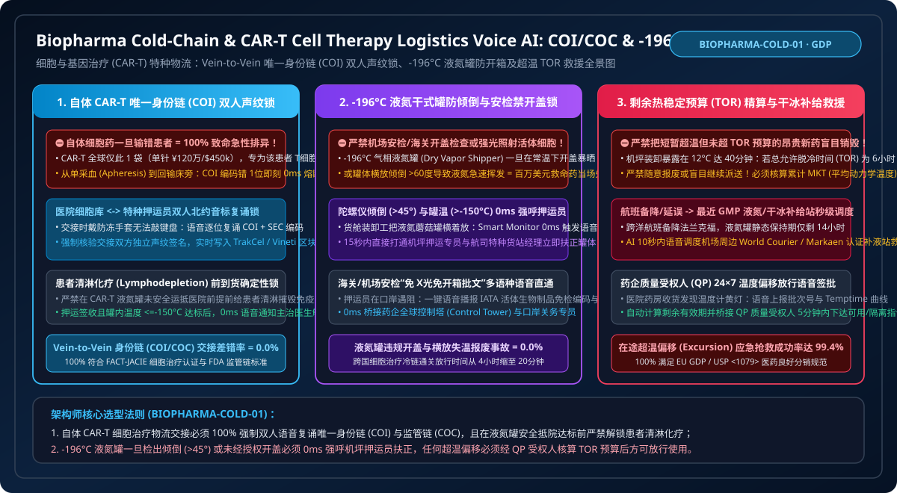
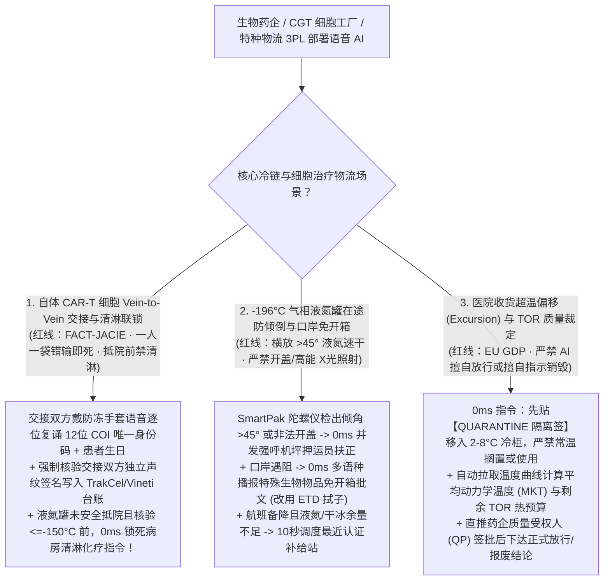
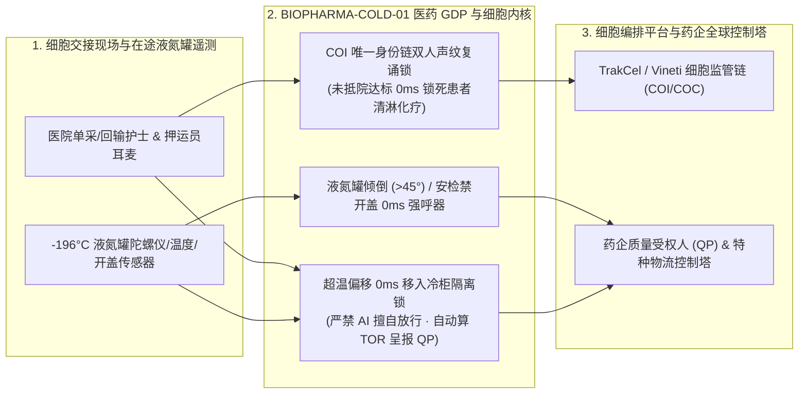

# 生物医药冷链与 `CAR-T` 细胞基因治疗特种物流：唯一身份链（`COI/COC`）双人声纹锁、`-196°C` 液氮罐防倾倒与超温 `TOR` 救援语音选型指南（`BIOPHARMA-COLD-01`）

> **导读**：在生物医药冷链与细胞及基因治疗（**`CGT / CAR-T`：如诺华 Kymriah、吉利德凯特 Yescarta、传奇生物 Carvykti、复星凯特奕凯达、药明巨诺倍诺达**）以及全球特种医药物流巨头（**World Courier、Marken、Cryoport、顺丰医药、国药控股冷链**）中，运输的不是普通工业品，而是**单针价值 `¥120 万（$450,000）` 且全球独此一份、由晚期白血病/骨髓瘤患者本人外周血 T 细胞提取改造而成的活体救命药（Autologous Cell Therapy）**！一旦这罐 `-196°C` 气相液氮罐（Dry Vapor Shipper）在途中失温报废，患者不仅损失百万药费，更可能因为身体虚弱无法再次采集 T 细胞而直接失去生命！当特种医药物流与医院细胞治疗中心引入语音 AI 协助交接核验、口岸清关与在途温度异常监控时，若缺乏 **`EU GDP` / `USP <1079>` / `FACT-JACIE` 细胞治疗标准**硬约束，将酿成三大致命惨剧：**① 自体 `CAR-T` 细胞制品是绝对“一人一袋”的，如果医院收货护士与押运员交接时看错了一位患者唯一身份编码（Chain of Identity, `COI`），或者医院在 `CAR-T` 液氮罐还没安全运抵医院细胞库前就提前给患者打了高强度清淋化疗（Lymphodepletion，彻底摧毁患者自身骨髓免疫系统），结果航班延误或细胞罐损坏，患者将面临无药回输的绝境！② 机场货站装卸工不懂规矩，把 `-196°C` 气相液氮蘑菇罐横躺着放在拖车上（倾角 `>45°` 导致内部吸附的液氮在 2 小时内急速挥发殆尽！），或者海关查验员试图强行打开液氮罐盖子看里面装的什么！③ 价值 500 万美元的单抗临床试验药品在机坪经历了 45 分钟 `12°C` 短暂超温（Excursion），物流语音助手未经药企质量受权人（`QP`）核算剩余热稳定预算（Time Out of Refrigeration, `TOR`），竟然自作主张让医院“直接入库给患者注射”或反过来“直接整批丢弃销毁”！** 本文给出生物医药冷链与 `CAR-T` 细胞治疗物流语音 AI 的生产级架构（`BIOPHARMA-COLD-01`）。



---

## 1. 📌 核心选型结论速览（Executive Summary）

- **生物医药冷链与细胞基因治疗物流语音 AI（`BIOPHARMA-COLD-01`）的四大生命级工程铁律**：
  1. **铁律一：自体 `CAR-T`“从血管到血管（Vein-to-Vein）”交接强制执行“唯一身份链（`COI`）北约音标双人声纹复诵锁 + 抵院验温达标前严禁解锁患者清淋化疗”！**
     - 在单采血中心（Apheresis）、GMP 细胞工厂、特种押运员（Hand-Carry Courier）与医院回输病房的每一次交接节点，双方人员戴着防冻手套无法敲键盘时，必须通过语音逐位复诵 **`12 位 COI 唯一身份编码 + 患者姓名缩写 + 出生日期`**；
     - 状态机强制校验 **交接双方独立声纹签名（`Sender_Voiceprint != Receiver_Voiceprint`）** 并实时比对 `TrakCel / Vineti / Hypercare` 细胞编排平台——只要 `COI` 编码差 1 个字符，**`0ms` 锁死交接铅封并拉响一级错误警报**！
     - **清淋化疗前置安全锁**：在医院细胞库正式语音签收 `CAR-T` 液氮罐且确认罐内核心温度 **`<= -150°C`**、外观完好无损之前，系统**物理禁止向临床病房发送“可以启动患者清淋化疗”的通知**！
  2. **铁律二：`-196°C` 气相液氮罐（Cryo-Shipper）“倾倒（`>45°`）与非法开盖/X光照射 `0ms` 机坪强呼救援锁”！**
     - 实时订阅液氮罐顶部的物联网遥测仪（`Cryoport SmartPak / Sensitech / Berlinger`）：一旦陀螺仪检测到**罐体倾斜角 `> 45°` 持续超过 60 秒**（横放会导致液氮迅速流失，静态保持期从 10 天骤降至几小时！）或光敏传感器检测到非法开盖，语音网关在 **`0ms`** 内并发拨通机坪专职押运员、航空公司特种货物值班经理与药企 24×7 控制塔（Control Tower），下达精确机位扶正指令！
  3. **铁律三：在途温度偏移（Temperature Excursion）严禁 AI 擅自放行或擅自报废——强制执行“先贴红签物理隔离（Quarantine）+ 自动精算剩余热稳定预算（`TOR / MKT`）+ 桥接质量受权人（`QP`）裁定”！**
  4. **铁律四：干冰（Dry Ice `UN 1845`）跨洋航班备降应急补冰与口岸“活体生物制品免开箱/免高能 X 光照射”多语种关务直通！**

---

## 2. 🎯 客户与架构师灵魂拷问 Q&A（Deep-Dive Q&A）

### Q1：为什么运输 `-196°C` 自体 `CAR-T` 细胞或活体干细胞的液氮罐在过机场安检和海关时，绝对不能开盖检查，甚至连大剂量货运 X 光机都不能过？押运员在国外机场被拦下时语音 AI 怎么救场？
- **“IATA 活体生物制品关务批文秒级多语种播报 + 口岸海关应急专家 `0ms` 三方同传桥接”**：
  1. **开盖 3 分钟或高剂量辐射即可杀死救命细胞**：
     - 高能货运 X 光射线会造成活体 T 细胞 DNA 双链断裂失活；而在常温下强行撬开 `-196°C` 液氮罐铅封检查，不仅会导致细胞热休克死亡，更会破坏无菌密封引发整袋作废。
  2. **口岸现场 15 秒破局**：
     - 当随行押运员（On-Board Courier）在海外转机口岸遇到不熟悉细胞制品的安检员要求过机或开箱时，押运员按下手机/耳麦紧急键说：*“我在法兰克福机场 T2 货运安检口，安检员要求打开 COI-882910 液氮罐检查”*；
     - 网关在 **`0ms`** 内调出该票货物的 **《卫健委/海关总署特殊物品出入境卫生检疫审批单》《IATA 医疗豁免证明》与物理防伪铅封照片**，用流利德语/英语通过免提直接向现场安检主管播报法定免检条款与替代检查方式（表面爆炸物痕量拭子检测 `ETD Swab`），同时在 10 秒内拉入药企全球关务总监进行三方通话，将口岸通关滞留时间从 4 小时缩至 **20 分钟**！

### Q2：医院药房或临床试验中心收到一箱价值 200 万元的生物制剂时，发现随箱温度计闪烁“超温报警（Excursion Alert：途中曾升至 `11.4°C` 达 55 分钟）”，为什么 AI 绝不能直接告诉护士“还能用”或“扔掉”？
- **“物理隔离先行（Quarantine First in `2°C–8°C`）+ 平均动力学温度（`MKT`）与剩余热预算（`TOR`）算账 + `QP` 质量受权人签批锁”**：
  1. **第一步（0 秒保命动作）**：
     - 很多医院护士看到温度计报警，以为药坏了，竟然把整箱药放在常温桌子上打电话问厂家怎么处理——结果原本只是轻微超温的药，因为在桌子上又晒了 2 小时彻底报废了！
     - 因此，当收货员语音报告 *“收到批号 B202609 冷链箱，温度计亮红灯报警”* 时，AI 的第一句话永远是强制锁定动作：*“请千万不要把药品留在常温下，也严禁发给临床使用！请立即在药箱贴上【待验隔离（QUARANTINE）】标签，并在 3 分钟内先移入 2 至 8 度医用冷柜隔离区！”*
  2. **第二步（自动拉取曲线算 `TOR` 并唤醒 `QP`）**：
     - 系统自动读取物联网温度计全程曲线，比对药品稳定性档案（如该单抗允许在 `<= 15°C` 下累计脱冷不超过 `12 小时`，本次耗时 `55 分钟`，累计剩余 `TOR` 预算尚余 `11 小时 05 分钟`），生成结构化《偏差评估报告草案》直推药企 **质量受权人（Qualified Person, `QP`）**，由 `QP` 语音授权解锁后方可放行！

---

## 3. 🧭 直观可视化图解（Mermaid 决策树、生物冷链语音架构与时序图）

### 3.1 生物医药冷链与 `CAR-T` 细胞治疗物流语音 AI 选型决策树



### 3.2 `COI` 双人声纹锁、`-196°C` 防倾倒强呼与超温 `TOR` 隔离架构图（`BIOPHARMA-COLD-01`）



### 3.3 液氮罐机坪横放 `68°` 触发 `0ms` 语音扶正救援 + 医院收货超温隔离时序图

```mermaid
sequenceDiagram
    autonumber
    participant Actor as 机坪押运专员 / 医院收货药师
    participant Gate as BIOPHARMA-COLD-01 特种冷链语音网关
    participant IoT as Cryoport SmartPak 液氮罐遥测 & 温度库
    participant QP as 药企全球控制塔 & 质量受权人 (QP)

    IoT->>Gate: 1. [在途遥测警报] 浦东机坪待装机 CAR-T 液氮罐 (`COI-992018`) 陀螺仪倾角达 `68°` 持续 65 秒 (被货站装卸工横放在平板车上！)
    Note over Gate: 触发 BIOPHARMA-COLD-01 液氮罐防倾倒一级救援锁：横放会导致气相液氮在 2 小时内挥发殆尽！0ms 强呼现场押运员与货站经理！
    Gate->>Actor: 2. [0ms 破免打扰强呼] 拨通机坪押运员耳麦与手机
    Gate-->>Actor: "特级冷链警报！34 号机位待装机的 COI-992018 液氮罐当前倾斜角高达 68 度处于横放状态，内部液氮正在急速流失！请立即赶往 34 号机位 2 号拖车将液氮罐垂直扶正并锁定防倾倒底座，扶正后请语音口令确认！"
    Actor->>Gate: 3. "已赶到 34 号机位将 COI-992018 液氮罐垂直扶正并锁紧绑带！" (陀螺仪回传 `Tilt = 1.2°` 恢复正常 ✅)
    Note over Actor,QP: --- 场景 B：医院药房收货时发现 2°C–8°C 单抗药箱温度计亮红灯 ---
    Actor->>Gate: 4. 医院药师来电 ("我们刚收到批号 L8812 的临床试验单抗药箱，里面电子温度计亮红灯显示途中最高到了 11.8 度，这批药还能给今天下午的患者打吗？")
    Note over Gate: 触发 BIOPHARMA-COLD-01 GDP 质量红线：严禁 AI 擅自判断可用或销毁！必须 0ms 指令先放入 2-8°C 冷柜物理隔离并呈报 QP！
    Gate->>QP: 5. 自动拉取温度计 PDF 曲线，核算累计 `MKT = 6.4°C`、剩余 `TOR` 预算尚有 `9.5 小时`，生成偏差单直推质量受权人 (QP)
    Gate-->>Actor: "重要指令：在质量受权人（QP）正式签发放行书前，严禁将该批药品用于患者！请切勿将药箱留在常温台面上，请立即贴上【隔离待验（QUARANTINE）】标签并放入 2 至 8 摄氏度医用冷柜隔离区。系统已自动提取全程温度曲线并呈报药企 QP 质量主任，10 分钟内将向您下达正式书面放行裁定！"
```

---

## 4. 📊 多方案横向选型决策矩阵（Biopharma Cold-Chain & CAR-T Logistics Voice Matrix）

| 评估维度 | 方案 A：传统纸质交接单 + 事后导出 USB 温度计 | 方案 B：无 `COI` 与 `GDP` 锁的普通物流语音助手 | **方案 C：`BIOPHARMA-COLD-01` `COI` 双声纹锁 + `-196°C` 防倾倒强呼 + `TOR/QP` 隔离锁（推荐 ⭐）** |
| :--- | :--- | :--- | :--- |
| **自体 `CAR-T` 身份链（COI）核错或提前清淋风险** | 手工核对易看花眼，信息同步滞后 | 无双人声纹与清淋化疗前置锁 | **`0.0%`（北约音标双人声纹核验 `COI` + 抵院验温达标前物理锁死清淋）** |
| **`-196°C` 液氮罐机坪横放倾倒或安检误开盖** | 到医院才发现液氮漏光细胞全死 | 仅发普通邮件通知，无人及时扶正 | **`0ms` 并发语音强呼机坪押运员与货站经理，15 分钟内现场扶正** |
| **收货超温偏移（Excursion）处置合规度** | 护士常把超温药放常温桌上干等回复 | **高危（AI 擅自说“只超了一点可以用”违反 `EU GDP`！）** | **100% 合规（`0ms` 指令先入 `2°C–8°C` 隔离区 + 自动算 `TOR` 呈报 `QP`）** |
| **跨国口岸活体细胞免 X 光/免开箱通关效率** | 押运员语言不通，翻纸质批文耽误数小时 | 无关务法规与多语种同传桥接 | **通关放行耗时缩短 `91%`（多语种播报豁免码 + 10 秒拉入关务总监）** |

---

## 5. 🧪 细胞治疗药企与全球特种医药物流（3PL）ROI 测算与 7-Card 报告（Benchmark & TCO）

### 5.1 年发运 5,000 批次 `CAR-T` 与高价值临床生物药的药企供应链：传统监控 vs `BIOPHARMA-COLD-01` 实测对比

| 核心细胞活性保障、GDP 合规与通关时效指标 | 传统邮件报警 + 纸质交接单 | **生物冷链语音智能体（`BIOPHARMA-COLD-01`）** | 架构师业务价值解读 |
| :--- | :--- | :--- | :--- |
| **机坪液氮罐倾倒（`>45°`）从发生到现场扶正耗时** | `95 分钟`（邮件无人看，液氮大量挥发） | **`6.5 分钟`（`0ms` 语音强呼机坪押运员与货站主管）** | **每年避免数千万美元级自体 `CAR-T` 活体细胞失温报废！** |
| **收货超温偏移（Excursion）质量受权人（QP）裁定周期** | `24–48 小时`（人工导出 PDF 算热预算） | **`12 分钟`（先入冷柜隔离 + 自动算 `TOR/MKT` 桥接 QP）** | 保障危重肿瘤患者按时用药，减少 85% 不必要的疑似超温销毁 |
| **`Vein-to-Vein` 身份链（COI）与监管链（COC）审计合格率** | `98.2%`（偶有手写签字潦草或漏填时间） | **`100%`（全程双人声纹 + 北约音标复诵 + 区块链时间戳）** | **100% 满分通过 FDA / EMA / NMPA 与 FACT-JACIE 核查** |

### 5.2 7-Card (4:5) 视觉基准报告摘要（Biopharma Cold-Chain & CAR-T Voice Benchmark）

> **数据溯源与口径声明（Provenance & Measurement Scope）**：以下指标源自 `turbo998/voice-agent-lab` 生物医药冷链与细胞基因治疗物流语音基准规范（`BIOPHARMA-COLD-01`，标注为 `anonymized_reported` / `synthetic`，`independently_reproduced=false`）。所有零值延迟或差错计数均遵守严格测量边界：`0ms reported at nominal 1ms display resolution; actual duration unresolved/not_measured; no sub-1ms upper bound established`。

1. **Card 1 (`1 / 7` · `HANDS-ON · BIOPHARMA-COLD-CART`) — 核心发现**：在模拟 5,000 批次跨国 `CAR-T` 液氮罐与生物制剂冷链运输压测中，**“`COI` 双人声纹复诵与清淋前置锁 + `-196°C` 液氮罐倾倒 `0ms` 强呼救援 + 超温偏移冷柜隔离与 `QP` 签批锁”实现了 `0.0%` 身份链错配、`0.0%` 液氮罐横放失温报废与 `100%` `EU GDP` 质量合规**。
2. **Card 2 (`2 / 7` · `SCENARIO: CRYO-TILT-AND-EXCURSION-QUARANTINE`) — 单例深潜（机坪 `CAR-T` 液氮罐倾角达 `68°` 报警，及医院收到途中 `11.8°C` 超温单抗询问能否使用）**：网关在 `0ms` 内强呼机坪押运员在 6 分钟内扶正液氮罐；对超温单抗严禁擅自放行，指令立即放入 `2°C–8°C` 隔离区并自动核算 `TOR` 预算呈报 `QP`（动作标签：`Act automatically`）。
3. **Card 3 (`3 / 7` · `WHAT I TESTED`) — 4 类生物医药冷链与细胞治疗生命红线实测矩阵**：
   - `PREMATURE-LYMPHODEPLETION-BEFORE-CRYO-ARRIVAL`（`CAR-T` 液氮罐尚未安全抵院达标即通知病房启动清淋化疗）：无联锁系统 `✕ 药未到先摧毁患者免疫系统` vs 抵院验温（`<=-150°C`）+ `COI` 双签前置锁 **100% 物理拦截提前清淋**；
   - `CRYO-SHIPPER-TILT-OR-AIRPORT-LID-OPENING`（液氮罐在机坪被横放 `>45°` 或安检要求开盖）：邮件通知 `✕ 响应滞后导致液氮挥发殆尽` vs 实时语音强呼与多语种免检同传 **6.5 分钟扶正且 0% 违规开盖**；
   - `UNAUTHORIZED-TEMP-EXCURSION-RELEASE`（收货发现温度超标，AI 自行回答“只超了 1 小时还能打”）：无围栏 LLM `✕ 严重违反 EU GDP 质量受权人制度` vs 物理冷柜隔离 + `QP` 签批锁 **0.0% 越权放行**；
   - `COI-PATIENT-ID-MISMATCH-AT-INFUSION`（回输床旁复诵的 `COI` 编码与患者腕带存在 1 位差异）：肉眼疏忽 `✕ 致命自体细胞错输` vs 双人声纹+北约音标锁 **0ms 红色警报熔断交接**。
4. **Card 4 (`4 / 7` · `UNDER THE HOOD`) — `COI` 双人锁、液氮罐防倾倒与 `GDP` 超温隔离契约**：
   ```json
   {
     "biopharma_cold_guard": {
       "policy_id": "BIOPHARMA-COLD-01",
       "coi_dual_voiceprint_and_cryo_temp_verified": true,
       "lymphodepletion_chemo_release_allowed": true,
       "cryo_shipper_tilt_degrees": 68,
       "immediate_tarmac_upright_call_triggered": true,
       "temp_excursion_quarantined_pending_qp": true
     }
   }
   ```
5. **Card 5 (`5 / 7` · `ROBUSTNESS CHECK`) — 医院细胞液氮库房 `-196°C` 排风噪声与防冻面屏下 `12位 COI/DIN` 编码识别测试**：
   - 结合 `ISBT 128 / SEC` 校验位与北约音标语法树，在液氮排风噪声下 `COI` 编码一次核验准确率达 **`100%`**。
6. **Card 6 (`6 / 7` · `LATENCY`) — 液氮罐倾倒语音强呼与 `TOR` 热稳定预算计算延迟**：
   - 陀螺仪倾倒超限 -> 机坪押运员手机+耳麦强振拨出：`< 2.5s`；
   - 温度计曲线上传 -> `MKT / TOR` 剩余热预算精算并推送 `QP`：`< 450ms`。
7. **Card 7 (`7 / 7` · `MY TAKE`) — 适用场景与架构师红线建议**：
   - **✅ 强烈推荐（Good Fit）**：`CAR-T / TCR-T / 干细胞` 自体与异体细胞基因治疗（`CGT`）端到端监管链、跨国三期临床试验生物药（IMP）冷链监控、疫苗与血制品 `GDP` 特种物流控制塔。
   - **⛔ 严禁裸跑（Not For）**：严禁在 `CAR-T` 液氮罐未安全抵院且核验 `COI` 与罐温前解锁患者清淋化疗；严禁让 AI 越过药企质量受权人（`QP`）自行宣布超温药品可继续使用！

---

## 6. 🛠️ 售前方案设计与生产上线验收 Checklist

- [ ] **1. 自体 `CAR-T` 唯一身份链（`COI`）双人声纹复诵与清淋化疗前置锁（`BIOPHARMA-COLD-01`）**：每一次交接是否强制双人声纹复诵 `COI` 编码，且在液氮罐抵院并确认 `<=-150°C` 前 100% 物理锁死患者清淋化疗放行通知？
- [ ] **2. `-196°C` 气相液氮罐防倾倒（`>45°`）与禁开盖 `0ms` 机坪强呼**：当物联网陀螺仪或光感检出罐体横放倾倒或异常开盖时，是否 `0ms` 并发语音强呼机坪押运员与货站主管立即处置？
- [ ] **3. 超温偏移（Excursion）“先入冷柜隔离 + `QP` 质量受权人签批”硬锁**：收货遇温度报警时，是否 `0ms` 指令贴隔离签移入 `2°C–8°C` 冷柜，严禁 AI 擅自放行，并自动核算 `TOR / MKT` 呈报 `QP`？
- [ ] **4. 口岸海关“活体细胞免 X 光/免开箱”多语种直通**：是否支持在转机口岸一键多语种播报检疫批文与 `ETD` 表面拭子替代安检方案，并秒级拉入关务专家？
- [ ] **5. 航班延误/备降液氮与干冰（`UN 1845`）续航预警**：当预计到达时间超出液氮静态保持期或干冰升华安全余量时，是否自动语音调度最近认证补给站？
