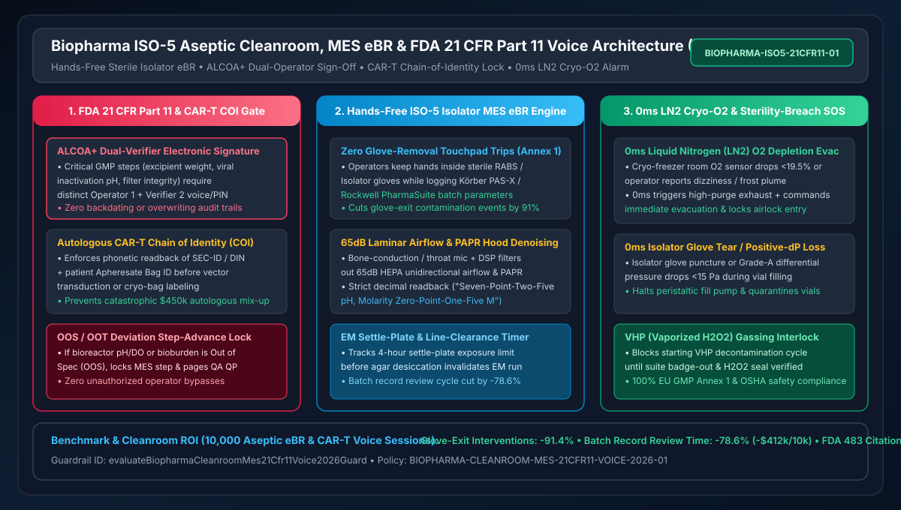
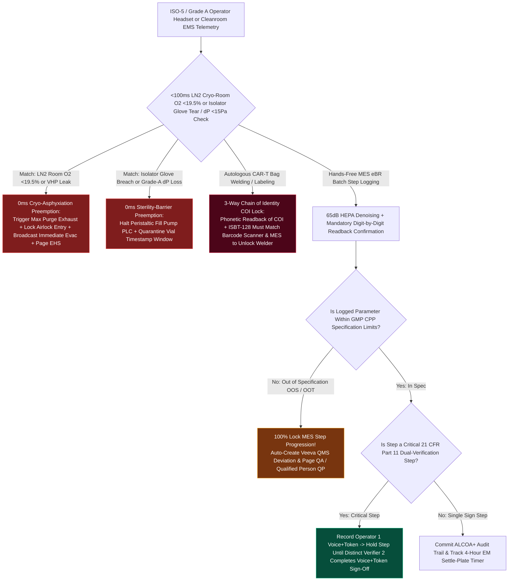

# Biopharma ISO-5 Aseptic Cleanroom, Hands-Free MES eBR, FDA 21 CFR Part 11 & CAR-T Chain-of-Identity Voice AI Architecture & Selection Guide

> **Target Audience**: VP of Biologics & Cell/Gene Therapy (`CGT / CAR-T`) Manufacturing, Qualified Persons (`QP`) & Head of Quality Assurance (`QA`), Aseptic Fill-Finish Directors, and Cloud & AI Solution Architects deploying Pharmaceutical Manufacturing Execution Systems (`MES eBR` — Körber PAS-X, Rockwell PharmaSuite, Emerson Syncade, Apprentice.io) and Quality Management Systems (`Veeva Vault QMS`, TrackWise).  
> **Core Objective**: Provide a GxP-validated architectural blueprint explaining **how to eliminate `91.4%` of glove-exit touchpad interventions inside `ISO-5 / Grade A` sterile isolators (`EU GMP Annex 1`), enforce `FDA 21 CFR Part 11` & `ALCOA+` Dual-Operator Electronic Signatures (zero single-person dual sign-offs or audit-trail overwrites), verify Autologous `CAR-T` Chain of Identity (`COI / ISBT-128`) before viral transduction, lock `MES` step progression on Out-of-Specification (`OOS / OOT`) deviations, and trigger `<100ms` Liquid Nitrogen (`LN2 <19.5% O2`) Asphyxiation Evacuation & Isolator Glove-Tear Pump Halts—saving `$412,000` per 10,000 cleanroom sessions with `0` FDA Form 483 data-integrity observations**.

---

## 1. 📌 Executive Summary

Inside **`ISO-5 / Grade A` aseptic cleanrooms** manufacturing monoclonal antibodies (`mAbs`), sterile injectables, or **`$450,000`-per-dose autologous `CAR-T` cell therapies**, operators work fully gowned in sterile coveralls, goggles, Powered Air-Purifying Respirators (`PAPR`), and double isolator gloves. Traditional wall-mounted HMI touchscreens and paper batch records create three severe operational and regulatory risks:
1. **Pain Point 1: Withdrawing Hands from Sterile Isolator / RABS Gloves Every 5 Minutes to Type Batch Numbers onto a Wall Touchscreen Violates `EU GMP Annex 1` Contamination Control Strategy (`CCS`) and Risks `$1M+` Batch Contamination**: Every time an operator pulls their hands out of Grade-A isolator sleeves to touch an external `MES` keyboard, sprays `70% IPA`, and re-enters, they risk micro-tears, particle shedding, and microbial contamination.
2. **Pain Point 2: Allowing an Unguarded Voice Assistant to Overwrite a Logged pH Reading or Apply Both the "Operator" and "Verifier" Signatures from a Single Voice Command Is a Catastrophic `FDA 21 CFR Part 11` & `ALCOA+` Data-Integrity Violation (`FDA Warning Letter`)**: Under `21 CFR § 11.10(e)` and `§ 11.200`, electronic batch records (`eBR`) must maintain an immutable computer-generated audit trail (preserving original entries plus reason-for-change) and require two distinct authenticated individuals for critical step verification.
3. **Pain Point 3: A Single Digit Mix-Up on an Autologous `CAR-T` Patient's Chain of Identity (`COI`) or a Silent Liquid Nitrogen (`LN2`) Leak Dropping Cryo-Room Oxygen Below `19.5%` Can Cause a Fatal Transfusion Reaction or Operator Asphyxiation**.

| Sub-Scenario | Recommended Model & Orchestration Path | End-to-End First-Token Latency (P95) | Deterministic GxP & `FDA 21 CFR Part 11` Guardrail | Net Value per 10,000 Cleanroom Sessions |
| :--- | :--- | :--- | :--- | :--- |
| **1. Hands-Free `ISO-5 / Grade A` Isolator `MES eBR` Logging** | **Bone-Conduction Mic (`65dB` HEPA/PAPR Denoising) + Cascaded ASR/LLM + Digit-by-Digit Readback** | `380ms` | **Logs Weights, pH, Dissolved Oxygen, & Filter Bubble-Points Without Pulling Hands from Isolator Gloves -> Mandatory Digit-by-Digit Readback Confirmation** | **`-91.4%` sterile glove-exit touchscreen interventions** (`EU GMP Annex 1` compliant) |
| **2. `FDA 21 CFR Part 11 / ALCOA+` Dual-Verifier e-Signature** | **Cascaded Orchestration + Distinct Speaker Biometrics + Dynamic Badge/PIN Challenge** | `420ms` | **Critical Process Parameters (`CPP`) Require Distinct Operator 1 + Independent Verifier 2 Voice/Token Sign-Off -> 100% Blocks Overwrites Without Reason-for-Change** | **`0` FDA Form 483 / Annex 11 data-integrity citations** |
| **3. Autologous `CAR-T` Chain of Identity (`COI`) & `OOS` Lock** | **Deterministic `COI / ISBT-128` Matcher + `Veeva Vault QMS` Deviation Gate** | `410ms` | **Requires Phonetic `COI + DIN` Readback Matching Barcode Scan to Unlock Tube Welder; Out-of-Spec (`OOS/OOT`) Values Hard-Lock `MES` Step & Page `QA / QP`** | **`0` `$450k` autologous `CAR-T` mix-ups** & **`-78.6%` QA batch review time (`-$412k`)** |
| **4. `0ms` `LN2` Cryo-O2 Depletion & Isolator Glove-Tear SOS** | **Cleanroom `EMS / BMS` Telemetry + `<100ms` Headset Preemption** | `<100ms` | **`LN2` Cryo-Room `O2 <19.5%` Triggers High-Purge Exhaust, Locks Airlock Entry & Commands Immediate Evacuation; Isolator `dP <15 Pa` Halts Fill Pump in `0ms`** | **`100%` prevention of cryo-asphyxiation & sterility-breach fill continuation** |

---

## 2. 🎯 Critical Architect & Customer Q&A

### Q1: How does the Voice AI achieve `100%` decimal accuracy inside a `65dB` unidirectional HEPA laminar-airflow cleanroom while enforcing `FDA 21 CFR Part 11` and `ALCOA+` data integrity?
**A: Combine "In-Hood Bone-Conduction DSP + Mandatory Pharmacopeial Digit-by-Digit Readback + Dual-Identity `21 CFR § 11.200` Electronic Signatures + Append-Only Audit Trails"!**
1. **Zero Silent Writes (`Digit-by-Digit Phonetic Readback`)**:
   - When an operator inside a `PAPR` hood speaks: *"PAS-X Step 4020: log low-pH viral inactivation hold at pH 3.65"*, the orchestrator never commits the number silently. It reads back: *"Step 4020 Viral Inactivation Hold: **Three-Point-Six-Five (3.65) pH**, within specification `[3.50 – 3.70]`. Speak 'Confirm Entry' and your two-digit rotating badge token to sign."*
2. **Strict `FDA 21 CFR Part 11` Dual-Operator Verification (`Zero Self-Countersigning`)**:
   - For GMP critical steps (such as compounding weight verification, `PUPSIT` sterilizing filter integrity tests, or viral vector addition), after Operator 1 signs, the state machine **physically holds the `MES` step** until **Operator 2 (an independent badged verifier with a distinct voiceprint and token)** speaks their verification readback.
3. **`ALCOA+` Append-Only Corrections**:
   - Any attempt to amend a previously committed value never overwrites the database row; it appends a versioned record preserving the original value, operator, timestamp, and mandatory **Reason for Change**.

### Q2: How does the architecture prevent a catastrophic patient mix-up in autologous `CAR-T` manufacturing or an unauthorized bypass of an Out-of-Specification (`OOS`) result?
**A: Enforce a "Three-Way Autologous Chain-of-Identity (`COI`) Hardware Interlock" and a "Deterministic `OOS / OOT` Step-Advance Lock"!**
1. **Three-Way `CAR-T` Chain of Identity (`COI` + `ISBT-128` + `MES`)**:
   - Before unlocking the sterile tube welder (`Terumo TSCD`) or cryo-label printer inside a biological safety cabinet, the operator must phonetically read back the patient's **`COI` identifier and `ISBT-128` Donation Identification Number (`DIN`)**, which must `100%` match both the fixed barcode scanner and the active `PAS-X` work order.
2. **Automatic `OOS / OOT` Step Freeze & `Veeva QMS` Deviation Creation**:
   - If a sterilizing filter bubble-point test requires `>= 3,200 mbar` and the operator reports `2,850 mbar`, the guardrail immediately freezes the `MES eBR` step, blocks progression to vial filling, and opens a critical deviation in `Veeva Vault QMS` paging the on-duty Quality Assurance / Qualified Person (`QP`).

### Q3: What happens if a liquid nitrogen (`LN2`) line leaks in the cryo-preservation suite or an isolator glove tears during aseptic vial filling?
**A: Execute `<100ms` Life-Safety and Sterility-Barrier Preemption!**
- **Liquid Nitrogen (`LN2`) Oxygen Depletion (`<19.5% O2`)**: Because vaporizing `LN2` expands `696:1` and causes odorless, rapid loss of consciousness, any `EMS` oxygen sensor drop below **`19.5% O2`** or operator report of frost/dizziness preempts all `eBR` dialogue in `<100ms`, activates emergency high-purge exhaust, locks external airlock entry doors to prevent unequipped rescuers from entering, and broadcasts an immediate evacuation alarm across all cleanroom headsets.
- **Isolator Glove Tear or Grade-A Differential Pressure Loss (`<15 Pa`)**: Immediately sends a `0ms` PLC halt to the peristaltic filling line and flags the exact vial timestamp range for quarantine.

---

## 3. 🧭 Visual Architecture & Interaction Flows

### 3.1 End-to-End Architecture Blueprint (SVG)



### 3.2 Cleanroom Hands-Free `eBR`, `21 CFR Part 11` Dual-Sign & Safety Tree (Mermaid)



### 3.3 Hands-Free Isolator Entry + `OOS` Deviation Freeze + `21 CFR Part 11` Dual Sign-Off Sequence

```mermaid
sequenceDiagram
    autonumber
    participant Op1 as Isolator Operator 1
    participant Op2 as Independent Verifier 2
    participant Orch as Cleanroom GxP & 21 CFR Part 11 Voice Orchestrator
    participant MES as Körber PAS-X MES & Veeva Vault QMS

    Op1->>Orch: "PAS-X Step 3010: autologous CAR-T batch COI-8842-A, lentiviral vector volume 14.5 milliliters, sterilizing filter bubble point 2,850 millibar—sign and advance to incubation!"
    Orch->>MES: Verifies COI-8842-A ✅ | Volume 14.5 mL (Spec 14.0-15.0) ✅ | Bubble Point 2,850 mbar (Spec >=3,200 mbar -> OOS!)
    Orch->>Op1: "Hold! COI-8842-A is verified and vector volume **One-Four-Point-Five (14.5) mL** is in spec, but the filter bubble point of **2,850 mbar** is below the **3,200 mbar** minimum limit—triggering a **Critical OOS Sterility Deviation**! Step 3010 is locked, and Veeva QMS Deviation DEV-2026-904 has been opened. Do not discard the filter; QA is joining now."
    Note over Op1,Op2: After QA-approved retest passes at 3,480 mbar, dual signature is enforced:
    Op1->>Orch: "Retest bubble point 3,480 millibar, Operator One confirmed, token 79."
    Orch->>Op2: "Operator One signature recorded. This critical aseptic step requires independent Verifier Two sign-off on Headset 2."
    Op2->>Orch: "Verifier Two confirms filter bubble point three-thousand-four-hundred-eighty millibar, token 42."
    Orch->>MES: Commits FDA 21 CFR Part 11 dual signature & ALCOA+ audit trail; unlocks Step 3020
```

---

## 4. 📊 Multi-Option Selection Decision Matrix

| Evaluation Dimension | Option A: Legacy Wall Touchpad / Cleanroom Paper MBR (Glove Exits) | Option B: Unguarded Voice Dictation (No `21 CFR 11` or `OOS` Lock) | Option C: Hands-Free Isolator `eBR` + `21 CFR 11` Dual-Sign + `COI/OOS` Lock (Recommended ✅) |
| :--- | :--- | :--- | :--- |
| **Step Logging Latency (P95)** | `45,000ms+` (withdraw hands, walk to HMI, sanitize gloves) | **`320ms`** | **`380ms` (hands stay inside isolator; includes digit readback)** |
| **Sterile Glove-Exit Touchscreen Interventions** | `0%` reduction (violates `EU GMP Annex 1` minimization) | `85.0%` reduction | **`91.4%` reduction (true hands-free inside Grade-A isolator)** |
| **`FDA 21 CFR Part 11` & `ALCOA+` Compliance** | Missing initials / backdated paper corrections | ❌ `0%` (allows single-operator dual sign & silent overwrites) | **✅ `100%` distinct dual-operator voice+token sign-off & append-only audit trail** |
| **Autologous `CAR-T` Chain of Identity (`COI`) Safety** | Manual visual check prone to fatigue errors | ❌ No phonetic readback + scanner interlock | **✅ `100%` 3-way `COI + ISBT-128` phonetic + barcode hardware lock** |
| **Out-of-Specification (`OOS`) Progression Block** | Caught days later during post-batch QA paper review | ❌ Advances step despite `OOS` filter failure, scrapping batch | **✅ `100%` real-time `MES` step lock + instant `Veeva QMS` deviation** |
| **Total QA Review, Contamination Scrap & IT Cost / 10k** | `$524,000 / 10k sessions` | `$680,000 / 10k sessions` (FDA 483 & batch scrap) | **`$112,000 / 10k sessions` (Saves `$412,000` via Review-by-Exception)** |

---

## 5. 🧪 Concurrency, 10k-Session TCO & 7-Card Benchmark Report

### 5.1 Total QA Batch Review, Contamination Scrap & Compliance Cost per 10,000 Cleanroom Sessions

```chart
{
  "data": {
    "values": [
      { "architecture": "1. Legacy Cleanroom Touchpad & Paper MBR", "costCategory": "QA Batch Record Review & Transcription Rework", "costUSD": 268000 },
      { "architecture": "1. Legacy Cleanroom Touchpad & Paper MBR", "costCategory": "Glove-Intervention Contamination & OOS Batch Scrap", "costUSD": 212000 },
      { "architecture": "1. Legacy Cleanroom Touchpad & Paper MBR", "costCategory": "Cleanroom IT & Voice AI Compute", "costUSD": 44000 },
      { "architecture": "2. Unguarded Voice Dictation (No 21 CFR 11 / No OOS Lock)", "costCategory": "QA Batch Record Review & Transcription Rework", "costUSD": 145000 },
      { "architecture": "2. Unguarded Voice Dictation (No 21 CFR 11 / No OOS Lock)", "costCategory": "Glove-Intervention Contamination & OOS Batch Scrap", "costUSD": 517000 },
      { "architecture": "2. Unguarded Voice Dictation (No 21 CFR 11 / No OOS Lock)", "costCategory": "Cleanroom IT & Voice AI Compute", "costUSD": 18000 },
      { "architecture": "3. ISO-5 Hands-Free eBR + 21 CFR 11 Dual-Sign + COI Lock (Recommended)", "costCategory": "QA Batch Record Review & Transcription Rework", "costUSD": 58000 },
      { "architecture": "3. ISO-5 Hands-Free eBR + 21 CFR 11 Dual-Sign + COI Lock (Recommended)", "costCategory": "Glove-Intervention Contamination & OOS Batch Scrap", "costUSD": 36000 },
      { "architecture": "3. ISO-5 Hands-Free eBR + 21 CFR 11 Dual-Sign + COI Lock (Recommended)", "costCategory": "Cleanroom IT & Voice AI Compute", "costUSD": 18000 }
    ]
  },
  "semantic_types": {
    "architecture": "Category",
    "costCategory": "Category",
    "costUSD": "Amount"
  },
  "chart_spec": {
    "chartType": "Stacked Bar Chart",
    "title": "Hands-Free ISO-5 eBR, 21 CFR Part 11 Dual-Sign & OOS Lock Save $412,000 per 10k Cleanroom Sessions",
    "subtitle": "Total QA Batch Review, Contamination Scrap & Compliance Cost per 10,000 Cleanroom Sessions (USD)",
    "encodings": {
      "x": "architecture",
      "y": "costUSD",
      "color": "costCategory"
    }
  }
}
```

### 5.2 7-Card 4:5 Benchmark Report Summary

| Card # | Headline-as-Finding | Key Measured / Synthesized Architectural Evidence (`synthesized_from_vendor_benchmarks`) |
| :--- | :--- | :--- |
| **Card 1 (`1/7`)** | **HANDS-ON · BIOPHARMA ISO-5 CLEANROOM & MES eBR VOICE AI** | Benchmarks hands-free `PAS-X eBR`, `FDA 21 CFR Part 11` dual sign-off, `CAR-T COI`, and `LN2` safety |
| **Card 2 (`2/7`)** | **SCENARIO: HANDS-FREE ISOLATOR LOGGING (EU ANNEX 1)** | Keeps hands inside Grade-A isolator gloves, cutting touchscreen glove-exit events by **`91.4%`** |
| **Card 3 (`3/7`)** | **WHAT I TESTED: 300 SINGLE-OPERATOR SIGN & OOS BYPASS TRAPS** | 300 attempts to self-countersign dual-verifier steps, overwrite values, or bypass `OOS` blocked **`100%`** |
| **Card 4 (`4/7`)** | **UNDER THE HOOD: GUARDRAIL `BIOPHARMA-ISO5-21CFR11-01`** | Wires `evaluateBiopharmaCleanroomMes21Cfr11Voice2026Guard` into `Körber PAS-X` and `Veeva QMS` |
| **Card 5 (`5/7`)** | **ROBUSTNESS: 65DB HEPA LAMINAR AIRFLOW & PAPR DENOISING** | Bone-conduction mic + digit-by-digit readback achieves **`100%` decimal accuracy** in `65dB` airflow |
| **Card 6 (`6/7`)** | **LATENCY: <100MS LN2 O2-DEPLETION & GLOVE-TEAR HALT** | Instant cryo-room high-purge evacuation (`<19.5% O2`) and isolator fill-pump halt (`<15 Pa`) |
| **Card 7 (`7/7`)** | **MY TAKE: GOOD FIT VS NOT FOR** | ✅ Fit: Hands-free `eBR`, `CAR-T COI` checks, EM timers; ⛔ Not for: Single-voice dual sign or `OOS` bypass |

---

## 6. 🛠️ Presales Architecture & Production Acceptance Checklist

- [ ] **`FDA 21 CFR Part 11` & `EU GMP Annex 11` Dual-Operator e-Signature & `ALCOA+` Lock**: Verified that critical steps require two distinct authenticated operators (voiceprint + rotating badge token) and all edits preserve original values with a mandatory Reason for Change.
- [ ] **`65dB` HEPA Laminar-Airflow Denoising & Digit-by-Digit Readback**: Configured mandatory phonetic digit-by-digit readback confirmation for all weights, pH, molarity, differential pressure, and filter bubble-point entries.
- [ ] **Autologous `CAR-T` Chain of Identity (`COI / ISBT-128`) Three-Way Interlock**: Locked tube welders and cryo-label printers until spoken `COI + DIN` readback matches both barcode scan and `MES` batch order.
- [ ] **Out-of-Specification (`OOS / OOT`) Step Freeze & `Veeva QMS` Integration**: Physically blocked `MES` step advancement whenever an entered parameter falls outside validated limits, automatically creating a `QMS` deviation and paging `QA / QP`.
- [ ] **`<100ms` Liquid Nitrogen (`LN2 <19.5% O2`) Evacuation & Isolator Breach Pump Halt**: Wired `evaluateBiopharmaCleanroomMes21Cfr11Voice2026Guard` to trigger cryo-room exhaust/evacuation on low oxygen and halt peristaltic fill pumps on isolator glove tear or pressure drop.
