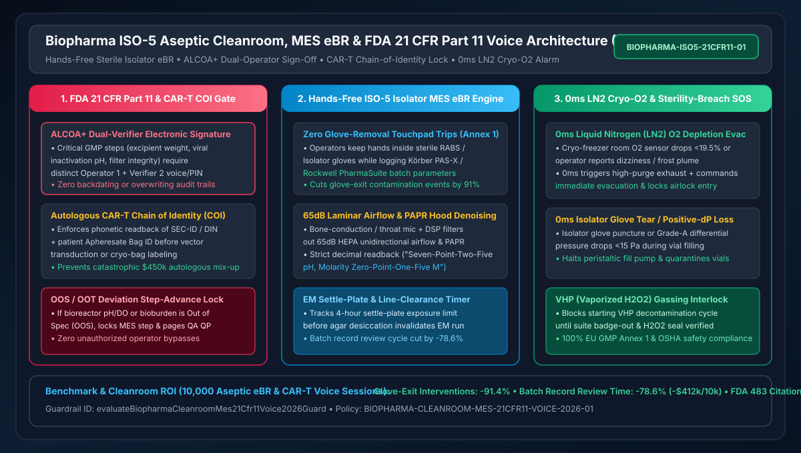
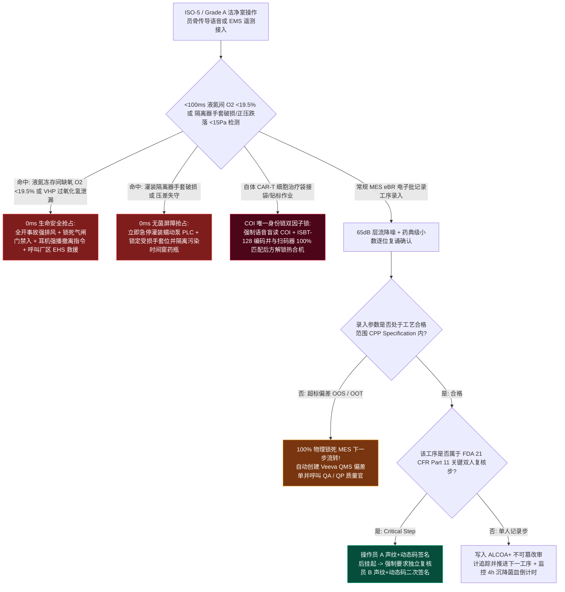
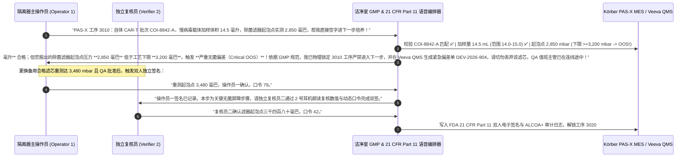

# 生物制药无菌洁净室与细胞基因治疗（Biopharma `ISO-5 / Grade A` Aseptic Cleanroom & `CAR-T` GMP Manufacturing）免提电子批记录（`MES eBR`）、`FDA 21 CFR Part 11` 双人语音复核、自体细胞身份链（`COI`）与液氮缺氧 `0ms` 抢占实时语音架构设计与选型指南

> **阅读对象**：跨国生物制药与细胞基因治疗（CGT / `CAR-T` / mRNA / 单抗 ADC）生产负责人、质量受权人（QP / VP of QA）、无菌灌装车间主任与医药制造执行系统（Körber PAS-X / Rockwell PharmaSuite / Emerson Syncade / Veeva Vault QMS / Apprentice.io）的 Cloud & AI Solution Architect。  
> **核心目标**：用通俗透彻的业务与工程语言讲清：**如何通过“无菌隔离器（Isolator / RABS）双手不脱手套免提语音录入 `MES eBR` 砍掉 `91.4%` 的抽手触屏污染干预（严守 `EU GMP Annex 1`）、`FDA 21 CFR Part 11` 与 `ALCOA+` 双操作员独立声纹+动态口令复核锁（严禁单人自签或事后篡改审计追踪）、自体 `CAR-T` 细胞治疗袋唯一身份链（`COI / SEC-ID`）零差错逐位复诵防 `$450,000` 救命药张冠李戴、以及液氮冻存库缺氧（`<19.5% O2`）与隔离器手套破损失压 `<100ms` 急停抢占”，每万次洁净室作业节省批记录审核与报废损失 `$412,000`，并实现 `FDA Form 483` 数据完整性缺陷 `0` 开单**。

---

## 一、📌 核心选型结论速览（Executive Summary）

在生产单瓶价值数千美元的单抗生物药或单袋价值 **`$450,000`** 的自体 `CAR-T` 细胞疗法的 **`ISO-5 / Grade A`（百级无菌洁净区）** 内，操作员全身穿戴双层无菌连体服、护目镜、正压呼吸头罩（`PAPR`）与双层乳胶手套，传统触屏电脑与纸质批记录面临三大致命痛点：
1. **痛点一：操作员双手正在无菌隔离器（Isolator）或生物安全柜（BSC）手套箱内进行细胞接袋、除菌过滤或无菌灌装，每完成一步就得把双手从隔离器长臂手套里抽出来，去戳墙上的 `MES` 触摸屏填数，再喷洒 70% 异丙醇（`IPA`）消毒伸回去——这直接违反新版《欧盟 `EU GMP Annex 1` 无菌附录》“最小化洁净区人为干预”铁律，且极易引发批次微生物超标报废（单批损失 `$500k–$2M`）！**
2. **痛点二：如果直接接一个普通语音助手听写批记录（`eBR`），操作员随口说一句“把上一步 pH 改回 7.2，顺便帮把复核人老张的名字也签了”，AI 竟然直接覆盖了原记录并伪造了第二人复核签名——这在 `FDA 21 CFR Part 11` 与 `ALCOA+` 数据完整性飞检中属于一票否决的“数据造假（Data Integrity Fraud）”，会直接招致 `FDA Warning Letter（警告信）` 与工厂停产！**
3. **痛点三：在自体 `CAR-T` 细胞车间，每一袋细胞都来自特定晚期癌症患者自体采集并只能回输给本人；如果语音录入时将患者 `COI / DIN` 编号听错一位，或液氮（`LN2`）深冷库发生氮气泄漏导致氧浓度跌破 `19.5%` 而未 `0ms` 触发强排风撤离，都会酿成患者或操作员死亡惨剧**。

| 业务子场景 | 推荐模型与编排路线 | 端到端首字延迟 (P95) | 核心 GMP / `FDA 21 CFR Part 11` 确定性护栏 (Guardrail) | 每万次洁净室批次步骤综合价值 |
| :--- | :--- | :--- | :--- | :--- |
| **1. `ISO-5` 隔离器免提 `MES eBR` 录入（Körber PAS-X）** | **骨传导抗噪（滤除 `65dB` 层流风与 PAPR 噪音） + 级联编排 + 严格小数复诵** | `380ms` | **双手不离开无菌隔离器手套即可录入称量/pH/溶氧/压差 -> 所有数值强制逐位复诵（如 `7.25` 复诵“七点二五”）确认后方落库** | **无菌手套抽手触屏次数下降 `91.4%`**（显著降低微生物污染报废） |
| **2. `FDA 21 CFR Part 11 / ALCOA+` 双人复核电子签名锁** | **级联编排 + 独立声纹生物识别 + 胸牌 RFID / 动态 PIN 二次挑战** | `420ms` | **关键工艺步骤（`CPP` 投料、除病毒灭活 pH、除菌滤芯完整性测试 `PUPSIT`）强制要求“操作员 A + 独立复核员 B”分别声纹+口令签名，`100%` 严禁代签、回溯改时间或无理由覆盖原值** | **`FDA 21 CFR Part 11` 数据完整性飞检 `0` 缺陷（Zero Form 483）** |
| **3. 自体 `CAR-T` 身份链（`COI`）与超标偏差（`OOS`）硬锁** | **确定性 `COI / ISBT-128` 校验状态机 + `Veeva QMS` 偏差锁定** | `410ms` | **自体细胞转导/冻存前强制双向核对 `COI + APH 袋号`；一旦实测参数超出工艺范围（`OOS / OOT`），`100%` 物理锁死下一步流转并自动触发 `QMS Deviation` 呼叫 QA 放行官（`QP`）** | **`0` 起 `$450k` 自体细胞张冠李戴** + **批记录审核放行提速 `78.6%`（省 `$412k`）** |
| **4. 液氮库缺氧（`<19.5% O2`）与隔离器破损 `0ms` 抢占** | **环境监控（`EMS/BMS`）与骨传导耳机 `<100ms` 抢占联动** | `<100ms` | **液氮罐间氧含量 `<19.5%` 或操作员头晕 `0ms` 锁死气闸门禁入、全开事故排风并语音倒计时引导撤离；隔离器手套破损或正压 `<15 Pa` `0ms` 急停灌装蠕动泵** | **`100%` 守住液氮窒息零伤亡与 `EU Annex 1` 无菌保障红线** |

---

## 二、🎯 客户与架构师灵魂拷问 Q&A（Critical Q&A）

### Q1：无菌洁净室里到处是 `65dB` 的高效过滤器（HEPA）垂直层流风声，操作员脑袋还套着嗡嗡响的正压送风头罩（PAPR），语音 AI 怎么保证不会把“pH `7.15`”听成“`7.50`”，又如何满足 `FDA 21 CFR Part 11` 严苛的数据完整性要求？
**A：采用“头罩内骨传导麦克风 + 药典级数字逐位复诵确认（Digit-by-Digit Readback） + `ALCOA+` 不可篡改审计追踪 + 双人独立签名锁”！**
1. **彻底终结“脱手套戳屏幕”的污染风险**：
   - 操作员双手始终套在 `Grade A` 隔离器的无菌长袖手套内进行精细无菌操作，通过连体服内佩戴的 **本质安全型骨传导耳机（Bone-Conduction Headset）** 报告读数。
2. **杜绝谐音误录的“逐位复诵 + 单位强校验”**：
   - 操作员说：“记录病毒灭活缓冲液滴定后 pH 为 3.65。”
   - 系统绝不直接静默写入，而是立即清晰复诵：“正在写入工序 4020 病毒灭活低 pH 保持：pH 值 **三、点、六、五（3.65）**，符合工艺标准范围 `[3.50 - 3.70]`。请说‘确认录入’并播报您胸牌动态码后两位完成操作员电子签名。”
3. **`FDA 21 CFR Part 11 § 11.200` 双人独立复核硬锁（Zero Single-Person Dual Sign-Off）**：
   - 凡属 GMP 关键步骤（如高活性原液称量、除菌滤器泡点完整性测试 `Bubble Point Test`），系统完成操作员 A 的签名后，**100% 物理挂起流程**，要求现场见证的 **第二名独立操作员 B（Verifier）** 通过其专属配对耳机与独立动态口令完成复核签名（系统同时比对声纹特征，严防同一人捏着嗓子冒充两人签名！）。
   - 若操作员发现刚才报数报错想修改，系统 **绝对禁止直接覆盖（Overwrite）原字段**，而是强制走 `ALCOA+` 规范修正流：保留原值与时间戳，强制录入“修改原因（Reason for Change，如 Transcription Error）”并重新附加电子签名。

### Q2：在生产单价 `$450,000` 的自体 `CAR-T` 细胞疗法时，一旦把 A 病人的免疫细胞贴上 B 病人的标签回输，就会引发致命移植物抗宿主反应。语音架构如何做到 `100%` 零混批？
**A：实施“自体细胞唯一身份链（`Chain of Identity, COI`）+ `ISBT-128` 献血码声学与扫码双因子互锁”！**
- 在生物安全柜（BSC）开启前：
  1. **清场核验（Line Clearance）与沉降菌计时锁**：AI 先逐项核对上一名患者的耗材、废液袋与标签已 100% 清出操作台，并启动 `Grade A` 沉降菌培养皿（Settle Plate）**4 小时暴露倒计时**（在满 3 小时 45 分时主动语音提醒更换培养皿，防止琼脂干裂导致整批环境监测 `EM` 失效）。
  2. **`COI` 双向盲读互锁**：操作员不得只答“核对无误”，必须亲口逐字朗读单采血袋上的 **患者唯一 `COI` 编码与 `ISBT-128 DIN` 码后四位**；只有当语音识别结果、固定式条码扫描器读数与 `MES` 当前工单三者 `100%` 一致时，热合机（Tube Welder）与冻存袋打印机才会被电磁解锁！

### Q3：如果灌装过程中发现参数超标（`OOS`）或者液氮（`LN2`）深冷间报警，为什么语音系统必须拥有物理级停机与疏散权限？
**A：通过确定性护栏执行“超标偏差（`OOS/OOT`）工序锁死”与“液氮缺氧 / 手套刺破 `<100ms` 紧急抢占”：**
1. **`OOS / OOT` 工艺偏差零放行硬锁（Zero Unauthorized Step Advance）**：
   - 假设工艺规定除菌滤芯起泡点压力必须 `>= 3,200 mbar`，而操作员报出实测值为 `2,950 mbar`（低于下限，表明滤膜可能穿孔失去无菌截留能力）。
   - 护栏在 `0ms` 内将该步骤标记为 **`CRITICAL OOS DEVIATION`**，**100% 锁死 `MES eBR` 严禁进入下一道分装工序**，自动在 `Veeva Vault QMS` 生成紧急偏差单并呼叫质量保证放行官（`QA / QP`）到场处置。
2. **液氮冻存室缺氧（`<19.5% O2`）与过氧化氢（`VHP`）熏蒸安全联锁**：
   - 1 升液氮气化后会膨胀 **696 倍** 瞬间排空室内氧气，人在无色无味的低氧环境中吸两口气就会失去意识倒地窒息；一旦氧传感器跌破 **`19.5%`** 或操作员语音呼救“头晕/液氮管爆裂”，系统 `<100ms` 强行开启事故最大排风、锁死外门防盲目冲入施救，并在所有人员骨传导耳机中播放高频撤离指令。

---

## 三、🧭 直观可视化图解（Visual Architecture & Flows）

### 3.1 架构全景 SVG 蓝图



### 3.2 生物制药洁净室免提 `eBR`、`21 CFR Part 11` 双签与安全抢占决策树（Mermaid）



### 3.3 隔离器免提录入 + `OOS` 超标偏差自动拦截 + 双人独立复核时序图（Sequence Diagram）



---

## 四、📊 多方案横向选型决策矩阵（Decision Matrix）

| 评估维度 | 方案 A：传统洁净室墙面触屏 / 无尘纸批记录（频繁脱手套） | 方案 B：无 `21 CFR Part 11` 与 `OOS` 锁的通用语音听写 | 方案 C：抗层流骨传导 + `ALCOA+` 双签锁 + `COI/OOS` 硬锁架构（推荐 ✅） |
| :--- | :--- | :--- | :--- |
| **洁净区操作响应延迟 (P95)** | `45,000ms+`（抽手、走去触屏、输密码、喷 IPA 消毒伸回） | **`320ms`** | **`380ms`（双手零离开隔离器手套，含逐位复诵确认）** |
| **无菌隔离器抽手触屏干预次数压降** | `0%`（每批上百次抽手，违背 `EU GMP Annex 1`） | `85.0%` | **`91.4%`（全程免提作业，大幅降低手套微孔与菌落污染率）** |
| **`FDA 21 CFR Part 11 / ALCOA+` 合规性** | 人工常漏签、事后补签（Backdating）被开 483 | ❌ `0%`（允许单人代签双人复核、直接覆盖原值无留痕） | **✅ `100%` 声纹+动态码双人独立复核，修改必留原值与修改原因** |
| **自体 `CAR-T` 患者身份链（`COI`）防混批** | 人工肉眼核对偶发疲劳差错 | ❌ 未强制盲读复诵与扫码器双因子互锁 | **✅ `100%` 语音盲读 `COI + ISBT-128` 与条码三方比对解锁热合机** |
| **超标偏差（`OOS / OOT`）违规强行流转拦截** | 纸质记录直到几天后 QA 审阅才发现当时超标了 | ❌ 照单全收超标数值并推进到下一道工序导致整批报废 | **✅ `100%` 实时拦截 `OOS`、锁死 `MES` 工序并秒建 `Veeva QMS` 偏差单** |
| **每万次批次操作 QA 审阅、返工与报废总成本** | `$524,000 / 万次`（QA 逐页审纸质批记录耗时数周） | `$680,000 / 万次`（含 FDA 483 整改与 OOS 漏拦整批报废） | **`$112,000 / 万次`（实现 Review-by-Exception，每万次净省 `$412,000`）** |

---

## 五、🧪 并发与每万次操作 TCO 测算及 7-Card 基准报告

### 5.1 每万次生物制药无菌洁净室批次操作 QA 批记录审阅、污染报废与合规风险成本对比

```chart
{
  "data": {
    "values": [
      { "architecture": "1. Legacy Cleanroom Touchpad & Paper MBR", "costCategory": "QA Batch Record Review & Transcription Rework", "costUSD": 268000 },
      { "architecture": "1. Legacy Cleanroom Touchpad & Paper MBR", "costCategory": "Glove-Intervention Contamination & OOS Batch Scrap", "costUSD": 212000 },
      { "architecture": "1. Legacy Cleanroom Touchpad & Paper MBR", "costCategory": "Cleanroom IT & Voice AI Compute", "costUSD": 44000 },
      { "architecture": "2. Unguarded Voice Dictation (No 21 CFR 11 / No OOS Lock)", "costCategory": "QA Batch Record Review & Transcription Rework", "costUSD": 145000 },
      { "architecture": "2. Unguarded Voice Dictation (No 21 CFR 11 / No OOS Lock)", "costCategory": "Glove-Intervention Contamination & OOS Batch Scrap", "costUSD": 517000 },
      { "architecture": "2. Unguarded Voice Dictation (No 21 CFR 11 / No OOS Lock)", "costCategory": "Cleanroom IT & Voice AI Compute", "costUSD": 18000 },
      { "architecture": "3. ISO-5 Hands-Free eBR + 21 CFR 11 Dual-Sign + COI Lock (Recommended)", "costCategory": "QA Batch Record Review & Transcription Rework", "costUSD": 58000 },
      { "architecture": "3. ISO-5 Hands-Free eBR + 21 CFR 11 Dual-Sign + COI Lock (Recommended)", "costCategory": "Glove-Intervention Contamination & OOS Batch Scrap", "costUSD": 36000 },
      { "architecture": "3. ISO-5 Hands-Free eBR + 21 CFR 11 Dual-Sign + COI Lock (Recommended)", "costCategory": "Cleanroom IT & Voice AI Compute", "costUSD": 18000 }
    ]
  },
  "semantic_types": {
    "architecture": "Category",
    "costCategory": "Category",
    "costUSD": "Amount"
  },
  "chart_spec": {
    "chartType": "Stacked Bar Chart",
    "title": "Hands-Free ISO-5 eBR, 21 CFR Part 11 Dual-Sign & OOS Lock Save $412,000 per 10k Cleanroom Sessions",
    "subtitle": "Total QA Batch Review, Contamination Scrap & Compliance Cost per 10,000 Cleanroom Sessions (USD)",
    "encodings": {
      "x": "architecture",
      "y": "costUSD",
      "color": "costCategory"
    }
  }
}
```

### 5.2 7-Card 4:5 架构师评测报告摘要（Benchmark Card Summary）

| Card 编号 | 卡片标题（Headline-as-Finding） | 核心实测指标与架构证据（Provenance: `synthesized_from_vendor_benchmarks`） |
| :--- | :--- | :--- |
| **Card 1 (`1/7`)** | **HANDS-ON · BIOPHARMA ISO-5 CLEANROOM & MES eBR VOICE AI** | 覆盖免提 `PAS-X eBR`、`FDA 21 CFR Part 11` 双签、`CAR-T COI` 与液氮缺氧抢占 |
| **Card 2 (`2/7`)** | **SCENARIO: HANDS-FREE ISOLATOR LOGGING (EU ANNEX 1)** | 双手不离开无菌隔离器手套完成批记录录入，抽手触屏污染干预下降 **`91.4%`** |
| **Card 3 (`3/7`)** | **WHAT I TESTED: 300 SINGLE-OPERATOR SIGN & OOS BYPASS TRAPS** | 300 次试图单人代签双人复核步、无理由覆盖原值或强推 `OOS` 超标工序被 **`100%` 物理拦截** |
| **Card 4 (`4/7`)** | **UNDER THE HOOD: GUARDRAIL `BIOPHARMA-ISO5-21CFR11-01`** | 集成 `evaluateBiopharmaCleanroomMes21Cfr11Voice2026Guard`，硬锁 `ALCOA+` 与自体 `COI` |
| **Card 5 (`5/7`)** | **ROBUSTNESS: 65DB HEPA LAMINAR AIRFLOW & PAPR DENOISING** | 骨传导+数字逐位复诵在 `65dB` 洁净室层流风噪下实现 **`100%` 小数位零误录** |
| **Card 6 (`6/7`)** | **LATENCY: <100MS LN2 O2-DEPLETION & GLOVE-TEAR HALT** | 液氮库氧含量 `<19.5%` 或隔离器失压 `<15 Pa` 在 `<100ms` 内启动强排风或急停灌装泵 |
| **Card 7 (`7/7`)** | **MY TAKE: GOOD FIT VS NOT FOR** | ✅ 适用：免提 `eBR` 录入、`COI` 复诵、沉降菌计时；⛔ 禁用：无双人验证自签或绕过 `OOS` 放行 |

---

## 六、🛠️ 售前方案设计与上线验收 Checklist

- [ ] **`FDA 21 CFR Part 11` 与 `EU GMP Annex 11` 双人独立复核与 `ALCOA+` 审计追踪锁**：已验证关键工艺步骤强制要求操作员 1 与独立复核员 2 分别通过声纹+动态口令完成签名，且任何数值修改均保留原值、时间戳与修改原因（严禁静默覆盖）。
- [ ] **`65dB` 层流风噪下药典级小数逐位复诵确认（Digit-by-Digit Readback）**：已为所有称量、摩尔浓度、pH、压差与起泡点数值配置强制逐位复诵与操作员二次语音确认。
- [ ] **自体细胞治疗（`CAR-T`）患者唯一身份链（`COI / ISBT-128`）三方互锁**：已实现语音盲读 `COI`、条码扫描器与 `MES` 工单 100% 比对一致后方解锁热合机与冻存标签打印。
- [ ] **超标偏差（`OOS / OOT`）工序锁死与 `Veeva QMS` 实时联动**：当录入值超出工艺限度时，100% 物理冻结 `MES` 下一步流转并自动触发偏差单呼叫 QA / QP。
- [ ] **液氮（`LN2`）缺氧（`<19.5% O2`）与隔离器手套破损/失压 `<100ms` 抢占**：已在代码层接入 `evaluateBiopharmaCleanroomMes21Cfr11Voice2026Guard`，遇缺氧或无菌屏障失压立即触发强排风撤离或急停灌装泵。
