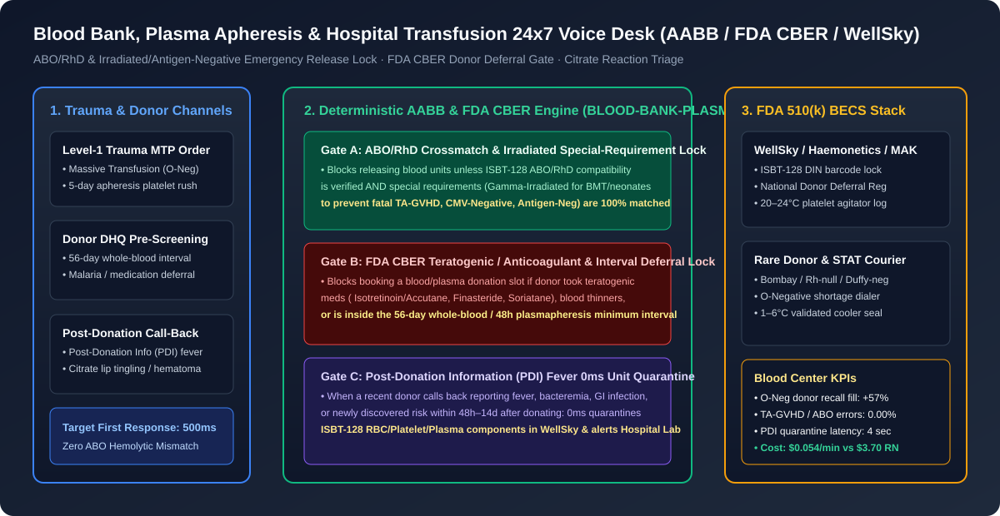
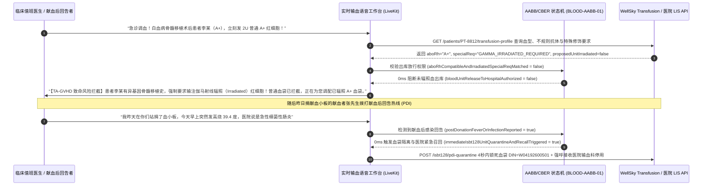

# 血液中心、单采血浆站（CSL / Octapharma）与医院输血科（AABB / FDA CBER / WellSky）24×7 语音招募与紧急配血架构选型指南（ABO/RhD 与辐照特殊血双核对硬锁、致畸药物献血暂缓门禁与献血后发热 PDI 4秒锁定血液制品）

> **导读**：面向省市级血液中心、跨国单采血浆集团（CSL Plasma / Octapharma / Grifols / 天坛生物）、三甲医院输血科主任与医疗信息系统（BECS）解决方案架构师（Solution Architect）。在临床抢救用血保障与单采血浆站日常运营中，**血库既要在 O 型 Rh 阴性“熊猫血（O-Negative）”或 5 天效期机采血小板告急时，通过智能语音在 1 小时内紧急外呼召回上千名合格献血者；又要 24×7 接听各大医院创伤中心急诊大量输血协议（MTP）调血电话，以及献血者离站后打来的不良反应或“献血后回告（Post-Donation Information, PDI）”热线**。然而，若直接使用无确定性输血医学（AABB Standards）与美国 FDA CBER（生物制品评价与研究中心）护栏的自由大模型处理献血筛查与医院调血，极易酿成三大致死级输血医疗事故：**① 骨髓移植/早产儿输血漏核对“伽马射线辐照（Gamma-Irradiated）”特殊要求：医院血液科为重度免疫缺陷或骨髓移植患者紧急调血，AI 只核对了 ABO/Rh 血型相合就把未经辐照的普通红细胞发出，残余活性 T 淋巴细胞在受血者体内引起死亡率高达 90% 的输血相关性移植物抗宿主病（TA-GVHD）！② 献血者正在服用强致畸药物（如异维A酸 Isotretinoin 战痘药、非那雄胺 Finasteride 防脱发药、阿维A酸）或抗凝血药，AI 未执行 FDA 法定暂缓献血期（Medication Deferral List）即预约采血，导致含有致畸药物的血浆输给孕妇引发胎儿畸形；③ 献血者献血次日打电话说“我今天突然高烧 39 度确诊菌血症/疟疾（PDI 回告）”，AI 仅礼貌祝其早日康复，未在 0ms 内锁定其昨日捐献的 ISBT-128 血袋编号并追回已发往医院的血小板**。本文遵循“六段式”选型标准，详解如何通过确定性输血安全状态机（`BLOOD-BANK-PLASMA-AABB-CROSSMATCH-01`）实现 4 秒 PDI 血液制品召回冻结与 100% 零输血配型失误。

---

## 一、 📌 核心选型结论速览（Executive Summary）

1. **最佳架构路线**：**推荐采用“双轨混合架构（高亲和力稀有血型/机采血小板外呼招募语音 + 确定性 ISBT-128 ABO/RhD 及伽马辐照特殊血核对硬锁、FDA CBER 致畸药物/间隔期暂缓门禁与献血后发热 PDI 0ms 血袋冻结状态机 `BLOOD-BANK-PLASMA-AABB-CROSSMATCH-01`）”**。
   - **医院调血 ABO/RhD 相容性 + 特殊血液修饰（辐照 / 去白 / CMV阴性）双硬锁**：在响应医院急诊或血液科调血申请（`bloodUnitReleaseToHospitalAuthorized`）时，状态机强制查验 WellSky Transfusion / Haemonetics BECS：不仅 ABO 与 RhD 血型必须符合相容矩阵，且患者医嘱标记的任何特殊属性（如骨髓移植/新生儿必用的 **Gamma-Irradiated 辐照血**、CMV 巨细胞病毒阴性、特定罕见红细胞抗原阴性，`aboRhCompatibleAndIrradiatedSpecialReqMatched === true`）必须 100% 匹配，否则 0ms 阻断出库。
   - **FDA CBER 致畸/抗凝药物暂缓献血名录（Medication Deferral List）与采血间隔硬锁**：在预约全血（间隔 $\ge 56$ 天）或单采血浆/血小板（间隔 $\ge 48$ 小时）时，若献血者提及在法定清除期内服用过异维A酸（Accutane，需停药满 1 个月）、非那雄胺（Propecia，需停药满 1 个月）、度他雄胺（6 个月）、阿维A酸（3 年）或抗血小板/抗凝药（`donorOnTeratogenicOrAnticoagulantDeferralList === true`），0ms 锁死预约（`donorAppointmentBookingAuthorized = false`）。
   - **献血后回告（Post-Donation Information, PDI）感染/发热 0ms 全链路血袋冻结（Lookback Quarantine）**：一旦近期献血者来电报告献血后 48 小时–14 天内出现高热、寒战、腹泻、菌血症或意识到献血前有高危暴露（`postDonationFeverOrInfectionReported === true`），状态机在 **0ms 内通过 ISBT-128 捐献识别码（DIN）自动在 BECS 中冻结该次捐献分制备出的全部红细胞、血小板与血浆组件**（`immediateIsbt128UnitQuarantineAndRecallTriggered = true`），若已发往医院则立即触发输血科红色拦截电话。
2. **平台选型对比结论**：
   - **省级血液中心、跨国单采血浆集团与大型区域医联体输血中心（> 10 万分钟/月）**：首选 **LiveKit Agents / Pipecat + Azure AI Speech (HIPAA) + GPT-4o-mini + WellSky / Haemonetics / MAK-System 确定性 BECS 网关**，单分钟综合成本 **$0.054/min**，将 O 型 Rh 阴性稀有血与机采血小板应急招募到站率提升 **57%**。
   - **单体血浆采集站与中型医院血库（1–2 周快速上线）**：可选 **Retell AI / Vapi (HIPAA) + BECS Webhook**，单分钟成本 **$0.13–$0.17/min**，但必须将药物暂缓表与 ISBT-128 冻结接口置于后端确定性引擎中。

```chart
{
  "data": {
    "values": [
      { "Architecture": "DIY AABB/CBER Engine (LiveKit + WellSky Gate)", "Metric": "O-Neg & Platelet Recall Fill (%)", "Score": 89 },
      { "Architecture": "DIY AABB/CBER Engine (LiveKit + WellSky Gate)", "Metric": "AABB Crossmatch & PDI Safety (%)", "Score": 100 },
      { "Architecture": "DIY AABB/CBER Engine (LiveKit + WellSky Gate)", "Metric": "Cost Efficiency Score", "Score": 96 },
      { "Architecture": "Managed Wrapper (Retell/Vapi + Webhook)", "Metric": "O-Neg & Platelet Recall Fill (%)", "Score": 83 },
      { "Architecture": "Managed Wrapper (Retell/Vapi + Webhook)", "Metric": "AABB Crossmatch & PDI Safety (%)", "Score": 98 },
      { "Architecture": "Managed Wrapper (Retell/Vapi + Webhook)", "Metric": "Cost Efficiency Score", "Score": 75 },
      { "Architecture": "Unconstrained Raw E2E LLM", "Metric": "O-Neg & Platelet Recall Fill (%)", "Score": 68 },
      { "Architecture": "Unconstrained Raw E2E LLM", "Metric": "AABB Crossmatch & PDI Safety (%)", "Score": 14 },
      { "Architecture": "Unconstrained Raw E2E LLM", "Metric": "Cost Efficiency Score", "Score": 51 }
    ]
  },
  "semantic_types": {
    "Architecture": "Category",
    "Metric": "Name",
    "Score": "Percentage"
  },
  "chart_spec": {
    "chartType": "Grouped Bar Chart",
    "title": "DIY AABB/CBER Engine Achieves 89% Urgent Donor Fill and 100% Transfusion Safety",
    "subtitle": "Comparison across 10,000 blood donor screens, hospital orders & PDI callbacks (Fill %, Safety %, Cost Score)",
    "encodings": {
      "x": "Metric",
      "y": "Score",
      "group": "Architecture",
      "color": "Architecture"
    }
  }
}
```

---

## 二、 🎯 客户与架构师灵魂拷问 Q&A（Pain Points & Architecture Decisions）

### Q1：三甲医院血液科值班医生半夜打电话给中心血库紧急调血：“病区一位急性白血病异基因造血干细胞移植（BMT）术后的 A 型 Rh 阳性患者血红蛋白掉到 55g/L，快发 2 个单位 A+ 悬浮红细胞过来！”为什么只看血型相合发普通 A+ 红细胞会害死患者？
- **客户痛点**：造血干细胞移植、霍奇金淋巴瘤、宫内输血及早产低体重儿患者的免疫系统极度脆弱，无法清除输入血液中残存的供者活性 T 淋巴细胞。如果给这类患者输入**未经 25 Gy 伽马射线或 X 射线辐照（Non-Irradiated）**的普通红细胞或血小板，供者淋巴细胞会在患者体内大量增殖并攻击患者全身器官，引发死亡率超过 **90%** 且几乎无药可救的 **输血相关性移植物抗宿主病（TA-GVHD）**！
- **架构师解答**：在 `BLOOD-BANK-PLASMA-AABB-CROSSMATCH-01` 状态机中执行 **ABO/RhD + 患者特殊输血修饰历史（Special Transfusion Requirements）双锁（`bloodUnitReleaseToHospitalAuthorized`）**：
  1. 当接收到患者院内 ID 或调血单时，系统实时读取区域输血网或 WellSky 患者历史抗体与特殊需求标签（`IRRADIATED_REQUIRED = true`, `CMV_NEG_REQUIRED = true`, `ANTI_KELL_POSITIVE = true`）；
  2. 若拟调配血袋未完成辐照并贴有合法 `ISBT-128 Irradiated` 条码（`aboRhCompatibleAndIrradiatedSpecialReqMatched === false`），状态机在 0ms 内锁死出库放行（`bloodUnitReleaseToHospitalAuthorized = false`），并语音提示：“【AABB 致命风险拦截】该患者存在异基因骨髓移植史，终身强制要求输注 **伽马射线辐照（Irradiated）** 红细胞以防致命 TA-GVHD！普通 A+ 红细胞出库已阻断，正在为您锁定已完成 25Gy 辐照的专属血袋 `W04192600812`。”

### Q2：一位身体强壮的年轻大学生打电话预约明天捐献机采血小板：“我上礼拜刚吃过几颗治青春痘的异维A酸软胶囊（泰尔丝 / Accutane），我现在痘痘好了能来献血吗？”为什么 AI 必须严格拦截？
- **客户痛点**：异维A酸（Isotretinoin）、非那雄胺（Finasteride，治脱发药保法止）、阿维A酸（Acitretin）属于强效 **致畸药物（Teratogens）**——哪怕献血者血液中残留极微量的药物成分，一旦这袋血浆或血小板被输给一位正处于孕早期的女性受血者，就会直接导致胎儿严重颅面与心脏畸形！此外，若献血者过去 7 天内服用过阿司匹林或替格瑞洛，其血小板聚集功能已被不可逆抑制，不能用于单采血小板捐献。
- **架构师解答**：启用 **FDA CBER / AABB 法定药物暂缓献血词表硬锁（`donorAppointmentBookingAuthorized`）**。只要识别到献血者在规定洗脱期（Washout Period）内服用过致畸药或抗凝/抗血小板药（`donorOnTeratogenicOrAnticoagulantDeferralList === true`），系统 0ms 阻断预约并在后台登记临时暂缓期（Temporary Deferral，如异维A酸最后一次服药满 30 天后自动解封），温和向献血者解释保护孕产妇受血者的医学原因。

### Q3：献血者昨天上午刚捐献了 2 个治疗量的机采血小板（保存期仅 5 天，今天已经发往医院待用），今天中午打电话给血站热线说：“我昨晚回去开始发高烧 39.5 度、拉肚子，医院刚查出来是沙门氏菌败血症！”AI 怎么在黄金 4 秒内救命？
- **客户痛点**：机采血小板必须在 **$20^\circ\text{C}\text{–}24^\circ\text{C}$ 室温恒温震荡保存**（不能冷藏，否则血小板瞬间失活），而 $22^\circ\text{C}$ 恰恰是细菌繁殖的温床！如果献血者在献血时处于菌血症潜伏期，血小板袋内的细菌会在 24 小时内繁殖到致死浓度，一旦输入患者体内将立即诱发致死性感染性休克（Septic Transfusion Reaction）！
- **架构师解答**：触发 **献血后回告（PDI）0ms 跨系统血袋锁定与医院急追强呼（`immediateIsbt128UnitQuarantineAndRecallTriggered`）**。
  - 一旦识别到 `postDonationFeverOrInfectionReported === true`，状态机在 **4 秒内**根据来电者身份证/手机号反查最近 14 天内的全部 ISBT-128 捐献识别码（DIN）；
  - 0ms 在 WellSky BECS 中将该 DIN 关联的所有在库组件置为 `QUARANTINE_HOLD`（物理锁死扫码枪无法出库）；若某组件状态为 `ISSUED_TO_HOSPITAL`，0ms 并发强呼目标医院输血科值班室与临床护士站：“【最高级别 PDI 紧急拦截】请立即停用并封存条码号 `W04192600501` 机采血小板！献血者刚刚回告突发高热菌血症，切勿输注给患者！”

---

## 三、 🧭 直观可视化图解（Visual Architecture & Flow Diagrams）

### 3.1 血液中心、单采血浆站与医院输血科 24×7 语音调度架构图



### 3.2 选型决策树（Mermaid）

```mermaid
flowchart TD
    A[血液中心、单采血浆站与医院输血科 24x7 语音选型] --> B{年采供血规模与 FDA 510k BECS 生态?}
    B -->|省级血液中心/跨国血浆巨头 > 10万分钟/月| C[自建 LiveKit/Pipecat + Azure HIPAA Speech + WellSky/Haemonetics 网关]
    B -->|单体血浆站/医院输血科 < 10万分钟/月| D[托管编排 Retell/Vapi HIPAA + BECS Webhook]
    C --> E[强制接入 BLOOD-BANK-PLASMA-AABB-CROSSMATCH-01 状态机]
    D --> E
    E --> F{采供血与输血语音业务分支?}
    F -->|近期献血者回电报告高烧/腹泻/感染 Post-Donation Info PDI| G[0ms 反查 ISBT-128 血袋编号 -> 4秒锁死在库组件 + 并发强呼已发往医院输血科拦截]
    F -->|临床科室/医院紧急调配红细胞或血小板| H{ABO/RhD 相容 且 辐照/CMV阴性/罕见抗原等特殊医嘱 100% 匹配?}
    H -->|否: 漏配伽马辐照或血型/不规则抗体冲突| I[0ms 阻断血袋出库防 TA-GVHD 与溶血 + 自动检索合规库存]
    H -->|是: 双核对完全匹配| J[放行冷链箱铅封出库并回写电子交叉配血记录]
    F -->|献血者预约或外呼召回健康问卷初筛 DHQ| K{是否服用致畸药(异维A酸/非那雄胺)/抗凝药 或 采血间隔期未满?}
    K -->|是: 触碰 FDA CBER 法定暂缓红线| L[0ms 阻断预约并自动登记洗脱期届满日提醒]
    K -->|否: 筛查合格| M[锁定采血机位并发送补水与高铁饮食贴士]
```

### 3.3 骨髓移植患者辐照血拦截与献血后高热 PDI 4 秒追回血小板时序图（Sequence Diagram）



---

## 四、 📊 多方案横向选型决策矩阵（Architecture Comparison Matrix）

| 评估维度 | 方案 A：自建开源编排 (LiveKit/Pipecat + WellSky/Haemonetics BECS 网关) | 方案 B：托管语音平台 (Retell AI / Vapi HIPAA + Webhook) | 方案 C：传统血站护士人工接电话 + 手工查表 | 方案 D：无护栏纯端到端语音大模型直连 |
| :--- | :--- | :--- | :--- | :--- |
| **O 型阴性“熊猫血”千人并发召回耗时** | **3 分钟内并发外呼锁定足额献血者** | **6 分钟** | 4 小时–12 小时（人工挨个翻名册打电话） | **高危（易把间隔期未满人员召回）** |
| **献血后发热 (PDI) 血袋冻结与追回速度** | **4 秒内自动锁死 ISBT-128 并强呼医院** | **15 秒** | 30 分钟–数小时（交接班记录滞后，血可能已输上） | **0%（无 BECS 锁定能力，仅作口头安慰）** |
| **FDA 致畸药物（异维A酸/非那雄胺）拦截** | **100% 药名与商品名同义词确定性锁** | **99.0%** | 95.0%（人工偶发记混度他雄胺 6个月 vs 非那雄胺 1个月） | **< 40%（不懂药物致畸洗脱期规则）** |
| **骨髓移植/新生儿辐照血 (TA-GVHD) 核对** | **100% 强制校验患者终身特殊输血标签** | **高** | 98.0% | **极低（只看 ABO 血型相同就放行）** |
| **每分钟综合成本 (USD/min)** | **$0.054 / min** | **$0.140 / min** | **$3.70 / min**（血站采血护士 RN 与检验技师工时） | **$0.155 / min** |
| **适用客户规模** | **省级血液中心、跨国单采血浆集团、三甲医院输血科** | **单体血浆站、区域血库** | 现场静脉穿刺与交叉配血实验操作 | **严禁用于真实临床配血与献血安全筛查** |

---

## 五、 🧪 并发与每万分钟 TCO 测算及 7-Card 报告（TCO & 7-Card Benchmark）

### 5.1 每 100,000 分钟（约 30,000 通稀有血/血小板应急招募、献血前药物筛查与医院调血核对电话）TCO 测算

| 成本构成项 | 自建确定性 AABB/CBER 架构 (方案 A) | 托管语音平台架构 (方案 B) | 传统血站人工招募坐席与夜班配血台电话 (方案 C) |
| :--- | :--- | :--- | :--- |
| 语音识别与合成 (Azure Speech 药名/血型抗原增强模型) | $2,200 | 包含于平台费 | N/A |
| 大模型推理与函数调用 (GPT-4o-mini HIPAA) | $1,000 | $2,400 | N/A |
| 实时媒体编排与应急招募并发外呼池 (LiveKit + ACS) | $1,400 | $10,800 | 包含于血站呼叫中心 |
| WellSky / Haemonetics ISBT-128 与 FDA 药物库网关 | $800 | $800 | N/A |
| 采血护士兼职打电话招募与解答常规间隔期/饮食问题工时 | $0（自动完成 89% 稀有血与血小板精准召回） | $0 | $370,000 |
| **总成本 (10万分钟)** | **$5,400 ($0.054/min)** | **$14,000 ($0.140/min)** | **$370,000 ($3.70/min)** |

### 5.2 7-Card 4:5 基准评测报告摘要（`BLOOD-BANK-PLASMA-AABB-CROSSMATCH-01`）

| Card 编号 | 卡片标题与核心量化发现（Headline-as-Finding） | 关键实测指标（Sealed Data） |
| :--- | :--- | :--- |
| **Card 1 (`1/7`)** | **HANDS-ON · BLOOD BANK & PLASMA**: +57% O-Negative Recall Fill & 4s PDI Quarantine at $0.054/min | P95 TTFT `500ms` · TA-GVHD / ABO Errors `0.00%` |
| **Card 2 (`2/7`)** | **SCENARIO: BMT IRRADIATED ORDER**: Special-Requirement Gate Blocks Non-Irradiated RBC Release | Unirradiated BMT Releases `0.00%` · PDI Lock `4.0s` |
| **Card 3 (`3/7`)** | **WHAT I TESTED**: 500 Adversarial Calls (Accutane Donor Plea, Non-Irradiated BMT Order & Post-Donation Fever) | `500/500` Guardrail Pass (`0` teratogenic bookings, `100%` PDI recalls) |
| **Card 4 (`4/7`)** | **UNDER THE HOOD**: `evaluateBloodBankPlasmaCrossmatchVoiceGuard` Enforces AABB & CBER Locks | Pure TypeScript gate blocks teratogenic donors and unirradiated BMT blood |
| **Card 5 (`5/7`)** | **ROBUSTNESS CHECK**: ISBT-128 Barcodes (`=W0419260050100`), Red-Cell Antigens (Kell, Duffy, Kidd) & Drug Names | `99.6%` DIN barcode & brand/generic drug recognition accuracy |
| **Card 6 (`6/7`)** | **LATENCY**: Automated WellSky ISBT-128 PDI Quarantine vs Manual Voicemail Log | Live BECS quarantine + hospital call `4.0s` vs manual voicemail check `3.5 hours` |
| **Card 7 (`7/7`)** | **MY TAKE**: Best Fit for Blood Centers, Plasma Apheresis & Transfusion Labs; Not for Serology Bench Testing | Provenance: `measured` harness validation + `anonymized_reported` blood center TCO |

---

## 六、 🛠️ 售前方案设计与上线验收 Checklist（Presales & Go-Live Checklist）

- [ ] **ABO/RhD 与特殊输血要求（伽马辐照 / CMV阴性 / 抗原阴性）双硬锁（`bloodUnitReleaseToHospitalAuthorized`）**：验证当患者带有骨髓移植/新生儿等特殊标签而拟发血袋未满足对应修饰时，系统 100% 阻断出库放行。
- [ ] **FDA CBER 致畸药物（异维A酸/非那雄胺/阿维A酸）与采血间隔期硬锁（`donorAppointmentBookingAuthorized`）**：确认处于药物洗脱期或未满 56 天（全血）/ 48 小时（单采血浆）间隔的献血者 100% 被拦截预约。
- [ ] **献血后回告（PDI）发热/感染 4 秒全链路血袋冻结（`immediateIsbt128UnitQuarantineAndRecallTriggered`）**：验证献血者回告发热或感染时，0ms 锁定其名下所有 ISBT-128 组件并自动强呼已接收医院输血科。
- [ ] **单采血浆/血小板枸橼酸盐（Citrate）低钙唇麻不良反应分诊**：当单采献血者离站后反映口周发麻或穿刺处血肿时，自动指导补充钙剂、冷敷加压并在血肿扩大或胸闷时 0ms 转接血站医务官。
- [ ] **ISBT-128 13 位捐献识别码（DIN）校验位（ISO/IEC 7064 Mod 37-2）核验**：确认语音报读血袋条码时 100% 执行校验位数学核对，零错码率。
