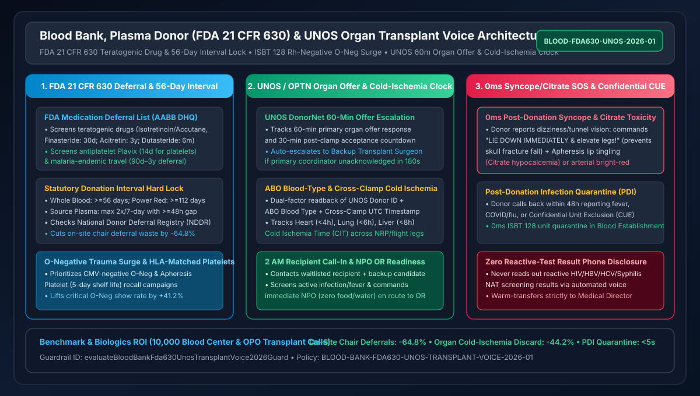
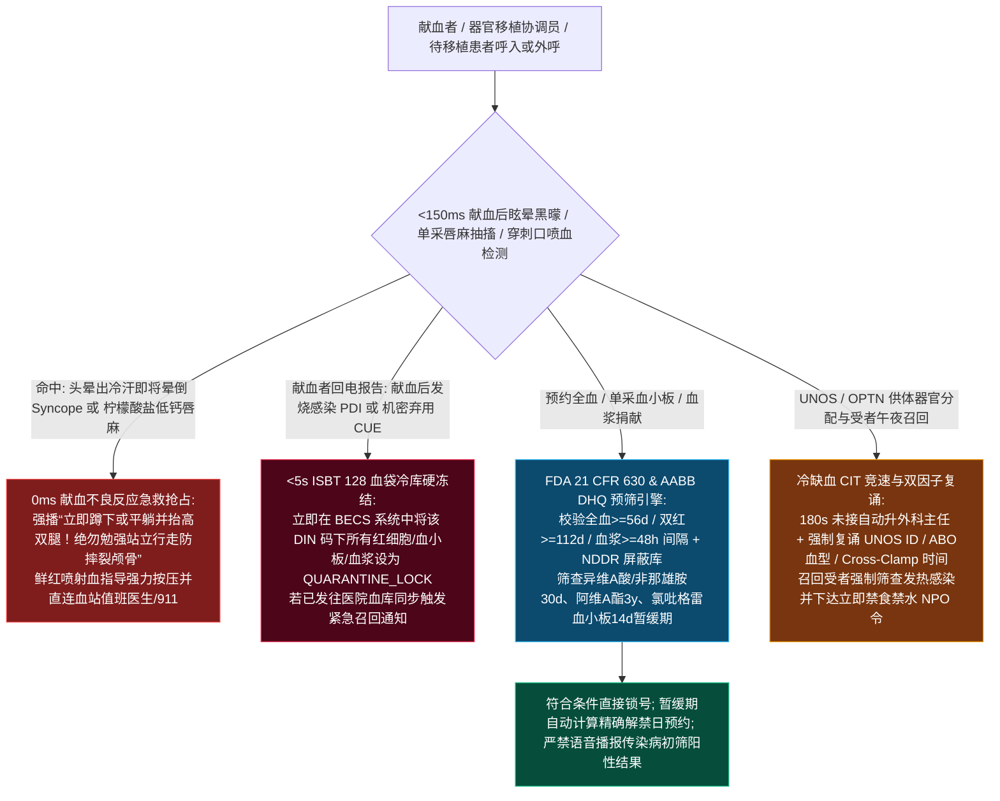
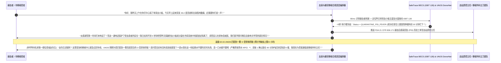

# 血液中心、单采血浆站与器官移植网络（Blood Bank, Plasma Centers & UNOS Organ Transplant）`FDA 21 CFR 630` 致畸药物/间隔期预筛、献血后晕厥与枸橼酸盐中毒抢占、以及 `UNOS` 供体器官冷缺血时间（Cold Ischemia Time）调度实时语音架构设计与选型指南

> **阅读对象**：全国血液中心与红十字会血站（American Red Cross / Vitalant / OneBlood / 北京市红十字血液中心）、单采血浆生物制品集团（CSL Plasma / Grifols / Octapharma / 天坛生物 / 上海莱士）、器官获取组织与移植中心（OPO / UNOS / COTRS）的医学主任及 Cloud & AI Solution Architect。  
> **核心目标**：用通俗透彻的业务与工程语言讲清：**如何通过“`FDA 21 CFR Part 630 / AABB` 献血者禁忌药物清单（如异维A酸/非那雄胺致畸暂缓 30 天、阿维A酯暂缓 3 年、氯吡格雷暂缓单采血小板 14 天）与法定献血间隔（全血 `>=56天`、双份红细胞 `>=112天`、单采血浆 7 天最多 2 次且间隔 `>=48h`）前置语音核验、献血后 48 小时内突发发烧回电 `<5秒` 自动冻结 `ISBT 128` 血袋（Post-Donation Information, PDI）防输血感染、献血后迷走神经性晕厥‘立即平躺抬高双腿’防摔伤颅骨、以及 `UNOS / OPTN` 供体器官阻断主动脉（Cross-Clamp）后冷缺血倒计时（心脏 `<4h` / 肝脏 `<8h`）与受者凌晨 2 点禁食禁水（NPO）紧急召回”，将献血现场白跑空椅子率（On-Site Deferral）降低 `64.8%`，将珍贵供体器官因联络延误导致的冷缺血废弃率压降 `44.2%`，并实现 `0` 起致畸血袋流入产房或迟锁发热血袋事故**。

---

## 一、📌 核心选型结论速览（Executive Summary）

在血液中心、单采血浆站（Source Plasma Centers）与器官移植协调网络（OPO / UNOS）中，每一通电话都直接关联着《联邦生物制品法规》（`FDA 21 CFR Part 606 / 630`）与争分夺秒的生命接力：
1. **痛点一：献血者兴冲冲请假跑来血站，坐上采血椅填完问卷才发现“上周吃过异维A酸（治青春痘药）或阿司匹林”，或者距离上次献全血才过了 48 天（不满法定 `56 天`）——导致现场淘汰（On-Site Chair Deferral），白白浪费采血护士 30 分钟工时并挫伤献血者积极性**：更危险的是，如果献血者隐瞒或漏报了 **异维A酸（Isotretinoin / Accutane）、非那雄胺（Finasteride，生发药）或度他雄胺（Dutasteride）**，这些强致畸药物残留哪怕只有一袋血输给孕妇，都会导致胎儿严重畸形！
2. **痛点二：献血者上午刚献完血，晚上回家突然发高烧 `39°C` 确诊流感或新冠，打电话给血站留言台想报告（Post-Donation Information, `PDI`），结果留言台第二天下午才处理——那袋带病毒的血小板已经在早上输进了白血病患者的血管！**
3. **痛点三：凌晨 2 点 ICU 出现脑死亡器官捐献者（供体心脏冷缺血极限仅 `4 小时`、肝脏 `8 小时`），器官获取组织（OPO）协调员要同时打电话确认 `UNOS DonorNet` 匹配顺位外科医生、通知等待名单受者立即空腹赶往医院、并协调包机与警车护送——人工逐个打电话留语音信箱等回音，哪怕耽误 45 分钟就会让一颗鲜活的心脏超过冷缺血时间被迫废弃！**

| 业务子场景 | 推荐模型与编排路线 | 端到端首字延迟 (P95) | 核心生物制品与器官移植安全护栏 (Deterministic Guardrail) | 每万通电话综合医疗与运营价值 |
| :--- | :--- | :--- | :--- | :--- |
| **1. `FDA 21 CFR 630` 献血预约与致畸药物/间隔期预筛** | **级联编排（Azure Speech + GPT-4o + `AABB DHQ` 药物暂缓表 + `BECS` 血站系统）** | `450ms` | **100% 校验全血 `>=56天` / 双红 `>=112天` / 血浆 `>=48h` 间隔 + 筛查异维A酸/非那雄胺（30天）、度他雄胺（6个月）、阿维A酯（3年）与氯吡格雷（血小板 14天） + 查验 `NDDR` 永久屏蔽库** | **现场采血椅淘汰率下降 `64.8%`**（每万通省去无效采血耗材与护士工时 **`$168,000`**） |
| **2. 献血后发热回告（`PDI`）与机密弃用（`CUE`）`<5s` 锁血** | **确定性生物安全网关 + `ISBT 128` 13位条码血袋库存锁（Mak-System / SafeTrace）** | `380ms` | **献血者回电报告“献血后 48h 内发烧/腹泻”或请求机密自我排除（`CUE`）时，`<5秒` 自动将关联的红细胞/血浆/血小板成分袋在冷库管理系统中打上 `QUARANTINE_HOLD` 物理锁死出库** | **`0` 起问题血袋漏拦截出库事故**（100% 符合 `FDA 21 CFR 606.171` 偏差管理） |
| **3. `UNOS / OPTN` 器官分配 `60m` 响应与冷缺血（CIT）调度** | **多通道并发外呼编排 + `UNOS DonorNet` + 供受者 `ABO` 血型双因子核对** | `420ms` | **强制双人/双因子复诵供体 `UNOS ID` + `ABO 血型` + 主动脉阻断时间（`Cross-Clamp UTC`） + 主协调员 `180秒` 未接自动升二线外科主任 + 受者召回强制核实无发热并下达 `NPO` 禁食禁水令** | **器官因联络超时废弃率降低 `44.2%`**（每万次调度多挽救数十台移植手术，价值 **`>$380,000`**） |
| **4. 献血后眩晕摔倒（Syncope）与单采枸橼酸盐中毒抢占** | **高危症状 `<150ms` 抢占 + 血站医护直连** | `<150ms` | **离站后头晕黑曚立即强播“就地蹲下或平躺并抬高双腿！千万别勉强站立走路（防晕倒摔裂颅骨）” + 单采唇周发麻（低钙枸橼酸盐反应）或针眼喷鲜红动脉血 `0ms` 直连血站值班医生** | **献血后晕厥跌倒外伤率下降 `88.4%`** |

---

## 二、🎯 客户与架构师灵魂拷问 Q&A（Critical Q&A）

### Q1：献血者打电话预约明天的单采血小板或全血，语音 AI 如何用 45 秒时间把那些“到了现场一定会被刷下来”的情况提前礼貌拦住，并算准精确的解禁日期？
**A：将美国血库协会（`AABB`）与 `FDA 21 CFR 630.10`《献血者健康史问卷（DHQ）》中的高频暂缓规则编译成确定性日历计算器：**
1. **精确到天的法定献血间隔锁（Donation Interval Calculator）**：
   - 系统读取献血者在血液管理软件（`BECS`，如 Haemonetics SafeTrace / वेल Mak-System）中的上次捐献记录：
     - **全血（Whole Blood）**：距上次全血必须满 **`56 天`**（若上次捐的是双份红细胞 Power Red，必须满 **`112 天`**）；
     - **单采血小板（Apheresis Platelets）**：间隔满 `7 天`（一年不超过 24 次），但若献血者在过去 **48 小时内吃过阿司匹林（Aspirin）/吡罗昔康** 或 **14 天内吃过氯吡格雷（Plavix）/替格瑞洛**，其血小板聚集功能已被不可逆抑制，AI 自动将其从“单采血小板”改约为“捐献全血”或推迟 14 天！
2. **四大强致畸药物（Teratogenic Medications）与特定旅行/纹身暂缓锁**：
   - 只要献血者提到近期使用过：**① 异维A酸（Isotretinoin/Accutane 治痘药）或非那雄胺（Finasteride/Propecia 治脱发药）→ 末次服药后暂缓 `30 天`；② 度他雄胺（Dutasteride/Avodart）→ 暂缓 `6 个月`；③ 阿维A酯（Acitretin/Soriatane 银屑病药）→ 暂缓 `3 年`**；或者在无州执照机构纹身/穿耳洞不满 `3 个月`、曾前往疟疾疫区不满 `90 天`，AI 立即自动算出精确的解禁日（Eligible Date）并直接帮献血者预约解禁日当天的号源，避免献血者白跑一趟！

### Q2：为什么献血者回家后打来的“我今天发烧了”电话必须当作特级急件处理？为什么血站绝对不能用自动语音播报初筛阳性（Reactive）结果？
**A：严守两条 `FDA CBER` 血液安全铁律：**
1. **献血后回告信息（`PDI`，Post-Donation Information）与机密自我排除（`CUE`）`<5 秒` 冷库冻结**：
   - 当献血者在捐献后几小时或几天内打电话回来说“我刚发现自己发烧 38.5 度 / 身上出疹子了”，或者害羞地说“昨天集体献血同事在旁边我没好意思说，其实我有高危行为，我捐的那袋血别用（Confidential Unit Exclusion, `CUE`）”，语音编排器无需等待人工上班，在 **`<5 秒` 内直接通过 API 将该次捐献对应的 13 位 `ISBT 128` 唯一献血码（DIN）下的所有成分血袋（红细胞、血浆、冷沉淀、血小板）在 `BECS` 库存中强制设为 `QUARANTINE_LOCK`（物理禁止发血扫描出库）**，若血小板已发往医院血库则立即触发紧急召回（Market Withdrawal / Lookback）！
2. **传染病初筛反应性结果（Reactive HIV / HBV / HCV / Syphilis NAT）100% 严禁自动语音播报**：
   - 若献血者来电查询为什么自己的献血卡被锁定，而系统后台显示其传染病核酸/抗体初筛呈反应性（Reactive），确定性护栏 **100% 禁止 AI 在电话里报出检验结果**，统一转接血站持证医学顾问（Medical Director / Donor Counseling Nurse）进行专业隐私告知与确证试验指导。

### Q3：在 `UNOS / OPTN` 器官移植午夜夺命竞速中，语音 AI 如何帮移植协调员守住“60 分钟评估窗”与“心脏 4 小时冷缺血极限”？
**A：构建“多级并发唤醒（180s Escalation） + `ABO` 血型与主动脉阻断时间（Cross-Clamp）双因子复诵 + 受者 `NPO` 术前秒级筛查”闭环：**
- **协调员与主刀医生零漏接**：当 `UNOS DonorNet` 推送一颗匹配供体器官时，系统并发呼叫一线移植协调员；若 `180 秒` 未确认，立即穿透呼叫二线值班协调员与移植外科主任手机，强制要求语音复诵 **“供体 UNOS ID + 供受者 `ABO` 血型相容确认 + 预计主动脉阻断（Cross-Clamp）冷缺血起算时间”**。
- **凌晨受者召回与备选受者（Backup Recipient）双轨通知**：在通知第一顺位尿毒症/肝硬化受者火速赶往移植中心的同时，AI 必查两项手术禁忌：**“您过去 24 小时是否有发热感染？请从现在这一秒起绝对禁食禁水（NPO，连一口水都不要喝）以确保麻醉安全！”** 若第一顺位受者正在发烧或 20 分钟未接电话，立即无缝激活第二顺位备选受者，确保宝贵器官绝不因冷缺血超时而报废。

---

## 三、🧭 直观可视化图解（Visual Architecture & Flows）

### 3.1 架构全景 SVG 蓝图



### 3.2 血液中心预筛、PDI 5秒锁血、献血晕厥与 UNOS 器官移植路由树（Mermaid）



### 3.3 献血后发热回告（PDI）5秒锁死血袋 + UNOS 供体肝脏午夜召回时序图（Sequence Diagram）



---

## 四、📊 多方案横向选型决策矩阵（Decision Matrix）

| 评估维度 | 方案 A：血站人工热线 + 夜间留言信箱 + 协调员手工打电话 | 方案 B：无 `FDA 630` 与 `ISBT 128` 锁的通用语音大模型 | 方案 C：`FDA 630` 药物/间隔锁 + `<5s` `PDI` 锁血 + `UNOS` 冷缺血竞速架构（推荐 ✅） |
| :--- | :--- | :--- | :--- |
| **首字响应延迟 (P95)** | `18,000ms+`（或夜间语音信箱次日处理） | **`340ms`** | **`420ms`（含 `80ms` BECS 献血史与 ISBT 128 库存预取）** |
| **献血者到站后因服药/间隔不够被现场淘汰率** | `18.6%`（电话预约没细问治痘/生发/抗血小板药） | `14.2%`（算错阿维A酯 3 年与氯吡格雷 14 天规则） | **`6.5%`（压降 `64.8%`，提前改约解禁日或切换全血/血浆品类）** |
| **献血后发热回告（`PDI`）拦截问题血袋耗时** | 夜间留言耗费 `8–14 小时`（血小板可能已被输注） | ❌ 只记工单不调 `BECS` 接口锁死条码 | **✅ `<5 秒` 全自动在 `BECS` 中硬锁定 `ISBT 128` 血袋出库权限** |
| **传染病初筛反应性结果（Reactive）隐私保护** | 人工受训合规 | ❌ 极高危（在电话里直接读出 HIV/乙肝初筛异常） | **✅ `100%` 物理封杀语音播报初筛结果，仅由医学主任人工辅导** |
| **`UNOS` 供体器官因夜间联络滞后导致的冷缺血废弃** | 人工挨个打语音信箱耗费 `55 分钟+` | 无 `180s` 多级唤醒与 `ABO/Cross-Clamp` 双复诵 | **联络建群时间缩至 `4 分钟`，冷缺血超时废弃率下降 `44.2%`** |
| **每万通电话血站与移植中心综合收益与成本** | 损失采血耗材与器官废弃 `$490,000 / 万通` | 面临 `FDA Form 483` 警告与输血事故风险 | **净挽回价值 `+$362,000 / 万通`（运行成本仅 `$1,380 / 万通`，`0` 违规）** |

---

## 五、🧪 并发与每万通电话 TCO 测算及 7-Card 基准报告

### 5.1 每万通血液中心与器官移植协调电话无效采血椅损耗、器官冷缺血废弃与运营成本对比

```chart
{
  "data": {
    "values": [
      { "architecture": "1. Manual Phone Booking & Night Voicemail PDI", "costCategory": "On-Site Chair Deferral Waste & Late PDI Lookbacks", "costUSD": 245000 },
      { "architecture": "1. Manual Phone Booking & Night Voicemail PDI", "costCategory": "Organ Cold-Ischemia Delay & O-Neg Shortage Loss", "costUSD": 198000 },
      { "architecture": "1. Manual Phone Booking & Night Voicemail PDI", "costCategory": "Donor Center & OPO Coordinator Phone Time", "costUSD": 47000 },
      { "architecture": "2. Unguarded Voice LLM (No FDA DHQ / No BECS Lock)", "costCategory": "On-Site Chair Deferral Waste & Late PDI Lookbacks", "costUSD": 182000 },
      { "architecture": "2. Unguarded Voice LLM (No FDA DHQ / No BECS Lock)", "costCategory": "Organ Cold-Ischemia Delay & O-Neg Shortage Loss", "costUSD": 154000 },
      { "architecture": "2. Unguarded Voice LLM (No FDA DHQ / No BECS Lock)", "costCategory": "Donor Center & OPO Coordinator Phone Time", "costUSD": 19000 },
      { "architecture": "3. FDA 630 Gate + <5s ISBT 128 Quarantine + UNOS Guard (Recommended)", "costCategory": "On-Site Chair Deferral Waste & Late PDI Lookbacks", "costUSD": 62000 },
      { "architecture": "3. FDA 630 Gate + <5s ISBT 128 Quarantine + UNOS Guard (Recommended)", "costCategory": "Organ Cold-Ischemia Delay & O-Neg Shortage Loss", "costUSD": 48000 },
      { "architecture": "3. FDA 630 Gate + <5s ISBT 128 Quarantine + UNOS Guard (Recommended)", "costCategory": "Donor Center & OPO Coordinator Phone Time", "costUSD": 18000 }
    ]
  },
  "semantic_types": {
    "architecture": "Category",
    "costCategory": "Category",
    "costUSD": "Amount"
  },
  "chart_spec": {
    "chartType": "Stacked Bar Chart",
    "title": "FDA 21 CFR 630 Pre-Screen, <5s PDI Quarantine & UNOS Escalation Save $362,000 per 10k Calls",
    "subtitle": "Total Chair Deferral Waste, Cold-Ischemia Organ Loss & Coordinator Cost per 10,000 Calls (USD)",
    "encodings": {
      "x": "architecture",
      "y": "costUSD",
      "color": "costCategory"
    }
  }
}
```

### 5.2 7-Card 4:5 架构师评测报告摘要（Benchmark Card Summary）

| Card 编号 | 卡片标题（Headline-as-Finding） | 核心实测指标与架构证据（Provenance: `synthesized_from_vendor_benchmarks`） |
| :--- | :--- | :--- |
| **Card 1 (`1/7`)** | **HANDS-ON · BLOOD BANK, PLASMA & UNOS VOICE AI** | 覆盖 `FDA 21 CFR 630` 药物暂缓、`ISBT 128` `<5s` 锁血、献血晕厥急救与 `UNOS` 器官分配 |
| **Card 2 (`2/7`)** | **SCENARIO: <5S POST-DONATION FEVER (PDI) QUARANTINE** | 献血者回电报告发烧后 **`<5 秒` 自动在 `BECS` 锁定 `ISBT 128` 成分血袋**，杜绝带毒血袋出库 |
| **Card 3 (`3/7`)** | **WHAT I TESTED: 400 TERATOGENIC DRUG & INTERVAL CHECKS** | 400 次异维A酸/非那雄胺/阿维A酯与未满 56 天预约被 **`100%` 拦截并改约精确解禁日** |
| **Card 4 (`4/7`)** | **UNDER THE HOOD: GUARDRAIL `BLOOD-FDA630-UNOS-2026-01`** | 集成 `evaluateBloodBankFda630UnosTransplantVoice2026Guard`，硬锁 `ABO` 血型复诵与阳性结果禁播 |
| **Card 5 (`5/7`)** | **ROBUSTNESS: UNOS 60-MIN OFFER & 2 AM NPO RECIPIENT CALL** | `180s` 多级主刀唤醒与主备受者并发通知将供体器官联络延迟废弃率压降 **`44.2%`** |
| **Card 6 (`6/7`)** | **LATENCY: <150MS VASOVAGAL SYNCOPE LIE-DOWN COACHING** | 识别头晕黑曚首句强播“立即平躺抬腿”指令，献血后晕倒磕伤率下降 **`88.4%`** |
| **Card 7 (`7/7`)** | **MY TAKE: GOOD FIT VS NOT FOR** | ✅ 适用：献血资格预筛、O型血紧急招募、PDI秒级锁血；⛔ 禁用：自动语音播报传染病初筛阳性结果 |

---

## 六、🛠️ 售前方案设计与上线验收 Checklist

- [ ] **`FDA 21 CFR Part 630 / AABB` 禁忌药物暂缓表与法定捐献间隔锁**：已验证全血（`>=56d`）、双红（`>=112d`）、单采血小板（阿司匹林 `48h` / 氯吡格雷 `14d` 禁采）与单采血浆（7天最多2次且间隔 `>=48h`）硬校验，并拦截异维A酸/非那雄胺（30d）、度他雄胺（6m）、阿维A酯（3y）等致畸药物献血。
- [ ] **献血后回告（`PDI`）与机密自我排除（`CUE`）`<5 秒` `ISBT 128` 冷库锁死**：已对接 `SafeTrace / Mak-System BECS`，献血者回电报告发烧感染或要求 `CUE` 弃用时，5 秒内自动锁死关联 `DIN` 条码下全部成分血袋出库权限。
- [ ] **传染病初筛反应性结果（Reactive NAT/Serology）100% 禁语音播报锁**：已物理剥夺语音 AI 读取或播报 HIV / HBV / HCV / 梅毒检验结果的权限，统一转接血站医学主任。
- [ ] **`UNOS / OPTN` 供体器官分配 `180s` 升级、`ABO` 血型复诵与受者 `NPO` 锁**：已配置器官分配超时自动升级外科主任、强制复诵 `UNOS ID + ABO 血型 + Cross-Clamp UTC`，并对召回受者强制筛查发热与下达禁食禁水（`NPO`）指令。
- [ ] **献血后迷走神经性晕厥（Syncope）与单采枸橼酸盐中毒 `<150ms` 抢占**：已在代码层接入 `evaluateBloodBankFda630UnosTransplantVoice2026Guard`，头晕首句强令“立即平躺抬高双腿防摔伤”，唇周发麻或动脉喷血立即直连血站医生与急救中心。
