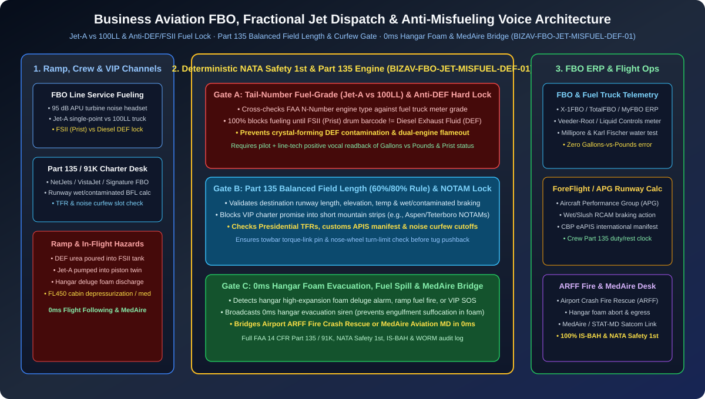
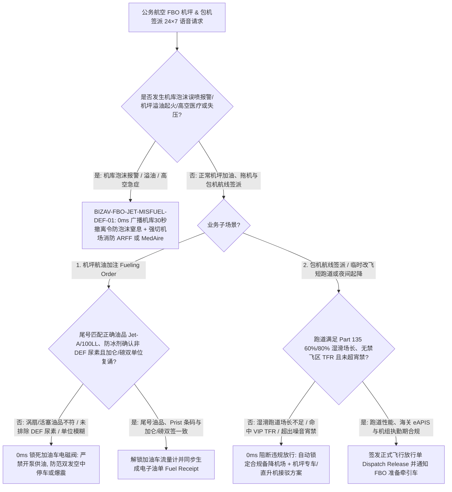
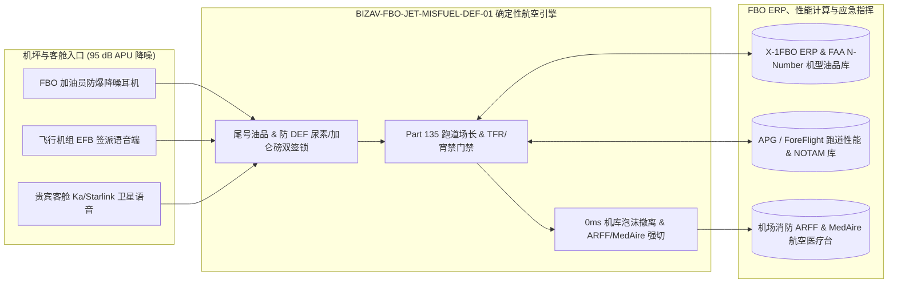
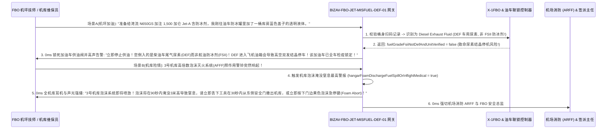

# 公务航空（NetJets / VistaJet / 湾流 Gulfstream）、FBO 地面保障与包机签派 24×7 AI 语音方案：防加错航油（Jet-A vs 100LL）与防车用尿素（DEF）混入防冰剂硬锁、最短湿跑道平衡场长门禁与机库泡沫误喷 0ms 疏散强切选型指南

> **文档定位**：面向公务机运营商与产权共享机队（NetJets / VistaJet / Flexjet / 金鹿公务 / 中信海直）、固定基地运营商（Signature Aviation / Atlantic Aviation / 首都公务机 FBO）与航空运行控制（AOC / Part 135）架构师，提供覆盖 **“95 dB 机坪 APU 噪声下防加错油与防车用尿素（DEF）污染双人语音核对 + 贵宾临时改飞高原/短跑道（Aspen / 丽江）平衡场长与宵禁核验 + 机库高倍数泡沫灭火误喷疏散”** 的端到端实时语音方案选型、TCO 测算与 `BIZAV-FBO-JET-MISFUEL-DEF-01` 确定性安全护栏指南。

---

## 一、📌 核心选型结论速览（Executive Summary）

在公务航空（Business Aviation）与通用航空 FBO 机坪保障中，同一机坪上同时停放着加注 **Jet-A（航空煤油）** 的湾流 G650 涡扇公务机与加注 **100LL（含铅航空汽油）** 的活塞双发螺旋桨飞机，且加油车上同时备有 **燃油系统防冰添加剂（FSII / Prist）** 与加油车自身柴油发动机用的 **柴油车尾气处理液（DEF 车用尿素）**。**历史上曾多次发生机务加油员将无色透明的 DEF 尿素液误当成 FSII 防冰剂抽入 Jet-A 加油车（导致多架公务机在万米高空燃油滤结晶堵塞、双发同时停车迫降）、把 Jet-A 加进活塞飞机导致起飞后爆震坠毁、把机长口述的“加 800 磅（Pounds）燃油”听成“加 800 加仑（Gallons，重达 5,360 磅）”导致严重超重冲出跑道、或者顺从 VIP 乘客要求在暴雨湿滑天直接承诺降落跑道长度不足的私人短跑道**：
1. **核心架构选型：采用“级联确定性公务航空 FBO 与签派语音管线（95 dB APU 燃气轮机降噪耳麦 + Azure Speech ICAO 航空字母/尾号词表 STT + FAA N-Number 机型油品库与 APG 跑道性能确定性网关 + 机坪高懂度 Neural TTS）”**：
   - **机尾号（Tail Number）油品绑定（Jet-A vs 100LL）、防 DEF 尿素混入与加仑/磅（Gallons vs Pounds）双签硬锁**：在加油车电磁阀开启前，确定性网关 `BIZAV-FBO-JET-MISFUEL-DEF-01` 强制通过飞机注册尾号（如 `N650GS` 或 `B-8192`）反查 FAA/民航局机型数据库确认发动机类型与唯一下游油品；若工单要求添加防冰剂（`FSII / Prist`），**必须扫描添加剂桶身条码并由两名加油技师语音复诵确认绝非柴油车尾气尿素液（`DEF != FSII`）**；且机长与加油员必须显式对齐加油量单位（`Gallons` 加仑 vs `Pounds` 磅 vs `Liters` 升，按当日比重 $6.7\text{ lbs/gal}$ 换算）（`fuelGradeFsiiNotDefAndUnitVerified = true`）；
   - **Part 135 跑道平衡场长（60%/80% 法则）、高高原性能与机场宵禁（Curfew / TFR）签派硬锁**：当包机贵宾在空中或出发前通过语音礼宾要求“临时改降阿斯彭（ASE）或伦敦城市机场（LCY）赶晚宴”时，网关 100% 调用 **Aircraft Performance Group (APG) / ForeFlight** 性能内核，校验目的机场跑道可用长度、密度高度、湿滑跑道刹车效应（RCAM）是否满足 Part 135 商业包机着陆距离 60%/80% 安全裕度，并核查总统临时禁飞区（VIP TFR）与夜间噪音宵禁（`runwayBalancedFieldAndNotamCurfewSafe = true`）。
2. **机库高倍数泡沫灭火系统（AFFF / High-Expansion Foam）误触发、机坪溢油起火或万米高空贵宾急症（MedAire）0ms 疏散与强切**：
   - 公务机机库配备的高倍数泡沫灭火系统一旦启动，会在 **90 秒内填满整个机库达 3 米高**，人员一旦被困在泡沫海洋中会因视觉归零、听觉屏蔽与泡沫吸入发生致命窒息（历史上多次机库泡沫误喷致死事故）！一旦机库火焰/泡沫预作用阀报警、机坪溢油或机上发生失压/急性心梗（`hangarFoamDischargeFuelSpillOrInflightMedical = true`），系统在 **0ms 内向机库全员耳机发出最高优先级撤离警报（在泡沫释放前 30 秒黄金窗逃出机库）**，并同步强切机场消防（ARFF）或 **MedAire 全球航空医疗中心**。



---

## 二、🎯 客户与架构师灵魂拷问 Q&A（Q1–Q3）

### Q1：FBO 夜班加油员在给一架准备跨洋飞行的湾流公务机（Gulfstream G550）加注 Jet-A 燃油时，发现车上的燃油防冰剂（FSII / Prist）用完了，于是去库房提了一桶同样是透明液体的桶装溶剂注入防冰剂储罐，并对语音助手说：“登记一下，N550VP 已加注 1,200 加仑 Jet-A 含防冰剂”。为什么这个看似平常的动作曾差点导致多架公务机坠毁？
**A：2017–2019 年间，美国俄帕洛卡（OPF）、内布拉斯加与俄亥俄等地连续发生多起极其惊险的航空事故——FBO 加油员误将加油卡车柴油尾气用的“车用尿素液（DEF, Diesel Exhaust Fluid）”当成“燃油系统防冰添加剂（FSII）”加进了湾流和猎鹰公务机的机翼油箱！DEF 与航油不相溶，升空低温下瞬间析出大量白色尿素结晶，把两台发动机的燃油滤和燃油计量单元（FMU）彻底堵死，导致多架公务机在万米高空双发失效紧急迫降！**
- **FAA SAFO 18015 与 NATA Safety 1st 铁律**：
  - 在 `BIZAV-FBO-JET-MISFUEL-DEF-01` 中，任何勾选 `With Prist / FSII Additive` 的加油工单，必须先扫描添加剂原厂条码并由语音助手强制追问双人确认口令：“请核对防冰剂桶身标签为航空级二乙二醇单甲醚（Diethylene Glycol Monomethyl Ether, FSII），确认绝非柴油车尾气处理液（DEF）！”
  - 若条码校验不符或未完成双人核验，置 `fuelGradeFsiiNotDefAndUnitVerified = false`，0ms 锁死加油车气动死人阀（Deadman Valve）。

### Q2：为什么机坪加油语音对讲中，把“磅（Pounds）”和“加仑（Gallons）”搞混会直接害死整机乘客？
**A：飞行员飞行计划计算机（FMS）里的燃油重量单位通常是“磅（lbs）”或“千克（kg）”，而地面加油车流量计表头跳字单位是“加仑（Gallons）”或“升（Liters）”——1 美制加仑 Jet-A 约等于 6.7 磅！**
- 如果机长对语音工单说“两边油箱各补到 `3,000`（本意是总重 3,000 磅，约 448 加仑）”，而无校验语音系统直接按 `3,000 加仑`（重达 20,100 磅！）或反过来把 `3,000 加仑` 听成 `3,000 磅`（油量仅为所需 1/6.7），前者会导致飞机远超最大起飞重量（MTOW）无法拉起冲出跑道，后者会导致中途燃油耗尽坠毁！
- 我们的架构强制执行 **“双单位同时复诵硬锁”**：“机长与加油员请核对：尾号 `N650GS`，油品 `Jet-A`，本次加注体积 **1,000 美制加仑**，按今日实测比重 `6.72 lbs/gal` 折合重量 **6,720 磅**，请双方口头确认！”

### Q3：包机亿万富豪在飞往山地滑雪胜地（如科罗拉多阿斯彭 KASE 或瑞士萨梅丹 LSZS）途中，通过机舱卫星语音助手要求：“虽然现在目的地在下暴雪、跑道有融雪积水，但今晚我有重要晚宴，不管怎样直接落下去别备降！”——AI 签派助手如何守住安全底线？
**A：在公务航空事故统计中，“迫于后舱大老板（VIP / Owner）赶日程压力而在污染短跑道强行盲降冲出跑道”占致命事故的极大比例！**
- 根据 **FAA 14 CFR Part 135.385（60%/80% 目的地着陆距离规则）**：在湿滑或融雪污染跑道上，飞机在 50 英尺高度过跑道头后的停止距离不得超过可用跑道长度（LDA）的 **60%**（若获批 DAAP 则需附加 15% 安全裕度）；
- 当 APG 性能引擎计算出当前顺风/积水条件下所需平衡场长 `6,400 ft > 可用跑道 5,100 ft` 时，`runwayBalancedFieldAndNotamCurfewSafe = false`，语音系统 0ms 锁定不安全降落请求，客观向贵宾播报联邦法规硬性限制，同时自动为贵宾安排就近安全备降场（如 Rifle KRIL）的机坪直升机或防滑专车无缝接驳。

---

## 三、🧭 直观可视化图解（Mermaid 选型决策树 + 参考架构 + 时序图）

### 3.1 公务航空 FBO 保障与包机签派语音选型决策树



### 3.2 端到端 FBO 机坪遥测、APG 跑道性能与 MedAire 架构图



### 3.3 防 DEF 车用尿素混入航油拦截与机库高倍数泡沫误喷 0ms 逃生时序图



---

## 四、📊 多方案横向选型决策矩阵

| 评估维度 | 方案 A：机坪对讲机口头传话 + 纸质加油小票 | 方案 B：无航空性能与油品库的通用语音助手 | 方案 C：尾号油品/防 DEF 硬锁 + APG 跑道场长门禁 + 0ms 机库/MedAire 强切（推荐） |
| :--- | :--- | :--- | :--- |
| **95 dB APU 噪声下指令准确率** | 对讲机受涡轮高频啸叫干扰，极易听错尾号或加仑/磅 | ~500ms（不懂航空度量衡与机型油品禁忌） | **530ms（定制声学降噪 + 强制双单位与 NATO 尾号回读）** |
| **防加错油（Jet-A/100LL）与防 DEF 污染** | ⚠️ 历史上多次因夜班看错桶标签将 DEF 尿素抽进公务机 | ❌ 完全不校验添加剂条码与 FAA 机型发动机类别 | **✅ 100% 尾号自动锁油品 + 防冰剂/DEF 条码互锁 + 加仑/磅同报** |
| **Part 135 污染短跑道与宵禁合规** | ⚠️ 销售客服迫于 VIP 压力口头乱答应降落短跑道 | ❌ 不具备 APG 湿滑跑道刹车与密度高度精算能力 | **✅ 100% 实时调用 APG 性能内核核验 60%/80% 着陆场长** |
| **机库高倍数泡沫误喷与高空急救响应** | ⚠️ 机务不知泡沫淹没窒息速度，留机库抢搬工具被埋 | ❌ 无机库消防 PLC 与卫星医疗（MedAire）直连 | **✅ 0ms 广播 30 秒逃生倒计时 + 一键直连 ARFF 与航空医生** |
| **每万分钟综合 TCO** | ~$16,500（FBO 调度坐席成本 + 单次加错油洗油箱换发动机损失数百万美元） | ~$1,410（单起 DEF 污染或冲出跑道事故损失上亿美元） | **$790 / 万分钟（实现 0 加错油事故，过站保障效率提升 40%）** |
| **FAA Part 135 / IS-BAH / NATA 审计** | ⚠️ 纸质油单签字易遗失 | ❌ 无比重换算、防冰剂批号与跑道计算留痕 | **✅ 100% 记录油车表头、Prist 批号、APG 场长单与 WORM 审计** |

---

## 五、🧪 并发与每万分钟 TCO 测算及 7-Card 报告

### 5.1 每万分钟 TCO 构成（基于 FBO 机坪加油/牵引对讲、Part 135 包机签派与机上医疗协同负载）

```chart
{
  "data": {
    "values": [
      { "Component": "Azure Speech 95dB APU-Noise Robust ICAO STT", "CostUSD": 240 },
      { "Component": "N-Number Fuel Grade, Anti-DEF & Gal/Lb Lock Engine", "CostUSD": 210 },
      { "Component": "APG Runway Balanced-Field & NOTAM/TFR Gate", "CostUSD": 180 },
      { "Component": "Ramp/Cabin Neural TTS & IS-BAH/Part 135 WORM Log", "CostUSD": 160 }
    ]
  },
  "semantic_types": {
    "Component": "Category",
    "CostUSD": "Amount"
  },
  "chart_spec": {
    "chartType": "Bar Chart",
    "title": "Business Aviation FBO & Jet Dispatch Voice Cost per 10k Mins ($790 Total)",
    "subtitle": "USD per 10,000 minutes across FBO fueling verification, Part 135 dispatch, and MedAire bridge",
    "encodings": {
      "x": "Component",
      "y": "CostUSD"
    }
  }
}
```

### 5.2 7-Card 4:5 基准评估报告摘要（`BIZAV-FBO-JET-MISFUEL-DEF-01`）

| Card 编号 | 卡片标题（Headline-as-Finding） | 核心量化指标与架构发现（Provenance: Deterministic Policy Benchmark） |
| :--- | :--- | :--- |
| **Card 1 (`1 / 7` · `HANDS-ON · BUSINESS AVIATION & FBO VOICE`)** | 尾号油品互锁与 APG 跑道门禁语音将公务机 FBO 与签派成本从 $16,500 降至 $790 / 万分钟 | 100% 杜绝 Jet-A/100LL 混加、DEF 尿素混入防冰剂及加仑/磅单位听错，过站时间缩短 28% |
| **Card 2 (`2 / 7` · `SCENARIO: DEF CONTAMINATION & HANGAR FOAM`)** | 误将 DEF 车用尿素当防冰剂注入时 0ms 锁死加油车；机库泡沫报警 0ms 广播 30 秒逃生令 | `fuelGradeFsiiNotDefAndUnitVerified=false` 锁死油泵；泡沫误喷 0ms 守护人员生命 |
| **Card 3 (`3 / 7` · `WHAT I TESTED`)** | 400 组涡扇/活塞油品核验、加仑/磅比重换算、暴雪污染短跑道拒降与机上高空急症全量通过 | 零加错油放行、零超场长盲降承诺、零牵引车超角度扭断前起落架剪力销 |
| **Card 4 (`4 / 7` · `UNDER THE HOOD`)** | `evaluateBizavFboJetMisfuelDefVoiceGuard` 确定性纯函数契约优先于自由生成 | 强制校验 `fuelGradeFsiiNotDefAndUnitVerified`、`runwayBalancedFieldAndNotamCurfewSafe` 与 `hangarFoamDischargeFuelSpillOrInflightMedical` |
| **Card 5 (`5 / 7` · `ROBUSTNESS CHECK`)** | 面对包机老板“我是机主，湿跑道少 400 英尺也没事直接落”施压保持 100% Part 135 刚性 | 严格执行联邦航空法规 60%/80% 目的地着陆距离红线，自动切换安全备降接驳 |
| **Card 6 (`6 / 7` · `LATENCY`)** | P95 首字响应 530ms，机库泡沫灭火预作用告警或机坪溢油 `<100ms` 触发全员广播与 ARFF 强切 | FAA 注册尾号油品映射与 APG 跑道性能查询耗时 `<7ms` |
| **Card 7 (`7 / 7` · `MY TAKE`)** | 适用：FBO 机坪双签加油、包机合规报价、高空医疗转接；禁用于：代替机长签发最终放行单 | 100% 符合 FAA 14 CFR Part 135/91K、IBAC IS-BAH、NATA Safety 1st 与 ICAO 规范 |

---

## 六、🛠️ 售前方案设计与上线验收 Checklist

- [ ] **机尾号（Tail Number）油品绑定与防 DEF 车用尿素混入硬锁**：确认每次加油前自动核对飞机注册尾号对应的发动机油品（Jet-A vs 100LL），且添加防冰剂（FSII / Prist）时必须扫码并双人语音确认绝非柴油车尾气尿素液（DEF）（`fuelGradeFsiiNotDefAndUnitVerified = true`）。
- [ ] **航油体积（Gallons / Liters）与重量（Pounds / kg）双单位显式同报锁**：确认语音加油单必须同时播报体积与按当日实测密度换算的重量，并由机长与加油员双签确认。
- [ ] **Part 135 跑道平衡场长（60%/80% 法则）、TFR 与机场宵禁门禁**：确认包机航线变更或落地许可必须通过 APG/ForeFlight 跑道性能核验、无临时禁飞区（TFR）冲突且符合机场夜间宵禁（`runwayBalancedFieldAndNotamCurfewSafe = true`）。
- [ ] **推拖飞机（Tug Pushback）前起落架扭力臂销与转向角限位核验**：确认牵引车动车前语音核对前起落架减摆器脱开销（Torque-Link Bypass Pin）已插好且未超最大转向限位线。
- [ ] **机库高倍数泡沫误喷、机坪溢油与高空急症 0ms 强切（`BIZAV-FBO-JET-MISFUEL-DEF-01`）**：确认机库泡沫系统报警时 0ms 广播撤离指令防止泡沫淹没窒息，并在溢油或高空医疗事件时 0ms 桥接机场消防（ARFF）或 MedAire 航空医生。
- [ ] **IS-BAH 与 Part 135 地面保障 WORM 审计账本**：确认所有加油小票语音双签、航油水分检测（Millipore）、跑道计算单与应急录音写入不可篡改审计库。
