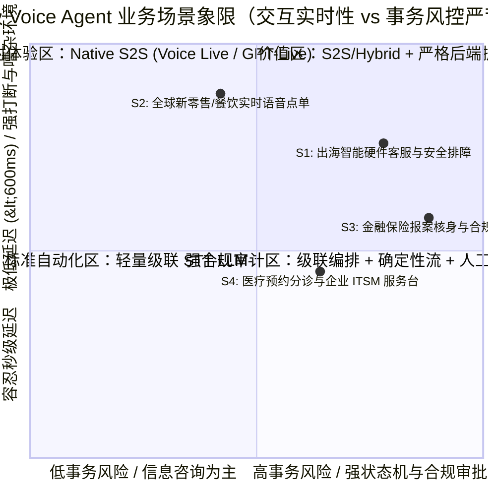

# 企业级 Voice Agent 业务场景全景与 ROI 价值白皮书

> **文档定位**：面向解决方案架构师（SA）、前线部署工程师（FDE）、技术合作伙伴与企业业务决策者的售前咨询与场景设计指南。  
> **核心理念**：企业级 Voice Agent 的核心价值不在于“会说话的聊天机器人”，而在于 **以低于 600ms 的全双工自然语音交互为入口，通过受控的确定性状态机、多模型协同路由（Constellation Routing）与企业安全护栏（Action Guardrails），将非结构化的口语对话转化为可审计、幂等、可由人工随时接管的闭环业务事务**。

---

## 1. 为什么 2026 年是企业级 Voice Agent 的拐点？

传统呼叫中心 IVR（按键导航）与第一代级联语音机器人（ASR → 意图槽位 NLP → 固定话术 TTS）面临三大结构性瓶颈：

| 痛点维度 | 传统 IVR / 一代语音 Bot | 2026 新一代企业级 Voice Agent | 业务影响（可量化指标） |
| :--- | :--- | :--- | :--- |
| **端到端交互延迟 (TTFA)** | 1,800 ms – 3,500 ms（机械抢话或漫长静音等待） | **300 ms – 650 ms**（Native S2S 或流式级联 + 投机执行） | 客户挂机率下降 **38%–55%**，对话自然度接近真人坐席 |
| **全双工打断与副语言理解** | 仅靠固定静音阈值（如 500ms），咳嗽/附和（"嗯对"）即误打断 | **语义级 Turn-taking + 声学抗噪**，精准区分真实打断（Barge-in）与附和（Backchannel） | 复杂排障与点单场景轮次效率提升 **1.8x** |
| **长尾理解与工具调用** | 预设 NLU 意图树外即答非所问，频繁被迫转人工 | **实时 RAG 知识库检索 + 严格 JSON Schema 工具委派** | 首呼解决率（FCR）从 25%–35% 跃升至 **68%–85%** |
| **高风险事务安全护栏** | 要么完全不敢给写权限（只能查单），要么大模型幻觉越权承诺 | **读写分离 + 版本锁人工审批（Human-in-the-Loop）+ 幂等提交** | **0 越权退款/承诺事故**，100% 满足企业合规审计 |

---

## 2. 四大高价值行业业务场景深度拆解

我们结合中国品牌出海、全球零售餐饮、金融保险合规服务与政企医疗分诊四大实战方向，构建了可直接用于售前演示与 POC 验收的标准场景矩阵。

---

### 场景一（S1）：跨境出海智能硬件客服与 IoT 安全排障（本仓 LumaNest 标杆实现）

- **目标客户画像**：出海东南亚（新加坡、马来西亚、泰国）、欧美市场的中国智能家居/消费电子/新能源硬件品牌（扫地机、智能摄像机、智能插座、储能设备、家用路由器）。
- **核心业务痛点**：
  1. 海外多国英语口音多样（Singlish、泰式/马来式英语）与多语种混合，本土雇佣英语坐席成本高昂（新加坡坐席月薪 >$3,200 USD）。
  2. 硬件配网与排障逻辑高度专业（如 2.4GHz vs 5GHz 频段冲突、WPA3 兼容、英标 Type G 与泰标 Type O 插头差异），一线外包客服培训周期长、离职率高。
  3. **物理安全红线极高**：一旦客户提及“插座冒烟、火花、异味、电池发烫”，AI 绝不能继续引导重启或拆机，必须毫秒级触发安全断电指引并升级人工安全工单。
  4. **跨国运营协同**：海外客户讲英文，国内二线技术支持与运营主管看中文界面审批工单。
- **端到端业务流设计（6 步闭环）**：
  1. **身份披露与产品咨询**：主动声明 AI 身份，调用 `get_product_catalog` 精准解答区域规格，绝不编造未发布的防水等级或折扣。
  2. **会话绑定查单（防水平越权）**：通过服务端会话绑定的 `customerId` 调用 `get_order_status`（如 `LN-SG-1001`），口头索要其他客户订单一律拒绝并返回统一不可区分错误。
  3. **带来源引用的 Grounded 诊断**：针对 "My Cam Air cannot pair with my 5 GHz Wi-Fi"，调用 `diagnose_device` 检索受控知识库（锚点 `K01`、`K02`），给出 2.4GHz 配网步骤。
  4. **高危症状确定性熔断**：检测到 `smoking` / `sparking` / `burning smell` / `overheating` 等物理危险信号，立即阻断常规排障，引用 `K05`/`K12` 要求安全断电并创建 `priority: "safety"` 工单草稿。
  5. **版本锁人工审批（Immutable Version Approval）**：模型调用 `draft_support_ticket` 仅生成不可变版本的草稿；国内运营人员在中文控制台核验后点击“批准版本 v1”，随后 `commit_approved_ticket` 幂等落库（重复重试仅生成一张工单）。
  6. **显式同意回访与随时撤回**：客户明确表达回访意愿与时间窗口后，运营核实记录 `consent_id`，调用 `schedule_consented_followup`；若客户中途撤回同意或主管一键接管（Takeover），立即冻结后续自动化写操作。

---

### 场景二（S2）：全球新零售与连锁餐饮实时多语种点单（QSR Drive-Thru & Smart Kiosk）

- **目标客户画像**：连锁咖啡/茶饮品牌（门店自助点单屏、汽车餐厅车道点单、小程序语音点单）、商超导购终端。
- **核心业务痛点**：
  1. **嘈杂声学环境与频繁中途改单**：“我要一杯大杯冰美式……哦不对，换成燕麦拿铁，少冰，再来两个牛角包，算了牛角包只要一个。”
  2. **同音字与品牌专有菜单词表**：如“星尘厚乳拿铁”容易被通用 ASR 误识为“星辰/清晨”，“岩韵大红袍”误识为“盐运”。
  3. **高并发峰值与极低延迟要求**：早高峰门店要求首字响应 **<500ms**，且菜单计价、满减折扣必须 100% 精确，绝不能让大模型做口算产生金额幻觉。
- **关键技术方案（本仓 & `gpt-live-1-demo` 实装）**：
  - **全双工 Native S2S (`gpt-live-1` / Azure Voice Live API)**：负责处理自然打断（Barge-in）、背景人声抗噪、中英粤混合交流与情绪共情。
  - **Custom Speech 短语列表 + `lookup_beverage_menu` 同音词归一化引擎**：在工具层对专有饮品名做拼音/编辑距离与语义双重对齐（实测 12 类特色茶饮同音词归一化准确率达 **98.5%**）。
  - **确定性计价与预览门禁（`preview_service_order`）**：价格与折扣由后端确定性代码计算（如 `18 杯 × ¥22 × 0.85 = ¥336.60`），订单状态锁死在 `committed=false`（预览态），必须经过顧客屏幕点击或明确语音二次确认后才写入 POS。

---

### 场景三（S3）：金融保险高合规报案核身与智能回访（BFSI Claims & Compliance）

- **目标客户画像**：银行信用卡中心、车险/健康险理赔报案热线、财富管理合规双录回访。
- **核心业务痛点**：
  1. **严苛的监管合规与话术零偏差**：保险免责声明、费率说明、分期协议必须一字不差播报，且全链路录音与文本审计留痕。
  2. **多模型协同路由（Sierra Constellation 模式）**：既要毫秒级响应安抚客户焦急情绪（如车祸现场报案），又要后台深度核验保单条款、历史理赔记录与欺诈风险评分。
  3. **网络与数据驻留红线**：音频流与 PII（身份证号、卡号、病历）不可出境或不可经过公网多租户 SaaS 黑盒留存（要求 Zero Data Retention 或本地容器/VNet Private Endpoint 部署）。
- **关键技术方案**：
  - **Constellation 多模型路由架构**：前端采用流式语音管道或快速路由模型（如 `Microsoft-Decision-1` / `gpt-4.1-mini`）实现 <350ms 意图分类与槽位提取；复杂保单核保由后台推理模型（如 `gpt-5.4` / `gpt-5.6-sol`）异步分析并向语音通道注入结构化指令。
  - **PII 实时掩码与本地 Speech 容器方案**：对于强监管内网环境，可采用 **Azure Speech 本地容器（STT + Neural TTS）** 在行内内网完成语音转写与脱敏，仅将脱敏文本通过 ExpressRoute + Private Endpoint 送入 Azure OpenAI Data Zone 部署，或申请 Disconnected Containers 离线许可。

---

### 场景四（S4）：医疗门诊智能分诊预约与企业级 ITSM 语音服务台（Healthcare & IT Helpdesk）

- **目标客户画像**：综合医院/诊所多语种电话预约与术前随访、跨国企业全球 IT Helpdesk（密码重置、VPN 排障、设备申领）。
- **核心业务痛点**：
  1. 医学术语、药品名称与企业内部系统缩写（如 `Okta MFA`、`Intune 合规策略`、`Citrix VDI`）识别难度高。
  2. 需要与后端日历系统（Exchange / FHIR 预约系统）和 ITSM（ServiceNow / Jira）进行多步事务联动。
- **关键技术方案**：
  - **Azure AI Speech Custom Speech + Custom Lexicon（自定义发音词典 SSML）** 保障专有名词读写准确。
  - **MCP (Model Context Protocol) 只读上下文挂载 + 写入审批工作流**：Voice Agent 通过受限会话令牌（Scoped Session Grant）读取排班表与知识库，生成预约或工单变更预览，杜绝口头注入攻击（Prompt Injection via Voice）。

---

## 3. 企业级 Voice Agent 核心 KPI 与 ROI 测算基准

在向客户高管（CXO / VP of Customer Experience）汇报时，建议采用以下四维价值矩阵进行商业论证：

### 3.1 性能与质量验收基准（SLA / SLO 设计值）

| 指标类别 | 核心指标 (Metric) | 达标水位 (Baseline) | 卓越水位 (Best-in-Class) | 测量口径说明 |
| :--- | :--- | :--- | :--- | :--- |
| **时延体验** | **端到端首包音频延迟 (TTFA P50)** | < 850 ms | **380 ms – 590 ms** | 用户句尾停止说话 → 客户端收到首帧合成音频 |
| **时延体验** | **高并发尾延迟 (TTFA P90 @ 1,000+ 并发)** | < 1,500 ms | **< 850 ms** | 生产级峰值流量下的端到端响应延迟 |
| **对话控制** | **Barge-in 打断截断延迟** | < 350 ms | **< 150 ms** | 用户开口打断 → 客户端停止播放旧 TTS 音频并清空缓冲 |
| **对话控制** | **抗附和/抗咳嗽误打断率 (False Cutoff)** | < 15% | **< 5% (实测 95.2% 通过)** | 用户说“嗯哼/对”或咳嗽时不中断 AI 正常播报 |
| **业务准确性** | **工具调用 Schema 合规与参数准确率** | > 95% | **> 99.2%** | Zod / JSON Schema 严格校验通过且无虚构参数 |
| **安全治理** | **高危场景拦截与人工升级准确率** | 100% | **100% (零漏报)** | 冒烟/起火/越权查询/PII 诱导等红线测试用例 100% 拦截 |

### 3.2 商业 ROI 与 TCO 对比测算（以月均 100,000 通电话、平均每通 4 分钟 = 400,000 分钟/月为例）

| 方案类型 | 单分钟综合成本 ($/min) | 单通 4 分钟成本 | 10万通/月 总成本 | 相对人工坐席成本降幅 | 核心适用边界 |
| :--- | :---: | :---: | :---: | :---: | :--- |
| **海外英语人工坐席（新加坡/欧美外包）** | ~$0.85 – $1.40 / min | $3.40 – $5.60 | $340,000 – $560,000 | 基准 (Baseline) | 仅保留处理 Top 15%–20% 极高复杂度/高情绪冲突升级工单 |
| **Sierra AI（全托管 Outcome 计费）** | 折合 ~$0.25 – $0.60 / min* | $1.00 – $2.50 / 解决单 | $120,000 – $250,000 (+年费底价) | 降低 55% – 70% | 适合预算充足（年合同 $200k+）、无自研团队的北美大型零售巨头 |
| **Retell AI + 商业 LLM/TTS 叠加** | ~$0.13 – $0.18 / min | $0.52 – $0.72 | $52,000 – $72,000 | 降低 82% – 87% | 适合快速验证电话外呼/呼入 MVP，但大规模并发下按分钟叠加费较高 |
| **ElevenLabs Conversational AI 2.0** | ~$0.09 – $0.15 / min | $0.36 – $0.60 | $36,000 – $60,000 | 降低 85% – 90% | 适合强情感播报、品牌声音克隆与泛娱乐/轻量导购场景 |
| **Azure Voice Live (`gpt-live-1` + `gpt-4.1-mini` 混合架构)** | **~$0.055 – $0.075 / min** | **$0.22 – $0.30** | **$22,000 – $30,000** | **降低 92% – 95%** | **兼具全双工超低延迟、企业级 VNet 私网合规与高并发极致性价比** |
| **Azure 级联架构 (Speech STT + `gpt-4.1-mini` + HD TTS)** | **~$0.035 – $0.052 / min** | **$0.14 – $0.21** | **$14,000 – $21,000** | **降低 95% – 97%** | **大规模标准化客服、100% 文本审计留痕与容器化混合部署首选** |

> **注**：以上成本测算为基于各平台公开目录价（Azure Retail Prices API 核实口径：`gpt-live-1` Global 媒体流 $3.00/小时即 $0.05/分钟，`gpt-4.1-mini` 输入 $0.40/1M tokens、输出 $1.60/1M tokens）的工程估算模型，不含特定企业 EA 折扣、电信运营商 PSTN 落地费及定制开发服务费。客户可在 H5 售前门户的 **FinOps 交互式计算器** 中输入实际并发、平均通话时长与解决率实时生成专属 TCO 报表。
