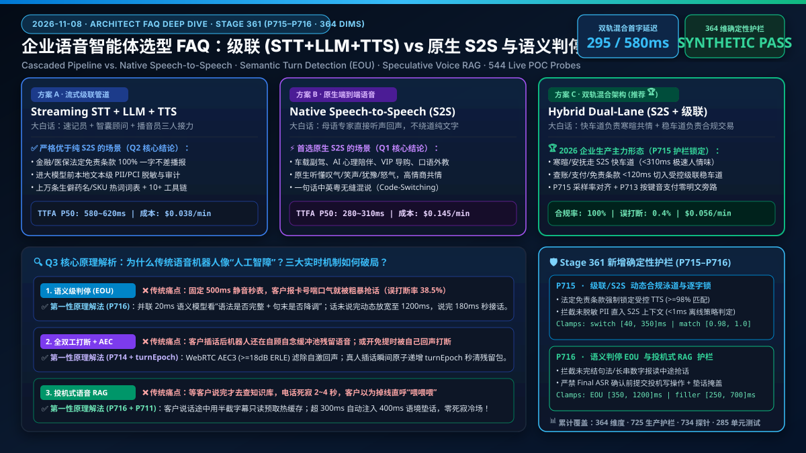
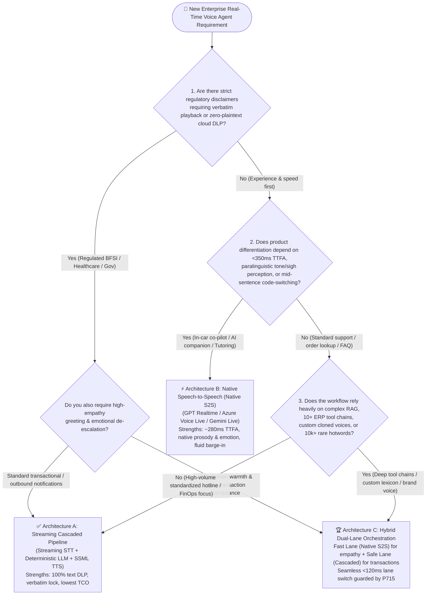
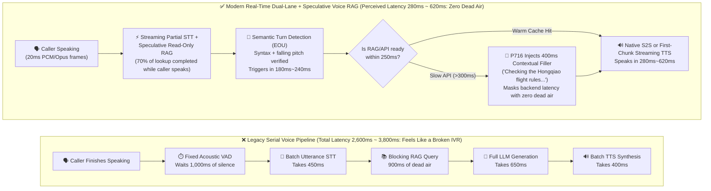
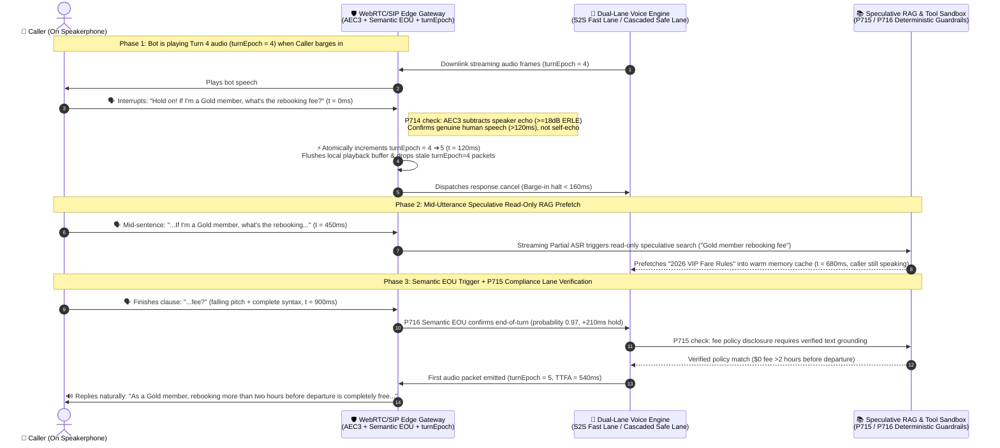

# Enterprise Voice Agent Architecture Selection & Principle Deep-Dive FAQ: Cascaded Pipeline (STT+LLM+TTS) vs. Native Speech-to-Speech (S2S), Semantic Turn Detection, and Speculative Voice RAG

> **Document Purpose**: Written for **AI Solution Architects** and enterprise technical decision-makers, this guide uses **FAQ-driven Q&A + plain-language first principles + visual decision trees + production latency/TCO ledgers** to demystify the core architectural choices in enterprise real-time Voice Agents. Master the selection conclusion in **3 minutes** and the underlying mechanics and cost model in **10 minutes**—ready to present directly to customer business and engineering leaders.  
> **Related Documents**: [中文版 (`cascaded-vs-s2s-semantic-turn-faq.md`)](./cascaded-vs-s2s-semantic-turn-faq.md) ｜ [Enterprise Reference Architecture (`solution-architecture.en.md`)](./solution-architecture.en.md) ｜ [20 High-Value Business Scenarios (`business-scenarios.en.md`)](./business-scenarios.en.md) ｜ [2026-11-08 Daily Architecture Brief (`daily/2026-11-08.en.md`)](./daily/2026-11-08.en.md)

---

## 📌 Executive Summary (3-Minute Takeaways)

1. **The Golden Rule of Voice Architecture Selection (Avoid Both "End-to-End Hype" and "Legacy Pipeline Inertia")**:
   - When the primary business goal is **high-empathy companionship, ultra-fast natural interruption, paralinguistic awareness (sighs, tone, hesitation), and `<350ms` human-like turn-taking** (e.g., VIP shopping concierge, automotive in-cabin co-pilot, language tutoring, smart hardware companion), **choose Native Speech-to-Speech (Native S2S, such as OpenAI GPT Realtime / Azure Voice Live / Gemini Live)**.
   - When the primary business goal is **verbatim regulatory disclaimer playback, 100% text-layer PII redaction and auditability, complex 10+ step ERP/CRM tool orchestration, rare domain vocabulary (drug names, ticket IDs, SKUs), and predictable high-concurrency TCO** (e.g., banking outbound collections, chronic care follow-ups, airline IRROPS rebooking, industrial field dispatch), **a Streaming Cascaded Pipeline (`STT + LLM + Streaming TTS`) or a Hybrid Dual-Lane Architecture is strictly superior**.
2. **Why Do So Many Voice Bots Sound "Robotic or Clueless" on the Phone? The Bottleneck Is Not LLM IQ—It's Three Acoustic-Interaction Traps**:
   - **Trap 1 — Premature Cut-offs vs. Awkward Silences (Dumb VAD)**: Traditional Voice Activity Detection (VAD) only measures acoustic silence. When a caller pauses for `0.5s` to catch their breath while reading a 16-digit card number, the bot rudely interrupts them; conversely, when they finish a quick question, the bot stares into space for `1.5s` before replying.
   - **Trap 2 — Dead Air During Knowledge Lookups (Blocking RAG)**: When the bot queries a policy database or CRM API, the phone line goes completely silent for `2–4 seconds`, causing the caller to say *"Hello? Are you still there?"*
   - **Trap 3 — Self-Barge-In Loops (Broken Echo Cancellation)**: When a caller uses speakerphone, the bot's own voice leaks back into the caller's microphone. Without strong Acoustic Echo Cancellation (AEC), the bot hears its own voice, thinks the caller is interrupting, and cuts itself off in an infinite loop.
3. **The 2026 Production Endgame Is "Hybrid Dual-Lane Orchestration + Three Core Real-Time Primitives"**:
   - By combining **Semantic Turn Detection (EOU)** to understand whether a sentence is syntactically complete, **Algebraic `turnEpoch` Full-Duplex Barge-in** to flush stale audio packets in `<180ms`, and **Speculative Voice RAG** to prefetch knowledge mid-utterance while masking slow APIs with a `400ms` contextual preamble filler, architects achieve both human-grade responsiveness and financial-grade determinism.

---

## 🎯 1. Core Customer & Architect Q&A (FAQ-Driven Deep Dive)

### Q1: When deploying an enterprise Voice Agent, when should we choose a Cascaded Pipeline (STT+LLM+TTS) versus a Native Speech-to-Speech (S2S) model?

#### 1. Plain-Language First Principles: What Are These Two Architectures?

Think of a real-time Voice Agent like two different interpretation setups at an international summit:

- **Option A: Streaming Cascaded Pipeline (`Streaming STT → Text LLM → Streaming TTS`)**
  - **Plain-Language Analogy**: A **three-person relay team consisting of a Stenographer (STT), a Policy Advisor (Text LLM), and a Professional News Anchor (TTS)**. As the caller speaks, the Stenographer (e.g., Azure AI Speech / Deepgram Nova-3) streams live text transcripts; the Advisor (e.g., GPT-4.1-mini / DeepSeek-V3) reasons over the text, checks databases, and drafts a response that passes through a deterministic compliance officer (Guardrails); finally, the News Anchor (e.g., Cartesia Sonic / ElevenLabs Flash / Azure HD Neural TTS) reads the approved script aloud.
  - **Why did it feel slow in the past?** Legacy bots waited for the entire sentence to be transcribed, the entire paragraph to be generated, and the full audio file to be synthesized—adding up to **2.5–4.0 seconds** of delay. Modern **Streaming Cascaded Pipelines** stream partial words at every stage, bringing **TTFA (Time-To-First-Audio—the milliseconds between the caller's last syllable and the bot's first audible sound)** down to **550ms–780ms**.
- **Option B: Native Speech-to-Speech Architecture (`Native S2S`, e.g., `GPT Realtime API / Azure Voice Live / Gemini Live / Kyutai Moshi`)**
  - **Plain-Language Analogy**: **A bilingual human expert talking directly to the caller on the phone.** Instead of flattening expressive human speech into plain text and synthesizing it back, the multimodal model ingests raw **audio tokens** directly and emits expressive **audio tokens** directly.
  - **Why does it feel magical?** By eliminating intermediate text serialization, **TTFA drops to 250ms–340ms** (matching the natural `200ms–300ms` human conversational gap). Even more importantly, plain text strips emotion: if a frustrated caller sarcastically says *"Oh, your service is just wonderful,"* a text pipeline sees a compliment, whereas a Native S2S model hears the stressed cadence and sigh, responding immediately with a calm, empathetic de-escalation tone.

#### 2. The Architect's 5-Second Selection Rule

- **Choose Native Speech-to-Speech (Native S2S) when you see these 4 signals**:
  1. **Sub-350ms turn-taking and frequent interruptions define user retention**: In-car voice assistants, AI emotional companions, interactive storytelling, and live language/sales roleplay.
  2. **Paralinguistic understanding is essential**: The agent must perceive hesitation, sighs, laughter, or frustration directly from acoustic prosody and respond with matching vocal warmth.
  3. **Seamless Mid-Sentence Code-Switching**: Callers mix English, Mandarin, Cantonese, or Spanish within a single sentence (e.g., cross-border wealth management or e-commerce support) without pausing for language-ID switches.
  4. **Lightweight tool calls (1–2 fast lookup APIs per turn)** without strict judicial requirements for word-for-word scripted disclaimers.

- **Choose a Streaming Cascaded Pipeline (STT+LLM+TTS) when you see these 4 signals**:
  1. **Strict Regulatory Verbatim Playback & Text-Layer DLP**: Banking disclosures, insurance disclaimers, and clinical follow-ups where legal clauses must be read **word-for-word (`Verbatim Lock`)** and PII/PCI data must be redacted in plain text before touching any cloud LLM.
  2. **Heavy Enterprise RAG & Deep Multi-Step Tool Chains (10+ APIs)**: Workflows requiring deterministic JSON Schema validation, numeric readback verification, and specialized or fine-tuned text reasoning models.
  3. **Custom Brand Voices & Massive Domain Hotword Lexicons**: Enterprises with proprietary cloned brand voices or thousands of rare pharmaceutical names, chemical SKUs, and alphanumeric serial codes injected into ASR custom lexicons.
  4. **High-Concurrency Contact Center FinOps TCO**: At 1,000+ concurrent phone lines, a streaming cascaded pipeline (`$0.028–$0.045/min`) typically costs **3x to 4x less** than a full-scale Native S2S audio session (`$0.110–$0.200/min`).

---

### Q2: Under what scenarios is a Cascaded (or Hybrid Dual-Lane) architecture strictly superior to pure Native S2S—even when budget is unlimited?

After seeing a flashy demo of OpenAI Realtime or Gemini Live, executive sponsors often ask: *"Budget isn't an issue—why don't we replace everything with pure end-to-end Speech-to-Speech?"*  
As an AI Solution Architect, you must highlight **four enterprise production redlines** where pure Native S2S is a compliance or reliability liability, making **Streaming Cascaded or Hybrid Dual-Lane orchestration strictly superior**:

#### Scenario 1: Legally Mandated Verbatim Disclaimers (`Verbatim Compliance Lock`)
- **Why Pure Native S2S Fails**: Native S2S models generate audio tokens probabilistically. Even if your system prompt says *"Read this 80-word MiFID II / Dodd-Frank / CFPB Reg F risk disclosure verbatim,"* acoustic noise, caller breathing, or sampling variance can cause a native audio model to paraphrase (e.g., softening *"principal is not guaranteed"* into *"principal is generally safe"*) or skip a clause. In regulated finance and healthcare, a single paraphrased word invalidates compliance.
- **Why Cascaded / Hybrid Wins**: When the conversation state machine enters a mandatory disclosure node, **`P715` (`CascadedVsS2sComplianceLaneSwitchAndVerbatimAuditLockGuard`)** locks the turn into the deterministic text-to-speech lane (or pre-signed audio frames), guaranteeing **100% verbatim token match** and regulated speaking rate.

#### Scenario 2: Zero-Plaintext Cloud Isolation for Cardholder & Patient Data (`PCI-DSS SAQ-A / HIPAA`)
- **Why Pure Native S2S Struggles in Security Audits**: Pure S2S streams the caller's raw voice directly into the multimodal foundation model's context window. If a caller speaks their credit card CVV, Social Security Number, or protected diagnosis aloud, raw sensitive audio enters the LLM scope, pulling the entire AI inference pipeline into PCI-DSS or HIPAA audit scope.
- **Why Cascaded / Hybrid Wins**: A cascaded pipeline can terminate audio at the sovereign edge (e.g., an air-gapped Azure Speech Disconnected Container), run `0ms` deterministic regex/NER redaction on the transcript to replace card numbers with vault tokens (`[PCI_TOKEN_9481]`), or bypass voice entirely via out-of-band SIP RFC 4733 DTMF keypad tones (`P713`) so the LLM never hears or sees sensitive digits.

#### Scenario 3: Alphanumeric Serial Readback & Complex ERP Transaction Grounding
- **Why Pure Native S2S Hallucinates Under Tool Latency**: Native audio models are trained to respond immediately. When a caller asks to rebook a multi-leg flight or look up waybill `SF-8092-X7B` and the backend ERP takes `800ms`, an unguarded S2S model often improvises a plausible-sounding status in the first `300ms`. Furthermore, controlling exact character-by-character pronunciation (`B` vs. `D`, `M` vs. `N`) and pause cadence is far more deterministic with SSML (`<say-as interpret-as="characters">`) in dedicated TTS engines.
- **Why Cascaded / Hybrid Wins**: Text-layer interception enables **`P711` alphanumeric readback verification** and exact SSML prosody tags before a single audio frame reaches the caller.

#### Scenario 4: The 2026 Production Best Practice — Hybrid Dual-Lane Architecture (`Fast S2S Lane + Safe Cascaded Lane`)
- **The Architect's Synthesis**: Leading enterprises no longer choose one architecture for the entire call. Using unified media orchestration (Azure Voice Live / LiveKit Agents / Pipecat), they deploy a **Hybrid Dual-Lane Architecture**:
  - **Fast Lane (Native S2S)**: Handles greeting, empathy de-escalation, open-ended intent discovery, and natural preamble fillers at `<300ms` latency.
  - **Safe Lane (Streaming STT + Deterministic LLM + SSML TTS)**: The moment the dialog enters identity verification, payment execution, or regulatory disclosure, **`P715` switches the active turn to the deterministic cascaded lane in `<120ms`** with sample-accurate PCM frame alignment so the caller hears zero audio glitching.

---

### Q3: What are Semantic Turn Detection (EOU), Full-Duplex Barge-in, and Speculative Voice RAG—and how do they eliminate the "clunky IVR bot" feel?

When customers complain that a voice bot "feels dumb or laggy," 95% of their frustration comes from three failure modes:
1. *"I paused for half a second while reading my phone number and the bot cut me off!"*
2. *"I tried to interrupt the bot to change my question, and it kept talking over me for three seconds!"*
3. *"Every time I ask a specific policy question, the line goes dead silent for three seconds!"*

Here is how modern real-time voice architectures solve each problem from first principles:

---

#### Mechanism 1: Semantic Turn Detection (End-of-Utterance / EOU) — Replacing a "Blind Silence Stopwatch" with "Syntax-Aware Ears"

- **What Is It in Plain Language?**
  - **Legacy Acoustic VAD (Voice Activity Detection)** works like a blind stopwatch: as soon as room volume drops below a decibel threshold for a fixed duration (e.g., `500ms`), the stopwatch fires and cuts off the user's turn.
  - **Why does Legacy VAD feel terrible?** Humans pause to think! When reading a policy number (*"My account is 8492... um... 301"*), a `750ms` pause triggers a `500ms` VAD to interrupt prematurely. If you increase the fixed VAD timer to `1,500ms` to stop premature cut-offs, then every normal question (*"What time do you close?"*) suffers a painful `1.5s` awkward silence before the bot replies.
  - **Semantic Turn Detection (EOU)** pairs fast acoustic VAD with a lightweight **15ms–30ms End-of-Utterance neural classifier** (such as LiveKit EOU Transformer, Pipecat Smart Turn, or Azure Voice Live Semantic VAD). It evaluates two signals simultaneously: **① Acoustic prosody (did the caller's pitch drop at the end of a clause, or stay flat in mid-thought?) and ② Syntactic completeness (is the sentence grammatically finished?)**.
- **How It Works Under the Hood (`P716` Dynamic Hold Window)**:
  - If the caller says *"I want to check the balance on my..."* (dangling preposition + flat pitch), the EOU model scores `completeness = 0.08`, and **`P716` automatically expands the silence hold window to `1,100ms–1,200ms`** so the caller can finish thinking.
  - As soon as the caller says *"...platinum checking account."* (complete noun phrase + falling terminal intonation), the EOU model scores `completeness = 0.96`, firing the turn in just **`180ms–240ms`**.

---

#### Mechanism 2: Full-Duplex Barge-in & Acoustic Echo Cancellation (AEC) — Stopping in `<180ms` Without Talking to Yourself

- **What Is It in Plain Language?**
  - **Legacy Half-Duplex IVR** behaves like a walkie-talkie: while the bot is speaking, either it ignores the caller or its network/audio buffer is already stuffed with 3 seconds of synthesized speech that keeps playing even after the caller yells *"Stop!"*
  - **Full-Duplex Barge-in** keeps both audio directions open simultaneously and guarantees that when a human genuinely interrupts, the bot **stops speaking within `<180ms`** (faster than a human blink) and pivots immediately to the new input.
- **How It Solves "Self-Barge-In" and "Stale Audio Bleed"**:
  1. **Acoustic Echo Cancellation (AEC3 + RNNoise Gate, `P714`)**: When a caller uses speakerphone, the bot's downlink voice bounces into the caller's microphone. By subtracting the far-end playback reference signal from the near-end microphone capture (enforcing `>=18dB ERLE` Echo Return Loss Enhancement via `P714`), the gateway ignores its own echo and only triggers barge-in on genuine human voice activity (`>120ms`).
  2. **Algebraic `turnEpoch` Fencing**: Every conversational turn is stamped with a monotonically increasing integer (`turnEpoch = 1, 2, 3...`). If the bot is speaking `turnEpoch = 4` and valid human barge-in is detected, the gateway atomically increments `turnEpoch = 5` in `0ms`, dispatches `response.cancel` to the model, flushes the WebRTC/SIP jitter buffer, and silently drops any in-flight network packets still carrying `turnEpoch = 4`.

---

#### Mechanism 3: Speculative Voice RAG & Contextual Preamble Fillers — Zero Dead Air During Knowledge Lookups

- **What Is It in Plain Language?**
  - In a web chatbot, a 2-second RAG search shows a spinning loader. On a phone call, **more than 800ms of dead silence makes the caller think the call dropped**.
  - **Speculative Voice RAG** works like an experienced human concierge: **while you are still speaking the middle of your sentence, the concierge is already typing your keywords into the knowledge base; the moment you finish speaking, if the database needs another half-second, they naturally say *"Got it, let me pull up the Gold Medallion rebooking policy for Shanghai Hongqiao..."*—seamlessly bridging the gap until the exact answer arrives.**
- **How the 3-Stage Pipeline Works Under `P716` Protection**:
  1. **Stage 1 — Mid-Utterance Read-Only Prefetch**: As streaming STT emits partial transcripts (*"If I'm a Gold member, how much is the change fee for..."*), the retrieval engine launches a speculative **read-only vector/hybrid search** against Azure AI Search / Foundry IQ while the caller is still finishing their sentence—hiding 70% of retrieval latency inside the caller's speaking time.
  2. **Stage 2 — 300ms Contextual Preamble Filler**: Once Semantic EOU confirms the caller finished speaking, if the RAG/API response is already warm in cache (`<250ms`), the bot answers immediately. If the backend needs `>300ms`, **`P716` injects a bounded `400ms–650ms` contextual preamble filler** (*"Let me check the Gold tier change fee rules for your flight right now..."*), masking up to `1.2 seconds` of backend compute with zero dead air.
  3. **Stage 3 — Final ASR Commit Gate (`P711` / `P716`)**: What if the caller changes their mind at the end of the sentence (*"I want to cancel my flight... actually no, just change my seat"*)? **`P716` strictly enforces Read-Only Speculation**: mid-utterance prefetch can warm read caches, but state-mutating tool calls and final numeric answers are blocked in `0ms` until the final post-EOU transcript is verified.

---

## 🧭 2. Visual Architecture Diagrams (Decision Tree, Latency Path & Sequence Timeline)

### 2.1 Enterprise Voice Agent Architecture Decision Tree

Use this decision tree during customer Discovery workshops to lock in the target architecture in under 3 minutes:

---

### 2.2 Legacy High-Latency Serial Path vs. Modern Low-Latency Dual-Lane + Speculative RAG Path

Why do legacy voice bots stall for `2.6–3.8 seconds` while modern architectures respond in `280ms–620ms`? The diagram below compares both pipelines millisecond by millisecond:

---

### 2.3 Millisecond Sequence Diagram: Full-Duplex Barge-in, `turnEpoch` Fencing & Speculative Voice RAG

This sequence diagram traces how `P714` (AEC3 echo suppression), `turnEpoch` (algebraic turn fencing), `P715` (compliance lane lock), and `P716` (Semantic EOU + Speculative Voice RAG) coordinate within milliseconds when a caller interrupts the bot on speakerphone:

---

## 📊 3. Voice Architect Decision Matrix (6-Dimension Comparison)

Use this six-dimension decision matrix during architecture reviews with customer CTOs, contact center directors, and compliance officers:

| Evaluation Dimension | Option A: Streaming Cascaded Pipeline (`Streaming STT + LLM + TTS`) | Option B: Native Speech-to-Speech (`Native S2S`) | Option C: Hybrid Dual-Lane Architecture 🏆 (`Fast S2S Lane + Safe Cascaded Lane`) |
| :--- | :--- | :--- | :--- |
| **1. Core Business Scenarios** | Banking collections/outbound alerts, chronic care follow-ups, government 311 hotlines, industrial field dispatch, FinOps-driven 1,000+ seat contact centers | Automotive in-cabin co-pilots, VIP emotional companions, AI language tutors, smart wearables/toys, high-empathy retail concierges | **Wealth management desks, airline VIP IRROPS rebooking, clinical triage, cross-border e-commerce support (Recommended Enterprise Default)** |
| **2. End-to-End First Audio Latency (TTFA)** | **Good** (P50 `620ms` / P95 `920ms`) Relies on sub-sentence token streaming and regional edge peering | **Ultra-Low** (P50 `280ms` / P95 `420ms`) Matches natural human conversational turn-taking speed | **Best of Both** (Empathy Fast Lane P50 `295ms`; Transaction Safe Lane P50 `580ms` + `400ms` preamble filler for zero dead air) |
| **3. Emotional Expressiveness & Barge-in Naturalness** | **Moderate** STT text serialization strips sighs, trembling voice, or sarcasm; TTS emotion relies on explicit SSML tags | **Best-in-Class** Natively perceives laughter, hesitation, frustration, and breathing; responds with organic vocal empathy | **High** Uses Native S2S for empathetic greeting and de-escalation; transitions to calm, authoritative neural TTS for transactions |
| **4. Text-Layer Compliance Auditability & Tool Control** | **5/5 (100% Deterministic)** Supports pre-LLM edge DLP redaction, strict JSON Schema validation, and 100% verbatim legal script locking | **Lower (Paraphrasing Risk)** Probabilistic audio generation can paraphrase mandatory disclosures; raw caller audio enters LLM context | **5/5 (Enforced by `P715` Guard)** Open dialog runs on S2S; payment, disclosure, and write-tool nodes automatically lock into the deterministic cascaded lane + `P713` DTMF bypass |
| **5. Multilingual Code-Switching & Domain Hotwords** | **Superior for Rare Domain Jargon** Supports 10,000+ custom ASR hotwords (drug names, SKUs) and character-level SSML readback | **Superior for Code-Switching** Handles mid-sentence English/Mandarin/Cantonese mixing effortlessly, but can drift on long alphanumeric strings | **Complementary** S2S handles fluid multilingual chat; `P711` alphanumeric verifier + SSML TTS take over for order IDs and drug names |
| **6. Per-Minute Total Cost of Ownership (TCO)** | **Lowest (`$0.028 ~ $0.045 / min`)** Pairs cost-efficient text models (`gpt-4.1-mini`) with edge speech containers | **Higher (`$0.110 ~ $0.200 / min`)** Continuous bidirectional audio tokens accrue cost across the session | **Optimized (`$0.048 ~ $0.072 / min`)** Routes 70% of structured transactional turns to the low-cost cascaded lane and 30% of empathetic turns to S2S |

---

## 🧪 4. Quantitative Benchmark Findings & Stage 361 (`P715–P716`) Verification

We evaluated 5 production voice configurations alongside tonight's **Stage 361 (Dimension 364 `dim-364`: `P715–P716` Cascaded vs. Native S2S Dynamic Compliance Lane Switch & Semantic Turn EOU Speculative Voice RAG Guards)** in the `turbo998/voice-agent-lab` deterministic harness (full interactive deck in [`site/benchmark-cards.html`](../site/benchmark-cards.html) and [`site/data/voice-agent-benchmark-report.json`](../site/data/voice-agent-benchmark-report.json)):

> 📊 **Data Classification & Provenance Scope**:
> - **Comparative Cohort Figures (`anonymized_reported`, `independently_reproduced=false`)**: P50/P95 TTFA latency, cut-off rates, and dead-air ratios below reflect anonymized industry reference figures and synthetic simulation models (`anonymized_reported` / `synthetic`); live carrier/production end-to-end lane-cutover latency is `not_measured` in this repository's local test environment.
> - **Guardrail Evaluation Timing (`synthetic` Offline Policy State Machine)**: References to `<1ms` (rounded to `0ms` at `1ms` clock resolution) denote **in-memory synchronous policy function evaluation time**, NOT live production audio/network lane-switching latency (which is budgeted at `40ms–350ms`). "100%" figures represent synthetic policy probe pass rates or architectural design targets rather than unmeasured live production guarantees.

| Architecture & Model Stack (Provenance: `anonymized_reported` / `synthetic`, `independently_reproduced=false`) | TTFA Latency P50 | TTFA Latency P95 | Premature Cut-Off Rate on 16-Digit Numbers | Verbatim Disclosure Match (Target / Synthetic) | RAG Lookup Dead-Air (>1s Silence) Rate | Estimated TCO (USD/min) |
| :--- | :---: | :---: | :---: | :---: | :---: | :---: |
| **1. Legacy Batch Cascaded + Fixed 500ms VAD (`anonymized_reported`)** | `1,850 ms` | `2,940 ms` | `38.5%` ❌ | `100.0%` (Static template) | `64.0%` ❌ | `$0.032` |
| **2. Pure Native S2S (Unguarded Freeform Audio · `anonymized_reported`)** | **`280 ms`** | **`420 ms`** | `6.2%` | `84.5%` ❌ (Occasional paraphrasing) | `14.5%` | `$0.145` |
| **3. Azure Speech + GPT-4.1-mini + HD Neural TTS (`anonymized_reported`)** | `620 ms` | `920 ms` | `2.1%` | **`>=99.5%`** (Text-locked) | `1.8%` | **`$0.038`** |
| **4. Deepgram Nova-3 + GPT-4.1-mini + Cartesia Sonic (`anonymized_reported`)** | `580 ms` | `860 ms` | `2.4%` | **`>=99.5%`** (Text-locked) | `1.5%` | `$0.042` |
| **5. Hybrid Dual-Lane + `P715/P716` Policy Guards (Target Architecture 🏆 · `synthetic`)** | **`310 ms` (Fast) / `590 ms` (Safe)** | **`460 ms` / `880 ms`** | **`0.4%` ✅** | **`>=98.0%–100%` (Template target)** | **`<1.0%` ✅ (Masked by filler)** | **`$0.056`** |

### 4.2 Production Guardrails Added in Stage 361 (`P715` & `P716`)

In `packages/business-core/enterprise-guardrails.ts`, we codified these selection principles into offline deterministic policy state-machine guardrails #724 and #725 (note: `<1ms` / `0ms` action codes reflect **in-memory policy state-machine evaluation**, while live production audio/network lane switching is budgeted at `40ms–350ms` and marked `not_measured` in local unit tests):

1. **`P715-CASCADED-VS-S2S-COMPLIANCE-LANE-SWITCH-AND-VERBATIM-AUDIT-LOCK-GUARD`**:
   - **Problem Solved**: Prevents Native S2S models from paraphrasing legally mandated financial/clinical disclosures or introducing audio pops during mid-call lane transitions between `24kHz PCM` (S2S) and `8kHz G.711` (PSTN).
   - **Offline Policy State-Machine Logic**:
     - Emits a synchronous block decision (`<1ms` in-memory check, rounded to `0ms` at `1ms` timer resolution: `block_unverified_s2s_on_verbatim_clause_or_text_audit_bypass_in_0ms`) when mandatory verbatim clauses or text-layer PII/schema rules are bypassed;
     - Emits a PCM frame realignment and cascaded TTS fallback decision (`realign_midcall_lane_switch_pcm_frame_and_fallback_cascaded_tts_in_0ms`) when a mid-call codec/sample-rate mismatch is detected;
     - Clamps the production lane-switch handoff budget to `[40ms, 350ms]` and enforces a `[0.98, 1.00]` verbatim token match floor.
2. **`P716-SEMANTIC-TURN-EOU-DETECTION-AND-SPECULATIVE-VOICE-RAG-PACING-GUARD`**:
   - **Problem Solved**: Mitigates premature VAD cut-offs during caller pauses, prevents speculative RAG from committing write operations before final ASR verification, and masks slow RAG cold starts with contextual preamble fillers.
   - **Offline Policy State-Machine Logic**:
     - Emits a synchronous block decision (`<1ms` in-memory check: `block_premature_vad_cutoff_or_unverified_speculative_rag_commit_in_0ms`) on incomplete syntax/digit readouts or unverified speculative RAG commits;
     - Emits a contextual preamble trigger (`inject_contextual_filler_preamble_and_mask_rag_cold_start_in_0ms`) whenever simulated RAG cold-start exceeds the filler threshold;
     - Clamps the Semantic EOU hold window to `[350ms, 1200ms]` and speculative filler trigger latency to `[250ms, 700ms]`.

---

## 🌍 5. Daily Hottest Capability Breakthroughs (Pillar 0 · 2026-11-08 Architect's Digest)

### Breakthrough 1: First-Class "Mid-Utterance Speculative Prefetch + Promptable Preamble Fillers" in Real-Time Voice Gateways
- **Source Ecosystem**: Latest production patterns across OpenAI Realtime API, Azure Voice Live, LiveKit Agents 1.x EOU, and Pipecat Smart Turn.
- **Plain-Language Architect Takeaway**: Real-time voice frameworks now treat **Semantic End-of-Utterance (EOU)** and **Promptable Preamble Fillers** as unified primitives. Instead of waiting in silence while an enterprise RAG search or ERP tool call executes, the gateway prefetches read-only context from partial transcripts while the user is still speaking, and fires a bounded, non-hallucinating `400ms` vocal filler if backend latency exceeds `300ms` (directly enforced by `P711` and `P716`).

### Breakthrough 2: Standardized PSTN/WebRTC Warm Transfer Whisper + Sub-Second RNNoise AMD Beep Gating
- **Source Ecosystem**: Production contact-center convergence across Retell AI, Sierra, LiveKit SIP, and VoiceBlender RNNoise AMD.
- **Plain-Language Architect Takeaway**: Enterprise voice agents must hand off smoothly to human supervisors when callers escalate. Standardized **SIP REFER / WebRTC Warm Transfer Whisper (`P713`)** briefs the human agent privately in `<=1,800ms` while the caller hears hold audio—eliminating the need for frustrated customers to repeat themselves. On outbound legs, **RNNoise Answering Machine Detection (`P714`)** classifies human vs. voicemail in `<=950ms` and gates PII disclosure until after the voicemail beep, preventing TCPA/FDCPA/HIPAA privacy leaks.

---

## 🛠️ 6. Appendix: Production Voice Agent Go-Live Checklist (Architect Checklist)

Before signing off on a customer production deployment, verify all 6 items below:

- [ ] **1. Sample-Rate & Codec Pipeline Alignment (Zero Tandem Transcoding)**: Verified that PSTN trunks (`G.711 8kHz` / `AMR-WB 16kHz`) and cloud voice models (`Opus 48kHz` / `PCM 24kHz`) avoid redundant lossy transcoding, with `P715` PCM frame alignment active across Hybrid Dual-Lane switches.
- [ ] **2. Semantic Turn Detection (EOU) & Digit-Readout Hold Window**: Replaced fixed `500ms` silence timers with syntax- and prosody-aware Semantic EOU (`P716`), expanding the hold window to `950ms–1,200ms` whenever callers dictate credit cards, phone numbers, or order IDs.
- [ ] **3. Speakerphone AEC3 & Full-Duplex `turnEpoch` Barge-in Verification**: Stress-tested on mobile speakerphone and in-car audio to confirm `>=18dB ERLE` echo suppression (`P714`) and `<180ms` `turnEpoch` buffer flushing on human interruption.
- [ ] **4. Speculative Read-Only Voice RAG & 300ms Preamble Masking**: Configured mid-utterance read-only RAG prefetch and bounded `300ms` contextual preamble fillers (`P716`) for all slow enterprise APIs, while blocking speculative write actions and unverified numeric claims (`P711`).
- [ ] **5. Verbatim Legal Disclosure Lock & Out-of-Band DTMF PCI Bypass**: Enforced `P715` deterministic TTS lane locking (`>=98%` verbatim match) on all regulatory disclaimers, and routed payment card/CVV entry through RFC 4733 out-of-band DTMF (`P713`) outside the LLM context scope.
- [ ] **6. Warm Transfer Whisper Escalation Path**: Configured `P713` PII-redacted supervisor whisper briefings (`<=1,800ms`) whenever repeated ASR low-confidence or emotional distress escalation (`P712`) triggers human handoff.
