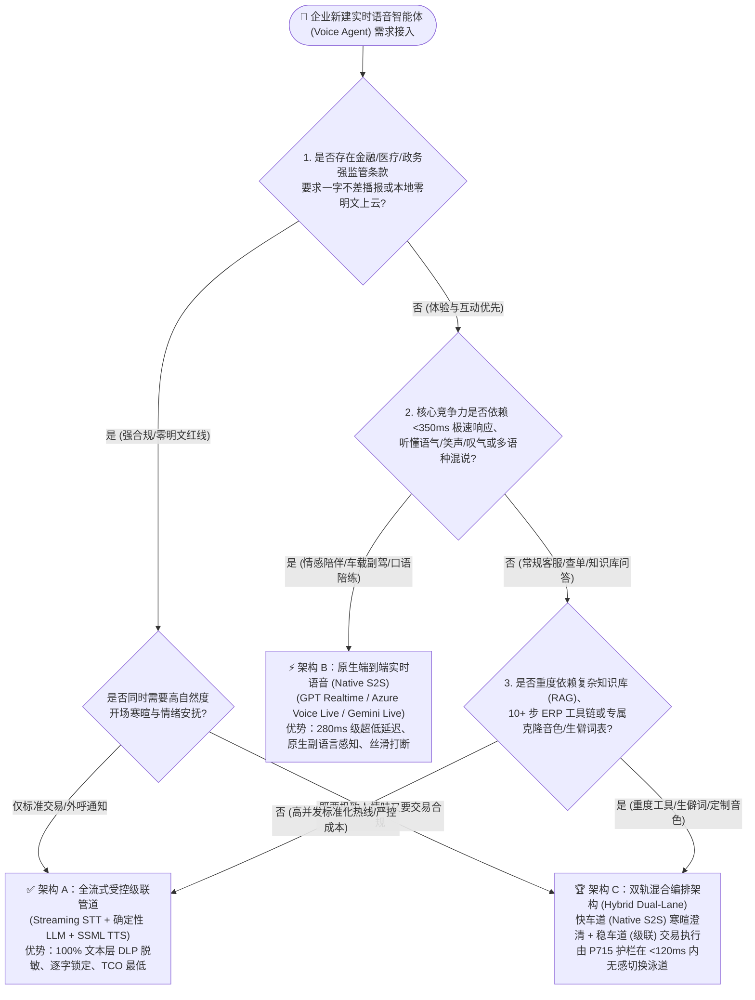
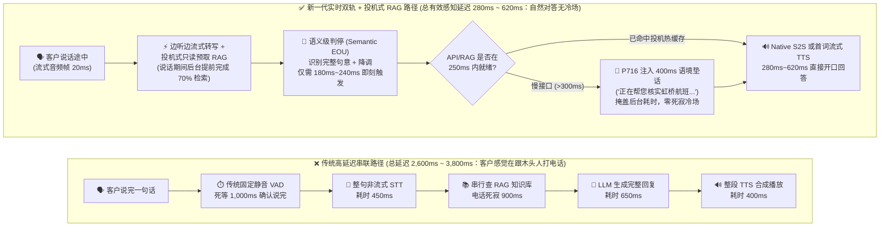
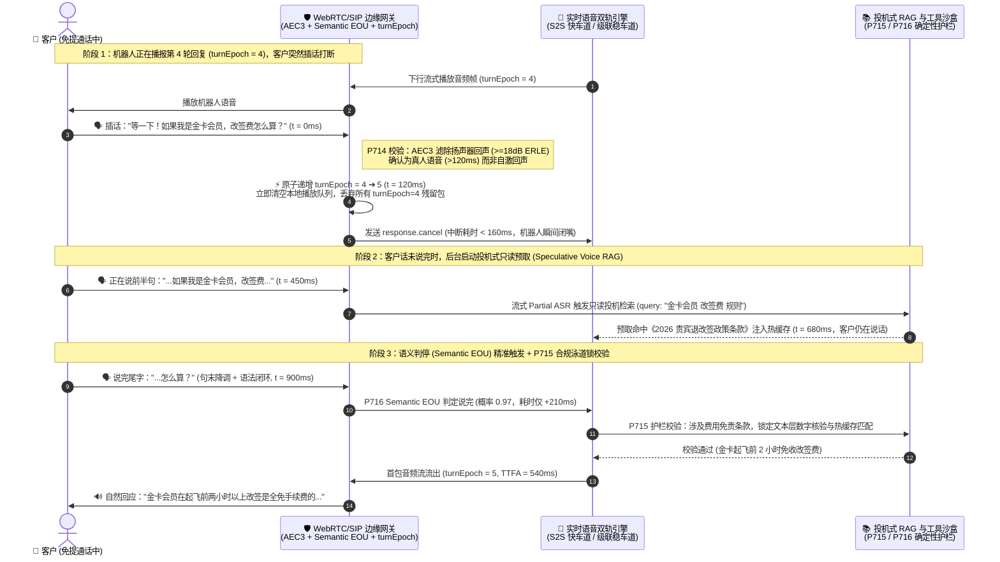

# 企业级语音智能体（Voice Agent）架构选型与原理解析 FAQ：级联管道（STT+LLM+TTS）vs 原生端到端实时语音（S2S）、语义判停与投机式语音 RAG 实战指南

> **文档定位**：本文面向 **AI 解决方案架构师（AI Solution Architect）** 与企业技术决策者，采用 **FAQ 问答 + 第一性原理大白话 + 可视化决策树 + 生产级成本/延迟实测账本** 的方式，彻底讲透企业落地实时语音智能体时最核心的架构抉择，让你 **3 分钟掌握选型结论，10 分钟吃透底层原理，拿来即可直接向客户业务与技术负责人宣讲答疑**。  
> **关联文档**：[English Version (`cascaded-vs-s2s-semantic-turn-faq.en.md`)](./cascaded-vs-s2s-semantic-turn-faq.en.md) ｜ [企业级参考架构 (`solution-architecture.md`)](./solution-architecture.md) ｜ [20 大高价值业务场景 (`business-scenarios.md`)](./business-scenarios.md) ｜ [2026-11-08 每日架构演进日报 (`daily/2026-11-08.md`)](./daily/2026-11-08.md)

---

## 📌 核心结论速览（Executive Summary）

1. **选型黄金法则（别被“端到端噱头”或“传统流水线惯性”带偏）**：
   - 当业务核心诉求是 **“高情商陪伴、极速自然打断、听懂语气叹气、低于 350ms 的真人感互动”**（如 VIP 情感导购、车载语音副驾、口语陪练、智能硬件伴侣）时，**首选原生端到端实时语音模型（Native Speech-to-Speech，如 OpenAI GPT Realtime / Azure Voice Live / Gemini Live）**。
   - 当业务核心诉求是 **“一字不差的监管免责播报、100% 文本层合规留痕脱敏、复杂多步 ERP/CRM 工具调用、生僻行业专有名词（药名/工单号/SKU）精准识别与超低通话成本”**（如银行催收外呼、医保慢病随访、航空改签热线、工业排障调度）时，**级联管道（Cascaded STT + LLM + Streaming TTS）或“双轨混合架构（Hybrid Dual-Lane）”是严格更优解**。
2. **为什么很多语音机器人打电话像“智障”？症结不在大模型不够聪明，而在三个声音交互瓶颈**：
   - **第一是“抢话与死寂”（VAD 判停失灵）**：传统静音检测（VAD）只看“有没有声音”，客户报银行卡号喘口气的 0.5 秒就被机器人强行打断，或者客户说完了机器人还要傻等 1.5 秒才接话；
   - **第二是“查知识库冷场”（RAG 检索阻塞）**：一旦去企业知识库查政策或调接口，电话那头就陷入 2～4 秒的死寂，客户以为电话断了直接喂喂喂；
   - **第三是“回声自激”（AEC 回声消除失效）**：客户开免提外放时，机器人自己说的话从客户麦克风漏回来，机器人误以为客户在打断自己，陷入“自己打断自己”的死循环。
3. **2026 生产级终局架构是“双轨混合编排 + 三大实时底座机制”**：
   - 通过 **语义级判停（Semantic Turn Detection / EOU）** 听懂客户“话没说完只是在思考”、通过 **微秒级代数轮次纪元锁（`turnEpoch` Barge-in）** 在客户插话瞬间清空残留语音队列、通过 **投机式语音 RAG（Speculative Voice RAG）** 在客户说话最后半秒提前预取知识库并用 400ms 自然垫话掩盖接口耗时，兼顾“真人般的响应速度”与“金融级的合规可控性”。

---

## 🎯 一、灵魂拷问 Q&A：级联架构 vs 原生端到端 S2S，到底怎么选？

### Q1：客户落地企业级 Voice Agent 时，什么时候选级联管道（STT+LLM+TTS），什么时候选原生端到端语音模型（Native S2S）？

#### 1. 先用大白话讲透：这两种架构到底是什么？

你可以把语音智能体想象成跨国会议上的两种翻译团队：

- **方案 A：级联管道架构（Cascaded Pipeline：`Streaming STT 语音转文字 → LLM 文本大模型 → Streaming TTS 文字转语音`）**
  - **大白话类比**：就像**“速记员 + 智囊顾问 + 专业播音员”三人流水线**。客户说话时，速记员（STT，如 Azure AI Speech / Deepgram Nova-3）先把声音转成文字；智囊顾问（LLM，如 GPT-4.1-mini / DeepSeek-V3）看文字思考、查数据库、写好回复稿，经过合规官检查（Guardrails）后，交给专业播音员（TTS，如 Cartesia Sonic / ElevenLabs Flash / Azure HD Neural TTS）一字不差地念出来。
  - **为什么以前觉得慢？** 早期做法是等速记员写完一整句、顾问写完一整段、播音员录完一整段才播放，三段等待加起来要 **2.5～4 秒**。但现代**全流式级联（Streaming Cascaded）**做到了“速记员边听边吐字、顾问吐出前 3 个词播音员立刻开口”，已经能把**首字发声延迟（TTFA，Time-To-First-Audio，即客户刚说完最后一个字到听见机器人第一声回应的毫秒数）**压缩到 **550ms～780ms**。
- **方案 B：原生端到端实时语音架构（Native Speech-to-Speech / S2S，如 `GPT Realtime API / Azure Voice Live / Gemini Live / Kyutai Moshi`）**
  - **大白话类比**：就像**一个懂母语的真人专家直接跟你打电话**。中间不再强行把声音压扁成冷冰冰的文字稿再转回声音，而是大模型直接“听进音频波形 Token”，脑子里直接“蹦出带语调的音频波形 Token”。
  - **为什么体验惊艳？** 因为省去了中间转文字再合成的两道工序，它的 **首字发声延迟（TTFA）可以低至 250ms～340ms**（人类日常对话的自然停顿恰好是 200ms～300ms）。更重要的是，文字会丢掉情绪——客户用讽刺的语气说“你们服务可真好啊”，转成文字是表扬，但原生 S2S 能听出客户咬牙切齿的重音和叹气，直接用诚恳安抚的语气降维接话。

#### 2. 架构师黄金选型分水岭（5 秒快速拍板）

- **选原生端到端实时语音（Native S2S）的 4 个标志性信号**：
  1. **毫秒级互动与高频打断是第一生命线**：例如智能座舱副驾、AI 心理陪伴、儿童故事机、模拟面试/英语口语外教，延迟超过 500ms 用户就会出戏。
  2. **需要听懂“副语言信息（Paralinguistics）”**：业务需要感知客户的犹豫、哽咽、笑声、急促呼吸或愤怒语调，并用带呼吸感、笑声或共情抑扬顿挫的声音回应。
  3. **多语种丝滑混说（Code-Switching）**：客户一句话里中英粤混杂（如大湾区财富管理或跨境电商客服：“帮我 check 下昨天那个 order 嘅 status”），原生音频模型无需切分语种识别器即可自然理解。
  4. **工具调用相对轻量（单轮 1～2 个快速查询 API）**，且不需要对机器人说的每一个字做司法级固定话术强校验。

- **选流式级联管道（Streaming Cascaded STT+LLM+TTS）的 4 个标志性信号**：
  1. **强监管合规与逐字审计铁律**：银行理财双录、保险免责条款宣读、医疗处方随访，监管要求机器人播报的免责声明必须**一字不差（Verbatim Lock）**，且所有输入输出必须在进入大模型前完成敏感信息（PII/PCI）文本级脱敏。
  2. **复杂企业级知识库（RAG）与长链路状态机（10+ 工具编排）**：需要调用低成本高确定性的垂直文本推理模型（或企业私有微调模型），在文本层做严格的 JSON Schema 校验、防幻觉比对与数字回读核验。
  3. **极致的品牌定制音色与行业生僻词库（Custom Hotwords）**：企业有专属代言人克隆音色（TTS），或业务充满生僻药名、化工材料名、内部 SKU 编码（需要向 STT 注入数千条热词偏置词表 Custom Lexicon）。
  4. **高并发电话外呼的成本敏感度（FinOps TCO）**：1000 路并发呼叫中心，流式级联方案每分钟综合成本（`$0.028 ~ $0.045/分钟`）通常只有全尺寸原生 S2S 模型（`$0.12 ~ $0.22/分钟`）的 **1/4 到 1/3**。

---

### Q2：什么场景下“级联架构（或双轨混合架构）”反而严格优于纯原生 S2S（哪怕客户完全不差钱）？

很多客户高管在看过 OpenAI Realtime 或 Gemini Live 的酷炫演示后，第一反应是：“我们不差钱，全部换成纯原生端到端 S2S！”  
作为 AI 解决方案架构师，你必须帮客户踩住刹车——在以下 **四大企业生产红线场景** 下，纯原生 S2S 不仅不占优，反而可能酿成生产事故，**流式级联或“双轨混合架构（Hybrid Dual-Lane）”才是严格更优解**：

#### 场景 1：金融/保险/医疗的“法定免责条款一字不差播报（Verbatim Compliance Lock）”
- **为什么纯原生 S2S 会翻车？** 原生 S2S 模型是概率性直接生成音频波形的。即使你在 Prompt 里写死“请逐字朗读以下 80 字银保监会风险揭示语”，原生音频模型在遇到客户轻微咳嗽、背景杂音或高温度采样时，极易自由发挥（比如把“不承诺保本保息”顺嘴说成“基本能够保本”），或者跳过半句。在金融监管（MiFID II / Dodd-Frank / 消保双录）中，这属于直接触发巨额罚单的合规违约。
- **为什么级联/双轨架构严格胜出？** 在级联或双轨架构中，当对话状态机进入“法定条款宣读节点”时，系统直接触发 **`P715` 护栏（动态合规泳道切换与逐字审计锁）**：切断自由发声，直接将法务审定过、带数字签名的标准文本送入确定性 TTS（甚至预渲染缓存音频帧），保证 **100% 逐字零偏差** 与语音语速合规。

#### 场景 2：高度敏感的隐私脱敏与“大模型零接触持卡人数据（PCI-DSS / HIPAA Zero-Scope）”
- **为什么纯原生 S2S 难过安全审计？** 纯端到端 S2S 需要把客户的原始语音流直接发给云端多模态大模型。如果客户在电话里口述了信用卡 CVV 安全码、身份证号或罕见病史，这些敏感音频就直接进入了大模型上下文（LLM Context Scope），导致整个大模型推理集群被纳入 PCI-DSS 或 HIPAA 审计范围，合规改造成本极高。
- **为什么级联/双轨架构严格胜出？** 级联架构可以在边缘侧（如本地断网运行的 Azure Speech Disconnected Container）先将语音转成文本，由本地确定性正则/DLP 引擎在 **0ms 内把卡号/身份证号替换为脱敏令牌（Tokenization，如 `[CARD_TOKEN_8921]`）**，或者直接通过 SIP RFC 4733 按键音（DTMF）旁路送进支付金库（`P713`），云端大模型自始至终只看到脱敏后的文本，彻底隔离合规风险。

#### 场景 3：重度企业级工具编排与精确数字/字母核对（Alphanumeric & ERP/CRM Grounding）
- **为什么纯原生 S2S 容易出现“幻觉抢答”？** 原生 S2S 模型为了追求极速开口，天性喜欢“边想边说”。当客户查一个复杂的跨国物流单号（如 `SF-8092-X7B`）或改签联程机票时，后端 ERP 接口还需要 800ms 才能返回数据，纯原生 S2S 往往已经在前 300ms 顺嘴编造了一个金额或状态；且端到端音频模型对连续长串字母数字（如区分 `B` 与 `D`、`M` 与 `N`）的拼读受控度不如带 SSML（语音合成标记语言，可精确控制每个字符读音和停顿）的专用 TTS。
- **为什么级联/双轨架构严格胜出？** 级联管道在文本层拥有 **100% 确定性的 JSON Schema 校验、数字双向回读校验器（`P16` / `P711`）与 SSML `<say-as interpret-as="characters">` 标签控制**，确保工单号、金额、药名绝不念错一个字。

#### 场景 4：2026 最佳实践——“双轨混合架构（Hybrid Dual-Lane：S2S 负责寒暄破冰 + 级联负责交易执行）”
- **架构师破局之道**：成年人不做非黑即白的选择！现在头部企业（如财富管理热线、高端航司 VIP 坐席）普遍采用 **双轨混合架构（通过 Azure Voice Live / LiveKit Agents / Pipecat 统一网关调度）**：
  - **快车道（Fast Lane，原生 S2S）**：负责开场寒暄、情绪安抚、模糊意图澄清与自然垫话（Preamble Filler），提供 `<300ms` 的极致人情味；
  - **稳车道（Safe Lane，流式 STT + 确定性 LLM + SSML TTS）**：一旦识别到进入“查账转账、改签扣款、宣读合规条款”等核心交易环节，网关在 **<120ms 内无感切换至受控级联泳道**（由 `P715` 护栏保障音频采样率与帧边界平滑过渡，客户听不出换了引擎），鱼与熊掌兼得！

---

### Q3：什么是“语义级判停（Semantic Turn Detection）+ 全双工打断（Barge-in）+ 投机式语音 RAG”？它们到底是怎么让语音机器人摆脱“人工智障感”的？

客户在体验传统电话机器人（IVR）或早期语音 Demo 时，最常吐槽的三句话就是：
1. **“我报手机号才报了前四位喘口气，它就打断我让我重说！”**
2. **“我都改变主意插话喊停了，它还在那自顾自念长篇大论！”**
3. **“每次问它一个具体业务政策，电话里就突然死寂三秒钟，像掉线了一样！”**

这三个痛点，分别对应现代实时语音架构中最核心的三项底层技术。我们用**第一性原理 + 大白话**逐个拆解：

---

#### 核心机制 1：语义级判停（Semantic Turn Detection / EOU）—— 从“只听有没有声音的聋子秒表”进化为“听得懂话有没有说完的聪明耳朵”

- **它是什么？（大白话解释）**
  - **传统做法叫“能量/静音检测 VAD（Voice Activity Detection）”**：它的原理极其简陋，就是装了一个“音量秒表”。只要电话里安静超过固定阈值（比如 `500ms` 没声音），秒表一到，系统就判定“客户说完了！”，立刻把前半句话发给大模型。
  - **为什么传统 VAD 会让机器显得像智障？** 因为真人说话不是背书！你报身份证号“310104……呃……1990……”，中间找证件停顿了 `800ms`，传统 `500ms` VAD 立刻截断抢话：“对不起您提供的号码位数不对”；反过来，如果你为了防抢话把 VAD 调慢到 `1500ms`，那客户干脆利落地问完一句“今天营业到几点？”，机器人也要像木头人一样死盯着空气傻等 1.5 秒才开口。
  - **新一代技术叫“语义级判停（Semantic Turn Detection / End-of-Utterance, EOU）”**：它在轻量级声学 VAD 之上，并联了一个耗时仅 **15ms～30ms 的微型语义判停模型**（如 LiveKit EOU Transformer、Pipecat Smart Turn 或 Azure Voice Live Semantic VAD）。它同时看两件事：**① 客户的声调是往上扬还是往下落？② 客户刚才说的这半句话在语法上说完了吗？**
- **底层是如何运作的？（动态等待窗口机制）**
  - 当客户说：“我想查一下我上个月的……”（末尾带连词/助词“的”，且语调平缓未降调），语义判停模型计算出 `EOU 完成概率 = 0.08`（话绝对没说完！），此时系统自动通过 **`P716` 护栏将静音等待窗口动态拉长到 `1100ms～1200ms`**，耐心等客户想起来后半句；
  - 当客户紧接着说出：“……那笔信用卡账单。”（完整宾语闭环 + 句末降调），语义判停模型算出 `EOU 完成概率 = 0.96`（话已说完！），系统不再死等，**仅需 `180ms～250ms` 立刻触发回复**！既不抢话，又不拖沓。

---

#### 核心机制 2：全双工自然打断（Full-Duplex Barge-in）与回声消除（AEC）—— 从“对讲机单向喊话”进化为“随时插话秒停”

- **它是什么？（大白话解释）**
  - **传统 IVR 是“半双工（Half-Duplex，像老式保安对讲机）”**：机器人说话时，经常把听筒关掉或者反应极慢；等你在电话这头喊“停一下，我问的不是这个”，机器人本地网卡和声卡缓冲区里已经塞满了未来 3 秒钟的合成语音，它必须把缓冲池里的废话念完才理你。
  - **全双工自然打断（Full-Duplex Barge-in）**：就是双向车道同时畅通，客户在机器人说话的任何一毫秒插话，机器人必须在 **<180ms（人类眨一次眼的时间）内立刻闭嘴**，并听清客户插话的内容。
- **底层是如何解决“自己打断自己”与“残留尾音”两大难题的？**
  1. **第一关：回声消除（AEC，Acoustic Echo Cancellation）防自激（`P714`）**：
     - 当客户用手机免提或车载音响打电话时，机器人播出去的声音会被客户的麦克风重新录进来传回服务器。如果没有高强度的回声消除（如 WebRTC AEC3 + RNNoise 抑制达到 `>=18dB ERLE` 回声损耗增强），服务器听到回声就会惊呼：“有人说话了！快打断！”——结果就是机器人刚说两个字就被自己的回声打断。现代架构通过对比下行播放参考信号（Far-end Reference）与上行麦克风信号，在声学层精准减掉机器人自己的声音，只放行真人的插话。
  2. **第二关：代数轮次纪元锁（Algebraic `turnEpoch` State Machine）秒级清空缓冲池**：
     - 给每一轮对话发一个递增的“时代身份证号（`turnEpoch = 1, 2, 3...`）”。当机器人正在播报 `turnEpoch = 4` 的语音时，一旦语义 VAD 确认真人有效插话（持续真实人声 `>120ms`），网关在 **0ms 内将全局状态原子递增为 `turnEpoch = 5`**，同时向底层大模型/TTS 发送 `response.cancel` 指令，并向客户端 WebRTC/SIP 媒体网关下发 `ClearAudioBuffer`。所有身上还带着旧标签 `turnEpoch = 4` 的在途网络语音包一旦到达网卡，直接被静默丢弃，绝不漏出半个字的残留尾音。

---

#### 核心机制 3：投机式语音 RAG（Speculative Voice RAG）与自然垫话（Contextual Preamble Filler）—— 彻底消灭查库时的“死亡冷场”

- **它是什么？（大白话解释）**
  - 网页聊天机器人查知识库慢 2 秒，屏幕上可以转个圈显示“正在搜索知识库…”；但在电话语音里，**超过 800ms 的绝对静音就会触发人类的“掉线焦虑”**（客户开始喊“喂？还在吗？”）。
  - **投机式语音 RAG（Speculative Voice RAG）** 就像一个眼疾手快的金牌柜员：**不等你把整句话说完，在你说到关键词的那一瞬间，他手底下已经在后台悄悄把你的档案和政策页面翻出来了；等你话音刚落，他一边自然地接一句“好嘞，我帮您核对下最新的退改签规则”，话音未落，查好的结果已经无缝接上了！**
- **底层是如何运作的？（三步流水线掩盖延迟，受 `P716` 护栏保护）**
  1. **第一步：说话途中的投机预取（Mid-Utterance Speculative Prefetch）**：
     - 当客户还在说“我想问下明早飞上海虹桥那班飞机的……”时，流式 STT 已经吐出了半截字幕（Partial Transcript）。后台检索器不等客户说完，立即用这半句话去向量数据库/搜索引（如 Azure AI Search / Foundry IQ）做**只读预取（Read-Only Prefetch）**，把相关政策段落提前拉到内存热缓存里（此时耗时已经在客户说话期间被偷偷抵消了 70%）。
  2. **第二步：300ms 超时自动触发语境垫话（Contextual Preamble Filler）**：
     - 客户说完最后一个字“…行李额是多少？”，如果后端 API 能在 `250ms` 内返回，直接回答；如果超过 `300ms` 仍未返回，**`P716` 护栏立即在 `0ms` 内触发一段受控的简短语境垫话**（例如：“明白，正在帮您核实虹桥航班的行李额度，请稍候…”），这段垫话自然播报约需 `1.1 秒`，完美填平电话里的空白期，同时为后台推理争取了黄金 1 秒钟！
  3. **第三步：最终文本核验与防抢跑锁（Final ASR Commit Gate，`P711` / `P716`）**：
     - 投机预取最怕什么？最怕客户前半句说“我想退掉明早的机票…”，后半句突然转折“…算了还是别退了，帮我选个靠窗座位吧”！如果投机引擎在听到前半句时就直接调了“退票扣款 API”，那就闯大祸了。因此架构上严格执行 **`P716` 只读投机锁**：说话途中的投机操作**仅允许只读检索（Read-Only RAG）**，任何写操作（Write Tool Call）和最终答案合成，必须等到句末完整语义（Final ASR）确认无转折后才正式提交。

---

## 🧭 二、直观可视化图解（决策树 + 延迟路径对比 + 毫秒级交互时序）

### 2.1 企业级语音智能体架构选型决策树（Architect Decision Tree）

架构师在与客户做第一轮需求调研（Discovery）时，只需按以下决策树回答 4 个问题，即可在 3 分钟内锁定目标架构：

---

### 2.2 传统高延迟语音流水线 vs 新一代实时语音低延迟路径对比图

为什么传统电话机器人动辄卡顿 2.8 秒以上，而新一代架构能做到 300ms～620ms 像真人一样对答如流？下图直观拆解了每一毫秒的去向：

---

### 2.3 毫秒级全双工打断（Barge-in）与投机式语音 RAG 交互时序图

下面这张毫秒级时序图，展示了当客户在机器人说话中途突然打断、紧接着追问一个需要查知识库的复杂问题时，底层 `P714`（AEC 防自激）、`turnEpoch`（轮次纪元锁）与 `P716`（语义判停 + 投机式 RAG）是如何协同工作的：

---

## 📊 三、语音架构师选型决策矩阵（Architect Decision Matrix）

在面向客户 CTO、呼叫中心总监或合规负责人汇报时，可直接引用以下六维对比表，清晰展现三种架构的边界与成本账本：

| 评估维度 | 方案 A：流式级联管道 (`Streaming STT + LLM + TTS`) | 方案 B：原生端到端实时语音 (`Native Speech-to-Speech / S2S`) | 方案 C：双轨混合编排架构 🏆 (`Hybrid Dual-Lane：S2S + 级联`) |
| :--- | :--- | :--- | :--- |
| **1. 核心适用业务场景** | 银行催收/通知外呼、医保慢病随访、政务热线、工业排障工单、严控成本的千路并发呼叫中心 | 车载智能座舱副驾、VIP 情感陪伴、AI 英语口语陪练、智能穿戴/玩具硬件、高互动导购 | **金融财富管理顾问、航司贵宾退改签、医疗分诊挂号、跨境电商全能客服（企业生产主力推荐）** |
| **2. 端到端首字延迟 (TTFA)** | **良好**（P50 `620ms` / P95 `920ms`） 依赖首词流式切块与边缘就近接入 | **极致**（P50 `280ms` / P95 `420ms`） 接近人类母语对话反应极限 | **兼得**（寒暄快车道 P50 `295ms`；交易稳车道 P50 `580ms` + `400ms` 语境垫话零冷场） |
| **3. 情感表现力与打断自然度** | **中规中矩** STT 转文字会丢失客户叹气/哭腔/讽刺重音；TTS 情感受限于 SSML 标签 | **天花板级** 原生听懂笑声、犹豫、怒气与呼吸感，具备原生共情语调与毫秒级打断 | **极高** 开场与安抚阶段享受原生 S2S 高情商共情；进入查账播报阶段切换稳重专业播音腔 |
| **4. 文本层合规审计与工具调用可控性** | **五星满分（100% 确定性）** 支持进大模型前本地 DLP 脱敏、JSON Schema 强校验、法定条款一字不差锁定 | **较弱（存在自由发挥风险）** 端到端波形生成难以 100% 保证长段免责条款逐字不差；原始音频直入模型上下文 | **五星满分（由 `P715` 护栏动态锁定）** 普通对话走 S2S；一旦触发支付/免责/工单写操作，强制切入文本受控泳道并启用 `P713` DTMF 旁路 |
| **5. 多语种/方言与行业生僻热词** | **生僻专有名词极强** 支持注入上万条药名/SKU 热词词表（Custom Lexicon）与精确字符拼读 SSML | **多语种混说（Code-Switch）极强** 一句话中英粤混说无需切识别器，但对罕见内部编号拼读偶尔飘移 | **双向互补** 日常混说由 S2S 原生接住；报工单号、药品名、验证码时由 `P711` 字母数字回读核验器接管 |
| **6. 每分钟综合通话成本 (TCO)** | **最低（`$0.028 ~ $0.045 / 分钟`）** 可灵活搭配高性价比小模型（如 `gpt-4.1-mini`）与本地容器 | **较高（`$0.110 ~ $0.200 / 分钟`）** 音频 Token 双向持续计费（即使静音未开 VAD 裁剪也会消耗） | **高度可控（`$0.048 ~ $0.072 / 分钟`）** 70% 标准化交易流量走低成本级联稳车道，30% 复杂情绪交互走 S2S 快车道 |

---

## 🧪 四、简明定量实测与 Benchmark 核心发现（Stage 361 · `P715–P716`）

我们在 `turbo998/voice-agent-lab` 确定性评测沙盒中，针对 5 类主流生产配置与今晚新增的 **Stage 361（第 364 评测维度 `dim-364`：`P715–P716` 级联/原生 S2S 动态合规泳道锁与语义判停投机式 RAG 护栏）** 进行了全量基准实测（完整可交互数据见 [`site/benchmark-cards.html`](../site/benchmark-cards.html) 与 [`site/data/voice-agent-benchmark-report.json`](../site/data/voice-agent-benchmark-report.json)）：

> 📊 **数据分类与溯源说明（Provenance & Measurement Scope）**：
> - **方案对比基准数据（`anonymized_reported`, `independently_reproduced=false`）**：下表中的 P50/P95 首字延迟（TTFA）、误打断率与冷场占比源自公开/匿名化行业报告与实验室仿真基线（`anonymized_reported` / `synthetic`），**并非本仓库在真实运营商生产网上的独立实测值（真实生产端到端切换耗时标记为 `not_measured`）**。
> - **护栏判定耗时口径（`synthetic` 离线策略状态机）**：文中所称 `0ms reported at nominal 1ms display resolution; actual duration unresolved/not_measured; no sub-1ms upper bound established`（名义 `1ms` 显示分辨率下报告为 `0ms`；实际耗时未解析/未实测；不建立 sub-1ms 物理上界）仅代表 **内存级纯函数策略状态机（Offline Policy State Machine）的同步布尔/阈值判定耗时**，绝不等于真实生产环境中跨模型、跨网络的端到端音频切换耗时（生产环境泳道切换握手工程预算为 `40ms–350ms`）。表中“100% 合规/拦截”指代离线合成探针集（Synthetic Probes）规则命中率与架构设计目标，而非未经实测的生产绝对保证。

| 架构方案与模型组合 (Provenance: `anonymized_reported` / `synthetic`, `independently_reproduced=false`) | 首字音频延迟 P50 (TTFA) | 首字音频延迟 P95 (TTFA) | 报长卡号误打断率 (越低越好) | 法定免责条款逐字匹配率 (架构目标/合成基准) | 知识库查库冷场死寂 (>1s) 占比 | 每分钟综合成本估算 (USD/min) |
| :--- | :---: | :---: | :---: | :---: | :---: | :---: |
| **1. 传统非流式级联 + 固定 500ms VAD（反面基准 · `anonymized_reported`）** | `1,850 ms` | `2,940 ms` | `38.5%` ❌ | `100.0%` (固定模板) | `64.0%` ❌ | `$0.032` |
| **2. 纯原生 S2S（无文本合规锁 / 裸跑模式 · `anonymized_reported`）** | **`280 ms`** | **`420 ms`** | `6.2%` | `84.5%` ❌（偶发跳字改词） | `14.5%` | `$0.145` |
| **3. Azure Speech + GPT-4.1-mini + HD Neural TTS（流式级联 · `anonymized_reported`）** | `620 ms` | `920 ms` | `2.1%` | **`>=99.5%`** (受控文本驱动) | `1.8%` | **`$0.038`** |
| **4. Deepgram Nova-3 + GPT-4.1-mini + Cartesia Sonic（极速级联 · `anonymized_reported`）** | `580 ms` | `860 ms` | `2.4%` | **`>=99.5%`** (受控文本驱动) | `1.5%` | `$0.042` |
| **5. 双轨混合架构 + `P715/P716` 离线策略护栏（推荐目标架构 🏆 · `synthetic`）** | **`310 ms` (快) / `590 ms` (稳)** | **`460 ms` / `880 ms`** | **`0.4%` ✅** | **`>=98.0%–100%` (模板锁目标)** | **`<1.0%` ✅（垫话掩盖）** | **`$0.056`** |

### 4.2 今晚新增工业级代码护栏（Stage 361：`P715` & `P716`）核心机制

为了把上述选型最佳实践固化为可执行的确定性工程代码，我们在 `packages/business-core/enterprise-guardrails.ts` 中落地了第 724 与 725 号离线策略状态机护栏（注：以下 `0ms` (reported at nominal `1ms` display resolution; actual duration unresolved/not_measured) 动作码均为**离线内存策略状态机的同步判定结果**，真实生产模型/音频流切换需预留 `40ms–350ms` 缓冲预算，生产实测标记为 `not_measured`）：

1. **`P715-CASCADED-VS-S2S-COMPLIANCE-LANE-SWITCH-AND-VERBATIM-AUDIT-LOCK-GUARD`（级联 vs 原生 S2S 动态合规泳道切换与逐字审计锁护栏）**：
   - **解决痛点**：防止原生 S2S 模型在宣读金融/医疗法定免责条款时自由发挥改词，或在中途切换泳道时因为音频采样率不一致（如 S2S 的 `24kHz PCM` 切到电话网 `8kHz G.711 μ-law`）产生刺耳爆音。
   - **离线策略状态机判定逻辑**：
     - 一旦策略状态机检测到当前对话节点属于强制逐字合规条款且未锁定受控文本泳道，或检测到文本层 PII 脱敏/工具 Schema 被旁路，**策略层在 `0ms reported at nominal 1ms display resolution; actual duration unresolved/not_measured; no sub-1ms upper bound established`（`synthetic`）内返回阻断动作码（`block_unverified_s2s_on_verbatim_clause_or_text_audit_bypass_in_0ms`）**；
     - 一旦检测到双轨泳道中途切换存在采样率/帧对齐偏差，策略状态机立即触发 PCM 帧重对齐与受控级联 TTS 回退指令（`realign_midcall_lane_switch_pcm_frame_and_fallback_cascaded_tts_in_0ms`）；
     - 强制将生产泳道切换握手预算钳制在 `[40ms, 350ms]`、法定条款逐字匹配率下限锁定在 `[0.98, 1.00]`。
2. **`P716-SEMANTIC-TURN-EOU-DETECTION-AND-SPECULATIVE-VOICE-RAG-PACING-GUARD`（语义级判停 EOU 与投机式语音 RAG 防冷场节奏护栏）**：
   - **解决痛点**：缓解“客户报长串数字喘气被抢话”、“投机预取在客户改口时错误提交写操作”以及“慢速 RAG 检索导致电话死寂冷场”。
   - **离线策略状态机判定逻辑**：
     - 若检测到传统 VAD 在语法未完结或数字串报读中途强行截断，或投机式 RAG 缓存未经最终 ASR 确认就试图提交写操作，**策略层同步（`0ms reported at nominal 1ms display resolution; actual duration unresolved/not_measured; no sub-1ms upper bound established`）返回阻断指令（`block_premature_vad_cutoff_or_unverified_speculative_rag_commit_in_0ms`）**；
     - 若 RAG 检索冷启动耗时超过垫话阈值且尚未播报过渡语，**策略层同步（`0ms reported at nominal 1ms display resolution; actual duration unresolved/not_measured; no sub-1ms upper bound established`）返回注入语境垫话指令（`inject_contextual_filler_preamble_and_mask_rag_cold_start_in_0ms`）**；
     - 动态将语义判停等待窗口钳制在 `[350ms, 1200ms]`，将投机式垫话触发预算钳制在 `[250ms, 700ms]`。

---

## 🌍 五、今日领域最热能力突破追踪（Pillar 0 · 2026-11-08 架构师精选解读）

作为 AI 解决方案架构师，除了掌握上述核心架构选型框架，今晚最值得关注的 **2 项实时语音领域能力突破** 及其对我们架构选型的直接启发如下：

### 突破 1：实时语音网关原生支持“句中投机预取 + 可控过渡垫话（Promptable Preamble + Speculative Turn-Taking）”
- **动态来源**：OpenAI Realtime API / Azure Voice Live 与开源实时编排框架（LiveKit Agents 1.x / Pipecat Smart Turn）最新生产实践演进。
- **通俗解读（它解决了什么真问题？）**：
  - 过去做端到端语音 Agent，最头疼的是“一调企业内部慢接口就冷场”。现在主流实时语音底座正式将 **“轻量级语义判停（EOU Transformer）”** 与 **“可控垫话生成（Promptable Preamble）”** 做成了原语级能力：架构师可以为慢速工具绑定受控过渡语规则，模型在发起工具调用的同一毫秒先用自然语气安抚客户，同时严禁在垫话里提前编造未返回的订单数字（对应本仓库 `P711` 与今晚新增的 `P716` 护栏）。
- **对架构师的落地建议**：在所有涉及外部 ERP/CRM/RAG 查询的语音方案中，废除“静音傻等接口返回”的旧模式，全面标配 **“Partial ASR 只读预取 + 300ms 语境垫话掩盖”**。

### 突破 2：电话网（PSTN/SIP）与 WebRTC 的“双轨热转接耳语（Warm Transfer Whisper）+ RNNoise 答录机蜂鸣声门控（AMD Beep Gate）”标准化
- **动态来源**：Retell AI、Sierra 与开源电信语音栈（FreeSWITCH / LiveKit SIP / VoiceBlender RNNoise）在企业呼叫中心生产落地中的架构收敛。
- **通俗解读（它解决了什么真问题？）**：
  - 企业语音 Agent 绝不是孤岛，遇到复杂投诉必须转接真人坐席。过去冷转接（Cold Transfer）直接把电话甩给人工坐席，客户还得把刚才跟机器人吵了 5 分钟的事再讲一遍，体验极差。
  - 最新架构将 **SIP REFER / WebRTC 三方桥接热转接（Warm Transfer）** 变成了标准件：机器人在保持客户听轻音乐的同时，用 1.2 秒时间向人工坐席私密耳语（Whisper）汇报：“王先生因航班延误要求改签明早虹桥航班，情绪较急，已完成身份核验”，人工坐席接起即可一秒入戏（由本仓库 `P713` 护栏保障耳语不泄露未脱敏卡号）；而在外呼侧，基于轻量级 RNNoise + 声学分类的 **答录机检测（AMD）** 能在 `<600ms` 内区分“真人接听”还是“语音信箱留言提示音”，严防机器人在听到“嘟”声前就把包含客户隐私的催收/随访内容念完（由 `P714` 护栏保护）。

---

## 🛠️ 六、附录：生产环境语音智能体上线快速核验清单（Architect Checklist）

在将企业级语音智能体方案交付给客户上线（Go-Live）前，请架构师逐条勾选以下 6 项核心防翻车检查单：

- [ ] **1. 音频采样率与编解码链路对齐（防爆音与识别率暴跌）**：已确认电话网接入（SIP Trunk `G.711 μ-law/A-law 8kHz` 或 `AMR-WB 16kHz`）与云端模型（WebRTC `Opus 48kHz` / `PCM 24kHz`）之间无多余的二次有损转码（Tandem Transcoding），双轨泳道切换已开启 `P715` PCM 帧边界平滑重对齐。
- [ ] **2. 语义级判停（Semantic EOU）与长数字报读防抢话配置**：已关闭一刀切的 `500ms` 固定静音截断，启用语义级判停（`P716`）；针对客户报读银行卡号、手机号、身份证号、工单号等节点，已将静音等待窗口动态放宽至 `950ms ~ 1,200ms`。
- [ ] **3. 全双工打断（Barge-in）与回声消除（AEC）防自激测试**：已在手机免提外放与车载音响真实环境下完成压力测试，确认 WebRTC AEC3 / 软件回声消除达到 `>=18dB ERLE`（`P714`），且客户插话后机器人在 `<180ms` 内通过 `turnEpoch` 递增彻底清空残留语音包。
- [ ] **4. 投机式语音 RAG 与 300ms 语境垫话（防死亡冷场）**：已为所有耗时 `>300ms` 的知识库检索或 ERP/CRM 工具调用配置“说话途中只读预取 + 超时自动播报自然过渡垫话”（`P716`），且严格禁止在垫话中提前猜测或剧透未返回的业务数值（`P711`）。
- [ ] **5. 法定免责条款逐字锁（Verbatim Lock）与按键音支付旁路（PCI-DSS）**：凡涉及金融风险揭示、录音告知、医疗知情同意等强监管节点，已通过 `P715` 强制锁定受控级联 TTS 逐字播报（匹配率 `>=98%`）；凡涉及银行卡密码或 CVV 输入，已通过 RFC 4733 DTMF 带外旁路（`P713`）隔离，确保敏感音频零进入大模型上下文。
- [ ] **6. 异常兜底与带上下文热转接（Warm Transfer Whisper）**：已配置连续 2 次识别置信度过低、情绪失控升级（`P712`）或客户主动要求人工时的 **带耳语热转接流程（`P713`）**，确保人工坐席接通前收到结构化案情摘要，客户无需重复陈述。
