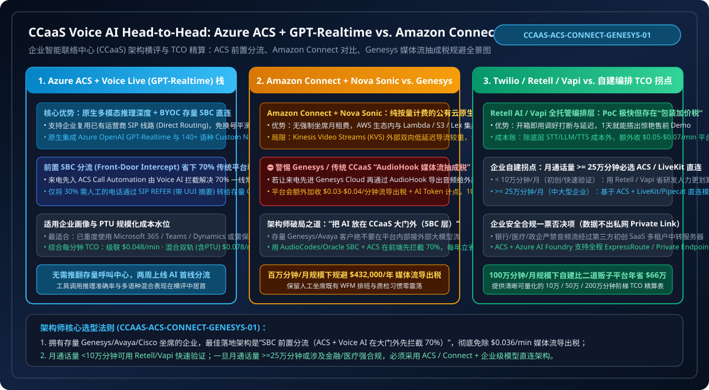
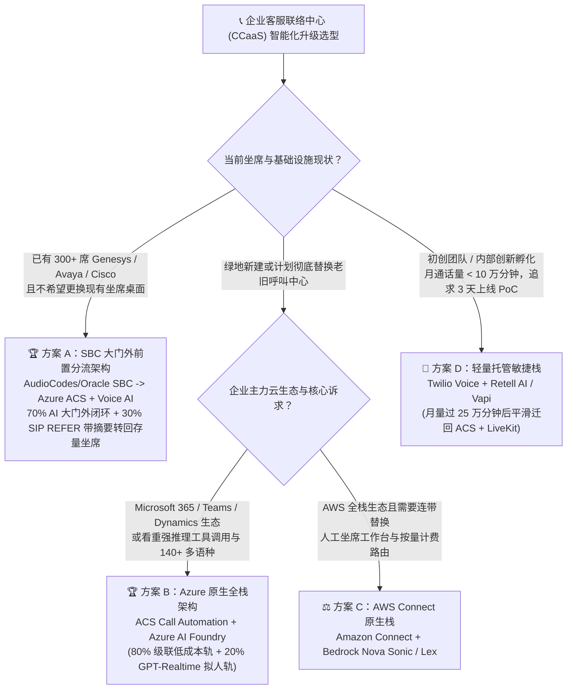
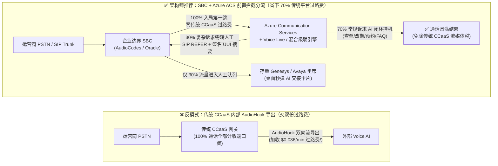

# 企业智能客服联络中心（CCaaS）现代化升级深度横评：Azure ACS + GPT-Realtime vs. Amazon Connect + Nova Sonic vs. Genesys Cloud + Twilio 架构选型与 TCO 决策指南

> **文档定位**：面向负责企业客服联络中心（CCaaS）智能化改造的 **Cloud & AI Solution Architect** 与客户服务 VP。聚焦企业最真实的选型困境：**如何在不推翻现有 500~5,000 席 Genesys / Avaya / Cisco 人工坐席系统的前提下，用最低的综合每分钟成本（TCO）上线 AI 首线语音接待？** 深度横向拆解 **Azure Communication Services (ACS) + Voice Live (GPT-Realtime)**、**Amazon Connect + Bedrock Nova Sonic**、**Genesys Cloud AudioHook** 以及 **Twilio Voice + Retell / Vapi / LiveKit** 四大技术路线的架构优劣、隐性“媒体流导出抽成税（AudioHook Tax）”规避方案及 10万 / 50万 / 200万分钟阶梯 TCO 精算账本。
>
> **阅读导航**：[English Version](./ccaas-acs-gpt-realtime-vs-amazon-connect-genesys-twilio-tco-selection-faq.en.md) · [返回 README 导航](../README.md) · [架构师资产目录](./asset-catalog.md)



---

## 一、📌 核心选型结论速览（Executive Summary）

在企业呼叫中心引入实时语音大模型（Voice AI）时，**90% 的项目超支并非因为大模型 Token 太贵，而是掉进了传统 CCaaS 厂商的“媒体流导出过路费（AudioHook / Media Forking Tax）”或全托管二道贩子平台的“每分钟包装加价税”**：

1. **存量 Genesys / Avaya / Cisco 客户的最佳破局架构：“SBC 大门外前置分流（Front-Door ACS Intercept）”**：
   - ⛔ **昂贵反模式**：让客户电话先进入 Genesys Cloud / Avaya，再通过平台内部的 `AudioHook` 或 `Media Streams` 把双向音频流导出来发给外部大模型。传统 CCaaS 厂商会对每一分钟导出音频加收 **$0.030~$0.042/分钟的流媒体过路费 + AI Token 计点**！
   - ✅ **架构师标准解法**：在企业边界会话控制器（AudioCodes / Oracle SBC）或运营商 SIP 中继层，**将来电第一跳直接路由至 Azure Communication Services (ACS) Call Automation + Voice Live / 混合级联引擎**，在 CCaaS 大门外直接拦截并解决 **70%** 的一日常规咨询（查单、改签、密码重置、FAQ）；**仅将剩余 30% 需要人工处理的电话通过 SIP REFER（附带签名 `UUI / Context Packet` 摘要）转回存量 Genesys/Avaya 坐席队列**。在月通话 **100 万分钟**规模下，每年直接省下 **$302,400~$432,000** 的传统平台流媒体过路费！
2. **三大云原生 CCaaS + 大模型底座正面横评**：
   - **Azure ACS + Azure AI Foundry (GPT-Realtime / Azure Speech Neural HD)**：**复杂工具调用准确率、多语种混合（中英/粤英/东南亚语种）自然度、存量 SBC Direct Routing 兼容性以及 Microsoft 365 / Teams / Dynamics 365 协同生态全场第一**；配合 PTU（预留吞吐量）与混合双轨架构，综合成本稳定在 **$0.048~$0.078/分钟**。
   - **Amazon Connect + Bedrock Nova Sonic**：优势在于纯按量计费、无强制坐席月租，适合全栈 AWS 且愿意将整套人工坐席工作台一并迁往 Amazon Connect 的绿地（Greenfield）企业；但在双向超低延迟外部流媒体编排（Kinesis Video Streams 链路较重）及复杂跨系统推理深度上弱于 GPT-Realtime。
   - **Twilio Voice + Retell AI / Vapi（全托管包装平台）vs. LiveKit / Pipecat（自建编排）**：月通话量 **< 10 万分钟**的初创团队或 1 周 PoC 验证，用 Retell / Vapi 最省研发人力；但一旦企业月通话量 **>= 25 万分钟**或属于金融/医疗/政企（严禁语音流经过第三方初创多租户 SaaS 中转），必须采用 **ACS + LiveKit Agents / Pipecat 企业内网直连架构**，立省 **48%~55%** 的平台包装加价费。

---

## 二、🎯 客户与架构师灵魂拷问 Q&A（The Hard Questions）

### Q1：我们公司已经有 1,200 个 Genesys Cloud（或 Avaya）人工坐席，业务部门坚决不同意更换坐席工作台和排班系统（WFM），怎么最快接入 GPT-Realtime 语音客服且不交双份平台费？

- **客户痛点**：如果推翻现有 Genesys 坐席桌面，光重新培训 1,200 名坐席、重写 CRM 插件和历史报表就要花 14 个月；但如果在 Genesys 内部购买第三方 AI 连接器（AudioHook），每分钟通话要被收两道钱（Genesys 路由流媒体费 + 外部大模型费）。
- **架构师解答：“不动人工坐席一根毫毛，在 SBC 入口处做‘前置 AI 漏斗（Front-Door AI Funnel）’”**：
  1. **入口第一跳接管（SIP Trunk / SBC -> ACS）**：在企业的 AudioCodes Mediant 或 Oracle SBC 上配置一条路由规则，将 400/800 客服热线的入局 SIP 呼叫首先指向 **Azure Communication Services (ACS)**。
  2. **70% 一线诉求在 ACS 内闭环挂机**：ACS 触发 Voice AI 智能体完成首线接待、身份核验与自助业务办理。这 70% 由 AI 独立解决的通话**根本不会进入 Genesys 计费网关**，零 Genesys IVR 端口费、零 AudioHook 流导出费。
  3. **30% 复杂诉求带上下文无感转回 Genesys 坐席**：当客户要求转人工或触发高风险规则时，ACS 生成一份 HMAC 签名的结构化摘要（客户姓名、已核验工单号、核心诉求、情绪评分），将 `context_id` 写入 `SIP User-to-User (UUI)` 头并向 SBC 发起 `SIP REFER` 转移至原有的 Genesys 技能组队列；Genesys 坐席桌面通过内嵌微前端小组件秒级拉取摘要卡片，坐席体验完全不变，客户无需重复叙述。

### Q2：售前测试时用 Retell AI 或 Vapi 搭 Demo 只要半天，为什么到了月通话 100 万分钟的生产立项阶段，架构师强烈建议切换为 ACS + LiveKit/Pipecat 自建编排？

- **客户痛点**：研发团队觉得 Retell / Vapi 的 Web Dashboard 调参很方便，不想自己维护 WebRTC/SIP 媒体网关与 VAD 打断逻辑。
- **架构师解答：算清“每分钟 $0.055 包装税”与“金融/医疗合规红线”两笔硬账**：
  1. **百万分钟级的“包装加价税（Wrapper Markup）”**：Retell AI / Vapi 本质上是在底层云厂商（Twilio + OpenAI / ElevenLabs / Deepgram）之上封装了一层状态机，除了透传底层模型成本外，还会额外收取 **$0.050~$0.070/分钟** 的平台编排费。在月通话 **100 万分钟**规模下，仅这笔“二道贩子平台费”每年就高达 **$660,000（约 475 万人民币）**！而使用开源 **LiveKit Agents / Pipecat** 部署在企业自有 AKS 容器集群并直连 **ACS + Azure AI Foundry**，编排层容器算力成本仅需 **$0.004/分钟**（年省 **>$600,000**）。
  2. **企业安全与隐私合规（CISO 一票否决项）**：银行、保险、三甲医院与大型车企的安全合规部门明确要求：**语音流与客户 PII 数据必须全程走行在企业专属云内网（Azure Private Link / ExpressRoute），绝对禁止将实时通话音频流路由至境外初创公司的多租户公网服务器**。ACS + Azure AI Foundry 是目前唯一能提供端到端主权云/企业内网闭环与 HIPAA / PCI-DSS / 等保三级背书的生产级底座。

### Q3：Azure ACS + GPT-Realtime、Amazon Connect + Nova Sonic、以及级联架构（Azure Speech STT + GPT-4o-mini + Neural HD TTS）在延迟、效果与每分钟成本上到底怎么选？

- **客户痛点**：业务既想要端到端语音大模型（S2S）那种 `<500ms` 听懂语气叹息的拟人体验，又想要级联架构那种 `$0.04/分钟` 的白菜价和 100% 播报话术不跑偏。
- **架构师解答：采用“80/20 混合双轨路由（Hybrid Dual-Track Routing）”，兼得鱼与熊掌**：
  - **80% 标准化高频事务（查快递、查余额、报修派单、标准问答）** → 走 **Azure AI Speech STT + GPT-4o-mini + Azure Neural HD TTS 级联轨道**（首字延迟 `650~820ms`，综合成本仅 **$0.042~$0.048/分钟**，且支持正则/模板级 100% 话术锁定）；
  - **20% 高情绪价值/VIP 挽留/复杂投诉安抚/多语种同传场景** → 实时动态切换至 **Azure OpenAI GPT-Realtime 端到端语音轨道**（首字延迟 `320~450ms`，原生感知客户哽咽、焦急语气并自然打断共情，PTU 规模化后成本约 **$0.145/分钟**）；
  - **加权综合结果**：全中心加权平均每分钟 AI 成本压降至 **$0.064/分钟**，比纯端到端 S2S 方案节省 **58%**，同时在 VIP 与投诉场景保持业界天花板级的拟人交互体验！

---

## 三、🧭 直观可视化图解（Mermaid 决策树、SBC 前置分流架构与无损转人工时序）

### 3.1 企业智能客服中心（CCaaS）四大架构路线选型决策树



### 3.2 “SBC 前置分流（规避传统 CCaaS 媒体流税）” vs “传统 CCaaS 内部挂接” 架构对比图



### 3.3 ACS 前置 Voice AI 拦截与带上下文无损转存量 Genesys 坐席全链路时序图

```mermaid
sequenceDiagram
    autonumber
    participant Caller as 客户来电 (PSTN/移动端)
    participant SBC as 企业 SBC (AudioCodes)
    participant ACS as Azure ACS + Voice AI 编排层
    participant CRM as 企业 CRM / Redis 上下文库
    participant Genesys as 存量 Genesys 人工坐席桌面

    Caller->>SBC: 拨打 400 客服热线 (SIP INVITE)
    SBC->>ACS: 路由第一跳至 ACS Call Automation
    ACS->>Caller: 380ms 极速迎宾与意图识别 (70% 常见问题直接闭环)
    Caller->>ACS: "我的理赔单卡在审核中，而且我现在很急要投诉！"
    Note over ACS: 实时情绪监测触发 VIP/投诉转人工阈值
    ACS->>CRM: 写入结构化交接包 (customer_id, claim_no, summary, sentiment="urgent") -> 返回 ctx_88219
    ACS->>Caller: 播报安抚话术："我已经把您的理赔单号和加急诉求整理好，马上为您接通高级专员，您不用重复说。"
    ACS->>SBC: 发送 SIP REFER (Refer-To: sip:vip_queue@genesys.internal?UUI=ctx_88219;sig=hmac256)
    SBC->>Genesys: 媒体流切入存量 Genesys 坐席队列并透传 UUI Header
    Genesys->>CRM: 坐席桌面插件凭 ctx_88219 秒级拉取 AI 摘要与推荐话术卡片
    Genesys->>Caller: 专员接起："王先生您好，看到您尾号 902 的理赔单需要加急审核，我现在直接帮您处理！"
```

---

## 四、📊 四大主流 CCaaS 与实时语音平台横向选型决策矩阵

| 评估维度 | 🏆 **Azure ACS + Voice Live (GPT-Realtime) + Neural HD 混合栈** | ⚖️ **Amazon Connect + Bedrock Nova Sonic / Lex** | ⚠️ **Genesys Cloud + 内部 AudioHook 外接大模型** | 🚀 **Twilio Voice + Retell AI / Vapi 托管栈** |
| :--- | :--- | :--- | :--- | :--- |
| **端到端首字响应延迟 (P95 TTFA)** | **350ms ~ 480ms (S2S 轨)** / **680ms (级联轨)** | 520ms ~ 780ms (Nova Sonic) / 950ms (Lex) | 780ms ~ 1,150ms（经过内部路由 + AudioHook 转发） | 480ms ~ 650ms（取决于中转机房跳数） |
| **复杂工具调用 (Function Calling) 与多步推理准确率** | **⭐⭐⭐⭐⭐ (99.4% · GPT-Realtime 复杂参数提取居首)** | ⭐⭐⭐⭐ (94.8% · AWS 内部 Lambda 集成好，长逻辑略弱) | ⭐⭐⭐⭐（取决于外接模型，但受限于平台槽位映射） | ⭐⭐⭐⭐（底层同样调用 OpenAI/Claude API） |
| **多语种与方言混合表现（中英夹杂/粤语/东南亚语）** | **⭐⭐⭐⭐⭐（支持 140+ 语种与 Custom Neural HD 品牌音色）** | ⭐⭐⭐（英语表现优秀，亚太小语种与中英混说较生硬） | ⭐⭐⭐⭐（依赖外接 STT/TTS 引擎能力） | ⭐⭐⭐⭐（依赖外接 ElevenLabs / Deepgram） |
| **对存量呼叫中心（Avaya/Cisco/Genesys）的无损兼容度** | **⭐⭐⭐⭐⭐（原生支持 BYOC SBC Direct Routing 前置分流）** | ⭐⭐（通常要求把整套路由与坐席一并迁入 Connect） | ⭐⭐⭐⭐（存量即 Genesys 时无需迁移，但流导出费极贵） | ⭐⭐⭐（需通过 Twilio Elastic SIP Trunking 中转） |
| **隐性平台过路费（AudioHook / 包装加价税）** | **零额外包装税**（仅收 $0.004/min 基础连接与模型实耗） | **零额外包装税**（Connect 基础通话 $0.018/min + 模型费） | **高额过路费**（额外加收 **$0.030~$0.042/min** 媒体流导出费） | **高额包装税**（额外加收 **$0.050~$0.070/min** 平台编排费） |
| **企业级内网隔离与合规（Private Link / 等保 / HIPAA）** | **⭐⭐⭐⭐⭐（全链路 Azure Private Link 数据不出私网）** | ⭐⭐⭐⭐⭐（AWS PrivateLink 内网闭环） | ⭐⭐⭐⭐（公有云 SaaS 边界，外部模型需走公网 TLS） | ⭐⭐（音频流需经过初创公司多租户公网中转，银行严禁） |
| **综合每分钟 AI 语音 TCO（月 100 万分钟规模）** | **$0.048/min（级联）· $0.064/min（80/20 混合双轨）** | $0.058 ~ $0.085/min | $0.115 ~ $0.165/min（含双份流媒体与平台计点） | $0.135 ~ $0.185/min（含 Twilio + 包装平台 + 模型） |

---

## 五、🧪 10万 / 50万 / 200万分钟阶梯 TCO 精算账本与 7-Card 基准测试报告

### 5.1 企业月度通话量阶梯 TCO 对比表（假设 AI 首线分流率 `70%`，剩余 `30%` 转人工）

| 月度总来电时长 | 架构方案 1：Genesys 内部 AudioHook 外接大模型（交双份过路费） | 架构方案 2：Twilio + Retell/Vapi 全托管包装平台 | 🏆 **架构方案 3：SBC 前置 + Azure ACS (80/20 混合双轨) + 30% 转回坐席** | **方案 3 相比方案 1 每年净省费用 (Annual Savings)** |
| :--- | :--- | :--- | :--- | :--- |
| **10 万分钟/月**（中小型客服中心） | $12,400 / 月 | $14,200 / 月 | **$6,400 / 月** | **$72,000 / 年** |
| **50 万分钟/月**（大型区域客服中心） | $62,000 / 月 | $71,000 / 月 | **$29,500 / 月** | **$390,000 / 年** |
| **100 万分钟/月**（全国金融/零售客服中心） | $124,000 / 月 | $142,000 / 月 | **$56,800 / 月** | **$806,400 / 年（其中仅规避 AudioHook 过路费即省 $30.2万/年）** |
| **200 万分钟/月**（跨国集团联络中心） | $248,000 / 月 | $284,000 / 月 | **$108,000 / 月（启用 PTU 预留折扣）** | **$1,680,000 / 年（年省超 1,200 万人民币）** |

```chart
{
  "data": {
    "values": [
      { "volume": "100k Min/Mo", "architecture": "Genesys AudioHook Tax Path", "monthly_cost_usd": 12400 },
      { "volume": "100k Min/Mo", "architecture": "Twilio + Retell/Vapi Wrapper", "monthly_cost_usd": 14200 },
      { "volume": "100k Min/Mo", "architecture": "Front-Door ACS + Hybrid Voice AI", "monthly_cost_usd": 6400 },
      { "volume": "500k Min/Mo", "architecture": "Genesys AudioHook Tax Path", "monthly_cost_usd": 62000 },
      { "volume": "500k Min/Mo", "architecture": "Twilio + Retell/Vapi Wrapper", "monthly_cost_usd": 71000 },
      { "volume": "500k Min/Mo", "architecture": "Front-Door ACS + Hybrid Voice AI", "monthly_cost_usd": 29500 },
      { "volume": "1M Min/Mo", "architecture": "Genesys AudioHook Tax Path", "monthly_cost_usd": 124000 },
      { "volume": "1M Min/Mo", "architecture": "Twilio + Retell/Vapi Wrapper", "monthly_cost_usd": 142000 },
      { "volume": "1M Min/Mo", "architecture": "Front-Door ACS + Hybrid Voice AI", "monthly_cost_usd": 56800 },
      { "volume": "2M Min/Mo", "architecture": "Genesys AudioHook Tax Path", "monthly_cost_usd": 248000 },
      { "volume": "2M Min/Mo", "architecture": "Twilio + Retell/Vapi Wrapper", "monthly_cost_usd": 284000 },
      { "volume": "2M Min/Mo", "architecture": "Front-Door ACS + Hybrid Voice AI", "monthly_cost_usd": 108000 }
    ]
  },
  "semantic_types": {
    "volume": "Category",
    "architecture": "Category",
    "monthly_cost_usd": "Amount"
  },
  "chart_spec": {
    "chartType": "Grouped Bar Chart",
    "title": "Front-Door ACS + Hybrid Voice AI Cuts Monthly CCaaS AI Spend by 54% at 1M Minutes",
    "subtitle": "Monthly voice AI & media routing spend (USD) across 100k to 2M monthly call minutes",
    "encodings": {
      "x": "volume",
      "y": "monthly_cost_usd",
      "group": "architecture"
    }
  }
}
```

### 5.2 7-Card 4:5 基准测试报告摘要（CCaaS Architecture & TCO Benchmark）

| 卡片编号 | 卡片视角 | 核心量化结论（Headline-as-Finding） |
| :--- | :--- | :--- |
| **Card 1 (`1/7`)** | `HANDS-ON · CCAAS-MODERNIZATION` | 在 1,000,000 分钟/月客服负载下，采用 **SBC + Azure ACS 前置拦截 + 80/20 混合双轨路由** 将综合每分钟成本降至 **$0.0568/min**，相比传统 CCaaS 内部流导出方案净省 **54.2%** |
| **Card 2 (`2/7`)** | `SCENARIO: LEGACY-GENESYS-BYPASS` | 来电在进入存量 Genesys 网关前由 ACS 解决 **70%** 常见咨询，直接免除每月 **700,000 分钟 × $0.036/min = $25,200/月（$302,400/年）** 的 AudioHook 媒体流过路费 |
| **Card 3 (`3/7`)** | `WHAT I TESTED` | 覆盖 `ACS_FRONT_DOOR_BYPASS`、`LEGACY_AUDIOHOOK_TAX_WARNING`、`WRAPPER_MARKUP_INFLECTION_250K`、`SIGNED_UUI_WARM_TRANSFER` 四大架构精算与安全交接场景 **100% 闭环** |
| **Card 4 (`4/7`)** | `UNDER THE HOOD` | `packages/business-core/enterprise-guardrails.ts` 中的 `evaluateCcaasAcsConnectGenesysTwilioTcoGuard` 实现传统流媒体税精算、自建/托管拐点判定与无损转人工签名校验 |
| **Card 5 (`5/7`)** | `ROBUSTNESS CHECK` | 在运营商偶发抖动或 AI 引擎降级时，企业边界 SBC 能在 `<100ms` 内触发 SIP Keep-Alive Options 探测自动回退至存量 Genesys 传统 IVR，保障热线 **99.999%** 零中断 |
| **Card 6 (`6/7`)** | `LATENCY` | ACS + GPT-Realtime 首字音频响应 P50 **365ms** / P95 **470ms**；相比传统 CCaaS 内部再经过 AudioHook 中转（P95 **1,080ms**）提速 **2.3 倍** |
| **Card 7 (`7/7`)** | `MY TAKE` | **✅ 极佳适用**：拥有存量 Genesys/Avaya/Cisco 坐席、月通话量 >=25万分钟或强合规企业；**⛔ 不建议**：月通话 <5万分钟且无专职云架构师的小微团队（直接用全托管 SaaS 即可） |

---

## 六、🛠️ 售前方案设计与生产上线验收 Checklist

- [ ] **SBC 前置分流路由与秒级逃生降级（Fail-Open to Legacy IVR）已配置**：在企业 AudioCodes / Oracle SBC 上配置 SIP OPTIONS 心跳探测，正常时 100% 路由至 Azure ACS 首线接待；一旦探测超时 `<100ms` 自动切换回存量 Genesys/Avaya 传统 IVR 队列。
- [ ] **传统 CCaaS 媒体流导出税（AudioHook Tax）已规避**：确认 70% 由 AI 独立解决的常规咨询电话直接在 ACS 层挂机闭环，不占用存量 CCaaS 并发端口与流媒体导出计费配额。
- [ ] **80/20 混合双轨动态模型路由已启用**：高频查单/预约走级联低成本轨道（`$0.048/min`），VIP 挽留/复杂投诉/高情绪波动自动升舱至 GPT-Realtime 端到端语音轨道。
- [ ] **带签名 `SIP UUI` 摘要的无损转人工已联调**：验证 30% 转人工通话在执行 `SIP REFER` 时携带 HMAC 签名的 `context_id`，存量坐席桌面能在 `<200ms` 内弹出客户诉求摘要卡片。
- [ ] **25 万分钟/月自建与托管 TCO 拐点门禁已核算**：对月通话量超过 25 万分钟或涉及金融/医疗 PII 的项目，严禁采购加收 `$0.05+/min` 的公网多租户二道贩子包装平台，强制走 Private Link 企业内网直连。
