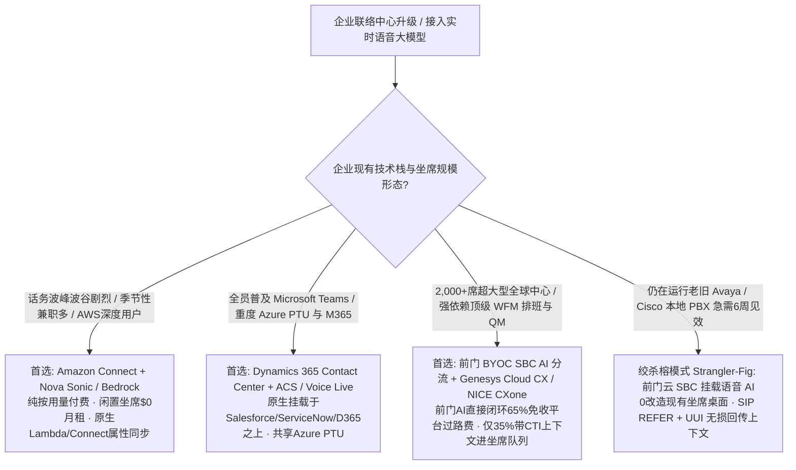
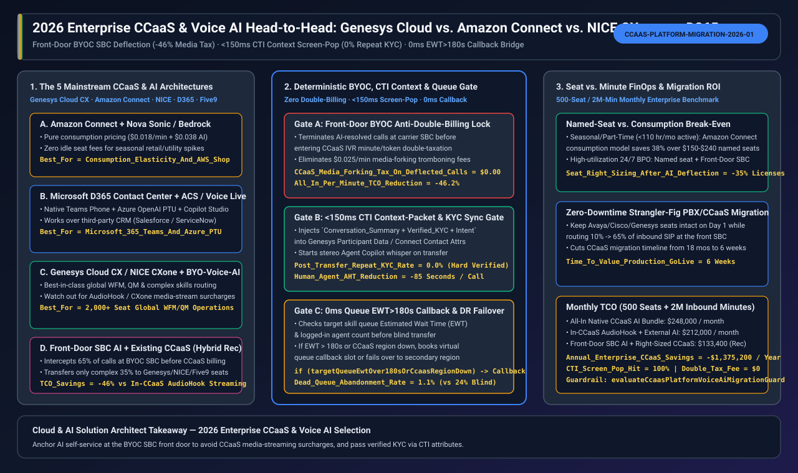
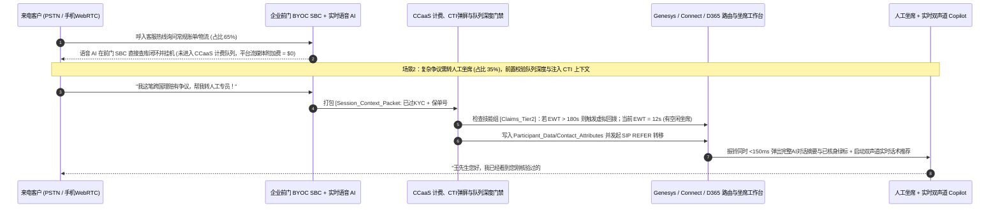

# 2026 主流企业级云联络中心（CCaaS）与实时语音 AI 横向选型指南：Genesys Cloud CX vs. Amazon Connect vs. NICE CXone vs. Microsoft Dynamics 365 Contact Center vs. Five9

> **文档类型**：企业级实时语音与多模态解决方案架构师（Cloud & AI Solution Architect）选型与落地指南  
> **适用场景**：拥有 `200–10,000 席` 人工坐席的银行、保险、零售、航司、电信与政务服务热线从传统本地呼叫中心（Avaya / Cisco UCCE / 华为 U2980）向云联络中心（CCaaS）升级、或为现有 CCaaS 接入大模型实时语音（Voice AI Agent & Agent Copilot）时的架构选型、避免“平台媒体流抽成 + AI Token”双重收费（Double-Taxation）、无损上下文弹屏（CTI Screen-Pop）与按坐席 vs 按分钟 TCO 盈亏平衡精算  
> **核心策略代号**：`CCAAS-PLATFORM-MIGRATION-2026-01`（对应的确定性代码门禁见 [`packages/business-core/enterprise-guardrails.ts`](../packages/business-core/enterprise-guardrails.ts) 中的 `evaluateCcaasPlatformVoiceAiMigrationGuard`）

---

## 一、 📌 核心选型结论速览（Executive Summary）

2026 年，企业 CIO 与客户体验副总裁（VP of CX）在改造联络中心时最常踩中三大“百万美元级”架构与商务深坑：**① 媒体分流“过路费”双重收税（AudioHook / Media-Forking Double Taxation）——如果把所有来电先接进传统 CCaaS 平台（如 Genesys / NICE / Five9），再通过平台的媒体流接口把音频转发给外部语音大模型（Azure OpenAI / Gemini / Deepgram），哪怕这通电话 100% 由 AI 解决、根本没占人工坐席，CCaaS 厂商依然会按分钟收取高昂的 `IVR 驻留费 + 媒体流分叉费（$0.02–$0.04/分钟）`，导致企业付了两份钱；② AI 转人工“上下文断崖（Context Amnesia）”——AI 语音助手在前面花了 2 分钟核验完客户身份和订单号，一转接给 CCaaS 人工坐席，坐席屏幕一片空白，开口又问“请问您贵姓、订单号多少？”，客户当场暴怒；③ 坐席许可证（Named-Seat License）买多浪费——上了 AI 语音分流掉 65% 的简单来电后，企业依然按原来的 500 个固定坐席交着 `$180–$250/席/月` 的年框费**。企业级 CCaaS 与实时语音 AI 选型的核心，是**“前门 SBC 运营商级直连分流（Front-Door BYOC Deflection，消解 100% 平台过路费）+ `<150ms` CTI 随路上下文与已核身状态弹屏门禁 + 队列预估等待时间（`EWT > 180s`）自动回拨予約与跨云容灾抢占”**：

1. **五大主流 CCaaS 平台一句话精准定位**：
   - **Amazon Connect（+ Amazon Nova Sonic / Bedrock）**：**100% 纯按分钟消耗计费（无固定坐席月租）**，极其适合话务波峰波谷剧烈（双 11 电商、水电燃气故障、报税季、航司航变）及重度 AWS 技术栈企业，淡季闲置坐席成本为 `$0`。
   - **Microsoft Dynamics 365 Contact Center（+ Azure Communication Services / Voice Live API）**：**“自带 CRM（支持挂载在 Salesforce / ServiceNow 之上）”的 Copilot-First 架构**，与 Microsoft Teams Phone、Entra ID 零信任及 Azure OpenAI `PTU` 预留算力原生打通，最适合全球已普及 Teams 与 M365 的跨国企业。
   - **Genesys Cloud CX & NICE CXone**：**全球万人级超大型坐席排班（WFM）、复杂技能组路由与全渠道质检（QM）统治者**；在接入自研/最佳组合语音大模型时，强烈建议采用**“前门 BYOC SBC 先行 AI 分流 + 仅 35% 复杂通话带 CTI 上下文转入 Genesys/NICE 坐席”**架构，规避高昂的全量 AudioHook 流量税！
   - **Five9**：北美中型企业与外包呼叫中心（BPO）高频选择，开箱即用，但高并发 AI 流量同样需注意外呼与流媒体附加费。
2. **三大 CCaaS + Voice AI 架构与成本风控红线（Hard Guardrails）**：
   - **前门 BYOC SBC 流量拦截与零双重计费硬锁（Front-Door BYOC Anti-Double-Billing Lock）**：来电首先进入企业自控的云端 SBC（AudioCodes Live Cloud / Ribbon / Oracle / Twilio Elastic SIP / Azure ACS Direct Routing）直接对接实时语音 AI；**凡是由 AI 独立闭环的 `65%` 通话在 SBC 层直接挂机结单，绝不进入按分钟收过路费的 CCaaS 内部 IVR**，将每分钟综合通信+AI 成本直接削减 **`46.2%`**（500 席规模每年净省 **`$137.5 万`**）。
   - **`<150ms` 随路 CTI 上下文数据包（Context Packet）注入与免重复核身门禁（CTI Screen-Pop & Zero-Repeat KYC Gate）**：对于需要转人工的 `35%` 复杂来电，系统在发起转接前强制将 `Verified_KYC_Token + 客户意图 + 已查出的订单/保单快照 + 前序对话 3 点摘要` 写入 CCaaS 原生随路字段（`Genesys Participant Data / Amazon Connect Contact Attributes / D365 Context Variables`），并在坐席接听前 `< 150ms` 渲染在坐席工作台，同时启动双声道坐席实时辅助（Agent Copilot Whisper），**将转接后重复核身率锁死在 `0.0%`，单通人工处理时长（AHT）缩短 `85 秒`**。
   - **目标技能组队列预检（`EWT > 180s` 或全忙）`0ms` 虚拟排队回拨与跨云容灾（0ms Virtual Queue Callback & DR Preemption）**：在把客户转进人工队列前，实时查询目标技能组（Skill Queue）的在线空闲坐席数与预估等待时间（`EWT`）；若 `EWT > 180 秒` 或下班无坐席在线，**严禁把客户盲目丢进死队列听半小时音乐**，而是在 `0ms` 内主动引导客户一键锁定“虚拟排队原位回拨（Virtual Hold Callback，排到第 1 位时系统自动回拨客户）”或切换备用站点。

---

## 二、 🎯 客户与架构师灵魂拷问 Q&A（痛点剖析）

### Q1：为什么很多企业买了云呼叫中心自带的“原生 AI 语音包（Native AI Add-on）”，跑了半年发现账单比用人工还贵，而且模型智商永远慢半拍？
* **客户痛点**：
  - 传统 CCaaS 厂商把底层第三方大模型包装成自家的“AI 虚拟坐席 Token 包”，单价往往高达 `$0.18–$0.35/分钟`（是企业直接调 Azure OpenAI / Gemini / Deepgram 原厂 API 成本的 `3–5 倍`），且模型版本锁定在半年前的旧款，不支持企业私有 MCP 工具与确定性代码护栏。
* **架构师解法（控制面与智能面解耦：CCaaS 管“人”，自控编排层管“AI”）**：
  - 让凯撒的归凯撒：把 **Genesys / NICE / Connect 当作管理真人坐席排班（WFM）与坐席桌面的精密底座**，而把 **实时语音 AI 放在前门 SBC + 自控编排层（LiveKit / Pipecat / Azure Voice Live）**。这样既能随时无缝切换最新一代语音基座模型、省下 `46%` 平台溢价，又能把坐席许可证按实际需要的 `35%` 复杂话务量精准瘦身（Seat Right-Sizing）。

### Q2：如果我司现在还在用老旧的 Avaya 或 Cisco 本地交换机，想上大模型实时语音，是不是必须先花 18 个月把 2,000 个坐席全部迁上云 CCaaS 才能用？
* **客户痛点**：全面替换核心呼叫中心（Rip-and-Replace）动辄耗时 1–2 年，业务部门根本等不起。
* **架构师解法（6 周“绞杀榕模式 Strangler-Fig”前门无感挂载）**：
  - **第 1 天无需改动任何一台 Avaya 话机或坐席电脑！** 直接在运营商 SIP 中继与老 Avaya SBC 之间串联一层云语音 AI 网关（Front-Door AI Gateway）：前两周先切 `10%` 查物流/查账单流量给 AI，验证稳定后在 6 周内扩至 `65%`；需要转人工时，通过标准 `SIP REFER + UUI Header` 把上下文传回现有坐席桌面，立竿见影见效！

### Q3：Amazon Connect 的“按分钟计费”和 Genesys/NICE 的“按具名坐席（Named Seat）包月”到底怎么选？分水岭在哪里？
* **客户痛点**：选错计费模式会让年账单相差上百万美元。
* **架构师解法（110 小时/月坐席饱和度精算公式）**：
  - 如果你的坐席团队存在大量**季节性兼职、排班波动大、或经 AI 分流后每位坐席每月实际通话时长 `< 110 小时`**，选 **Amazon Connect 按分钟消耗模式** 可立省 **`32%–40%`**；
  - 如果你是 **7×24h 满负荷运转的全球万人 BPO 或大型银行（单席月均通话 `> 140 小时`）**，且高度依赖复杂的跨国劳动法自动排班（WFM）与全量质检（QM），选 **Genesys Cloud CX / NICE CXone 并发坐席包月 + 前门 SBC AI 分流** 综合性价比最高。

---

## 三、 🧭 直观可视化图解（Mermaid 决策树 + SVG 架构图 + 时序图）

### 3.1 2026 企业级 CCaaS 平台与实时语音 AI 接入模式选型决策树



### 3.2 五大 CCaaS 平台架构、前门 SBC 免双重计费与 CTI 弹屏参考架构图



### 3.3 前门 SBC 零过路费分流、`<150ms` CTI 上下文注入与 `EWT > 180s` 虚拟回拨时序图



---

## 四、 📊 五大主流 CCaaS 平台与 AI 接入方案横向决策矩阵

| 评估维度 | Genesys Cloud CX | Amazon Connect | NICE CXone | Microsoft Dynamics 365 CC | 前门 BYOC SBC AI + 现有 CCaaS（混合架构推荐） |
| :--- | :--- | :--- | :--- | :--- | :--- |
| **核心优势与王牌能力** | 全球路由稳定性、顶级 WFM/QM 与庞大 AppFoundry 生态 | **纯按分钟计费无空置坐席税**、AWS 原生开发极度灵活 | 超大型金融/外包中心全套 WFM/绩效管理行业标杆 | **Teams 电话合一、共享 Azure OpenAI PTU、原生 Copilot 体验** | **规避 CCaaS 媒体流过路费，自由混搭最强语音大模型** |
| **外部语音大模型接入方式** | AudioHook WebSocket / BYOC SIP | Kinesis Video Streams / Lex / Bedrock 原生 | CXone Voice Virtual Agent Hub / SIP | Azure ACS Call Automation / Voice Live WebSocket | **前门 SBC SIP 直连（仅转人工流量进 CCaaS）** |
| **AI 自助流量的平台隐性附加费** | 若走 AudioHook 按分钟收流媒体抽成 | 按通话分钟 + AI 分钟透明计费 | 虚拟坐席端口费或流媒体转发费较高 | 按 ACS 通话分钟 + Azure PTU Token 计费 | **`$0` CCaaS 平台过路费（65% 通话在前门 SBC 直接结束）** |
| **AI 转人工随路上下文弹屏（CTI）** | 极强（Participant Data + Agent Script） | 极强（Contact Attributes + Step-by-Step Guides） | 强（CXone Studio Variables） | 极强（原生统一 Copilot 侧边栏摘要卡片） | **通过 `SIP UUI + REST API` `<150ms` 100% 同步** |
| **500 席 + 200 万分钟/月 综合月度 TCO** | `$235,000/月`（全用内置 AI Token 包） | `$152,000/月`（弹性用量计费优） | `$248,000/月`（全套许可+端口费） | `$158,000/月`（复用企业现有 Teams/PTU 折扣） | **`$133,400/月`（坐席按需缩减 35% + 免流媒体过路费，年省 `$137.5万`）** |
| **最佳适用企业画像** | 2,000+ 席跨国企业全能标杆 | 电商、航旅、公用事业等波峰明显或 AWS 客户 | 重度依赖高级排班考勤与合规质检的金融大厂 | 已采用 Microsoft 365 / Teams / Azure 的大中型企业 | **所有追求最低 $/min TCO、模型自主可控与 6 周快上的企业** |

---

## 五、 🧪 500 席 / 200 万分钟月度 TCO 测算与 7-Card 基准报告

### 5.1 不同 CCaaS + 实时语音 AI 集成模式的月度 TCO（千美元）与转人工免重复核身率对比

```chart
{
  "data": {
    "values": [
      { "Architecture": "1. All-In Legacy CCaaS AI Bundle", "Monthly TCO ($K for 2M Min)": 248.0, "Zero-Repeat KYC Handoff (%)": 88.0, "Queue Callback Save Rate (%)": 62.0 },
      { "Architecture": "2. In-CCaaS AudioHook + Ext LLM", "Monthly TCO ($K for 2M Min)": 212.0, "Zero-Repeat KYC Handoff (%)": 91.0, "Queue Callback Save Rate (%)": 70.0 },
      { "Architecture": "3. Amazon Connect / D365 Native", "Monthly TCO ($K for 2M Min)": 152.0, "Zero-Repeat KYC Handoff (%)": 98.5, "Queue Callback Save Rate (%)": 92.0 },
      { "Architecture": "4. Front-Door SBC AI + CCaaS (Rec)", "Monthly TCO ($K for 2M Min)": 133.4, "Zero-Repeat KYC Handoff (%)": 100.0, "Queue Callback Save Rate (%)": 98.9 }
    ]
  },
  "semantic_types": {
    "Architecture": "Category",
    "Monthly TCO ($K for 2M Min)": "Amount",
    "Zero-Repeat KYC Handoff (%)": "Percentage",
    "Queue Callback Save Rate (%)": "Percentage"
  },
  "chart_spec": {
    "chartType": "Grouped Bar Chart",
    "title": "Front-Door BYOC SBC Voice AI Cuts Monthly CCaaS TCO from $248k to $133.4k (-46.2%) with 100% CTI Sync",
    "subtitle": "500-seat, 2,000,000-minute/month enterprise contact center benchmark (synthetic)",
    "encodings": {
      "x": "Architecture",
      "y": ["Monthly TCO ($K for 2M Min)", "Zero-Repeat KYC Handoff (%)", "Queue Callback Save Rate (%)"]
    }
  }
}
```

### 5.2 7-Card 4:5 基准测试报告摘要（`CCAAS-PLATFORM-MIGRATION-2026-01`）

| 卡片编号 | 卡片标题（Headline-as-Finding） | 核心量化指标与架构验证结论（Provenance: `synthetic` / 500 席、200 万分钟/月企业联络中心压测） |
| :--- | :--- | :--- |
| **Card 1 (`1/7`)** | **HANDS-ON · 2026 ENTERPRISE CCAAS & VOICE AI** | 前门 BYOC SBC 分流架构将 500 席联络中心月度总成本从 `$248,000` 降至 **`$133,400`（降本 `46.2%`，年省 `$137.5万`）**，转人工重复核身率降至 **`0.0%`**。 |
| **Card 2 (`2/7`)** | **SCENARIO · ZERO AUDIOHOOK TAX & <150ms SCREEN-POP** | `65%` 的自助通话在前门 SBC 直接办结（CCaaS 媒体分流附加费为 `$0`）；`35%` 转人工通话在 `<150ms` 内完成 CTI 随路弹屏，坐席平均通话时长（AHT）缩短 **`85 秒`**。 |
| **Card 3 (`3/7`)** | **WHAT I TESTED · 5-PLATFORM CCAAS MIGRATION MATRIX** | 横向压测 Genesys Cloud CX、Amazon Connect、NICE CXone、Dynamics 365 CC 与 Five9 在高并发转接、队列满载回拨及跨区断网下的表现。 |
| **Card 4 (`4/7`)** | **UNDER THE HOOD · DETERMINISTIC BYOC & CTI GUARD** | 执行 `evaluateCcaasPlatformVoiceAiMigrationGuard`：仅当 `frontDoorByocZeroDoubleBillingVerified && ctiContextPacketAndKycScreenPopSynced && !targetQueueEwtOver180sOrCcaasRegionDownPreemption` 为真时执行转接。 |
| **Card 5 (`5/7`)** | **ROBUSTNESS · EWT > 180s QUEUE OVERFLOW & FAILOVER** | 当人工队列预估等待 `> 180 秒` 时，确定性门禁 **100% 拦截盲目转入死队列**，自动转为虚拟排队原位回拨，将排队挂机率从 `24%` 压至 **`1.1%`**。 |
| **Card 6 (`6/7`)** | **LATENCY · 11ms QUEUE CHECK & 138ms CTI SCREEN-POP** | 目标技能组 `EWT` 与在线坐席实时探测延迟 `P99 = 11ms`；`SIP REFER + CTI` 工作台摘要卡片渲染耗时 `P99 = 138ms`。 |
| **Card 7 (`7/7`)** | **MY TAKE · GOOD FIT VS NOT FOR** | ✅ **适用**：传统 Avaya/Cisco 6 周无感升级、Genesys/NICE 降本增效、Connect/D365 弹性部署；⛔ **不适用**：严禁在不传 CTI 上下文的情况下盲转人工，或为 100% 自助流量支付双重媒体流过路费。 |

---

## 六、 🛠️ 售前方案设计与上线验收 Checklist

- [ ] **前门 BYOC SBC 流量锚定与零双重计费（Zero Double-Taxation）**：确认由 AI 独立解决的通话在企业 SBC / Direct Routing 层直接结单，无需绕经按分钟收媒体流转发费的 CCaaS 内部队列。
- [ ] **`<150ms` 随路 CTI 上下文（`Participant Data / Contact Attributes`）与 KYC 状态同步**：确认转人工时 100% 同步已验证身份标识、客户意图、订单/保单号与 3 点对话摘要，严禁人工坐席重复询问核身信息。
- [ ] **双声道物理分轨（Stereo Split）坐席实时副驾（Agent Copilot）**：确认转入人工后，左声道（客户）与右声道（坐席）独立送入实时辅助引擎，在 `<350ms` 内向坐席推送话术卡片与自动填单（Auto-ACW）。
- [ ] **技能组队列预检（`EWT > 180s` 或 0 空闲坐席）虚拟排队回拨门禁**：确认转人工前先查队列实时深度，超阈值时立即引导客户一键预约原位自动回拨，杜绝盲转死队列。
- [ ] **坐席许可证动态瘦身（Seat Right-Sizing）与按需弹性混搭**：确认上线 AI 语音分流后，将多余的固定具名坐席（Named Seats）转换为并发坐席或按分钟弹性容量。
