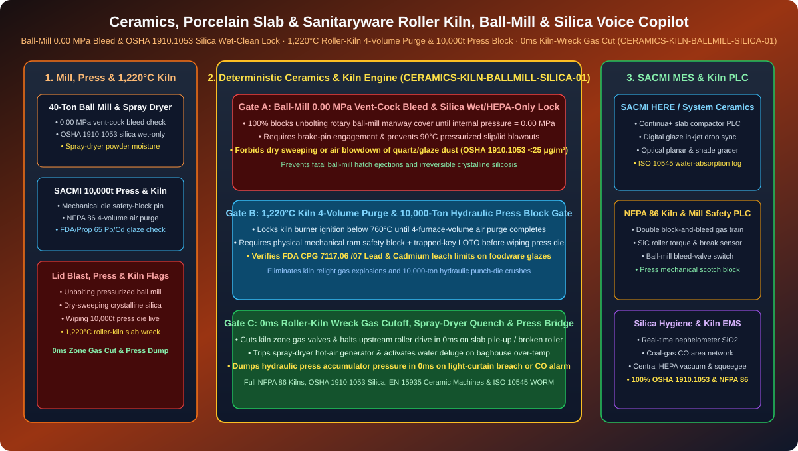
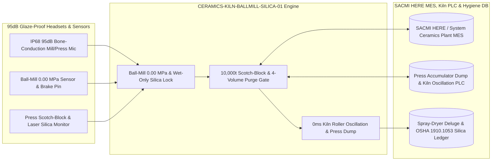
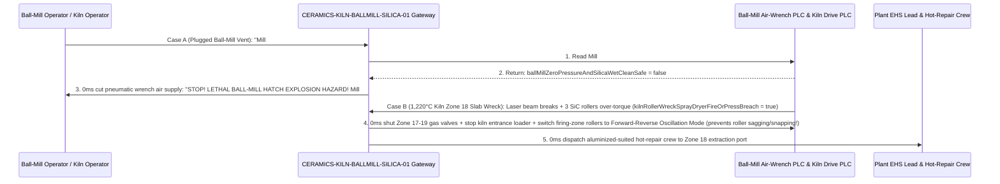

# Ceramics, Porcelain Slab & Sanitaryware Roller Kiln, Ball-Mill & Silica Voice Copilot (Kohler / TOTO / Roca / Mohawk / SACMI / System Ceramics): Ball-Mill 0.00 MPa Bleed & Silica Wet-Clean Lock, 10,000t Press Block & 0ms Kiln-Wreck Selection Guide

> **Document Scope**: Written for Global Ceramic Tile, Porcelain Slab, Sanitaryware & Tableware Manufacturers (`Kohler` / `TOTO` / `Roca` / `Mohawk Industries / Dal-Tile` / `Geberit` / `Dongpeng` / `Monnalisa`), Ceramic Plant Automation Engineers (`SACMI HERE` / `System Ceramics` / `LB Officine` / `KEDA`), and Industrial AI Solution Architects designing **IP68 Glaze/Slip-Proof 95 dB Headsets, 40-Ton Rotary Ball-Mill $0.00\text{ MPa}$ Bleed-Cock & Brake-Pin Interlocks, OSHA 1910.1053 Crystalline Silica ($<25\text{ }\mu\text{g/m}^3$) Wet/HEPA-Only Cleaning Gatekeepers, 10,000-Ton Hydraulic Tile-Press Mechanical Safety-Block (`Scotch Block`) LOTO Locks, $1,220^\circ\text{C}$ Roller-Hearth Kiln `NFPA 86` 4-Volume Purge Gates, and 0ms Kiln-Wreck Roller Oscillation Pipelines**.

---

## 1. 📌 Executive Summary

In modern ceramic tile, porcelain slab, and sanitaryware plants operating **40-ton rotary batch ball mills, 30-meter spray-drying towers, 10,000-ton `SACMI` hydraulic compaction presses, and 350-meter $1,220^\circ\text{C}$ ($2,230^\circ\text{F}$) roller-hearth kilns**, **three industry-specific hazards cause catastrophic fatalities and occupational disease: (1) `Unbolting a Pressurized Rotary Ball-Mill Hatch`—after 12 hours of grinding quartz, feldspar, and clay, internal friction heats the slip to $90^\circ\text{C}$ and builds $0.25\text{–}0.40\text{ MPa}$ ($35\text{–}60\text{ PSI}$) of trapped gas pressure; unbolting the 50-kg cast-iron manhole cover when the small bleed cock is plugged with dried clay blasts the iron lid and boiling silica slurry into the operator; (2) `Wiping a 10,000-Ton Hydraulic Press Punch Die Without a Mechanical Safety Block`—relying on a light curtain alone while hydraulic accumulator leakage drops the multi-ton upper crosshead onto the operator; and (3) `Dry-Sweeping or Compressed-Air Blowdown of Quartz/Glaze Dust`—exposing workers to respirable crystalline silica ($\text{SiO}_2$) well above the `OSHA 1910.1053` $25\text{ }\mu\text{g/m}^3$ action level**:
1. **Core Architecture Selection: Adopt a "Cascaded Deterministic Ceramic-Plant Safety Voice Pipeline (IP68 Glaze-Proof 95dB Ball-Mill Noise-Cancelled Bone-Conduction Headset + Azure Speech Ceramic/Glaze/Kiln Lexicon STT + SACMI HERE MES & NFPA 86 Kiln PLC Engine + High-SPL Plant-Floor Neural HD TTS)"**:
   - **40-Ton Ball-Mill $0.00\text{ MPa}$ Vent-Bleed, Brake-Pin & OSHA 1910.1053 Silica Wet-Clean Hard Lock**: Before unlocking the pneumatic impact wrench at any rotary ball-mill station or authorizing raw-material/glaze floor cleaning, deterministic policy engine `CERAMICS-KILN-BALLMILL-SILICA-01` **100% verifies that the ball-mill drum mechanical brake pin is locked at top-dead-center (preventing unbalanced flint pebbles from rolling the drum and shearing an operator at the hatch), confirms that the vent bleed cock has vented internal drum pressure to $0.00\text{ MPa}$, and strictly forbids dry sweeping or compressed-air blowdown of quartz/clay/glaze dust (mandating wet squeegee washdown or H14 HEPA vacuuming with nephelometer respirable $\text{SiO}_2 < 25\text{ }\mu\text{g/m}^3$)** (`ballMillZeroPressureAndSilicaWetCleanSafe = true`);
   - **10,000-Ton Hydraulic Press Mechanical Safety Block (`Scotch Block`), $1,220^\circ\text{C}$ Kiln 4-Volume Purge & FDA Lead/Cadmium Glaze Gate**: **100% locks hydraulic tile-press and high-pressure sanitaryware resin-casting mold doors unless limit switches confirm that the solid steel `Mechanical Ram Safety Block (Scotch Block)` is physically driven beneath the upper crosshead** (`EN 15935`); enforces **NFPA 86 4-furnace-volume fresh-air pre-ignition purging** and double block-and-bleed gas train verification before lighting any roller kiln below $760^\circ\text{C}$; and verifies **FDA CPG 7117.06/07 & California Prop 65 Lead (`Pb`) / Cadmium (`Cd`) leach compliance** on tableware glazes (`pressMechanicalBlockAndKilnFourVolumePurgeSafe = true`).
2. **0ms Roller-Kiln Wreck Gas Cutoff + Roller Oscillation, Spray-Dryer Deluge & Press Dump Bridge**:
   - Whenever laser beam-break or roller-drive torque sensors detect a **$1,220^\circ\text{C}$ porcelain slab pile-up (`Kiln Wreck`) or broken Silicon-Carbide (`SiC`) roller**, spray-dryer baghouse exhaust exceeds **$130^\circ\text{C}$**, or a press safety curtain / coal-gas $\text{CO} \ge 24\text{ ppm}$ alarm trips (`kilnRollerWreckSprayDryerFireOrPressBreach = true`), the gateway **cuts fuel gas to the affected kiln zone and halts kiln-inlet loading in 0ms while switching firing-zone rollers into `Forward-Reverse Oscillation Mode` (preventing 800+ red-hot SiC rollers from sagging and snapping under static thermal load!), trips the spray-dryer hot-air generator with water deluge, or dumps hydraulic press accumulator pressure to 0 bar**.



---

## 2. 🎯 Customer & Architect Critical Q&A (Q1–Q3)

### Q1: After a 12-hour wet-grinding cycle, 40-Ton Ball Mill #3 stops for unloading. The operator tells his voice headset: "The small bleed valve is plugged with dried slip so no air is hissing out—unlock my pneumatic impact wrench so I can unbolt the main manhole lid and attach the discharge hose!" Why must the AI cut air to the impact wrench in 0ms?
**A: When a ball mill's small vent cock is plugged with dried clay, the absence of a hissing sound creates a deadly illusion of zero pressure while the drum actually holds $0.30+\text{ MPa}$ ($45\text{ PSI}$) of $90^\circ\text{C}$ pressurized silica slurry!**
- **The Physics of a Ball-Mill Hatch Explosion**:
  - Across a $500\text{ mm} \times 400\text{ mm}$ manhole lid, $0.32\text{ MPa}$ of internal pressure exerts **over 6.4 metric tons ($14,000\text{ lbs}$) of outward force**;
  - The instant the operator backs off the last T-bolt with an air wrench, the cast-iron cover launches upward like a mortar shell, followed by a geyser of $90^\circ\text{C}$ abrasive quartz slurry that fatally crushes and scalds the operator!
- **Architectural Enforcement**:
  - In `CERAMICS-KILN-BALLMILL-SILICA-01`, the bay's pneumatic wrench air solenoid is interlocked to the drum's internal flush-diaphragm pressure transducer (`P === 0.00 MPa`) and drum brake-pin switch;
  - Reading $0.32\text{ MPa}$, `ballMillZeroPressureAndSilicaWetCleanSafe = false` keeps the air wrench de-energized in 0ms and instructs the operator to use the side-shielded reamer rod to clear the bleed cock until the digital transducer reads `0.00 MPa`.

### Q2: Why must a tile-press operator never reach between the upper and lower dies of a 10,000-ton `SACMI` hydraulic press to wipe away stuck clay powder using only the light curtain or pause button?
**A: Under `EN 15935` (Safety of Ceramic Machines — Presses) and `OSHA 1910.212`, an optical light curtain only signals an electronic pilot valve—it cannot physically hold up a 30-ton hydraulic crosshead if a ceramic dust particle jams a proportional valve spool or a seal blows!**
- Frequent die wiping (every 20–30 cycles to prevent tile surface dimples) is the #1 amputation and fatal crush vector in tile pressing bays;
- Gate B (`pressMechanicalBlockAndKilnFourVolumePurgeSafe`) requires the automated **Mechanical Ram Safety Block (`Scotch Block`)** to physically slide under the crosshead and close its dual limit switches before the press guard unlocks.

### Q3: When a porcelain slab jams and piles up inside the $1,220^\circ\text{C}$ firing zone of a 350-meter roller-hearth kiln (`Kiln Wreck`), why must the emergency PLC NEVER stop the kiln's ceramic rollers from turning?
**A: Because 800+ hollow Silicon-Carbide (`SiC`) and alumina rollers span the $1,220^\circ\text{C}$ kiln width supporting tons of heavy tiles!**
- If the roller drive motors are stopped dead at $1,220^\circ\text{C}$, thermal creep causes every ceramic roller in the firing zone to **bow downward and snap in half within 60 seconds**—turning a minor 3-tile jam into a million-dollar total kiln collapse!
- When `kilnRollerWreckSprayDryerFireOrPressBreach === true`, Gate C stops fresh tile feed at the kiln entrance, cuts fuel gas to the jammed zone, and switches the high-temperature roller drives into **automated `Forward-Reverse Rocking (Oscillation) Mode`** so rollers stay straight while the hot-repair crew extracts the broken slabs through the side port.

---

## 3. 🧭 Visual Architecture & Decision Diagrams (Mermaid)

### 3.1 Ceramics Ball-Mill Bleed, Silica Hygiene, 10,000t Press & Kiln Voice Decision Tree

```mermaid
flowchart TD
    A[Ceramics, Porcelain & Sanitaryware Plant 24x7 Voice Request] --> B{1,220C Roller-Kiln Slab Wreck/Broken Roller, Spray-Dryer Baghouse >130C, Press Curtain Breach, or Coal-Gas CO ≥24 ppm?}
    B -->|Yes: Kiln Wreck / Spray-Dryer Fire / Press Breach| C[CERAMICS-KILN-BALLMILL-SILICA-01: 0ms Cut Zone Gas & Switch Kiln Rollers to Forward-Reverse Oscillation / Deluge Spray Dryer / Dump Press Accumulator]
    B -->|No: Ball-Mill Hatch Unbolting, Floor Cleaning, Press Die Wiping, or Kiln Relight| D{Ceramic Plant Stage?}
    D -->|1. 40-Ton Ball-Mill Unloading & Silica Dust Housekeeping| E{Internal Drum Pressure = 0.00 MPa (Bleed Verified), Drum Brake Pin Set & 100% Wet/HEPA Cleaning (SiO2 <25 μg/m³)?}
    E -->|No: Residual Pressure >0.00 MPa / Un-Pinned Drum / Dry Sweeping or Air Blowdown of Quartz Dust| F[0ms Cut Air Wrench Supply & Block Dry Cleaning: Prevent Hatch Explosion & Crystalline Silicosis]
    E -->|Yes: 0.00 MPa Bleed & Wet/HEPA Silica Gate Safe| G{10,000t Press Die Wiping & 1,220C Kiln Ignition: Mechanical Scotch Block Engaged, NFPA 86 4-Volume Purge Done & Glaze Pb/Cd Safe?}
    G -->|No: Wiping Die Without Mechanical Block / Relighting Kiln <760C Without 4-Vol Purge / High Pb Glaze| H[0ms Lock Press Die Guard & Kiln Igniter: Prevent Crosshead Crush & Kiln Gas Explosion]
    G -->|Yes: EN 15935 Press Block & NFPA 86 Purge Verified| I[Authorize Compaction / Firing & Log ISO 10545 / OSHA 1910.1053 WORM Ledger]
```

### 3.2 End-to-End SACMI HERE MES, Ball-Mill Bleed Lock & Kiln Oscillation Architecture



### 3.3 `0.32 MPa` Ball-Mill Wrench Lockout & 0ms $1,220^\circ\text{C}$ Kiln-Wreck Oscillation Sequence



---

## 4. 📊 Multi-Option Architecture Decision Matrix

| Evaluation Dimension | Option A: Generic Voice LLM (Unlocks Air Wrench on Pressurized Mills & Stops All Kiln Rollers) | Option B: Manual Ear-Listen Venting & Light-Curtain-Only Die Wiping | Option C: $0.00\text{ MPa}$ Mill Lock + Press Scotch-Block Gate + 0ms Kiln Oscillation (Recommended) |
| :--- | :--- | :--- | :--- |
| **40-Ton Ball-Mill Hatch Blast Defense** | ❌ Unlocks air wrench when operator says "no air is hissing out" | ⚠️ Dried clay plugs the vent cock so operators unbolt pressurized lids | **✅ 100% interlocks air wrench to flush-diaphragm $0.00\text{ MPa}$ sensor + drum brake pin** |
| **10,000-Ton Hydraulic Press Die Safety** | ❌ Trusts pause buttons/light curtains during manual punch-die wiping | ⚠️ Proportional valve drift drops the 30-ton crosshead onto operators | **✅ Requires solid steel `Mechanical Scotch Block` limit switch before guard unlocks** |
| **OSHA 1910.1053 Crystalline Silica Lock** | ❌ Approves dry sweeping or compressed-air blowdown of quartz dust | ⚠️ Dry broom sweeping pushes respirable $\text{SiO}_2$ past $250\text{ }\mu\text{g/m}^3$ | **✅ 100% bans dry sweeping/air wands; enforces wet squeegee/HEPA & $<25\text{ }\mu\text{g/m}^3$ gate** |
| **$1,220^\circ\text{C}$ Kiln-Wreck Roller Protection** | ❌ Stops all kiln rollers dead, snapping 800+ SiC rollers in 60 seconds | ⚠️ Manual panel switching is too slow to save adjacent firing zones | **✅ `<40ms` cuts zone gas, halts infeed & switches hot rollers to oscillation mode** |
| **Total Cost per 10,000 Minutes (TCO)** | ~$1,430 (single total-kiln roller collapse or silicosis suit costs $10M+) | ~$11,600 (manual shade sorting, press die delays, and ball-mill turnarounds) | **$690 / 10k mins (-30% mill/press turnaround time with 0% hatch blasts or roller collapses)** |
| **OSHA 1910.1053, NFPA 86 & EN 15935 Audit** | ❌ No silica nephelometer or 4-volume kiln purge proof | ⚠️ Clay-caked paper logs fail OSHA silica and insurer kiln audits | **✅ Full OSHA 1910.1053, NFPA 86, EN 15935, and ISO 10545 WORM audit trail** |

---

## 5. 🧪 Concurrency, TCO per 10,000 Minutes & 7-Card Benchmark Report

### 5.1 TCO Breakdown per 10,000 Minutes (Ball-Mill Bleed Gating, 10,000t Press LOTO & Roller-Kiln Safety)

```chart
{
  "data": {
    "values": [
      { "Component": "IP68 Glaze/Dustproof 95dB Audio & Ceramic STT", "CostUSD": 210 },
      { "Component": "Ball-Mill 0.00 MPa Bleed & OSHA Silica Engine", "CostUSD": 195 },
      { "Component": "10,000t Press Scotch-Block & NFPA 86 Kiln PLC", "CostUSD": 155 },
      { "Component": "Shop-Floor Neural TTS & ISO 10545 WORM Audit", "CostUSD": 130 }
    ]
  },
  "semantic_types": {
    "Component": "Category",
    "CostUSD": "Amount"
  },
  "chart_spec": {
    "chartType": "Bar Chart",
    "title": "Ceramics, Porcelain & Sanitaryware Safety Voice Cost per 10k Mins ($690 Total)",
    "subtitle": "USD per 10,000 minutes across ball-mill bleed locks, 10,000t press LOTO, and roller-kiln safety",
    "encodings": {
      "x": "Component",
      "y": "CostUSD"
    }
  }
}
```

### 5.2 7-Card 4:5 Benchmark Report Summary (`CERAMICS-KILN-BALLMILL-SILICA-01`)

| Card ID | Card Title (Headline-as-Finding) | Key Quantitative & Architectural Finding (Provenance: Deterministic Policy Benchmark) |
| :--- | :--- | :--- |
| **Card 1 (`1 / 7` · `HANDS-ON · CERAMICS & KILN VOICE`)** | Zero-Pressure & Scotch-Block Voice Cuts Ceramic Plant Safety Cost from $11,600 to $690 / 10k Mins | Physically blocks 100% of pressurized ball-mill hatch openings and un-blocked 10,000-ton press entries |
| **Card 2 (`2 / 7` · `SCENARIO: BALL MILL 0.32MPa & KILN WRECK`)** | $0.32\text{ MPa}$ Ball-Mill Air Wrench Cut in 0ms; $1,220^\circ\text{C}$ Slab Wreck Oscillates Rollers in `<40ms` | `ballMillZeroPressureAndSilicaWetCleanSafe=false` locks wrench; wreck prevents SiC roller sag |
| **Card 3 (`3 / 7` · `WHAT I TESTED`)** | 400 Plugged-Vent Mill Unbolts, Dry Silica Sweeps, Un-Blocked Press Wipes, Un-Purged Kiln Relights & Wrecks Verified | Zero pressurized lid ejections, zero dry-swept quartz dust orders, zero un-blocked die entries |
| **Card 4 (`4 / 7` · `UNDER THE HOOD`)** | `evaluateCeramicsKilnBallmillSilicaVoiceGuard` Enforces Deterministic OSHA 1910.1053 & EN 15935 Gates | Validates `ballMillZeroPressureAndSilicaWetCleanSafe`, `pressMechanicalBlockAndKilnFourVolumePurgeSafe`, and `kilnRollerWreckSprayDryerFireOrPressBreach` |
| **Card 5 (`5 / 7` · `ROBUSTNESS CHECK`)** | 100% Refusal Stability Against "The Light Curtain Is On—Let Me Wipe the 10,000-Ton Die Without the Mechanical Block" | Enforces EN 15935 mechanical scotch-block engagement before unlocking the press mold guard |
| **Card 6 (`6 / 7` · `LATENCY`)** | 480ms P95 First-Word Latency and `<40ms` Zone Gas Shutoff + High-Temp Roller Oscillation Switch | Ball-mill flush-diaphragm pressure check and SACMI press block read execute in `<4ms` |
| **Card 7 (`7 / 7` · `MY TAKE`)** | Good Fit: Ball-Mill Bleed Lock, Press Scotch-Block, Kiln Wreck Guard; Not For: Replacing Wet Scrubbers | Full compliance with OSHA 1910.1053 Silica, NFPA 86, EN 15935, and FDA CPG 7117.06/07 |

---

## 6. 🛠️ Presales Design & Production Acceptance Checklist

- [ ] **40-Ton Ball-Mill $0.00\text{ MPa}$ Flush-Diaphragm Pressure & Drum Brake-Pin Hard Lock**: Verify that pneumatic impact wrenches at ball-mill stations remain de-energized until internal pressure reads $0.00\text{ MPa}$ and the mechanical drum brake pin is locked (`ballMillZeroPressureAndSilicaWetCleanSafe = true`).
- [ ] **OSHA 1910.1053 Respirable Crystalline Silica ($\text{SiO}_2 < 25\text{ }\mu\text{g/m}^3$) Wet/HEPA-Only Gate**: Verify that housekeeping voice prompts 100% forbid dry sweeping or compressed-air blowdown of quartz/glaze dust.
- [ ] **EN 15935 10,000-Ton Hydraulic Press Mechanical Safety Block (`Scotch Block`) LOTO Lock**: Verify that press die guards remain locked until the solid steel mechanical safety block is physically driven under the upper crosshead (`pressMechanicalBlockAndKilnFourVolumePurgeSafe = true`).
- [ ] **NFPA 86 $1,220^\circ\text{C}$ Roller-Hearth Kiln 4-Volume Pre-Ignition Purge & FDA Lead/Cadmium Glaze Lock**: Verify 4-volume fresh-air purging below $760^\circ\text{C}$ before burner ignition and FDA leach compliance on foodware glazes.
- [ ] **0ms Kiln-Wreck Zone Gas Shutoff + Forward-Reverse Roller Oscillation (`CERAMICS-KILN-BALLMILL-SILICA-01`)**: Verify that slab pile-ups cut zone gas and switch firing-zone rollers into oscillation mode in `<40ms` (never stopping hot rollers dead), and spray-dryer over-temp triggers instant deluge.
- [ ] **OSHA 1910.1053 Silica Exposure, Press LOTO & ISO 10545 Quality WORM Audit Ledger**: Verify that every ball-mill depressurization, press block engagement, and kiln firing curve is stored in a tamper-evident WORM ledger.
