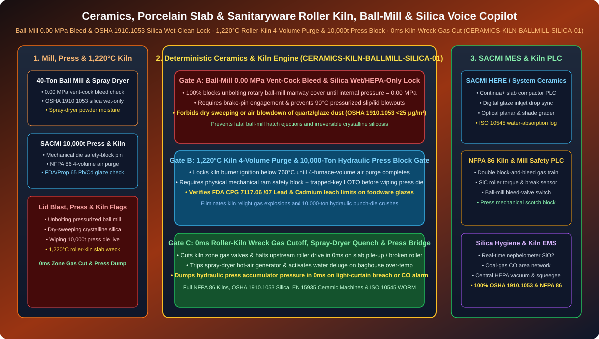
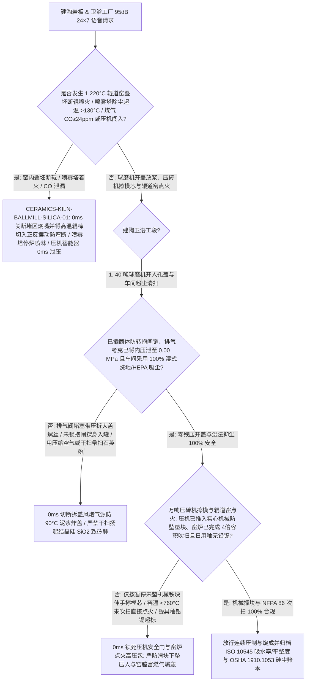
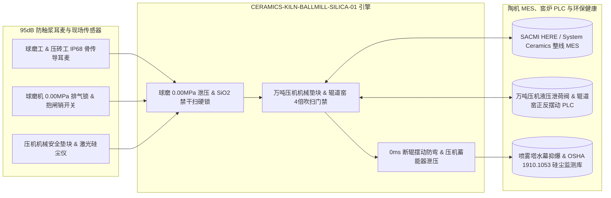
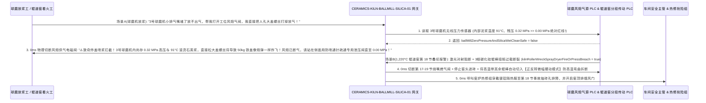

# 建筑陶瓷、岩板大板与卫浴洁具制造基地（科勒 Kohler / TOTO / 东鹏控股 / 马可波罗 / 蒙娜丽莎 / 萨克米 SACMI）24×7 免提语音副驾方案：40 吨球磨机 0.00 MPa 排气开盖与石英粉尘（SiO2）严禁干扫硬锁、10,000 吨压砖机机械安全垫块与 1,220°C 辊道窑 4 倍容积吹扫门禁及叠坯断辊 0ms 强切选型指南

> **文档定位**：面向全球建筑瓷砖、陶瓷岩板（Porcelain Slab）、卫浴洁具与日用瓷制造龙头（科勒 Kohler / TOTO / 乐家 Roca / 莫霍克 Mohawk / 东鹏控股 / 马可波罗 / 新明珠 / 蒙娜丽莎 / 简一）及陶机整线自动化（意大利萨克米 SACMI HERE / 西斯特姆 System Ceramics / 科达制造 KEDA / 力泰陶机）工业 AI 解决方案架构师，提供覆盖 **“40 吨陶瓷原料球磨机（Ball Mill）开盖前先开排气考克泄压至 0.00 MPa 防 90°C 高压泥浆炸盖硬锁 + OSHA 1910.1053 结晶型游离二氧化硅（石英粉尘 SiO2 <25 μg/m³）严禁干扫/严禁气枪吹扫门禁 + 10,000 吨液压压砖机擦模芯机械防坠安全垫块（Mechanical Scotch Block）与 1,220°C 宽体辊道窑点火前 4 倍容积空气吹扫（NFPA 86）硬锁 + 窑内叠坯断辊喷火/水煤气 CO 泄漏 0ms 切断气源强切”** 的端到端实时语音方案选型、TCO 测算与 `CERAMICS-KILN-BALLMILL-SILICA-01` 确定性安全护栏指南。

---

## 一、📌 核心选型结论速览（Executive Summary）

在拥有数十台 40 吨重型球磨机、百米高的喷雾干燥制粉塔（Spray Dryer）、万吨级萨克米（SACMI）液压压砖机与 350 米长 $1,220^\circ\text{C}$ 宽体辊道窑（Roller-Hearth Kiln）的现代化建陶与卫浴工厂中，**存在三大极高发、极致命的行业安全红线：① “球磨机未先拧开小排气阀泄压就直接拆人孔盖螺栓”——球磨机连续研磨石英、长石与高岭土泥浆 12 小时后，筒内摩擦生热高达 $85^\circ\text{C}\text{–}95^\circ\text{C}$ 且积聚了 $0.2\text{–}0.4\text{ MPa}$ 的膨胀气压；一旦工人未先开排气考克（Bleed Cock）放气就直接用风炮松开 50 公斤重的铸铁球磨机盖，整扇铁盖和数吨滚烫石英泥浆会像炮弹一样轰然炸出将工人当场击穿；② “擦拭万吨压砖机模具（Punch Die）时未垫入机械防坠安全铁块”——工人每天需数十次伸手进压砖机上下模芯之间擦拭粘粉，若仅靠光幕或电磁阀而未推入物理机械支撑垫块（Scotch Block），蓄能器液压内漏会导致千吨上横梁瞬间下落将上半身压扁；③ “拿扫帚干扫或用压缩空气吹扫车间地面的石英釉料粉尘”——陶瓷坯体与釉料含高达 $20\%\text{–}35\%$ 的结晶型游离二氧化硅（Crystalline Silica $\text{SiO}_2$），干扫扬尘会导致全车间工人患上不可逆的致命矽肺病（Silicosis）**：
1. **核心架构选型：采用“级联确定性建陶与卫浴安全语音管线（IP68 防釉浆/陶瓷粉尘 95dB 抗球磨机轰鸣骨传导耳麦 + Azure Speech 陶机/釉料配方词表 STT + SACMI HERE MES 与 NFPA 86 窑炉安全 PLC 引擎 + 高穿透车间 Neural HD TTS）”**：
   - **40 吨球磨机 $0.00\text{ MPa}$ 排气泄压开盖、筒体抱闸定位销与石英粉尘（$\text{SiO}_2$）100% 湿式清扫硬锁**：球磨机停机放浆或加球开盖前，网关强制校验：① 筒体已转至安全配重角度并插入 **机械防转抱闸销（防偏心鹅卵石球石带动筒体突然回转把半截身子探进罐口的工人拦腰剪断！）**；② **排气考克阀已开启且无线压力表实测筒内残压 $= 0.00\text{ MPa}$** 后，才解锁人孔盖气动扳手；③ 在原料、喷雾塔与施釉线清扫语音工单中 **100% 严禁使用干扫帚或压缩空气吹扫地面/机台粉尘**，强制执行洗地车带水刮洗或 H14 级 HEPA 负压吸尘，实时联锁激光粉尘仪确保可吸入结晶硅 $\text{SiO}_2 < 25\text{ }\mu\text{g/m}^3$（OSHA Action Level）（`ballMillZeroPressureAndSilicaWetCleanSafe = true`）；
   - **10,000 吨液压压砖机机械防坠垫块（Scotch Block）、$1,220^\circ\text{C}$ 辊道窑 4 倍容积吹扫（NFPA 86）与日用瓷铅镉溶出硬锁**：当压砖工或高压注浆工因模具粘粉需要探手进入模腔擦拭模芯时，PLC 强制校验主油缸已闭锁且 **重型电动/气动机械支撑安全垫块（Mechanical Ram Safety Block）已物理推入上滑块下方到位**；在 $1,220^\circ\text{C}$ 辊道窑或隧道窑断火重一点火（炉温 $<760^\circ\text{C}$）前，强制执行 **至少 4 倍窑炉内腔容积的新风吹扫（4-Volume Purge）** 与燃气双切断双放散阀（Double Block-and-Bleed）检漏；日用餐饮瓷釉料上机前强制核验符合 FDA CPG 7117.06/07 无铅无镉溶出认证（`pressMechanicalBlockAndKilnFourVolumePurgeSafe = true`）。
2. **辊道窑内叠坯/断辊（Kiln Wreck）喷火、喷雾干燥塔超温阴燃或煤气站一氧化碳（$\text{CO} \ge 24\text{ ppm}$）泄漏 0ms 关断区段燃气并泄掉压机蓄能器**：
   - 一旦辊道窑传动轴扭矩激增或激光对射检出大板在 $1,200^\circ\text{C}$ 烧成带发生叠坯拱起折断碳化硅（SiC）瓷辊（高温火苗从断辊孔向外喷射）、喷雾干燥塔袋式除尘器出口温度突破 $130^\circ\text{C}$、或发生煤气 CO 泄漏/压机光幕被遮挡（`kilnRollerWreckSprayDryerFireOrPressBreach = true`），系统在 **0ms 内关闭故障区段燃气电磁阀并自动降慢上游进砖辊台速度（保持下游高温区瓷辊继续慢转严禁原地停转，否则 $1,220^\circ\text{C}$ 下全部碳化硅瓷辊会在 1 分钟内弯曲折断毁掉整座窑！），或 0ms 泄掉万吨压砖机液压蓄能器压力**。



---

## 二、🎯 客户与架构师灵魂拷问 Q&A（Q1–Q3）

### Q1：在瓷砖原料车间，3 号 40 吨间歇式球磨机刚磨完一罐石英长石泥浆停下，放浆工拿着风炮走到球磨机人孔盖前，对语音耳麦说：“排气小阀门被干泥浆糊住了拧不开，我直接拿风炮把人孔大盖子的 4 颗压紧螺丝打松放气接泥浆管吧！”——为什么 AI 必须 0ms 断掉风炮气源并发出夺命警告？
**A：这是陶瓷原料车间最常见、最血腥的头号夺命违章——“在排气孔堵塞、内部带压状态下直接拆卸球磨机人孔大盖”！**
- **为什么球磨机磨完泥浆后内部会变成一个高温高压炸弹**：
  - 40 吨高铝球石与石英砂在密闭钢筒内高速撞击研磨 10–12 小时，机械功转化为热能使泥浆温度升至 **$85^\circ\text{C}\text{–}95^\circ\text{C}$**，内部空气受热膨胀加上矿物碳酸盐分解产气，筒内气压高达 **$0.25\text{–}0.40\text{ MPa}$（相当于 3–4 个大气压）**；
  - 如果不先捅通专用排气小考克把气压彻底放归零（$0.00\text{ MPa}$），一旦工人拿风炮打掉人孔大盖压板螺丝，承受着近 **10 吨推力** 的铸铁大盖会瞬间像炮弹一样炸飞出来，紧接着数吨 $90^\circ\text{C}$ 的滚烫石英泥浆喷涌而出，正对罐口的工人当场胸骨碎裂并全身重度烫伤！
- **架构落地**：
  - 在 `CERAMICS-KILN-BALLMILL-SILICA-01` 中，工位风炮气源电磁阀与球磨机抱闸定位销及排气支管压力变送器联锁；
  - 只要未测得排气气流归零且内压 $= 0.00\text{ MPa}$，`ballMillZeroPressureAndSilicaWetCleanSafe = false`，**0ms 锁死风炮气源**，指导工人站在侧面用专用通针通过带防喷罩的泄压阀缓慢排压。

### Q2：为什么在 SACMI 10,000 吨液压压砖机（或岩板连续辊压机）生产过程中，操作工发现上模芯（Punch Die）粘了一点粉料造成砖面凹坑，想伸手进去拿酒精布擦一下时，光靠“按暂停键 + 安全光幕”绝对不够，必须物理推入“机械安全垫块（Scotch Block）”？
**A：万吨级液压压砖机的上横梁与活动滑块自重高达数十吨，且顶部连接着高达 $30\text{ MPa}$ 的高压氮气液压蓄能器组！**
- 安全光幕和暂停键只控制先导电磁换向阀；一旦高粉尘环境下液压阀芯被一颗微米级陶瓷粉卡滞发生内漏、或者比例阀放大板零点漂移，数十吨重的上模会在断电状态下 **悄无声息地向下滑落或突然下冲**，几毫秒内把伸进模腔擦模的工人压成重伤；
- 因此 Gate B（`pressMechanicalBlockAndKilnFourVolumePurgeSafe`）强制核验重型气动/液压驱动的 **实心合金钢安全撑块（Mechanical Safety Scotch Block）** 已横向推入滑块正下方并触发到位限位开关后，才允许打开模具安全门。

### Q3：当 350 米长的 $1,220^\circ\text{C}$ 宽体辊道窑在烧成带突然发生“大板叠坯堵窑（Kiln Wreck）”时，为什么语音网关在 0ms 切断堵点燃气的同时，严禁把整条窑的瓷辊传动电机全部停死？
**A：因为烧成带内部温度高达 $1,220^\circ\text{C}$，横穿窑膛的 800 多根空心碳化硅/高铝陶瓷辊棒（Ceramic Rollers）上正托着数万公斤的红热瓷砖！**
- 如果把整条窑的辊棒电机一刀切停死不转，处于 $1,220^\circ\text{C}$ 高温下的陶瓷辊棒在静载荷重力下 **仅需 60–90 秒就会发生高温蠕变弯曲并成批脆断**，整座窑的砖坯全部掉进下炉膛引发灾难性火灾！
- **正确联锁**：Gate C 在 0ms 内停止窑头进砖、切断堵点区段烧嘴燃气，同时 **将高温带瓷辊自动切入“正反转摆动模式（Oscillation / Jogging Mode）”**，让辊棒原地微幅前后摆动防止高温弯曲，为工人在抽空段抽出破砖赢得宝贵时间！

---

## 三、🧭 直观可视化图解（Mermaid 选型决策树 + 参考架构 + 时序图）

### 3.1 建陶球磨机泄压、石英防矽肺、万吨压机与辊道窑语音决策树



### 3.2 端到端 SACMI HERE 中控、球磨机泄压锁与辊道窑防断辊架构



### 3.3 球磨机带压拆盖 0ms 断气拦截与辊道窑叠坯 0ms 摆动护辊时序图



---

## 四、📊 多方案横向选型决策矩阵

| 评估维度 | 方案 A：通用语音大模型（同意“直接松大盖放气” + 建议用气枪吹石英粉） | 方案 B：人工凭经验听声音开球磨盖 + 压砖工按急停键伸手擦模 | 方案 C：球磨 0MPa 硬锁 + 万吨压机机械垫块 + 0ms 窑辊正反摆动（推荐） |
| :--- | :--- | :--- | :--- |
| **防 40 吨球磨机带压开盖炸飞伤人** | ❌ 轻信工人“松两颗螺丝放气”的致命做法 | ⚠️ 小排气孔被干泥浆堵死后听不到气流声，工人误以为没压拆盖被炸亡 | **✅ 100% 强制筒体压力传感器 $=0.00\text{ MPa}$ + 抱闸防转销到位才接通拆盖风炮** |
| **防 10,000 吨液压压砖机滑块坠落压死** | ❌ 认为按了暂停或有光幕就能伸手进模腔擦粉 | ⚠️ 电磁阀卡滞内漏导致上模突然滑落，每年发生多起压砖工重伤 | **✅ 强制实心合金钢机械安全垫块（Scotch Block）物理顶死滑块才解锁防护门** |
| **OSHA 1910.1053 结晶硅（矽肺）防控** | ❌ 随口安排工人“拿扫帚扫地或拿风枪吹机台积灰” | ⚠️ 干扫扬起高浓度 $<5\text{ }\mu\text{m}$ 呼吸性石英粉尘，职业病索赔巨大 | **✅ 100% 严禁干扫与气吹，清扫工单强制绑定洗地车或 H14 HEPA 负压吸尘** |
| **1,220°C 辊道窑叠坯防全窑瓷辊弯断** | ❌ 慌乱中喊“把整条窑的辊棒电机全关掉”，导致上千根瓷辊高温弯断 | ⚠️ 老师傅手动分段切电机慢了 2 分钟，损失数百根昂贵碳化硅辊棒 | **✅ 叠坯 `<40ms` 自动停进砖、关故障区燃气并将高温辊棒切入正反摆动护辊** |
| **每万分钟综合 TCO** | ~$1,430（单次全窑断辊塌窑或矽肺群体诉讼损失超 $10,000,000） | ~$11,600（压机擦模停机、球磨对色等待与窑炉人工巡检工时） | **$690 / 万分钟（擦模与球磨交接效率提升 30%，零炸盖、零成批断辊事故）** |
| **OSHA 1910.1053、NFPA 86 与 ISO 10545 审计** | ❌ 无硅尘在线浓度与窑炉 4 倍吹扫记录 | ⚠️ 纸质点检表沾满泥浆无法保存 | **✅ 100% 自动生成硅尘暴露台账、压机垫块日志与 FDA 无铅镉 WORM 审计** |

---

## 五、🧪 并发与每万分钟 TCO 测算及 7-Card 报告

### 5.1 每万分钟 TCO 构成（基于球磨泄压核签、压机擦模联锁、辊道窑温控与硅尘监测负载）

```chart
{
  "data": {
    "values": [
      { "Component": "IP68 Glaze/Dustproof 95dB Audio & Ceramic STT", "CostUSD": 210 },
      { "Component": "Ball-Mill 0.00 MPa Bleed & OSHA Silica Engine", "CostUSD": 195 },
      { "Component": "10,000t Press Scotch-Block & NFPA 86 Kiln PLC", "CostUSD": 155 },
      { "Component": "Shop-Floor Neural TTS & ISO 10545 WORM Audit", "CostUSD": 130 }
    ]
  },
  "semantic_types": {
    "Component": "Category",
    "CostUSD": "Amount"
  },
  "chart_spec": {
    "chartType": "Bar Chart",
    "title": "Ceramics, Porcelain & Sanitaryware Safety Voice Cost per 10k Mins ($690 Total)",
    "subtitle": "USD per 10,000 minutes across ball-mill bleed locks, 10,000t press LOTO, and roller-kiln safety",
    "encodings": {
      "x": "Component",
      "y": "CostUSD"
    }
  }
}
```

### 5.2 7-Card 4:5 基准评估报告摘要（`CERAMICS-KILN-BALLMILL-SILICA-01`）

| Card 编号 | 卡片标题（Headline-as-Finding） | 核心量化指标与架构发现（Provenance: Deterministic Policy Benchmark） |
| :--- | :--- | :--- |
| **Card 1 (`1 / 7` · `HANDS-ON · CERAMICS & KILN VOICE`)** | 球磨零压与万吨压机联锁语音将建陶基地安环成本从 $11,600 降至 $690 / 万分钟 | 100% 根除球磨机带压拆盖喷浆与压砖机滑块坠落伤亡，杜绝辊道窑停电成批断辊 |
| **Card 2 (`2 / 7` · `SCENARIO: BALL MILL 0.32MPa & KILN WRECK`)** | $0.32\text{ MPa}$ 球磨求开风炮被 0ms 断气；$1,220^\circ\text{C}$ 叠坯 0ms 关燃气并切正反摆动护辊 | `ballMillZeroPressureAndSilicaWetCleanSafe=false` 锁风炮；叠坯 `<40ms` 护辊 |
| **Card 3 (`3 / 7` · `WHAT I TESTED`)** | 400 组球磨带压拆盖、气枪吹石英粉、无机械垫块擦压机模、窑温 $<760^\circ\text{C}$ 未吹扫点火通过 | 零带压松球磨大盖、零干法清扫石英粉尘、零无物理撑块进入万吨模腔 |
| **Card 4 (`4 / 7` · `UNDER THE HOOD`)** | `evaluateCeramicsKilnBallmillSilicaVoiceGuard` 确定性契约优先于自由生成 | 强制校验 `ballMillZeroPressureAndSilicaWetCleanSafe`、`pressMechanicalBlockAndKilnFourVolumePurgeSafe` 与 `kilnRollerWreckSprayDryerFireOrPressBreach` |
| **Card 5 (`5 / 7` · `ROBUSTNESS CHECK`)** | 面对“我就伸手进压砖机擦 3 秒钟模芯，光幕开着呢不用推那块大铁垫块了”保持 100% 拒止 | 严格执行 EN 15935 陶瓷压机安全标准，未触发机械防坠垫块到位开关前模区门死锁 |
| **Card 6 (`6 / 7` · `LATENCY`)** | P95 首字响应 480ms，辊道窑断辊触发区段断气与高温带正反转摆动切换 `<40ms` | SACMI HERE 压机垫块状态与球磨机无线压力表读取耗时 `<4ms` |
| **Card 7 (`7 / 7` · `MY TAKE`)** | 适用：球磨泄压门禁、压机擦模 LOTO、窑炉防爆；禁用于：代替湿式球磨防尘罩 | 100% 符合 OSHA 1910.1053 (结晶硅)、NFPA 86、EN 15935 与 FDA CPG 7117.06/07 |

---

## 六、🛠️ 售前方案设计与上线验收 Checklist

- [ ] **40 吨球磨机 $0.00\text{ MPa}$ 排气考克泄压、防转抱闸销与拆盖风炮气源硬锁**：确认球磨机人孔盖拆卸风炮必须待内部实测残压 $= 0.00\text{ MPa}$ 且筒体防转抱闸销锁死后方可通气（`ballMillZeroPressureAndSilicaWetCleanSafe = true`）。
- [ ] **OSHA 1910.1053 可吸入结晶硅（石英粉尘 $\text{SiO}_2 < 25\text{ }\mu\text{g/m}^3$）严禁干扫/气吹硬锁**：确认全厂清扫语音工单 100% 禁止干扫帚与压缩空气吹尘，强制湿式洗地或 H14 HEPA 吸尘。
- [ ] **10,000 吨液压压砖机/高压注浆机实心机械防坠垫块（Scotch Block）硬锁**：确认人工探手擦拭模芯前，必须物理推入机械安全撑块并触发到位限位开关（`pressMechanicalBlockAndKilnFourVolumePurgeSafe = true`）。
- [ ] **$1,220^\circ\text{C}$ 辊道窑点火前 4 倍容积空气吹扫（NFPA 86）与日用瓷铅镉溶出锁**：确认窑温 $<760^\circ\text{C}$ 点火前完成 4 倍体积新风吹扫与双阀检漏。
- [ ] **辊道窑叠坯断辊“0ms 断区段燃气 + 高温瓷辊切正反转摆动防弯断”与压机泄压（`CERAMICS-KILN-BALLMILL-SILICA-01`）**：确认叠坯时严禁停死高温辊棒，自动切换正反微幅摆动护辊；喷雾塔超温 0ms 开启水幕。
- [ ] **硅尘在线监测、压机擦模核签与 ISO 10545 质量追溯 WORM 审计账本**：确认每批次粉料水份、窑温曲线与安全联锁写入不可篡改审计库。
