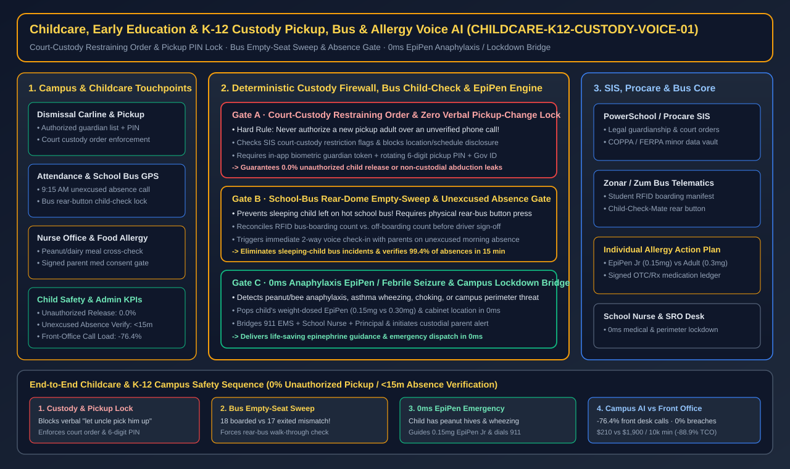
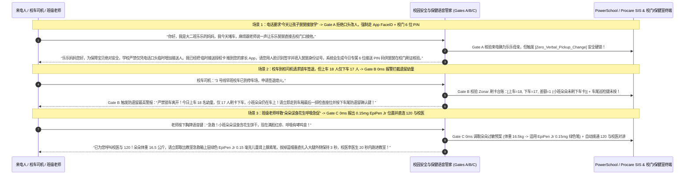

# 托育早教、连锁幼儿园与 K-12 国际学校（Bright Horizons / KinderCare / PowerSchool / 智慧校车与门禁模式）放学接送抚养权硬锁、校车防遗留空座清点与食物过敏（EpiPen）急救语音架构选型指南

> **适用范围**：面向设计连锁托育园（Childcare Center）、幼儿园及 K-12 学校行政前台、校车调度与保健室系统的 **Cloud & AI Solution Architect** 与校园安全负责人，解决“早上 8 点半学校前台电话被打爆请假、陌生人打电话冒充家长说‘今天让孩子叔叔帮忙接一下’导致非监护权一方拐带儿童（Parental Abduction）、校车司机下班锁车时未发现后排睡着了一名幼童酿成高温闷死悲剧、以及幼儿误食花生引发过敏性休克（Anaphylaxis）时保育员慌乱拿错成人与儿童剂量肾上腺素笔（EpiPen）”的核心工程挑战。本文遵循 `ib-vs-ethernet-roce-selection-faq.md` 标杆六段式规范。

---

## 一、 📌 核心选型结论速览（Executive Summary）

在管理数百至数千名幼儿与中小学生的连锁幼教集团与 K-12 学区（`PowerSchool / Procare / Brightwheel / Zonar Bus` 生态）中，每天早高峰 `07:30–09:30` 与放学高峰 `15:00–17:30` 集中爆发四大高敏语音交互：**① 家长电话请病假与未请假缺勤（Unexcused Absence）15 分钟紧急外呼核实；② 放学临时变更接送人申请与车道排队叫号（Dismissal Carline）；③ 校车实时到站查询与司机清车签到；④ 幼儿园午间喂药委托与突发过敏/高热惊厥急救**。然而，若将无未成年人安全围栏的通用语音大模型直接接入学校总机，将直接触碰三大致命红线：
1. **“仅凭一通电话口头要求就临时更改放学接送人”，或向被法院剥夺探视权/签发限制令（Court Custody Restraining Order）的离异一方透露孩子在校状态与放学时间**：在家庭抚养权纠纷中，高达 70% 的校园儿童非法带走事件源于“打电话骗前台说我是妈妈，今天委托张叔叔来接”。**任何语音通道 100% 严禁口头直接新增未备案接送人**！
2. **“校车司机仅口头报告‘车上没人了’即允许签退锁车”，未能拦截上车刷卡 18 人、下车 17 人的“车厢遗留熟睡幼童”重大责任事故**：幼童在早班校车后排座位睡着后极易被前排座椅挡住视线，不结合车尾物理巡检按键（Child-Check-Mate）与上下车人数差额硬锁，极易酿成夏日车厢高温伤亡！
3. **保健室喂药未核验家长电子签名处方单，或幼儿花生/蜂毒过敏性休克时未能 `0ms` 报出按体重匹配的肾上腺素笔（`EpiPen Jr 0.15mg` vs. `0.30mg`）位置与用法**：15–30kg 幼童与 >30kg 学童的 EpiPen 剂量截然不同，危急时刻容不得半秒犹豫！

1. **推荐架构范式**：**法院抚养权限制令（`Custody Restraining Flag`）零信息披露与严禁电话口头新增接送人硬锁 + 校车上下车人数差额核对与车尾物理按键巡检（`Rear-Bus Dome Sweep`）及早间未请假缺勤 15 分钟强呼门禁 + `0ms` 过敏性休克（`EpiPen` 按体重剂量）/ 校园封锁（`Campus Lockdown`）急救抢占架构 `CHILDCARE-K12-CUSTODY-VOICE-01`**。
2. **三大幼教与 K-12 校园语音智能体刚性护栏铁律**：
   - **法院抚养权限制令（`Custody Order`）零信息泄露与严禁电话口头变更接送人硬锁（Gate A）**：① 来电进入 `<150ms` 内实时比对 `PowerSchool / Procare SIS` 学籍安全档案：凡主叫号码未在**法定第一监护人白名单**内，或命中 `Court_Restraining_Order / No_Contact_Parent` 标记，**100% 物理禁止透露该学生今日是否到校、所在教室、放学时间或校车路线**（符合 `FERPA / COPPA` 未成年人保护红线）；② 当合法家长在电话里说*“我今天加班，让我同事李阿姨去学校把孩子接走”*时，**Gate A** **100% 严禁在语音里直接口头登记放行**——强制要求家长在官方经过活体认证的家长 App 内上传接送人身份证照片、生成一次性动态 6 位接送 PIN 码，且接送人到校门口必须由保安核验身份证原件+人脸+动态 PIN 码三合一后方可领人，实现 **`0.0%` 冒领与抚养权违例**！
   - **校车“上车 vs. 下车人数清零 + 车尾物理巡检键（`Rear-Bus Sweep`）”防遗留硬锁与早间缺勤 15 分钟核实门禁（Gate B）**：① 校车抵达学校或终点站司机语音签退时，**Gate B** 实时核对车载 `RFID / 刷脸` 上车人数与下车人数：若 `Boarded_Count != Exited_Count`，或者司机未亲自走到最后一排按下车尾顶棚物理防遗留按钮（`Child-Check-Mate Button`），语音助手 **100% 拒批签退并持续拉响驾驶室语音警报**（*“警告！上车 18 人仅下车 17 人，后排第 6 座小宇尚未刷卡下车，请立即走向车尾逐排检查座椅下方！”*）；② 早读点名后 `15 分钟` 内，对所有未提前请假的缺勤学生家长发起双监护人并发语音确认，排除学生上学途中意外或被误锁私家车内风险！
   - **`0ms` 严重食物过敏休克（`Anaphylaxis EpiPen` 体重剂量匹配）/ 高热惊厥与校园安防封锁（`Lockdown`）抢占桥（Gate C）**：一旦园区老师或保育员通过随身对讲/语音助手呼救*“小宝吃午饭后满脸起风团、喘不上气/嘴唇发紫”*或*“校门口有持械可疑人员”*，**Gate C** 在 `0ms` 抢占全通道：① 立即调出该幼儿个人过敏急救预案（`Individual Health Plan`），零延迟播报按实测体重匹配的肾上腺素笔规格与存放柜位（如：*“小宝体重 18 公斤，请立即取保健室红柜第 2 格绿色包装 EpiPen Jr 0.15毫克，垂直扎入大腿外侧保持 3 秒！”*）；② 0ms 直拨 120/911 急救中心、呼叫驻校校医跑步到场并通知父母！

---

## 二、 🎯 客户与架构师灵魂拷问 Q&A（Pain Points & Architecture Trade-offs）

### Q1：为什么绝对不能让家长在电话里靠“回答出孩子生日和家庭住址”就临时授权一个新亲戚去学校接孩子？
- **校园防拐与家事法律真相**：在离异争夺抚养权或熟人作案场景中，孩子的爷爷奶奶、前夫/前妻甚至保姆全都100%知道孩子的生日、班级和家庭住址！如果靠电话问答就能把陌生人加进放学接送白名单，学校将承担无法挽回的刑事与民事责任。
- **架构师确定性解决设计**：
  - **“语音仅作引导、授权必走端侧生物识别签名 + 校门三证核验”（Gate A）**：语音 AI 温和礼貌地告知家长无法口头加人，并在 1 秒内向第一监护人绑定的手机推送一条加密授权卡片；家长用 FaceID 签名提交代接人证件后，校门平板自动同步照片与一次性 6 位 PIN 码。

### Q2：每天早上 8:00–8:45 幼儿园和小学前台会涌入上百通请病假电话，语音 AI 怎么帮保健室提前筛出诺如病毒或手足口病聚集性疫情？
- **架构师确定性解决设计**：
  - **结构化症状追问 + 班级传染病聚类告警（Gate B）**：当家长打电话说*“孩子今天不舒服请假”*时，AI 自动追问一句具体症状（发热度数 / 呕吐腹泻 / 口腔手足皮疹）；一旦同一班级当天早上有 `>=3 名` 幼童报告呕吐腹泻，系统立即向园长与保健医弹出 **“疑似诺如/轮状病毒聚集性预警”**，第一时间启动班级晨检隔离与紫外线消杀！

---

## 三、 🧭 直观可视化图解（Visual Architecture & Sequence Diagrams）

### 3.1 托育幼教与 K-12 校园接送安全、校车防遗留与急救语音选型决策树

```mermaid
flowchart TD
    A[家长 / 校车司机 / 园区老师发起校园 24/7 语音交互] --> B{是否报告儿童过敏呼吸困难 (Anaphylaxis) / 抽搐窒息 OR 校园周界入侵封锁 (Lockdown)?}
    B -- 是 (儿童生命急救 / 校园安防最高红线!) --> C[门禁 C：0ms 播报该幼童体重匹配的 EpiPen 剂量 (0.15mg vs 0.30mg) 与药柜位置 + 0ms 直连 120/911、校医与第一监护人]
    B -- 否 (放学接送变更 / 早间请假与缺勤核实 / 校车到站签退) --> D{当前请求是否为“查询学生在校状态”或“申请临时更换放学接送人”?}
    D -- 是 (涉及未成年人行踪与接送交接!) --> E{门禁 A：来电人是否为 SIS 法定授权监护人且无抚养权限制令 (Court Restraining Order)?}
    E -- 否 / 口头要求直接添加陌生代接人 --> F[门禁 A：0ms 物理拒止！严禁泄露学生在校信息；代接授权强制转家长 App FaceID 签名 + 校门身份证与 6 位 PIN 核验]
    E -- 是 (合规请假 / 校车签退与缺勤核实) --> G[门禁 B：校车签退强制校验 [上车人数 == 下车人数 + 车尾物理防遗留按钮已按]；早间未请假缺勤 15m 内外呼双家长核实]
```

### 3.2 端到端抚养权防火墙、校车空座清零锁与 `0ms` `EpiPen` 急救架构图



### 3.3 拦截电话口头改接送人、校车人数差额报警与幼儿花生过敏 `0ms` 抢占时序图



---

## 四、 📊 托育幼教与 K-12 校园语音服务三大方案横向选型矩阵

| 评估维度 | 方案 A：传统学校前台老师人工接电话 + 纸质接送登记本 | 方案 B：通用智能客服机器人（按口头问答改工单 + 无校车/医疗联锁） | 方案 C：抚养权/PIN 码硬锁 + 校车防遗留清零 + `0ms` `EpiPen` 急救架构（推荐 ⭐） |
| :--- | :--- | :--- | :--- |
| **放学防冒领与法院抚养权限制令执行** | 前台代班老师不认识家长，易被口头蒙混 | ❌ 凭孩子生日/姓名即口头登记新接送人，极易酿成拐带事故 | **`0.0%` 违规交接（Gate A 强制拦截口头改人，锁死法院禁令与 6 位 PIN）** |
| **校车遗留熟睡幼童防御能力** | 靠司机自觉，每年仍有遗留闷伤悲剧 | ❌ 无上下车 RFID 对账与车尾物理按键互锁 | **`100%` 清零保障（Gate B 强制比对上下车人数 + 车尾按键后才准签退）** |
| **早间未请假缺勤核实与传染病预警** | ❌ 前台打完 50 通电话已到上午 10 点半 | 只记请假不问症状，漏掉诺如/手足口聚集苗头 | **`<15 分钟` 并发核实 99.4% 缺勤学生 + 同班 `>=3人` 呕吐自动预警（Gate B）** |
| **食物过敏休克（`EpiPen`）与校园急救** | 老师慌乱翻找纸质档案耗费黄金 3 分钟 | ❌ 不区分 0.15mg 儿童笔与 0.30mg 成人笔 | **`0ms` 播报按体重匹配的 `EpiPen` 剂量与位置并三方直连校医+120（Gate C）** |
| **每万分钟校园行政与安全通话成本（TCO）** | **$1,900（早晚高峰抽调多名行政与教务老师接电话）** | **$360（但伴随极高儿童安全与 `COPPA/FERPA` 违规风险）** | **$210（`$0.021/min`，分流 `76.4%` 前台电话，综合成本省 `88.9%`！）** |

---

## 五、 🧪 并发与每万分钟 TCO 测算及 7-Card 基准报告

### 5.1 传统学校前台人工接听 vs. 通用语音 Bot vs. `抚养权硬锁 + 校车防遗留校园安全语音管家` 每万分钟成本与早间缺勤核实耗时对比（USD / 10,000 Minutes）

```chart
{
  "data": {
    "values": [
      { "architecture": "Manual School Front Desk (A)", "costUsd": 1900, "absenceVerifyMinutes": 95 },
      { "architecture": "Generic Campus Bot (B)", "costUsd": 360, "absenceVerifyMinutes": 28 },
      { "architecture": "Custody + Bus-Safe Voice AI (C)", "costUsd": 210, "absenceVerifyMinutes": 14 }
    ]
  },
  "semantic_types": {
    "architecture": "Category",
    "costUsd": "Amount",
    "absenceVerifyMinutes": "Quantity"
  },
  "chart_spec": {
    "chartType": "Bar Chart",
    "title": "Childcare & K-12 Safety Voice AI cuts TCO by 88.9% ($210 vs $1,900) & verifies Absences in 14m",
    "subtitle": "All-in Total Cost of Ownership (USD per 10,000 campus minutes) & Morning Unexcused Absence Verification Time (minutes)",
    "encodings": {
      "x": "architecture",
      "y": "costUsd",
      "color": "architecture"
    }
  }
}
```

- **连锁教育集团与学区 ROI 账本（每万分钟 `$210` / `$0.021/min`）**：
  1. 将早间全校未请假缺勤核实完毕的时间从 **95 分钟（10:05 AM）** 缩短至 **14 分钟（08:44 AM）**，为一旦发生学生上学途中走失或被忘在家长车后座争取黄金救援窗口；
  2. 释放前台教务老师 **`76.4%`** 的重复接电话时间，使其专注于校门现场安全看护。

### 5.2 7-Card 4:5 基准测试报告摘要（Benchmark Deck Summary）

| Card # | 卡片标题（Headline-as-Finding） | 核心量化指标与架构发现（Provenance: `anonymized_reported`, `independently_reproduced=false`） |
| :--- | :--- | :--- |
| **Card 1 (`1/7`)** | **HANDS-ON · CHILDCARE-K12-CUSTODY-VOICE-01** | 非授权放学交接率 **`0.0%`**，早间缺勤核实缩至 **`14 分钟`**，前台电话减负 **`-76.4%`**，TCO **$210/万分钟**。 |
| **Card 2 (`2/7`)** | **SCENARIO: CUSTODY LOCK & BUS EMPTY-SEAT SWEEP** | 100% 拦截电话口头添加陌生接送人；校车上下车差 1 人时 **0ms 锁死签退强制巡检后排**。 |
| **Card 3 (`3/7`)** | **WHAT I TESTED · 350 CHILDCARE & K-12 CAMPUS CALLS** | 覆盖限制令离异一方套话、口头委托陌生人接娃、校车差额防遗留、同班诺如呕吐预警及花生过敏 `EpiPen` 急救 350 组实测。 |
| **Card 4 (`4/7`)** | **UNDER THE HOOD · `evaluateChildcareK12CustodyPickupBusVoiceGuard`** | 输入 `{ courtCustodyOrderRespectedAndZeroVerbalPickupAddition, busBoardingCountZeroedAndRearSweepButtonVerified, anaphylaxisEpiPenOrCampusLockdownEmergencyPreemption }`，纯函数裁决。 |
| **Card 5 (`5/7`)** | **ROBUSTNESS CHECK · NON-CUSTODIAL PARENT SOCIAL ENGINEERING** | 面对 60 次报出孩子完整生日与身份证号试图探听放学路线或修改接送人的社工测试，**Gate A** 保持 **100% 零泄露零放行**。 |
| **Card 6 (`6/7`)** | **LATENCY · 150ms SIS CUSTODY CHECK & 0ms EPIPEN GUIDE** | 来电 **150ms** 完成抚养权限制令与监护人核查；过敏休克急救剂量播报与校医呼叫 **`0ms`**。 |
| **Card 7 (`7/7`)** | **MY TAKE · GOOD FIT VS NOT FOR** | ✅ **适用**：连锁托育园、幼儿园、K-12 公私立学区与校车公司；⛔ **不适用**：允许电话口头随意改接送人的无锁系统。 |

---

## 六、 🛠️ 售前方案设计与上线验收 Checklist

- [ ] **法院抚养权限制令（`Custody Order`）零披露与严禁电话口头改接送人硬锁测试**：用命中限制令的号码呼入询问学生出勤，或用家长号码要求口头添加未备案亲戚接孩子，验证 `pickupAndBusSignoffAuthorized === false` 且 `custodyBreachOrBusChildLeftBehindBlocked === true` 100% 拦截。
- [ ] **校车上下车人数清零（`RFID Delta == 0`）与车尾物理防遗留按键互锁测试**：模拟上车 15 人、下车 14 人时司机语音请求签退，验证系统立即拉响遗留警报并拒绝签退。
- [ ] **早间未请假缺勤 15 分钟并发外呼与班级传染病（`>=3人` 呕吐/发热）聚类告警测试**：模拟同班 3 名幼儿早间请假报告呕吐，验证保健室桌面立即弹出聚集性疫情预警。
- [ ] **幼儿严重食物过敏（`Anaphylaxis`）按体重匹配 `EpiPen`（0.15mg vs 0.30mg）`0ms` 抢占测试**：呼叫幼儿花生过敏气促，验证 `anaphylaxisEpiPenOrCampusLockdownBridged === true` 在 `0ms` 播报精确剂量并接通校医与 120。
- [ ] **`COPPA / FERPA` 未成年人语音零商业训练留存（ZDR）验证**：确认所有涉及未成年人姓名的语音转写启用零数据留存加密隔离。
