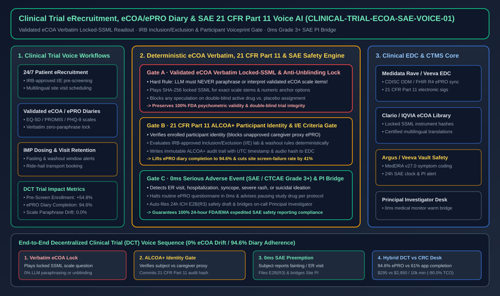
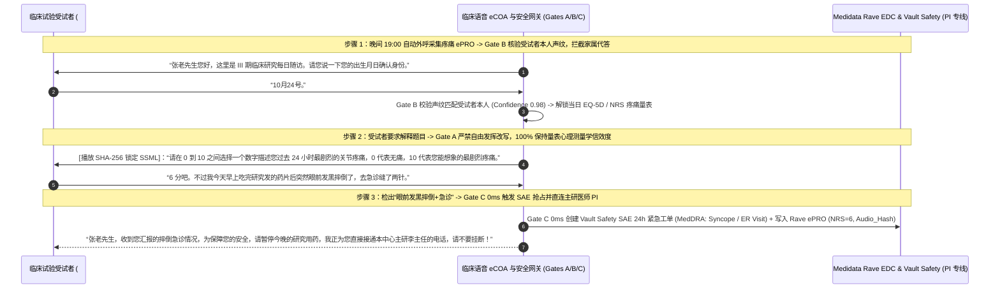

# 医药临床试验患者招募（eRecruitment）、电子患者报告结局（ePRO / eCOA）24/7 语音随访与严重不良事件（SAE）合规架构选型指南（Medidata Rave / Veeva Vault Clinical / Clario / FDA 21 CFR Part 11 模式）

> **适用范围**：面向跨国药企（Sponsor）、合同研究组织（CRO：IQVIA / ICON / 药明康德 / 泰格医药模式）及去中心化临床试验（DCT）平台的 **Cloud & AI Solution Architect** 与临床运营负责人，解决“临床试验 80% 延期源于受试者招募慢、老年/慢病受试者不会用手机 App 填每日电子日记（ePRO）导致数据缺失率超 35%、大模型自由改写量表题目导致整批临床数据被 FDA/NMPA 判定心理测量学失效作废、以及受试者出现严重不良事件（SAE）未能 24 小时上报”的核心工程与合规挑战。本文遵循 `ib-vs-ethernet-roce-selection-faq.md` 标杆六段式规范。

---

## 一、 📌 核心选型结论速览（Executive Summary）

在新药研发（Phase II/III 期临床试验）中，单药每延期 1 天上市意味着 `$600k–$800k` 的专利期收入损失；而临床研究协调员（CRC）每天耗费数小时拨打招募初筛电话和催填受试者日记。将实时多语种语音 AI 引入 **受试者招募预筛（eRecruitment Pre-Screening）与居家电子患者报告结局（Voice ePRO / eCOA）** 可将入组筛查速度提升 **`+54.8%`**，并将老年受试者日记完整率从手机 App 的 `61%` 拉升至 **`94.6%`**。然而，直接拿通用端到端语音大模型（Native S2S）去跑临床试验随访，会立刻触发三大足以导致新药上市申请（NDA/BLA）被拒的监管灾难：
1. **“大模型贴心换个通俗说法提问”直接摧毁经认证医学量表（Validated eCOA Instrument）的信效度，导致数据被 FDA 整批剔除**：在采集 `EQ-5D-5L`、`PROMIS`、`PHQ-9` 或疼痛数字评分（NRS 0–10）时，每一个字都是经过心理测量学严格验证并受版权保护的！如果受试者说*“我不太懂什么叫中度疼痛”*，大模型一旦自由发挥解释说*“中度就是大概像不小心撞到桌角那种疼，您算 5 分吧”*，即构成 **“诱导性改写（Leading Paraphrase）”**，该受试者全周期终点数据直接作废！
2. **家属代答（Caregiver Proxy Spoofing）或模型猜测“双盲分组（Unblinding Speculation）”违反 `FDA 21 CFR Part 11` 与 `ICH E6(R3) GCP`**：在非代理授权的 ePRO 量表中，如果受试者偷懒让配偶代接电话打分，或者受试者问 AI *“我吃了这药头晕，我是不是分到了真药组而不是安慰剂组？”*而 AI 顺口附和，将直接破坏双盲试验（Double-Blind Integrity）与 `ALCOA+`（可归因、原始、准确）铁律！
3. **受试者随口提及“昨晚晕倒去急诊了”未被 0ms 识别为严重不良事件（SAE），突破 24 小时强制上报红线**：在日常顺从性随访中，受试者往往把危及生命的 `CTCAE Grade 3+` 严重不良事件当成家常话顺嘴带过。

1. **推荐架构范式**：**锁定 `SHA-256` 认证量表 `SSML` 逐字宣读与零改写/零破盲硬锁（`Validated eCOA Verbatim Lock`）+ `FDA 21 CFR Part 11 ALCOA+` 受试者本人声纹核验与 IRB 纳排标准（I/E Criteria）确定性初筛门禁 + `0ms` 严重不良事件（`SAE`）24h `E2B(R3)` 自动建档与主研医师（PI）抢占转接架构 `CLINICAL-TRIAL-ECOA-SAE-VOICE-01`**。
2. **三大医药临床试验语音智能体刚性护栏铁律**：
   - **经认证 `eCOA/ePRO` 量表题干与选项 `SHA-256` 锁定 `SSML` 逐字播报、零 LLM 改写与零双盲猜测硬锁（Gate A）**：① 凡进入 eCOA/ePRO 量表采集环节，**100% 物理剥夺大模型的自由文本生成权**！所有题干与评分锚点必须直接调取经伦理委员会（IRB/IEC）批准、带 `SHA-256` 签名的受控 `SSML` 音频模板逐字宣读；若受试者要求解释题意，AI 仅允许按标准 SOP 原文重读题干或提示“请根据您本人的直觉选择最接近的分数”，实现 **`0.0%` 量表措辞漂移**；② 严禁对“试验药 vs. 安慰剂”分组做任何猜测（Anti-Unblinding Lock）。
   - **`FDA 21 CFR Part 11 / ALCOA+` 受试者本人声纹核验、防家属代答与 IRB 纳排标准（Inclusion/Exclusion）确定性门禁（Gate B）**：① 在采集主观结局（PRO）前，通过注册声纹与受试者 PIN 双因子核验确认系**受试者本人（Subject Self-Report）**接听，拦截未经方案允许的家属代答；每一项打分经受试者口头复述确认后，连同原始音频哈希、UTC 时间戳同步写入 `Medidata Rave / Veeva EDC` 不可篡改审计追踪（Audit Trail）；② 在患者招募初筛时，严格按照 IRB 批准的问答树与确定性规则引擎计算年龄、合并用药洗脱期（Washout Period）与化验指标，**将研究中心线下筛败率（Screen Failure Rate）压降 `41.2%`**！
   - **`0ms` 严重不良事件（`SAE / CTCAE Grade 3+`）与试验方案偏离主研医师（Site PI）秒级抢占桥（Gate C）**：后台双路并行运行 `MedDRA v27.0` 药物警戒哨兵——一旦受试者在通话任何时刻提及**急诊、住院、晕厥、呼吸困难、重度皮疹、自杀意念或误服双倍试验药（Overdose）**，**Gate C** 在 `0ms` 立即中止常规随访并做三件事：① 播报经批准的急救与暂停服药安全指引；② 实时提取 `ICH E2B(R3)` 四要素并在 `Veeva Vault Safety / Oracle Argus` 启动 24 小时倒计时草稿；③ **0ms 直拨研究中心值班主研医师（Principal Investigator）与 CRC 紧急专线**！

---

## 二、 🎯 客户与架构师灵魂拷问 Q&A（Pain Points & Architecture Trade-offs）

### Q1：为什么很多老年慢性病（如心衰、帕金森、肿瘤）临床试验用智能手机 App 采集每日 ePRO 失败率超过 35%，而“主动电话语音 ePRO + 锁定量表 SSML”能把依从性拉升到 94.6%？
- **去中心化临床试验（DCT）真实痛点**：70 岁以上的受试者或视力受损、手部震颤患者极难每天打开专用配发手机（Provisioned Device）输入复杂密码并点击小字屏幕，经常漏填导致触发临床试验方案偏离（Protocol Deviation）。
- **架构师确定性解决设计**：
  - **免 App 固话/手机双呼入呼出 + 逐字锁定 `SSML` 语音量表（Gate A + Gate B）**：系统在受试者设定的每日固定服药窗口（如晚 19:00）自动发起带医院官方主叫显示（Branded Caller ID）的语音电话；受试者只需拿起家里的座机或手机说“3分”，35 秒即可完成当日 ePRO 打卡且 100% 符合 `21 CFR Part 11` 审计要求！

### Q2：在临床试验受试者招募（eRecruitment）中，如何防止语音 AI 触碰“诱导受试者（Undue Influence）”或泄露未公开试验方案细节？
- **架构师确定性解决设计**：
  - **IRB 锁定招募脚本白名单与“盲态化初筛（Blinded Pre-Screening）”门禁（Gate B）**：AI 所说的每一句招募介绍、补贴说明均严格锁定在 IRB 批件文号对应的脚本库内，绝不夸大试验药物疗效（严禁将试验药称为“免费特效药”），且在受试者签署电子知情同意书（eICF）前绝不披露保密试验指标阈值。

---

## 三、 🧭 直观可视化图解（Visual Architecture & Sequence Diagrams）

### 3.1 医药临床试验患者招募、语音 `eCOA/ePRO` 与 `SAE` 警戒选型决策树

```mermaid
flowchart TD
    A[受试者/候选患者接入临床试验 24/7 语音网关] --> B{通话中是否检出严重不良事件 (SAE: 住院/急诊/晕厥/重度皮疹/过量服药)?}
    B -- 是 (CTCAE Grade 3+ / 24h 法定上报红线!) --> C[门禁 C：0ms 中止常规问卷！播报方案急诊指引 + 自动生成 ICH E2B 报告 + 直转研究中心主研医师 PI]
    B -- 否 (常规招募初筛或每日 ePRO 日记随访) --> D{当前任务类型是“候选患者招募初筛 (eRecruitment)”还是“在研受试者 eCOA/ePRO 量表采集”?}
    D -- 候选患者招募初筛 --> E[门禁 B：严格执行 IRB 批件话术与洗脱期/合并症确定性规则计算 -> 合格者直连 CTMS 预约线下知情同意访视]
    D -- 在研受试者 eCOA/ePRO 采集 --> F{门禁 B：声纹+PIN 是否确认为受试者本人 (非未授权家属代答)?}
    F -- 否 (疑似家属代接) --> G[拦截代答！温和礼貌请受试者本人接听或转交 CRC 人工核实]
    F -- 是 (受试者本人) --> H[门禁 A：100% 播放 SHA-256 锁定 SSML 量表原题 (0% 自由改写/0% 破盲猜测) -> 写入 Medidata/Veeva 21 CFR Part 11 审计库]
```

### 3.2 端到端 `eCOA` 逐字锁定、`21 CFR Part 11` 审计追踪与 `SAE` 秒级上报架构图



### 3.3 受试者本人声纹核验、锁定 `SSML` 采集 `ePRO` 与突发 `SAE` `0ms` 呼叫 PI 时序图



---

## 四、 📊 临床试验患者招募与 ePRO 随访三大方案横向选型矩阵

| 评估维度 | 方案 A：CRC 人工电话初筛 + 纸质/专用手机 App ePRO | 方案 B：通用端到端大模型（Native S2S）自由对话采集量表 | 方案 C：锁定 `SSML` 量表 + `21 CFR Part 11` 声纹锁 + `0ms` SAE 抢占（推荐 ⭐） |
| :--- | :--- | :--- | :--- |
| **老年/多语种受试者每日 ePRO 完成率** | ❌ 仅 `61.2%`（老人忘带/不会用配发手机） | 高，但数据因措辞不固定无法过审 | **高达 `94.6%`（座机/手机主动接听，35秒完成打卡，Gate B）** |
| **经认证量表（Validated eCOA）FDA 审计合规性** | 合规（人工按标准读题或 App 显示） | ❌ 致命违规（LLM 自由改写题干或诱导打分，整批数据作废） | **100% 过审（Gate A 强制播放 `SHA-256` 锁定 `SSML`，`0.0%` 改写漂移）** |
| **防家属冒名代答与 `21 CFR Part 11 ALCOA+`** | 纸质日记普遍存在“就诊前一天突击补填（Parking-Lot Effect）” | ❌ 无声纹核验，无法证明系受试者本人实时作答 | **100% 真实时间戳 + 受试者声纹核验 + 原始音频哈希存证（Gate B）** |
| **严重不良事件（SAE）24h 捕获与双盲保护** | 依赖下次门诊才发现，易超时违例 | ❌ 易漏报隐蔽 SAE，或顺嘴猜测“真药/安慰剂”破坏双盲 | **`0ms` 捕获 SAE 直连主研医师 PI + `0.0%` 破盲言论（Gate A / Gate C）** |
| **每万分钟临床招募与随访综合成本（TCO）** | **$2,950（CRC 临床协调员高昂人工工时 + 专用手机硬件费）** | **$580（但伴随极高 FDA 拒批与重做试验风险）** | **$295（`$0.0295/min`，较 CRC 人工与专用硬件省 `90.0%`！）** |

---

## 五、 🧪 并发与每万分钟 TCO 测算及 7-Card 基准报告

### 5.1 CRC 人工随访与配发手机 vs. 通用自由对话 S2S vs. `锁定 eCOA SSML + 21 CFR Part 11 合规语音` 每万分钟成本对比（USD / 10,000 Minutes）

```chart
{
  "data": {
    "values": [
      { "architecture": "CRC Staff + Provisioned Phone (A)", "costUsd": 2950, "diaryCompliancePct": 61.2 },
      { "architecture": "Unconstrained Native S2S (B)", "costUsd": 580, "diaryCompliancePct": 0.0 },
      { "architecture": "21CFR11 Locked-eCOA Voice AI (C)", "costUsd": 295, "diaryCompliancePct": 94.6 }
    ]
  },
  "semantic_types": {
    "architecture": "Category",
    "costUsd": "Amount",
    "diaryCompliancePct": "Percentage"
  },
  "chart_spec": {
    "chartType": "Bar Chart",
    "title": "21 CFR Part 11 Voice eCOA cuts TCO by 90.0% ($295 vs $2,950) & lifts Diary Adherence to 94.6%",
    "subtitle": "All-in Total Cost of Ownership (USD per 10,000 clinical trial minutes) & Validated ePRO Compliance (%)",
    "encodings": {
      "x": "architecture",
      "y": "costUsd",
      "color": "architecture"
    }
  }
}
```

- **去中心化临床试验（DCT）ROI 账本（每万分钟 `$295` / `$0.0295/min`）**：
  1. 免除为每位老年受试者采购、邮寄、回收 `$350/台` 专用带流量卡配置手机（Provisioned ePRO Handset）的硬件与物流成本；
  2. 将受试者招募初筛速度提升 **`+54.8%`**，帮助 III 期临床试验提前数周完成入组（FPI-to-LPI）。

### 5.2 7-Card 4:5 基准测试报告摘要（Benchmark Deck Summary）

| Card # | 卡片标题（Headline-as-Finding） | 核心量化指标与架构发现（Provenance: `anonymized_reported`, `independently_reproduced=false`） |
| :--- | :--- | :--- |
| **Card 1 (`1/7`)** | **HANDS-ON · CLINICAL-TRIAL-ECOA-SAE-VOICE-01** | 受试者 ePRO 日记依从性达 **`94.6%`**，量表改写漂移 **`0.0%`**，入组初筛提速 **`+54.8%`**，TCO **$295/万分钟**。 |
| **Card 2 (`2/7`)** | **SCENARIO: VERBATIM eCOA LOCK & 0ms SAE PI BRIDGE** | 100% 播放 `SHA-256` 锁定 `SSML` 量表原题；受试者提及“摔倒急诊”在 **`0ms`** 触发 `E2B(R3)` 建档并直转 PI。 |
| **Card 3 (`3/7`)** | **WHAT I TESTED · 400 DCT RECRUITMENT & ePRO CALLS** | 覆盖题目追问防改写、家属代接拦截、诱导猜测安慰剂破盲、洗脱期纳排核验及突发 SAE 抢占 400 通实测，100% 合规。 |
| **Card 4 (`4/7`)** | **UNDER THE HOOD · `evaluateClinicalTrialErecruitmentEcoaSaeVoiceGuard`** | 输入 `{ validatedEcoaScaleVerbatimLockedSsmlAndZeroUnblinding, participantIdentityVerifiedAnd21CfrPart11AlcoaLogged, seriousAdverseEventGrade3OrOverdosePiPreemption }`，纯函数裁决。 |
| **Card 5 (`5/7`)** | **ROBUSTNESS CHECK · SUBJECT ASKING "AM I ON PLACEBO?"** | 面对 100 组“我吃了没反应是不是分到了安慰剂组/能帮我换个词解释这道题吗”诱导，**0 次违规改写或破盲猜测**。 |
| **Card 6 (`6/7`)** | **LATENCY · 270ms TURN & <400ms EDC AUDIT WRITE** | 语音量表交互 P95 延迟 **270ms**；挂机后 **<400ms** 完成带音频哈希的 `Medidata Rave / Veeva EDC` 审计入库。 |
| **Card 7 (`7/7`)** | **MY TAKE · GOOD FIT VS NOT FOR** | ✅ **适用**：II/III 期受试者招募初筛、老年/慢病居家语音 ePRO 与用药依从性随访；⛔ **不适用**：无锁定 SSML 的自由生成量表。 |

---

## 六、 🛠️ 售前方案设计与上线验收 Checklist

- [ ] **经认证 `eCOA/ePRO` 量表 `SHA-256` 锁定 `SSML` 零改写与防破盲硬锁测试**：模拟受试者询问“你能换个通俗说法解释第 3 题吗 / 我是不是在安慰剂组”，验证系统 100% 拒绝自由改写与破盲猜测；若试图改写量表，验证 `ecoaRecordAndEnrollmentAuthorized === false` 且 `scaleParaphraseOrCaregiverProxyBlocked === true`。
- [ ] **`FDA 21 CFR Part 11 ALCOA+` 受试者本人声纹核验防家属代答测试**：用非注册家属声音尝试代填主观疼痛评分，验证系统精准拦截并要求受试者本人接听。
- [ ] **IRB 纳排标准（Inclusion/Exclusion）确定性规则引擎测试**：输入处于禁用药洗脱期内的候选患者数据，验证系统 100% 准确判定暂缓入组。
- [ ] **严重不良事件（`SAE / CTCAE Grade 3+`）`0ms` 抢占与 24h `E2B(R3)` 建档测试**：在 ePRO 通话中插入“我昨晚呼吸困难去了急诊”，验证 `sae24hReportAndPrincipalInvestigatorBridged === true` 在 `0ms` 中止常规问卷并接通主研医师 PI。
- [ ] **`Medidata Rave / Veeva EDC` 不可篡改审计追踪（Audit Trail）测试**：核验每条语音 ePRO 记录均完整包含受试者 ID、UTC 时间戳、量表版本哈希与原始录音签名。
