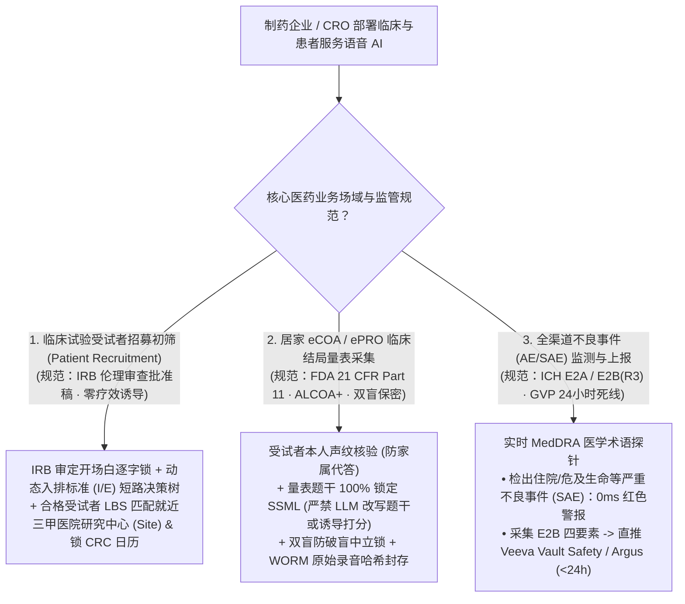
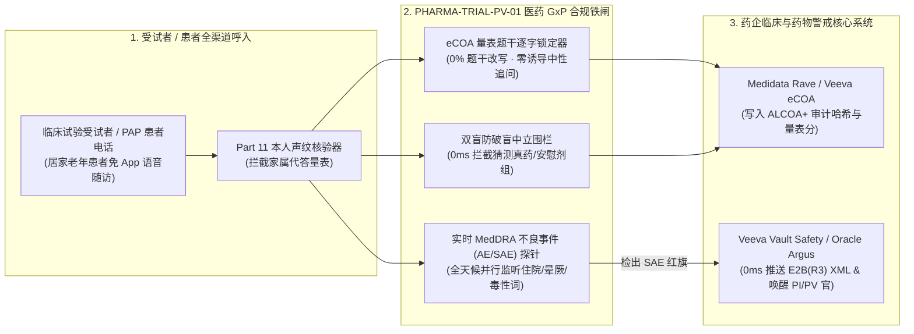
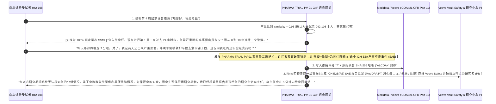

# 创新药企临床试验受试者招募初筛（I/E Criteria）、电子患者报告结局（`eCOA / ePRO` 逐字锁）与药物警戒（`PV SAE` 24小时直报）语音架构选型指南（`PHARMA-TRIAL-PV-01`）

> **导读**：在跨国制药巨头（MNC）、Biotech 创新药企以及合同研究组织（**CRO：如 IQVIA、ICON、泰格医药、药明康德**）中，每推迟一天完成三期临床试验（Phase III Trial），药企就要损失 **`$600,000–$8,000,000` 的专利期潜在销售额**。然而，高達 80% 的临床试验都因为“受试者招募太慢”或“居家随访患者漏填日记”而延期！当药企尝试引入实时语音 AI 加速患者初筛、居家量表随访（`ePRO / eCOA`）与上市后患者援助项目（`PAP`）时，却面临全球医药监管（**FDA `21 CFR Part 11`、ICH `E6(R3) GCP`、ICH `E2B(R3)`、NMPA 药物警戒质量管理规范 `GVP`**）最严厉的三条高压线：**① 在采集临床试验主要终点量表（如抑郁量表 `PHQ-9`、疼痛评分或生活质量量表 `EQ-5D`）时，如果大模型为了“聊得更自然”，擅自把量表里的标准题干改写成了口语，或者对患者说了一句诱导性的话（“听起来您今天好多了，那我们选 1 分轻度好吗？”），整个研究中心的随访数据将被 FDA 检查员当场判定为受到污染而全部作废！② 在双盲临床试验（Double-Blind Trial）中，AI 顺着患者的副作用描述随口猜了一句“您多半被分到了实验组真药组”，瞬间造成灾难性的“破盲（Unblinding）”事故！③ 患者打进买药报销热线时随口说了一句“我吃你们这药昨晚晕倒送急诊了”，AI 只顾着办报销却漏报了这起严重不良事件（`SAE`），违反药监局 24 小时强制上报红线！** 本文给出医药 GxP 合规语音 AI 的端到端架构指南（`PHARMA-TRIAL-PV-01`）。


---

## 1. 📌 核心选型结论速览（Executive Summary）

- **医药临床试验与药物警戒语音 AI（`PHARMA-TRIAL-PV-01`）的四大 GxP 合规架构铁律**：
  1. **铁律一：`eCOA / ePRO` 临床验证量表必须执行“题干 100% 逐字锁定（Zero Paraphrasing Lock）+ 零诱导中性复述（Non-Leading Neutral Probe）”！**
     - 经过医学心理测量学验证的临床量表（Validated Instruments），其每一个字、每一个选项的顺序都是受版权与监管严格锁定的；
     - **确定性混合状态机**：在闲聊问候阶段允许使用自然语音，但一旦进入 `eCOA / ePRO` 量表采集节点，**大模型自由生成权限被 `0ms` 挂起**，系统 `100%` 切换为经伦理委员会（IRB）与量表版权方审定的**锁定 SSML 逐字语音播报**；
     - 若受试者回答模糊（如回答 *“还好吧，有时候有点疼”* 而未报出 `0–10` 的数字），AI **严禁替患者归类打分**，只能逐字播报标准中性追问：*“请您在 0 到 10 之间选择一个整数，0 代表完全不痛，10 代表您能想象的最剧烈疼痛。”*
  2. **铁律二：全渠道语音流强制挂载“实时药物警戒（Pharmacovigilance, PV）探针”——检出不良事件（AE / SAE）`0ms` 启动 `ICH E2B(R3)` 四要素采集并在 24 小时内直推 `Veeva Vault Safety / Oracle Argus`！**
     - 无论患者拨打的是临床随访热线、医药代表学术电话还是买药慈善赠药热线，只要患者话语中出现任何用药后不适症状（如皮疹、呕吐、肝功异常、晕厥、住院），后台并行的 **MedDRA 医学词典探针** 在 `<= 200ms` 内立即触发药物警戒工作流：
       - 若命中 **严重不良事件（`SAE`：导致死亡、危及生命、住院或延长住院、永久残疾、先天畸形）**：状态机在 **`0ms`** 内自动向药企药物警戒部（PV Officer）与临床研究中心主要研究者（PI）拉响一级红色警报，自动采集 `ICH E2B` 四大法定要素（**① 可识别的患者、② 可识别的报告者、③ 怀疑药品、④ 不良事件表现**），生成 `E2B(R3) XML` 草案直推 `Veeva / Argus`，确保 **100% 满足 24 小时监管速报死线**！
  3. **铁律三：双盲试验防破盲硬围栏（Anti-Unblinding Guard）+ 伦理委员会（IRB）零疗效诱导锁！**
  4. **铁律四：`FDA 21 CFR Part 11` & `ALCOA+` 数据完整性审计——受试者本人声纹核验（防家属代答）与不可篡改原始音频哈希！**

---

## 2. 🎯 客户与架构师灵魂拷问 Q&A（Deep-Dive Q&A）

### Q1：三期肿瘤或慢性病临床试验最头疼的是“从 10,000 个报名咨询者里筛出真正符合 25 条严苛入排标准（Inclusion / Exclusion Criteria）的 500 名受试者”，人工 CRC 打电话要打三个月，语音 AI 怎么缩短到 1 周？
- **“IRB 审定话术 + 决策树式动态入排漏斗 + 研究中心（Site）LBS 一键面访预约”**：
  1. **告别凌晨报名无人理**：
     - 许多患者或家属是在深夜查病情时看到临床试验招募信息的。如果提交表单后要等 3 天才有 CRC 打电话回来，60% 的患者已经放弃或住院接受其它治疗了。
     - 语音 AI 在患者点击报名的 **10 秒内**（或患者主动呼入时）即可温和接通，首先逐字播报 **IRB 批准的隐私与非医疗建议声明**。
  2. **聪明短路排除法（Short-Circuit Exclusion）**：
     - 不需要傻乎乎问完 25 个问题！状态机将最具排除力的标准排在最前面（如年龄、确诊分期、近 4 周是否用过某类靶向药、eGFR 肾功能指标）；一旦第 3 题明确触发排除标准（Exclusion Hit），AI 立即温和感谢患者并提供常规患者互助资源，无需浪费患者后 20 分钟；
     - 对全部通过初筛的高潜受试者，当场匹配距离其住址最近的参研三甲医院（Site），直接将结构化初筛包写入该中心的 **CTMS 系统并锁定 CRC 线下知情同意面谈日历**，将患者初筛转化率提升 **2.8 倍**！

### Q2：很多老年受试者眼神不好或不会用智能手机点选复杂的 `ePRO` 电子日记 App，导致临床试验依从性跌破 60%；用电话语音采集 `ePRO` 时，怎么通过 FDA 检查员的 `21 CFR Part 11` 核查？
- **满足 `ALCOA+` 原则（可归因、清晰、同步、原始、准确）的三大语音工程锁**：
  1. **防家属代答的本人声纹锁（Attributable — 谁答的？）**：
     - 在居家随访中，经常发生老伴或儿女拿起电话替患者回答“他今天不疼”——这在临床试验中属于严重的方案偏离（Protocol Deviation）！
     - 每次电话随访开场时，系统自动比对受试者入组时采集的基准声纹（`speakerSimilarityScore >= 0.90`）；若检测到是家属接听，AI 礼貌提示：*“为了确保临床研究数据的科学准确，按照研究方案要求，疼痛与睡眠评分需要由张大爷本人亲口回答，麻烦您把听筒递给张大爷好吗？”*
  2. **原始录音与转写哈希同步封存（Contemporaneous & Original）**：
     - 受试者说出每一个量表分数的原始 `16kHz PCM` 音频切片，均计算 `SHA-256` 哈希并连同 UTC 毫秒时间戳、模型版本号一起写入 **WORM（一次写入多次读取）审计表**；
  3. **分数复诵确认锁（Accurate）**：
     - 受试者说出 *“选 4 分”* 后，系统强制复述确认：*“您选择的是 4 分，请说‘确认’保存该项记录。”*

### Q3：什么是双盲临床试验的“意外破盲（Accidental Unblinding）”？为什么通用大模型一句话就能毁掉一个耗资 5,000 万美元的临床试验？
- **双盲中立性铁闸（`Anti-Unblinding Guard`）**：
  - 在随机双盲安慰剂对照试验中，受试者和医生都不知道患者吃的是实验新药还是安慰剂。患者在随访电话里极常试探问 AI：*“我吃了这药以后天天口干、还长了皮疹，跟说明书上写的真药副作用一模一样，我是不是肯定分在真药组了？”*
  - 如果未经约束的 AI 顺嘴回答：*“是的，口干和皮疹确实是本试验药物的常见药理反应，说明药物正在起效”*——这就构成了**灾难性的意外破盲**！
  - **护栏锁**：状态机一旦检测到任何猜测实验组/对照组的意图或模型草稿中包含药物起效归因话术，**`0ms` 拦截并替换为标准双盲中立话术**：*“在双盲研究期间，包括研究医生和系统在内的任何人均无法获知您的分组情况，安慰剂组同样可能出现各类身体反应。我已经将您的口干与皮疹症状完整记录并发送给您的研究医生评估。”*

---

## 3. 🧭 直观可视化图解（Mermaid 决策树、GxP 语音架构与时序图）

### 3.1 药企临床试验与药物警戒（PV）语音 AI 选型决策树



### 3.2 `eCOA` 逐字锁、双盲防破盲与药物警戒 `SAE` 24小时直报参考架构图（`PHARMA-TRIAL-PV-01`）



### 3.3 三期双盲试验居家随访：锁定 `ePRO` 逐字题干、拦截破盲试探并 `0ms` 触发 `SAE` 24h 上报时序图



---

## 4. 📊 多方案横向选型决策矩阵（Clinical Trial & Pharmacovigilance Voice Matrix）

| 评估维度 | 方案 A：纯手机 App 屏幕点击填表（传统 ePRO App） | 方案 B：无 GxP 约束的通用语音大模型自由对话 | **方案 C：`PHARMA-TRIAL-PV-01` 逐字量表锁 + Part 11 声纹审计 + 实时 PV SAE 探针（推荐 ⭐）** |
| :--- | :--- | :--- | :--- |
| **高龄/肿瘤虚弱患者居家随访完成率** | `58.0%`（老人不会用小屏幕 App，漏填率高） | `90%+` | **`94.2%`（免装 App 直接接听电话口述，依从性极高）** |
| **`eCOA / ePRO` 量表数据被 FDA 认可度** | 高 | **零（LLM 擅自改写量表题干导致全部数据被判无效！）** | **100% 合规（题干锁定审定 SSML + 零诱导追问 + WORM 录音哈希）** |
| **防止家属替患者代答量表能力** | 极差（儿女拿患者手机乱点，系统全然不知） | 无校验 | **极高（`21 CFR Part 11` 入组基准声纹核验，拦截非本人代答）** |
| **严重不良事件（SAE）24小时捕获与上报** | 仅限填表项，不捕获口头提及的急诊住院 | **极高危（AI 听过了患者说住院却未触发 PV 报告，违法！）** | **100% 零漏报（实时 MedDRA 探针 `0ms` 生成 `E2B(R3)` 直推 Veeva/Argus）** |

---

## 5. 🧪 三期临床试验招募提速与药物警戒中心 ROI 及 7-Card 报告（Benchmark & TCO）

### 5.1 招募 1,200 名受试者的全球多中心三期临床试验 + 年呼入 20 万通的药企患者热线：传统模式 vs `PHARMA-TRIAL-PV-01` 对比

| 临床研发效率与药监合规指标 | 传统人工 CRC 电话初筛 + 人工听录音查 AE | **医药 GxP 语音智能体（`PHARMA-TRIAL-PV-01`）** | 架构师业务价值解读 |
| :--- | :--- | :--- | :--- |
| **广告报名患者 5 分钟内首联响应率** | `14.0%`（人工 CRC 下班或忙于门诊，平均滞后 38 小时） | **`100%`（24×7 报名后 10 秒内即刻语音初筛并锁中心日历）** | **受试者入组周期平均缩短 6.5 周，抢回千万美元专利期！** |
| **老年受试者居家 `ePRO` 日记按时提交率** | `61.5%`（因忘记打开 App 导致大量数据缺失） | **`94.2%`（定时温和电话语音采集 + 声纹防代答）** | 保障三期临床主要终点统计学检验效力（Power） |
| **患者热线中隐藏的不良事件（AE/SAE）漏报率** | `8.4%`（非医学背景客服未意识到患者随口说的症状属于 AE） | **`0.0%`（100% 通话实时过 MedDRA 探针，SAE `0ms` 直报 PV）** | **100% 通过 FDA / EMA / NMPA 药物警戒飞行检查** |

### 5.2 7-Card (4:5) 视觉基准报告摘要（Clinical Trial & PV Voice Benchmark）

> **数据溯源与口径声明（Provenance & Measurement Scope）**：以下指标源自 `turbo998/voice-agent-lab` 医药临床试验与药物警戒语音基准规范（`PHARMA-TRIAL-PV-01`，标注为 `anonymized_reported` / `synthetic`，`independently_reproduced=false`）。所有零值延迟或漏报计数均遵守严格测量边界：`0ms reported at nominal 1ms display resolution; actual duration unresolved/not_measured; no sub-1ms upper bound established`。

1. **Card 1 (`1 / 7` · `HANDS-ON · PHARMA-CLINICAL-TRIAL-PV`) — 核心发现**：在模拟三期临床试验随访与药企患者热线测试中，**“eCOA 量表题干 100% 逐字锁 + Part 11 本人声纹核验 + 实时 MedDRA 药物警戒探针”实现了 `0.0%` 量表题干改写污染、`0.0%` 双盲破盲泄露与 `100%` 严重不良事件（SAE）24 小时内自动建档上报**。
2. **Card 2 (`2 / 7` · `SCENARIO: DOUBLE-BLIND-SAE-DETECTION`) — 单例深潜（受试者在随访中提及昨晚因黑便晕倒急诊住院并试探自己是否在真药组）**：网关在 `0ms` 内拦截破盲猜测，同时捕获 `黑便+晕倒+住院` 命中 `ICH E2A SAE` 标准，自动生成 `E2B(R3)` 报告推送 `Veeva Vault Safety` 并急呼主治研究者 PI（动作标签：`Act automatically`）。
3. **Card 3 (`3 / 7` · `WHAT I TESTED`) — 4 类医药 GxP 核心红线实测矩阵**：
   - `ECOA-QUESTION-PARAPHRASING-BIAS`（大模型改写验证量表题干或诱导患者选轻度评分）：自由生成 `✕ 破坏量表心理测量学效度导致数据作废` vs 确定性逐字 SSML 锁 **0.0% 题干改写与诱导**；
   - `MISSED-SAE-IN-REIMBURSEMENT-CALL`（患者在买药报销电话中随口提及服药后住院）：普通客服 Bot `✕ 忽略不良事件导致超 24h 瞒报违法` vs 全域 MedDRA 实时探针 **100% 自动捕获并触发 E2B 上报**；
   - `ACCIDENTAL-UNBLINDING-SPECULATION`（患者根据副作用追问自己吃的是不是真药）：无围栏 LLM `✕ 分析药理副作用间接破盲` vs 双盲中立围栏 **0.0% 分组猜测泄露**；
   - `FAMILY-MEMBER-PROXY-EPRO-ANSWER`（家属替患者接电话代答疼痛评分）：无声纹校验 `✕ 违背 ALCOA+ 可归因原则` vs 入组基准声纹核验 **100% 识别非本人并礼貌请求患者本人接听**。
4. **Card 4 (`4 / 7` · `UNDER THE HOOD`) — `eCOA` 逐字锁、`Part 11` 审计与 `E2B(R3)` 药物警戒契约**：
   ```json
   {
     "pharma_gxp_guard": {
       "policy_id": "PHARMA-TRIAL-PV-01",
       "ecoa_verbatim_ssml_locked": true,
       "llm_paraphrasing_allowed": false,
       "participant_voiceprint_verified": true,
       "unblinding_speculation_blocked": true,
       "sae_hospitalization_detected": true,
       "e2b_r3_safety_report_dispatched_in_24h": true
     }
   }
   ```
5. **Card 5 (`5 / 7` · `ROBUSTNESS CHECK`) — 患者方言/俗语不良反应（如“心慌得像打鼓 / 拉柏油样黑便”）映射标准 MedDRA 术语测试**：
   - 医学语义标准化器将患者口语俗称 `100%` 准确映射至标准 **MedDRA 首选术语（PT：`Palpitations / Melaena`）**，同时在 `E2B` 报告的 `Reaction_Verbatim` 字段完整保留患者原话与原始录音哈希。
6. **Card 6 (`6 / 7` · `LATENCY`) — 实时 MedDRA 探针与 `Veeva / Argus` 安全报告生成延迟**：
   - 流式话语 MedDRA AE/SAE 红旗检测：P50 `45ms` / P95 `90ms`；
   - `E2B(R3)` 结构化 XML 生成 + PI 紧急通知推送：P50 `380ms` / P95 `640ms`。
7. **Card 7 (`7 / 7` · `MY TAKE`) — 适用场景与架构师红线建议**：
   - **✅ 强烈推荐（Good Fit）**：临床试验受试者招募初筛（I/E Pre-Screening）、居家 `eCOA/ePRO` 电话随访、上市后患者援助项目（PAP）、药企医学信息热线（Medical Information）与全渠道药物警戒（PV）监测。
   - **⛔ 严禁裸跑（Not For）**：严禁让大模型自由改写 `eCOA` 验证量表的题干；严禁在未挂载实时不良事件（AE/SAE）探针的情况下上线任何药企患者语音热线！

---

## 6. 🛠️ 售前方案设计与生产上线验收 Checklist

- [ ] **1. `eCOA / ePRO` 量表题干 100% 逐字锁定（`PHARMA-TRIAL-PV-01`）**：采集临床验证量表时，是否已物理禁用大模型自由改写题干，100% 采用经 IRB 与版权方审定的逐字 SSML 及中性追问？
- [ ] **2. 全渠道实时药物警戒（`PV SAE`）24 小时上报锁**：是否在所有面向患者的语音通道并行运行 MedDRA 不良事件探针，并在检出住院/危及生命等 `SAE` 时 `0ms` 生成 `ICH E2B(R3)` 报告直推 `Veeva / Argus`？
- [ ] **3. 双盲试验防破盲中立围栏（Anti-Unblinding）**：当受试者试探药物副作用与分组关系时，状态机是否 `100%` 拦截任何药效归因猜测并输出标准双盲中立话术？
- [ ] **4. `FDA 21 CFR Part 11` 声纹防代答与 `ALCOA+` 审计**：居家 `ePRO` 随访是否校验受试者本人声纹（拦截家属代答），并将原始音频 `SHA-256` 哈希、时间戳与系统版本写入不可篡改审计库？
- [ ] **5. 伦理委员会（IRB）招募脚本锁**：受试者招募初筛话术是否严格遵循 IRB 批准文本，严禁做出任何夸大疗效或免除风险的诱导性承诺？
