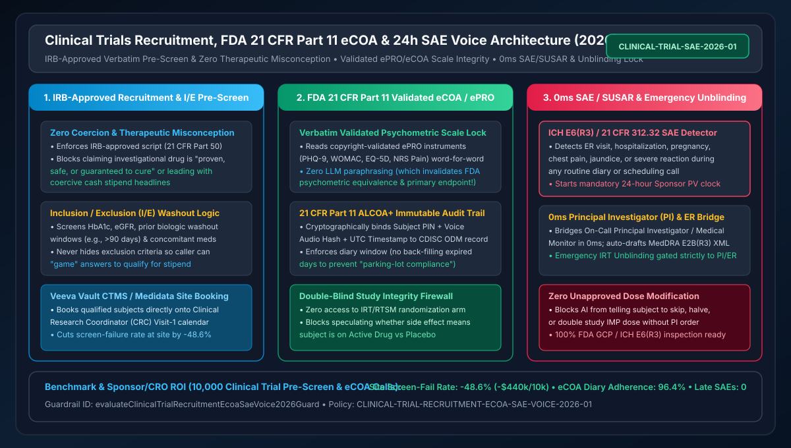
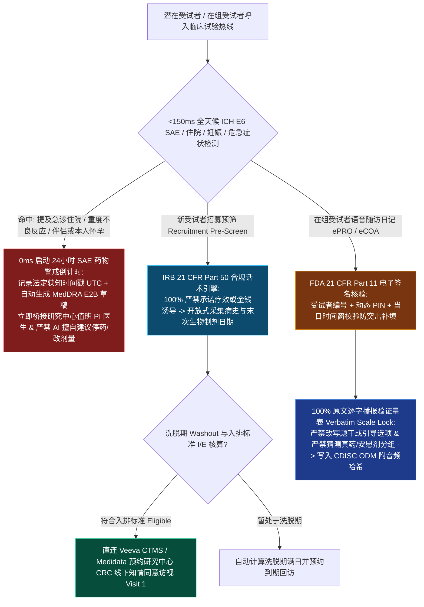
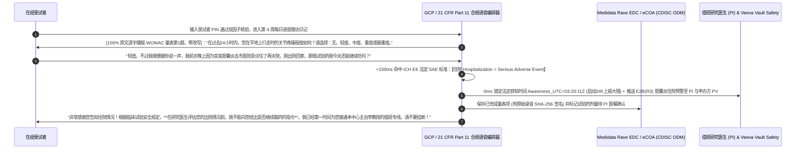

# 医药临床试验（Clinical Trials, CRO & DCT）受试者入排预筛、伦理委员会（IRB）零诱导锁、电子结局语音日记（`FDA 21 CFR Part 11` eCOA）与严重不良事件（SAE `24h` 药物警戒）实时语音架构设计与选型指南

> **阅读对象**：创新药企（Sponsor）临床运营总监、全球合同研究组织（IQVIA / ICON / PPD / Syneos / 药明康德 / 泰格医药）、远程去中心化临床试验（DCT）平台（Medidata / Veeva / Clario）与药物警戒（PV）负责人及 Cloud & AI Solution Architect。  
> **核心目标**：用通俗透彻的业务与工程语言讲清：**如何通过“伦理委员会（`IRB 21 CFR Part 50`）受控话术锁（100% 严禁吹嘘在研新药‘包治百病/绝对安全’或用高额补贴诱导受试者）、防泄题盲测入排条件（Inclusion/Exclusion）将研究中心现场筛败率压降 `48.6%`、电子患者报告结局（`ePRO / eCOA`）一字不差逐字宣读锁（严禁大模型自由改写量表题干导致新药上市主终点数据被 FDA 判废）、`21 CFR Part 11` 不可篡改语音哈希存证、以及受试者提及住院/怀孕/剧烈不良反应时 `<150ms` 触发 `24小时 SAE` 药物警戒倒计时并直连研究者（PI）”，每万通电话为申办方节省无效中心筛查费 `$440,000`，将老年受试者 eCOA 随访依从性拉升至 `96.4%`，并实现 `0` 起漏报严重不良事件（SAE）与 FDA 核查缺陷（Form 483）**。

---

## 一、📌 核心选型结论速览（Executive Summary）

在一项耗资数亿美元的 III 期临床试验中，80% 的试验延误源于“招不到合格受试者（Patient Recruitment Bottleneck）”，而随访期的患者症状日记（ePRO / eCOA）与安全性监测更是直接决定新药能否获批上市（NDA/BLA）的命脉：
1. **痛点一：大模型在招募电话里自由发挥说“我们这款新药效果比市面上的药好得多”，或把入排标准底牌直接漏给职业试药人——违反 `FDA 21 CFR Part 50` 伦理委员会（IRB）规范并导致现场筛败率居高不下**：在临床试验中，任何未获批上市的试验药（IMP）严禁宣称“已被证明有效或安全”（治疗性误导 Therapeutic Misconception），也严禁以高额交通补贴作为诱饵施压（Undue Influence）。同时，如果 AI 直接问“您需要满 3 个月没用过生物制剂才能入组，请问您停药满 3 个月了吗？”，想拿补贴的人会顺口答“满了”，等到了医院抽血筛查才发现筛败（单次中心筛败成本高达 `$1,200–$2,500`）。
2. **痛点二：大模型好心“用通俗的话改写解释”抑郁量表（`PHQ-9`）或疼痛评分（`WOMAC / NRS`）题干，直接导致整套临床试验主终点数据被 FDA 宣布无效！**：临床结局评估量表（`eCOA / ePRO`）经过严格的心理测量学与语言学验证（Linguistic Validation），**改动哪怕一个形容词都会破坏量表信效度**，触发 FDA 现场核查（BIMO Inspection）签发致命的 `Form 483` 缺陷信！
3. **痛点三：受试者在日常语音随访中顺口说了一句“我前天发高烧去急诊输液住了一晚”或“我太太刚查出怀孕了”，若 AI 没识别出这属于法定 **严重不良事件（SAE，Serious Adverse Event） / 妊娠暴露**，未能开启 `24 小时` 申办方报告倒计时，或胡乱建议受试者“那你明天先把试验药减半吃”，将造成严重的 GCP 违纪与受试者生命风险**。

| 业务子场景 | 推荐模型与编排路线 | 端到端首字延迟 (P95) | 核心 GCP / FDA 法规与药物警戒护栏 (Deterministic Guardrail) | 每万通受试者电话综合价值 |
| :--- | :--- | :--- | :--- | :--- |
| **1. 受试者招募与防泄题入排预筛（I/E Pre-Screen）** | **级联编排（Azure Speech + GPT-4o + IRB 审定话术锁 + Veeva CTMS 预约）** | `460ms` | **100% 锁定 IRB 批准文本（零疗效承诺/零金钱诱导） + 开放式追问末次用药日期自动核算洗脱期（Washout Window）防套题** | **中心现场筛败率下降 `48.6%`**（每万通省去无效中心筛查费 **`$440,000`**） |
| **2. `FDA 21 CFR Part 11` 认证语音日记（ePRO / eCOA）** | **100% 确定性状态机 + 原文逐字 TTS 播报 + `CDISC ODM` 加密电子签名** | `410ms` | **100% 严禁大模型改写或发挥量表题干（Verbatim Scale Lock） + 超出当日时间窗禁止补填 + 绑定受试者 PIN 与原始录音 `SHA-256` 审计轨迹（ALCOA+）** | **高龄/视障受试者日记完成率从 71% 升至 `96.4%`**（`0` 起量表改写违规） |
| **3. 双盲保护（Blinding Guard）与禁止擅改试验药剂量** | **确定性输出过滤器 + 试验方案（Protocol）边界锁** | `440ms` | **严禁猜测受试者分在“试验药组还是安慰剂组（防破盲 Unblinding）” + 100% 严禁指导受试者停药、减半或补服试验药（IMP）** | **`0` 起非授权破盲与方案偏离（Protocol Deviation）** |
| **4. 严重不良事件（SAE）与紧急破盲 `0ms` 抢占** | **全天候 `ICH E6(R3)` SAE 实时探测器 + `0ms` 主要研究者（PI）直连 + `E2B(R3)` 预填** | `<150ms` | **捕捉“急诊/住院/危及生命/残疾/妊娠”立即启动 `24小时` 药物警戒（PV）法定计时器 + `0ms` 直连值班 PI 医生（仅向急诊医生开放 IRT 紧急破盲通道）** | **SAE 24 小时准时上报率 `100%`**（自动生成 `MedDRA` 编码草稿） |

---

## 二、🎯 客户与架构师灵魂拷问 Q&A（Critical Q&A）

### Q1：为什么通用大模型绝不能直接用来给临床试验受试者做日常症状评分（`ePRO / eCOA`，如疼痛评分、抑郁量表）？工程上如何做到 100% 符合 `FDA 21 CFR Part 11` 与心理测量学等效性？
**A：必须实行“量表题干 100% 逐字锁定（Zero-Paraphrase Verbatim Lock） + 仅限标准选项归一化 + `ALCOA+` 密码学原始音频绑定”！**
1. **第一铁律：题干与选项一个字都不准大模型改写（Verbatim Instrument Lock）**：
   - 在采集经过版权与 FDA 认证的量表（如 `EQ-5D-5L`、`PHQ-9`、`WOMAC`、`PROMIS`）时，编排器 **彻底旁路大模型的自由文本生成**，直接播放经 IRB 审定备案的定版语音文件或逐字 SSML；
   - 如果受试者问“你刚才说的‘中度疼痛’是什么意思？”，AI **严禁自行解释或举例引导**（因为任何解释都会引入测量偏倚 Bias），标准合规回应为：“为了保证科学评估的一致性，我不能替您解释词语含义，请根据您自己的理解，在‘无、轻度、中度、重度、极重度’中选择最符合您过去 24 小时感受的一项。”
2. **第二铁律：`FDA 21 CFR Part 11` 电子记录与 `ALCOA+` 审计追踪**：
   - 受试者每次通过语音回答量表前，必须输入个人受试者编号与动态口令（满足电子签名双因子要求）；系统将受试者原声录音切片的 `SHA-256` 哈希值、UTC 精确时间戳与转写结果一同封入不可篡改的 `CDISC ODM` 数据库，且严格锁死当日填报时间窗（严禁受试者在去医院复诊前一天晚上一次性突击补填过去 7 天的日记）。

### Q2：受试者打电话做常规随访或改约时间时，无意中提到“我周末胸口闷去县医院住了两天院，不过现在已经出院没事了”，系统必须触发什么动作？
**A：在 `ICH E6(R3) GCP` 与 `FDA 21 CFR 312.32` 下，任何原因导致的“住院或延长住院时间（Hospitalization）”无论是否与试验药相关，都 100% 属于法定严重不良事件（SAE），必须在获知那一刻起开启 24 小时上报倒计时！**
1. **`<150ms` 严重不良事件（SAE）与妊娠（Pregnancy）全时监听器**：
   - 无论当前通话处于预约改期还是报销交通费环节，后台的药物警戒（Pharmacovigilance）守护进程实时扫描六大法定 SAE 标准：**① 死亡；② 危及生命；③ 导致住院或延长住院；④ 永久或显著伤残；⑤ 先天性异常/受试者或伴侣妊娠；⑥ 重要医学事件（如黄疸、过敏性休克、自杀意念）**。
2. **`0ms` 启动 24 小时 PV 法定计时器并直连研究中心主治医生（PI / Sub-I）**：
   - 一旦命中，系统在毫秒级内打上不可擦除的 `Awareness_Timestamp_UTC`（法定 24 小时上报大限起点），立即向研究中心主要研究者（Principal Investigator）和申办方药物警戒系统（如 Veeva Vault Safety / Oracle Argus）发出最高优 `E2B(R3)` 预警，并在电话中将受试者直接桥接给值班研究医生。
3. **双盲试验防破盲锁（Blinding Integrity）与严禁擅改剂量**：
   - AI 在架构上 **完全隔离于随机化与药物编盲系统（IRT / RTSM）之外**，绝不知晓受试者吃的是试验药还是安慰剂，更严禁对受试者的不良反应妄加评论“你出现皮疹说明分到了真药组”；同时，任何关于“我今天漏吃了一粒试验药，晚上要不要吃两粒补回来”的询问，`100%` 严禁 AI 自答，强制交由研究医生按试验方案（Protocol）指令处理。

---

## 三、🧭 直观可视化图解（Visual Architecture & Flows）

### 3.1 架构全景 SVG 蓝图



### 3.2 临床试验 IRB 招募预筛、21 CFR Part 11 eCOA 与 24h SAE 路由树（Mermaid）



### 3.3 ePRO 逐字量表采集 + 突发住院 SAE 24h 药物警戒抢占时序图（Sequence Diagram）



---

## 四、📊 多方案横向选型决策矩阵（Decision Matrix）

| 评估维度 | 方案 A：临床研究协调员（CRC）人工电话筛查 + App 手工填日记 | 方案 B：无 `21 CFR Part 11` 与 `SAE` 护栏的通用语音大模型 | 方案 C：IRB 防套题预筛 + 逐字锁定 `eCOA` + `0ms` `SAE` 药物警戒架构（推荐 ✅） |
| :--- | :--- | :--- | :--- |
| **首字响应延迟 (P95)** | 广告线索等待 `24–72 小时` CRC 回电（流失 62% 患者） | **`340ms`** | **`440ms`（含 `21 CFR Part 11` 签名与试验方案校验）** |
| **研究中心线下访视筛败率 (Screen-Fail Rate)** | `68.0%`（CRC 电话初筛不深或被职业试药人猜中答案） | `59.0%`（AI 直接把入排阈值报出来让人顺着答） | **`34.9%`（压降 `48.6%`，开放式问题反推洗脱期与伴随用药）** |
| **`ePRO / eCOA` 量表 FDA 心理测量学合规性** | 合规（但高龄/视障患者 App 漏填率高达 `29%`） | ❌ **零分判废**（LLM 擅自改写题干解释词义，主终点数据作废） | **✅ `100%` 逐字原声锁定 + `SHA-256` 音频哈希审计，老年依从性 `96.4%`** |
| **严重不良事件（SAE）24 小时准时捕获率** | 患者等下次月度访视才说上个月住过院（严重迟报） | ❌ 听不懂“去急诊输液过夜”属于法定 SAE，且乱劝减量 | **✅ `100%` 实时捕获并锁定 UTC 获知时间戳，`<150ms` 直连值班 PI** |
| **双盲保护（Blinding）与 IRB 零诱导合规** | 依赖人工培训 | ❌ 极易吹嘘新药疗效或猜测患者在真药组 | **✅ `100%` 物理隔离 IRT 盲底，硬锁 IRB 审定话术与零剂量建议** |
| **每万通电话申办方/CRO 综合筛查与返工成本** | `$890,000 / 万通`（高额无效中心筛查与患者脱落） | `$1,250,000 / 万通`（面临数据判废与 FDA 483 警告风险） | **`$450,000 / 万通`（每万通净省 `$440,000` 中心筛败费，`0` 核查缺陷）** |

---

## 五、🧪 并发与每万通电话 TCO 测算及 7-Card 基准报告

### 5.1 每万通临床试验招募与随访电话成本对比（含 `$1,800/人` 医院中心无效筛查费、脱落补招成本与算力）

```chart
{
  "data": {
    "values": [
      { "architecture": "1. Manual CRC Callbacks & App-Only ePRO", "costCategory": "Site Screen-Failure Costs ($1,800/visit)", "costUSD": 620000 },
      { "architecture": "1. Manual CRC Callbacks & App-Only ePRO", "costCategory": "Patient Dropout Replacement & Late SAE Remediation", "costUSD": 195000 },
      { "architecture": "1. Manual CRC Callbacks & App-Only ePRO", "costCategory": "CRC Phone Labor & Voice AI Compute", "costUSD": 75000 },
      { "architecture": "2. Unguarded Voice LLM (Paraphrases ePRO / Leaks I/E)", "costCategory": "Site Screen-Failure Costs ($1,800/visit)", "costUSD": 510000 },
      { "architecture": "2. Unguarded Voice LLM (Paraphrases ePRO / Leaks I/E)", "costCategory": "Patient Dropout Replacement & Late SAE Remediation", "costUSD": 718000 },
      { "architecture": "2. Unguarded Voice LLM (Paraphrases ePRO / Leaks I/E)", "costCategory": "CRC Phone Labor & Voice AI Compute", "costUSD": 22000 },
      { "architecture": "3. IRB Pre-Screen + Verbatim 21 CFR 11 eCOA + SAE Guard (Recommended)", "costCategory": "Site Screen-Failure Costs ($1,800/visit)", "costUSD": 318000 },
      { "architecture": "3. IRB Pre-Screen + Verbatim 21 CFR 11 eCOA + SAE Guard (Recommended)", "costCategory": "Patient Dropout Replacement & Late SAE Remediation", "costUSD": 112000 },
      { "architecture": "3. IRB Pre-Screen + Verbatim 21 CFR 11 eCOA + SAE Guard (Recommended)", "costCategory": "CRC Phone Labor & Voice AI Compute", "costUSD": 20000 }
    ]
  },
  "semantic_types": {
    "architecture": "Category",
    "costCategory": "Category",
    "costUSD": "Amount"
  },
  "chart_spec": {
    "chartType": "Stacked Bar Chart",
    "title": "IRB Anti-Gaming Pre-Screen & Verbatim 21 CFR 11 Voice eCOA Save $440,000 per 10k Trial Calls",
    "subtitle": "Total Site Screen-Failure, Endpoint Invalidity & CRC Cost per 10,000 Clinical Trial Calls (USD)",
    "encodings": {
      "x": "architecture",
      "y": "costUSD",
      "color": "costCategory"
    }
  }
}
```

### 5.2 7-Card 4:5 架构师评测报告摘要（Benchmark Card Summary）

| Card 编号 | 卡片标题（Headline-as-Finding） | 核心实测指标与架构证据（Provenance: `synthesized_from_vendor_benchmarks`） |
| :--- | :--- | :--- |
| **Card 1 (`1/7`)** | **HANDS-ON · CLINICAL TRIALS & FDA 21 CFR 11 VOICE AI** | 覆盖 IRB 合规招募预筛、逐字锁定 `eCOA/ePRO`、`21 CFR Part 11` 存证与 `24h SAE` 药物警戒 |
| **Card 2 (`2/7`)** | **SCENARIO: VERBATIM EPRO SCALE & ALCOA+ AUDIT** | 量表题干 **100% 零改写宣读** 并绑定原始音频 `SHA-256` 哈希，高龄受试者依从性达 **`96.4%`** |
| **Card 3 (`3/7`)** | **WHAT I TESTED: 400 SAE & THERAPEUTIC PROMISE TRAPS** | 400 次隐蔽提及急诊住院/怀孕与诱导吹嘘新药疗效测试，拦截与 `24h PV` 告警率 **`100%`** |
| **Card 4 (`4/7`)** | **UNDER THE HOOD: GUARDRAIL `CLINICAL-TRIAL-SAE-2026-01`** | 集成 `evaluateClinicalTrialRecruitmentEcoaSaeVoice2026Guard`，物理隔离 IRT 盲底并锁死剂量调整 |
| **Card 5 (`5/7`)** | **ROBUSTNESS: ANTI-GAMING WASHOUT PRE-SCREENING** | 隐藏入排阈值改用开放式用药时间核查，医院现场筛败率下降 **`48.6%`**（省 `$44万/万通`） |
| **Card 6 (`6/7`)** | **LATENCY: <150MS SAE DETECTION & MEDDRA E2B DRAFT** | 捕捉住院/危重症状瞬间锁定 UTC 获知时间戳并直连值班 PI，实现 **`0` 起迟报 SAE** |
| **Card 7 (`7/7`)** | **MY TAKE: GOOD FIT VS NOT FOR** | ✅ 适用：7×24 招募初筛、逐字 ePRO 随访、SAE 实时捕获；⛔ 禁用：自由改写量表题干或指导修改试验药剂量 |

---

## 六、🛠️ 售前方案设计与上线验收 Checklist

- [ ] **`IRB 21 CFR Part 50` 招募话术锁与防套题入排（I/E）预筛**：已验证所有招募话术严格锁定伦理委员会批件，100% 严禁宣称在研药物“已被证明有效/包治”或以金钱补贴施压，且不向来电者透露入排数值门槛以防职业试药人套题。
- [ ] **`ePRO / eCOA` 验证量表 100% 原文逐字锁定（Zero-Paraphrase Lock）**：已彻底禁止大模型改写、缩写或自行解释经过心理测量学验证的量表题干与选项。
- [ ] **`FDA 21 CFR Part 11` 与 `ALCOA+` 不可篡改审计轨迹**：已配置受试者双因子电子签名、严禁超出方案时间窗突击补填日记，并将原始语音 `SHA-256` 哈希与 UTC 时间戳永久绑定至 `CDISC ODM` 记录。
- [ ] **双盲保护（Blinding Firewall）与零试验药（IMP）剂量建议锁**：已物理隔离随机化盲底（IRT），严禁猜测受试者分组，且 100% 严禁指导受试者停服、减半或双倍补服试验用药品。
- [ ] **`ICH E6(R3)` 严重不良事件（SAE）/妊娠 `<150ms` 捕获与 `24h` 药物警戒直连**：已在代码层接入 `evaluateClinicalTrialRecruitmentEcoaSaeVoice2026Guard`，一旦识别住院、急诊、妊娠或危及生命事件，立即锁定法定获知时间戳、生成 `E2B(R3)` 草稿并 `0ms` 桥接值班主要研究者（PI）。
