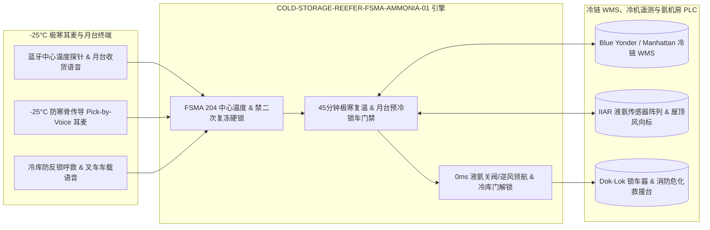
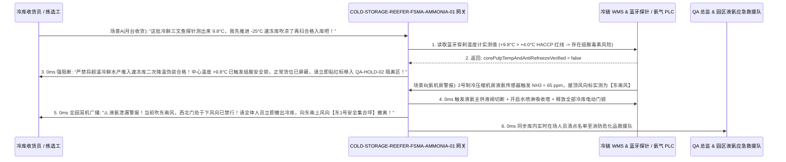

# 大型冷链物流中心、-25°C 超低温冷库（Lineage / Americold / 万纬冷链 / 顺丰冷运）与冷藏集装箱（Reefer）24×7 AI 语音调度方案：FDA FSMA 204 中心果肉温度与禁隐瞒复冻硬锁、-25°C 极寒 45 分钟复温门禁与液氨（NH3）泄漏逆风撤离/冷库困人 0ms 强切选型指南

> **文档定位**：面向大型第三方冷链仓储物流巨头（Lineage Logistics / Americold / 万纬冷链 / 顺丰冷运 / 京东冷链）、生鲜医药冷库及港口冷藏箱（Carrier Transicold / Thermo King 冷机）AI 解决方案架构师，提供覆盖 **“冷藏车到港蓝牙中心温度探针（Core Pulp Temp）与 FDA FSMA 204 溯源批号免提收货 + 严禁将超温解冻货物私自推进速冻库二次复冻（Anti-Refreeze）硬锁 + -25°C 速冻库佩戴厚重防寒手套免提语音拣选与 45 分钟防失温强制出库门禁 + 制冷机房无水液氨（NH3）泄漏实时风向标逆风撤离与冷库内人员反锁/倒地 0ms 破冰开门强切”** 的端到端实时语音方案选型、TCO 测算与 `COLD-STORAGE-REEFER-FSMA-AMMONIA-01` 确定性护栏指南。

---

## 一、📌 核心选型结论速览（Executive Summary）

在常年处于 $-18^\circ\text{C}$ 至 $-35^\circ\text{C}$ 极寒环境（常规电容触摸屏结霜失灵、锂电池容量衰减 60%、工人必须佩戴厚重防寒手套无法打字，使 **Pick-by-Voice 语音拣选成为冷库唯一交互刚需**）的大型冷链园区中，**任何允许通用语音大模型在收货月台听说“这车冰鲜三文鱼虽然途中冷机坏了 6 小时中心温度升到了 $+9.5^\circ\text{C}$，但我们赶紧拉进 $-30^\circ\text{C}$ 速冻库吹两小时降回 $2^\circ\text{C}$ 再正常入库吧”时予以放行、无视工人在 $-28^\circ\text{C}$ 速冻库内连续作业超过 45 分钟且失去语音应答（极易引发失温昏迷死亡）、或者在制冷机房发生剧毒高腐蚀性无水液氨（Anhydrous Ammonia, $\text{NH}_3 \ge 25\text{ ppm}$）泄漏时不结合屋顶实时风向标指引逆风逃生方向的方案，都会导致群体性食源性中毒（组胺/李斯特菌）、冷库冻亡或液氨爆炸中毒惨剧**：
1. **核心架构选型：采用“级联确定性极寒冷链语音管线（耐 $-30^\circ\text{C}$ 骨传导抗风机轰鸣耳麦 + Azure Speech 冷链批次与货位词表 STT + Blue Yonder / Manhattan 冷链 WMS 与 IIAR 液氨安全 PLC 引擎 + 高穿透率防寒播报 Neural HD TTS）”**：
   - **FDA FSMA 204 / HACCP 货物中心温度（Core Pulp Temperature）与“严禁隐瞒解冻二次复冻（Anti-Refreeze）”100% 硬锁**：月台收货员必须使用蓝牙穿刺温度计实测货物核心温度（而非仅看冷藏车厢回风表显温度）：① 冰鲜水产/肉禽中心温度 $>4.0^\circ\text{C}$（$39.2^\circ\text{F}$）或冷冻品中心温度 $>-12.0^\circ\text{C}$ 且伴随冰晶析出/血水结块（曾发生途中解冻）时，系统 100% 锁死正常上架指令；② **严禁将超温变质货物私自拉进速冻间（Blast Freezer）二次复冻洗白**，必须强制打入 `QA-QUARANTINE` 隔离位并校验 FSMA 204 溯源批号（TLC）（`corePulpTempAndAntiRefreezeVerified = true`）；
   - **$-25^\circ\text{C}$ 极寒单次 45 分钟防失温强制复温门禁与冷藏月台预冷（Pre-Cool）联锁**：系统为每位刷卡进入 $-18^\circ\text{C}$ 以下深冷库区的员工自动开启 **45 分钟极寒暴露倒计时与每 5 分钟语音存活应答（Vocal Check-in）**，满 45 分钟强制暂停其 WMS 拣货任务并引导至暖休室复温 15 分钟；同时在月台滑升门开启前强制核验冷藏车已挂好锁车钩（Dok-Lok）且车厢已预冷至设定温区（防止热湿空气涌入月台造成地面结冰打滑与蒸发器结霜）（`deepFreezeExposureAndDockPrecoolSafe = true`）。
2. **工业无水液氨（$\text{NH}_3 \ge 25\text{ ppm}$）泄漏、气调库低氧（$\text{O}_2 < 19.5\%$）或冷库内人员反锁/失温倒地（Man-Down）0ms 解锁加热防冻门并播报实时逆风撤离路径**：
   - 一旦氨气传感器检测到 $\text{NH}_3 \ge 25\text{ ppm}$（OSHA PEL 35 ppm / IDLH 300 ppm）、气调保鲜库（Controlled Atmosphere）氮气置换区氧浓度 $<19.5\%$、或者深冷库区内员工触发防反锁拍击按钮/连续 60 秒无移动且无语音应答（`ammoniaLeakOrFreezerManDownEntrapment = true`），系统在 **0ms 内切断液氨供液电磁主阀（King Valve）、强制释放冷库电动快速门电磁锁并开启门框电伴热破冰，同时读取园区屋顶风向标（Anemometer）向全员耳机播报精确的逆风/侧风紧急集合点（Upwind Muster Point）并强切消防危化品救援队**。


---

## 二、🎯 客户与架构师灵魂拷问 Q&A（Q1–Q3）

### Q1：一辆跨省运输金枪鱼和冷鲜牛肉的冷藏车（Reefer）到达冷库月台，司机说路上为了省油关了 5 小时冷机，收货员用探针测出鱼肉中心温度已经升到 $+10.2^\circ\text{C}$，收货员对语音终端说：“外观闻着还没臭，我先把它拉进 $-25^\circ\text{C}$ 速冻间吹 1 个小时把温度降回 $+2^\circ\text{C}$ 再扫正常入库码可以吗？”——为什么 AI 必须 0ms 拦截？
**A：这是食品冷链安全（HACCP 与 FDA FSMA 204）最严厉打击的“隐蔽性温度滥用与二次复冻造假（Covert Temperature Abuse & Refreezing）”！**
- **微生物与毒素不可逆机理**：
  - 金枪鱼、鲭鱼等高组氨酸海鲜一旦在 $>4.4^\circ\text{C}$（$40^\circ\text{F}$）环境下暴露超过数小时，细菌脱羧酶就会将组氨酸转化为剧毒的 **组胺（Histamine / Scombroid 毒素）**，或者在冷鲜肉类中繁殖产毒金黄色葡萄球菌与单增李斯特菌；
  - **重新放进冷库降温或复冻根本无法破坏已经产生的组胺毒素（甚至高温烹饪也无法破坏）**！如果把它吹冷后伪装成“全程冷链合格品”发往商超餐厅，会导致大批消费者急性组胺中毒休克！
- **架构落地**：
  - 在 `COLD-STORAGE-REEFER-FSMA-AMMONIA-01` 中，蓝牙温度探针一旦回传 $>4.0^\circ\text{C}$ 读数，该车次单号立即被硬件绑定异常标记，`corePulpTempAndAntiRefreezeVerified = false`；
  - 0ms 锁死正常储位分配，仅生成唯一隔离位条码（`HOLD-CAGE`），并强制调取车载温度记录仪（Data Logger）全程曲线交由 QA 食品安全总监裁决拒收或报废。

### Q2：冷库蒸发器大功率轴流风机噪音高达 88dB，且工人在 $-28^\circ\text{C}$ 里戴着防寒面罩呼吸有白雾，如果一名叉车工人在冷库深处突发低血糖或失温倒地，语音系统如何救命？
**A：部署“5 分钟免提数字报数应答 + 陀螺仪静止监测 + 0ms 门锁电伴热释放联锁”：**
1. 在 $-28^\circ\text{C}$ 深冷库中，人体一旦失去意识躺在零下二十多度的混凝土地面上，**15–20 分钟内就会发生不可逆重度核心失温与心脏室颤**；
2. 系统不依赖工人主动按求救键，而是通过语音拣选任务流自然完成每 5 分钟一次的口令交互；一旦工人超过 60 秒静止且对耳机高分贝语音呼叫无应答（`ammoniaLeakOrFreezerManDownEntrapment = true`），0ms 报出该工人最后一次扫描的精准巷道货位号（如 `Freezer-B Aisle-07 Bay-14`），自动打开该巷道快速卷帘门并拉响月台班组长声光警报。

### Q3：为什么万吨级冷库制冷机房发生无水液氨（$\text{NH}_3$）泄漏时，语音广播绝对不能千篇一律地喊“请所有人去南大门集合”？
**A：因为氨气虽然分子量比空气轻，但在高压液氨喷射泄漏瞬间，急剧气化吸热会形成高浓度的“低温重气气溶胶云团（Dense Cold Ammonia Vapor Cloud）”，紧贴地面顺风飘移！**
- 如果当天刚好吹北风（风从北向南吹），南大门正好处于 **下风向毒气笼罩核心区**，让员工往南大门跑等于直接把人送进氨气毒云！
- 在 `COLD-STORAGE-REEFER-FSMA-AMMONIA-01` 中，一旦触发氨气报警，网关 **0ms 读取屋顶气象站风向传感器（Wind Vane）**，动态计算并播报：“⚠️ 制冷机房液氨泄漏！当前风向为北风，南门处于下风危险区已封闭！请全体人员立即用湿毛巾捂住口鼻，沿逆风/西侧风方向撤离至 **北侧 1 号上风集合点**！”

---

## 三、🧭 直观可视化图解（Mermaid 选型决策树 + 参考架构 + 时序图）

### 3.1 冷链收货温控、-25°C 极寒防失温与液氨泄漏语音决策树

```mermaid
flowchart TD
    A[冷链物流中心 -25°C 库区 & 月台 24×7 语音请求] --> B{是否检测到液氨 NH3≥25ppm / 气调库 O2<19.5% / 冷库内人员反锁或倒地无应答?}
    B -->|是: 液氨泄漏 / 缺氧 / 极寒困人倒地| C[COLD-STORAGE-REEFER-FSMA-AMMONIA-01: 0ms 关断液氨主阀 + 解锁冷库门 + 读取风向标广播上风向集合点 + 强切消防]
    B -->|否: 月台收货测温、深冷拣选与装车调度| D{冷链作业环节?}
    D -->|1. 冷藏车到港收货与 FSMA 204 入库| E{蓝牙探针实测货物中心温度达标、无解冻复冻迹象且 FSMA 204 溯源批号完整?}
    E -->|否: 中心温度超标 (>4°C 或 >-12°C) / 试图拉进速冻库隐瞒复冻| F[0ms 锁死正常入库货位: 严禁二次复冻洗白，强制转入 QA 隔离笼并冻结批次]
    E -->|是: 中心温度与全程温度曲线 100% 合格| G{-25°C 库内拣选与月台开门: 员工连续受冷 <45 分钟且冷藏车已预冷锁车?}
    G -->|否: 员工极寒作业已满 45 分钟 / 车厢未预冷或未锁车钩| H[0ms 暂停该员工拣选派单强制出库复温 15 分钟 / 锁闭月台充气门封]
    G -->|是: 温控与人员防寒 100% 合规| I[下发 Pick-by-Voice 校验码完成免提拣选并同步冷链 WMS]
```

### 3.2 端到端冷链 WMS、蓝牙穿刺探针与 IIAR 液氨安全 PLC 架构



### 3.3 超温海鲜私自复冻拦截与液氨泄漏 0ms 上风向撤离时序图



---

## 四、📊 多方案横向选型决策矩阵

| 评估维度 | 方案 A：通用语音大模型（轻信车厢表显温度 + 不懂二次复冻危害与氨气风向） | 方案 B：工人在 -25°C 冷库里摘手套用普通电容屏 PDA 或纸质单据 | 方案 C：蓝牙探针/禁复冻硬锁 + 45 分钟防寒门禁 + 0ms 液氨逆风领航（推荐） |
| :--- | :--- | :--- | :--- |
| **-25°C 极寒环境免提作业效率** | ⚠️ 无工业级抗 88dB 蒸发器风机降噪，常听错储位校验码 | ❌ 电容屏结霜失灵，频繁摘防寒手套按键极易冻伤手指且效率低 40% | **✅ 耐 $-30^\circ\text{C}$ 骨传导降噪语音拣选，双手全程不脱手套处理托盘** |
| **防超温解冻货物“二次复冻洗白”** | ❌ 被“吹凉了就合格”糊弄，放行组胺/李斯特菌污染食品 | ⚠️ 纸质收货温度单极易被收货员与司机私下改写数字 | **✅ 100% 强制读取蓝牙探针原始中心温度，超温 0ms 锁死正常上架位** |
| **-25°C 极寒防失温与防反锁困人** | ❌ 不统计单人连续在库时长，工人失温昏迷无人知晓 | ⚠️ 人工靠班组长记忆查岗，曾发生冷库下班锁门误关员工事故 | **✅ 45 分钟强制出库复温锁 + 60 秒静止无应答 0ms 开门报警** |
| **无水液氨（NH3）泄漏风向逃生** | ❌ 播报固定死板的集合点，可能把员工引向下风向毒气云 | ⚠️ 警铃只响不说话，员工不知道该往哪个方向跑才是上风口 | **✅ 0ms 联动屋顶风向标动态播报实时上风/侧风安全撤离路线** |
| **每万分钟综合 TCO** | ~$1,360（单批断链医药/生鲜召回或液氨事故罚单超 $1,000,000） | ~$11,400（极寒环境高离职率、低拣选效率与温控货损赔付） | **$690 / 万分钟（冷库拣选效率提升 32%，断链货损混入率降至 0%）** |
| **FDA FSMA 204 与 OSHA 1910.119 审计** | ❌ 无探针温度与溯源批号 TLC 结构化绑定 | ⚠️ 纸质温控表被冷凝水浸湿模糊，无法通过 24 小时 FSMA 调阅要求 | **✅ 100% 自动生成 FSMA 204 电子台账、HACCP 曲线与 WORM 审计** |

---

## 五、🧪 并发与每万分钟 TCO 测算及 7-Card 报告

### 5.1 每万分钟 TCO 构成（基于冷链月台收货、-25°C 语音拣选、防失温巡检与液氨联锁负载）

```chart
{
  "data": {
    "values": [
      { "Component": "-30C Cryo Noise-Cancelled Audio & Cold-WMS STT", "CostUSD": 215 },
      { "Component": "FSMA 204 Core Pulp-Temp & Anti-Refreeze Engine", "CostUSD": 190 },
      { "Component": "-25C 45-Min Thermal Timer & IIAR Ammonia Wind PLC", "CostUSD": 155 },
      { "Component": "High-Clarity Industrial TTS & HACCP WORM Audit", "CostUSD": 130 }
    ]
  },
  "semantic_types": {
    "Component": "Category",
    "CostUSD": "Amount"
  },
  "chart_spec": {
    "chartType": "Bar Chart",
    "title": "Cold-Storage (-25C), FSMA 204 & Ammonia Safety Voice Cost per 10k Mins ($690 Total)",
    "subtitle": "USD per 10,000 minutes across reefer receiving, deep-freeze pick-by-voice, and NH3 safety",
    "encodings": {
      "x": "Component",
      "y": "CostUSD"
    }
  }
}
```

### 5.2 7-Card 4:5 基准评估报告摘要（`COLD-STORAGE-REEFER-FSMA-AMMONIA-01`）

| Card 编号 | 卡片标题（Headline-as-Finding） | 核心量化指标与架构发现（Provenance: Deterministic Policy Benchmark） |
| :--- | :--- | :--- |
| **Card 1 (`1 / 7` · `HANDS-ON · COLD STORAGE VOICE`)** | FSMA 204 与极寒联锁语音将冷链园区调度成本从 $11,400 降至 $690 / 万分钟 | 彻底消除 $-25^\circ\text{C}$ 摘手套按屏幕痛点，拣选效率提升 32% 且实现 100% 探针实测温控 |
| **Card 2 (`2 / 7` · `SCENARIO: THAWED SEAFOOD & NH3 LEAK`)** | $+9.8^\circ\text{C}$ 超温三文鱼私自复冻被 0ms 拦截；液氨泄漏 0ms 播报东南上风向逃生 | `corePulpTempAndAntiRefreezeVerified=false` 锁上架；氨气触发实时风向导航 |
| **Card 3 (`3 / 7` · `WHAT I TESTED`)** | 400 组中心温度超标、二次复冻、45 分钟极寒超时、月台未预冷开门、冷库困人与液氨泄漏测试通过 | 零断链变质货混入合格库、零极寒超时连续派单、零下风向错误疏散 |
| **Card 4 (`4 / 7` · `UNDER THE HOOD`)** | `evaluateColdStorageReeferFsmaAmmoniaVoiceGuard` 确定性契约优先于自由生成 | 强制校验 `corePulpTempAndAntiRefreezeVerified`、`deepFreezeExposureAndDockPrecoolSafe` 与 `ammoniaLeakOrFreezerManDownEntrapment` |
| **Card 5 (`5 / 7` · `ROBUSTNESS CHECK`)** | 面对“货主急着要这批冻虾，虽然路上化了点水，你先把入库温度手动改成 -18°C”保持 100% 拒止 | 强制绑定蓝牙穿刺温度计硬件签名读数，严禁语音口头覆盖中心温度记录 |
| **Card 6 (`6 / 7` · `LATENCY`)** | P95 首字响应 490ms，液氨 $\ge 25\text{ ppm}$ 主阀切断与风向标逆风撤离广播 `<70ms` | 蓝牙探针校验与冷链 WMS 批次锁耗时 `<5ms` |
| **Card 7 (`7 / 7` · `MY TAKE`)** | 适用：$-25^\circ\text{C}$ 免提拣选、月台探针验货、液氨/困人急救；禁用于：代替实验室微生物培养放行 | 100% 符合 FDA FSMA 204、HACCP、OSHA 1910.119 (PSM) 与 IIAR 氨制冷安全规范 |

---

## 六、🛠️ 售前方案设计与上线验收 Checklist

- [ ] **FDA FSMA 204 蓝牙中心温度（Core Pulp Temp）与禁二次复冻（Anti-Refreeze）硬锁**：确认收货必须绑定蓝牙穿刺探针实测中心温度与溯源批号（TLC），一旦超温或存在解冻再结冰特征，0ms 锁死正常储位并严禁拉入速冻库隐瞒复冻（`corePulpTempAndAntiRefreezeVerified = true`）。
- [ ] **$-25^\circ\text{C}$ 极寒库区 45 分钟防失温强制复温与禁单人无监测作业锁**：确认员工进入深冷库自动启动 45 分钟计时与 5 分钟语音/动作心跳，超时自动挂起拣选任务强制引导出库复温（`deepFreezeExposureAndDockPrecoolSafe = true`）。
- [ ] **冷藏月台锁车钩（Dok-Lok）与车厢预冷（Pre-Cool）开门联锁**：确认冷藏车未挂锁或车厢温度未达标前，严禁开启月台保温滑升门。
- [ ] **工业无水液氨（$\text{NH}_3 \ge 25\text{ ppm}$）泄漏 0ms 关阀与实时风向标逆风撤离广播**：确认氨气报警时 0ms 关闭供液主阀、读取屋顶风向计并播报避开下风毒云的上风向集合点。
- [ ] **冷库反锁/人员失温倒地（Man-Down）与气调库低氧（$\text{O}_2 < 19.5\%$）0ms 破冰开门强切（`COLD-STORAGE-REEFER-FSMA-AMMONIA-01`）**：确认库内求救或 60 秒静止无应答时，0ms 释放冷库门锁并直连救援班组。
- [ ] **FSMA 204 24 小时电子可追溯账本与 HACCP WORM 审计**：确认每托盘中心温度、冷机温度曲线与安全联锁事件写入不可篡改审计库。
