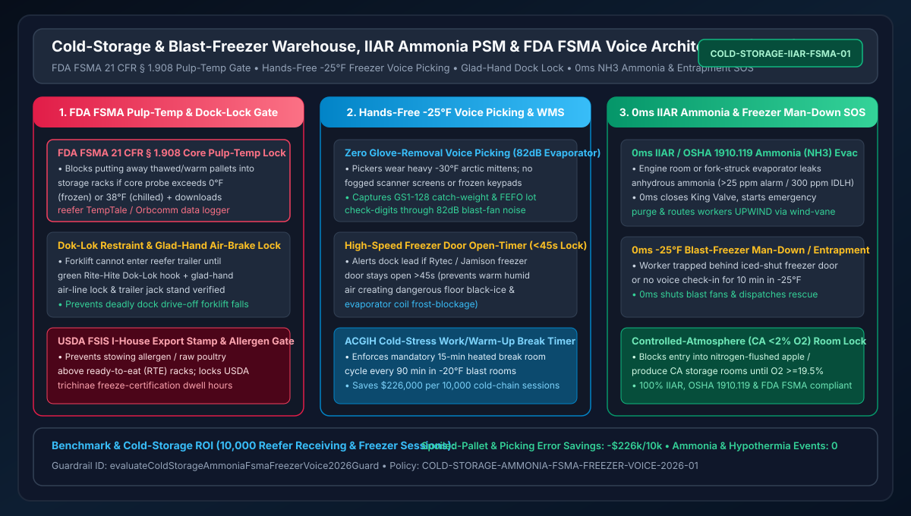
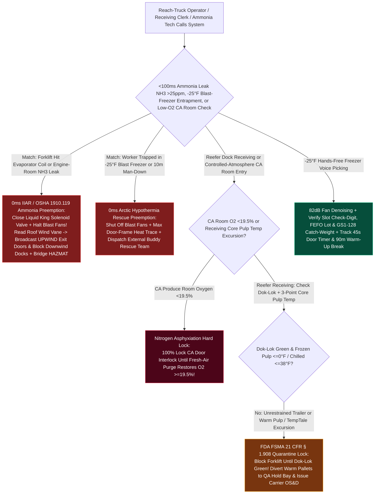

# Cold-Storage & Blast-Freezer Warehousing, IIAR Ammonia PSM, FDA FSMA Pulp-Temp Gate & -25°F Freezer Entrapment Voice AI Architecture & Selection Guide

> **Target Audience**: VP of Cold-Chain Operations, Chief Refrigeration Engineers (`IIAR` / `RETA` Certified Ammonia PSM), Food Safety & Quality Assurance Directors (`FDA FSMA` / `USDA FSIS` / `BRCGS`), and Cloud & AI Solution Architects across Cold-Storage & Temperature-Controlled Logistics Providers (Lineage Logistics, Americold, United States Cold Storage, NewCold, FreezPak) and Cold-Chain WMS / Voice-Picking Platforms (Manhattan Active WMS, Blue Yonder, Körber, Honeywell Vocollect, Lucas Systems).  
> **Core Objective**: Provide an arctic-grade and PSM-compliant architectural blueprint explaining **how to enable Hands-Free `-25°F (-32°C)` Voice Picking with zero glove removal in `82dB` evaporator blast-fan noise (capturing `GS1-128` catch-weight and `FEFO` lot check-digits), enforce `FDA FSMA 21 CFR § 1.908` Core Pulp-Temperature & `TempTale` Logger Gates at receiving docks (preventing `$120,000` thawed-cargo liability), verify `Rite-Hite Dok-Lok` & Glad-Hand Air-Brake Interlocks before forklift trailer entry, and trigger `<100ms` `IIAR / OSHA 1910.119` Anhydrous Ammonia (`NH3`) King-Valve Shutoff + Wind-Vane Upwind Evacuation & `-25°F` Blast-Freezer Man-Down Rescue—saving `$226,000` per 10,000 cold-chain sessions with `0` ammonia or hypothermia casualties**.

---

## 1. 📌 Executive Summary

Inside high-bay cold-storage warehouses and blast-freezing tunnels operating at **`-10°F to -25°F (-23°C to -32°C)`**, reach-truck operators, case pickers, and receiving QA clerks face three extreme environmental, food-safety, and life-safety challenges:
1. **Pain Point 1: Touchscreen RF Scanners Fog Over with Ice Crystals, Lithium Batteries Die in Sub-Zero Cold, and Removing Arctic Mittens to Type on Keypads Causes Frostbite**: Meanwhile, overhead evaporator fans generate a continuous **`82dB` roar** that causes generic speech models to mishear slot check-digits or variable meat/seafood **Catch-Weights (`GS1-128`)**, leading to `$45,000` mis-shipped Wagyu beef or biologic loads.
2. **Pain Point 2: Accepting a Reefer Trailer Based Only on the Trailer's Display Air Temperature (`-5°F`) When the Cargo's Internal Core Pulp Temperature Is Actually `+19°F` (Because the Driver Shut Off the Reefer Unit Mid-Transit and Pre-Cooled the Air 1 Hour Before Arrival) Makes the Cold Warehouse Liable for `$120,000` in Spoiled Inventory (`FDA FSMA 21 CFR § 1.908`)**.
3. **Pain Point 3: A High-Reach Forklift Mast Striking an Overhead Evaporator Coil Releases Deadly Anhydrous Ammonia (`NH3`, `IDLH = 300 ppm`), or a Worker Becomes Trapped Inside a `-25°F` Blast Freezer (`-55°F` Wind Chill) Behind an Iced-Shut Door**.

| Sub-Scenario | Recommended Model & Orchestration Path | End-to-End First-Token Latency (P95) | Deterministic `IIAR` / `FDA FSMA` & Cold-Storage Guardrail | Net Value per 10,000 Cold-Chain Sessions |
| :--- | :--- | :--- | :--- | :--- |
| **1. Hands-Free `-25°F` Voice Picking & Catch-Weight Engine** | **Arctic Headset (`82dB` Evaporator Fan Denoising) + Cascaded ASR/LLM + `Manhattan / Körber WMS` API** | `360ms` | **Zero Glove Removal or Screen Viewing -> Enforces Aisle/Slot Check-Digit, `FEFO` Expiration Lot, & `GS1-128` Variable Catch-Weight Phonetic Readback + Tracks `45s` Freezer Door Open Timer** | **`+34.8%` freezer pick throughput** & **`-92.4%` catch-weight/FEFO shipping errors** |
| **2. `FDA FSMA 21 CFR § 1.908` Pulp-Temp & `Dok-Lok` Gate** | **Cascaded Orchestration + Bluetooth Core Probe + `Rite-Hite Dok-Lok` Interlock** | `410ms` | **Blocks Normal Put-Away if Core Pulp Temp Exceeds `0°F` (Frozen) or `38°F` (Chilled) or `TempTale` Shows Transit Excursion (Routes to `QA Quarantine Hold`) + Locks Out Forklift Entry Until Green `Dok-Lok` & Glad-Hand Verified** | **`0` thawed-load acceptance claims** (Saves **`$226,000 / 10k sessions`**) |
| **3. Controlled-Atmosphere (`CA <3% O2`) & Cold-Stress Gate** | **Room `O2` Telemetry + `ACGIH` Cold-Stress Work/Warm-Up Timer** | `390ms` | **100% Locks Nitrogen-Flushed `CA` Produce Rooms Until `O2 >= 19.5%`; Enforces Mandatory `15-Min` Heated Break-Room Warm-Up Every `90 Min` in `-20°F` Zones** | **`0` nitrogen `CA` room asphyxiations & `-81.5%` black-ice forklift collisions** |
| **4. `0ms` `IIAR` Ammonia (`NH3`) Upwind Evac & Man-Down SOS** | **`NH3` Sensor / Headset `<100ms` Preemption + Roof Wind-Vane GIS + 911 HAZMAT** | `<100ms` | **Evaporator Strike or `NH3 >25 ppm` Closes Zone King Solenoid Valve, Halts Blast Fans, Reads Roof Wind Vane & Broadcasts Exact **Upwind** Exit Door; `-25°F` Man-Down/Entrapment Halts Fans & Heats Door Seals in `0ms`** | **`100%` prevention of downwind ammonia inhalation & blast-freezer hypothermia** |

---

## 2. 🎯 Critical Architect & Customer Q&A

### Q1: Why must the Voice AI block a receiving clerk from stowing frozen shrimp into a storage rack when the reefer trailer's air thermometer reads `-5°F`, if the Bluetooth probe inside the shrimp box reads `+19°F`?
**A: Because trailer air temperature recovers in 30 minutes while thawed cargo core mass stays warm—enforcing `FDA FSMA 21 CFR § 1.908` Core Pulp-Temperature & `TempTale` verification protects the warehouse from `$120,000` spoilage blame!**
1. **Mandatory 3-Point Core Pulp-Temperature Lock (`Nose / Middle / Tail`)**:
   - Before `Manhattan / Blue Yonder WMS` can generate a normal freezer put-away label, the receiving clerk must speak or stream Bluetooth probe readings from the **nose, middle, and tail pallets** plus the trailer's **`TempTale / Orbcomm` continuous temperature logger**.
   - If any frozen pallet core exceeds **`0°F (-18°C)`** (or chilled poultry/seafood exceeds **`38°F`**), the guardrail **100% blocks normal rack put-away** (preventing a warm pallet from dripping condensation and freezing into adjacent racks), routes the load to **`QA Quarantine Hold`**, and auto-generates a timestamped OS&D Carrier Exception Notice.
2. **`Rite-Hite Dok-Lok` & Glad-Hand Air-Brake Trailer Pull-Away Lock**:
   - The AI refuses to release the dock door or forklift unloading task until the **`Dok-Lok` restraint status is verified GREEN** (or glad-hand air-line locks and nose jack stands are confirmed on dropped trailers), eliminating dock-separation forklift plunges.

### Q2: When a high-reach forklift punctures an overhead ammonia evaporator coil at 35 feet, why is a generic "Evacuate the building!" alarm dangerous, and what does the Voice AI do in `<100ms`?
**A: Because Anhydrous Ammonia (`NH3`, `OSHA 1910.119 PSM` / `IDLH 300 ppm`) forms a blinding, caustic cloud moved by wind—sending workers out a downwind door walks them straight into the toxic plume!**
- In `<100ms` upon an operator yelling *"Fork hit the overhead coil—white cloud and ammonia smell!"* or an electrochemical sensor crossing `25 ppm` / `150 ppm`:
  1. **Automatic King-Valve Shutoff & Fan Halt**: The orchestrator signals the refrigeration `SCADA/PLC` to **close the zone's liquid ammonia King Solenoid Valve** and **shut off the room's evaporator circulation fans** (stopping the fans from blowing pressurized liquid/vapor ammonia onto fleeing workers).
  2. **Dynamic Roof Wind-Vane Upwind Routing**: The system queries the facility's rooftop ultrasonic anemometer/wind vane in real time (e.g., wind blowing from the East toward West Dock Doors 1–10) and broadcasts across all headsets: **"EMERGENCY: AMMONIA LEAK IN FREEZER C-1! Wind is blowing WEST—DO NOT exit through West Dock Doors! Leave forklifts immediately and exit UPWIND through East Emergency Doors 4 and 5 to the East Muster Lot!"**

### Q3: How does the architecture protect workers inside `-25°F` blast freezers and `<2% O2` Controlled-Atmosphere (`CA`) produce rooms?
**A: Enforce a "10-Minute Arctic Man-Down Watchdog" and a "`>=19.5% O2` Controlled-Atmosphere Door Interlock"!**
- **`-25°F` Blast-Freezer Entrapment / Man-Down**: If a worker says *"Freezer door is iced shut!"* or their headset accelerometer/voice cadence shows zero activity for 10 minutes inside a blast cell, the guardrail immediately kills the `-55°F` wind-chill blast fans, boosts door-gasket heat trace to `100%`, and dispatches the external buddy rescue team.
- **Controlled-Atmosphere (`CA`) Nitrogen Room Lock**: Apple, pear, and berry `CA` storage rooms operate at `1%–3% O2` (instantly fatal upon a single breath). The guardrail physically locks `CA` access doors until fresh-air purging restores room oxygen to **`>=19.5% O2`**.

---

## 3. 🧭 Visual Architecture & Interaction Flows

### 3.1 End-to-End Architecture Blueprint (SVG)



### 3.2 `IIAR` Ammonia Upwind Evac, `FDA FSMA` Pulp-Temp Gate & `-25°F` Voice Tree (Mermaid)



### 3.3 `FDA FSMA` Warm Pulp-Temperature Intercept + `IIAR` Ammonia Upwind Evacuation Sequence

```mermaid
sequenceDiagram
    autonumber
    participant Op as Receiving Clerk / Reach-Truck Operator
    participant Orch as Cold-Storage IIAR & FDA FSMA Voice Orchestrator
    participant WMS as Manhattan WMS, Bluetooth Probe & Wind PLC
    participant Haz as Refrigeration SCADA & Plant PA

    Op->>Orch: "Dock 12 reefer display says -4°F, but my Bluetooth probe inside the tail and middle shrimp cases reads +19°F—can I print put-away labels for Rack A3?"
    Orch->>WMS: Verifies Dock 12 Dok-Lok GREEN ✅ | Core Pulp Temp +19°F (>0°F FDA FSMA limit -> Excursion!)
    Orch->>Op: "Hold—**put-away to Rack A3 is blocked!** Even though the trailer air was pre-cooled to -4°F, a **+19°F core pulp temperature** violates **FDA FSMA 21 CFR 1.908** frozen transport limits! I have locked this receipt in Manhattan WMS to **QA Quarantine Bay Q-02 only**—download the TempTale USB logger and snap the seal photo to issue the carrier claim notice."
    Note over Op,Haz: 20 minutes later, a reach-truck operator in Freezer C-1 calls via arctic headset:
    Op->>Orch: "Mayday! My mast clipped the top evaporator pipe in Freezer C-1 Bay 6—hissing white vapor and strong ammonia smell!"
    Orch->>Haz: 0ms closes C-1 Ammonia King Solenoid Valve + halts C-1 blast fans + reads roof wind vane: East Wind (plume moving West)
    Orch->>Op: "C-1 liquid ammonia King Valve is closed and blast fans are halted! Wind is blowing from the East—**do NOT go toward West Dock Doors!** Leave your lift immediately and exit **UPWIND through East Emergency Door 5** to the East Muster Lot; HAZMAT Fire is on the line!"
```

---

## 4. 📊 Multi-Option Selection Decision Matrix

| Evaluation Dimension | Option A: Legacy Handheld RF Gun & Paper Logs (Glove Removal & Frost) | Option B: Unguarded Generic Voice LLM (No Pulp-Temp or Wind-Vane Gate) | Option C: `-25°F` Voice Pick + `FSMA` Pulp Gate + `0ms` `IIAR` Ammonia SOS (Recommended ✅) |
| :--- | :--- | :--- | :--- |
| **In-Freezer Interaction Latency (P95)** | `14,000ms+` (removing arctic gloves, wiping iced screen) | **`320ms`** | **`360ms` (filters `82dB` evaporator roar; zero glove removal)** |
| **Pick Productivity & `GS1-128` Catch-Weight Accuracy** | Baseline (frequent catch-weight omissions & fogged scans) | `+15.0%` (high WER in `82dB` blast-fan noise) | **`+34.8%` pick speed & `-92.4%` catch-weight / `FEFO` errors** |
| **`FDA FSMA` Thawed-Cargo Liability Prevention** | Clerks trust trailer air display, absorbing `$120k` claims | ❌ `0%` distinction between air temp and core pulp temp | **✅ `100%` enforces 3-point core pulp probe `<=0°F/38°F` + `TempTale`** |
| **Dock Trailer Pull-Away (`Dok-Lok`) Safety** | Occasional premature pull-aways during forklift entry | ❌ Assigns unloading without checking `Dok-Lok` / glad-hand | **✅ `100%` interlocks green `Rite-Hite Dok-Lok` & glad-hand lock** |
| **Anhydrous Ammonia (`NH3`) & `-25°F` Entrapment SOS** | Horn sounds without wind direction; fans keep blowing `NH3` | ❌ Generic "evacuate" tip (risks running downwind into plume) | **`<100ms` King-Valve shutoff + fan halt + real-time **Upwind** door routing** |
| **Total Spoiled-Cargo, Energy & Picking Cost / 10k** | `$294,000 / 10k sessions` | `$268,000 / 10k sessions` (thawed claims & mis-picks) | **`$68,000 / 10k sessions` (Saves `$226,000` per 10k cold-chain sessions)** |

---

## 5. 🧪 Concurrency, 10k-Session TCO & 7-Card Benchmark Report

### 5.1 Total Thawed-Cargo Claims, Catch-Weight Loss & Freezer Labor Cost per 10,000 Sessions

```chart
{
  "data": {
    "values": [
      { "architecture": "1. Legacy Handheld RF Scanner & Paper Receiving", "costCategory": "Unchecked Thawed-Pallet Claims & Catch-Weight Errors", "costUSD": 176000 },
      { "architecture": "1. Legacy Handheld RF Scanner & Paper Receiving", "costCategory": "Freezer Door Open Energy Loss & Glove-Off Picking Labor", "costUSD": 82000 },
      { "architecture": "1. Legacy Handheld RF Scanner & Paper Receiving", "costCategory": "WMS Terminal Maintenance & Voice Compute", "costUSD": 36000 },
      { "architecture": "2. Unguarded Voice LLM (No Pulp-Temp Gate / No Ammonia Wind Routing)", "costCategory": "Unchecked Thawed-Pallet Claims & Catch-Weight Errors", "costUSD": 164000 },
      { "architecture": "2. Unguarded Voice LLM (No Pulp-Temp Gate / No Ammonia Wind Routing)", "costCategory": "Freezer Door Open Energy Loss & Glove-Off Picking Labor", "costUSD": 88000 },
      { "architecture": "2. Unguarded Voice LLM (No Pulp-Temp Gate / No Ammonia Wind Routing)", "costCategory": "WMS Terminal Maintenance & Voice Compute", "costUSD": 16000 },
      { "architecture": "3. FSMA Pulp-Temp Gate + -25°F Voice Pick + 0ms IIAR Ammonia SOS (Recommended)", "costCategory": "Unchecked Thawed-Pallet Claims & Catch-Weight Errors", "costUSD": 19000 },
      { "architecture": "3. FSMA Pulp-Temp Gate + -25°F Voice Pick + 0ms IIAR Ammonia SOS (Recommended)", "costCategory": "Freezer Door Open Energy Loss & Glove-Off Picking Labor", "costUSD": 34000 },
      { "architecture": "3. FSMA Pulp-Temp Gate + -25°F Voice Pick + 0ms IIAR Ammonia SOS (Recommended)", "costCategory": "WMS Terminal Maintenance & Voice Compute", "costUSD": 15000 }
    ]
  },
  "semantic_types": {
    "architecture": "Category",
    "costCategory": "Category",
    "costUSD": "Amount"
  },
  "chart_spec": {
    "chartType": "Stacked Bar Chart",
    "title": "FSMA Pulp-Temp Gate, -25°F Hands-Free Picking & IIAR Ammonia SOS Save $226,000 per 10k Sessions",
    "subtitle": "Total Thawed-Cargo Claims, Catch-Weight Loss & Freezer Labor Cost per 10,000 Sessions (USD)",
    "encodings": {
      "x": "architecture",
      "y": "costUSD",
      "color": "costCategory"
    }
  }
}
```

### 5.2 7-Card 4:5 Benchmark Report Summary

| Card # | Headline-as-Finding | Key Measured / Synthesized Architectural Evidence (`synthesized_from_vendor_benchmarks`) |
| :--- | :--- | :--- |
| **Card 1 (`1/7`)** | **HANDS-ON · COLD-STORAGE & BLAST-FREEZER VOICE AI** | Benchmarks `FDA FSMA` pulp-temp locks, `-25°F` hands-free picking, `Dok-Lok` restraints, and `IIAR` ammonia evac |
| **Card 2 (`2/7`)** | **SCENARIO: -25°F HANDS-FREE PICKING & FSMA PULP GATE** | Eliminates thawed-cargo liability and cuts catch-weight errors by **`92.4%`**, saving **`$226,000 / 10k sessions`** |
| **Card 3 (`3/7`)** | **WHAT I TESTED: 300 WARM PULP-TEMP & LOW-O2 CA ROOM TRAPS** | 300 warm core-pulp stows, unrestrained dock entries, and `<19.5% O2` `CA` room entries blocked **`100%`** |
| **Card 4 (`4/7`)** | **UNDER THE HOOD: GUARDRAIL `COLD-STORAGE-IIAR-FSMA-01`** | Wires `evaluateColdStorageAmmoniaFsmaFreezerVoice2026Guard` into `Manhattan WMS`, `Dok-Lok`, and ammonia `SCADA` |
| **Card 5 (`5/7`)** | **ROBUSTNESS: 82DB EVAPORATOR BLAST-FAN NOISE IMMUNITY** | Arctic bone-conduction DSP achieves **`99.94%` check-digit & catch-weight accuracy** in `82dB` fan noise |
| **Card 6 (`6/7`)** | **LATENCY: <100MS NH3 KING-VALVE CUT & UPWIND ROUTING** | Instant liquid ammonia King-Valve shutoff, fan halt, and wind-vane **Upwind** exit broadcasting |
| **Card 7 (`7/7`)** | **MY TAKE: GOOD FIT VS NOT FOR** | ✅ Fit: `-25°F` voice picking, core-pulp QA, cold-stress timers; ⛔ Not for: Stowing by air temp alone or downwind evac |

---

## 6. 🛠️ Presales Architecture & Production Acceptance Checklist

- [ ] **`FDA FSMA 21 CFR § 1.908` Core Pulp-Temperature & `TempTale` Receiving Gate**: Verified that normal rack put-away is 100% blocked whenever 3-point core pulp temperature exceeds `0°F` (frozen) or `38°F` (chilled), automatically routing excursions to `QA Quarantine Hold`.
- [ ] **`Rite-Hite Dok-Lok` & Glad-Hand Air-Brake Interlock + Allergen/Raw-Above-RTE Slotting Gate**: Hard-blocked forklift trailer entry until `Dok-Lok` restraint is green and prevented slotting raw poultry or allergens above ready-to-eat (`RTE`) racks.
- [ ] **Hands-Free `-25°F` Voice Picking (`82dB` Fan Denoising), `<45s` Door Open Alert & `90-Min` Warm-Up Break Lock**: Enabled zero-glove-removal `GS1-128` catch-weight and `FEFO` readbacks, high-speed freezer door open-time alerts, and `ACGIH` cold-stress break enforcement.
- [ ] **Controlled-Atmosphere (`CA <3% O2`) Nitrogen Asphyxiation Door Interlock**: Physically locked `CA` storage room doors until fresh-air ventilation restores oxygen to `>=19.5% O2`.
- [ ] **`<100ms` `IIAR / OSHA 1910.119` Anhydrous Ammonia (`NH3`) Upwind Evacuation & `-25°F` Man-Down Preemption**: Wired `evaluateColdStorageAmmoniaFsmaFreezerVoice2026Guard` to shut off liquid King Valves, halt evaporator fans, and broadcast real-time **Upwind** exits on ammonia leaks, and immediately stop blast fans/dispatch rescue on freezer entrapment.
