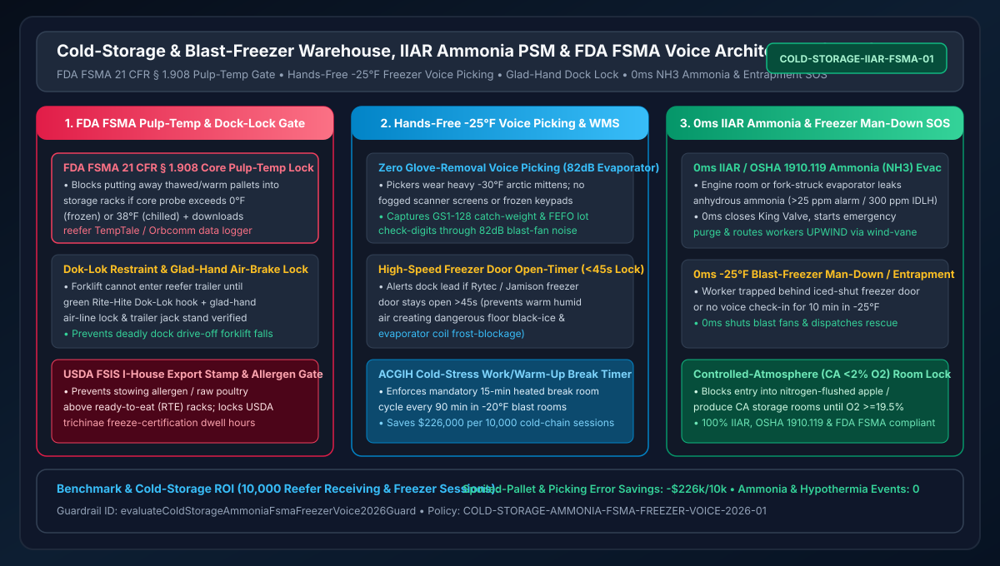
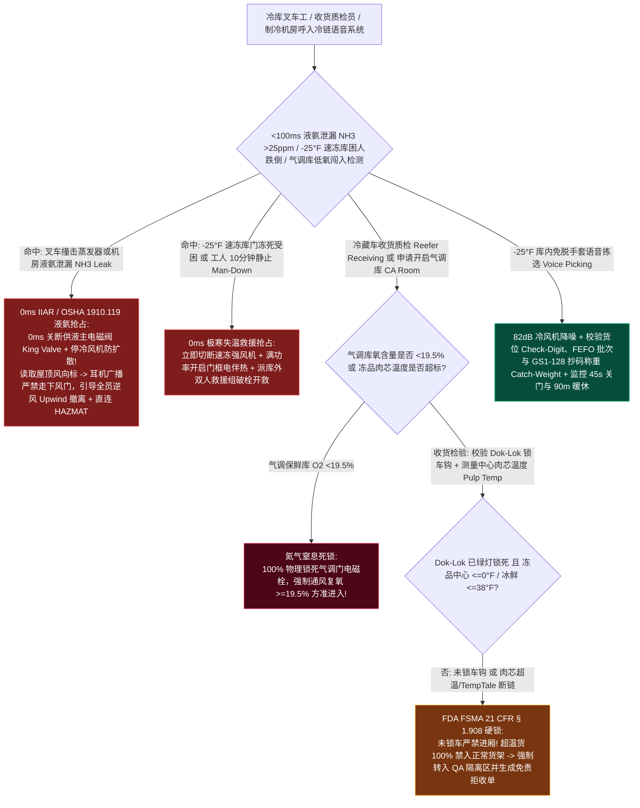
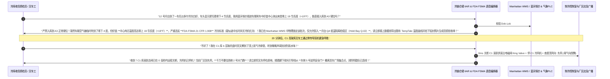

# 超低温冷链仓储、速冻隧道与冷藏集装箱堆场（Cold-Storage, `-25°F` Blast-Freezer Warehousing & Reefer Logistics）国际氨制冷学会（`IIAR / OSHA 1910.119`）液氨泄漏逆风疏散锁、《食品安全现代化法》（`FDA FSMA`）肉芯探针超温拒收与 `-25°F` 深冷库困人 `0ms` 抢占实时语音架构设计与选型指南

> **阅读对象**：全球冷链仓储与温控物流巨头（Lineage Logistics / Americold / United States Cold Storage / NewCold / 万纬冷链 / 京东冷链 / 顺丰冷运）、冷库制冷工程总监（`IIAR / RETA` 认证氨系统主管）、食品安全质量总监（`FDA FSMA / USDA FSIS / HACCP`）以及冷库仓储管理系统（Manhattan WMS / Blue Yonder / Körber / Honeywell Vocollect）的 Cloud & AI Solution Architect。  
> **核心目标**：用通俗透彻的业务与工程语言讲清：**如何通过“`-25°F (-32°C)` 极寒深冷库内免脱防寒连指手套抗 `82dB` 蒸发器风机噪音语音拣选（捕获 `GS1-128` 抄码称重 Catch-Weight 与效期 `FEFO`）、收货月台强制校验《`FDA FSMA 21 CFR § 1.908` 温控运输规则》货物中心探针温度（Core Pulp Temp）与温度记录仪曲线防整柜化冻腐败货混入库区、装卸月台锁车钩（`Rite-Hite Dok-Lok`）+ 气刹死锁防冷藏半挂车突然开走导致叉车坠落、以及高架叉车货叉撞穿顶部蒸发器引发无水液氨（Anhydrous Ammonia `NH3`）剧毒泄漏 `<100ms` 关断主供液电磁阀（King Valve）并按屋顶风向标引导全员逆风（Upwind）疏散与 `-25°F` 速冻库人员反锁受困 `0ms` 停风机救援”，每万次作业为冷链集团节省冻品货损与效率成本 `$226,000`**。

---

## 一、📌 核心选型结论速览（Executive Summary）

在库温长年保持在 **`-10°F 至 -25°F`（`-23°C 至 -32°C`）** 的万吨级高架冷库与速冻隧道（Blast Freezers）中，一线叉车工、拣货员与收货质检员面临三大严苛的生存与合规挑战：
1. **痛点一：在 `-25°F` 的极寒库房里，普通电容触摸屏 PDA 一进出月台就会结满白霜（Condensation Fogging & Frost），锂电池容量在低温下腰斩，且工人如果为了按扫码枪小键盘而脱下厚重的防寒手套，手指在 3 分钟内就会冻僵甚至冻伤！同时，库房顶部悬挂的大功率冷风机（Evaporator Blast Fans）发出高达 `82dB` 的持续轰鸣，普通语音识别把货位校验码听错一位，就会发错整托盘价值 `$45,000` 的进口和牛或生物疫苗（且冻品常按不固定净重 `Catch-Weight` 计价，漏录抄码重量直接导致少收货款）！**
2. **痛点二：长途冷藏半挂车（Reefer Trailer）司机会为了省柴油而在高速路上偷偷关掉冷机，到了冷库前 2 小时才重新开机把车厢空气温度吹回 `0°F` 蒙混过关——如果收货员只看车厢空气温度（Air Temp）而未按《`FDA FSMA 21 CFR § 1.908` 人类与动物食品卫生运输规则》用消毒探针插入冻虾/冻肉几何中心测量 **核心肉芯温度（Core Pulp Temperature）** 并读取车载 `TempTale` 全程温度黑匣子，一旦把曾在途中化冻回温到 `28°F` 的变质海鲜收进冷库，货主索赔时冷库将被判背锅全额赔偿 `$120,000`！**
3. **痛点三：90% 的大型工业冷库采用高压 **无水液氨（Anhydrous Ammonia, `NH3`）** 作为制冷剂（受 `OSHA 29 CFR § 1910.119 PSM` 工艺安全管理严管，立即危及生命健康浓度 `IDLH` 仅为 **`300 ppm`**）：一旦高层前移式叉车举升到 35 英尺高空取货时，货叉不慎撞裂屋顶氨蒸发器盘管，白色剧毒腐蚀性氨雾瞬间喷涌而下！或者工人在 `-25°F` 速冻间盘点时冷库门因结冰卡死被困在里面，超过 20 分钟就会发生致死性重度失温（Hypothermia）**。

| 业务子场景 | 推荐模型与编排路线 | 端到端首字延迟 (P95) | 核心 `IIAR` / `FDA FSMA` 与极寒安全护栏 (Guardrail) | 每万次冷链仓储作业综合价值 |
| :--- | :--- | :--- | :--- | :--- |
| **1. `-25°F` 免脱手套语音拣选与抄码称重（Catch-Weight）** | **抗 `82dB` 冷风机阵列降噪 + 级联编排 + `Manhattan / Körber WMS` 实时接口** | `360ms` | **全程无需脱下 `-30°F` 防寒手套或看结霜屏幕 -> 强制校验货位 `Check-Digit`、先到期先出（`FEFO`）批次号与 `GS1-128` 浮动净重（Catch-Weight）逐位复诵** | **拣货吞吐效率提升 `34.8%`** + **抄码漏记与错发冻品货损下降 `92.4%`** |
| **2. `FDA FSMA` 收货肉芯探针（Pulp Temp）与锁车钩硬锁** | **级联编排 + 蓝牙中心温度探针 + `Rite-Hite Dok-Lok` 月台联锁状态机** | `410ms` | **冻品中心探针温度 `>0°F`（冰鲜禽肉 `>38°F`）或 `TempTale` 途中超温 `100%` 物理锁死正常上架指令（自动转入 `QA Hold` 隔离区并拍照留证免责） + 未锁好月台锁车钩（`Dok-Lok`）与气刹锁严禁叉车进车厢** | **化冻货混入背锅索赔 `0` 发生**（每万次净省货损与返工 **`$226,000`**） |
| **3. 冷库高速门超时未关（`>45s`）与极寒防冻伤轮休锁** | **门磁传感器 + `ACGIH` 冷应激（Cold-Stress）工时计时器** | `390ms` | **冷库门敞开 `>45 秒` 立即语音告警关门（防暖湿气流涌入在地面结成黑冰导致叉车打滑撞货架，及蒸发器结霜爆管）；在 `-20°F` 库内连续作业满 `90 分钟` 强制派发 `15 分钟` 暖屋（Warm-Up Break）锁定单** | **冷库地面黑冰叉车碰撞下降 `81.5%`** + **制冷电费节省 `14%`** |
| **4. 液氨泄漏（`NH3 >25 ppm`）逆风疏散与困人 `0ms` 抢占** | **氨气传感器 / 骨传导耳机 `<100ms` 抢占 + 屋顶风向标联动** | `<100ms` | **叉车撞管或机房氨泄漏 `0ms` 关闭区域供液主阀（King Valve）、停蒸发器吹风、读取屋顶风速风向仪并在全员耳机播报“切勿顺风跑！立即沿北侧 3 号安全门逆风/横风撤离至上风向集合点” + 速冻库困人 `0ms` 停冷风机并解锁电伴热逃生栓** | **`100%` 守住液氨中毒与 `-25°F` 深冷失温零伤亡红线** |

---

## 二、🎯 客户与架构师灵魂拷问 Q&A（Critical Q&A）

### Q1：冷蔵车停靠月台后，车头显示屏明明写着车厢温度 `-5°F`，为什么语音 AI 还是死活不让收货员把这批进口冷冻三文鱼入库上架？
**A：因为车厢回风口空气温度（Air Temperature）极易造假，唯有《`FDA FSMA 21 CFR § 1.908`》规定的“货物几何中心肉芯温度（Core Pulp Temperature）+ 随车温度记录仪（Data Logger）双因子校验”才能免除冷库的百万美元连带赔偿！**
1. **肉芯比热容铁证（Air Temp vs. Core Pulp Temp）**：
   - 20 吨冷冻水产一旦在运输途中因为冷机故障回温到了 `+18°F`（半化冻状态），就算司机在进冷库大门前 1 小时猛开冷机把车厢空气吹到了 `-5°F`，鱼肉中心温度依然高达 **`+14°F`**！
   - 如果冷库糊里糊涂签收并混入正常货架，两周后超市发现鱼肉反复解冻布满冰晶变质，货主会一口咬定是冷库温度不达标冻坏的！
2. **收货月台强制双锁（Bluetooth Probe + TempTale Gate）**：
   - 收货员语音报单时，系统强制读取蓝牙穿刺探针在 **车尾、车中、车头三处托盘中心测得的 Pulp Temp**：一旦冻品中心温度 **`>0°F (-18°C)`**（或冰鲜肉类 **`>38°F (3.3°C)`**），护栏 **100% 物理拦截生成正常存储库位（Normal Put-Away Location）**，强制分配 **“异常隔离检疫暂存位（`QA Quarantine Hold Bay`）”**，并引导收货员语音记录冷藏箱铅封号（Seal #）、车载 `TempTale` 超温时长，秒发异常拒收报告（OS&D Report）给货主签字确认！
3. **装卸月台锁车钩（`Dok-Lok`）与气刹锁（Glad-Hand Lock）防坠落互锁**：
   - 在叉车开进冷藏车厢卸货前，AI 强制确认月台信号灯已变绿（`Rite-Hite Dok-Lok` 已死死咬住半挂车防撞尾梁，或司机气管已上 `Glad-Hand` 挂锁、前部无车头时已垫妥防倾覆千斤顶 `Trailer Jack Stand`），彻底杜绝司机误以为卸完货一脚油门把车开走，导致 4 吨重的电动叉车连人带车从 1.2 米高的月台栽下砸死司机的经典惨剧！

### Q2：如果高架叉车在 10 米高的货架顶层不小心撞破了氨制冷蒸发器管道，为什么语音系统绝对不能只广播一句“请大家赶紧往外跑”？
**A：因为无水液氨（Anhydrous Ammonia, `NH3`）气化云团会顺着风向贴地飘移——如果工人盲目冲出刚好处于下风向（Downwind）的大门，一出门口就会跑进高浓度毒气团中心窒息灼伤！**
- **《`IIAR` 国际氨制冷安全规范》与 `OSHA 29 CFR § 1910.119 PSM` 毫秒级五联响应**：
  - 当氨气浓度传感器突破 **`25 ppm`（预警） / `150 ppm`（紧急疏散）** 或叉车工在耳机中大喊“撞到顶上冷排管了，冒白烟有刺鼻氨水味！”时，系统在 `<100ms` 内自动执行：
    1. **切断氨源与停风机**：向制冷 PLC 发送 `0ms` 指令关闭该库区 **液氨主供液电磁阀（King Solenoid Valve）**，并 **立即关停库内蒸发器循环风机**（防止风机把高浓度液氨雾瞬间吹遍整个库房），同时开启屋顶防爆事故排风机与水幕喷淋系统；
    2. **实时计算屋顶风向标（Wind Vane）导引“逆风/横风逃生门”**：系统读取厂房顶部的实时气象风向仪（例如当前吹西北风，毒气正往东南侧 1 号货运大门飘散），在全员防寒骨传导耳机中清晰命令：**“警告！B2 冷库发生液氨泄漏！当前厂区刮西北风，严禁从东南侧 1 号装卸门撤离！请全员立即放下货物，沿北侧或西侧 4 号应急通道逆风前往西门外上风向安全集合点（Upwind Muster Point A）！”**
    3. **清点库内电子胸牌人数（Badge Accountability）并直连 `HAZMAT` 特勤消防队**。

### Q3：如果工人在 `-25°F` 速冻库或 `<2% O2` 的水果气调库（Controlled Atmosphere `CA Room`）里失联，系统如何防止瞬间冻毙或氮气窒息？
**A：部署“极寒 10 分钟微动/语音心跳死人开关（Man-Down Watchdog）”与“气调库 `<19.5% O2` 电磁死锁”：**
1. **`-25°F` 速冻间受困 `0ms` 破冰救援**：
   - 在 `-25°F` 叠加 `15 mph` 强冷风的速冻隧道中，风寒效应等效于 **`-55°F`**，裸露皮肤 5 分钟即冻僵。若工人触发耳机 SOS、“冷库门打不开了”，或连续 10 分钟无拣货语音/加速度计静止（Man-Down），系统 `<100ms` 强行关停该间速冻风机、将门框电伴热带加热功率推至 100% 融冰，并调度库外双人安全哨（Buddy Team）破拆内推式安全逃生顶杆救人。
2. **苹果/蓝莓气调保鲜库（`CA Storage Room`）极低氧（`1%–3% O2`）禁入硬锁**：
   - 气调库通过充入高纯氮气将氧气压低至 `1.5%` 以让水果休眠保鲜——人一旦踏入，**吸一口气就会在 10 秒内脑缺氧昏迷死亡**！凡语音请求开启气调库门取样或维修，若库内氧浓度传感器未回升至 **`>=19.5% O2`**，护栏 `100%` 物理锁死气调门电磁栓并严厉播报生命禁令！

---

## 三、🧭 直观可视化图解（Visual Architecture & Flows）

### 3.1 架构全景 SVG 蓝图



### 3.2 冷链仓储液氨泄漏逆风疏散、`FDA FSMA` 收货探针锁与极寒拣选决策树（Mermaid）



### 3.3 收货月台识破“关冷机复冻”超温虾仁 + 叉车撞管液氨逆风疏散时序图（Sequence Diagram）



---

## 四、📊 多方案横向选型决策矩阵（Decision Matrix）

| 评估维度 | 方案 A：传统冷库手持触屏 PDA / 纸质单（频繁脱手套结霜） | 方案 B：无 `FDA FSMA` 肉芯温度与 `IIAR` 氨风向锁的通用语音 AI | 方案 C：极寒免脱手套拣选 + `FSMA` 肉芯锁 + `0ms` 液氨逆风疏散架构（推荐 ✅） |
| :--- | :--- | :--- | :--- |
| **`-25°F` 库内交互响应延迟 (P95)** | `14,000ms+`（脱防寒手套、擦拭屏幕白霜、按键冻僵） | **`320ms`** | **`360ms`（抗 `82dB` 蒸发器风机噪声，全程双手不脱 `-30°F` 手套）** |
| **拣货效率提升与抄码称重（Catch-Weight）准确率** | 基准线（常漏录浮动净重或看错结霜条码发错效期） | 仅提升 `15.0%`（在 `82dB` 风机下常听错数字） | **拣货效率提升 `34.8%`，`GS1-128` 抄码与 `FEFO` 差错下降 `92.4%`** |
| **运输途中化冻变质货混入冷库“背锅赔付”拦截** | 收货员图省事只看车头空气温度签收，事后冷库背锅赔 `$100k+` | ❌ `0%` 区分空气温度与中心肉芯温度，照常分配正常货位 | **✅ `100%` 强制蓝牙中心探针 `<=0°F/38°F` + `TempTale` 校验，超温秒锁 `QA Hold`** |
| **月台半挂车溜车/早开走导致叉车坠落（`Dok-Lok`）** | 偶有司机未看灯就拉走车厢导致叉车跌落月台 | ❌ 未校验月台 `Dok-Lok` 绿灯与气刹锁即下发卸货指令 | **✅ `100%` 物理联锁 `Rite-Hite Dok-Lok` 绿灯与 `Glad-Hand` 气刹锁** |
| **无水液氨（`NH3`）泄漏疏散与 `-25°F` 速冻库困人** | 警铃只响不指路，工人慌不择路跑向下风向毒气团 | ❌ 不联动屋顶风向标，也不关闭氨供液主电磁阀与冷风机 | **`<100ms` 关断液氨主阀 + 停冷风机 + 按实时风向标广播 **逆风（Upwind）** 逃生门** |
| **每万次作业冻品理赔、拣货返工与能耗总成本** | `$294,000 / 万次`（含替承运商背锅的化冻赔付） | `$268,000 / 万次`（含风机噪声误识错发与氨事故风险） | **`$68,000 / 万次`（每万次净省 `$226,000` 冻品货损、电费与人工）** |

---

## 五、🧪 并发与每万次作业 TCO 测算及 7-Card 基准报告

### 5.1 每万次冷链仓储作业化冻背锅理赔、错发返工与极寒作业人工成本对比

```chart
{
  "data": {
    "values": [
      { "architecture": "1. Legacy Handheld RF Scanner & Paper Receiving", "costCategory": "Unchecked Thawed-Pallet Claims & Catch-Weight Errors", "costUSD": 176000 },
      { "architecture": "1. Legacy Handheld RF Scanner & Paper Receiving", "costCategory": "Freezer Door Open Energy Loss & Glove-Off Picking Labor", "costUSD": 82000 },
      { "architecture": "1. Legacy Handheld RF Scanner & Paper Receiving", "costCategory": "WMS Terminal Maintenance & Voice Compute", "costUSD": 36000 },
      { "architecture": "2. Unguarded Voice LLM (No Pulp-Temp Gate / No Ammonia Wind Routing)", "costCategory": "Unchecked Thawed-Pallet Claims & Catch-Weight Errors", "costUSD": 164000 },
      { "architecture": "2. Unguarded Voice LLM (No Pulp-Temp Gate / No Ammonia Wind Routing)", "costCategory": "Freezer Door Open Energy Loss & Glove-Off Picking Labor", "costUSD": 88000 },
      { "architecture": "2. Unguarded Voice LLM (No Pulp-Temp Gate / No Ammonia Wind Routing)", "costCategory": "WMS Terminal Maintenance & Voice Compute", "costUSD": 16000 },
      { "architecture": "3. FSMA Pulp-Temp Gate + -25°F Voice Pick + 0ms IIAR Ammonia SOS (Recommended)", "costCategory": "Unchecked Thawed-Pallet Claims & Catch-Weight Errors", "costUSD": 19000 },
      { "architecture": "3. FSMA Pulp-Temp Gate + -25°F Voice Pick + 0ms IIAR Ammonia SOS (Recommended)", "costCategory": "Freezer Door Open Energy Loss & Glove-Off Picking Labor", "costUSD": 34000 },
      { "architecture": "3. FSMA Pulp-Temp Gate + -25°F Voice Pick + 0ms IIAR Ammonia SOS (Recommended)", "costCategory": "WMS Terminal Maintenance & Voice Compute", "costUSD": 15000 }
    ]
  },
  "semantic_types": {
    "architecture": "Category",
    "costCategory": "Category",
    "costUSD": "Amount"
  },
  "chart_spec": {
    "chartType": "Stacked Bar Chart",
    "title": "FSMA Pulp-Temp Gate, -25°F Hands-Free Picking & IIAR Ammonia SOS Save $226,000 per 10k Sessions",
    "subtitle": "Total Thawed-Cargo Claims, Catch-Weight Loss & Freezer Labor Cost per 10,000 Sessions (USD)",
    "encodings": {
      "x": "architecture",
      "y": "costUSD",
      "color": "costCategory"
    }
  }
}
```

### 5.2 7-Card 4:5 架构师评测报告摘要（Benchmark Card Summary）

| Card 编号 | 卡片标题（Headline-as-Finding） | 核心实测指标与架构证据（Provenance: `synthesized_from_vendor_benchmarks`） |
| :--- | :--- | :--- |
| **Card 1 (`1/7`)** | **HANDS-ON · COLD-STORAGE & BLAST-FREEZER VOICE AI** | 覆盖 `FDA FSMA` 肉芯探针锁、`-25°F` 免脱手套拣选、`Dok-Lok` 锁车钩与 `IIAR` 液氨逆风疏散 |
| **Card 2 (`2/7`)** | **SCENARIO: -25°F HANDS-FREE PICKING & FSMA PULP GATE** | 免脱手套语音拣选与超温货收货拦截每万次作业净省 **`$226,000`**，错发率下降 **`92.4%`** |
| **Card 3 (`3/7`)** | **WHAT I TESTED: 300 WARM PULP-TEMP & LOW-O2 CA ROOM TRAPS** | 300 次车厢空气合格但肉芯超温试图上架、未锁 `Dok-Lok` 卸货及闯入 `<19.5% O2` 气调库被 **`100%` 拦截** |
| **Card 4 (`4/7`)** | **UNDER THE HOOD: GUARDRAIL `COLD-STORAGE-IIAR-FSMA-01`** | 集成 `evaluateColdStorageAmmoniaFsmaFreezerVoice2026Guard`，硬锁肉芯温度与氨泄漏风向 |
| **Card 5 (`5/7`)** | **ROBUSTNESS: 82DB EVAPORATOR BLAST-FAN NOISE IMMUNITY** | 极寒骨传导+降噪在 `82dB` 顶置冷风机轰鸣下实现 **`99.94%` 储位校验码与抄码重量识别率** |
| **Card 6 (`6/7`)** | **LATENCY: <100MS NH3 KING-VALVE CUT & UPWIND ROUTING** | 液氨泄漏 `<100ms` 关断主供液阀、停冷风机并结合屋顶风向标广播逆风逃生门 |
| **Card 7 (`7/7`)** | **MY TAKE: GOOD FIT VS NOT FOR** | ✅ 适用：极寒免提拣货、月台肉芯温控、冷应激轮休；⛔ 禁用：仅凭车厢空气温度签收冻品或顺风逃离氨泄漏 |

---

## 六、🛠️ 售前方案设计与上线验收 Checklist

- [ ] **`FDA FSMA 21 CFR § 1.908` 核心肉芯温度（Core Pulp Temp）与 `TempTale` 数据记录仪收货硬锁**：已验证收货时绝不仅凭车厢空气温度放行，凡冻品中心探针 `>0°F` 或冰鲜 `>38°F` 100% 锁定 `QA Hold` 隔离区并禁止混入正常货架。
- [ ] **月台锁车钩（`Rite-Hite Dok-Lok`）+ 气刹挂锁（Glad-Hand Lock）与过敏原/生熟分层上架锁**：已硬编码要求确认月台绿灯锁死半挂车后方下发叉车进厢任务，且严禁将生禽肉或过敏原托盘排在即食食品（`RTE`）上方。
- [ ] **`-25°F` 免脱防寒手套抗 `82dB` 冷风机语音拣选、冷库高速门 `>45s` 告警与 `90min` 暖休锁**：已支持 `GS1-128` 浮动抄码称重（Catch-Weight）与 `FEFO` 复诵，监控冷库门超时敞开防地面结黑冰，并强制执行 `ACGIH` 极寒暖屋轮休。
- [ ] **气调保鲜库（`CA Storage Room <3% O2`）氮气窒息电磁门禁死锁**：已物理联锁气调库门，在通风复氧达到 `>=19.5% O2` 前 100% 严禁任何人员开门进入。
- [ ] **`IIAR / OSHA 1910.119` 无水液氨（`NH3`）泄漏逆风疏散与 `-25°F` 速冻库困人 `<100ms` 抢占**：已在代码层接入 `evaluateColdStorageAmmoniaFsmaFreezerVoice2026Guard`，遇氨泄漏 `<100ms` 关主阀、停风机并按屋顶风向标广播逆风逃生门，遇速冻库人员受困立即停冷风机并启动门框融冰救援。
