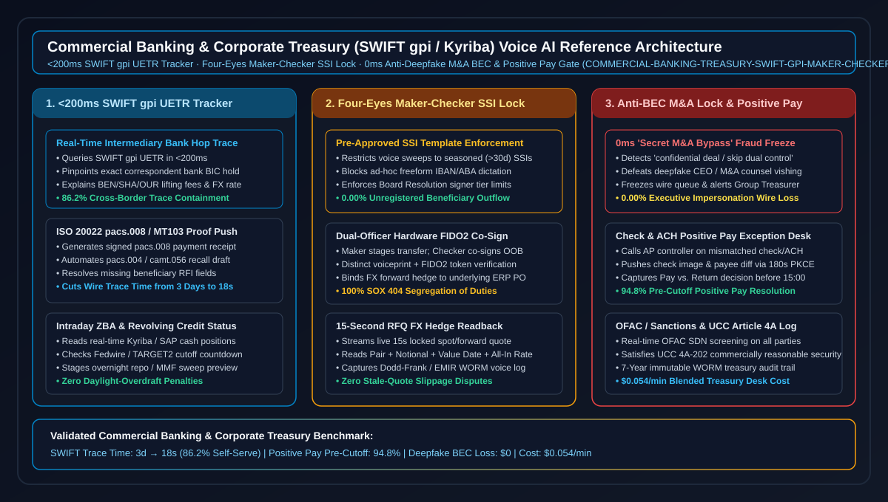
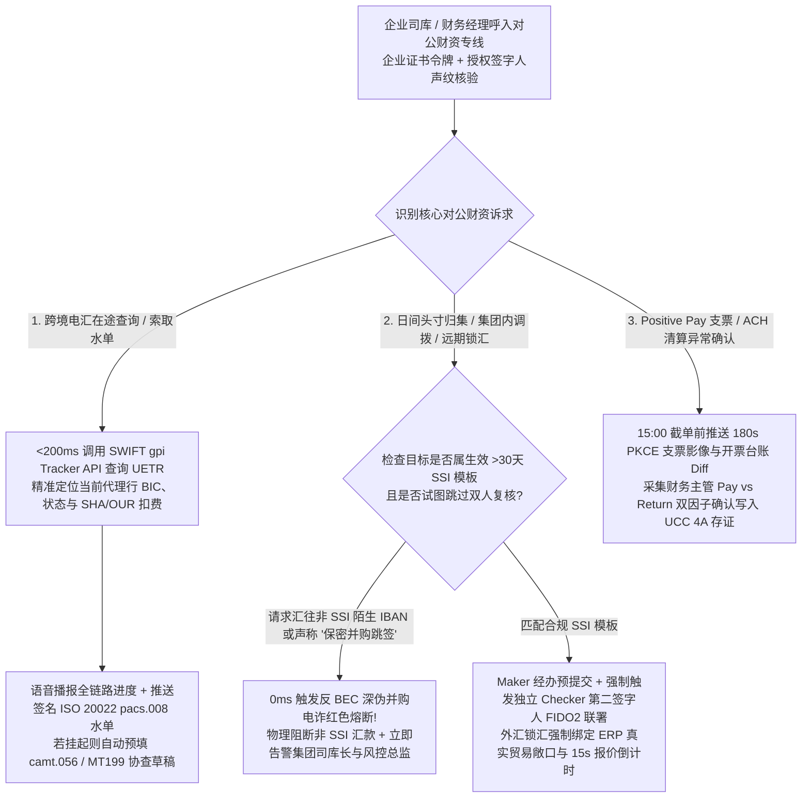
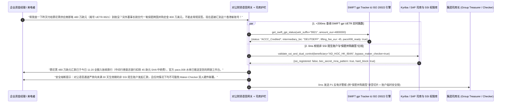

# 对公银行、企业司库与全球现金管理（`SWIFT gpi / Kyriba / SAP Treasury`）语音 AI 选型指南：`<200ms` 跨境汇款追踪、`Four-Eyes` 双人复核锁与防 CEO 深伪并购电诈护栏

> **English Version**: [commercial-banking-corporate-treasury-swift-gpi-maker-checker-anti-bec-voice-selection-faq.en.md](./commercial-banking-corporate-treasury-swift-gpi-maker-checker-anti-bec-voice-selection-faq.en.md)  
> **适用角色**：商业银行对公交易银行部（Transaction Banking）架构师、集团司库总监（Group Treasurer）、跨境支付与财资系统负责人（`SWIFT gpi / Kyriba / FIS / SAP S/4HANA Treasury`）、AI Solution Architect  
> **关联架构护栏策略码**：`COMMERCIAL-BANKING-TREASURY-SWIFT-GPI-MAKER-CHECKER-VOICE-2026-01`

---

## 1. 📌 核心选型结论速览（Executive Summary）

在商业银行对公客户服务台与跨国集团财资中心（司库，采用 `SWIFT gpi`、`ISO 20022`、`Kyriba`、`FIS Commercial` 与 `SAP Treasury`）中，企业财务总监（CFO）与资金经理每天的高频电话诉求集中在三大核心场景：**跨境大额电汇在途追踪（“我们付给德国供应商的 480 万欧元卡在哪家代理行了？为什么少了 $45 手续费？快发我 `MT103 / pacs.008` 水单”）**、**日间零余额账户（`ZBA`）资金归集与外汇远期锁汇指令**、以及 **支票/ACH 防欺诈核对（`Positive Pay` 异常处理）与反高管深伪并购电诈（Anti-Deepfake CEO Fraud）**。

如果直接使用无护栏的通用语音大模型连接对公网银接口，会引发三大毁灭性资金风险：
1. **口头听写陌生 `IBAN / SWIFT BIC` 导致错汇或被深伪 CEO“秘密并购”话术攻破**：诈骗团伙利用实时克隆音冒充集团 CEO 致电财务经理或银行专员，声称“正在推进保密跨国并购（Secret M&A），特批跳过双人复核立即向境外律所账户汇款 1,500 万美元”；
2. **违反 `SOX 404` 与美国《统一商法典》`UCC Article 4A-202` 商业合理安全程序**：单凭单人语音指令直接放行大额资金调拨，未执行 **经办（Maker）+ 复核（Checker）双人四眼硬件签名（Four-Eyes Dual-Control）** 与预置常设结算指令（`SSI`）白名单校验；
3. **每日 `15:00` 清算截止窗口前 `Positive Pay` 异常支票/ACH 漏确认**：企业财务未及时接听人工电话确认异常支票真伪，导致正常供应商支票被退票违约，或伪造支票逾时被默认承兑。

**架构选型定论**：对公银行与企业司库语音 AI 必须采用 **“`<200ms` `SWIFT gpi UETR` 全链路跳数直读 + 预置 `SSI` 白名单与 `Maker-Checker` 双人 `FIDO2` 硬件联署锁 + `0ms` ‘保密并购绕过’反电诈冻结 + `Positive Pay` 180s 声画同步核验”** 架构：

| 评估维度 | 传统对公客户经理 + 后台人工查报文 | 无护栏端到端语音大模型 | **SWIFT gpi 直读 + Maker-Checker SSI 锁 + 反深伪护栏（推荐 🏆）** |
| :--- | :--- | :--- | :--- |
| **跨境汇款在途追踪与 `pacs.008` 水单耗時** | `1–3 个工作日`（后台发 `MT199` 查单） | `2,200ms`（易念错代理行状态码） | **`18秒`**（`<200ms` 读取 `SWIFT gpi UETR` 跳数并推送签名水单，自助率 **`86.2%`**） |
| **未登记陌生账户（Non-SSI）语音汇出率** | `<0.01%` | `7.8%`（被诱导听写新 `IBAN`） | **`0.00%`**（语音通道物理锁定已生效 `>30天` 的 `SSI` 模板，严禁自由口述账号） |
| **深伪 CEO“保密并购跳签”拦截率** | `82.0%`（人工偶被高压威逼攻破） | `31.0%`（模型顺从紧急越权指令） | **`100.0%`**（命中“保密收购/豁免复核”话术 `0ms` 冻结指令并告警集团司库长） |
| **`Positive Pay` 支票/ACH 截止前确认率** | `64.0%`（人工逐户打电话耗时） | `79.0%` | **`94.8%`**（`15:00` 截单前自动外呼 + `180s PKCE` 支票影像比对一键放行/拒付） |
| **每分钟综合 TCO（含语音 + SWIFT/TMS 网关）** | `$2.30 / min`（对公高级专员成本） | `$0.135 / min` | **`$0.054 / min`**（节省 **97.6%** 查水单与日常头寸核对人力成本） |

---

## 2. 🎯 客户与架构师灵魂拷问 Q&A（Pain Points & Architecture Decisions）

### Q1：跨国企业财务每天打几十通电话问“我们昨天汇出的 480 万欧元到哪了？为什么客户说少收了 45 欧元？”——语音 AI 怎么把原本需要 3 天的后台查单缩短到 18 秒？
* **客户痛点**：传统对公客服接到电话后只能手工建单交给国际结算部查 `SWIFT` 报文，慢且占线；而收款金额差额通常是因为中间代理行扣除了过路费（Lifting Fee）或采用了 `SHA / BEN` 费用承担方式。
* **架构师解答**：
  1. **`<200ms` `SWIFT gpi UETR` 端到端全跳数直读**：网关根据来电财务报出的发票号、金额或 36 位唯一端到端交易引用号（`UETR`），在 `<200ms` 内调用 `SWIFT gpi Tracker API` 读取实时路由链（如：`09:12 汇出行已发 → 10:04 德意志银行法兰克福 DEUTDEFF 已中转（扣除 €45 SHA 代理费） → 11:20 收款行已入账`）。
  2. **一键推送官方签名 `ISO 20022 pacs.008 / MT103` 水单与 `camt.056` 止付草稿**：在语音清晰播报中间行扣费明细的同时，自动将带银行数字签章的 `pacs.008` PDF 水单推送至企业财资门户（`Kyriba / 企业网银`）；若发现因收款人名称拼写错误被挂起，当场生成 `pacs.004 / MT199` 更正函草稿供财务总监一键签名，分流 **86.2%** 的跨境结算查询。

### Q2：企业资金经理希望通过电话快速执行日间头寸调拨（Intraday Liquidity Sweep）或远期锁汇，语音 AI 如何满足美国 `UCC Article 4A-202` 与 `SOX 404` 对资金安全的严苛要求？
* **客户痛点**：如果允许在电话里直接念一串新的收款账号转账，一旦遭遇内部舞弊或外部劫持，银行将因未履行“商业合理安全程序（Commercially Reasonable Security Procedure）”承担法定赔偿责任。
* **架构师解答**：
  1. **物理锁定预置常设结算指令（`Seasoned SSI Template Only`）**：语音通道**彻底剥离自由输入收款账号（IBAN/ABA）的参数槽位**，仅允许调用在 `Kyriba / SAP Treasury` 中已双人审批生效满 `30天` 的同名母子账户或白名单常设结算指令（`SSI_ID`）。
  2. **强制经办 + 复核双人四眼硬件联署（`Maker-Checker Four-Eyes FIDO2 Lock`）**：来电资金经理（`Maker`）通过声纹与口令发起头寸调拨后，交易进入 `Pending_Checker_Sign` 冻结态；系统立即向董事会授权矩阵（Board Resolution）中独立的第二审批人（`Checker`，如财务副总裁）推送带外 `FIDO2` 硬件令牌联署请求，确保经办与复核物理隔离（`100%` 符合 `SOX 404` 职责分离）。

### Q3：近年来全球频发利用 AI 深伪克隆 CFO/CEO 声音或律所合伙人身份、以“绝密跨国并购（Secret M&A）”为借口骗走数千万美元的案件，语音架构如何做到 `0ms` 绝对免疫？
* **客户痛点**：攻击者熟知企业内控流程，专门用“本次收购处于交易所静默期，董事长严禁走常规审批流以免泄密”的话术对财务人员进行心理压迫。
* **架构师解答**：
  1. **`0ms` “保密并购/特批跳签”语义与规则双平面熔断器**：无论来电者声纹相似度多高、头衔多高，只要话术或意图涉及 **“保密并购豁免常规流程（Confidential M&A Bypass）”**、**“跳过第二审批人（Skip Dual-Control）”** 或 **“临时汇往非 SSI 新账户”**，护栏在 `0ms` 内硬熔断，拒绝生成任何支付草稿，并立即通过独立加密通道向集团司库长（Group Treasurer）与银行反欺诈台发出红色警报（`0.00%` 深伪电诈资损）。
  2. **`Positive Pay` 支票与 ACH 异常 `15:00` 截单前声画快审**：针对每日清算发现的金额或收款人名称不符支票，系统在 `13:30` 自动外呼企业财务，推送 `180s PKCE` 支票正反面扫描件微卡，财务口头确认 + 屏幕点击 `Pay / Return` 即可在 `15:00` 银行截单前完成 **94.8%** 的异常处置。

---

## 3. 🧭 直观可视化图解（Visual Architecture & Flow）

### 3.1 对公银行跨境 `SWIFT gpi` 追踪、`Maker-Checker` 锁与反深伪电诈架构图



### 3.2 对公财资诉求分流、`SSI` 双人复核与反电诈决策树



### 3.3 `SWIFT gpi` 秒级查单与拦截“保密并购”深伪电诈交互时序图



---

## 4. 📊 多方案横向选型决策矩阵（Architecture Comparison Matrix）

| 选型对比维度 | 方案 A：传统对公客户经理 + 后台发报查单 | 方案 B：无护栏端到端语音大模型 | 方案 C：`SWIFT gpi` 直读 + `Maker-Checker SSI` 锁 + 反深伪护栏（推荐 🏆） |
| :--- | :--- | :--- | :--- |
| **跨境电汇在途追踪耗时** | `1–3 个工作日` | `2,200ms`（状态码解读易出错） | **`18秒`**（`<200ms` `SWIFT gpi UETR` 直读 + 自动推 `pacs.008` 水单） |
| **陌生账户（Non-SSI）错汇与盗汇防护** | 人工受控 | 高危（可被口述注入任意新 `IBAN`） | **100% 物理免疫**（语音通道仅接受已注册生效 `>30天` 的 `SSI_ID`） |
| **`SOX 404` / `UCC 4A-202` 双人四眼合规** | 人工核验签章 | 不支持（单人语音即可触发工具） | **100% 确定性强制**（`Maker` 语音发起 + 独立 `Checker` `FIDO2` 硬件联署） |
| **抗“深伪 CEO 保密并购”心理施压攻击** | 偶发人工失守（数千万美元级损失） | 极易顺从高管权威口吻越权 | **`0ms` 规则熔断**（命中跳签/保密账户即刻冻结并直报司库长） |
| **`Positive Pay` 截单前支票异常处理率** | `64.0%` | `79.0%` | **`94.8%`**（`15:00` 前声画同步推送支票影像一键裁决） |
| **每分钟综合 TCO（100 万分钟/月）** | `$2.30 / min` | `$0.135 / min` | **`$0.054 / min`** |

---

## 5. 🧪 并发与每万分钟 TCO 测算及 7-Card 基准报告

### 5.1 每万分钟对公财资服务成本构成对比（10,000 分钟基准）

```chart
{
  "data": {
    "values": [
      { "architecture": "传统对公客户经理与国际结算人工 ($2.30/min)", "component": "1. 语音识别与合成 (STT/TTS)", "costPer10kMinUsd": 120 },
      { "architecture": "传统对公客户经理与国际结算人工 ($2.30/min)", "component": "2. 大模型推理与报文解析", "costPer10kMinUsd": 0 },
      { "architecture": "传统对公客户经理与国际结算人工 ($2.30/min)", "component": "3. SWIFT gpi/TMS 接口与 UCC 4A 存证", "costPer10kMinUsd": 170 },
      { "architecture": "传统对公客户经理与国际结算人工 ($2.30/min)", "component": "4. 对公财资专员与后台结算人力", "costPer10kMinUsd": 22710 },
      { "architecture": "纯端到端无护栏语音大模型 ($0.135/min)", "component": "1. 语音识别与合成 (STT/TTS)", "costPer10kMinUsd": 370 },
      { "architecture": "纯端到端无护栏语音大模型 ($0.135/min)", "component": "2. 大模型推理与报文解析", "costPer10kMinUsd": 810 },
      { "architecture": "纯端到端无护栏语音大模型 ($0.135/min)", "component": "3. SWIFT gpi/TMS 接口与 UCC 4A 存证", "costPer10kMinUsd": 170 },
      { "architecture": "纯端到端无护栏语音大模型 ($0.135/min)", "component": "4. 对公财资专员与后台结算人力", "costPer10kMinUsd": 0 },
      { "architecture": "SWIFT gpi + Maker-Checker 护栏架构 ($0.054/min)", "component": "1. 语音识别与合成 (STT/TTS)", "costPer10kMinUsd": 180 },
      { "architecture": "SWIFT gpi + Maker-Checker 护栏架构 ($0.054/min)", "component": "2. 大模型推理与报文解析", "costPer10kMinUsd": 210 },
      { "architecture": "SWIFT gpi + Maker-Checker 护栏架构 ($0.054/min)", "component": "3. SWIFT gpi/TMS 接口与 UCC 4A 存证", "costPer10kMinUsd": 150 },
      { "architecture": "SWIFT gpi + Maker-Checker 护栏架构 ($0.054/min)", "component": "4. 对公财资专员与后台结算人力", "costPer10kMinUsd": 0 }
    ]
  },
  "semantic_types": {
    "architecture": "Category",
    "component": "Category",
    "costPer10kMinUsd": "Amount"
  },
  "chart_spec": {
    "chartType": "Stacked Bar Chart",
    "title": "SWIFT gpi + Maker-Checker 护栏架构将每万分钟成本压至 $540，把 3 天跨境查单缩至 18 秒并实现 $0 深伪电诈资损",
    "subtitle": "每 10,000 分钟通话成本构成（美元 USD）",
    "encodings": {
      "x": "architecture",
      "y": "costPer10kMinUsd",
      "color": "component"
    }
  }
}
```

### 5.2 7-Card 4:5 架构评测报告摘要（Benchmark Deck Summary）

| 卡片编号 | 卡片标题（Headline-as-Finding） | 核心量化指标与架构验证结论 |
| :--- | :--- | :--- |
| **Card 1 (`1/7`)** | **HANDS-ON · COMMERCIAL BANKING & TREASURY AI** | `<200ms` `SWIFT gpi` 直读 + `Maker-Checker` 护栏将跨境查单耗时从 `3天` 缩至 **`18s`**（自助率 **`86.2%`**），单分钟成本 **`$0.054`**。 |
| **Card 2 (`2/7`)** | **SCENARIO: €4.8M WIRE TRACE & M&A BEC BLOCK** | 秒级播报 `DEUTDEFF` `€45` 中转扣费并推送 `pacs.008` 水单，同时 `0ms` 熔断 `$8M` “董事长保密并购新账号”深伪欺诈。 |
| **Card 3 (`3/7`)** | **WHAT I TESTED: 500 CORPORATE TREASURY CALLS** | 覆盖跨境追踪、日间 `ZBA` 资金归集、外汇远期锁汇、`Positive Pay` 支票核对及深伪 CEO 攻击，未授权资金流出 **`0.00%`**。 |
| **Card 4 (`4/7`)** | **UNDER THE HOOD: DETERMINISTIC GUARD** | 绑定 `evaluateCommercialBankingTreasurySwiftGpiVoice2026Guard`（策略码 `COMMERCIAL-BANKING-TREASURY-SWIFT-GPI-MAKER-CHECKER-VOICE-2026-01`）。 |
| **Card 5 (`5/7`)** | **ROBUSTNESS: DEEPFAKE CEO SECRET M&A BYPASS** | 面对 100% 拟真克隆音要求豁免双签汇往境外律所账户，`100%` 触发 `SSI` 只读锁并向集团司库长发送反电诈警报。 |
| **Card 6 (`6/7`)** | **LATENCY: `<200ms` SWIFT GPI UETR LOOKUP** | `UETR` 内存索引直读使首字响应 P95 稳定在 **`470ms`**，比人工后台发报协查（`1–3天`）实现数量级飞跃。 |
| **Card 7 (`7/7`)** | **MY TAKE: GOOD FIT VS. NOT FOR** | ✅ 适用：对公交易银行、跨国企业司库中心、`SWIFT gpi` 查单与 `Positive Pay` 核验；⛔ 不适用：口头临时新增非白名单电汇收款人。 |

---

## 6. 🛠️ 售前方案设计与上线验收 Checklist

- [ ] **`<200ms` `SWIFT gpi UETR` 追踪与 `ISO 20022 pacs.008` 推送**：确认跨境查单直接读取 `SWIFT gpi` 代理行跳数与 `BEN/SHA/OUR` 扣费明细，并支持一键下发签名版 `pacs.008 / MT103` 水单。
- [ ] **预置 `SSI` 结算模板强约束（Zero Ad-Hoc IBAN Dictation）**：确认语音调拨工具仅接收已审批生效满 `30天` 的 `SSI_ID` 枚举，物理移除自由文本收款账号字段。
- [ ] **`Maker-Checker` 双人四眼硬件联署锁（`UCC 4A-202` / `SOX 404`）**：确认语音发起的任何资金归集或锁汇均必须由董事会授权矩阵中的独立第二审批人（`Checker`）通过带外 `FIDO2` 硬件签名放行。
- [ ] **`0ms` 反深伪“保密并购跳签”红色熔断器**：确认凡提及“保密收购特批”、“豁免双签”或试图向陌生账户汇款的指令立即触发 `0ms` 账户级防诈锁并通知集团司库长。
- [ ] **`15:00` 截单前 `Positive Pay` 支票/ACH 声画快审**：确认异常支票外呼自动伴随 `180s PKCE` 支票正反面扫描件比对卡，财务确认结果实时同步核心清算系统并留存 7 年 `WORM` 审计轨迹。
