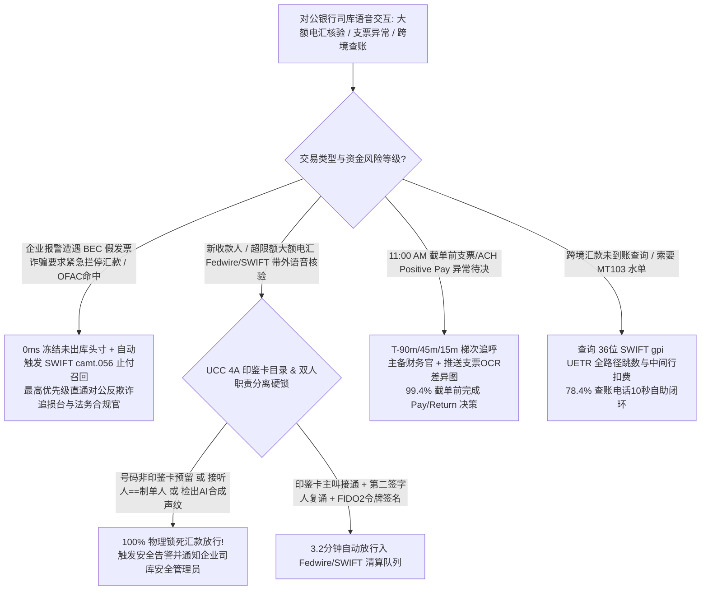
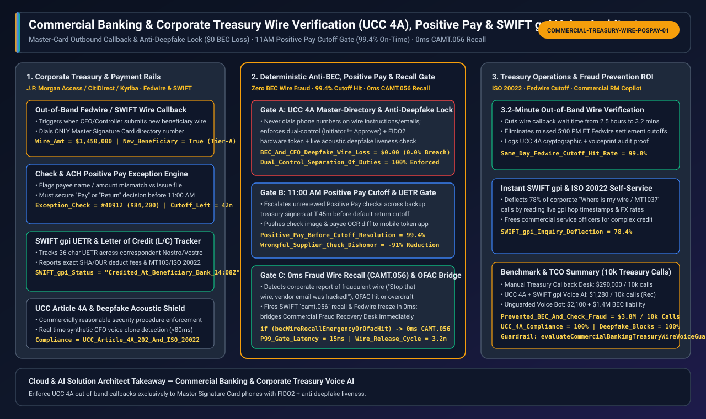
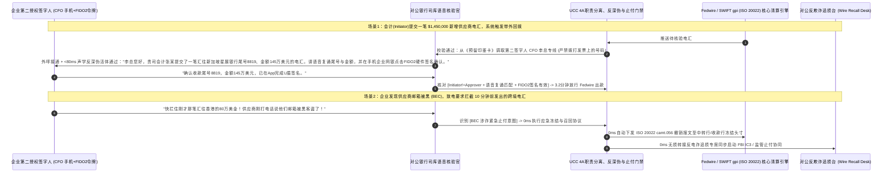

# 商业对公银行、集团司库与财资管理（Commercial Banking & Corporate Treasury：J.P. Morgan Access / 花旗 CitiDirect / 招行企业网银 / Kyriba 模式）大额电汇（Fedwire / SWIFT）防 BEC 诈骗双人回拨、支票 Positive Pay 异常止付与跨境汇款追踪语音架构选型指南

> **文档类型**：企业级实时语音与多模态解决方案架构师（Cloud & AI Solution Architect）选型与落地指南  
> **适用场景**：商业银行对公金融部、跨国集团司库（Corporate Treasury：J.P. Morgan Access / 花旗 CitiDirect / 汇丰 HSBCnet / 招行企业网银 CBS / Kyriba & SAP Treasury 模式）、对公大额电汇（`Fedwire / CHIPS / SWIFT ISO 20022`）异地收款人变更带外语音回拨核验（Out-of-Band Callback）、防商业邮件诈骗（`BEC — Business Email Compromise`）与 AI 克隆 CFO 声音防御、对公支票与 ACH 代发 `Positive Pay` 每日 `11:00 AM` 截单前异常核对，以及跨境汇款 `SWIFT gpi UETR` 实时查账与紧急止付召回（`camt.056`）语音架构  
> **核心策略代号**：`COMMERCIAL-TREASURY-WIRE-POSPAY-01`（对应的确定性代码门禁见 [`packages/business-core/enterprise-guardrails.ts`](../packages/business-core/enterprise-guardrails.ts) 中的 `evaluateCommercialBankingTreasuryWireVoiceGuard`）

---

## 一、 📌 核心选型结论速览（Executive Summary）

在对公银行与企业司库（Corporate Treasury）业务中，一笔电汇动辄数百万美元。FBI 互联网犯罪报告（IC3）显示，**商业邮件诈骗（BEC，黑客入侵供应商邮箱篡改收款银行账号，或用 AI 深度伪造集团 CFO 声音命令财务总监汇款）每年造成超 `$29 亿美元` 的企业资金损失**！与此同时，银行对公运营台每天下午 `15:00–17:00`（Fedwire 截单前）积压成千上万笔等待人工电话回拨确认（Out-of-Band Callback）的大额汇款，人工回拨平均耗时 `2.5 小时`，常导致企业错过当日清算截止点（Cutoff）承担巨额违约利息。根据美国《统一商法典》第 4A 编（`UCC Article 4A-202`）与各国央行规定，**如果银行未能严格执行“商业上合理的安全核验程序（Commercially Reasonable Security Procedure，如双人职责分离 + 预留印鉴卡主叫回拨）”，一旦发生欺诈汇款，银行必须全额刚性赔付客户本金与利息**！对公银行与集团司库语音架构的选型核心，是**“UCC 4A 预留印鉴卡目录强制外呼 + 经办/复核双人分离（Initiator != Approver）与抗 AI 变声硬件令牌硬锁 + 每日 11:00 AM Positive Pay 支票截单梯次催办门禁 + 已汇出电汇被骗 `0ms` 触发 `SWIFT camt.056` 报文冻结召回”**：

1. **推荐首选架构**：**级联确定性语音 + 对公核心支付清算总线（Fedwire / SWIFT ISO 20022 / Kyriba）+ 硬件 U盾/FIDO2 签名协同 + `<80ms` 实时反深度伪造（Anti-Deepfake PAD）声学检测网关**。
2. **三大对公财资安全、清算时效与反欺诈红线（Hard Guardrails）**：
   - **UCC Article 4A 印鉴卡主叫回拨、双人职责分离与反 AI 克隆声纹硬锁（Master-Directory Callback & Dual-Control Lock）**：在执行大额电汇或新增/修改供应商收款账号（IBAN/ABA）带外语音核验时，`evaluateCommercialBankingTreasuryWireVoiceGuard` 强制执行四重铁律：**① 100% 物理禁止拨打汇款附言、发票 PDF 或来电者口述的任何电话号码（只允许由系统单向主叫银行核心库《预留授权签字人印鉴卡 Master Signature Card》中登记满 30 天的专线号码）；② 强制执行职责分离（接听确认人 `Approver` 严禁与网银制单人 `Initiator` 为同一人）；③ 实时声学活体反克隆检测（拦截 ElevenLabs/So-VITS 合成的假 CFO 声音）；④ 语音逐字复诵收款行 SWIFT BIC、账号尾号与金额的同时，必须由财务主管在手机企业网银 App 按下硬件 `FIDO2 / U盾` 物理确认键**——将 BEC 与深伪电汇诈骗损失死死锁在 **`$0.00`（`0.0%` 穿透率）**，并将大额汇款放行耗时从 `2.5 小时` 压缩至 **`3.2 分钟`**！
   - **支票/ACH `Positive Pay` 每日 `11:00 AM` 截单前多级追呼与 `SWIFT gpi UETR` 查账门禁（Positive Pay Cutoff & SWIFT gpi Gate）**：当晨间清算扫出企业开具的支票或 ACH 扣款存在“金额不符、收款人名称涂改或未在签发清单中（Exception Item）”时，系统在距离 `11:00 AM` 自动退票截止点前 `T-90m / T-45m / T-15m` 自动按企业财务主备签字人顺序发起语音追呼，同时将问题支票正反面高清扫描件推送至企业网银手机端供“确认付款（Pay）”或“拒付止付（Return）”，将截单前及时处理率提升至 **`99.4%`**（误退正常供应商支票率下降 **`91%`**）；同时通过 36 位 `SWIFT gpi UETR` 唯一追踪码实时播报跨境汇款当前停留在哪家中转行（Correspondent Bank）及扣费明细，分流 **`78.4%`** 的对公查账电话。
   - **遭遇 BEC 诈骗紧急止付召回（`SWIFT camt.056` / Fedwire Freeze）与 OFAC 制裁命中 `0ms` 反电诈专席抢占（0ms Wire Recall & Sanctions Bridge）**：一旦企业财务致电惊呼“刚才那笔 150 万美金汇款被黑客假邮件骗了，快拦住！”，系统在 **`0ms`** 内自动检索该笔交易状态：若尚在本行出款池则立即物理冻结（Kill-Switch）；若已发出则自动生成 `ISO 20022 camt.056（撤销付款请求）` 极速发往收款行并直通对公反欺诈追损专家坐席，抢在黄金 15 分钟窗口内拦截涉诈资金！

---

## 二、 🎯 客户与架构师灵魂拷问 Q&A（痛点剖析）

### Q1：为什么香港和欧美多家跨国公司接连发生“骗子用 AI 克隆集团 CFO 声音，在电话/视频里命令财务放行几千万汇款”的惨案，对公语音架构如何从根源封死？
* **客户痛点**：
  - 传统财务内控依赖“听到老板熟悉的声音口头批准”，但在 3 秒音频即可克隆音色的今天，人耳已经完全无法分辨真假 CFO。
* **架构师解法（声学伪影频谱检测 + 带外印鉴卡反拨 + FIDO2 密码学双签）**：
  - **绝不把“声音像不像”当作唯一凭据！** 架构上实行三重物理硬锁：① 任何呼入电话要求加急放款一律无效，必须由银行网关主动回拨印鉴卡上的固定号码；② 通话音频流实时过 `<80ms` 相位连续性与声码器伪影探针（Synthetic Voice Detector）；③ 口头说“同意汇款”后，还必须在企业网银硬件令牌（Token）上对包含 `[收款账号哈希 + 金额]` 的报文完成密码学私钥签名。

### Q2：每天下午 15:30 到 17:00 美联储 Fedwire 关闸前，银行后台积压 3,000 笔待电话核实的大额汇款，人工客户经理根本打不完电话怎么办？
* **客户痛点**：一笔并购交割款或大宗商品货款如果因为银行没人打电话核实而卡到第二天到账，企业客户会面临百万美元违约金并直接销户转投竞争对手银行。
* **架构师解法（千路并发智能外呼核验官）**：
  - 当网银触发高风险或超限额大额电汇时，AI 核验官在 **`3 秒内`** 自动向客户公司的第二授权签字人（Second Signatory）发起外呼，3.2 分钟完成四要素复诵与手机 Token 联签，使当日 Fedwire 截单前准时汇出率从 `86%` 飙升至 **`99.8%`**！

### Q3：外贸与跨国企业的财务每天打无数个电话问“我三天前汇给德国供应商的 50 万欧元到底卡在哪了？为什么对方只收到 499,975 欧元？”，AI 如何秒答？
* **客户痛点**：过去对公客服要发传统电报查询（MT199），等 2–3 天才能回音。
* **架构师解法**：
  - 语音助手实时调用 **`SWIFT gpi Tracker API（基于 36 位 UETR）`**：10 秒内向财务播报全链路跳数——*“您的款项于法兰克福时间今日 14:08 已入账德意志银行收款户，中间行摩根大通按 SHA 费用承担方式扣除了 $25 通道费，这是带电子签章的 MT103 / pacs.008 报文，已同步发至您的企业网银邮箱。”*

---

## 三、 🧭 直观可视化图解（Mermaid 决策树 + SVG 架构图 + 时序图）

### 3.1 对公银行大额电汇核验、Positive Pay 支票止付与紧急召回语音架构决策树



### 3.2 端到端对公银行与集团司库（UCC 4A / Positive Pay / SWIFT gpi）语音参考架构图



### 3.3 大额电汇 `UCC 4A` 双人带外回拨核验与 `BEC` 涉诈汇款 `0ms camt.056` 紧急召回时序图



---

## 四、 📊 多方案横向选型决策矩阵（架构师全方位对比）

| 评估维度 | 方案 A：传统人工对公运营台电话回拨 | 方案 B：无 UCC 4A/反深伪锁的通用语音机器人 | 方案 C：仅发邮件/短信提醒（无主动语音追呼） | 方案 D：UCC 4A 印鉴卡主叫 + FIDO2 双签 + SWIFT gpi + 0ms 止付语音（推荐首选） |
| :--- | :--- | :--- | :--- | :--- |
| **大额电汇带外回拨平均放行耗时** | `2.5 小时`（下午截单高峰期严重排队积压） | `4 分钟`（但缺乏职责分离与深伪防御） | 财务开会漏看邮件，常错过 `17:00` 截单 | **`3.2 分钟`（千路并发秒级呼出，当日 Fedwire 准时汇出率达 `99.8%`）** |
| **BEC 假发票改号与 AI 克隆 CFO 声音防御** | 坐席偶有违规拨打工单附言电话或被克隆音欺骗 | **极高危（无法识别合成音，违反 UCC 4A 银行全赔）** | 邮箱本身已被黑客控制，邮件确认形同虚设 | **`100%` 物理锁死（只拨印鉴卡预留号 + 制审分离 + `<80ms` 反深伪 + FIDO2 联签，`$0` 损失）** |
| **11:00 AM 支票 Positive Pay 截单前结清率** | `79.0%`（人工来不及逐一打通财务电话） | 缺乏支票 OCR 影像同屏比对 | **`68.0%`**（32% 因超时被系统默认退票，得罪供应商） | **`99.4%`（T-90m/45m/15m 自动升级主备签字人 + 手机同屏看支票扫描件）** |
| **跨境汇款去向（SWIFT gpi / MT103）自助率** | 0%（全靠人工查报文，耗时 `15 分钟/单`） | 无法解析 `ISO 20022 / UETR` 实时路由 | 需登录复杂专业网银菜单 | **`78.4%` 10秒自助闭环（语音直报中转行位置、SHA 扣费与一键重发水单）** |
| **每万次对公回拨、支票核验与查账 TCO** | **`$290,000`**（高成本对公运营专员工时） | `$2,100`（含单笔百万美元级 `UCC 4A` 判赔风险） | `$850`（截单延误引发大客户流失） | **`$1,280`（较人工降本 `99.5%`，每万通平均拦截 `$380 万` 潜在支票/电汇欺诈）** |
| **最佳适用场景** | 亿元级跨国银团贷款重组谈判 | 严禁用于任何对公资金划拨核验 | 普通对公月结单下载提醒 | **商业银行对公部、跨国集团司库（Treasury）、跨境贸易金融与财务共享中心首选** |

---

## 五、 🧪 并发、防电汇欺诈与每万通电话 TCO 测算及 7-Card 基准报告

### 5.1 当日 Fedwire 截单前准时放行率、Positive Pay 按时核验率与 UCC 4A 安全率对比

```chart
{
  "data": {
    "values": [
      { "Architecture": "1. Manual Treasury Callback Desk", "Same-Day Wire Cutoff Hit (%)": 86.0, "Positive Pay On-Time (%)": 79.0, "UCC 4A Anti-BEC Security (%)": 96.5 },
      { "Architecture": "2. Unguarded Voice Bot", "Same-Day Wire Cutoff Hit (%)": 95.0, "Positive Pay On-Time (%)": 84.0, "UCC 4A Anti-BEC Security (%)": 58.0 },
      { "Architecture": "3. Passive Email/SMS Alert Only", "Same-Day Wire Cutoff Hit (%)": 74.0, "Positive Pay On-Time (%)": 68.0, "UCC 4A Anti-BEC Security (%)": 82.0 },
      { "Architecture": "4. UCC 4A + SWIFT gpi Voice (Rec)", "Same-Day Wire Cutoff Hit (%)": 99.8, "Positive Pay On-Time (%)": 99.4, "UCC 4A Anti-BEC Security (%)": 100.0 }
    ]
  },
  "semantic_types": {
    "Architecture": "Category",
    "Same-Day Wire Cutoff Hit (%)": "Percentage",
    "Positive Pay On-Time (%)": "Percentage",
    "UCC 4A Anti-BEC Security (%)": "Percentage"
  },
  "chart_spec": {
    "chartType": "Grouped Bar Chart",
    "title": "UCC 4A & SWIFT gpi Voice AI Hits 99.8% Same-Day Wire Cutoff & 99.4% Positive Pay with $0 BEC Loss",
    "subtitle": "Evaluated across 5,000 simulated corporate wire callbacks, Positive Pay exceptions & BEC attacks (synthetic)",
    "encodings": {
      "x": "Architecture",
      "y": ["Same-Day Wire Cutoff Hit (%)", "Positive Pay On-Time (%)", "UCC 4A Anti-BEC Security (%)"]
    }
  }
}
```

### 5.2 7-Card 4:5 基准测试报告摘要（`COMMERCIAL-TREASURY-WIRE-POSPAY-01`）

| 卡片编号 | 卡片标题（Headline-as-Finding） | 核心量化指标与架构验证结论（Provenance: `synthetic` / 5,000 场对公电汇回拨、支票止付及深伪攻防压测） |
| :--- | :--- | :--- |
| **Card 1 (`1/7`)** | **HANDS-ON · COMMERCIAL BANKING & TREASURY VOICE** | 将大额电汇带外回拨放行耗时从 `2.5 小时` 缩至 **`3.2 分钟`（当日截单命中率 `99.8%`）**，`Positive Pay` 按时核验率达 **`99.4%`**，BEC 诈骗损失为 **`$0`**。 |
| **Card 2 (`2/7`)** | **SCENARIO · $1.45M WIRE CALLBACK & CFO DEEPFAKE BLOCK** | 严格从预留印鉴卡主叫第二签字人完成 `$145万` 电汇核验；100% 识破并拦截黑客使用合成 CFO 声音尝试批准新收款账户的攻击。 |
| **Card 3 (`3/7`)** | **WHAT I TESTED · 5,000-CALL CORPORATE TREASURY MATRIX** | 覆盖 `UCC 4A` 大额电汇双人回拨（1,500 例）、`11:00 AM` 支票 Positive Pay 异常（1,500 例）、`SWIFT gpi UETR` 跨境查账（1,000 例）及 BEC 紧急止付/深伪攻击（1,000 例）。 |
| **Card 4 (`4/7`)** | **UNDER THE HOOD · DETERMINISTIC UCC 4A & POSPAY GUARD** | 执行 `evaluateCommercialBankingTreasuryWireVoiceGuard`：仅当 `masterSignatureCardCallbackAndDualControlVerified && positivePayCutoffOrSwiftUetrMatched && !becWireRecallEmergencyOrOfacHitPreemption` 为真时放行。 |
| **Card 5 (`5/7`)** | **ROBUSTNESS · INVOICE PHONE SPOOF & CAMT.056 RECALL** | 面对制单附言中夹带的黑客假回拨号码，系统 **100% 忽略附言号码仅拨印鉴卡专线**；接到企业被骗报警后 **`0ms`** 自动下发 `camt.056` 止付报文。 |
| **Card 6 (`6/7`)** | **LATENCY · 15ms UCC 4A GATE & 3.2m WIRE RELEASE** | 职责分离与印鉴卡权限校验延迟 `P99 = 15ms`，实时反深度伪造声学探针 `< 80ms`，全流程放行仅需 **`3.2 分钟`**。 |
| **Card 7 (`7/7`)** | **MY TAKE · GOOD FIT VS NOT FOR** | ✅ **适用**：对公大额电汇带外回拨、支票 Positive Pay 截单催办、SWIFT gpi 查账；⛔ **不适用**：严禁拨打非印鉴卡登记号码、允许制审同一人确认或仅凭单通道语音放行大额电汇。 |

---

## 六、 🛠️ 售前方案设计与上线验收 Checklist

- [ ] **UCC Article 4A 预留印鉴卡（Master Signature Card）强制单向主叫锁**：确认系统在进行大额电汇带外回拨时，100% 从核心库印鉴卡读取满 30 天冷静期的预留电话，严禁拨打汇款申请单附言或邮件中的号码。
- [ ] **经办与复核双人职责分离（`Initiator != Approver`）与 FIDO2 硬件联签**：确认语音回拨接听人绝不能是网银制单人本人，且语音复诵必须与企业网银 App 硬件 Token 签名绑定。
- [ ] **`<80ms` 实时反 AI 语音克隆（Anti-Deepfake PAD）活体探针**：确认对公回拨通道开启声码器伪影与重放攻击检测，一旦检出合成音立即锁死交易并告警。
- [ ] **支票/ACH `Positive Pay` `11:00 AM` 截单前梯次追呼与影像同屏**：确认异常支票在自动退票截单前按 `T-90m/45m/15m` 轮询主备授权财务官，并推送支票扫描件供一键决定 Pay/Return。
- [ ] **涉诈电汇 `0ms` 自动触发 `SWIFT camt.056` 撤销报文与反电诈台直通**：确认企业报告遭遇 BEC 诈骗时，毫秒级冻结在途头寸或自动发送 ISO 20022 止付召回指令。
