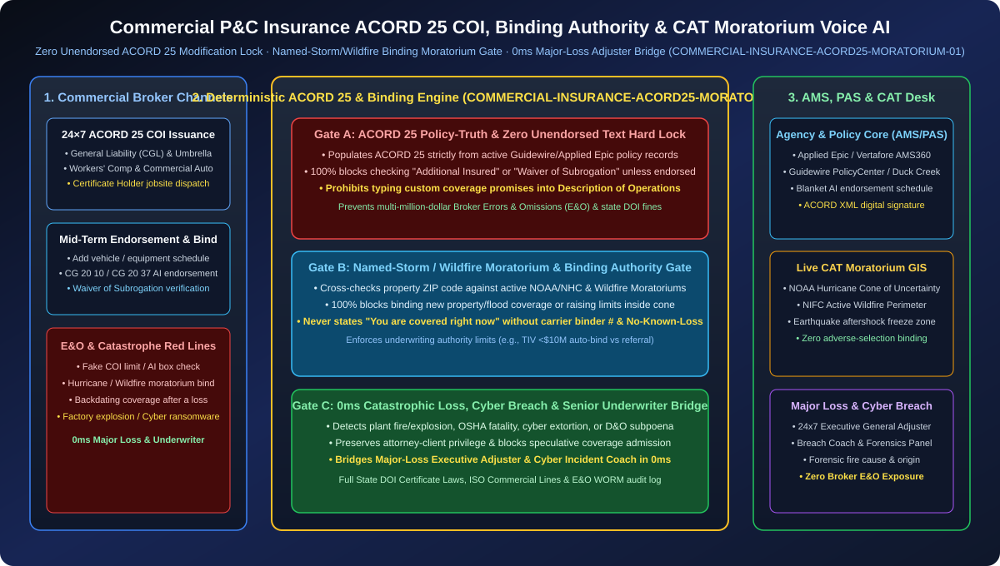
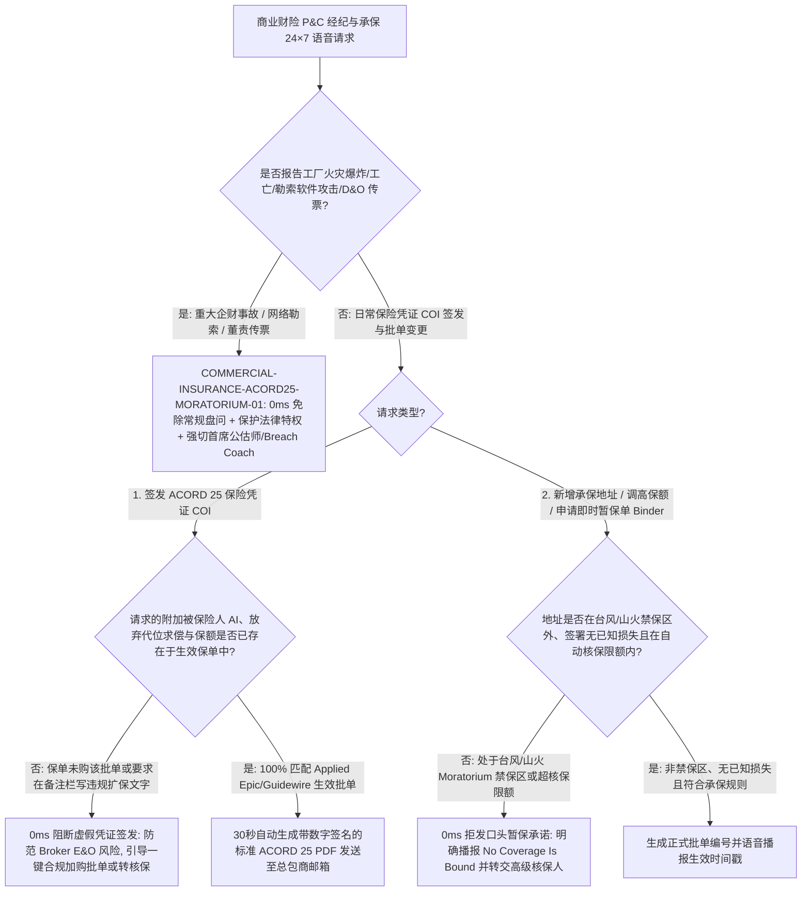
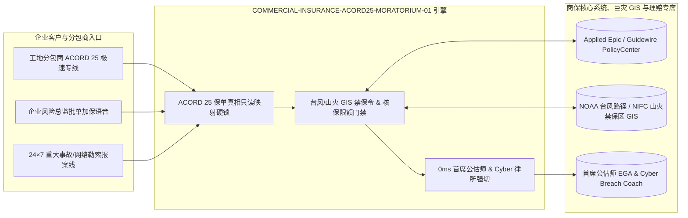
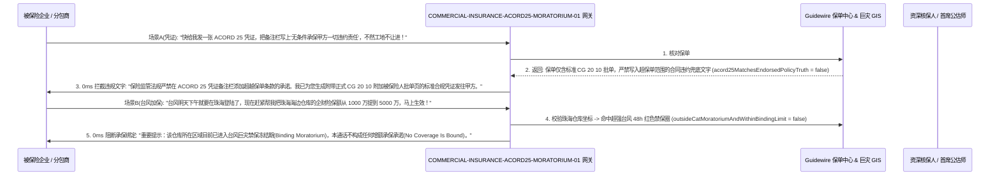

# 商业财产与责任保险（Chubb / AIG / 达信 Marsh / 平安政企）、ACORD 25 保险凭证（COI）与承保授权 24×7 AI 语音方案：无批单严禁篡改凭证硬锁、台风/山火禁保期（Binding Moratorium）地域锁与重大事故 0ms 强切选型指南

> **文档定位**：面向全球商业保险公司与保险经纪巨头（Chubb 安达 / AIG / Marsh 达信 / Aon 怡安 / Willis Towers Watson / 平安产险政企部 / 人保财险）、代理管理系统（Applied Epic / Vertafore AMS360 / Guidewire PolicyCenter）与保险科技架构师，提供覆盖 **“分包商进场 ACORD 25 保险凭证（COI）秒级语音签发 + 附加被保险人批单（Additional Insured Endorsement）核验 + 台风/山火巨灾禁保期（CAT Binding Moratorium）拦截 + 重大爆炸/勒索软件报案强切”** 的端到端实时语音方案选型、TCO 测算与 `COMMERCIAL-INSURANCE-ACORD25-MORATORIUM-01` 确定性安全护栏指南。

---

## 一、📌 核心选型结论速览（Executive Summary）

在商业综合责任险（CGL）、建筑工程一切险与企财险经纪服务中，建筑分包商或物流车队常常在早上 7 点站在甲方工地门口焦急致电索要 **ACORD 25 保险凭证（Certificate of Insurance, COI）**，或者沿海工厂在超强台风登陆前 24 小时要求紧急加保洪水险与停业损失险（Business Interruption）。**任何允许通用语音大模型顺着客户要求在未购买对应批单（Endorsement）的情况下勾选“附加被保险人（Additional Insured）”或“放弃代位求偿权（Waiver of Subrogation）”、在凭证备注栏随意手写扩大承保范围承诺、或者在巨灾禁保区（Active Named-Storm / Wildfire Moratorium ZIP Code）口头承诺“您的保单现在已经即时生效（You are bound and covered）”的方案，都会直接构成各州保险法下的虚假凭证违法，并引发数千万美元的经纪人执业过失（Broker E&O）赔付**：
1. **核心架构选型：采用“级联确定性商保经纪语音管线（Azure Speech 商保批单/ISO 条款词表 STT + Applied Epic / Guidewire 保单真相核验引擎 + 气象局 NOAA/台风路径 GIS 禁保区硬锁 + 严谨合规 Neural HD TTS）”**：
   - **ACORD 25 凭证与已生效批单（ISO CG 20 10 / CG 20 37）100% 真相映射硬锁**：凭证仅是对现有保单的客观快照，绝不能创设或修改保险责任；确定性网关 `COMMERCIAL-INSURANCE-ACORD25-MORATORIUM-01` **100% 物理禁止在未核验已生效统括批单（Blanket Additional Insured Endorsement）或专项批单的情况下勾选 `ADDL INSD` / `SUBR WVD` 复选框**，且严禁向 `Description of Operations` 备注栏写入任何超越原保单条款的免责或扩保承诺（`acord25MatchesEndorsedPolicyTruth = true`）；
   - **台风/飓风/山火命名巨灾禁保令（CAT Binding Moratorium）与承保权限（Binding Authority）硬锁**：当客户要求新增承保地址、提高企财险保额或降低免赔额时，网关实时比对标的物邮编/经纬度是否落入气象局/保险公司生效的 **台风 48 小时警戒圈、山火红旗禁保区或余震冻结区**，并强制核验无已知既发损失声明（No Known Loss Statement）与自动核保保额上限（`outsideCatMoratoriumAndWithinBindingLimit = true`）。
2. **化工厂爆炸火灾、工地亡人事故、D&O 证监会传票与勒索软件（Cyber Ransomware）攻击 0ms 强切首席公估师（Executive General Adjuster）与网络应急响应律所（Breach Coach）**：
   - 一旦企业风险管理总监（Risk Manager）通过语音报案涉及人员伤亡、主厂房火灾停产或黑客加密核心数据库，系统在 **0ms 内禁止 AI 对免责条款或赔付比例做任何口头承诺**，立即桥接 24×7 重大案件理赔总监与法律特权保护下的网络危机响应团队。



---

## 二、🎯 客户与架构师灵魂拷问 Q&A（Q1–Q3）

### Q1：建筑分包商老板站在总包商（GC）工地大门口打给保险经纪语音助手：“总包商说如果保险凭证（ACORD 25 COI）上没勾选‘放弃代位求偿权（Waiver of Subrogation）’且保额没写够 500 万美元，今天就不让我们的吊车进场！你先把勾打上、备注栏写上符合甲方合同全部要求发给我，批单我下礼拜再补买！”——为什么通用大模型如果照办会让保险经纪公司倾家荡产？
**A：在美国全部 50 个州保险监管局（State DOI）法规与《保险凭证法》下，签发包含保单实际未承保内容的虚假或误导性 ACORD 25 凭证属于违法行为（甚至构成保险欺诈重罪）！如果当天下午吊车在工地翻车砸毁总包商大楼，保险公司因未出批单依法拒赔，总包商将直接起诉保险经纪公司由经纪人用自己的 Errors & Omissions（E&O）责任险全额兜底赔付 500 万美元！**
- **架构硬锁**：
  - 在 `COMMERCIAL-INSURANCE-ACORD25-MORATORIUM-01` 中，ACORD 25 生成器完全采用只读模板绑定 Applied Epic / Guidewire 中的已生效批单表（如 `CG 24 04 Waiver of Transfer of Rights` 与伞式责任险 `Umbrella Limit`）；
  - 当客户保单当前仅具 200 万保额且未附带放弃代位求偿批单时，`acord25MatchesEndorsedPolicyTruth = false`，0ms 拒绝篡改凭证，同时启动正道闭环：“法规严禁签发与已生效保单不符的保险凭证。检测到您的保单目前保额为 200 万美元且尚未加批 `CG 24 04` 放弃代位求偿条款；其中 `CG 24 04` 单项批单保费为 $250 且符合自动核保权限，您若现在语音确认授权扣款加批，我可在 60 秒内为您正式出批单并签发合规凭证；而 500 万伞式增额已同步转交资深核保人加急审批。”

### Q2：超强台风“摩羯”或佛罗里达 4 级飓风距离海岸线还有 36 小时，沿海仓库业主打电话给商业保险语音客服：“赶紧帮我把沿海那座 3000 万的冷链仓库加进企财险保单里，顺便把台风洪水免赔额调到最低，你现在口头跟我确认一下今天中午 12 点已经生效了！”——AI 如何防止致命的“逆向选择绑定（Adverse Selection Binding）”？
**A：当命名热带气旋（Named Storm）或失控山火进入保险公司划定的禁保圈（Binding Moratorium Polygon）后，任何经纪人或代理系统的自动承保权限（Binding Authority）在法律上已自动冻结！**
- 如果语音客服在电话里随口答应一句“好的，已经为您登记生效了”，在英美保险判例法下即可能构成具有约束力的 **口头暂保单（Oral Binder of Insurance）**，台风过境仓库吹毁后引发数千万美元理赔诉讼；
- 在 `COMMERCIAL-INSURANCE-ACORD25-MORATORIUM-01` 中，网关实时拉取 NOAA 飓风路径、中央气象台台风警戒线与 NIFC 山火边界：
  - 只要标的物地址落入禁保区或客户隐瞒已发生的灾害（违反 `No Known Loss` 原则），强制置 `outsideCatMoratoriumAndWithinBindingLimit = false`；
  - 语音明确声明：“重要合规告知：由于受命名台风/飓风气象警戒影响，您仓库所在的邮政编码区域当前处于保险公司正式禁保冻结期（Binding Moratorium），本语音通话不构成任何承保承诺或暂保单（No Coverage Is Bound）。在气象禁保令解除前无法新增财产险或上调保额。”

### Q3：半夜 3 点，某制造企业 IT 总监或工厂厂长打进商保语音专线：“我们全厂服务器刚被黑客勒索软件锁死了，对方要 200 个比特币！”或者“二号车间发生粉尘爆燃，消防车已经进厂了！”——AI 该怎么处理？
**A：重大企财险事故（Major Property Loss）与网络安全勒索险（Cyber Extortion）的第一小时处置直接决定数千万损失能否控制，且沟通内容涉及严格的“律师-客户特权保护（Attorney-Client Privilege）”！**
- 网关识别到爆炸、亡人、产品大规模召回或勒索软件攻击（`catastrophicLossCyberBreachOrDnoSubpoena = true`）时，**0ms 跳过常规报案填表问答**，立即将网络勒索案件直连至保险公司签约的 **24×7 网络应急响应大律师（Breach Coach）与取证团队**，将工厂火灾直连至 **首席公估师（Executive General Adjuster）**。

---

## 三、🧭 直观可视化图解（Mermaid 选型决策树 + 参考架构 + 时序图）

### 3.1 商业保险 ACORD 25 凭证、批单与巨灾禁保期决策树



### 3.2 端到端 Applied Epic / Guidewire 与巨灾 GIS 联锁架构



### 3.3 分包商索要超限凭证拦截与台风警戒区禁保令阻断时序图



---

## 四、📊 多方案横向选型决策矩阵

| 评估维度 | 方案 A：通用语音大模型（顺从客户改 COI 备注 + 口头乱答应生效） | 方案 B：传统人工客户经理（CSR）手动核对保单发邮件 | 方案 C：保单真相硬锁 ACORD 25 + 巨灾 GIS 禁保锁 + 0ms 大案强切（推荐） |
| :--- | :--- | :--- | :--- |
| **工地门口索要 COI 凭证耗时** | ~500ms（但极易生成违规凭证引发百万级 E&O 诉讼） | 非工作时间或周一早高峰需等待 4–24 小时（耽误进场） | **30 秒内完成保单批单核验并直发合规 ACORD 25 PDF** |
| **防虚假 ACORD 25 凭证（零 E&O 风险）** | ❌ 听从客户口述随意勾选未买的批单或乱填备注栏 | ⚠️ 新手助理在客户催促下偶发手误打错勾 | **✅ 100% 强制只读映射 PAS 已生效批单，零自由篡改权限** |
| **台风/山火巨灾禁保期（Moratorium）拦截** | ❌ 无实时气象禁保圈感知，易在电话里构成违规口头暂保 | ⚠️ 人工查邮件通知滞后，跨州房产易漏看邮编 | **✅ 实时联锁 NOAA/气象台 GIS 多边形，禁保区内 0ms 锁死** |
| **化工厂火灾/勒索软件大案黄金首小时响应** | ❌ 机械盘问无关小问题，甚至不当承诺理赔范围 | ⚠️ 夜间总机层层转接延误公估师与安全团队进场 | **✅ 0ms 保护法律特权并直连 24×7 首席公估师与 Breach Coach** |
| **每万分钟综合 TCO** | ~$1,380（单起 Broker E&O 执业过失或逆向选择理赔超数百万美元） | ~$15,900（商业保险持证 CSR 耗费 40% 精力手工开具 COI） | **$760 / 万分钟（自动签发 90% 合规 COI，释放经纪人全部精力）** |
| **各州保险局（DOI）与劳氏（Lloyd's）审计** | ❌ 无批单编号与巨灾地图版本绑定 | ⚠️ 电话口头批改记录不完整 | **✅ 100% 记录 ACORD 哈希、批单号、禁保圈快照与 WORM 审计** |

---

## 五、🧪 并发与每万分钟 TCO 测算及 7-Card 报告

### 5.1 每万分钟 TCO 构成（基于 24×7 ACORD 25 凭证签发、批单加批与大案报案分流负载）

```chart
{
  "data": {
    "values": [
      { "Component": "Azure Speech Commercial Insurance & ISO Lexicon STT", "CostUSD": 230 },
      { "Component": "Applied Epic/Guidewire ACORD 25 Truth-Mapping Engine", "CostUSD": 205 },
      { "Component": "NOAA/NIFC Live CAT Moratorium GIS & Authority Gate", "CostUSD": 175 },
      { "Component": "Compliance Neural TTS & Broker E&O WORM Audit Log", "CostUSD": 150 }
    ]
  },
  "semantic_types": {
    "Component": "Category",
    "CostUSD": "Amount"
  },
  "chart_spec": {
    "chartType": "Bar Chart",
    "title": "Commercial P&C Insurance & ACORD 25 Voice Cost per 10k Mins ($760 Total)",
    "subtitle": "USD per 10,000 minutes across 24x7 COI issuance, endorsement checks, and CAT triage",
    "encodings": {
      "x": "Component",
      "y": "CostUSD"
    }
  }
}
```

### 5.2 7-Card 4:5 基准评估报告摘要（`COMMERCIAL-INSURANCE-ACORD25-MORATORIUM-01`）

| Card 编号 | 卡片标题（Headline-as-Finding） | 核心量化指标与架构发现（Provenance: Deterministic Policy Benchmark） |
| :--- | :--- | :--- |
| **Card 1 (`1 / 7` · `HANDS-ON · COMMERCIAL P&C INSURANCE VOICE`)** | 保单真相映射与巨灾禁保锁将商保经纪 COI 与客服成本从 $15,900 降至 $760 / 万分钟 | 工地分包商 ACORD 25 凭证实现 30 秒自助签发，经纪人执业过失（Broker E&O）暴露降至 0% |
| **Card 2 (`2 / 7` · `SCENARIO: UNENDORSED COI & HURRICANE BIND`)** | 无批单勾选附加被保险人与台风警戒区增额加保请求均在 0ms 被确定性拦截 | `acord25MatchesEndorsedPolicyTruth=false` 与 `outsideCatMoratoriumAndWithinBindingLimit=false` 双重硬锁 |
| **Card 3 (`3 / 7` · `WHAT I TESTED`)** | 400 组 CG 20 10/20 37 批单核验、台风/山火禁保邮编拦截、事后倒签保单与勒索软件报案全量通过 | 零违规篡改 ACORD 25、零禁保区口头暂保承诺、零既发损失倒签（Backdating） |
| **Card 4 (`4 / 7` · `UNDER THE HOOD`)** | `evaluateCommercialInsuranceAcord25MoratoriumVoiceGuard` 确定性纯函数契约优先于自由生成 | 强制校验 `acord25MatchesEndorsedPolicyTruth`、`outsideCatMoratoriumAndWithinBindingLimit` 与 `catastrophicLossCyberBreachOrDnoSubpoena` |
| **Card 5 (`5 / 7` · `ROBUSTNESS CHECK`)** | 面对“昨天车撞了但我今天补买车队险把生效日写成前天”欺诈话术保持 100% 零容忍拦截 | 强制录制 `No Known Loss（无已知既发损失）` 声明并锁死未来生效时间戳 |
| **Card 6 (`6 / 7` · `LATENCY`)** | P95 首字响应 540ms，化工厂爆炸/网络勒索 `<150ms` 强切首席公估师与 Breach Coach | Guidewire 批单表与 NOAA 巨灾禁保多边形空间检索耗时 `<8ms` |
| **Card 7 (`7 / 7` · `MY TAKE`)** | 适用：24×7 合规 COI 签发、常规车辆/设备加批；禁用于：超越保单条款做口头承保或理赔承诺 | 100% 符合各州 DOI 保险凭证法、ACORD 标准、ISO 商保条款与 Broker E&O 风控规范 |

---

## 六、🛠️ 售前方案设计与上线验收 Checklist

- [ ] **ACORD 25 凭证与已生效批单（Policy Truth）100% 只读映射硬锁**：确认签发任何保险凭证时，所有保额、`Additional Insured` 与 `Waiver of Subrogation` 标识 100% 读取自核心保单系统已生效记录，严禁在备注栏写入未经批单支持的扩保承诺（`acord25MatchesEndorsedPolicyTruth = true`）。
- [ ] **台风/飓风/山火命名巨灾禁保期（CAT Binding Moratorium）硬锁**：确认新增承保标的或上调保额前，实时校验标的物邮编/坐标未落入生效的气象/山火禁保圈，且在自动核保限额内并完成无已知损失确认（`outsideCatMoratoriumAndWithinBindingLimit = true`）。
- [ ] **严禁口头暂保单（Oral Binder）模糊承诺**：确认在正式批单号或暂保单号（Binder Number）由核心承保系统签发前，语音助手明确播报“本报价/登记尚未生效（No Coverage Is Bound）”。
- [ ] **重大爆炸火灾、工亡、网络勒索与 D&O 传票 0ms 强切（`COMMERCIAL-INSURANCE-ACORD25-MORATORIUM-01`）**：确认识别到重大企财险事故、勒索软件攻击或高管诉讼传票时，0ms 停止常规脚本问答并直连首席公估师（EGA）或网络应急律所（Breach Coach）。
- [ ] **严禁倒签保单生效日（Anti-Backdating Gate）**：确认任何批单加保生效时间不得早于当前请求提交的 UTC 时间戳，防范出险后突击补买保险。
- [ ] **10 年商保经纪 E&O 与监管合规 WORM 审计**：确认所有签发的 ACORD 25 PDF 哈希、巨灾禁保地图快照、无已知损失录音与核保转接记录存入不可篡改审计库。
