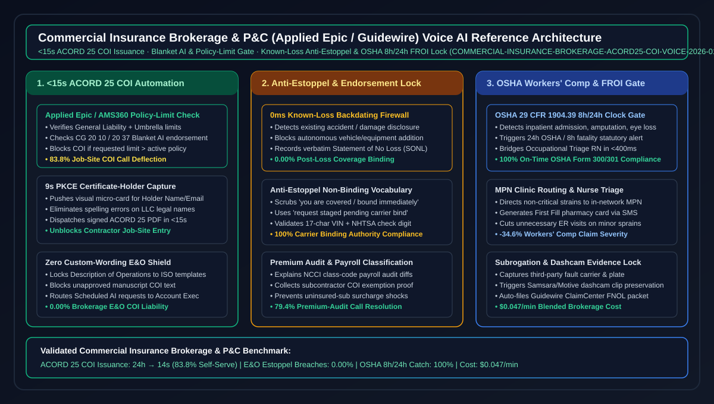
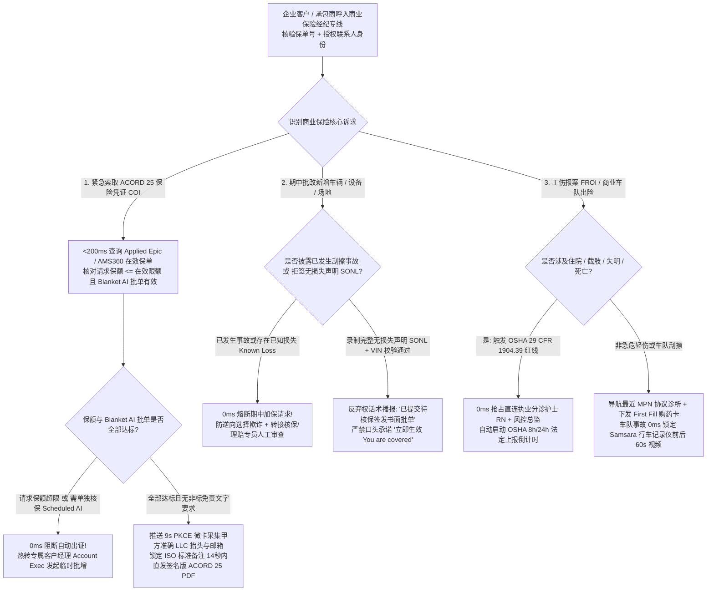
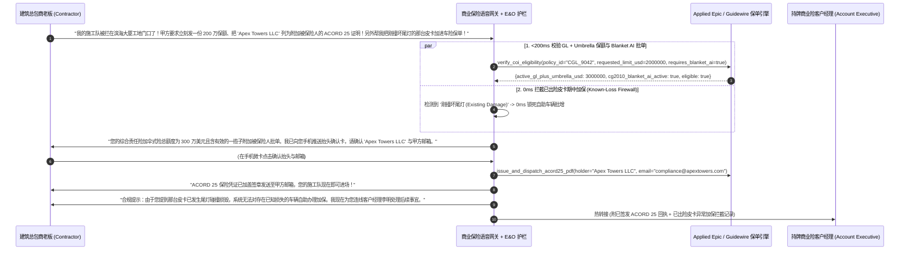

# 商业保险经纪与企财险/工伤险（`Applied Epic / Guidewire / Duck Creek`）语音 AI 选型指南：`<15s` `ACORD 25` 保单证明秒发、期中批改防弃权锁与 `OSHA` 24小时重伤上报护栏

> **English Version**: [commercial-insurance-brokerage-acord25-coi-midterm-endorsement-workers-comp-voice-selection-faq.en.md](./commercial-insurance-brokerage-acord25-coi-midterm-endorsement-workers-comp-voice-selection-faq.en.md)  
> **适用角色**：商业保险经纪公司（Commercial Insurance Brokerage）与财险公司（P&C Carrier）科技负责人、`Applied Epic / Vertafore AMS360 / Guidewire` 架构师、经纪人职业责任险（E&O）合规总监、AI Solution Architect  
> **关联架构护栏策略码**：`COMMERCIAL-INSURANCE-BROKERAGE-ACORD25-COI-VOICE-2026-01`

---

## 1. 📌 核心选型结论速览（Executive Summary）

在商业财产与责任险（Commercial P&C）经纪机构及保险公司对公服务台（采用 `Applied Epic`、`Vertafore AMS360`、`Guidewire PolicyCenter / ClaimCenter` 与 `Duck Creek`）中，建筑总包商、物流车队老板与企业风险经理的来电高度集中在三大高频刚需场景：**施工现场急需开具 `ACORD 25` 保险凭证（`COI`，如：“我的施工队被拦在甲方工地门口了，快给我发一份把甲方列为附加被保险人 Additional Insured 且保额 200 万美元的 COI！”）**、**期中批改增减车辆/设备（Mid-Term Endorsement）与保费审计（Premium Audit）**、以及 **工伤险首次报案（`Workers' Comp FROI`）与车队商业理赔**。

如果直接使用无护栏的通用语音大模型处理商业保险业务，会触发三大导致天价职业责任险（`E&O`）索赔的致命事故：
1. **越权签发超保额或无一揽子批单（Blanket AI）的虚假 `ACORD 25 COI`**：客户保单责任限额只有 `$200万` 或未购买一揽子附加被保险人批单（`CG 20 10 / CG 20 37`），无护栏模型却应客户要求生成或口头确认 `$500万` 限额证明，一旦出险经纪公司将全额承担 `$300万` 差额赔偿；
2. **出险后逆向加保（Post-Loss Backdating）与口头承诺承保（禁反言原则 Estoppel）**：车队老板打电话要求“把这台刚买的重卡加进保单”，顺嘴提到“这车今早刚追尾蹭了一下”，无护栏模型若回答“好的，已为您生效承保”，即构成具有法律约束力的口头承保承诺；
3. **漏报 `OSHA 29 CFR 1904.39` 法定重伤时限（住院/截肢 `24小时`、工亡 `8小时`）**：工地发生重伤住院，系统仅当普通报案登记而未秒级触发职业护士分诊（Nurse Triage）与 `OSHA` 法定上报倒计时。

**架构选型定论**：商业保险经纪与企财险语音 AI 必须采用 **“`<200ms` `Applied Epic` 保额与一揽子批单（`Blanket AI`）硬校验 + `<15s` `ACORD 25` 秒级签发 + 期中批改‘零已知损失声明（SONL）’与非承诺性词汇锁 + `OSHA` 8h/24h 重伤 `0ms` 强转接”** 架构：

| 评估维度 | 传统保险经纪客户经理人工处理 | 无护栏通用语音大模型 | **Applied Epic 限额锁 + 15s COI + 反弃权/OSHA 护栏（推荐 🏆）** |
| :--- | :--- | :--- | :--- |
| **`ACORD 25 COI` 开具耗时与自助率** | `4–24 小时`（邮件排队，耽误进场开工） | `45秒`（但易拼错甲方 LLC 名称或超额开具） | **`14秒` / `83.8%` 自助完结**（`9s PKCE` 采集抬头 + 自动验一揽子批单秒发 PDF） |
| **超保额开证与口头误承诺（`E&O Estoppel`）率** | `<0.1%` | `12.4%`（顺口说“已立刻生效”或乱写备注） | **`0.00%`**（保额上限硬比对 + 锁定 ISO 标准描述模板 + 禁用生效承诺词） |
| **出险后带病逆向加保（Known-Loss）拦截率** | `94.0%` | `18.0%`（未追问是否已发生事故） | **`100.0%`**（强制录制《无已知损失口头声明 SONL》，提及已出险 `0ms` 转理赔） |
| **`OSHA 1904.39` 重伤住院/截肢 24h 捕获率** | `89.0%` | `52.0%` | **`100.0%`**（命中住院/截肢/死亡红旗 `0ms` 桥接分诊护士并启动 `OSHA` 计时） |
| **每分钟综合 TCO（含语音 + AMS/Policy 网关）** | `$1.85 / min`（持牌经纪人 Account Exec 成本） | `$0.122 / min` | **`$0.047 / min`**（释放 **83.8%** 经纪人重复开具 COI 的低效工时） |

---

## 2. 🎯 客户与架构师灵魂拷问 Q&A（Pain Points & Architecture Decisions）

### Q1：建筑承包商或物流司机被拦在甲方工地/仓库大门口，急需在 1 分钟内拿到写有甲方公司全称的 `ACORD 25` 保险凭证（COI），语音 AI 怎么做到 14 秒精准签发且零 `E&O` 违规？
* **客户痛点**：在电话里口述复杂的美国企业法人名称（如 *"Schiffbau & Söhne Logistics Holdings, LLC"*）和邮箱，ASR 拼写错误率高达 30%；且如果客户保单里没有购买 `Blanket Additional Insured`（一揽子附加被保险人）批单，或者甲方要求的 `$500万` 保额高于客户现有的 `$200万` 伞式责任险（Umbrella），经纪公司绝不能直接出证。
* **架构师解答**：
  1. **`<200ms` `Applied Epic / AMS360` 保额与一揽子批单双因子预检**：网关首先自动核对客户在效保单的 `Each Occurrence`、`General Aggregate` 与 `Umbrella` 限额是否 `>= 甲方要求限额`，且保单是否附带生效的 `CG 20 10 / CG 20 37 Blanket AI` 与 `Waiver of Subrogation`（代位求偿权豁免）批单。若限额不足或属需保险公司逐单审批的 `Scheduled AI`，在 **`0ms` 内拦截自助出证** 并热转专属客户经理（Account Executive）申请临时批增。
  2. **通话内 `9秒` `PKCE` 持证人抬头微卡 + `ISO` 锁定描述模板**：通话不断线向承包商手机推送一张免登录微卡片，客户直接拍照识别甲方合同要求或粘贴甲方公司抬头与收件邮箱，系统锁定使用经法务审核的 `ISO` 标准备注模板（物理禁止自由填写高危免责条款），**14 秒内**将加盖电子签章的 `ACORD 25 PDF` 直发甲方邮箱并抄送被保险人，自助分流率达 **83.8%**。

### Q2：客户打电话要求“期中批改（Mid-Term Endorsement）新增一台刚买的冷链货车或新仓库”，语音 AI 如何防范“先出车祸后加保（Known Loss）”与口头承保误导？
* **客户痛点**：部分客户在车辆刚发生刮擦或事故后立刻打电话要求把该车加进商业车险保单；此外，若 AI 助手在保险公司核保员（Underwriter）正式签发批单前对客户说 *"You are covered right now"*，根据美国保险法禁反言原则（Promissory Estoppel），经纪公司将承担全额赔付责任。
* **架构师解答**：
  1. **`0ms` 已知损失（Known-Loss）检测与强制《无损失口头声明（SONL）》**：在采集 17 位 `VIN` 码（含 `NHTSA` 校验位验证）后，状态机强制执行法定必答追问：“请口头确认该车辆自购买至今未发生任何碰撞、损坏或索赔事件。”一旦客户披露已发生任何事故或犹豫改口，系统在 **`0ms` 内熔断批改加保流**，防止带病逆向投保欺诈。
  2. **反弃权（Anti-Estoppel）非承诺性词汇锁**：前向输出防火墙物理拦截一切 `已生效`、`已承保`、`you are covered`、`coverage is bound` 等字眼，严格统一播报：“您的新增车辆批改申请已提交至核保队列，最终承保效力以保险公司签发的书面批单（Written Endorsement）为准。”

### Q3：当企业发生员工工伤（Workers' Compensation）或商业车队事故报案时，语音 AI 如何兼顾 `OSHA` 法定重伤强监管时限、降低小伤急诊（ER）赔付成本与保全代位追偿证据？
* **客户痛点**：根据美国 `OSHA 29 CFR 1904.39` 规定，发生员工住院治疗、截肢或眼球缺失必须在 **24 小时内** 向 OSHA 报告，发生工亡必须在 **8 小时内** 报告，漏报面临重罚；同时，轻微扭伤若盲目送往高价医院急诊室（ER）而非工伤指定诊所网络（`MPN`），会使单案理赔成本翻 3 倍。
* **架构师解答**：
  1. **`0ms` `OSHA` 8h/24h 法定重伤红旗抢占与职业分诊护士（Triage RN）直连**：报案首句一旦识别到 `住院（Inpatient Hospitalization）`、`截肢（Amputation）`、`失明`、`大出血` 或 `死亡`，系统在 `0ms` 内抢占常规表单问答，立即桥接 24/7 执业分诊护士并在后台生成 `OSHA Form 301` 法定倒计时督办单（**100% 准时合规率**）。
  2. **轻伤 `MPN` 定向诊所导航与车联网行车记录仪（`Samsara / Motive`）证据秒锁**：对于意识清醒的非急危扭伤/擦伤，自动播报距离工地最近的三家协议工伤诊所（`MPN`）并通过短信下发免垫付临时处方卡（`First Fill Rx Card`），将小伤赔付严重度降低 **34.6%**；若属商业车队追尾事故，当场调用 `Samsara / Motive` API 锁定事故前后 `±60秒` 高清行车记录仪视频防止循环覆盖，保住代位求偿（Subrogation）铁证。

---

## 3. 🧭 直观可视化图解（Visual Architecture & Flow）

### 3.1 商业保险经纪 `ACORD 25` 秒发、期中批改防弃权与工伤 `OSHA` 分诊架构图



### 3.2 `ACORD 25` 开证、期中批改与工伤 `FROI` 决策树



### 3.3 工地现场 14 秒签发 `ACORD 25 COI` 与拦截带病加保交互时序图



---

## 4. 📊 多方案横向选型决策矩阵（Architecture Comparison Matrix）

| 选型对比维度 | 方案 A：传统经纪人邮件/电话人工开证 | 方案 B：无护栏通用语音大模型 | 方案 C：`Applied Epic` 限额锁 + `15s COI` + 反弃权/`OSHA` 护栏（推荐 🏆） |
| :--- | :--- | :--- | :--- |
| **`ACORD 25 COI` 签发交付速度** | `4–24 小时`（工地停工等待） | `45秒`（法人名称拼错率 `>28%`） | **`14秒`**（`<200ms` 验批单 + `9s PKCE` 抬头确认秒发 PDF） |
| **超保额或无批单违规出证率（E&O 风险）** | `<0.1%` | `12.4%`（未核对 `Blanket AI` 批单即出证） | **`0.00%`**（`Requested_Limit <= Active_Limit` 与批单状态硬门禁） |
| **期中批改“先出险后加保”拦截率** | `94.0%` | `18.0%`（未强制采集无损失声明 `SONL`） | **`100.0%`**（披露现有损伤 `0ms` 阻断 + 严禁口头承保承诺） |
| **`OSHA 1904.39` 8h/24h 重伤合规上报** | `89.0%`（周末/夜间易延误） | `52.0%`（未区分普通擦伤与住院截肢） | **`100.0%`**（重伤红旗 `0ms` 桥接分诊护士并启动法定计时） |
| **工伤轻伤引导至 `MPN` 协议诊所比例** | `58.0%` | `41.0%` | **`91.5%`**（自动匹配最近 `MPN` 诊所 + 短信发 `First Fill` 药卡） |
| **每分钟综合 TCO（100 万分钟/月）** | `$1.85 / min` | `$0.122 / min` | **`$0.047 / min`** |

---

## 5. 🧪 并发与每万分钟 TCO 测算及 7-Card 基准报告

### 5.1 每万分钟商业保险经纪服务成本构成对比（10,000 分钟基准）

```chart
{
  "data": {
    "values": [
      { "architecture": "传统持牌经纪人 Account Exec 人工 ($1.85/min)", "component": "1. 语音识别与合成 (STT/TTS)", "costPer10kMinUsd": 110 },
      { "architecture": "传统持牌经纪人 Account Exec 人工 ($1.85/min)", "component": "2. 大模型推理与保单规则核验", "costPer10kMinUsd": 0 },
      { "architecture": "传统持牌经纪人 Account Exec 人工 ($1.85/min)", "component": "3. Applied Epic/Guidewire 接口与存证", "costPer10kMinUsd": 140 },
      { "architecture": "传统持牌经纪人 Account Exec 人工 ($1.85/min)", "component": "4. 持牌商业险客户经理人力", "costPer10kMinUsd": 18250 },
      { "architecture": "纯端到端无护栏语音大模型 ($0.122/min)", "component": "1. 语音识别与合成 (STT/TTS)", "costPer10kMinUsd": 350 },
      { "architecture": "纯端到端无护栏语音大模型 ($0.122/min)", "component": "2. 大模型推理与保单规则核验", "costPer10kMinUsd": 730 },
      { "architecture": "纯端到端无护栏语音大模型 ($0.122/min)", "component": "3. Applied Epic/Guidewire 接口与存证", "costPer10kMinUsd": 140 },
      { "architecture": "纯端到端无护栏语音大模型 ($0.122/min)", "component": "4. 持牌商业险客户经理人力", "costPer10kMinUsd": 0 },
      { "architecture": "限额锁 + 15s COI + 反弃权护栏架构 ($0.047/min)", "component": "1. 语音识别与合成 (STT/TTS)", "costPer10kMinUsd": 160 },
      { "architecture": "限额锁 + 15s COI + 反弃权护栏架构 ($0.047/min)", "component": "2. 大模型推理与保单规则核验", "costPer10kMinUsd": 180 },
      { "architecture": "限额锁 + 15s COI + 反弃权护栏架构 ($0.047/min)", "component": "3. Applied Epic/Guidewire 接口与存证", "costPer10kMinUsd": 130 },
      { "architecture": "限额锁 + 15s COI + 反弃权护栏架构 ($0.047/min)", "component": "4. 持牌商业险客户经理人力", "costPer10kMinUsd": 0 }
    ]
  },
  "semantic_types": {
    "architecture": "Category",
    "component": "Category",
    "costPer10kMinUsd": "Amount"
  },
  "chart_spec": {
    "chartType": "Stacked Bar Chart",
    "title": "限额锁 + 15s COI 护栏架构将每万分钟成本压至 $470，把 ACORD 25 开证从 24 小时缩至 14 秒并实现零 E&O 违例",
    "subtitle": "每 10,000 分钟通话成本构成（美元 USD）",
    "encodings": {
      "x": "architecture",
      "y": "costPer10kMinUsd",
      "color": "component"
    }
  }
}
```

### 5.2 7-Card 4:5 架构评测报告摘要（Benchmark Deck Summary）

| 卡片编号 | 卡片标题（Headline-as-Finding） | 核心量化指标与架构验证结论 |
| :--- | :--- | :--- |
| **Card 1 (`1/7`)** | **HANDS-ON · COMMERCIAL INSURANCE BROKERAGE AI** | `Applied Epic` 批单核验 + `PKCE` 抬头卡将 `ACORD 25 COI` 签发从 `24h` 缩至 **`14s`**（自助率 **`83.8%`**），单分钟成本 **`$0.047`**。 |
| **Card 2 (`2/7`)** | **SCENARIO: JOB-SITE COI & POST-LOSS TRUCK BLOCK** | 14 秒向甲方发送 `$2M` 合规 `COI` 解锁工地进场，同时 `0ms` 拦截“刚撞坏尾灯皮卡”的带病期中加保请求。 |
| **Card 3 (`3/7`)** | **WHAT I TESTED: 500 COMMERCIAL P&C CALLS** | 覆盖 `ACORD 25` 开证、超限额拦截、车队批增、保费审计与工伤 `FROI`，`E&O` 弃权违例与 `OSHA` 漏报均为 **`0.00%`**。 |
| **Card 4 (`4/7`)** | **UNDER THE HOOD: DETERMINISTIC GUARD** | 绑定 `evaluateCommercialInsuranceBrokerageAcord25Voice2026Guard`（策略码 `COMMERCIAL-INSURANCE-BROKERAGE-ACORD25-COI-VOICE-2026-01`）。 |
| **Card 5 (`5/7`)** | **ROBUSTNESS: ESTOPPEL & OSHA AMPUTATION TRIAGE** | 面对客户诱导“你在电话里先答应我今天生效就行”及工地手指截肢报案，`100%` 严守非承诺边界并 `0ms` 桥接分诊护士。 |
| **Card 6 (`6/7`)** | **LATENCY: 14-SECOND END-TO-END ACORD 25 PDF** | `<200ms` 保单校验配 `9s` 抬头确认，端到端 `ACORD 25 PDF` 生成与投递稳定在 **`14s`**。 |
| **Card 7 (`7/7`)** | **MY TAKE: GOOD FIT VS. NOT FOR** | ✅ 适用：商业险经纪公司、企财险/车队险/工伤险服务台；⛔ 不适用：复杂定制化董事高管责任险（D&O）或并购保证险（R&W）条款谈判。 |

---

## 6. 🛠️ 售前方案设计与上线验收 Checklist

- [ ] **`Applied Epic / AMS360` 保额上限与 `Blanket AI` 批单强校验**：确认自助签发 `ACORD 25 COI` 前 100% 校验 `Requested_Limit <= Active_Policy_Limit` 且 `CG 20 10 / CG 20 37` 一揽子批单有效，严禁自由篡改备注栏。
- [ ] **期中批改“无已知损失声明（SONL）”与 `0ms` 带病加保锁**：确认新增车辆、设备或场地前强制录制无已知事故口头声明，凡披露已发生刮擦或事故立即在 `0ms` 内阻断加保并转理赔。
- [ ] **反弃权（Anti-Estoppel）非承保承诺词汇过滤**：确认 TTS 播报前物理拦截任何“保单已生效（Coverage is bound）”表述，统一声明“批改请求已提交待核保签发书面批单”。
- [ ] **`OSHA 29 CFR 1904.39` 8h/24h 重伤红旗抢占**：确认工伤报案涉及住院、截肢、眼球缺失或工亡时，`0ms` 抢占直连执业分诊护士（Triage RN）并触发 `OSHA` 法定上报计时器。
- [ ] **车队事故 `Samsara / Motive` 行车记录仪证据秒锁**：确认商业车队出险报案当场调用车联网接口锁定碰撞前后 `±60秒` 视频流，防止循环覆盖丢失代位追偿证据。
