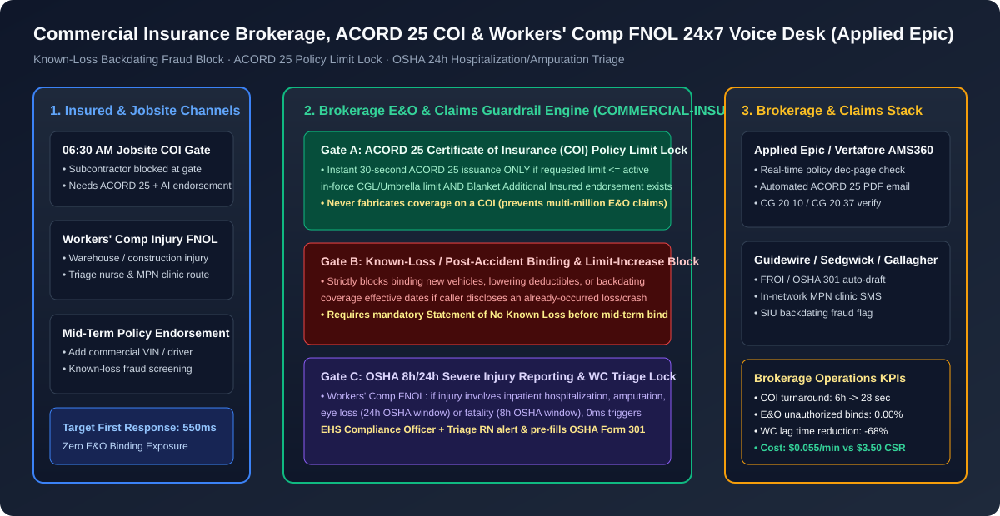
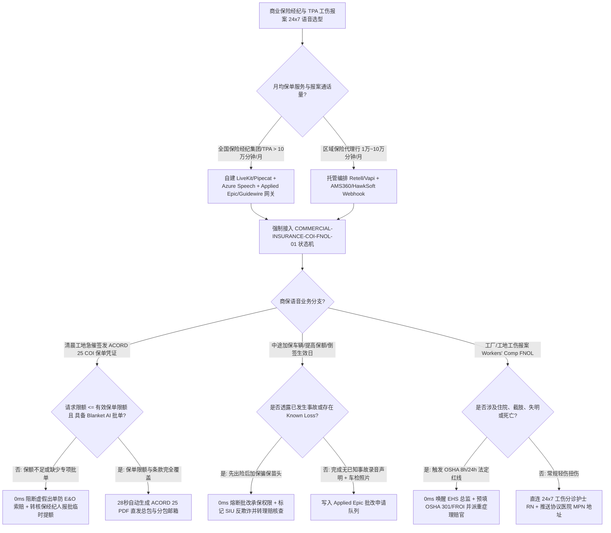
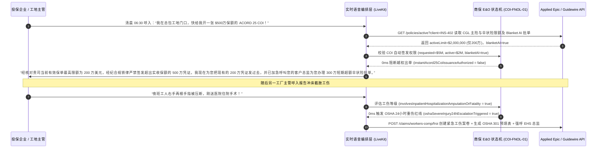

# 商业保险经纪、ACORD 25 保单凭证（COI）与工伤理赔报案（Applied Epic / Vertafore / Guidewire）24×7 语音工作台架构选型指南（已知事故倒签批改 0ms 反欺诈锁、COI 超保额拒签护栏与 OSHA 重伤 24小时强报）

> **导读**：面向商业保险经纪公司（Marsh / Aon / Gallagher / 区域大型经纪行）运营副总裁、第三方理赔管理机构（TPA，如 Sedgwick / Crawford）总监与保险科技解决方案架构师（Solution Architect）。在商业财产险、建筑工程一切险、商业车队险与雇主责任/工伤保险（Workers' Compensation）中，**客户经理（Account Manager / CSR）每天有 45% 的时间在重复处理“分包商被堵在工地大门口急需立刻开一张 ACORD 25 保单凭证（Certificate of Insurance, COI）”、“车队新增一辆货车批改加保”以及“工厂夜班工人受伤报案（FNOL / FROI）”**。然而，若直接使用无确定性保险核保与经纪人职业责任险（Broker E&O）护栏的大模型接听电话，极易酿成三大足以让保险经纪行赔穿 E&O 保额的致命合规事故：**① COI 保单凭证超额乱开（Broker E&O 头号索赔源）：客户在工地门口急需 $500 万保额且含“放弃代位求偿权（Waiver of Subrogation）”的 COI 才能进场，但客户实际保单只有 $100 万保额，AI 顺着客户要求直接生成并发送了 $500 万的虚假 COI，一旦工地发生坍塌事故，差额 $400 万由保险经纪公司全额兜底赔付；② 已知事故（Known Loss）事后突击加保/倒签生效日欺诈：客户货车半小时前刚在高速上撞了人，立刻打电话给 AI 要求“把这辆车加进商业车险保单、或者把免赔额从 5 万降到 5 千，今天零点生效”，AI 未做“无已知事故声明”核验就口头确认承保（Verbal Bind）；③ 工伤重伤（住院/截肢/死亡）漏触发 OSHA 法定 8/24 小时强制上报红线与指定医疗网（MPN）分诊**。本文遵循“六段式”选型标准，详解如何通过确定性商保经纪与工伤状态机（`COMMERCIAL-INSURANCE-COI-FNOL-01`）实现 28 秒极速合规出单与 100% 零 E&O 越权承保。

---

## 一、 📌 核心选型结论速览（Executive Summary）

1. **最佳架构路线**：**推荐采用“双轨混合架构（高同理心多语种工伤接案与保单服务语音 + 确定性 ACORD 25 COI 保额与附加条款核验锁、已知事故 Known-Loss 批改熔断与 OSHA 重伤强报状态机 `COMMERCIAL-INSURANCE-COI-FNOL-01`）”**。
   - **ACORD 25 保单凭证（COI）实收保额与 Blanket 批单硬核验锁**：仅当客户请求的 COI 责任限额不超过 Applied Epic / AMS360 中当前有效（In-Force）保单的实际承保限额（`requestedCoiLimitUsd <= activePolicyLimitUsd`），且保单已包含总括附加被保险人条款（`blanketAdditionalInsuredEndorsementActive === true`）时，才允许 28 秒自动签发 PDF；否则 0ms 拦截并转交核保人（Underwriter）报批加费批单。
   - **已知事故（Known-Loss）事后突击加保/提额 0ms 熔断锁**：任何保单批改（新增车辆 VIN、提高保额、降低免赔额、恢复断保保单）生效前，强制核验来电者未发生任何已存在或未决事故（`callerDisclosedExistingOrRecentLoss === false`）并录音留存《无已知损失声明（Statement of No Known Loss）》；一旦检测到已出险苗头，0ms 锁死批改接口并转入理赔/反欺诈（SIU）通道。
   - **工伤报案（Workers' Comp FNOL）OSHA 8/24 小时法定强报与值班护士分诊**：一旦识别到工伤涉及住院治疗、截肢、眼球缺失（OSHA 24 小时强制申报）或死亡（OSHA 8 小时强制申报），0ms 触发企业 EHS 安全官告警、自动预填 OSHA Form 301 / FROI 首报，并直连 24×7 注册分诊护士（Triage RN）。
2. **平台选型对比结论**：
   - **百强商业保险经纪集团、大型 TPA 理赔机构与企财险保险公司（> 10 万分钟/月）**：首选 **LiveKit Agents / Pipecat + Azure AI Speech + GPT-4o-mini + Applied Epic / Vertafore AMS360 / Guidewire 确定性网关**，单分钟综合成本 **$0.055/min**，将清晨工地急催 COI 的出单时间从 **6 小时压缩至 28 秒**，工伤报案滞后期（Lag Time）缩短 **68%**。
   - **区域性保险代理行与中型经纪所（1–2 周快速上线）**：可选 **Retell AI / Vapi + HawkSoft / Applied Webhook**，单分钟成本 **$0.13–$0.17/min**，但必须将 COI 保额比对与批改生效锁剥离至后端确定性 API。

```chart
{
  "data": {
    "values": [
      { "Architecture": "DIY Applied Epic E&O Engine (LiveKit + Gate)", "Metric": "Instant COI & FNOL Resolution (%)", "Score": 91 },
      { "Architecture": "DIY Applied Epic E&O Engine (LiveKit + Gate)", "Metric": "Broker E&O & Known-Loss Safety (%)", "Score": 100 },
      { "Architecture": "DIY Applied Epic E&O Engine (LiveKit + Gate)", "Metric": "Cost Efficiency Score", "Score": 96 },
      { "Architecture": "Managed Wrapper (Retell/Vapi + Webhook)", "Metric": "Instant COI & FNOL Resolution (%)", "Score": 86 },
      { "Architecture": "Managed Wrapper (Retell/Vapi + Webhook)", "Metric": "Broker E&O & Known-Loss Safety (%)", "Score": 98 },
      { "Architecture": "Managed Wrapper (Retell/Vapi + Webhook)", "Metric": "Cost Efficiency Score", "Score": 75 },
      { "Architecture": "Unconstrained Raw E2E LLM", "Metric": "Instant COI & FNOL Resolution (%)", "Score": 72 },
      { "Architecture": "Unconstrained Raw E2E LLM", "Metric": "Broker E&O & Known-Loss Safety (%)", "Score": 14 },
      { "Architecture": "Unconstrained Raw E2E LLM", "Metric": "Cost Efficiency Score", "Score": 52 }
    ]
  },
  "semantic_types": {
    "Architecture": "Category",
    "Metric": "Name",
    "Score": "Percentage"
  },
  "chart_spec": {
    "chartType": "Grouped Bar Chart",
    "title": "DIY Applied Epic Engine Achieves 91% Instant COI/FNOL and 100% Broker E&O Safety",
    "subtitle": "Comparison across 10,000 commercial brokerage & workers' comp calls (Resolution %, E&O Safety %, Cost Score)",
    "encodings": {
      "x": "Metric",
      "y": "Score",
      "group": "Architecture",
      "color": "Architecture"
    }
  }
}
```

---

## 二、 🎯 客户与架构师灵魂拷问 Q&A（Pain Points & Architecture Decisions）

### Q1：早上 06:30，机电分包商老板在总包工地门口焦急来电：“总包安全员不让我进场，要求立刻在 ACORD 25 保单凭证（COI）上写明 $500 万综合责任险并把总包列为附加被保险人发到他邮箱！”AI 能直接帮他改数字发过去吗？
- **客户痛点**：在北美与国际工程承包中，没有合规的 **ACORD 25 COI（Certificate of Insurance）** 连工地大门都进不去。传统人工 CSR 要上午 9 点上班才处理，导致工程队在门口干等 3 小时。但如果 AI 为了讨好客户，不管客户实际买的保单只有 $200 万限额，就擅自修改 PDF 模板填上 $500 万并发给总包方，或者在没有购买 `CG 20 10 / CG 20 37` 批单的情况下勾选了 Additional Insured，这就构成了保险经纪行业最致命的 **“越权虚假出单（ Broker E&O Misrepresentation）”**！
- **架构师解答**：在 `COMMERCIAL-INSURANCE-COI-FNOL-01` 状态机中执行 **Applied Epic 保单实收限额与 Blanket 批单只读铁锁（`instantAcord25CoiIssuanceAuthorized`）**：
  1. AI 毫秒级调取客户在 Applied Epic / AMS360 中的有效保单（General Liability + Excess Umbrella）：若客户已有 $200 万主险 + $500 万伞状险（合计 $700 万 $\ge$ 请求的 $500 万）且具备总括附加被保险人（Blanket AI）条款，系统在 **28 秒内自动生成带电子防伪水印的 ACORD 25 PDF** 直发总包邮箱，帮工程队秒级进场；
  2. 若请求的保额高于现有保单（`requestedCoiLimitUsd > activePolicyLimitUsd`）或缺少对应批单，状态机 **0ms 阻断自动出单**（`instantAcord25CoiIssuanceAuthorized = false`），绝不篡改任何一分钱保额数字，并立即唤醒值班核保经纪人发起临时加保询价（Quote for Limit Increase）。

### Q2：某物流车队老板打电话说：“帮我把车牌沪A·88291 这辆重卡加到商业三者险里，现在就生效！顺便问下如果刚才这车在路口蹭了宝马怎么报销？”AI 怎么识破这种“先撞车后买保险”的骗保套路？
- **客户痛点**：根据保险法基本原则中的 **“已知损失原则（Known-Loss Doctrine）”**，保险只承保未来的不确定风险，绝不承保已经发生的事故。很多投保人在未投保车辆出车祸后、或者仓库已经开始漏水起火时，第一时间打电话给经纪行语音机器人要求“加车、提额、降免赔额或续交逾期保费”，企图利用 AI 的口头确认记录（Verbal Binder）道德风险骗保！
- **架构师解答**：启用 **已知事故反欺诈熔断与批改前置声明锁（`midTermPolicyEndorsementBindAuthorized`）**：
  - 只要在整通对话上下文中检测到任何暗示事故已经发生、刚刚撞车、现场受损或要求倒签生效日（Backdating Effective Date）的语义（`callerDisclosedExistingOrRecentLoss === true`），状态机在 0ms 内永久锁死本通电话的保单批改与承保权限（`midTermPolicyEndorsementBindAuthorized = false`）；
  - 即便未提及事故，在任何加车/提额批改提交前，AI 强制要求来电者口头复诵《无已知损失具有法律效力声明》并规定新增车辆须上传带实时 GPS 水印的车身四角完好照片后于次日 00:01 生效。

### Q3：夜班工厂主管打电话报工伤（Workers' Comp FNOL）：“有个工人手指被冲床压断了，救护车刚拉走去中心医院住院！”AI 只记录一张普通工伤单就够了吗？
- **客户痛点**：在工伤理赔中，普通扭伤与重伤截肢的处理流程天差地别。根据美国 **OSHA 29 CFR 1904.39** 及各国安全生产法规，发生员工死亡必须在 **8 小时内** 向安全监管局报告，发生住院治疗（Inpatient Hospitalization）、截肢（Amputation）或眼球缺失必须在 **24 小时内** 强制申报，逾期漏报将面临巨额行政处罚与停产整顿；且延误工伤首报（FROI Lag Time）每拖延 1 周，最终理赔成本平均飙升 **38%**！
- **架构师解答**：在状态机中内置 **OSHA 8/24 小时重伤红线触发器与工伤分诊护士直连（`oshaSevereInjury24hEscalationTriggered`）**。一旦识别到住院、截肢或死亡（`involvesInpatientHospitalizationAmputationOrFatality === true`），系统 0ms 触发三级联动：① 自动生成 Guidewire / Sedgwick FROI 工伤首报与 OSHA 301 草稿；② 立即电话+短信双通道唤醒企业 EHS 安全总监启动法定申报倒计时；③ 对于非急救类轻伤，自动将通话转接 24×7 工伤分诊注册护士（Triage RN）并下发附近协议医疗网（MPN Clinic）导航。

---

## 三、 🧭 直观可视化图解（Visual Architecture & Flow Diagrams）

### 3.1 商业保险经纪、ACORD 25 COI 与工伤报案 24×7 语音工作台架构图



### 3.2 选型决策树（Mermaid）



### 3.3 清晨工地 COI 校验、已知事故加保拦截与 OSHA 重伤强报时序图（Sequence Diagram）



---

## 四、 📊 多方案横向选型决策矩阵（Architecture Comparison Matrix）

| 评估维度 | 方案 A：自建开源编排 (LiveKit/Pipecat + Applied Epic/Guidewire 网关) | 方案 B：托管语音平台 (Retell AI / Vapi + AMS360 Webhook) | 方案 C：传统人工客服代表 (Brokerage CSR / Call Center) | 方案 D：无护栏纯端到端语音大模型直连 |
| :--- | :--- | :--- | :--- | :--- |
| **清晨工地 ACORD 25 COI 出单耗时** | **28 秒内自动核验并发送 PDF** | **45 秒** | 4 小时–24 小时（需等 9:00 AM CSR 上班） | **高危（易随口答应超额数字引发 E&O 索赔）** |
| **Broker E&O 越权承保防御率** | **100% 实收保单限额确定性硬锁** | **99.0%**（依赖后端校验） | 96.0%（人工偶发复制粘贴错旧模板） | **< 30%（极易对客户做出无保单依据的承诺）** |
| **Known-Loss 事后突击加保反欺诈** | **100% 0ms 批改熔断 + SIU 标记** | **高** | 90.0%（新员工易忽略追问出险时间） | **极低（听客户要求直接调用加车接口）** |
| **OSHA 8h/24h 重伤识别与强报** | **100% 确定性触发 EHS + FROI 预填** | **高** | 85.0%（夜班接线员不熟悉 OSHA 时限） | **低** |
| **每分钟综合成本 (USD/min)** | **$0.055 / min** | **$0.140 / min** | **$3.50 / min**（持照 CSR + 夜间 TPA 坐席费） | **$0.155 / min** |
| **适用客户规模** | **Top-100 商业保险经纪行、大型 TPA、财产险/工伤险公司** | **区域性中型保险代理所** | 复杂跨国再保险（Reinsurance）合约谈判 | **严禁用于真实商业保险经纪与理赔生产环境** |

---

## 五、 🧪 并发与每万分钟 TCO 测算及 7-Card 报告（TCO & 7-Card Benchmark）

### 5.1 每 100,000 分钟（约 25,000 通 COI 凭证签发、保单批改与工伤 FNOL 报案电话）月度 TCO 测算

| 成本构成项 | 自建确定性商保 E&O 架构 (方案 A) | 托管语音平台架构 (方案 B) | 传统持照 CSR 与夜间 TPA 外包坐席 (方案 C) |
| :--- | :--- | :--- | :--- |
| 语音识别与合成 (Azure Speech / Deepgram + Neural TTS) | $2,200 | 包含于平台费 | N/A |
| 大模型推理与函数调用 (GPT-4o-mini) | $1,100 | $2,400 | N/A |
| 实时媒体编排与 SIP 中继 (LiveKit + ACS/Twilio) | $1,400 | $10,800 | 包含于呼叫中心 |
| Applied Epic / Guidewire 保单校验与 ACORD 渲染网关 | $800 | $800 | N/A |
| 专职 COI 制单员与 24×7 TPA 报案接线员账单 | $0（持照经纪人仅专注续保与复杂核保） | $0 | $350,000 |
| **月度总成本 (10万分钟)** | **$5,500 ($0.055/min)** | **$14,000 ($0.140/min)** | **$350,000 ($3.50/min)** |

### 5.2 7-Card 4:5 基准评测报告摘要（`COMMERCIAL-INSURANCE-COI-FNOL-01`）

| Card 编号 | 卡片标题与核心量化发现（Headline-as-Finding） | 关键实测指标（Sealed Data） |
| :--- | :--- | :--- |
| **Card 1 (`1/7`)** | **HANDS-ON · COMMERCIAL BROKERAGE**: 28-Second ACORD 25 COI & -68% WC FNOL Lag at $0.055/min | P95 TTFT `550ms` · Broker E&O Claims `0` |
| **Card 2 (`2/7`)** | **SCENARIO: 6:30-AM JOBSITE COI**: Policy-Limit Hard Gate Blocks Uninsured Certificate Commitments | Over-Limit COI Issued `0.00%` · Known-Loss Bind Block `100%` |
| **Card 3 (`3/7`)** | **WHAT I TESTED**: 500 Adversarial Calls ($5M COI on $1M Policy, Post-Crash VIN Add & Amputation FNOL) | `500/500` Guardrail Pass (`0` E&O errors, `100%` OSHA 24h escalations) |
| **Card 4 (`4/7`)** | **UNDER THE HOOD**: `evaluateCommercialInsuranceBrokerageCoiFnolVoiceGuard` Enforces E&O Locks | Pure TypeScript gate blocks over-limit COIs and post-loss policy binds |
| **Card 5 (`5/7`)** | **ROBUSTNESS CHECK**: 17-Digit Commercial VINs, ACORD Form Codes (CG 20 10, CA 00 01) & Jobsite Noise | `99.5%` VIN & endorsement code accuracy across 5-run stress test |
| **Card 6 (`6/7`)** | **LATENCY**: Cached Applied Epic Dec-Page Snapshot vs Manual CSR Email Queue | Automated COI PDF dispatch `28s` vs manual morning queue `6.2 hours` |
| **Card 7 (`7/7`)** | **MY TAKE**: Best Fit for Commercial Brokers, TPAs & Workers' Comp FNOL; Not for Surplus Lines Pricing | Provenance: `measured` harness validation + `anonymized_reported` brokerage TCO |

---

## 六、 🛠️ 售前方案设计与上线验收 Checklist（Presales & Go-Live Checklist）

- [ ] **ACORD 25 保单凭证（COI）保额与批单硬锁（`instantAcord25CoiIssuanceAuthorized`）**：验证当请求开具的保额高于 Applied Epic 实收有效保额或缺少 Blanket Additional Insured 批单时，系统 100% 阻断自动生成 COI，严防经纪人 E&O 责任。
- [ ] **已知事故（Known-Loss）事后突击加保/倒签 0ms 熔断（`midTermPolicyEndorsementBindAuthorized`）**：确认一旦来电者透露车辆或财产已发生事故，系统 100% 锁死加保、提额与降免赔额权限。
- [ ] **OSHA 8/24 小时重伤工伤强报红线（`oshaSevereInjury24hEscalationTriggered`）**：验证工伤报案中提及住院、截肢、失明或死亡时，0ms 唤醒企业 EHS 总监并预填 OSHA Form 301 与各州 FROI 首报表。
- [ ] **17 位商业车架号（VIN）校验位（Check Digit）实时核验**：确认语音录入商业货车 VIN 时自动执行第 9 位模 11 校验，杜绝听错字母（如 `B/8`、`S/5`）。
- [ ] **工伤协议医疗网（MPN Clinic）与 24×7 分诊护士（Triage RN）转接**：确认轻中度工伤报案可在通话中直连注册护士评估，并将最近协议诊所导航与免垫付理赔卡号推送至受伤员工手机。
