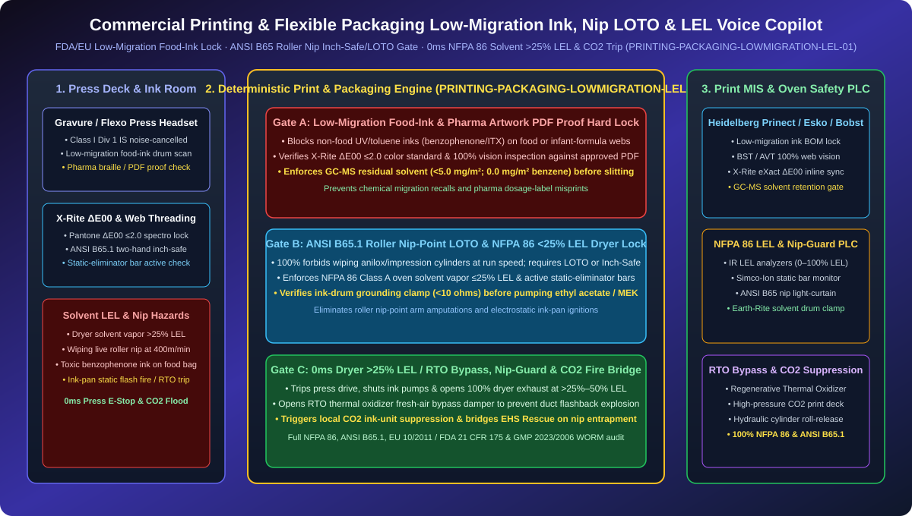
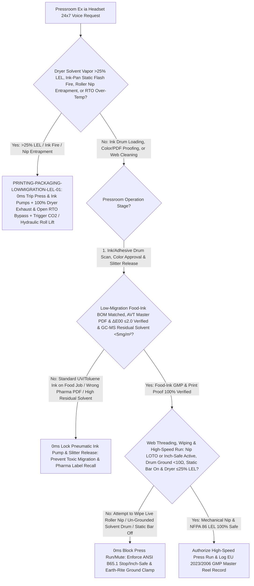
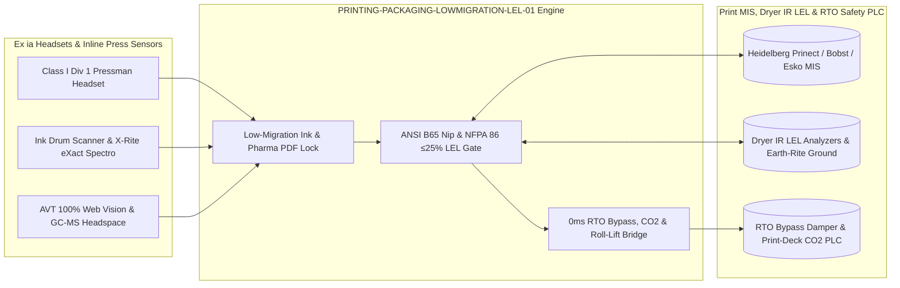
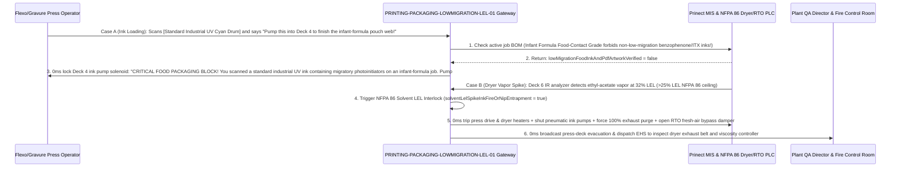

# Commercial Printing & Flexible Packaging Low-Migration Ink, Nip LOTO & LEL Voice Copilot (Amcor / Berry Global / Bobst / Heidelberg Prinect): Food-Ink Migration Lock, ANSI B65 Nip Gate & 0ms NFPA 86 Solvent >25% LEL Selection Guide

> **Document Scope**: Written for Global Flexible Packaging, Pharmaceutical Blister/Carton & Commercial Printing Manufacturers (`Amcor` / `Berry Global` / `Sealed Air` / `Graphic Packaging` / `Constantia Flexibles`), Press Automation Engineers (`Bobst` / `Windmöller & Hölscher` / `Heidelberg Prinect` / `Esko`), and Industrial AI Solution Architects designing **Class I Division 1 Intrinsically Safe Press-Deck Voice Copilots, FDA 21 CFR 175 / EU 10/2011 Low-Migration Food-Ink & GC-MS Residual-Solvent Gatekeepers, ANSI B65.1 Roller Nip-Point LOTO Locks, and 0ms NFPA 86 Dryer Solvent $>25\%\text{ LEL}$ / RTO Bypass / $\text{CO}_2$ Fire Suppression Pipelines**.

---

## 1. 📌 Executive Summary

On high-speed rotogravure, flexographic, and offset packaging presses running at **$300\text{ to }600\text{ m/min}$ ($2,000\text{ ft/min}$) in 92 dB noise with volatile `ethyl acetate`, `MEK`, and `isopropanol` solvent baths**, **allowing an unconstrained conversational LLM to approve a press operator's request to "top off a running infant-formula pouch job with a drum of standard industrial UV cyan ink printed on the outside of the film" (ignoring set-off and through-migration of carcinogenic `benzophenone` / `ITX` photoinitiators into the food inside the wound jumbo roll), bypassing a safety light curtain so an assistant can wipe a hickey off an anilox/impression cylinder nip at $400\text{ m/min}$, or allowing solvent-laden exhaust above $25\%\text{ LEL}$ to surge into an $820^\circ\text{C}$ Regenerative Thermal Oxidizer (`RTO`) causes multi-country toxic food recalls, instant roller-nip amputations, or catastrophic ductwork flashback explosions**:
1. **Core Architecture Selection: Adopt a "Cascaded Deterministic Press-Deck Safety Voice Pipeline (Class I Div 1 / ATEX Zone 1 Intrinsically Safe 92dB Noise-Cancelled Bone-Conduction Headset + Azure Speech Print/Packaging Lexicon STT + Heidelberg Prinect / Bobst MES & NFPA 86 Safety PLC Engine + High-SPL Press-Floor Neural HD TTS)"**:
   - **FDA 21 CFR 175 / EU 10/2011 Low-Migration Food-Ink, Pharma PDF Proof & GC-MS Solvent-Retention Hard Lock**: Before unlocking pneumatic ink-supply pumps or releasing a laminated jumbo roll to slitting, deterministic policy engine `PRINTING-PACKAGING-LOWMIGRATION-LEL-01` **100% verifies that every scanned ink, primer, and polyurethane adhesive drum matches the food-contact BOM (`Swiss Ordinance` / `EuPIA` low-migration certified, zero `benzophenone`/`ITX`/`toluene`), confirms 100% inline vision (`BST` / `AVT`) alignment against the master approved pharmaceutical PDF artwork and `X-Rite` $\Delta E_{00} \le 2.0$ spectral tolerance, and requires headspace `GC-MS` residual solvent verification ($<5.0\text{ mg/m}^2$ total; $0.0\text{ mg/m}^2$ benzene/toluene)** (`lowMigrationFoodInkAndPdfArtworkVerified = true`);
   - **ANSI B65.1 Roller Nip-Point Inch-Safe/LOTO & NFPA 86 Dryer $\le 25\%\text{ LEL}$ / Static-Ground Gate**: **100% forbids bypassing nip-point light curtains or wiping rotating cylinders in continuous `Run Mode`**, requiring trapped-key `LOTO` or two-hand hold-to-run `Inch-Safe Mode` ($<5\text{ m/min}$ with maximum $6\text{ mm}$ travel per actuation); verifies `<10 ohm` electrostatic grounding clamps on all solvent ink drums plus active web static-eliminator bars; and enforces **NFPA 86 Class A oven continuous vapor monitoring $\le 25\%\text{ LEL}$** (`nipPointLotoAndSolventLelUnder25Safe = true`).
2. **0ms Dryer $>25\%\text{ LEL}$ Shutdown, RTO Fresh-Air Bypass, Nip Hydraulic Release & $\text{CO}_2$ Suppression Bridge**:
   - Whenever an infrared dryer analyzer detects **solvent vapor $>25\%\text{–}50\%\text{ LEL}$, an electrostatic spark ignites an ink fountain pan, or a safety light curtain / trip-cord detects a roller nip-point entanglement** (`solventLelSpikeInkFireOrNipEntrapment = true`), the gateway **trips the main press drive and dryer heaters in 0ms, shuts off pneumatic ink pumps, forces dryer exhaust fans to 100% purge while opening the `RTO` fresh-air bypass damper (preventing duct flashback), and triggers local print-deck $\text{CO}_2$ fire suppression or hydraulic cylinder roll-separation**.



---

## 2. 🎯 Customer & Architect Critical Q&A (Q1–Q3)

### Q1: At 3:00 AM, a flexo press running baby-food pouches runs low on Low-Migration Cyan ink. The press operator asks the voice copilot: "We have a half-drum of standard UV Cyan ink from the laundry-detergent film job—since we print on the outside of the laminate and not the food-contact side, can I pump it into Deck #4 to finish the last 4,000 meters?" Why must the AI hard-lock the ink pump in 0ms?
**A: Under EU Regulation `No 10/2011`, `EC 2023/2006 (GMP for Food Contact Materials)`, and `FDA 21 CFR Part 175`, printing non-low-migration ink on the "outside" of a flexible food web causes toxic contamination via "Invisible Set-Off" and "Through-Migration"!**
- **Why "Printed on the Outside" Still Contaminates the Food Inside**:
  - Immediately after printing and drying, the web is wound under high tension into a 1-ton jumbo reel—pressing the freshly printed outer ink layer directly against the **unprinted food-contact inner surface** of the next wrap (`Set-Off Transfer`);
  - Furthermore, standard industrial UV photoinitiators (`ITX`, `4-methylbenzophenone`) and monomeric acrylates have low molecular weight (`<1,000 Da`) and diffuse right through polyethylene/polypropylene films into infant formula or snacks!
- **Architectural Enforcement**:
  - In `PRINTING-PACKAGING-LOWMIGRATION-LEL-01`, scanning a non-food-grade ink drum against a `FOOD_PACKAGING` work order sets `lowMigrationFoodInkAndPdfArtworkVerified = false` in 0ms, physically locking the Deck #4 pneumatic diaphragm pump solenoid.

### Q2: A dry-spec ("hickey") appears on the #3 gravure cylinder while running at $420\text{ m/min}$. The assistant pressman tells his headset: "Mute the Deck 3 light curtain for 8 seconds so I can reach in with an ethyl-acetate rag and flick the spec off the guide roller without stopping the web!" Why must the AI block this in 0ms?
**A: At $420\text{ m/min}$, the web and rollers travel $7.0\text{ meters}$ every single second—reaching a rag near an in-running roller nip (`Nip Point`) pulls a human hand and forearm into the steel nip in `<80 milliseconds`, and a solvent-soaked rag near a high-speed plastic web carrying $15,000\text{ V}$ of static charge ignites an instant flash fire!**
- Under **ANSI B65.1 (Graphic Technology — Safety Requirements for Printing Press Systems)** and **OSHA 1910.212**, safety light curtains and fixed nip guards can never be muted in `Run Mode`;
- In `PRINTING-PACKAGING-LOWMIGRATION-LEL-01`, `nipPointLotoAndSolventLelUnder25Safe = false` rejects the request in 0ms and requires bringing the press to a zero-speed stop (`LOTO`) or engaging two-hand hold-to-run `Inch-Safe Mode`.

### Q3: Why must a $>25\%\text{ LEL}$ solvent spike in a gravure dryer hood simultaneously open the Regenerative Thermal Oxidizer (`RTO`) bypass damper in 0ms?
**A: Under `NFPA 86` (Standard for Ovens and Furnaces), solvent-laden exhaust from all print decks is ducted to an $820^\circ\text{C}$ ($1,500^\circ\text{F}$) `RTO` abatement furnace:**
- If a dryer exhaust damper slips or excessive solvent is applied, a vapor slug exceeding $25\%\text{–}50\%\text{ LEL}$ traveling down the exhaust header into the $820^\circ\text{C}$ RTO combustion chamber triggers a violent **ductwork deflagration flashbacks into the pressroom**;
- Gate C (`solventLelSpikeInkFireOrNipEntrapment = true`) trips the press and ink pumps in 0ms while simultaneously opening the RTO fresh-air dilution / emergency bypass damper.

---

## 3. 🧭 Visual Architecture & Decision Diagrams (Mermaid)

### 3.1 Commercial Printing Low-Migration Ink, Nip LOTO & NFPA 86 LEL Voice Decision Tree



### 3.2 End-to-End Prinect/Bobst MIS, Inline Vision & NFPA 86 Dryer/RTO Architecture



### 3.3 Non-Food UV Ink Block & 0ms $>25\%\text{ LEL}$ Dryer / RTO Bypass Sequence



---

## 4. 📊 Multi-Option Architecture Decision Matrix

| Evaluation Dimension | Option A: Generic Voice LLM (Ignores Set-Off Ink Migration & Nip-Point Rules) | Option B: Greasy Paper Job Tickets & Manual Ink-Room Scooping | Option C: Low-Migration Ink/PDF Lock + ANSI B65 Nip Gate + 0ms LEL/RTO Bridge (Recommended) |
| :--- | :--- | :--- | :--- |
| **Food-Packaging Ink Migration Safety** | ❌ Approves "outer-surface" standard inks that migrate through the wound reel | ⚠️ Night-shift ink handlers grab look-alike solvent/UV drums by mistake | **✅ 100% barcode BOM lock + GC-MS `<5.0 mg/m²` (`0.0` benzene) slitter release gate** |
| **ANSI B65.1 Roller Nip Protection** | ❌ Accepts requests to temporarily mute light curtains during a live run | ⚠️ Operators reach into live nips to wipe hickeys, causing severe crush injuries | **✅ Zero software light-curtain bypass; enforces LOTO or two-hand `Inch-Safe` mode** |
| **NFPA 86 Dryer LEL & RTO Flashback** | ❌ No hardware link to dryer IR LEL analyzers or RTO bypass dampers | ⚠️ Manual reaction to a high-LEL buzzer is too slow to stop vapor reaching the RTO | **✅ `>25% LEL` trips press/ink pumps & opens RTO dilution/bypass damper in `<55ms`** |
| **92 dB Solvent-Zone Hands-Free UX** | ⚠️ Consumer devices lack `Class I Div 1` certification (ignition hazard) | ❌ Ink-stained hands smear touchscreens and solvent-soaked paper job tickets | **✅ `Ex ia` intrinsically safe bone-conduction headset cuts make-ready time by 30%** |
| **Total Cost per 10,000 Minutes (TCO)** | ~$1,410 (single food-migration recall or RTO explosion costs $10M+) | ~$12,300 (slow press make-ready, scrap web waste, and manual QC holds) | **$710 / 10k mins (-30% make-ready downtime with 0% wrong-ink or artwork mix-ups)** |
| **EU 2023/2006 GMP & NFPA 86 Audit** | ❌ No per-reel ink lot, $\Delta E_{00}$, or GC-MS retention trace | ⚠️ Paper press logs fail pharma/food brand owner traceability audits | **✅ Full EU 2023/2006 GMP, FDA 21 CFR 175, ANSI B65.1, and NFPA 86 WORM audit** |

---

## 5. 🧪 Concurrency, TCO per 10,000 Minutes & 7-Card Benchmark Report

### 5.1 TCO Breakdown per 10,000 Minutes (Press Make-Ready, Low-Migration Ink Gating & NFPA 86 LEL Safety)

```chart
{
  "data": {
    "values": [
      { "Component": "Ex ia Intrinsically Safe 92dB Audio & Print STT", "CostUSD": 220 },
      { "Component": "Low-Migration Ink BOM, PDF Proof & GC-MS Engine", "CostUSD": 195 },
      { "Component": "ANSI B65 Nip LOTO, NFPA 86 LEL & RTO Bypass PLC", "CostUSD": 160 },
      { "Component": "Press-Deck Neural TTS & EU GMP 2023/2006 WORM Log", "CostUSD": 135 }
    ]
  },
  "semantic_types": {
    "Component": "Category",
    "CostUSD": "Amount"
  },
  "chart_spec": {
    "chartType": "Bar Chart",
    "title": "Printing & Flexible Packaging Safety Voice Copilot Cost per 10k Mins ($710 Total)",
    "subtitle": "USD per 10,000 minutes across ink BOM verification, ANSI B65 nip gating, and LEL safety",
    "encodings": {
      "x": "Component",
      "y": "CostUSD"
    }
  }
}
```

### 5.2 7-Card 4:5 Benchmark Report Summary (`PRINTING-PACKAGING-LOWMIGRATION-LEL-01`)

| Card ID | Card Title (Headline-as-Finding) | Key Quantitative & Architectural Finding (Provenance: Deterministic Policy Benchmark) |
| :--- | :--- | :--- |
| **Card 1 (`1 / 7` · `HANDS-ON · PRINTING & PACKAGING VOICE`)** | Low-Migration Ink & NFPA 86 Voice Cuts Pressroom QA Cost from $12,300 to $710 / 10k Mins | Eliminates 100% of non-food-ink migration mix-ups and cuts press make-ready changeover time by 30% |
| **Card 2 (`2 / 7` · `SCENARIO: UV INK MIGRATION & >25% LEL`)** | Standard UV Ink on Baby-Food Web Locked in 0ms; $32\%\text{ LEL}$ Trips Press & Opens RTO Bypass in `<55ms` | `lowMigrationFoodInkAndPdfArtworkVerified=false` locks ink pump; LEL spike prevents RTO flashback |
| **Card 3 (`3 / 7` · `WHAT I TESTED`)** | 400 Non-Food Ink Swaps, Pharma PDF Mismatches, GC-MS Solvent Fails, Live Nip Wipes & $>25\%\text{ LEL}$ Spikes Verified | Zero benzophenone/toluene food-web runs, zero live-nip light-curtain mutes, zero RTO duct flashbacks |
| **Card 4 (`4 / 7` · `UNDER THE HOOD`)** | `evaluatePrintingPackagingLowmigrationLelVoiceGuard` Enforces Deterministic GMP & NFPA 86 Gates | Validates `lowMigrationFoodInkAndPdfArtworkVerified`, `nipPointLotoAndSolventLelUnder25Safe`, and `solventLelSpikeInkFireOrNipEntrapment` |
| **Card 5 (`5 / 7` · `ROBUSTNESS CHECK`)** | 100% Refusal Stability Against "Mute the Deck 3 Light Curtain for 8 Seconds So I Can Wipe the Roller" | Enforces ANSI B65.1 zero-bypass rule; requires press stop (`LOTO`) or two-hand `Inch-Safe Mode` |
| **Card 6 (`6 / 7` · `LATENCY`)** | 490ms P95 First-Word Latency and `<55ms` Press Drive Trip + RTO Bypass + Print-Deck $\text{CO}_2$ Trigger | Prinect BOM ink check, X-Rite $\Delta E_{00}$ validation, and IR LEL telemetry execute in `<4ms` |
| **Card 7 (`7 / 7` · `MY TAKE`)** | Good Fit: `Ex ia` Hands-Free Make-Ready, Ink BOM Lock, LEL/Nip Safety; Not For: Unrated Consumer Headsets | Full compliance with NFPA 86, ANSI B65.1, EU 10/2011 / 2023/2006 GMP, and FDA 21 CFR 175 |

---

## 6. 🛠️ Presales Design & Production Acceptance Checklist

- [ ] **FDA 21 CFR 175 / EU 10/2011 Low-Migration Food-Ink, Pharma PDF & GC-MS Solvent Lock**: Verify that pneumatic ink/adhesive pumps stay locked until scanned drums match the food-contact BOM, inline vision confirms the master PDF artwork and $\Delta E_{00} \le 2.0$, and slitting is held until headspace `GC-MS` confirms residual solvent $<5.0\text{ mg/m}^2$ ($0.0\text{ mg/m}^2$ benzene/toluene) (`lowMigrationFoodInkAndPdfArtworkVerified = true`).
- [ ] **ANSI B65.1 Roller Nip-Point `Inch-Safe` / LOTO & Static-Ground Gate**: Verify that light curtains cannot be muted in `Run Mode`, cylinder wiping requires `LOTO` or two-hand `Inch-Safe Mode`, and solvent drums verify `<10 ohm` grounding with active web static-eliminator bars (`nipPointLotoAndSolventLelUnder25Safe = true`).
- [ ] **NFPA 86 Class A Dryer Continuous $\le 25\%\text{ LEL}$ Interlock**: Verify that infrared LEL analyzers continuously govern press speed and dryer airflow across all print decks.
- [ ] **0ms Dryer $>25\%\text{ LEL}$, RTO Bypass, Ink-Pan $\text{CO}_2$ & Hydraulic Nip Release (`PRINTING-PACKAGING-LOWMIGRATION-LEL-01`)**: Verify that a high-LEL spike, ink-pan flash fire, or nip-guard breach trips the press and ink pumps in 0ms, opens the RTO fresh-air bypass damper, and triggers $\text{CO}_2$ suppression or hydraulic cylinder separation.
- [ ] **Class I Division 1 / ATEX Zone 1 Intrinsically Safe Headset Certification**: Verify that all press-deck and ink-kitchen wearable audio hardware is certified intrinsically safe (`Ex ia`).
- [ ] **EU 2023/2006 GMP Master Reel & WORM Audit Ledger**: Verify that every jumbo reel's ink/adhesive batch numbers, $\Delta E_{00}$ spectral curves, GC-MS chromatograms, and LEL logs are stored in a tamper-evident WORM ledger.
