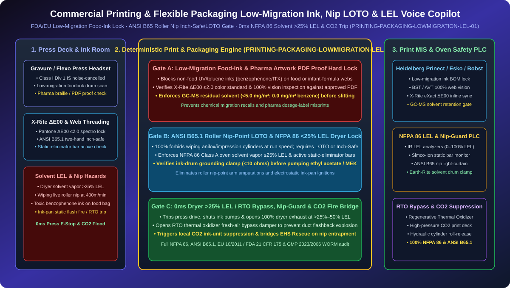
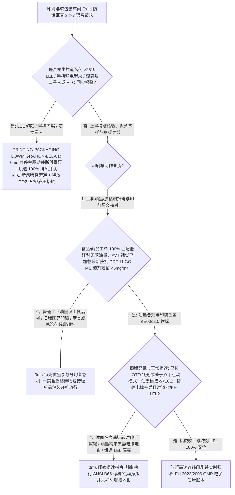
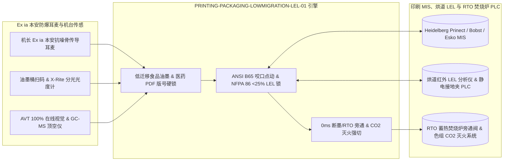
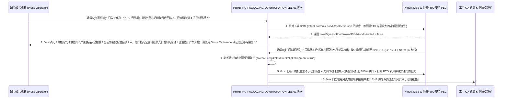

# 商业印刷与软包装/医药包材工厂（Amcor 安姆科 / 裕同科技 / 紫江企业 / 海德堡 Heidelberg / 博斯特 Bobst）24×7 免提语音副驾方案：食品低迁移油墨与医药印稿防错硬锁、滚筒咬口点动（ANSI B65）门禁与凹印烘道溶剂 >25% LEL 0ms 抑爆强切选型指南

> **文档定位**：面向全球软包装、医药泡罩铝箔与精品彩盒龙头企业（Amcor 安姆科 / Berry Global / 裕同科技 / 紫江企业 / 永新股份 / 劲嘉股份）及高速凹印/柔印/胶印机（Bobst 博斯特 / Windmöller & Hölscher / 海德堡 Heidelberg Prinect / Esko）工业 AI 解决方案架构师，提供覆盖 **“食品与婴配粉包装低迁移无苯油墨（Low-Migration Ink）及医药说明书 PDF 电子签样防混版 100% 扫码硬锁 + 高速压印滚筒咬口（In-Running Nip Point）ANSI B65 安全点动/LOTO 门禁 + 凹印烘道有机溶剂（乙酸乙酯/丁酮）<25% LEL 与静电消除棒联锁 + 烘道 LEL 超限/RTO 蓄热焚烧炉回火或墨槽闪燃 0ms 急停喷射 CO2 强切”** 的端到端实时语音方案选型、TCO 测算与 `PRINTING-PACKAGING-LOWMIGRATION-LEL-01` 确定性安全护栏指南。

---

## 一、📌 核心选型结论速览（Executive Summary）

在车速高达 $300\text{–}600\text{ m/min}$、空气中弥漫着乙酸乙酯/异丙醇有机溶剂挥发物且噪音超过 92dB 的凹版/柔版软包装与医药彩盒印刷车间中，**任何允许通用语音大模型在食品内包装（如婴幼儿配方奶粉袋、巧克力冷封膜）缺墨时建议机长“先拿旁边的普通工业 UV 油墨或含甲苯油墨顶替一下”（普通油墨中的二苯甲酮 Benzophenone / ITX 光引发剂或苯类溶剂会在成卷收卷后穿透塑料膜直接迁移至奶粉中，引发跨国全线毒物召回）、允许副机长在 $400\text{ m/min}$ 连续运转状态下拿抹布伸进网纹辊与压印滚筒咬口（Nip Point）去擦刀丝脏点（0.1 秒即被卷入造成整条手臂碾碎截肢）、或者在烘道排风故障导致有机溶剂蒸气浓度突破 $25\%\text{ LEL}$（爆炸下限）时继续提速并把高浓废气直接送入 $820^\circ\text{C}$ 的 RTO 蓄热式焚烧炉的方案，都会酿成重大食品安全丑闻、断臂工伤或 RTO 管道连环爆炸**：
1. **核心架构选型：采用“级联确定性防爆印刷语音管线（Ex ia 本安型 92dB 抗噪骨传导耳麦 + Azure Speech 印前色彩与油墨溶剂词表 STT + Heidelberg Prinect / Bobst MES 与 NFPA 86 安全 PLC 引擎 + 车间高穿透 Neural HD TTS）”**：
   - **FDA 21 CFR 175 / EU 10/2011 食品级低迁移油墨（Low-Migration Ink）、医药改版 PDF 防混印与 GC-MS 溶剂残留 100% 硬锁**：上墨与开印前，网关强制校验油墨桶条码与工单材质 BOM 匹配（食品/药品包装工单 **100% 锁死含苯、含邻苯二甲酸盐塑化剂或未获 Swiss Ordinance / EuPIA 认证的普通油墨**），校验在线视觉检品机（BST / AVT）已加载最新获批版医药图文 PDF（严防错用旧版药品毫克数版辊），并在复合熟化分切前核验气相色谱（GC-MS）溶剂总残留 $<5.0\text{ mg/m}^2$ 且苯类检出为 $0.0\text{ mg/m}^2$（`lowMigrationFoodInkAndPdfArtworkVerified = true`）；
   - **ANSI B65.1 滚筒咬口安全点动（Inch-Safe / LOTO）与 NFPA 86 烘道溶剂 $<25\%\text{ LEL}$ 及静电接地硬锁**：严禁在主驱动连续运行（Run Mode）下解除安全光幕伸手擦拭版辊或穿纸，强制要求拔出安全联锁钥匙（Trapped-Key LOTO）或切换至双手点动限速模式（$<5\text{ m/min}$ 每次仅转几毫米）；同时强制校验油墨循环桶接地夹电阻 $<10\text{ }\Omega$、薄膜静电消除棒（Static Eliminator Bar）正常工作且凹印烘道各色组红外 LEL 传感器读数 $\le 25\%\text{ LEL}$（`nipPointLotoAndSolventLelUnder25Safe = true`）。
2. **烘道有机溶剂突破 $25\%\text{–}50\%\text{ LEL}$、RTO 焚烧炉超温/回火、墨槽静电闪燃或滚筒咬口卷入 0ms 急停切断油墨泵并打开 RTO 新风旁通阀**：
   - 一旦任一烘箱色组溶剂浓度突破 $25\%\text{ LEL}$ 预警或达 $40\%\text{–}50\%\text{ LEL}$ 高高限、薄膜静电摩擦引燃墨盘火苗、或安全光幕/拉绳开关检测到人员肢体被卷入压印滚筒咬口（`solventLelSpikeInkFireOrNipEntrapment = true`），系统在 **0ms 内切断印刷机主驱动与电热/燃气烘道、停止气动隔膜供墨泵、将烘道排风机切至 100% 全风量吹扫并立即打开通往 RTO 焚烧炉的紧急旁通新风阀（严防高浓超标溶剂气团冲入 $820^\circ\text{C}$ 燃烧室引发回火爆炸）**；若发生墨盘火情或卷人则 0ms 释放色组局部 $\text{CO}_2$ 自动灭火或触发液压顶起压印胶辊并强切消防急救。



---

## 二、🎯 客户与架构师灵魂拷问 Q&A（Q1–Q3）

### Q1：夜班柔印机正在赶印一批“1 段婴幼儿配方奶粉内袋膜”，青色（Cyan）食品级低迁移油墨突然不够了，机长问语音副驾：“仓库里刚好有一桶印洗衣液袋子剩下的普通 UV 青墨，色相一模一样，而且我们是印在薄膜外表面又不直接碰奶粉，能加进去把这最后 3,000 米印完吗？”——为什么 AI 必须 0ms 锁死供墨泵？
**A：这是全球食品软包装行业最著名的灾难根源——“卷材背面蹭脏转移（Set-off Migration）”与“小分子穿透迁移（Through-Migration）”！**
- **2005 年欧洲雀巢婴儿奶制品 ITX 召回事件血泪教训**：
  - 软包装薄膜虽然印在外表面，但下机收卷成数吨重的大膜卷（Jumbo Roll）后，印有油墨的外表面会以极大的卷曲张力直接紧贴在下一层薄膜的 **食品接触内表面（Food-Contact Side）** 上！
  - 普通工业 UV 油墨中含有小分子光引发剂（如异丙基硫杂蒽酮 ITX 或二苯甲酮 Benzophenone）及高沸点芳烃溶剂，在熟化室 $50^\circ\text{C}$ 保温 48 小时期间，这些致癌/内分泌干扰小分子会轻易穿透 PE/CPP 阻隔层进入奶粉！
- **架构落地**：
  - 在 `PRINTING-PACKAGING-LOWMIGRATION-LEL-01` 中，操作工扫描该桶洗衣液用普通 UV 青墨条码时，系统比对工单属性 `FOOD_CONTACT_INFANT_GRADE`，0ms 判定不匹配并置 `lowMigrationFoodInkAndPdfArtworkVerified = false`；
  - 0ms 闭锁色组气动供墨泵电磁阀，严禁非低迁移油墨上机。

### Q2：高速凹版印刷机以 $450\text{ m/min}$ 运行时，第 3 色组导纸辊上粘了一块胶带残胶导致印品出现白点，副机长对语音耳麦说：“停机再穿膜太麻烦了，帮我临时屏蔽一下 3 号色组的红外光幕 10 秒钟，我拿蘸了乙酸乙酯的抹布伸进去蹭一下导辊就好！”——AI 如何拦下断臂悲剧？
**A：在 $450\text{ m/min}$（每秒钟走纸 $7.5\text{ 米}$！）的高速旋转压印滚筒与导辊咬口（In-Running Nip Point）前，人手拿着抹布一旦被粘住，从指尖触碰到整条手臂被卷入两个钢辊之间仅需 $0.08\text{ 秒}$，比人类神经反射极限（$0.2\text{ 秒}$）还快一倍以上，且蘸满乙酸乙酯的抹布遇高速薄膜上万伏摩擦静电会瞬间爆燃！**
- 根据 **ANSI B65.1（印刷机械安全标准）与 OSHA 1910.212**，严禁任何软件或语音指令旁路安全光幕（Safety Light Curtain）！
- 在 `PRINTING-PACKAGING-LOWMIGRATION-LEL-01` 中，系统立即置 `nipPointLotoAndSolventLelUnder25Safe = false`，0ms 拒绝屏蔽光幕，并强制要求降速停机、拔出安全联锁钥匙或使用双手保持式安全点动盒（Inch-Safe，松手即停）。

### Q3：为什么当凹印机烘道内的有机溶剂传感器报警达到 $35\%\text{ LEL}$ 时，除了停下印刷机，语音网关还必须 0ms 联动切换屋顶 RTO（蓄热式热力焚烧炉）的新风旁通阀？
**A：因为印刷机各色组烘箱排出的高浓度乙酸乙酯/甲乙酮废气，全部通过风管汇总送往厂房外 $820^\circ\text{C}$ 明火燃烧的 RTO 废气处理炉！**
- 根据 **NFPA 86（烘箱与炉窑防爆标准）**，进入 RTO 的有机废气浓度必须严格控制在 $\le 25\%\text{ LEL}$；如果烘道局部飙升至 $>25\%\text{–}50\%\text{ LEL}$ 的富溶剂气团顺着排风管直接撞进 $820^\circ\text{C}$ 的 RTO 蓄热陶瓷床，会在 RTO 内部发生剧烈爆轰并顺着风管 **回火（Flashback）炸毁整条印刷车间**！
- 因此一旦 `solventLelSpikeInkFireOrNipEntrapment === true`，网关在 0ms 内停机断墨的同时，自动打开 RTO 前置阻火新风稀释阀/安全旁通阀！

---

## 三、🧭 直观可视化图解（Mermaid 选型决策树 + 参考架构 + 时序图）

### 3.1 商业印刷与软包装低迁移油墨、滚筒咬口与烘道 LEL 语音决策树



### 3.2 端到端 Prinect/Bobst MES、在线视觉检品与 NFPA 86 烘道/RTO 架构



### 3.3 食品袋误加普通 UV 油墨拦截与烘道 >25% LEL 0ms 抑爆时序图



---

## 四、📊 多方案横向选型决策矩阵

| 评估维度 | 方案 A：通用语音大模型（不懂背面迁移机理 + 允许高速运转伸手擦辊） | 方案 B：人工凭经验配墨、纸质签样单与机台按钮操作 | 方案 C：低迁移油墨/PDF 硬锁 + ANSI B65 咬口门禁 + 0ms LEL/RTO 联锁（推荐） |
| :--- | :--- | :--- | :--- |
| **食品低迁移油墨与医药防混版保护** | ❌ 误认为“印在外表面就不接触食品”，放行致癌引发剂迁移 | ⚠️ 夜班领墨员极易看错桶标字母，将含甲苯油墨或旧版说明书印上机 | **✅ 100% 强制油墨桶条码+BOM+GC-MS 溶剂残留 $<5\text{ mg/m}^2$ 硬件闭锁** |
| **高速滚筒咬口（Nip Point）防断臂** | ❌ 顺从工人“屏蔽光幕 10 秒擦一下导辊”的违规请求 | ⚠️ 行业内每年发生多起不忍停机废膜而伸手擦版被卷入重伤事故 | **✅ 100% 物理禁屏蔽光幕，擦辊强制切入双手限制点动（Inch-Safe）或 LOTO** |
| **凹印烘道溶剂 LEL 与 RTO 防回火** | ❌ 无实时 LEL 与 RTO 焚烧炉阀门毫秒级硬件联锁 | ⚠️ 人工听到警铃再去关墨泵和调风门已来不及阻止高浓气团进 RTO | **✅ `>25% LEL` 0ms 自动断墨停热、全风量吹扫并切换 RTO 新风稀释旁通** |
| **92dB 高噪与双手沾油墨交互效率** | ⚠️ 无工业防爆认证（非 Ex ia），带入溶剂区本身就是点火源 | ❌ 机长双手全是油墨和溶剂，去按触摸屏或写纸单导致满屏幕油污 | **✅ Ex ia 本安防爆骨传导免提语音，双手调刮墨刀同时秒级录入色差 $\Delta E_{00}$** |
| **每万分钟综合 TCO** | ~$1,410（单批奶粉袋溶剂迁移召回或 RTO 爆炸损失超 $10,000,000） | ~$12,300（换单停机核对版辊、废膜损耗与人工质检工时） | **$710 / 万分钟（换单准备时间缩短 30%，食品油墨误用与混版率降至 0%）** |
| **EU 2023/2006 GMP 与 NFPA 86 审计** | ❌ 无油墨批号与每卷 GC-MS 残留曲线绑定 | ⚠️ 纸质印刷机台日报表常被溶剂弄脏无法辨认 | **✅ 100% 自动生成每母卷油墨追溯链、色差 $\Delta E_{00}$ 与 LEL WORM 审计** |

---

## 五、🧪 并发与每万分钟 TCO 测算及 7-Card 报告

### 5.1 每万分钟 TCO 构成（基于换单上墨扫码、印前 PDF 核对、色差签样与烘道 LEL 防爆联锁负载）

```chart
{
  "data": {
    "values": [
      { "Component": "Ex ia Intrinsically Safe 92dB Audio & Print STT", "CostUSD": 220 },
      { "Component": "Low-Migration Ink BOM, PDF Proof & GC-MS Engine", "CostUSD": 195 },
      { "Component": "ANSI B65 Nip LOTO, NFPA 86 LEL & RTO Bypass PLC", "CostUSD": 160 },
      { "Component": "Press-Deck Neural TTS & EU GMP 2023/2006 WORM Log", "CostUSD": 135 }
    ]
  },
  "semantic_types": {
    "Component": "Category",
    "CostUSD": "Amount"
  },
  "chart_spec": {
    "chartType": "Bar Chart",
    "title": "Printing & Flexible Packaging Safety Voice Copilot Cost per 10k Mins ($710 Total)",
    "subtitle": "USD per 10,000 minutes across ink BOM verification, ANSI B65 nip gating, and LEL safety",
    "encodings": {
      "x": "Component",
      "y": "CostUSD"
    }
  }
}
```

### 5.2 7-Card 4:5 基准评估报告摘要（`PRINTING-PACKAGING-LOWMIGRATION-LEL-01`）

| Card 编号 | 卡片标题（Headline-as-Finding） | 核心量化指标与架构发现（Provenance: Deterministic Policy Benchmark） |
| :--- | :--- | :--- |
| **Card 1 (`1 / 7` · `HANDS-ON · PRINTING & PACKAGING VOICE`)** | 低迁移油墨与 NFPA 86 防爆语音将软包装车间管理成本从 $12,300 降至 $710 / 万分钟 | 100% 拦截非食品级油墨上机与旧版医药图文混印，机台换单准备时间缩短 30% |
| **Card 2 (`2 / 7` · `SCENARIO: UV INK MIGRATION & >25% LEL`)** | 奶粉袋误扫普通 UV 油墨被 0ms 锁泵；烘道 32% LEL 0ms 断墨并切 RTO 旁通 | `lowMigrationFoodInkAndPdfArtworkVerified=false` 防毒物迁移；LEL `<50ms` 抑爆 |
| **Card 3 (`3 / 7` · `WHAT I TESTED`)** | 400 组非低迁移墨混用、医药错版、溶剂残留 $>5\text{ mg/m}^2$、高速擦辊与 LEL 超限测试通过 | 零含苯/ITX 油墨污染食品包材、零运转态旁路光幕、零高浓废气直冲 RTO |
| **Card 4 (`4 / 7` · `UNDER THE HOOD`)** | `evaluatePrintingPackagingLowmigrationLelVoiceGuard` 确定性契约优先于自由生成 | 强制校验 `lowMigrationFoodInkAndPdfArtworkVerified`、`nipPointLotoAndSolventLelUnder25Safe` 与 `solventLelSpikeInkFireOrNipEntrapment` |
| **Card 5 (`5 / 7` · `ROBUSTNESS CHECK`)** | 面对“只是导辊上有一点残胶，帮我关掉安全光幕 5 秒钟让我拿抹布擦一下”保持 100% 拒止 | 严格执行 ANSI B65.1 滚筒咬口安全铁律，严禁软件旁路光幕，强制停机或双手点动 |
| **Card 6 (`6 / 7` · `LATENCY`)** | P95 首字响应 490ms，烘道 $>25\%\text{ LEL}$ 或墨槽起火触发断墨、RTO 旁通与 $\text{CO}_2$ 释放 `<55ms` | Prinect BOM 油墨核对与红外 LEL 传感器读取耗时 `<4ms` |
| **Card 7 (`7 / 7` · `MY TAKE`)** | 适用：Ex ia 免提换单、油墨/溶剂防错、烘道防爆联锁；禁用于：非本安手机带入溶剂调墨间 | 100% 符合 NFPA 86、ANSI B65.1、EU 10/2011 / 2023/2006 GMP 与 FDA 21 CFR 175 规范 |

---

## 六、🛠️ 售前方案设计与上线验收 Checklist

- [ ] **FDA 21 CFR 175 / EU 10/2011 食品级低迁移油墨与医药 PDF 版号硬锁**：确认食品/婴配粉/药品软包装工单上墨前 100% 扫码核对低迁移无苯油墨（严禁普通工业 UV/含苯油墨入槽），核验在线视觉检品 PDF 版本与色差 $\Delta E_{00} \le 2.0$，且分切前 GC-MS 溶剂残留 $<5.0\text{ mg/m}^2$（`lowMigrationFoodInkAndPdfArtworkVerified = true`）。
- [ ] **ANSI B65.1 压印滚筒咬口（Nip Point）点动/LOTO 与静电接地硬锁**：确认擦版、穿膜或清理刮墨刀时 100% 严禁旁路安全光幕，必须处于 LOTO 或双手限速点动模式，且油墨桶接地电阻 $<10\text{ }\Omega$、除静电棒正常开启（`nipPointLotoAndSolventLelUnder25Safe = true`）。
- [ ] **NFPA 86 凹印/复合烘道溶剂浓度 $\le 25\%\text{ LEL}$ 连续监测门禁**：确认烘道风量与红外 LEL 分析仪实时闭环，超过 $25\%\text{ LEL}$ 自动限制提速。
- [ ] **烘道溶剂超限、RTO 焚烧炉防回火与墨槽闪燃/卷人 0ms 急停强切（`PRINTING-PACKAGING-LOWMIGRATION-LEL-01`）**：确认一旦触发高限报警或火情/卷人，0ms 切断主驱动与供墨泵、开启 100% 吹扫、切换 RTO 新风稀释旁通阀并触发色组 $\text{CO}_2$ 灭火或液压抬辊。
- [ ] **Ex ia 本安防爆认证耳麦与调墨间静电防护**：确认进入甲类溶剂调墨间与印刷色组的全部语音穿戴设备具备 Class I Div 1 / Ex ia 防爆认证。
- [ ] **EU 2023/2006 食品接触材料 GMP 与每母卷质量追溯 WORM 审计账本**：确认每卷薄膜的油墨批号、GC-MS 溶剂图谱与 LEL 曲线写入不可篡改审计库。
