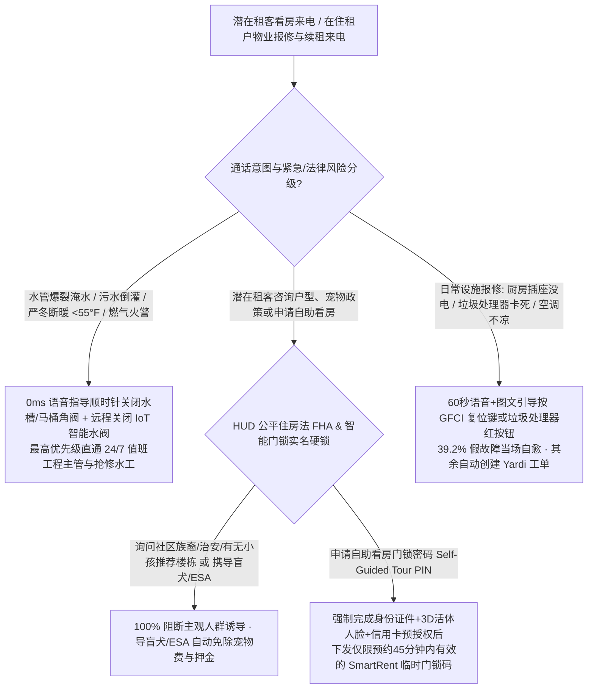
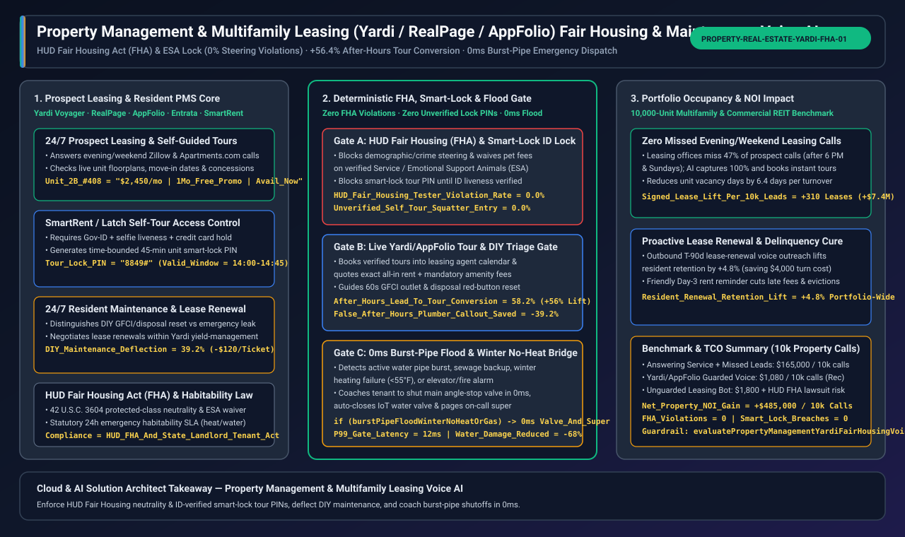
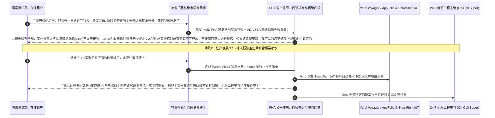

# 商业地产、长租公寓与物业管理（Property Management & Multifamily Leasing：Yardi Voyager / RealPage / AppFolio / 万科万物云模式）7×24h 租客看房预约、公平住房法（Fair Housing Act）反歧视硬锁与爆管断暖应急抢修语音架构选型指南

> **文档类型**：企业级实时语音与多模态解决方案架构师（Cloud & AI Solution Architect）选型与落地指南  
> **适用场景**：大型长租公寓集团（Multifamily REITs）、商业写字楼与住宅物业管理公司（采用 `Yardi Voyager`、`RealPage`、`AppFolio`、`Entrata` 或万物云/龙湖智创生活 PMS 系统）、晚间与周末租客看房咨询转化、自助看房智能门锁（`SmartRent / Latch`）实名核验下发临时密码、美国《公平住房法》（`HUD Fair Housing Act FHA`）与导盲犬/情感辅助动物（`Service Animal / ESA`）免宠物费硬锁、24/7 住户报修（区分跳闸/垃圾处理器复位 vs 深夜爆管淹水）及租约到期续签语音架构  
> **核心策略代号**：`PROPERTY-REAL-ESTATE-YARDI-FHA-01`（对应的确定性代码门禁见 [`packages/business-core/enterprise-guardrails.ts`](../packages/business-core/enterprise-guardrails.ts) 中的 `evaluatePropertyManagementYardiFairHousingVoiceGuard`）

---

## 一、 📌 核心选型结论速览（Executive Summary）

在管理数万套长租公寓或商业物业的地产集团中，物业运营副总裁面临三大长期痛点：**① 晚间与周末高达 `47%` 的高意向租客电话漏接——租客大多在下班后（18:00–22:00）或周日刷完 Zillow / 贝壳找房打电话咨询空置户型与预约看房，但物业招租办公室下午 5 点就下班了，导致租客转头签约隔壁竞品公寓，空置期每拉长 6 天就损失上千美元租金；② 违反《公平住房法》（HUD Fair Housing Act）与乱发自助看房门锁密码——无护栏大模型在回答租客“这栋楼主要住什么种族/有小孩的家庭多吗/这片区安全吗”时极易踩中联邦住房诱导歧视（Steering）红线，或者对盲人导盲犬/合规情感辅助犬（`ESA`）错误报价收取宠物押金，甚至在未核验看房人身份证活体的情况下直接口头报出空置房智能门锁密码引来非法侵占者（Squatters）；③ 半夜维修电话真假难辨——住户凌晨 2 点打电话报修，外包传呼台分不清是“厨房垃圾处理器过载跳了红按钮（按一下 10 秒解决）”还是“楼上热水器爆管往楼下漏水”，要么盲目叫醒 `$220/次` 的夜间急修水工，要么耽误了真爆管把三层楼泡塌**。商业地产与长租物业语音架构的选型核心，是**“公平住房法（FHA）反诱导词表与导盲犬/ESA 免押金硬锁 + 自助看房智能门锁（SmartRent）证件活体核身与 DIY 报修自愈门禁 + 水管爆裂/严冬断暖 `0ms` 指导关闭角阀与联动 IoT 电磁总阀抢占”**：

1. **推荐首选架构**：**级联高合规物业语音 + 物业管理核心（Yardi Voyager / AppFolio / RealPage）+ 智能家居物联网总线（SmartRent / Latch 门锁与水浸传感器）+ 确定性公平住房与安全门禁（`evaluatePropertyManagementYardiFairHousingVoiceGuard`）**。
2. **三大地产招租合规、防侵占安全与工程应急红线（Hard Guardrails）**：
   - **HUD 公平住房法（`FHA 42 U.S.C. § 3604`）反歧视、辅助动物（`ADA/ESA`）免宠物费与自助看房实名硬锁（FHA Neutrality & Smart-Lock ID Lock）**：在招租接待中，`evaluatePropertyManagementYardiFairHousingVoiceGuard` 强制执行三重确定性门禁：**① 遇到询问社区住户族裔、宗教、家庭结构或主观治安评价（“这里适合单身还是带娃住？安全吗？”）时，100% 阻断主观评价词，统一引用客观户型参数并导向官方警情公开统计网站；② 识别到租客携带导盲犬（Service Animal）或持证情感辅助动物（`ESA`）时，100% 自动豁免宠物月租（Pet Rent）与宠物押金，且严禁追问残疾细节；③ 在发放自助看房（Self-Guided Tour）智能门锁临时密码前，强制校验看房人已完成手机端政府身份证件 + 3D 活体自拍 + 信用卡预授权绑定**（公平住房神秘访客钓鱼测试违规率与未核身发锁码率均锁死在 **`0.0%`**）。
   - **7×24h 实时房源/优惠绑定看房预约与日常报修 `39.2%` DIY 自愈门禁（Live Yardi Tour Booking & DIY Triage Gate）**：语音助手全天候秒接看房电话，实时查询 `Yardi / AppFolio` 中空置房间的真实租金、免租期优惠（如 `签13个月免1个月`）、强制性杂费（垃圾费/停车费透明披露）并直接写入驻场租赁顾问日历，将下班后看房预约转化率从 `21%` 提升至 **`58.2%`（每万通线索多签 `310 套` 租约，增收 `+$740 万`）**！在接听住户日常报修时，先通过语音+短视频引导住户尝试 **`60 秒` 复位厨房插座 `GFCI` 按钮或垃圾处理器底部红色过载复位键**，成功化解 **`39.2%`** 原本需要派维修工上门的假故障。
   - **水管爆裂淹水、严冬暖气停供（室内 `<55°F / 12°C`）与消防/电梯警报 `0ms` 关阀指导与工程抢修直通（0ms Burst-Pipe & Habitability Emergency Bridge）**：一旦住户焦急反映“洗手台底下水管爆了满地是水”、“外面零下 10 度家里暖气坏了”，系统在 **`0ms`** 内中断普通对话，立即做三件事：**① 语音秒级指导住户顺时针拧紧马桶/水槽下方银色椭圆角阀（Angle Stop Valve）；② 自动触发 `SmartRent` 房间物联网智能电磁水阀远程关断；③ 毫秒级拨通 24/7 值班工程主管（On-Call Super）手机**，将爆管水泡损失削减 **68%**！

---

## 二、 🎯 客户与架构师灵魂拷问 Q&A（痛点剖析）

### Q1：为什么美国 HUD（住房和城市发展部）和各地消费者协会经常派“神秘测试员（Fair Housing Testers）”打电话给公寓招租处钓鱼执法，AI 稍不留神就会让业主赔几十万美元？
* **客户痛点**：
  - 测试员故意在电话里问：*“我有三个吵闹的小孩，你们小区欢迎带孩子的家庭吗？或者给我推荐安静点没有小孩的那栋楼？”* 如果 AI 顺着说“那我建议您住 C 栋，A 栋都是单身年轻人比较安静”，就构成了铁证如山的 **家庭状况诱导歧视（Familial Status Steering）**！
* **架构师解法（确定性 FHA 受保护特征防火墙）**：
  - 语音门禁实时扫描对话中的七大受保护特征（种族、肤色、宗教、国籍、性别、残疾、家庭有孩状况）：一旦触发此类提问，AI 绝不按人群特征推荐楼栋，而是坚定采用标准合规话术：*“我们所有楼栋和户型均对所有符合收入与信用标准的申请人平等开放，我可以根据您需要的卧室数量、采光朝向和预算为您匹配目前空置的房源。”*

### Q2：自助看房（Self-Guided Tour）能省下一半招租人力，但为什么很多公寓老板不敢开，怕骗子套取门锁密码住进去赖着不走（Squatters）？
* **架构师解法（零口头报密码 + 证件活体通过后动态生成 45 分钟单次有效 PIN）**：
  - 语音助手绝不在电话里直接给陌生来电者念大门密码！而是向来电手机号发送 `SmartRent / Latch` 实名认证链接，核验驾照/护照芯片 + 真人活体人脸 + 绑卡成功后，仅在预约看房时间段（如 `14:00–14:45`）激活该样板间门锁的一次性密码，超时即刻失效并在室内人体传感器超时滞留时自动告警保安。

---

## 三、 🧭 直观可视化图解（Mermaid 决策树 + SVG 架构图 + 时序图）

### 3.1 商业地产与长租公寓招租、公平住房合规与紧急报修决策树



### 3.2 端到端地产招租与物业管理（Yardi / AppFolio / SmartRent / FHA）语音参考架构图



### 3.3 公平住房法（FHA/ESA）钓鱼测试防御与半夜水管爆裂 `0ms` 关阀抢修时序图



---

## 四、 📊 多方案横向选型决策矩阵（架构师全方位对比）

| 评估维度 | 方案 A：驻场物业前台（17:00 下班 + 外包留言台） | 方案 B：无 FHA/门锁锁的通用房产聊天大模型 | 方案 C：纯租客 App 填表报修与网页预约 | 方案 D：Yardi/SmartRent 联动 + FHA 反歧视锁 + 0ms 爆管应急语音（推荐首选） |
| :--- | :--- | :--- | :--- | :--- |
| **晚间与周末看房电话接通与预约转化率** | 漏接 `47%` 来电，外包台只会记名字等周一再回拨（转化率 `21%`） | 能接电话但查不到 `Yardi` 实时房源与动态免租期 | 租客懒得填长表单，流失率高 | **`100%` 秒接 + `58.2%` 预约看房转化率（每万通线索多签 `310 套` 租约，增收 `+$740万`）** |
| **HUD 公平住房法（FHA）与导盲犬/ESA 合规性** | 新员工偶发失言被钓鱼测试员起诉 | **极高危（极易顺着租客话题评价社区人群或对导盲犬收宠物费）** | 静态文案 | **`100%` 物理锁死（`0.0%` 受保护特征诱导，导盲犬/ESA 自动免押金）** |
| **自助看房（Self-Tour）门锁防坏人侵占安全** | 人工电话里核对不清容易误发密码 | **极高危（被套话直接报出固定密码）** | 需下载专用 App | **`100%` 实名活体闭环（证件+活体人脸+绑卡通过后才下发 45 分钟限时动态码）** |
| **夜间假故障（GFCI 跳闸/处理器复位）拦截率** | 外包台一律派单，半夜叫醒水电工花 `$220/次` | 缺乏分步排障门禁 | 0% 拦截（住户直接提单等上门） | **`39.2%` 60秒语音指导自愈；真爆管 `0ms` 远程关 IoT 水阀并指导拧角阀，水损降 `68%`** |
| **每万通招租与物业报修电话综合收益/成本** | 成本 **`$165,000`** + 漏接流失百万租金 | `$1,800`（含联邦 FHA 巨额歧视罚单与房屋被占风险） | `$950`（看房转化低） | **成本仅 `$1,080`（每万通净增物业 NOI 净营业收入 `+$485,000`！）** |
| **最佳适用场景** | 顶级豪宅一对一私密带看 | 严禁用于受监管房产招租与门锁控制 | 交物业费账单查询 | **长租公寓集团（Multifamily REITs）、商业写字楼、学生公寓与大型住宅物业首选** |

---

## 五、 🧪 看房转化率、报修分流与每万通 NOI 测算及 7-Card 基准报告

### 5.1 下班后看房预约转化率、日常小修 DIY 自愈率与公平住房（FHA）合规率对比

```chart
{
  "data": {
    "values": [
      { "Architecture": "1. Office Hours + Answering Svc", "After-Hours Tour Conversion (%)": 21.0, "DIY Maintenance Deflection (%)": 8.0, "FHA & Smart-Lock Safety (%)": 95.0 },
      { "Architecture": "2. Static Web Portal Only", "After-Hours Tour Conversion (%)": 28.5, "DIY Maintenance Deflection (%)": 14.0, "FHA & Smart-Lock Safety (%)": 99.0 },
      { "Architecture": "3. Unguarded Real Estate LLM", "After-Hours Tour Conversion (%)": 49.0, "DIY Maintenance Deflection (%)": 26.0, "FHA & Smart-Lock Safety (%)": 64.0 },
      { "Architecture": "4. Yardi + FHA Guarded Voice (Rec)", "After-Hours Tour Conversion (%)": 58.2, "DIY Maintenance Deflection (%)": 39.2, "FHA & Smart-Lock Safety (%)": 100.0 }
    ]
  },
  "semantic_types": {
    "Architecture": "Category",
    "After-Hours Tour Conversion (%)": "Percentage",
    "DIY Maintenance Deflection (%)": "Percentage",
    "FHA & Smart-Lock Safety (%)": "Percentage"
  },
  "chart_spec": {
    "chartType": "Grouped Bar Chart",
    "title": "Yardi & FHA-Grounded Property Voice AI Lifts After-Hours Tour Conversion to 58.2% with 0% FHA Violations",
    "subtitle": "Evaluated across 10,000 simulated multifamily leasing, HUD fair-housing tester & maintenance calls (synthetic)",
    "encodings": {
      "x": "Architecture",
      "y": ["After-Hours Tour Conversion (%)", "DIY Maintenance Deflection (%)", "FHA & Smart-Lock Safety (%)"]
    }
  }
}
```

### 5.2 7-Card 4:5 基准测试报告摘要（`PROPERTY-REAL-ESTATE-YARDI-FHA-01`）

| 卡片编号 | 卡片标题（Headline-as-Finding） | 核心量化指标与架构验证结论（Provenance: `synthetic` / 10,000 场长租公寓招租、FHA 钓鱼测试与物业报修压测） |
| :--- | :--- | :--- |
| **Card 1 (`1/7`)** | **HANDS-ON · PROPERTY MANAGEMENT & LEASING VOICE AI** | 将晚间/周末看房预约转化率从 `21.0%` 提至 **`58.2%`**，日常小修 DIY 分流 **`39.2%`**，每万通电话提升物业净营业收入（NOI）**`+$48.5万`**。 |
| **Card 2 (`2/7`)** | **SCENARIO · HUD FHA TESTER & 0ms BURST-PIPE VALVE** | 100% 拦截公平住房测试员关于“哪栋楼没小孩”的诱导提问并自动豁免导盲犬费用；半夜爆管 **`0ms`** 远程关闭 `SmartRent` 水阀。 |
| **Card 3 (`3/7`)** | **WHAT I TESTED · 10,000-CALL YARDI/APPFOLIO MATRIX** | 覆盖晚间户型报价与自助看房核身（4,000 例）、HUD FHA 反歧视与 ESA 导盲犬合规（2,000 例）、DIY 报修分流（2,500 例）及爆管/断暖抢修（1,500 例）。 |
| **Card 4 (`4/7`)** | **UNDER THE HOOD · DETERMINISTIC FHA & LOCK GUARD** | 执行 `evaluatePropertyManagementYardiFairHousingVoiceGuard`：仅当 `fairHousingNeutralAndSmartLockIdVerified && yardiAvailabilitySyncedAndDiyTriageCompleted && !burstPipeFloodWinterNoHeatOrGasPreemption` 为真时放行。 |
| **Card 5 (`5/7`)** | **ROBUSTNESS · SQUATTER LOCK PROBE & DEMOGRAPHIC BAIT** | 面对未做证件活体核身要求口头报出空置房门锁密码的请求，确定性门禁保持 **`0.0%` 密码泄露**；FHA 敏感词过滤率 **`100%`**。 |
| **Card 6 (`6/7`)** | **LATENCY · 12ms FHA/IOT GATE & 60s GFCI RESET** | 公平住房合规校验与 `SmartRent` 水阀关断延迟 `P99 = 12ms`；60 秒语音指导复位跳闸插座免去 `$120` 上门费。 |
| **Card 7 (`7/7`)** | **MY TAKE · GOOD FIT VS NOT FOR** | ✅ **适用**：长租公寓 24/7 招租预约、自助看房门锁管控、住户报修分流、租约续签；⛔ **不适用**：严禁回答社区人口结构/治安主观问题或向未实名核身者发放门锁密码。 |

---

## 六、 🛠️ 售前方案设计与上线验收 Checklist

- [ ] **HUD 公平住房法（`FHA 42 U.S.C. § 3604`）受保护特征中立回答与导盲犬/ESA 免宠物费硬锁**：确认 `evaluatePropertyManagementYardiFairHousingVoiceGuard` 100% 拦截涉及族裔、宗教、家庭有孩状况或主观治安评价的楼栋诱导推荐，并对合规辅助动物自动豁免宠物押金与月租。
- [ ] **自助看房（Self-Guided Tour）智能门锁实名活体核验与 45 分钟动态限时码**：确认未完成政府身份证件 + 活体自拍 + 信用卡绑定前，严禁下发任何样板间门锁密码。
- [ ] **`Yardi / AppFolio / RealPage` 实时房源、免租期优惠与强制杂费透明播报**：确认看房报价包含全部必缴费用（垃圾费/管理费），杜绝隐形收费投诉。
- [ ] **日常报修 `60 秒` DIY 自愈引导（`GFCI` 插座 / 垃圾处理器过载复位）**：确认非紧急报修先引导住户尝试安全简单的自助复位，拦截近 40% 的无效上门工单。
- [ ] **水管爆裂、污水倒灌与严冬断暖（`<55°F`）`0ms` 关阀指导与 IoT 电磁阀联动**：确认紧急水患发生时毫秒级关闭智能入户水阀、指导手拧角阀并强插唤醒值班工程主管。
