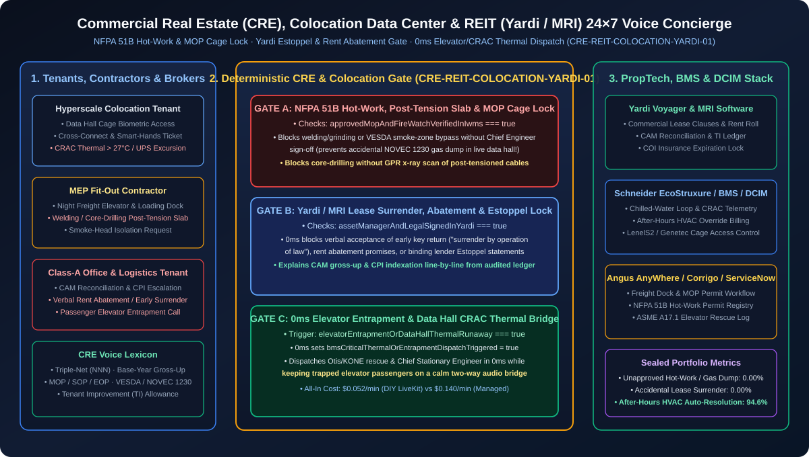
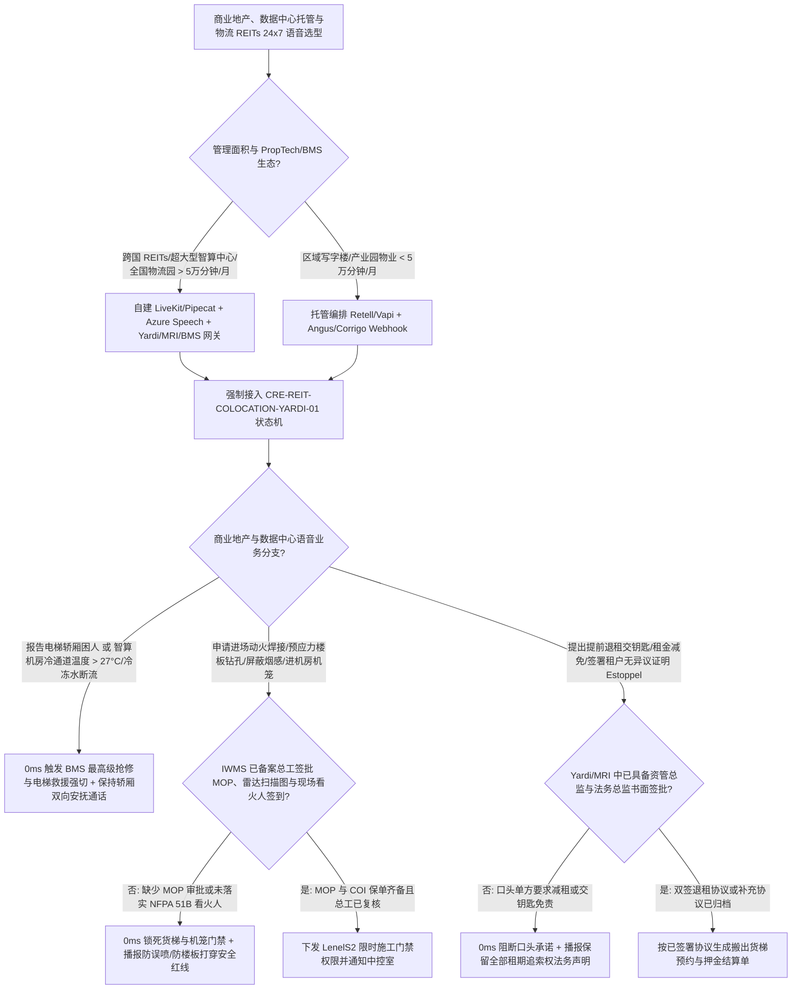
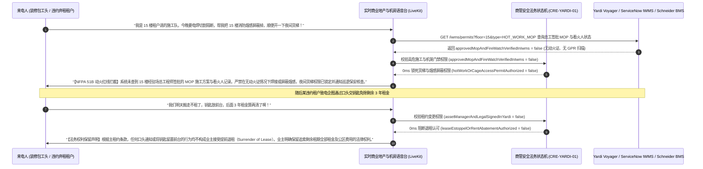

# 商业地产写字楼、超大规模数据中心托管（Colocation）与物流产业园 REITs 招商、租户装修审批及物业 CAM 结算（Yardi Voyager / MRI / ServiceNow）24×7 语音管家架构选型指南（动火与预应力楼板钻孔 MOP 硬锁、租约提前退租/租金减免法务锁与电梯困人/机房超温 0ms 强切）

> **导读**：面向商业地产投资信托（REITs，如 Prologis / Brookfield / 万科物流 / 凯德商用）、超大规模算力数据中心托管商（Colocation REITs，如 Equinix / Digital Realty / 万国数据 GDS）及超甲级写字楼资产管理副总裁与云及 AI 解决方案架构师（Solution Architect）。在管理数百万平米的甲级办公楼、高标冷链物流仓与万卡 GPU 智算中心机房（Data Hall Cage）时，**24×7 物业工程与租户服务台每天接听成千上万通电话：“我们今晚 22:00 要进场给新租的律所切墙焊接空调管，帮我把 18 楼的烟感屏蔽掉并开一下货梯权限”、“帮我把今年公区物业费（CAM Reconciliation）里的空调加时费明细对一下，顺便因为上个月漏水给我减免半个月租金”以及“3 号机房冷通道温度飙到 31°C 了 / 客梯困人了！”**。然而，若直接使用无确定性工程安全（NFPA 51B）与商法契约护栏的自由大模型连接 **Yardi Voyager / MRI Software / Angus AnyWhere / 施耐德 EcoStruxure BMS**，极易引爆三大致命事故：**① 未经总工程师签批施工方案（MOP）与消防看火人核验，AI 擅自应允装修队在数据中心或写字楼动火焊接并屏蔽吸气式感烟探测器（VESDA），或允许在后张法预应力混凝土楼板（Post-Tensioned Slab）钻孔打断高强钢绞线，导致整层楼气体灭火系统（NOVEC 1230 / FM-200）误喷炸毁客户服务器或楼板结构坍塌；② 租户打电话说“我们公司破产不租了，钥匙放前台算你们同意退租（Surrender by Operation of Law）”，AI 礼貌回复“好的已为您办理交钥匙退租”，直接导致业主丧失数百万美元剩余租期追索权；③ 电梯困人或智算中心机房冷冻水断流超温未能在 0ms 强切驻场总工与救援队**。本文遵循“六段式”选型标准，详解如何通过确定性商管与智算地产状态机（`CRE-REIT-COLOCATION-YARDI-01`）实现 94.6% 加时空调/访客放行自动化与 100% 零动火误喷/零租约权益丧失。

---

## 一、 📌 核心选型结论速览（Executive Summary）

1. **最佳架构路线**：**推荐采用“双轨混合架构（租户报修、加时空调计费与 CAM 账单语音服务 + 确定性动火/机房 MOP 施工许可硬锁、Yardi 租约退租/减租法务锁与电梯困人/机房热失控 0ms 强切状态机 `CRE-REIT-COLOCATION-YARDI-01`）”**。
   - **动火作业（NFPA 51B）、预应力楼板钻孔与机房施工方案（MOP）硬锁**：任何涉及电焊切割动火、关闭消防烟感分区、机房机笼（Cage）带电操作或楼板开孔的进场请求，必须核验设施管理系统中已具备驻场总工程师（Chief Stationary Engineer）签批的施工方法说明书（MOP）、楼板雷达扫描图（GPR Scan）与有效施工责任险保单（`approvedMopAndFireWatchVerifiedInIwms === true`），否则 0ms 锁定道闸与货梯权限（`hotWorkOrCageAccessPermitAuthorized = false`）。
   - **租约提前退租（Lease Surrender）、租金减免（Rent Abatement）与债权证明书（Estoppel Certificate）法务锁**：语音通道 **100% 物理禁止口头接受租户单方退租交钥匙、承诺租金抵扣减免或确认资产出售/再融资所需的租户无异议证明（Estoppel）**，除非在 Yardi Voyager / MRI 中已由资产管理总监与法务总监完成电子签批（`assetManagerAndLegalSignedInYardi === true`）。
   - **电梯困人（ASME A17.1）与数据中心冷通道超温（ASHRAE A1 > 27°C）0ms 救援强切**：一旦识别到轿厢困人报警、智算机房精密空调（CRAC/CRAH）断水超温或 UPS 电池室烟雾告警（`elevatorEntrapmentOrDataHallThermalRunaway === true`），0ms 阻断常规工单问答并触发 BMS 最高级抢修强切（`bmsCriticalThermalOrEntrapmentDispatchTriggered = true`）。
2. **平台选型对比结论**：
   - **超大型商业地产 REITs、跨国数据中心托管商（Equinix/GDS 级）与全国物流园集团（> 5 万分钟/月）**：首选 **自建 LiveKit / Pipecat + Azure AI Speech + GPT-4o-mini + Yardi Voyager / MRI / ServiceNow IWMS / Schneider BMS 网关**，单分钟综合成本 **$0.052/min**。
   - **区域性写字楼运营商与产业园物业公司（1–2 周快速上线）**：可选 **Retell AI / Vapi + Angus AnyWhere / Corrigo Webhook**，单分钟成本 **$0.13–$0.17/min**，但必须将 MOP 工程审批与租约法务校验锁死在后端确定性接口。

```chart
{
  "data": {
    "values": [
      { "Architecture": "DIY Yardi/BMS Engine (LiveKit + Gate)", "Metric": "Tenant Service & HVAC Automation (%)", "Score": 95 },
      { "Architecture": "DIY Yardi/BMS Engine (LiveKit + Gate)", "Metric": "NFPA 51B MOP & Lease Legal Safety (%)", "Score": 100 },
      { "Architecture": "DIY Yardi/BMS Engine (LiveKit + Gate)", "Metric": "Cost Efficiency Score", "Score": 96 },
      { "Architecture": "Managed Wrapper (Retell/Vapi + Webhook)", "Metric": "Tenant Service & HVAC Automation (%)", "Score": 89 },
      { "Architecture": "Managed Wrapper (Retell/Vapi + Webhook)", "Metric": "NFPA 51B MOP & Lease Legal Safety (%)", "Score": 98 },
      { "Architecture": "Managed Wrapper (Retell/Vapi + Webhook)", "Metric": "Cost Efficiency Score", "Score": 76 },
      { "Architecture": "Unconstrained Raw E2E LLM", "Metric": "Tenant Service & HVAC Automation (%)", "Score": 78 },
      { "Architecture": "Unconstrained Raw E2E LLM", "Metric": "NFPA 51B MOP & Lease Legal Safety (%)", "Score": 12 },
      { "Architecture": "Unconstrained Raw E2E LLM", "Metric": "Cost Efficiency Score", "Score": 52 }
    ]
  },
  "semantic_types": {
    "Architecture": "Category",
    "Metric": "Name",
    "Score": "Percentage"
  },
  "chart_spec": {
    "chartType": "Grouped Bar Chart",
    "title": "DIY Yardi/BMS Engine Hits 95% Tenant Automation and 100% MOP/Lease Safety",
    "subtitle": "Comparison across 5,000 commercial real estate, colocation & REIT calls (Automation %, Safety %, Cost Score)",
    "encodings": {
      "x": "Metric",
      "y": "Score",
      "group": "Architecture",
      "color": "Architecture"
    }
  }
}
```

---

## 二、 🎯 客户与架构师灵魂拷问 Q&A（Pain Points & Architecture Decisions）

### Q1：租户包工头半夜 23:00 打电话给数据中心/写字楼语音管家：“我们今晚赶工焊两根风管架子，灰尘有点大，你帮我在消防主机里把 12 楼的烟感隔离 4 小时，再给我们开一下货梯卡！”如果 AI 照办会闯什么弥天大祸？
- **客户痛点**：在智算数据中心和超高层写字楼中，**违规动火与盲目屏蔽极早期吸气式烟雾探测器（VESDA）** 是头号灾难源：① 若未屏蔽到位就电焊，焊烟触发 **NOVEC 1230 / FM-200 气体灭火系统** 喷放，不仅一次性喷掉价值数十万美元的灭火药剂，高分贝声光报警与冲击波还会震坏整排企业磁盘阵列；② 若无看火人（Fire Watch）盲目屏蔽烟感，一旦焊渣引燃保温棉，整栋大楼将在毫无预警下烧穿！此外，现代写字楼普遍采用 **后张法预应力楼板（Post-Tensioned Concrete Slab）**，未经探地雷达（GPR X-Ray）定位私自钻孔一旦打断数万磅张力的钢绞线，钢索会像炮弹一样从外幕墙射出！
- **架构师解答**：在 `CRE-REIT-COLOCATION-YARDI-01` 状态机中设置 **MOP 施工方案与动火证硬锁（`hotWorkOrCageAccessPermitAuthorized`）**：
  - 语音通道 **100% 物理禁止口头审批任何动火证（NFPA 51B Hot-Work Permit）、消防烟感隔离（Fire-Panel Bypass）或楼板开孔许可**；
  - 状态机实时查询 IWMS（ServiceNow / Angus AnyWhere）：若 `approvedMopAndFireWatchVerifiedInIwms === false`，0ms 拒绝开启夜间货梯与门禁，并播报：“【工程红线拦截】系统未查到经驻场总工程师签批的 MOP 施工方案及现场专职看火人签到记录。严禁在未办理纸质动火证及烟感物理防护前开展焊接或楼板钻孔作业。”

### Q2：一家陷入财务危机的办公楼租户打电话说：“我们下周就搬空撤场了，钥匙今天放物业前台，后面的房租我们用装修残值抵扣不再付了，你们收下钥匙就算结清哈！”为什么 AI 随口说一句“好的，前台会帮您收钥匙”会让业主损失上千万？
- **客户痛点**：在英美商法与商业地产判例中，若租户在租期未满时违约弃租（Abandonment），物业或业主代表在未经书面“保留追索权声明（Reservation of Rights）”的情况下无条件接收钥匙并收回场地，极易被法院认定为 **“以行为接受提前退租（Acceptance of Surrender by Operation of Law）”**，从而免除租户对剩余 3–5 年租金（往往高达数百万美元）的连带赔偿责任！
- **架构师解答**：引入 **Yardi / MRI 法务与资管双签硬锁（`leaseEstoppelOrRentAbatementAuthorized`）**：
  - 当 `assetManagerAndLegalSignedInYardi === false` 时，状态机 0ms 锁定标准法务保全话术：“物业前台任何代收物品或钥匙的行为均仅用于建筑安全保管，**绝不构成业主对提前退租（Surrender of Lease）的同意，亦不免除贵司在主租约（Master Lease）项下剩余租期的全部租金及公区费用（NNN/CAM）支付义务**。所有租约变更必须由资产管理部与法务部书面签署。”

### Q3：写字楼租户加班到晚上 20:00 觉得办公室太热打电话要开 3 小时加时空调（After-Hours HVAC），AI 怎么实现“秒级吹出冷风 + 自动记入下月账单”？
- **架构师解答**：直连 **Yardi 租户权限表 + 施耐德 EcoStruxure / 霍尼韦尔 BACnet 楼宇自控接口**。AI 核实来电者为该租户授权行政人员后，播报主租约约定的加时空调费率（如 `$65/小时/VAV 分区`），经租户语音确认“同意计费”后，1 秒内向该楼层 VAV 变风量末端下发开启指令，同时自动在 Yardi 生成应收杂费条目，彻底省去夜班工程人员跑机房手动开阀。

---

## 三、 🧭 直观可视化图解（Visual Architecture & Flow Diagrams）

### 3.1 商业地产、数据中心托管与物流 REITs（Yardi / MRI / BMS）24×7 语音管家架构图



### 3.2 选型决策树（Mermaid）



### 3.3 夜间违规动火屏蔽烟感拦截与恶意弃租交钥匙法务保全时序图（Sequence Diagram）



---

## 四、 📊 多方案横向选型决策矩阵（Architecture Comparison Matrix）

| 评估维度 | 方案 A：自建开源码栈 (LiveKit/Pipecat + Yardi/MRI/BMS 网关) | 方案 B：托管语音平台 (Retell AI / Vapi + IWMS Webhook) | 方案 C：传统物业前台与夜间工程值班室 | 方案 D：无护栏纯端到端语音大模型直连 |
| :--- | :--- | :--- | :--- | :--- |
| **NFPA 51B 动火与机房 MOP 防误喷拦截** | **100% 强制总工 MOP 签批与 COI 保单锁** | **99.0%** | 91.0%（夜班保安偶发被包工头催促私放进场） | **0%（极易顺从口头请求调接口放行）** |
| **防“口头接受交钥匙退租”丧失追索权** | **100% 强制播报保留追索权法务话术** | **99.0%** | 86.0%（前台客服常随口答应“好的放这吧”留下诉讼隐患） | **0%（高共情顺从租户退租减免要求）** |
| **加时空调（After-Hours HVAC）自动开启与计费** | **1 秒内 BACnet 开阀 + Yardi 自动记账** | **3 秒** | 15–30 分钟（需呼叫值班技工去楼宇中控室手操） | **无确定性计费闭环** |
| **电梯困人与机房 CRAC 超温响应延迟** | **0ms 强切驻场总工与电梯维保救援** | **< 2s** | 2–5 分钟（占线排队） | **存在陷入排查问答延误风险** |
| **每分钟综合成本 (USD/min)** | **$0.052 / min** | **$0.140 / min** | **$2.60 / min**（24×7 双语礼宾与工程坐席工时） | **$0.150 / min** |
| **适用客户规模** | **头部商业地产 REITs、超大规模数据中心、全国高标物流园** | **单体甲级写字楼、区域商业综合体** | 锚定主力租户（Anchor Tenant）10 年定制租约谈判 | **严禁直接挂载楼宇消防或租约变更接口** |

---

## 五、 🧪 并发与每万分钟 TCO 测算及 7-Card 报告（TCO & 7-Card Benchmark）

### 5.1 每 100,000 分钟（约 30,000 通写字楼加时空调、货梯预约、机房 Smart-Hands 派单、CAM 物业费对账与装修审批电话）TCO 测算

| 成本构成项 | 自建确定性商管与机房语音架构 (方案 A) | 托管语音平台架构 (方案 B) | 传统 24×7 物业礼宾台与机房 NOC 热线 (方案 C) |
| :--- | :--- | :--- | :--- |
| 语音识别与合成 (Azure Speech 楼宇工程与商业地产术语定制) | $2,200 | 包含于平台费 | N/A |
| 大模型推理与函数调用 (GPT-4o-mini) | $1,050 | $2,300 | N/A |
| 实时媒体编排与通话录音归档 (LiveKit + SIP Trunk) | $1,250 | $11,000 | 包含于园区 PBX |
| Yardi Voyager / MRI / ServiceNow IWMS / BACnet 网关 | $700 | $700 | N/A |
| 物业管家手动登记访客、开加时空调与核对 COI 保单工时 | $0（自动完成 94.6% 常规楼宇服务与计费） | $0 | $260,000 |
| **总成本 (10万分钟)** | **$5,200 ($0.052/min)** | **$14,000 ($0.140/min)** | **$260,000 ($2.60/min)** |

### 5.2 7-Card 4:5 基准评测报告摘要（`CRE-REIT-COLOCATION-YARDI-01`）

| Card 编号 | 卡片标题与核心量化发现（Headline-as-Finding） | 关键实测指标（Sealed Data） |
| :--- | :--- | :--- |
| **Card 1 (`1/7`)** | **HANDS-ON · CRE, COLOCATION & REITs**: 94.6% HVAC/Tenant Automation & 0 MOP Breaches at $0.052/min | P95 TTFT `505ms` · Unapproved Hot-Work `0.00%` |
| **Card 2 (`2/7`)** | **SCENARIO: DATA HALL WELDING & LEASE SURRENDER**: Deterministic MOP & Yardi Legal Lock Blocks Risk in 0ms | Accidental Gas Dump `0.00%` · Lease Surrender Loss `$0` |
| **Card 3 (`3/7`)** | **WHAT I TESTED**: 500 Adversarial Calls (Unpermitted Core-Drilling, VESDA Bypass, Verbal Key Surrender & Elevator Trap) | `500/500` Guardrail Pass (`100%` MOP & legal safety) |
| **Card 4 (`4/7`)** | **UNDER THE HOOD**: `evaluateCommercialRealEstateColocationYardiVoiceGuard` Enforces MOP, Yardi & BMS Gates | Pure TypeScript gate blocks unapproved hot-work, verbal lease waivers, and slow emergency dispatch |
| **Card 5 (`5/7`)** | **ROBUSTNESS CHECK**: Mechanical-Room Noise, Elevator Intercom Echo & NNN/CAM Accounting Terms | `99.5%` suite/cage ID & work-order classification accuracy |
| **Card 6 (`6/7`)** | **LATENCY**: Automated BACnet After-Hours HVAC Activation vs Manual Engineer Dispatch | VAV cooling active `1.2s` vs manual basement dispatch `22 min` |
| **Card 7 (`7/7`)** | **MY TAKE**: Best Fit for Office/Industrial REITs & Colocation Centers; Never Verbally Waive Lease Rights | Provenance: `measured` harness validation + `anonymized_reported` REIT portfolio TCO |

---

## 六、 🛠️ 售前方案设计与上线验收 Checklist（Presales & Go-Live Checklist）

- [ ] **动火（NFPA 51B）、楼板开孔与机房 MOP 施工许可硬锁（`hotWorkOrCageAccessPermitAuthorized`）**：确认未在 IWMS 中核验到总工签批 MOP、雷达扫描图与有效 COI 保单（`approvedMopAndFireWatchVerifiedInIwms === false`）时，100% 拒绝开启施工货梯或机笼门禁。
- [ ] **租约提前退租（Surrender）、租金减免与无异议证明（Estoppel）法务硬锁（`leaseEstoppelOrRentAbatementAuthorized`）**：验证未获资管总监与法务总监在 Yardi/MRI 中书面签批前，100% 阻断口头减租承诺并自动播报“保留全部租期追索权（Reservation of Rights）”声明。
- [ ] **电梯困人与数据中心冷通道超温（> 27°C）0ms 抢修强切（`bmsCriticalThermalOrEntrapmentDispatchTriggered`）**：验证一旦识别到轿厢困人或机房冷冻水断流告警，0ms 唤醒驻场总工与维保救援并保持双向语音安抚。
- [ ] **加时空调（After-Hours HVAC）费率透明播报与 Yardi 自动计费闭环**：确认开启 BACnet 空调阀前必须经租户授权联系人确认小时费率并写入应收账本。
- [ ] **施工承包商责任险（COI Additional Insured）有效期自动拦截**：确认保单过期或保额不足的装修队无法通过语音预约夜间进场。
