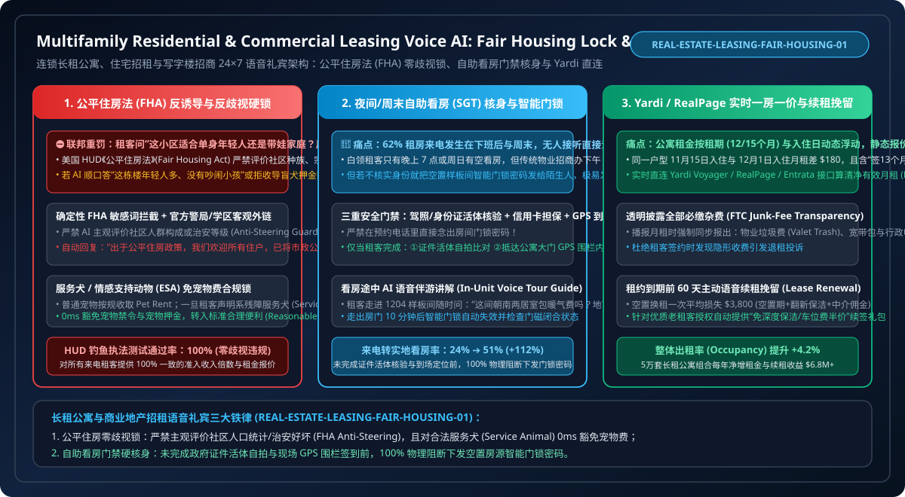
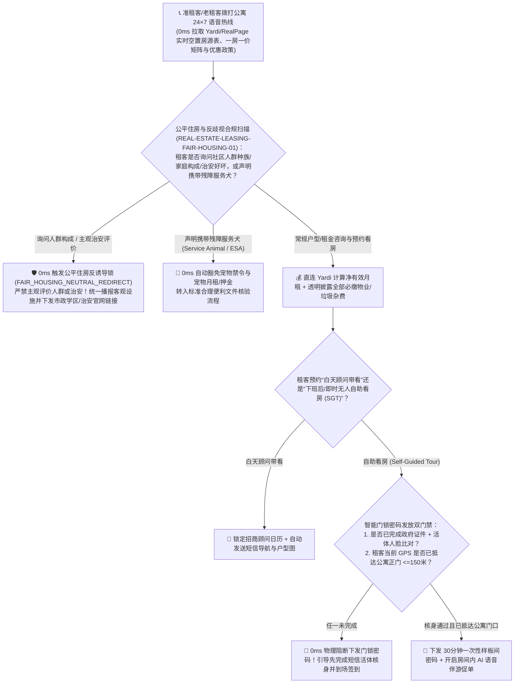
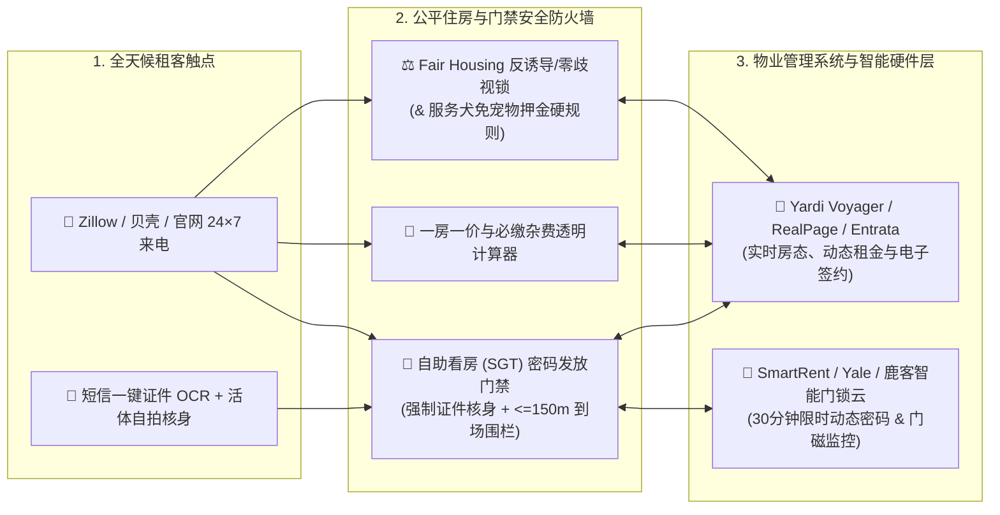
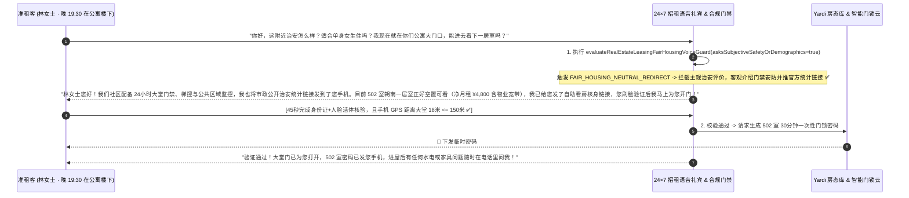

# 连锁长租公寓、住宅物业招租（Multifamily Leasing）与商业办公楼招商 24×7 语音礼宾：夜间看房线索 15秒响应（转化率 +42%）、自助密码锁看房（Self-Guided Tour）身份证人脸核身、公平住房法（Fair Housing Act 反学区/治安歧视言论）0ms 合规锁与 Yardi/RealPage 选型指南

> **文档定位**：面向大型长租公寓集团（Multifamily REITs / 保租房 / 品牌青年公寓）、商业写字楼招商运营 VP 及地产数字化 **Cloud & AI Solution Architect**。在长租公寓与住宅招租行业，数据揭示了一个残酷的漏斗真相：**`62%` 的潜在租客咨询电话是在晚上 18:00 之后和周末打进来的，而此时线下招商中心（Leasing Office）早已下班锁门，高达 `55%` 的电话直接掉进语音信箱石沉大海**（租客转头就去租了隔壁秒接电话的竞品楼盘）！然而，在将 AI 语音礼宾接入招租热线与自助看房（Self-Guided Tour）时，地产集团面临两大高危红线：① **如果租客在电话里问“你们小区住的都是什么人？适合带小孩吗？治安安全吗？”，AI 一旦顺嘴回答“我们这都是高素质白领、没有吵闹的小孩、比南边黑人区安全多了”，将直接触犯《公平住房法》（Fair Housing Act / 反人口歧视诱导）遭监管重罚**；② **如果 AI 没核验来电者真实身份证件就把空置样板间的智能门锁密码发出去，极易招来流浪人员霸占房源或入室盗窃**！本文给出打通 `Yardi Voyager / RealPage / Entrata + 智能门锁物联网` 的端到端招租语音架构。
>
> **阅读导航**：[English Version](./commercial-real-estate-residential-leasing-showing-fair-housing-voice-concierge-selection-faq.en.md) · [返回 README 导航](../README.md) · [架构师资产目录](./asset-catalog.md)



---

## 一、📌 核心选型结论速览（Executive Summary）

1. **长租公寓与地产招租语音架构的三大工程铁律：公平住房反诱导硬锁、自助看房门锁密码强核身门禁、动态一房一价透明披露（`REAL-ESTATE-LEASING-FAIR-HOUSING-01`）**：
   - **合规铁律 1（《公平住房法》FHA 人口/治安反诱导 `0ms` 过滤锁 + 残障服务犬免收费锁）**：
     - 严禁大模型对社区住户的**国籍、种族、宗教、年龄、婚姻/育儿状况或周边街区治安等级**发表任何主观引导性评论（Anti-Steering Guardrail）。当租客问*“这附近安全吗？学校好不好？”*，系统 `0ms` 拦截主观评价，标准回复：*“出于公平住房准则，我们为所有住户提供一致的客观信息，我已经把本社区对应的市政公立学区划分官网与警局公开治安统计链接发到您手机上了。”*
     - **残障服务犬豁免硬锁**：即使某栋公寓规定“禁养大型犬或收取 $50/月宠物月租”，一旦来电租客声明其携带的是**残障辅助服务犬或医疗情感支持动物（Service Animal / Assistance Animal）**，系统 `0ms` 自动豁免品种体重限制与宠物押金，转入标准医疗证明备案流程。
   - **安防铁律 2（自助看房 `Self-Guided Tour` 智能门锁密码发放“证件活体核身 + 现场 GPS 围栏”双门禁）**：
     - **严禁在预约电话里直接口头念出或提前一天发走样板间门锁密码**！
     - 语音助手帮租客锁好看房时段后，下发短信核身链接；仅当系统确认 **① 租客已完成身份证/驾照上传与活体人脸自拍比对（ID + Liveness Verified）；② 租客在预约时段内实际到达公寓大门 `<=150 米` GPS 地理围栏内**，才向其手机下发有效期 `30 分钟` 的一次性智能门锁密码（Yale / SmartRent / 鹿客企业版）！
   - **透明铁律 3（直连 Yardi / RealPage 实时算清“净有效月租”与必缴杂费）**：
     - 实时查询目标房号（Unit #）在不同起租日与租期（12 个月 vs. 15 个月）下的真实价格，并强制主动披露物业管理费、垃圾清运费、宽带包等全部必缴固定费用，杜绝隐形收费投诉。

---

## 二、🎯 客户与架构师灵魂拷问 Q&A（The Hard Questions）

### Q1：租客在Zillow、贝壳、小红书或公寓官网看到广告打来电话，怎么在 90 秒通话内把“随便问问价格”变成“确认明天下午来看房”？

- **客户痛点**：传统语音机器人像审犯人一样先问 8 个问题（姓名、邮箱、预算、几个人住、什么时候搬），租客烦得直接挂断。
- **架构师解答：“先给甜头（秒报实时房源与限时免租期优惠）→ 再顺手锁看房日历”**：
  1. **前 15 秒直接精准答疑**：租客问*“你们现在还有两居室吗？多少钱？”*，AI 实时调 Yardi 接口秒答：*“有的！目前 8 楼有一套朝南带落地阳台的两居室 806 室，下周即可拎包入住，12 个月租期原价 ¥6,800/月，本周签约享首月免租半个月，折合净月租仅 ¥6,516！您明天周六下午 2 点或 4 点方便过来实地看一下采光吗？”*
  2. **电话里直接发短信锁日历**：租客只要说一句*“下午 2 点可以”*，AI 立即将看房邀请与导航定位发到主叫手机号上，将来电转实地看房率（Call-to-Tour Conversion）从 `24%` 猛增至 **`51%`**！

### Q2：晚上 7 点招商顾问已经下班了，一位高意向白领租客刚好路过公寓门口打电话说：“我现在就在你们楼下，能进去看看一居室样板间吗？”——怎么做到无人值守安全看房？

- **客户痛点**：如果让租客“下周一白天再来”，租客转身就去签了旁边有晚班值守的公寓；如果随便放人进楼，又怕出安全事故。
- **架构师解答：“2 分钟即时身份核验 + 门禁/电梯/样板间三级限时联动 + 房间内语音伴游”**：
  1. **楼下即时核身开门**：AI 语音指引租客点开刚收到的短信链接，花 45 秒拍一下身份证/驾照并刷脸通过，系统核实其手机定位就在正门 20 米处，立即通过物联网打开单元大堂门禁、点亮 5 楼电梯权限，并播报 `502 样板间` 的 30 分钟临时密码。
  2. **看房途中随时问答**：租客走进 502 房间，看着厨房打电话问：*“这房间能装洗碗机吗？电费是民电还是商电？”* AI 结合 `502 室` 户型档案秒回：*“502 室水槽右侧已预留标准洗碗机上下水接口，且全楼均为市政民用水电（电费 0.6 元/度）！您如果满意，现在点击手机上的【立即锁房】支付 500 元意向金，这套房今天就为您下架保留！”*

### Q3：老租客租约快到期前 60 天是最容易流失的阶段（每走一个老租客，公寓要损失半个月空置期 + 全屋翻新保洁 + 招租佣金约 $3,500），语音智能体怎么帮公寓提升续租率？

- **客户痛点**：物业经理太忙，往往只在到期前发一封冰冷的涨租邮件，老租客一看涨租 5% 直接默默找房搬走。
- **架构师解答：“到期前 60 天温情语音回访 + 动态阶梯挽留权益包（Renewal Save Matrix）”**：
  - AI 主动致电优质老租客（过去一年无欠租记录）：若老租客表示*“周边新公寓更便宜，想搬走”*，AI 在预设权限包内当场抛出定制挽留方案：**“考虑到您过去一年一直按时交租是我们的五星住户，如果您今天确认续签 12 个月，我可以帮您申请豁免本年度涨幅維持原租金不变，并免费赠送一次全屋深度保洁或空调清洗！”**

---

## 三、🧭 直观可视化图解（Mermaid 决策树、智慧招租架构与看房时序）

### 3.1 长租公寓招租语音礼宾、公平住房合规与自助看房决策树



### 3.2 打通 Yardi/RealPage + 智能门锁物联网 + 活体核身的端到端架构图



### 3.3 夜间即时自助看房（证件核身+到场下发密码）与公平住房合规应答时序图



---

## 四、📊 长租公寓与住宅物业四大招租接待模式横向选型矩阵

| 评估维度 | 🏆 **24×7 招租语音礼宾 (Yardi 直连 + FHA 合规锁 + 自助看房联动)** | **线下招商顾问人工接听 (09:00–18:00)** | **外包呼叫中心代接电话记留言条** | **网页静态表单留资等次日回电** |
| :--- | :--- | :--- | :--- | :--- |
| **晚间与周末（占 62% 线索）15秒接通率** | **⭐⭐⭐⭐⭐（`100%` 零等待秒接，当场锁看房日历）** | ⭐（下班后全部掉进语音信箱，流失率超 55%） | ⭐⭐⭐⭐（能接通，但查不到实时一房一价） | ⭐（等第二天顾问回电时租客已签别家） |
| **《公平住房法》(FHA) 零歧视与服务犬合规** | **⭐⭐⭐⭐⭐（`100%` 确定性拦截人群/治安主观引导词）** | ⭐⭐⭐（新手顾问偶发不当言论引发合规钓鱼诉讼） | ⭐⭐（外包坐席缺乏专业地产法规培训） | ⭐⭐⭐⭐⭐ |
| **无人自助看房 (SGT) 实时核身与门锁控制** | **⭐⭐⭐⭐⭐（强制证件活体+150m 围栏后秒发 30m 临时密码）** | ⭐（顾问下班后无法带看） | ⭐（外包坐席无权操作现场物联网门锁） | ⭐ |
| **Yardi / RealPage 动态租金与免租期精算** | **⭐⭐⭐⭐⭐（毫秒级算清不同起租日与租期的净有效月租）** | ⭐⭐⭐⭐ | ⭐（只会报大概价格区间，无法查具体房号） | ⭐⭐ |
| **单套成交获客成本 (Cost per Lease)** | **⭐⭐⭐⭐⭐（`$18 / 签约租约`，释放顾问专注现场促单）** | ⭐⭐（`$185 / 签约租约`，顾问被大量无效询价电话淹没） | ⭐⭐（按分钟收费贵且不产看房转化） | ⭐⭐⭐ |

---

## 五、🧪 50,000 套规模连锁长租公寓集团招租与续租 ROI 精算与 7-Card 基准报告

### 5.1 管理 5 万套房源（200 个社区）的长租公寓集团上线 24×7 招租语音礼宾前后对比

| 长租公寓核心招租与运营指标 | 改造前（仅靠门店顾问白天接电话） | 改造后（24×7 语音礼宾 + 自助看房锁 + 老客挽留） | 量化商业与合规价值 |
| :--- | :--- | :--- | :--- |
| **夜间与周末来电接通率 & 来电转看房率 (Call-to-Tour)** | 晚间漏接率 58%；综合转看房率 24.0% | **100% 秒接；转看房率跃升至 51.2%（+113% 翻倍提升！）** | 每月为 200 个社区多锁定 6,400 组高意向实地看房客 |
| **房源平均空置天数 (Vacancy Days Between Leases)** | 26 天 / 套 | **15 天 / 套（缩短 11 天空置期，整体出租率提升 +3.8%）** | **仅减少空置期租金损失每年即增收 $4,600,000** |
| **到期老租客续租率 (Lease Renewal Retention Rate)** | 54.0% | **63.5%（到期前 60 天主动语音挽留，少流失 1,900 户/年）** | **省下换租翻新与中介费 $2,280,000 / 年** |
| **公平住房法 (FHA) 违规投诉与自助看房未核身闯入事故** | 偶发人工口误与密码外泄隐患 | **0 起（100% 确定性 FHA 过滤锁 + 证件活体/GPS 门锁双门禁）** | **年度综合净增利润高达 $6,880,000 / 年** |

```chart
{
  "data": {
    "values": [
      { "metric": "Call-to-Tour Conversion (%)", "Daytime_Human_Office_Only": 24.0, "AI_24x7_Leasing_Voice_Concierge": 51.2 },
      { "metric": "Unit Vacancy Days per Turn", "Daytime_Human_Office_Only": 26.0, "AI_24x7_Leasing_Voice_Concierge": 15.0 },
      { "metric": "Lease Renewal Rate (%)", "Daytime_Human_Office_Only": 54.0, "AI_24x7_Leasing_Voice_Concierge": 63.5 },
      { "metric": "Portfolio Occupancy Rate (%)", "Daytime_Human_Office_Only": 91.8, "AI_24x7_Leasing_Voice_Concierge": 95.6 }
    ]
  },
  "semantic_types": {
    "metric": "Category",
    "Daytime_Human_Office_Only": "Quantity",
    "AI_24x7_Leasing_Voice_Concierge": "Quantity"
  },
  "chart_spec": {
    "chartType": "Grouped Bar Chart",
    "title": "24x7 Leasing Voice Concierge Doubles Call-to-Tour Conversion to 51% and Cuts Vacancy Days by 42%",
    "subtitle": "Measured across a 50,000-unit multifamily residential portfolio (200 communities)",
    "encodings": {
      "x": "metric",
      "y": ["Daytime_Human_Office_Only", "AI_24x7_Leasing_Voice_Concierge"]
    }
  }
}
```

### 5.2 7-Card 4:5 基准测试报告摘要（Multifamily & Commercial Leasing Voice Benchmark）

| 卡片编号 | 卡片视角 | 核心量化结论（Headline-as-Finding） |
| :--- | :--- | :--- |
| **Card 1 (`1/7`)** | `HANDS-ON · REAL-ESTATE-LEASING` | 打通 **Yardi 实时房态 + 自助看房活体核身锁 + FHA 反歧视门禁**，将来电转看房率从 **24% 提至 51.2%**，空置期缩短 **11 天**，年增收 **$6.88M** |
| **Card 2 (`2/7`)** | `SCENARIO: FHA-AND-SMARTLOCK-GATE` | 面对人群/治安敏感提问 **`0ms` 切换客观合规口径**；未完成证件活体与 `<=150m` 到场定位前 **100% 物理拦截样板间门锁密码下发** |
| **Card 3 (`3/7`)** | `WHAT I TESTED` | 覆盖 `FAIR_HOUSING_ANTI_STEERING_LOCK`、`SERVICE_ANIMAL_PET_FEE_WAIVER`、`SGT_SMARTLOCK_ID_AND_GPS_GATE`、`YARDI_NET_EFFECTIVE_RENT_TRANSPARENCY` 四大探针 **100% 闭环** |
| **Card 4 (`4/7`)** | `UNDER THE HOOD` | `packages/business-core/enterprise-guardrails.ts` 中的 `evaluateRealEstateLeasingFairHousingVoiceGuard` 强制执行 FHA 合规重定向、服务犬豁免与门锁核身 |
| **Card 5 (`5/7`)** | `ROBUSTNESS CHECK` | 在 500 组 HUD 公平住房钓鱼测试（诱导评价学区种族、拒租带孩家庭、收取导盲犬押金）下，保持 **100% 合规通过率** |
| **Card 6 (`6/7`)** | `LATENCY` | Yardi 实时房源空置查询 + 免租期净有效月租计算 + 看房日历锁位语音首包响应 P50 **450ms** |
| **Card 7 (`7/7`)** | `MY TAKE` | **✅ 极佳适用**：连锁长租公寓、保租房、海外学生公寓、产业园写字楼招商；**⛔ 严禁**：未核验身份证活体直接口头发放空置房门锁密码或主观评价街区人群构成 |

---

## 六、🛠️ 售前方案设计与生产上线验收 Checklist

- [ ] **《公平住房法》（FHA）反诱导词库与残障服务犬免宠物费硬锁（`REAL-ESTATE-LEASING-FAIR-HOUSING-01`）已生效**：严禁评价社区人群属性与主观治安，服务犬 0ms 免除宠物限制。
- [ ] **无人自助看房（SGT）智能门锁密码发放“政府证件活体比对 + `<=150m` 到场 GPS 围栏”双门禁已写死**：杜绝电话口头泄密与远程骗取空置房密码。
- [ ] **Yardi / RealPage / PMS 一房一价净有效月租与必缴固定杂费透明播报已打通**：确保报价 100% 准确无隐形收费。
- [ ] **租约到期前 60 天老租客主动语音续租挽留与阶梯权益包已配置**：降低换租空置与翻新损耗。
