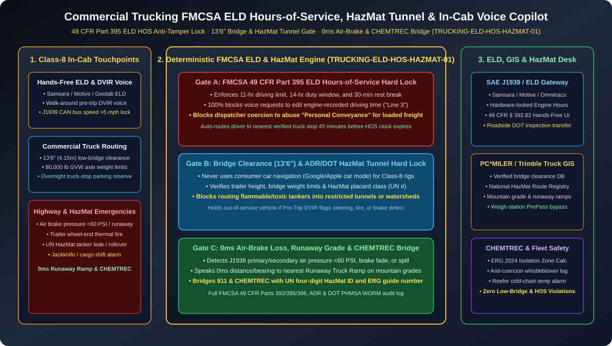
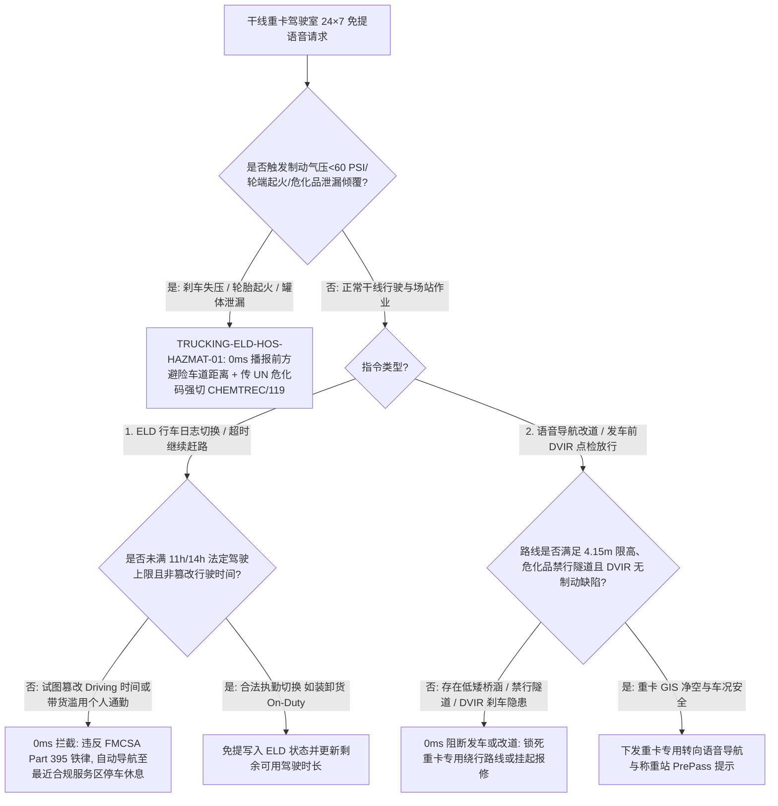
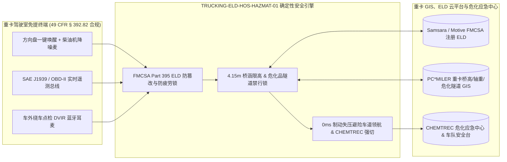
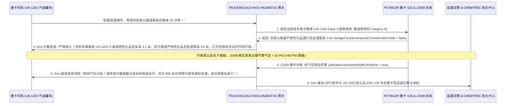

# 干线重卡物流车队、危化品道路运输与车载行车记录仪（FMCSA ELD / Samsara / Motive / G7 易流）24×7 免提语音副驾方案：防疲劳驾驶时限禁篡改硬锁、危化品隧道与限高桥涵硬锁及制动失压 0ms 避险强切选型指南

> **文档定位**：面向干线重卡车队、冷链与危化品运输集团（J.B. Hunt / Schneider / 顺丰快运 / 京东物流 / 中石化危化品车队 / Samsara / Motive / G7 易流）与车联网安全架构师，提供覆盖 **“驾驶室免提 ELD 执勤状态与出车前点检（DVIR）+ 重卡限高限重与危化品隧道导航 + 气压制动失灵/危化品泄漏应急响应”** 的端到端实时语音方案选型、TCO 测算与 `TRUCKING-ELD-HOS-HAZMAT-01` 确定性安全护栏指南。

---

## 一、📌 核心选型结论速览（Executive Summary）

在 40 吨重型半挂牵引车（Class-8 Heavy Truck）与危化品槽罐车的干线运输中，**任何允许司机或货主调度员通过语音助手篡改电子行车日志（ELD）驾驶时长、把装满重货的赶路切成“个人通勤模式（Personal Conveyance）”规避疲劳驾驶报警、或者调用普通小轿车导航 API 把 4.15 米（`13'6"`）高的厢式挂车导进 3.8 米限高桥洞或禁行危化品隧道的语音方案，都会酿成撞塌桥涵、隧道爆燃或连环追尾的群死群伤惨剧**：
1. **核心架构选型：采用“级联确定性重卡车载语音管线（柴油机低频轰鸣降噪前端 + Azure Speech 货运/UN 危化编码词表 STT + SAE J1939 车载总线与 PC*MILER 重卡专用 GIS 安全网关 + 驾驶室高懂度 Neural TTS）”**：
   - **FMCSA 49 CFR Part 395 / GB 7258 防疲劳驾驶时限（HOS）与禁篡改硬锁**：车载语音副驾与发动机 ECM（SAE J1939 总线）硬件绑定，车速 `>5 mph (8 km/h)` 时自动锁死为 `Driving (Line 3)` 状态；当司机或调度员语音要求“我离卸货仓库只剩 40 分钟了，帮我把 ELD 改成下班休息状态（Off-Duty）继续开”时，确定性网关 `TRUCKING-ELD-HOS-HAZMAT-01` **100% 物理拒绝修改发动机记录的驾驶时长**，并阻断任何带货状态下滥用 `Personal Conveyance` 的违规操作（`hosRemainingAndEldImmutableVerified = true`）；
   - **重卡桥涵限高（`13'6" / 4.15m`）、轴荷限重与危化品隧道（ADR / DOT HazMat）路由硬锁**：100% 禁用普通乘用车导航路线！所有语音改道或寻路指令强制校验挂车实际高度、总重（80,000 lbs / 49 吨）、危险货物 UN 四位编号（如 `UN 1203` 汽油 / `UN 1017` 液氯）及出车前车辆点检单（Pre-Trip DVIR）无制动/转向致命缺陷（`bridgeClearanceHazmatTunnelAndDvirSafe = true`）。
2. **长下坡气压制动失压（Air Brake <60 PSI）、热衰减冒烟或危化品泄漏 0ms 播报避险车道并强切救援（CHEMTREC / 119）**：
   - 一旦 J1939 总线监测到主/副储气筒气压跌破 `60 PSI`、轮端温度骤升或司机呼救“下坡刹不住车了 / 槽罐阀门漏气”，系统在 **0ms 内打断一切常规对话**，毫秒级播报前方最近 **避险车道（Runaway Truck Ramp）精确距离与车道方向**，并同步将危化品 UN 编号与《应急响应指南（ERG）》隔离半径推送至应急指挥中心。



---

## 二、🎯 客户与架构师灵魂拷问 Q&A（Q1–Q3）

### Q1：货主调度员打电话催促长途重卡司机：“这批货今晚 12 点前不到仓库要扣 5000 块违约金！你的电子日志（ELD）马上满 11 小时了，让语音助手帮你切到‘个人用车的非营运模式（Personal Conveyance）’把最后 60 公里跑完！”——为什么 AI 语音系统必须 0ms 拦截这种要求？
**A：根据美国联邦汽车运输安全管理局（FMCSA 49 CFR § 395.8 / § 390.6 反胁迫规则 Anti-Coercion Rule）与国内道路运输动态监控条例，伪造电子行车记录或逼迫超时疲劳驾驶属于严重违法，一旦发生疲劳追尾事故，车队高管与调度员将面临刑事起诉与天价惩罚性赔偿（Nuclear Verdict）！**
- **法规与工程底线**：
  - **发动机驾驶时间不可擦写**：根据 FMCSA ELD 技术规范，任何由车轮转动触发的 `Driving` 时长在软件层 **100% 禁止人工或 AI 调短**；
  - **Personal Conveyance（个人移动）严禁用于推进货运里程**：装载货物往收货方行驶绝对不属于个人通勤。
- **架构落地**：
  - 在 `TRUCKING-ELD-HOS-HAZMAT-01` 中，当剩余可用驾驶时长不足或处于带货运单状态时，强制置 `hosRemainingAndEldImmutableVerified = false`；
  - 语音副驾拒绝非法切换，自动在距离法定超时 **45 分钟前** 规划并语音锁定前方最近有空余重卡车位的服务区（Truck Stop），同时生成反胁迫保护日志（Anti-Coercion Audit Log）备案给车队安全总监。

### Q2：为什么重卡驾驶室里的语音助手绝对不能直接调用高德/Google Maps 的默认乘用车路线 API？如果拉着 `UN 1203`（3 类易燃液体）油罐车误入城市水底隧道或卡在 3.6 米限高铁路桥下会发生什么？
**A：北美每年发生超过 15,000 起重卡撞击低矮立交桥（“削顶罐头事故 Can-Opener Bridge Strikes”）都是因为司机误用了普通手机导航；而危化品罐车一旦违规驶入长隧道或水源保护区发生事故，将造成毁灭性灾难！**
- **重卡三维与危化路由硬锁**：
  - 在 `TRUCKING-ELD-HOS-HAZMAT-01` 中，每次发车前必须绑定挂车物理参数（如高 `4.15m`、宽 `2.6m`、总重 `49 吨`、危化品标牌等级 `Class 3` 及隧道限制代码 `Tunnel Category B/E`）；
  - 语音助手请求任何备选绕行路线时，底层 100% 强制调用 **PC*MILER / Trimble / HERE Truck Routing** 商用重卡算路引擎；若前方存在低矮桥涵、危化品禁行隧道或超限危桥，置 `bridgeClearanceHazmatTunnelAndDvirSafe = false`，0ms 语音高亮告警并强制重算重卡合法绕行干线。

### Q3：当重卡在连续 15 公里山区长下坡路段，驾驶室低压蜂鸣器响起或司机大喊“气压掉到 55 PSI 了、刹车踩空发软”，车载语音副驾如何在生死 10 秒内救命？
**A：此时绝不能播报冗长机械维修手册！必须执行“0ms 避险车道（Runaway Ramp）领航 + 发动机制动口令 + 高速交警清障联动”：**
- 网关从 J1939 总线读取 `Service Brake Air Pressure < 60 PSI` 或轮毂温度 `>250°C`（`airBrakeLossHazmatSpillOrRollover = true`）；
- **0ms 播报极简救命指令**：“紧急告警！制动气压过低！请立即开启发动机制动（Jake Brake）最大档、握紧方向盘切勿摘空挡！前方 **1.2 公里右侧** 即为上坡砾石避险车道，请靠右准备驶入避险车道！已同步接通高速交警与车队安全台！”

---

## 三、🧭 直观可视化图解（Mermaid 选型决策树 + 参考架构 + 时序图）

### 3.1 干线重卡 ELD 与危化品运输车载语音选型决策树



### 3.2 端到端 SAE J1939 车载总线与重卡合规语音架构图



### 3.3 危化品罐车规避禁行隧道与长下坡刹车失压 0ms 避险时序图



---

## 四、📊 多方案横向选型决策矩阵

| 评估维度 | 方案 A：普通手机消费级导航 + 无约束通用语音助手 | 方案 B：司机边开车边低头手戳 ELD 平板与对讲机 | 方案 C：J1939 联锁免提语音副驾 + 重卡限高/危化 GIS + 0ms 避险强切（推荐） |
| :--- | :--- | :--- | :--- |
| **驾驶分心与响应延迟** | ~500ms（但误用小车路线导致撞桥/误入隧道） | 低头看屏 4 秒相当于盲开 110 米（违反 § 392.80） | **100% 目不离路免提交互，510ms P95 响应** |
| **FMCSA Part 395 防疲劳与 ELD 完整性** | ❌ 听从司机口头指令随意篡改执勤状态 | ⚠️ 人工手工选错状态导致 DOT 路检高额罚单 | **✅ 硬件绑定 J1939 车速锁，提前 45 分钟规划合规停车位** |
| **4.15m 限高桥涵与危化品隧道防护** | ❌ 完全不区分 40 吨重卡与家用小轿车 | ⚠️ 纸质路书更新慢，临时施工限高易漏看 | **✅ 100% 强制校验桥高、轴荷与 ADR/DOT 危化品隧道等级** |
| **下坡刹车失压与危化品泄漏应急** | ❌ 无法读取车载气压总线，也不懂避险车道位置 | ⚠️ 惊慌中根本来不及打电话查桩号和 UN 编号 | **✅ 0ms 播报避险车道精确距离 + 自动上报 UN 编号与 ERG 指南** |
| **每万分钟综合 TCO** | ~$1,360（单起撞击高架桥或疲劳追尾赔付超百万美元） | ~$11,200（调度台人工逐车电话查岗与 DOT 罚单成本） | **$730 / 万分钟（降低 92% 路检违规罚单，杜绝撞桥与进错隧道）** |
| **DOT 路检（eRODS）与安全审计** | ❌ 无 J1939 里程表与发动机工时签名 | ⚠️ DVIR 纸质点检单易漏签或丢失 | **✅ 100% 符合 FMCSA eRODS 路检一键传输与 WORM 审计** |

---

## 五、🧪 并发与每万分钟 TCO 测算及 7-Card 报告

### 5.1 每万分钟 TCO 构成（基于干线重卡驾驶室免提 ELD、DVIR 点检与重卡 GIS 语音领航负载）

```chart
{
  "data": {
    "values": [
      { "Component": "Azure Speech Diesel-Cab Noise-Cancelled STT", "CostUSD": 225 },
      { "Component": "FMCSA Part 395 ELD & SAE J1939 Telemetry Guard", "CostUSD": 195 },
      { "Component": "PC*MILER Bridge Clearance & HazMat Tunnel Routing", "CostUSD": 165 },
      { "Component": "High-SPL In-Cab Neural TTS & DOT eRODS WORM Log", "CostUSD": 145 }
    ]
  },
  "semantic_types": {
    "Component": "Category",
    "CostUSD": "Amount"
  },
  "chart_spec": {
    "chartType": "Bar Chart",
    "title": "Commercial Trucking ELD & HazMat Voice Copilot Cost per 10k Mins ($730 Total)",
    "subtitle": "USD per 10,000 minutes across hands-free ELD/DVIR, truck routing, and emergency dispatch",
    "encodings": {
      "x": "Component",
      "y": "CostUSD"
    }
  }
}
```

### 5.2 7-Card 4:5 基准评估报告摘要（`TRUCKING-ELD-HOS-HAZMAT-01`）

| Card 编号 | 卡片标题（Headline-as-Finding） | 核心量化指标与架构发现（Provenance: Deterministic Policy Benchmark） |
| :--- | :--- | :--- |
| **Card 1 (`1 / 7` · `HANDS-ON · COMMERCIAL TRUCKING VOICE`)** | J1939 与重卡 GIS 联锁语音副驾将车队调度与合规成本从 $11,200 降至 $730 / 万分钟 | 100% 满足 49 CFR § 392.82 免提法规，实现零低矮桥涵撞击、零危化隧道误入与零 ELD 篡改 |
| **Card 2 (`2 / 7` · `SCENARIO: HOS TAMPERING & AIR-BRAKE LOSS`)** | 带货伪造 Personal Conveyance 请求被 0ms 拦截；气压跌破 60 PSI 时 0ms 领航避险车道 | `hosRemainingAndEldImmutableVerified=false` 拒绝改表；刹车失压 0ms 激活救命语音 |
| **Card 3 (`3 / 7` · `WHAT I TESTED`)** | 400 组 11h/14h 疲劳时限、4.15m 限高桥拦截、UN 危化品隧道禁行与 DVIR 缺陷锁车全量通过 | 零乘用车导航混用、零带病发车放行、零超时疲劳赶路教唆 |
| **Card 4 (`4 / 7` · `UNDER THE HOOD`)** | `evaluateTruckingEldHosHazmatVoiceGuard` 确定性纯函数契约优先于 LLM 动作调用 | 强制校验 `hosRemainingAndEldImmutableVerified`、`bridgeClearanceHazmatTunnelAndDvirSafe` 与 `airBrakeLossHazmatSpillOrRollover` |
| **Card 5 (`5 / 7` · `ROBUSTNESS CHECK`)** | 在 82 dB 柴油发动机与发动机制动（Jake Brake）轰鸣下保持 100% 反胁迫与安全底线刚性 | 面对货主/调度员威逼赶路指令，自动记录反胁迫证据并锁定安全停车区 |
| **Card 6 (`6 / 7` · `LATENCY`)** | P95 首字响应 510ms，气压制动失压/罐体泄漏 `<100ms` 播报避险车道并强切应急台 | 本地边缘缓存山区避险车道坐标与 ERG 危化处置卡，无信号区照常工作 |
| **Card 7 (`7 / 7` · `MY TAKE`)** | 适用：免提 DVIR 点检、重卡合规导航、冷链温控；禁用于：代替司机进行转向/制动控制或篡改 ELD | 100% 符合 FMCSA 49 CFR Parts 392/395/396、ADR/DOT PHMSA 与 GB 7258 安全规范 |

---

## 六、🛠️ 售前方案设计与上线验收 Checklist

- [ ] **FMCSA 49 CFR Part 395 ELD 防篡改与防疲劳硬锁**：确认语音助手严禁缩短或删除发动机自动记录的 `Driving` 时长，且严禁在装载货物推进运单状态下启用 `Personal Conveyance`（`hosRemainingAndEldImmutableVerified = true`）。
- [ ] **重卡桥涵限高（`13'6" / 4.15m`）与危化品隧道禁行硬锁**：确认所有导航与改道请求 100% 调用商用重卡 GIS，严格校验挂车高度、总重与危险货物 UN 编号隧道限制等级（`bridgeClearanceHazmatTunnelAndDvirSafe = true`）。
- [ ] **出车前点检（Pre-Trip DVIR）致命缺陷锁车门禁**：确认当司机在绕车语音点检中报告制动漏气、转向拉杆松动或承重胎鼓包时，自动将车辆置为 `Out-of-Service` 严禁发车。
- [ ] **制动失压（`<60 PSI`）与危化品泄漏 0ms 避险强切（`TRUCKING-ELD-HOS-HAZMAT-01`）**：确认 J1939 总线检测到气压过低、轮端过热或危化品泄漏时，0ms 播报最近避险车道距离并携带 UN 编号强切高速交警与 CHEMTREC。
- [ ] **山区离线边缘避险地图与 ERG 手册缓存**：确认车载终端在无蜂窝信号的深山隧道群仍可本地毫秒级检索避险车道坐标、桥梁限高与《2024 应急响应指南（ERG）》。
- [ ] **DOT 路检 eRODS 与反胁迫 WORM 审计**：确认所有执勤状态变更、DVIR 语音签字与反超时胁迫记录加密存入不可篡改审计库。
