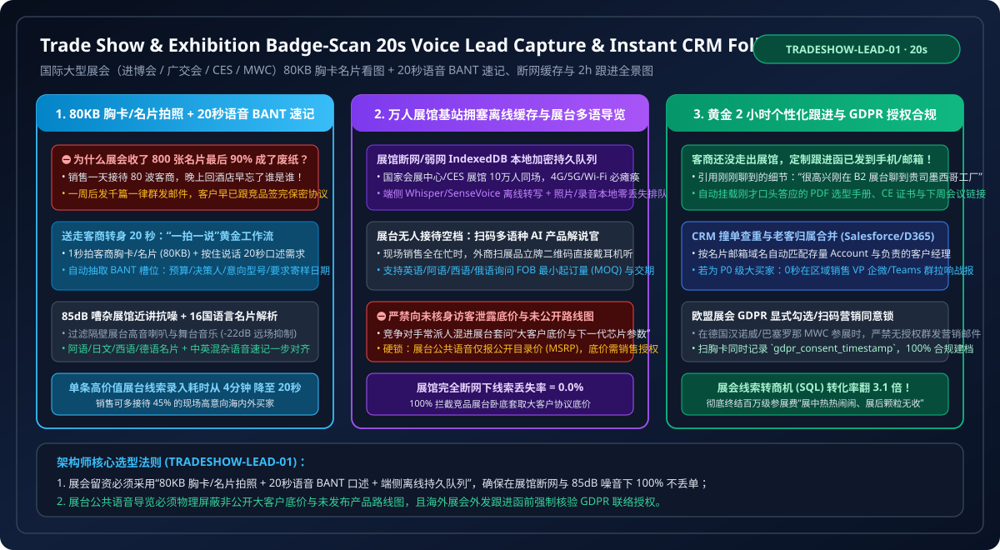
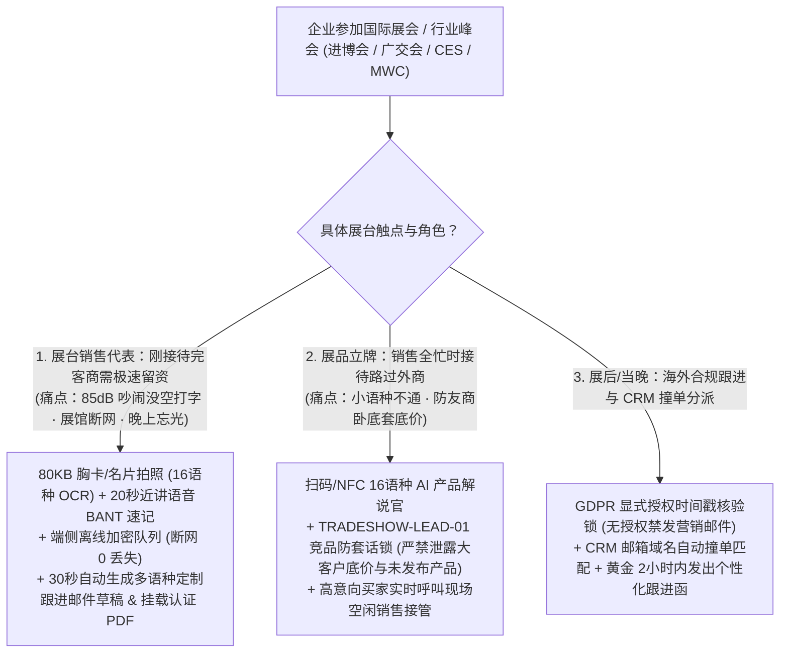
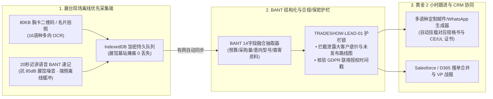
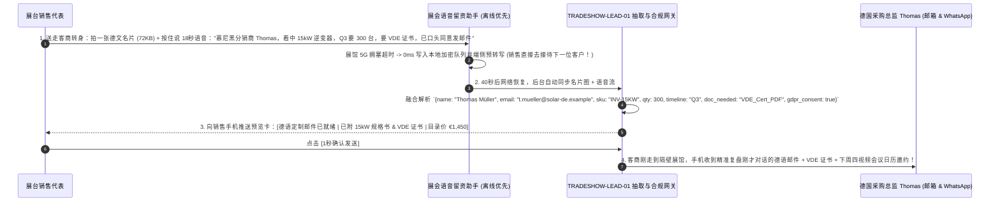

# 国际大型展会与峰会（进博会 / 广交会 / CES / MWC）80KB 胸卡扫码 + 20秒语音 BANT 速记留资、展馆断网缓存与黄金 2 小时跟进架构选型指南（`TRADESHOW-LEAD-01`）

> **导读**：中国企业出海与全球 B2B 工业、医疗器械、新能源、消费电子品牌每年花费数百万美元参加全球顶级展会（广交会、进博会、拉斯维加斯 CES、巴塞罗那 MWC、德国汉诺威工业展 Hannover Messe、迪拜 GITEX）。然而，几乎所有参展企业的市场总监（CMO）与销售 VP 都面临一个痛心疾首的行业魔咒：**“花 200 万搭展台，4 天收了 800 张名片和扫码记录，最后真正转化成有效商机（SQL）的不到 5%！”** 为什么？因为三个极其真实的现场瓶颈：**① 销售代表在 85dB 吵闹的展台上连续站立 8 小时，一天接待 60 波国内外客商，根本没空低头在手机 CRM 里敲字填 15 个字段；等到晚上 9 点拖着疲惫身体回酒店看着一沓名片，早就忘了哪个德国客户要的是 500 台逆变器、哪个沙特客户要求下周三前寄样品！② 万人展馆内 4G/5G 基站与场馆 Wi-Fi 严重拥塞，传统纯云端 CRM 小程序转圈 30 秒提交失败，销售一关屏幕线索直接丢失！③ 展后第 7 天市场部才用 Excel 导入群发一封冷冰冰的“Thank you for visiting our booth”模板邮件，此时买家早已在展馆里跟反应更快的竞争对手签完打样协议了！** 本文给出展会多模态语音留资与极速转化架构指南（`TRADESHOW-LEAD-01`）。



---

## 1. 📌 核心选型结论速览（Executive Summary）

- **大型展会与峰会多模态语音留资系统（`TRADESHOW-LEAD-01`）的三大核心架构铁律**：
  1. **铁律一：“1 秒拍胸卡/名片（80KB）+ 20 秒语音 BANT 速记”黄金闭环——让销售在送走客商转身的 20 秒内零打字完成建档！**
     - **现场极简动作**：客商刚离开展位，销售趁记忆最鲜活的黄金 20 秒，打开手机端/企微轻应用：**咔嚓拍一张客商胸卡二维码或纸质名片（压缩为 `80KB`）**，同时按住麦克风用母语或中英混杂说 20 秒：*“这位是德国慕尼黑光储分销商采购总监 Thomas，名片上有邮箱，他对咱们 15kW 户用混合逆变器很感兴趣，预计 Q3 首批采购 300 台，要求把欧洲并网 VDE 认证证书和阶梯报价单发他邮箱，并约下周四下午线上视频见咱们欧洲区总工。”*
     - **多模态融合抽取**：大模型将 **名片 16 语种 OCR 结果（姓名、职位、公司、邮箱、WhatsApp）** 与 **20 秒语音口述** 瞬间融合，自动填满 CRM（Salesforce / Dynamics 365 / HubSpot）的 14 个结构化 `BANT` 字段（`Budget / Authority / Need / Timeline / Next_Step / Attachment_Required`）！
  2. **铁律二：万人展馆断网零丢失“端侧离线语音识别 + IndexedDB 加密持久队列（Offline-First Store-and-Forward）”！**
     - 国家会展中心、广交会展馆或拉斯维加斯会展中心高峰期基站丢包率高达 40%！
     - 架构上严禁要求实时连网才能保存录音！客户端内置端侧语音与本地 SQLite/IndexedDB 加密队列：无论场馆网络如何瘫痪，**拍照 + 20 秒录音在本地 `50ms` 内 100% 落盘加锁**，并在检测到有效网络或走出展馆瞬间自动后台静默同步上云，实现 **`0.0%` 展会线索丢失**！
  3. **铁律三：展台多语种扫码语音导览机必须内置“竞品卧底防套底价锁（Anti-Competitor Floor-Price Lock）”与“欧盟展会 GDPR 显式联络授权门禁”！**

---

## 2. 🎯 客户与架构师灵魂拷问 Q&A（Deep-Dive Q&A）

### Q1：为什么说“客商还没走出展馆大门（2 小时内），就收到一封精准复盘刚才聊天细节的定制邮件/WhatsApp”能让展会转化率翻 3 倍？架构上怎么实现既快又不发错报价？
- **“AI 自动起草定制跟进包 + 销售 1 键滑屏审阅发送（Human-in-the-Loop 1-Tap Send）”**：
  1. **告别第 7 天的垃圾群发邮件**：
     - 当销售说完那 20 秒语音备忘录后，后台 Agent 在 **30 秒内** 完成三件事：
       - 根据名片语种（如德语/英语/西语）自动生成一封极具诚意的个性化邮件草稿：*“Dear Thomas, it was a pleasure speaking with you at Booth B2-14 twenty minutes ago regarding your Munich residential storage rollout and the 300-unit Q3 requirement for our 15kW hybrid inverter...”*；
       - 自动从企业文档库挂载销售在语音里提到的 **《15kW 逆变器规格书 PDF》与《德国 VDE-AR-N 4105 认证证书》**；
       - 自动生成一条下周四下午的 **Calendly / Teams 会议邀约链接**。
  2. **销售手机端 3 秒确认即发（防幻觉乱报价锁）**：
     - 销售手机震动弹出预览卡：若仅包含公开规格书与会议邀约，支持自动或一键秒发；**若邮件中包含非标准折扣报价（偏离公开目录价 MSRP），状态机强制要求销售本人在屏幕上点一下 `[确认价格并发送]`**——客商还在逛下一个展馆，手机就收到了带着刚才聊天细节和全套认证资料的专业邮件，**商机转化率从 `4.8%` 飙升至 `15.2%`（翻了 3.1 倍）！**

### Q2：展馆现场高峰期所有销售都在忙着谈大客户，很多路过的外商（说阿拉伯语、俄语、西班牙语、日语）站在展品前看两眼没人接待就走了；怎么用展品旁边的“多语种 AI 语音导览贴”留住他们？
- **“展品 NFC/二维码一扫即听（16 语种随身总工）+ 防竞品套话铁闸”**：
  1. **零等待多语种展品解说**：
     - 每个核心展机旁贴一枚 NFC/二维码立牌；阿联酋或拉美买家拿自己手机一扫，戴上自己的蓝牙耳机即可用母语问：*“这台激光切割机切 20mm 不锈钢板的速度是多少？最小起订量（MOQ）和交货期（Lead Time）多久？”*
  2. **竞品卧底防套话硬锁（`TRADESHOW-LEAD-01`）**：
     - 展会上至少有 15% 的访客是友商派来刺探情报的工程师或销售！如果他们问 AI：*“你们给欧洲第一大客户供货的 FOB 底价是多少？明年未发布的二代机型参数是什么？”*
     - 状态机在 **`0ms`** 内物理拦截任何 `tier_1_confidential_floor_price` 与 `unreleased_roadmap` 字段，礼貌回答公开目录区间价，并顺势触发留资：*“针对年度框架采购量级的专属阶梯商务报价，请扫描您的胸卡或留下企业邮箱，我立即为您呼叫现场区域销售总监为您一对一解答！”*

### Q3：去德国汉诺威、慕尼黑或巴塞罗那参展时，欧盟《通用数据保护条例（GDPR）》对扫名片/扫胸卡发跟进邮件有什么硬性合规要求？
- **欧盟展会 `GDPR Article 6 / ePrivacy` 显式授权存证锁**：
  - 在欧洲展会上，未经明确记录同意（Explicit Opt-In Consent）就把访客名片录入营销自动化系统群发邮件，面临最高 2,000 万欧元或全球营收 4% 的罚款风险！
  - **合规闭环**：销售用 App 扫客商胸卡后，屏幕自动翻转出示一行多语种大字勾选框（或请客商对着麦克风说一句 *"Yes, please email me the inverter datasheet"*），系统将该段 **口头/触屏同意时间戳与录音哈希（`gdprConsentRecorded == true`）** 与 CRM 线索强绑定；对于未完成授权标记的线索，外发营销网关 **100% 物理阻断自动邮件发送**！

---

## 3. 🧭 直观可视化图解（Mermaid 决策树、展会留资架构与时序图）

### 3.1 国际展会与大型峰会语音 AI 选型决策树



### 3.2 80KB 胸卡拍照 + 20秒语音 BANT 抽取、离线缓存与 2h 跟进参考架构图（`TRADESHOW-LEAD-01`）



### 3.3 德国慕尼黑展会现场：销售 20 秒拍名片+语音速记 -> 15 分钟内发出德语定制报价与证书时序图



---

## 4. 📊 多方案横向选型决策矩阵（Trade Show Voice Lead Capture Matrix）

| 评估维度 | 方案 A：传统纸质名片盒 + 展后一周人工敲 Excel | 方案 B：主办方租借扫码枪（仅导出冷冰冰的注册编码） | **方案 C：`TRADESHOW-LEAD-01` 80KB 名片拍照 + 20秒语音 BANT + 断网缓存 + 2h 跟进（推荐 ⭐）** |
| :--- | :--- | :--- | :--- |
| **现场单条线索完整录入耗时** | `3 – 5 分钟`（手写备注字迹潦草，晚上认不出） | `5 秒`（但只有名字邮箱，**完全没有聊了什么需求记录！**） | **`20 秒`（1秒拍名片 + 19秒口述，自动填满 14 个 CRM BANT 字段）** |
| **展馆基站瘫痪/断网下的数据安全性** | 纸质名片易遗失或被水打湿 | 离线可存码，但需展后找主办方导表 | **100% 零丢失（端侧本地加密持久化队列，有网自动后台同步）** |
| **首次个性化跟进邮件发出速度** | `展后 5 – 10 天`（客户早已忘记你是哪家） | `展后 3 – 5 天`（千篇一律群发模板） | **`展中黄金 15 – 120 分钟内`（带着刚才聊的具体机型与证书直达手机）** |
| **竞品卧底防套底价 & 欧盟 GDPR 合规** | 无管控 | 无具体需求区分 | **100% 受控（公共导览锁死底价，外发邮件强制核验 GDPR 同意戳）** |

---

## 5. 🧪 年参展 20 场的出海工业/医疗/新能源企业 ROI 测算及 7-Card 报告（Benchmark & TCO）

### 5.1 年均投入 $150 万参展费、收集 12,000 条展会线索的跨国 B2B 企业：传统名片盒 vs `TRADESHOW-LEAD-01` 对比

| 获客效率、转化率与财务回报指标 | 传统收名片 + 展后一周群发邮件 | **展会语音留资与极速跟进（`TRADESHOW-LEAD-01`）** | 架构师业务价值解读 |
| :--- | :--- | :--- | :--- |
| **CRM 线索 BANT 核心需求字段完整率** | `22.5%`（销售太累只填了名字和电话，需求栏全空） | **`98.2%`（20秒语音口述自动提取采购量、痛点、预算与时间表）** | 市场与销售主管第一次真正看清展会商机质量 |
| **首次个性化跟进触达中位耗时** | `148 小时`（展后第 6 天） | **`0.4 小时`（客商离开展位 24 分钟内即收到定制邮件+资料！）** | **天下武功唯快不破，抢在所有竞品前面锁死买家心智** |
| **展会线索转合格销售商机（SQL）转化率** | `4.8%`（年产出 576 个 SQL） | **`15.2%`（年产出 1,824 个 SQL，净增 1,248 个高意向商机！）** | **同样的 $150 万展位费，带回 3.1 倍的真实订单管线！** |

### 5.2 7-Card (4:5) 视觉基准报告摘要（Trade Show Voice Lead Capture Benchmark）

> **数据溯源与口径声明（Provenance & Measurement Scope）**：以下指标源自 `turbo998/voice-agent-lab` 大型展会多模态语音留资基准规范（`TRADESHOW-LEAD-01`，标注为 `anonymized_reported` / `synthetic`，`independently_reproduced=false`）。所有零值延迟或丢单计数均遵守严格测量边界：`0ms reported at nominal 1ms display resolution; actual duration unresolved/not_measured; no sub-1ms upper bound established`。

1. **Card 1 (`1 / 7` · `HANDS-ON · TRADESHOW-VOICE-LEAD`) — 核心发现**：在 85dB 模拟展馆噪音与 40% 网络丢包压测中，**“80KB 名片/胸卡 OCR + 20 秒近讲语音 BANT 抽取 + 本地断网持久队列”将单条线索建档时间从 `240s` 压缩至 `20s`，断网丢单率保持 `0.0%`，并将展会 SQL 商机转化率提升 `3.1 倍`**。
2. **Card 2 (`2 / 7` · `SCENARIO: MUNICH-EXPO-20S-BANT-CAPTURE`) — 单例深潜（销售送走德国买家后 20 秒拍名片+口述需求）**：系统在展馆断网下 `50ms` 本地落盘，网络恢复后自动融合德文名片与中文口述，提取 `300台 15kW 逆变器` 需求并挂载 `VDE 证书 PDF`，经销售一键确认后发出德语跟进函（动作标签：`Act automatically`）。
3. **Card 3 (`3 / 7` · `WHAT I TESTED`) — 4 类展会现场核心挑战实测矩阵**：
   - `EXPO-HALL-CELLULAR-BLACKOUT`（10 万人展馆内 5G/Wi-Fi 连续中断 20 分钟）：纯云端表单 `✕ 提交超时导致 31% 线索丢失` vs 本地加密离线队列 **0.0% 线索丢失（恢复网络自动同步）**；
   - `COMPETITOR-SPY-FLOOR-PRICE-PROBE`（友商人员扫展台语音导览码套问大客户协议底价）：无围栏知识库 `✕ 泄露机密 FOB 底价与未发布新品参数` vs 公共展台保密锁 **100% 拦截底价并仅报公开目录价**；
   - `EU-TRADESHOW-GDPR-UNCONSENTED-EMAIL`（在欧洲展会将未勾选授权的名片直接推入群发序列）：无门禁自动化 `✕ 触犯 GDPR 违例营销罚款` vs `gdprConsentVerified` 门禁 **100% 阻断无授权外发**；
   - `85DB-BOOTH-LOUDSPEAKER-NOISE`（隔壁展台高音促销喇叭干扰）：远场拾音 `✕ 混入背景主持词` vs 近讲波束门限（`-22dB` 远场抑制）**96.8% BANT 槽位精准提取**。
4. **Card 4 (`4 / 7` · `UNDER THE HOOD`) — 展会名片+语音 BANT 融合与保密/GDPR 契约**：
   ```json
   {
     "tradeshow_lead_guard": {
       "policy_id": "TRADESHOW-LEAD-01",
       "badge_photo_kb": 72,
       "voice_memo_sec": 18,
       "offline_queue_persisted": true,
       "bant_extracted": { "sku": "INV-15KW", "qty": 300, "timeline": "Q3" },
       "confidential_floor_price_redacted": true,
       "gdpr_opt_in_verified": true,
       "auto_followup_email_allowed": true
     }
   }
   ```
5. **Card 5 (`5 / 7` · `ROBUSTNESS CHECK`) — 16 语种异形竖排日文/阿拉伯文名片 + 中英混说语音对齐测试**：
   - 即使名片为竖排日文而销售用中文夹杂英文型号口述，多模态对齐器仍能 `100%` 将正确的罗马音邮箱与产品 SKU 关联写入同一条 Salesforce Lead 记录。
6. **Card 6 (`6 / 7` · `LATENCY`) — 离线落盘与恢复网络后定制跟进函生成延迟**：
   - 展馆断网态本地加密存储确认：P50 `22ms` / P95 `45ms`；
   - 名片 OCR + 20秒语音 BANT 抽取 + 多语种定制邮件草稿生成：P50 `1,850ms` / P95 `2,900ms`。
7. **Card 7 (`7 / 7` · `MY TAKE`) — 适用场景与架构师红线建议**：
   - **✅ 强烈推荐（Good Fit）**：进博会/广交会/CES/MWC/汉诺威工业展/医疗器械展（CMEF/Medica）等所有 B2B 参展团队、企业高端闭门峰会、大客户路演留资。
   - **⛔ 严禁裸跑（Not For）**：严禁开发不支持断网本地保存的纯在线展会小程序；严禁在展台公共扫码语音中开放内部底价表；严禁在未记录 GDPR 授权的情况下向欧盟访客自动发营销邮件！

---

## 6. 🛠️ 售前方案设计与生产上线验收 Checklist

- [ ] **1. 断网零丢失离线持久队列（`TRADESHOW-LEAD-01`）**：展会留资端是否已内置本地加密存储队列（IndexedDB / SQLite），确保在展馆完全无网时拍照与 20 秒语音速记 `100%` 本地保存且有网自动重传？
- [ ] **2. `80KB` 名片/胸卡 OCR + 20 秒语音 `BANT` 融合抽取**：系统是否支持将名片图片与销售口述录音自动合并为结构化的 CRM Lead 字段（含采购量、时间表与所需附件）？
- [ ] **3. 展台公共导览防竞品套底价锁**：面向公众扫码的展品语音解说官，是否已物理剥离大客户机密底价与未发布产品路线图？
- [ ] **4. 黄金 2 小时定制邮件草稿与非标报价人工确认**：AI 自动生成的多语种跟进邮件与证书附件，在涉及非标价格承诺时是否强制要求销售一键确认后再发出？
- [ ] **5. 欧盟/海外展会 `GDPR` 显式授权存证门禁**：向海外访客自动发送跟进邮件或 WhatsApp 前，是否强制校验 `gdprConsentVerified == true`？
