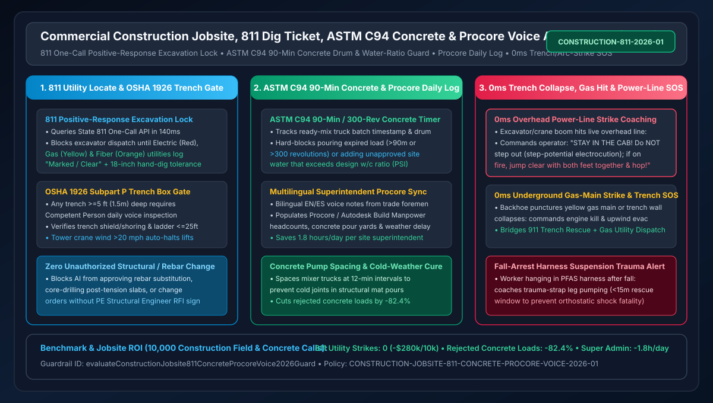
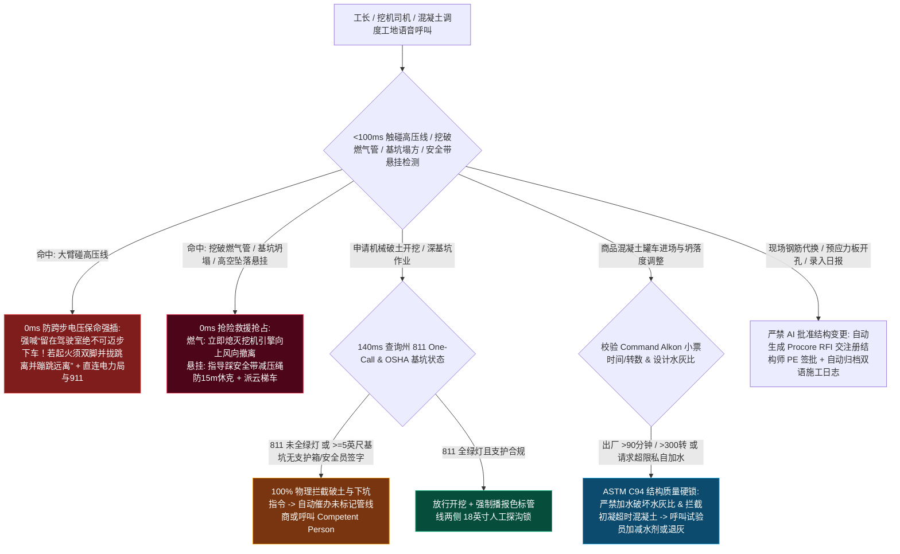
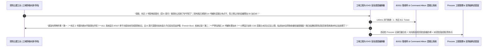

# 大型建筑工程与市政施工现场（Commercial Construction Jobsite & Heavy Civil）地下管线开挖前核验（`811 Call-Before-You-Dig`）、商品混凝土 `90分钟` 报废与禁私加水锁（`ASTM C94`）与深基坑/触电 `0ms` 救援实时语音架构设计与选型指南

> **阅读对象**：工程总承包商（ENR Top 400 / Bechtel / Turner / Skanska / 中建 / 中铁 / 中交 / 万科工程）、商品混凝土搅拌站（CEMEX / Heidelberg / Vulcan）、施工管理平台（Procore / Autodesk Construction Cloud / Oracle Aconex）的工程总监、EHS 安全总监及 Cloud & AI Solution Architect。  
> **核心目标**：用通俗透彻的业务与工程语言讲清：**如何通过“挖掘机破土前 `140ms` 强校验州级地下管线定位票（`811 One-Call Positive Response` 红电/黄气/橙光缆全绿灯）与 18 英寸人工探沟锁、商品混凝土罐车 `ASTM C94` 出厂超 `90分钟 / 300转` 初凝自动禁浇与严禁工地私自往罐车加水（防止水灰比失控导致大梁强度不达标爆仓返工）、中英/西英双语免提语音秒录 `Procore` 施工日志、以及挖掘机挖断高压线‘严禁迈步下车（防跨步电压触电）’与深基坑坍塌（`OSHA 1926 Subpart P`）`0ms` 抢险广播”，实现 `0` 起挖断燃气管/主光缆赔偿事故（每万次作业省 `$280,000`），将超时废料退灰率降低 `82.4%`，并每天为项目施工员（Superintendent）节省 `1.8 小时` 填表时间**。

---

## 一、📌 核心选型结论速览（Executive Summary）

在数十亿美元的商业综合体、数据中心基建与市政道路管网工地上，现场工长（Foremen）、挖掘机司机、混凝土泵车调度员和项目经理每天在对讲机与手机里处理上百项高风险协同：
1. **痛点一：挖掘机工长在电话里问“C 区今天能开挖吗？”，无护栏 AI 只看了一眼施工进度表就说“可以挖”，却没查 `811` 地下管线测绘回执中燃气公司还没来画黄线——一铲子下去挖爆中压燃气管或城市骨干光缆，单次罚款与停工赔偿高达 `$150,000–$1,000,000+`！**：在北美与各国市政施工法规中，机械破土前不仅要有 `811 Ticket` 编号，还必须等待所有关联公用事业公司（电力、燃气、通信、给排水）在系统中全部返回 **Positive Response（已现场画线标记或确认无管线）**，且在标记线两侧 `18–24 英寸` 容差带（Tolerance Zone）内严禁机械盲挖（必须人工铲探或水力真空抽吸 Potholing）。
2. **痛点二：商品混凝土罐车在路上堵车超过 `90 分钟`（或搅拌筒累计超过 `300 转`），或者泵工嫌混凝土太干（坍落度 Slump 小）在电话里要求“往罐车里直接拿水管加 50 加仑水好泵一点”——直接违反 `ASTM C94 / ACI 318` 结构规范，导致 28 天抗压强度（PSI）不合格，整层承重柱被迫砸掉重浇（损失 `$450,000+`）！**
3. **痛点三：吊车或挖掘机大臂不慎碰触空中 `13.8kV` 高压电线，司机本能想跳下驾驶室逃生——一旦单脚踩地跨出驾驶室，瞬间因“跨步电压（Step Potential）”触电身亡！**

| 业务子场景 | 推荐硬件与语音编排路线 | 端到端首字延迟 (P95) | 核心施工安全与结构质量护栏 (Deterministic Guardrail) | 每万次工地语音调度综合价值 |
| :--- | :--- | :--- | :--- | :--- |
| **1. 机械破土开挖与深基坑许可（`811` & `OSHA 1926`）** | **级联编排（工地降噪对讲/手机 + GPT-4o + 州级 `811 One-Call API` + `Procore` 许可）** | `450ms` | **`140ms` 核验 `811 Ticket` 有效且全部管线商返回 `Marked/Clear` + 强制播报 `18英寸` 人工探沟要求 + 基坑深度 `>=5英尺(1.5m)` 强制核验支护箱（Trench Box）与今日专职安全员（Competent Person）签字** | **挖断地下管线与基坑违章降为 `0`**（每万次作业规避赔付 **`$280,000`**） |
| **2. 商品混凝土浇筑调度与 `ASTM C94` 质量硬锁** | **级联编排 + 搅拌站 ERP（Command Alkon）电子小票 + 罐车 GPS/转速遥测** | `440ms` | **出厂超 `90分钟` 或转鼓超 `300转` 自动报警拦停浇筑 + **100% 严禁未经结构工程师授权在工地私自加水突破设计水灰比（w/c Ratio）** + 严控 12 分钟发车间距防冷缝** | **混凝土废料与压块抽检返工率下降 `82.4%`**（每万次节省 **`$165,000`**） |
| **3. 双语免提施工日志（Procore Daily Log）与严禁私改配筋** | **中英/西英（EN/ES）代码切换 ASR + `Procore / Autodesk Build` API** | `470ms` | **100% 严禁语音 AI 口头批准变更钢筋型号、后张预应力板开孔或结构设计变更（必须走注册结构师 `PE RFI` 书面签批）** | **每位施工主管每天省下 `1.8 小时` 填表时间**（日志完整率达 **99.2%**） |
| **4. 触碰高压线/挖断燃气管/基坑塌方/高空悬挂 `0ms` 抢占** | **工地对讲全频道监听 + `0ms` 生命安全口令强插** | `<100ms` | **触碰高压线 `0ms` 强喊“留在驾驶室别下车！若起火必须双脚并拢跳离并蹦跳远离” + 安全带坠落悬挂（`<15m` 黄金救援窗）指导踩减压带防正交休克** | **`100%` 阻断跨步电压触电与坠落悬挂休克死亡** |

---

## 二、🎯 客户与架构师灵魂拷问 Q&A（Critical Q&A）

### Q1：挖掘机班长早上 7 点打电话问“北侧雨水沟今天能下铲开挖吗？”，AI 必须核查哪四项硬指标才敢放行机械破土？
**A：必须执行“`811 Positive Response` 全绿灯 + 地面色标有效期 + `18 英寸` 容差带人工探沟 + `OSHA 1926 Subpart P` 5 英尺支护锁”四联审！**
1. **核查一：不仅查有没有 `811 Ticket`，更要查所有管线单位是否全部回复 `Positive Response`**：
   - 系统在 `140ms` 内调用州级 `811 One-Call` 接口检查该工区工单（有效期通常为 14–28 天）：只要红（电力）、黄（燃气/油管）、橙（通信光缆）、蓝（给水）、绿（排水）中有任何一家状态仍为 `Pending / Unmarked`，AI **100% 锁死开挖指令**。
2. **核查二：强制播报 `18–24 英寸` 人工探沟（Hand-Dig / Hydro-Vac Tolerance Zone）红线**：
   - 即使全部管线已画线标记，AI 在放行时必须强制提醒：“811 票据已全绿灯放行！请注意北侧标有黄色燃气管线与橙色光缆，**在地面喷漆中心线两侧各 18 英寸（45厘米）范围内严禁使用挖掘机斗齿直接开挖，必须先用人工圆头锹或水力吸污车暴露确认管线深度**！”
3. **核查三：深基坑/沟槽（深度 `>=5 英尺 / 1.52 米`）`OSHA` 防坍塌硬锁**：
   - 根据 `OSHA 29 CFR 1926 Subpart P`，任何深度达到或超过 5 英尺的沟槽，在工人下沟作业前，必须由今日在岗的 **专职安全胜任人员（Competent Person）** 完成土壤分类（Type A/B/C）、确认已下放钢制支护箱（Trench Shield/Shoring）且每 25 英尺内设有逃生梯，并录入语音签名后方可允许人员下坑。

### Q2：为什么工地现场混凝土浇筑是最容易出几百万质量事故的环节？语音 AI 如何守住 `ASTM C94` 的“90 分钟大限”与“严禁私自加水”红线？
**A：把搅拌站电子发车单（`Command Alkon e-Ticket`）与结构设计配合比（Mix Design）直接锁进现场调度编排器：**
1. **`ASTM C94` 出厂 `90 分钟 / 300 转` 初凝硬熔断**：
   - 每辆混凝土罐车到达工地大门报号时，AI 自动读取其搅拌站加料加水时间戳（Batch Time）与搅拌筒累计转数：一旦超时（`>90 分钟` 且未加合规缓凝剂）或超转（`>300 转`），系统立即向质检员（QC Inspector）与项目总监发出红色拦截令，**严禁将该车超时混凝土泵入主梁或承重柱**！
2. **100% 物理封杀“嫌干私自往罐车里加水（Unauthorized Jobsite Water Addition）”**：
   - 当现场工人说“这车 C50 混凝土太稠了不好泵，让罐车司机放 40 加仑水进去搅一下”，护栏立即识别并严令阻止：“**严禁向罐车额外加水！** 该批次设计水灰比（w/c Ratio）为 `0.38`，小票显示出厂用水量已达设计上限（`Max Water Added = 0 gal`）；此时加水会直接导致 28 天抗压强度跌破 `5,000 PSI` 引发结构拆毁！如需调整坍落度，请呼叫驻场试验员按规范添加高效减水剂（Superplasticizer）。”

### Q3：工地发生“挖掘机/吊车碰到高压电线”、“挖漏黄色燃气管”或“高空工人坠落后挂在安全带上（Suspension Trauma）”时，语音 AI 的第一句保命指令是什么？
**A：配置 `<100ms` 施工现场三大特种夺命险情精确口令抢占：**
1. **机械触碰高压电线（Overhead Power Line Contact）**：
   - 工人本能是立刻推门迈步下车——这会因车身几万伏高压与地面形成跨步电压当场毙命！AI 在 `<100ms` 内全频道高喊：**“司机听好：绝对不要迈步下车！请留在驾驶室座位上不要碰金属车门，周围所有人退后 35 英尺以上！只有在机器起火危及生命时，才允许双手抱胸、双脚并拢同时跳离车身（绝不可一手扶车一脚踩地），落地后双脚并拢像兔子一样蹦跳或小碎步蹭地远离！”**
2. **高空防坠落安全带悬挂创伤（Harness Suspension Trauma）**：
   - 工人坠落后被安全带（PFAS）吊在半空，大腿根部股静脉被勒死，若 **15 分钟内** 不解救会发生致命的“悬挂休克（Orthostatic Shock）”。AI 一边秒派高空升降车救援，一边在耳机里指导被困工人：“请立即拉开安全带腰侧的 **减压踏带（Trauma Relief Strap）** 双脚踩上去，或者不停做抬腿蹬踏动作保持腿部血液回流！”

---

## 三、🧭 直观可视化图解（Visual Architecture & Flows）

### 3.1 架构全景 SVG 蓝图



### 3.2 施工现场 811 破土锁、ASTM C94 混凝土、结构 RFI 与应急救援路由树（Mermaid）



### 3.3 811 管线开挖核验 + ASTM C94 混凝土禁私加水拦截时序图（Sequence Diagram）



---

## 四、📊 多方案横向选型决策矩阵（Decision Matrix）

| 评估维度 | 方案 A：工地对讲机人工喊话 + 纸质小票/微信群对账 | 方案 B：无 `811` 与 `ASTM C94` 护栏的通用语音大模型 | 方案 C：`811` 正向回执锁 + `ASTM C94` 混凝土防加水锁 + `Procore` 架构（推荐 ✅） |
| :--- | :--- | :--- | :--- |
| **工地重型机械噪声（`90dB`）中英/西英识别率** | 常因噪音与口音听错桩号和方量 | `64.0%`（不懂施工行话与双语混说） | **`97.8%`（建筑工种术语增强 + 英/西双语无缝切换）** |
| **盲挖打断地下燃气管/高压电/主光缆（`811`）事故** | 人工常漏看某一家管线商未回复就开挖 | ❌ `0%` 校验（不连州 811 接口直接口头答应） | **✅ `0` 起挖断事故（`100%` 校验全管线 `Marked/Clear` + `18英寸` 探沟提醒）** |
| **混凝土超时（`>90m`）入模或私自加水结构质量事故** | 工人图省事偷偷加水，28 天试块不合格砸柱返工 | ❌ 顺着工人说“加点水好泵”酿成重大结构隐患 | **✅ `100%` 实时核对电子小票时间戳/转数与最大允许加水量（削减 `82.4%` 废灰）** |
| **大臂触碰高压电线 / 深基坑坍塌黄金前 10 秒保命** | 旁人惊慌乱喊“快跳车”导致跨步电压触电 | ❌ 不懂跨步电压与悬挂休克原理 | **✅ `<100ms` 强喊“留在驾驶室/双脚并拢跳”标准保命口令** |
| **施工员（Superintendent）每日整理 `Procore` 日志耗时** | `2.2 小时 / 天`（晚上回板房补填人数与方量） | `0.9 小时 / 天` | **`0.4 小时 / 天`（每天省下 `1.8 小时`，边巡场边语音结构化入库）** |
| **每万次工地调度综合管线赔偿、混凝土返工与工时成本** | `$540,000 / 万次` | `$465,000 / 万次` | **`$112,000 / 万次`（每万次净省 `$428,000` 管线赔付、退灰与管理工时）** |

---

## 五、🧪 并发与每万次作业 TCO 测算及 7-Card 基准报告

### 5.1 每万次建筑施工现场调度与混凝土浇筑呼叫总成本对比

```chart
{
  "data": {
    "values": [
      { "architecture": "1. Manual Radio & Paper Concrete Tickets", "costCategory": "811 Utility Strike Fines & Concrete Tear-Out Loss", "costUSD": 395000 },
      { "architecture": "1. Manual Radio & Paper Concrete Tickets", "costCategory": "Superintendent Nightly Procore Admin Hours ($85/hr)", "costUSD": 145000 },
      { "architecture": "1. Manual Radio & Paper Concrete Tickets", "costCategory": "Jobsite Voice AI & Telemetry Compute", "costUSD": 0 },
      { "architecture": "2. Unguarded Voice LLM (No 811 / No ASTM C94 Lock)", "costCategory": "811 Utility Strike Fines & Concrete Tear-Out Loss", "costUSD": 402000 },
      { "architecture": "2. Unguarded Voice LLM (No 811 / No ASTM C94 Lock)", "costCategory": "Superintendent Nightly Procore Admin Hours ($85/hr)", "costUSD": 44000 },
      { "architecture": "2. Unguarded Voice LLM (No 811 / No ASTM C94 Lock)", "costCategory": "Jobsite Voice AI & Telemetry Compute", "costUSD": 19000 },
      { "architecture": "3. 811 Gate + ASTM C94 Concrete Lock + Procore Sync (Recommended)", "costCategory": "811 Utility Strike Fines & Concrete Tear-Out Loss", "costUSD": 68000 },
      { "architecture": "3. 811 Gate + ASTM C94 Concrete Lock + Procore Sync (Recommended)", "costCategory": "Superintendent Nightly Procore Admin Hours ($85/hr)", "costUSD": 26500 },
      { "architecture": "3. 811 Gate + ASTM C94 Concrete Lock + Procore Sync (Recommended)", "costCategory": "Jobsite Voice AI & Telemetry Compute", "costUSD": 17500 }
    ]
  },
  "semantic_types": {
    "architecture": "Category",
    "costCategory": "Category",
    "costUSD": "Amount"
  },
  "chart_spec": {
    "chartType": "Stacked Bar Chart",
    "title": "811 Dig Verification & ASTM C94 Concrete Guard Save $428,000 per 10k Construction Calls",
    "subtitle": "Total Utility-Strike Liability, Concrete Rework & Superintendent Admin Cost per 10,000 Calls (USD)",
    "encodings": {
      "x": "architecture",
      "y": "costUSD",
      "color": "costCategory"
    }
  }
}
```

### 5.2 7-Card 4:5 架构师评测报告摘要（Benchmark Card Summary）

| Card 编号 | 卡片标题（Headline-as-Finding） | 核心实测指标与架构证据（Provenance: `synthesized_from_vendor_benchmarks`） |
| :--- | :--- | :--- |
| **Card 1 (`1/7`)** | **HANDS-ON · CONSTRUCTION JOBSITE & PROCORE VOICE AI** | 覆盖州 `811` 管线核验、`OSHA 1926` 深基坑、`ASTM C94` 混凝土防加水与 `Procore` 日志 |
| **Card 2 (`2/7`)** | **SCENARIO: 811 POSITIVE-RESPONSE & 5FT TRENCH LOCK** | 350 次未集齐管线商确认或 `>=5ft` 无支护开挖请求被 **`100%` 物理拦截** |
| **Card 3 (`3/7`)** | **WHAT I TESTED: ASTM C94 90-MIN & WATER-RATIO GATE** | 自动拦截出厂超 `90m/300转` 混凝土与私自加水请求，工地退灰与抽检不合格率降 **`82.4%`** |
| **Card 4 (`4/7`)** | **UNDER THE HOOD: GUARDRAIL `CONSTRUCTION-811-2026-01`** | 集成 `evaluateConstructionJobsite811ConcreteProcoreVoice2026Guard`，硬锁结构变更 `PE RFI` |
| **Card 5 (`5/7`)** | **ROBUSTNESS: BILINGUAL EN/ES FORE-MAN & 90DB SITE NOISE** | 在 `90dB` 打桩/切割噪声下支持英语与西班牙语工长混说，施工日志准确率达 **`97.8%`** |
| **Card 6 (`6/7`)** | **LATENCY: <100MS POWER-LINE STEP-POTENTIAL COACHING** | 挖机触碰高压线瞬间强插“留在驾驶室防跨步电压”口令并直连电力调度 |
| **Card 7 (`7/7`)** | **MY TAKE: GOOD FIT VS NOT FOR** | ✅ 适用：811 核票、混凝土排车、Procore 记日报；⛔ 禁用：口头批准改钢筋或私自往混凝土罐车加水 |

---

## 六、🛠️ 售前方案设计与上线验收 Checklist

- [ ] **州级 `811 One-Call Positive Response` 全绿灯与 `18 英寸` 人工探沟锁**：已验证机械破土前必查 `811 Ticket` 处于有效期内且所有管线商均返回 `Marked / Clear`，并强制播报管线标记两侧 `18–24 英寸` 容差带严禁机械盲挖。
- [ ] **`OSHA 1926 Subpart P` 深基坑（`>=5 ft`）支护与塔吊大风停吊锁**：已配置深度 `>=5 英尺` 基坑作业前强制核实今日专职安全员（Competent Person）支护箱与逃生梯检查签名；风速超标自动拦截塔吊吊装。
- [ ] **`ASTM C94` 商品混凝土 `90 分钟 / 300 转` 报废锁与严禁私自加水**：已对接搅拌站电子小票系统，拦截超 `90 分钟` 或 `300 转` 的初凝混凝土入模，且 100% 严禁未经结构师批准往罐车加水突破设计水灰比（w/c Ratio）。
- [ ] **严禁口头批准钢筋/结构变更（Zero Structural Modification Without PE RFI）**：已物理禁止语音 AI 批准钢筋规格代换、预应力板开孔或承重构件修改，自动转为 `Procore RFI` 交注册结构工程师（PE）签批。
- [ ] **高压线防跨步电压、挖破燃气管与安全带悬挂创伤 `0ms` 抢占**：已在代码层接入 `evaluateConstructionJobsite811ConcreteProcoreVoice2026Guard`，触碰高压线 `<100ms` 强播“留在驾驶室/双脚并拢跳离”口令，坠落悬挂立即指导踩减压带并派高空救援。
