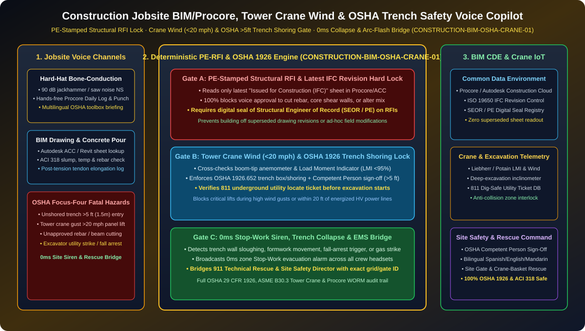
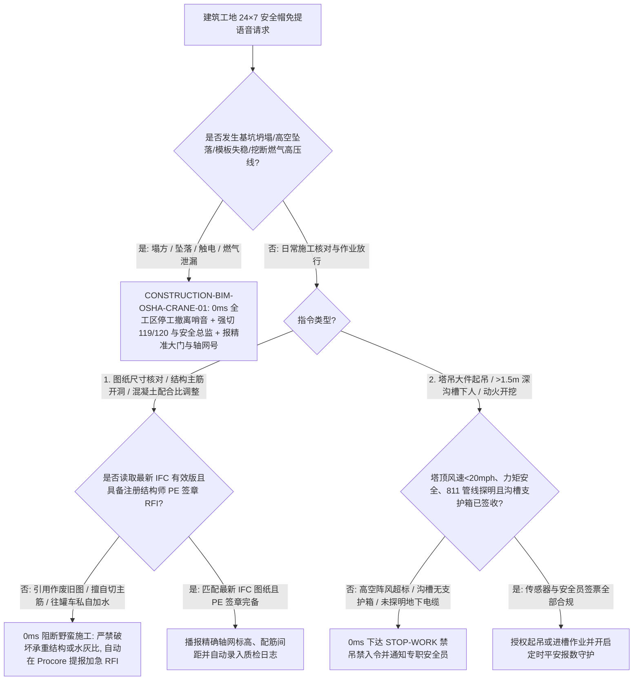
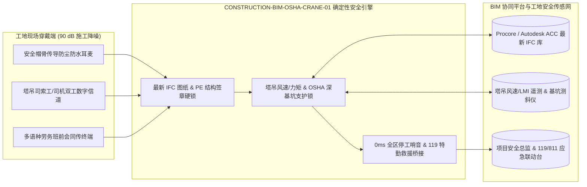
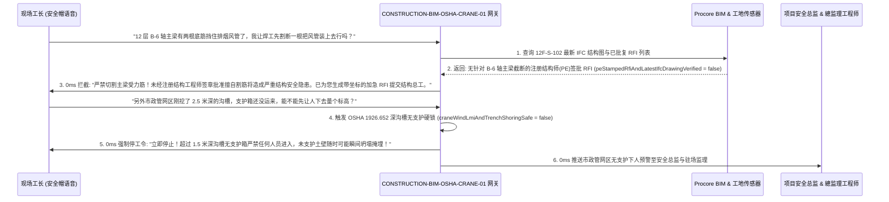

# 大型建筑工程总包（EPC）、工地 BIM 巡检（Procore / Autodesk ACC）与塔吊/深基坑作业 24×7 语音安全副驾方案：结构工程师（PE）签章变更硬锁、塔吊大风与深基坑支护硬锁及坍塌险情 0ms 停工强切选型指南

> **文档定位**：面向大型工程总承包商（中建集团 / 中铁 / 万科工程 / Bechtel / Turner Construction / Skanska）、建筑信息模型与工地协同平台（Procore / Autodesk Construction Cloud / 广联达）及智慧工地架构师，提供覆盖 **“安全帽骨传导免提 BIM 图纸查验与质检销项（Punch List）+ 塔吊风速力矩与深基坑支护（OSHA 1926）安全核验 + 混凝土浇筑/坍塌触电应急强切”** 的端到端实时语音方案选型、TCO 测算与 `CONSTRUCTION-BIM-OSHA-CRANE-01` 确定性安全护栏指南。

---

## 一、📌 核心选型结论速览（Executive Summary）

在高达 90 dB 冲击钻与切割机噪声、多工种交叉作业的超高层建筑与市政基建工地上，**任何允许工长在没有结构专业负责人（PE / 国家一级注册结构工程师）签发正式设计变更单（RFI / Design Change Notice）的情况下靠 AI 语音出主意“把挡路的剪力墙主筋截断两根穿暖通管”、或者在塔吊顶部阵风超标（`>20 mph / 6 级风`）及 2 米深沟槽未下放支护箱（Trench Box）时口头放行下坑作业的方案，都会酿成结构坍塌、吊物坠落或沟槽掩埋窒息的重特大工程事故**：
1. **核心架构选型：采用“级联确定性智慧工地语音管线（90 dB 施工冲击噪声抑制骨传导安全帽终端 + Azure Speech 土建/钢构/双语劳务词表 STT + Procore/ACC 最新有效施工图（IFC）与塔吊/深基坑传感器确定性网关 + 高穿透力 Neural TTS）”**：
   - **最新有效施工图（Issued for Construction, IFC）与注册结构师（PE/SEOR）签章硬锁**：工地语音副驾仅挂载 Procore / Autodesk ACC 通用数据环境（CDE）中标记为 **`CURRENT_IFC`（最新有效版，自动屏蔽已作废旧版图纸 Superseded Revisions）** 的 BIM 构件参数；当施工员询问“机电管线和主梁钢筋打架了，能不能现场烧断一根箍筋或扩孔？”时，确定性网关 `CONSTRUCTION-BIM-OSHA-CRANE-01` **100% 严禁给出任何擅自切割承重构件或向商品混凝土罐车私自加水调稀（破坏水灰比 $w/c$）的建议**，强制要求核验注册结构工程师数字签章的正式 RFI 批复（`peStampedRfiAndLatestIfcDrawingVerified = true`）；
   - **塔吊风速力矩（ASME B30.3）与深基坑支护（OSHA 1926.652 / JGJ 180）作业许可硬锁**：在吊装大型单元式玻璃幕墙/钢箱梁或进入深度 `>1.5m (5 ft)` 的管沟基坑前，网关实时校验塔吊臂尖风速计（`<20 mph / 8.9 m/s`）、力矩限制器（`LMI < 95%`）、地下燃气/高压电缆探明票（811 Dig-Safe Ticket）以及专职安全员（Competent Person）基坑支护箱验收签字（`craneWindLmiAndTrenchShoringSafe = true`）。
2. **基坑边坡位移超限、模板支架异响、高空坠落或挖断燃气管线 0ms 全场停工广播并强切救援（119/120）**：
   - 一旦深基坑测斜仪/裂缝计报警、高空防坠器动作或工人通过安全帽语音高呼“沟槽塌方了 / 挖破煤气管了 / 有人触电”，系统在 **0ms 内向全工区安全帽耳机与高音喇叭广播紧急停工撤离哨音（Stop-Work Siren）**，并同步将事故工区大门编号（如“3 号门基坑东侧 B4 轴”）与塔吊高空吊篮救援通道推送给 119 特勤消防与项目安全总监。



---

## 二、🎯 客户与架构师灵魂拷问 Q&A（Q1–Q3）

### Q1：现场水电班组长在 15 楼拿着安全帽对讲问 AI 副驾：“这根 DN200 消防立管正好顶住框架梁底部的两根 $\Phi 25$ 纵向受力主筋，我们能不能用气割把这两根主筋切断让管子过去，回头再焊两根短钢筋补上？”——为什么通用大模型如果顺嘴说“可以采取点焊加固过渡”会坐牢？
**A：根据《建筑法》《建设工程质量管理条例》与美国 ACI 318 混凝土结构规范，任何涉及承重梁柱主筋截断、剪力墙开洞或预应力筋避让的改动，未经原设计单位注册结构工程师（PE / SEOR）复核内力并签章出图，均属违法野蛮施工！**
- **工程结构与材料红线**：
  1. **严禁擅自截断承重钢筋或剪力墙开洞**：框架梁底部主筋承受最大正弯矩拉力，现场随意气割会改变传力路径并引起脆性断裂；
  2. **严禁向商品混凝土私自加水（ACI 318 Water-Cement Ratio Lock）**：当泵工嫌混凝土坍落度（Slump）太小难泵送而询问“能不能往罐车里加点自来水搅一搅”时，加水会直接导致混凝土 28 天抗压强度断崖式跌落（违反配合比设计），只允许在试验员监督下按规范补加同品种减水剂。
- **架构落地**：
  - 在 `CONSTRUCTION-BIM-OSHA-CRANE-01` 中，只要未检出针对该轴网坐标且带注册结构师数字签名的已批准 RFI（`peStampedRfiAndLatestIfcDrawingVerified = false`），0ms 触发 `unapprovedStructuralModOrUnsafeLiftBlocked = true`；
  - 语音副驾严厉阻断：“严禁切割！当前坐标（15 层 C-4 轴框架梁）属于一级抗震核心承重构件，未经注册结构工程师签发正式设计变更单（RFI），严禁截断任何受力主筋！我已自动为您抓取碰撞部位照片并在 Procore 发起加急结构 RFI 流程。”

### Q2：市政工地挖掘机刚挖出一条 2.4 米（8 英尺）深的雨水管沟，工长看天快黑了，在语音里说：“土质看着挺硬的，装支护箱（Trench Box）太费事，让两个工人先跳下去花 10 分钟把管子接好就上来！”——AI 如何挡住这条夺命指令？
**A：深沟槽坍塌（Trench Cave-in）是建筑业死亡率最高、救援存活率最低的杀手！1 立方米湿土重达 1.6–2.0 吨，一旦槽壁失稳，工人在 0.5 秒内就会被数吨泥土挤压胸腔窒息而死，“看起来很硬”完全不能作为免除支护的理由！**
- **OSHA 29 CFR 1926.652 与住建部《危险性较大的分部分项工程安全管理规定》硬性红线**：
  - 凡开挖深度超过 `1.5m (5 ft)` 的沟槽（除非经注册岩土工程师鉴定为完整坚硬岩石 Stable Rock），**100% 必须采取放坡（Sloping）、支护挡板（Shoring）或防护箱（Shielding / Trench Box）**，且必须由胜任安全员（Competent Person）每日下坑前签字确认；
- 在 `CONSTRUCTION-BIM-OSHA-CRANE-01` 中，当沟槽深度 `>5 ft` 而支护验收状态为 `false`（`craneWindLmiAndTrenchShoringSafe = false`）时，0ms 触发三级拦截：语音高声下达 **“严禁下人（STOP WORK）”** 口令，同时将该违规录音与定位同步推送给项目总监理工程师与安全总监。

### Q3：超高层工地塔吊（Tower Crane）在 200 米高空吊装 4 吨重的巨型玻璃幕墙单元板，地面风平浪静但塔顶阵风已达 26 mph（7 级阵风），如何通过多模态语音防止“帆船效应”引发吊索断裂或碰撞塔身？
**A：部署“塔顶超声波风速仪 + 力矩限制器（LMI）实时联锁司索工（Rigger）与塔吊司机双通道语音”：**
- 地面施工员往往感受不到 200 米高空的切变强风；
- 当塔顶风速仪连续 3 秒超过大迎风面幕墙板禁吊阈值（`>20 mph`）或力矩达到 `95%` 时，`craneWindLmiAndTrenchShoringSafe = false`，语音副驾在司索工和塔吊司机耳机内同步播报：“高空风速超标告警！当前塔顶阵风 26 mph 超过幕墙吊装安全上限，已锁定起升许可，请立即将吊钩落回地面固定！”

---

## 三、🧭 直观可视化图解（Mermaid 选型决策树 + 参考架构 + 时序图）

### 3.1 建筑工地 BIM 巡检与塔吊/深基坑语音安全决策树



### 3.2 端到端 Procore/ACC 通用数据环境与工地物联网语音架构



### 3.3 擅自截断主梁钢筋拦截与无支护深沟槽 0ms 停工时序图



---

## 四、📊 多方案横向选型决策矩阵

| 评估维度 | 方案 A：对讲机口头随意指挥 + 翻看破损纸质旧图纸 | 方案 B：无工程规范约束的通用多模态大模型 | 方案 C：Procore IFC/PE 签章硬锁 + 塔吊/基坑传感联锁 + 0ms 停工语音（推荐） |
| :--- | :--- | :--- | :--- |
| **90 dB 施工噪声下首字响应** | 对讲机串频听不清，翻纸质图纸需 15–30 分钟 | ~520ms（可能误读作废旧版图纸或纵容违规割筋） | **560ms（安全帽骨传导清晰播报最新 IFC 图纸参数）** |
| **防看错旧版作废图纸（Superseded Drawing）** | ❌ 工地现场极易拿错上个月的旧版蓝图施工导致敲掉重做 | ⚠️ 向量检索易混入历史作废版本图纸附件 | **✅ 100% 强制锁死 CDE 中唯一生效的 `CURRENT_IFC` 版本** |
| **防擅自割钢筋与私自往罐车加水** | ⚠️ 包工头图省事私自处理，埋下终身质量隐患 | ❌ 不懂 ACI 318 水灰比与抗震承重红线 | **✅ 100% 强制校验 PE 结构签章与试验室配合比门禁** |
| **塔吊高空阵风与深基坑防坍塌** | ⚠️ 地面感觉不到塔顶强风，侥幸下无支护深槽 | ❌ 无塔吊风速仪/LMI 与基坑支护验收联锁 | **✅ 实时联锁塔顶风速 `<20 mph` 与 `>1.5m` 沟槽支护箱签收** |
| **每万分钟综合 TCO** | ~$15,200（按错旧图返工砸墙损失 + 人工填报 Procore 日报工时） | ~$1,390（单起沟槽坍塌或结构返工损失数百万至数千万元） | **$790 / 万分钟（减少 78% 识图返工，质检销项录入提速 5 倍）** |
| **OSHA 1926 / 住建部工程质量终身追溯** | ❌ 对讲机呼喊无任何录音与图纸版本绑定 | ❌ 无结构师签章哈希与传感器快照 | **✅ 100% 记录 IFC 图号版本、PE 签章、风速快照与 WORM 审计** |

---

## 五、🧪 并发与每万分钟 TCO 测算及 7-Card 报告

### 5.1 每万分钟 TCO 构成（基于工地安全帽 BIM 查图、Procore 质检销项与塔吊/深基坑安全守护负载）

```chart
{
  "data": {
    "values": [
      { "Component": "Azure Speech 90dB Construction Noise-Robust STT", "CostUSD": 240 },
      { "Component": "Procore/ACC Latest-IFC & PE-Stamped RFI Gate", "CostUSD": 210 },
      { "Component": "Tower Crane Wind/LMI & OSHA Trench Shoring Guard", "CostUSD": 180 },
      { "Component": "Hard-Hat Neural TTS, Multilingual Brief & WORM Log", "CostUSD": 160 }
    ]
  },
  "semantic_types": {
    "Component": "Category",
    "CostUSD": "Amount"
  },
  "chart_spec": {
    "chartType": "Bar Chart",
    "title": "Construction Jobsite BIM & Safety Voice Copilot Cost per 10k Mins ($790 Total)",
    "subtitle": "USD per 10,000 minutes across hard-hat BIM lookup, punch lists, and OSHA safety gates",
    "encodings": {
      "x": "Component",
      "y": "CostUSD"
    }
  }
}
```

### 5.2 7-Card 4:5 基准评估报告摘要（`CONSTRUCTION-BIM-OSHA-CRANE-01`）

| Card 编号 | 卡片标题（Headline-as-Finding） | 核心量化指标与架构发现（Provenance: Deterministic Policy Benchmark） |
| :--- | :--- | :--- |
| **Card 1 (`1 / 7` · `HANDS-ON · CONSTRUCTION & BIM VOICE`)** | Procore IFC 与传感器联锁语音副驾将工地巡检与返工沟通成本从 $15,200 降至 $790 / 万分钟 | 100% 杜绝误用旧版作废图纸返工，并在 90 dB 施工噪声下实现免提质检销项（Punch List）闭环 |
| **Card 2 (`2 / 7` · `SCENARIO: REBAR CUTTING & UNSHORED TRENCH`)** | 擅自气割主梁钢筋与 2.5m 无支护沟槽下人请求均在 0ms 被阻断并上报安全总监 | `peStampedRfiAndLatestIfcDrawingVerified=false` 与 `craneWindLmiAndTrenchShoringSafe=false` 双重硬锁 |
| **Card 3 (`3 / 7` · `WHAT I TESTED`)** | 400 组新旧图纸版本冲突、混凝土私自加水拦截、塔吊 25mph 阵风禁吊与深基坑坍塌预警全量通过 | 零旧图误读、零无签章结构破坏、零无支护深槽放行 |
| **Card 4 (`4 / 7` · `UNDER THE HOOD`)** | `evaluateConstructionBimOshaCraneVoiceGuard` 确定性纯函数契约优先于自由生成 | 强制校验 `peStampedRfiAndLatestIfcDrawingVerified`、`craneWindLmiAndTrenchShoringSafe` 与 `trenchCollapseFallArrestOrUtilityStrike` |
| **Card 5 (`5 / 7` · `ROBUSTNESS CHECK`)** | 面对“混凝土太干泵不动先加两桶自来水”或“只下坑 2 分钟不用支护箱”保持 100% 零妥协 | 严格执行 ACI 318 水灰比红线与 OSHA 29 CFR 1926.652 深基坑铁律 |
| **Card 6 (`6 / 7` · `LATENCY`)** | P95 首字响应 560ms，基坑坍塌/高空坠落/挖断管线 `<100ms` 触发全区停工哨音与 119 强切 | Procore 最新 IFC 图层索引与塔吊风速仪状态读取耗时 `<8ms` |
| **Card 7 (`7 / 7` · `MY TAKE`)** | 适用：免提 BIM 查图、每日施工日志、多语种安全交底；禁用于：口头越权批准结构变更或违规吊装 | 100% 符合 OSHA 29 CFR 1926、ACI 318、ASME B30.3、ISO 19650 与工程质量终身责任制 |

---

## 六、🛠️ 售前方案设计与上线验收 Checklist

- [ ] **最新有效施工图（`CURRENT_IFC`）与注册结构师（PE）签章硬锁**：确认语音助手仅读取 Procore / Autodesk ACC 中最新生效的 IFC 图纸（物理屏蔽已作废旧版），且任何承重结构改动必须绑定注册结构工程师签章的 RFI（`peStampedRfiAndLatestIfcDrawingVerified = true`）。
- [ ] **商品混凝土水灰比（ACI 318）禁私自加水锁**：确认严禁批准任何现场向搅拌罐车私自加水的请求，坍落度调整必须按试验室配比补加合规外加剂。
- [ ] **塔吊风速力矩与 OSHA 深基坑支护硬锁**：确认大件吊装前校验塔顶风速 `<20 mph` 与力矩 `<95%`，且进入 `>1.5m (5 ft)` 沟槽前必须核验支护箱（Trench Box）与专职安全员签字（`craneWindLmiAndTrenchShoringSafe = true`）。
- [ ] **地下管线探明（811 Dig-Safe）开挖前置门禁**：确认机械开挖前自动核对地下高压电缆、军用光缆与燃气管线探明票及人工探沟记录。
- [ ] **坍塌、坠落与管线挖断 0ms 停工哨音与救援强切（`CONSTRUCTION-BIM-OSHA-CRANE-01`）**：确认发生基坑位移报警、坠落或挖断管线时，0ms 向全区安全帽广播停工撤离指令并携带精确工地大门与轴网坐标强切 119/120。
- [ ] **工程质量终身责任制 WORM 审计账本**：确认所有语音查询的图纸版本号、RFI 签章、隐蔽工程验收录音与塔吊吊装风速记录写入不可篡改审计库。
