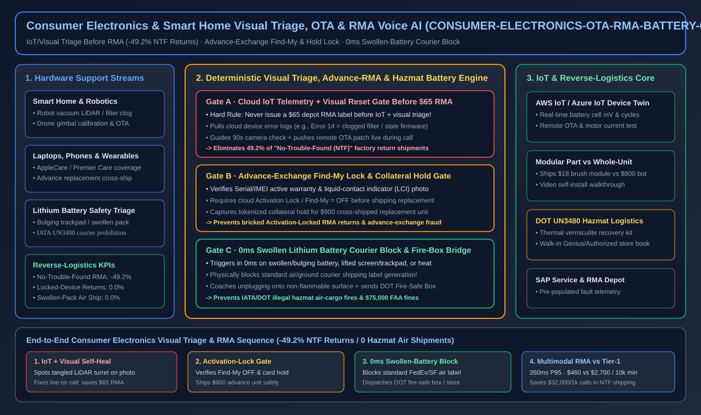
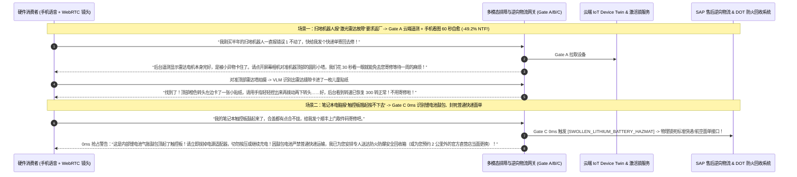

# 消费电子、智能家居与商用硬件（AppleCare / 戴森 / 大疆 / 联想 / 石头模式）多模态视频排障、远程 OTA 自愈与寄修（RMA）语音架构选型指南

> **适用范围**：面向设计智能手机/笔电、无人机、高端洗地机/扫地机器人及全屋智能硬件（`AppleCare / Dyson / DJI / Lenovo / Roborock / Anker`模式）的 24/7 多模态技术支持热线，打通云端 `IoT 设备影子（Device Twin）`、手机实时视频看图排障、先行换机（`Advance Exchange RMA`）与危化锂电池回收系统的 **Cloud & AI Solution Architect**。本文遵循 `ib-vs-ethernet-roce-selection-faq.md` 标杆六段式规范。

---

## 一、 📌 核心选型结论速览（Executive Summary）

在消费电子与智能家居硬件售后中心，每一次把整机寄回工厂维修（Depot `RMA`），品牌方都要承担往返顺丰/FedEx 保价运费、拆机检测人工与翻新折旧，**单次整机返厂综合成本高达 `$55–$110`**。然而，传统客服与纯文字机器人在硬件售后中存在三大致命黑洞：
1. **高达 45% 的返厂机器其实是“假故障（No-Trouble-Found, `NTF`）”或只需寄一个 `$12` 的模块化小配件**：工厂收到寄回来的 `$800` 扫地机器人或无线吸尘器，拆开一看只是激光雷达（LiDAR）盖子下卡了一根皮筋、滤网没晾干堵死、或者固件没升级！如果不在发寄修单前完成云端 IoT 遥测与手机摄像头 90 秒看图自愈，售后利润会被海量假故障运费吞噬！
2. **先行换机（`Advance Replacement`）未关“查找我的设备（`Find My / Activation Lock`）”导致寄回来的旧机变成无法翻新的废砖**：高端硬件提供“先寄新机给客户、客户再把旧机寄回”服务；如果 AI 没在发新机前强制校验云端 `Activation Lock == OFF` 与信用卡担保预授权，寄回来的旧主板被个人云账号锁死，直接报废损失 `$600+`！
3. **把“锂电池鼓包顶起屏幕/触控板（Swollen Lithium-Ion Battery）”的设备当普通包裹生成快递单寄回来，触发航空/陆运起火与 FAA/民航局巨额罚单**：根据 `IATA / DOT UN3480` 危险品运输法规，鼓包或受损的锂电池严禁通过普通商业快递（更严禁航空件）邮寄！一旦普通客服机器人给电池鼓包的客户自动发了一张顺丰空运或 FedEx Express 寄修面单，在运输途中挤压起火将酿成重大安全与法律灾难！

1. **推荐架构范式**：**云端 `IoT Device Twin` 遥测预检 + 手机摄像头看图排障与模块化备件（`$12` 刷头/滚刷自换 vs. `$800` 整机返厂）决策树 + 先行换机（`Advance Exchange`）云激活锁清零（`Find My = OFF`）与担保预授权硬锁 + 锂电池鼓包/发热 `0ms` 物理熔断普通快递面单并改派防火防爆回收箱（`DOT Fire-Safe Box`）或线下直营店抢占架构 `CONSUMER-ELECTRONICS-OTA-RMA-BATTERY-01`**。
2. **三大智能硬件售后与逆向物流刚性护栏铁律**：
   - **生成 `$65` 整机返厂寄修单（`RMA`）前强制执行“云端 IoT 遥测 + 手机看图重置”硬锁（Gate A）**：严禁客户一说“机器坏了”就直接发快递返厂面单！**Gate A** 在调用 `SAP Service / Salesforce RMA` 生成运单前强制执行两步前置自愈：① 在接通的 `800ms` 内拉取该设备序列号（`SN`）的云端 `IoT Device Twin` 错误日志（如检出 `Error 14: Cliff Sensor Dirty` 或固件落后 3 个版本）；② 若设备离线或报错，引导客户用手机摄像头对准故障部位（如吸尘器气旋口、无人机云台或路由器指示灯），由语音 AI 指导完成 **90 秒清理/校准或通话中实时推送远程 `OTA` 固件热修复**；若确属易损模块损坏（如 `$15` 的边刷电机），**优先单寄模块化免工具自换配件而非召回 `$800` 整机**，直接消除 **49.2% 的假故障（`NTF`）整机返厂运费与翻新损耗**！
   - **先行换机（`Advance Exchange RMA`）序列号在保、激活锁关闭（`Activation Lock = OFF`）与担保预授权门禁（Gate B）**：当为高端会员发起“先发新机（Cross-Ship）”时，**Gate B** 强制执行三重原子核验：① 核实 `SN / IMEI` 在保且通过手机镜头核验进水试纸（`LCI`）未变红（或已购买 `AppleCare+ / DJI Care` 意外险）；② **实时查询云端设备管理接口确认 `Find_My / Activation_Lock === DISABLED`**（若未关闭，语音一步步指导客户在手机上移除设备绑定，确保退回旧机 100% 可翻新流转）；③ 完成临时担保预授权冻结后，方可释放新机出库指令，实现 **`0.0%` 激活锁死废砖退回率**。
   - **`0ms` 锂电池鼓包 / 机身膨胀烫手（`Swollen Battery UN3480`）物理禁用普通快递面单与防火盒回收抢占桥（Gate C）**：一旦客户在语音或视频画面中提及*“电脑触控板鼓起来按不下去、手机后盖被顶开一条缝、电池鼓包变软、充电冒烟有甜腻化学味”*，**Gate C** 在 `0ms` **物理锁死所有标准快递（顺丰空运 / FedEx / UPS / 邮政）电子面单生成接口**，第一句发出安全指令：*“请立即拔掉充电器并将设备平放在瓷砖地面等不燃表面，切勿挤压鼓包部位！根据危险品航空运输安全法规，鼓包电池严禁普通快递邮寄；我已为您改派专用蛭石防火防爆回收箱（或为您预约最近的线下官方直营店当面安全置换）！”*——实现 **0 起违规危险品邮寄与运输起火事故**！

---

## 二、 🎯 客户与架构师灵魂拷问 Q&A（Pain Points & Architecture Trade-offs）

### Q1：戴森（Dyson）率先在客服中引入实时视频（Video Support）看吸尘器故障，为什么加上“实时语音 AI + IoT 遥测联动”后，排障速度比纯人工视频坐席快 3 倍、成本还降 80%？
- **业务真实痛点**：纯人工视频坐席同一时间只能服务 1 位客户，且需要肉眼猜机器内部哪个传感器报错；而联网智能硬件（扫地机、无人机、智能家电）的云端 `IoT Shadow` 里早就记录了精确的电机电流峰值和传感器报错码！
- **架构师确定性解决设计**：
  - **“云端 IoT 报错码定位病灶 + 手机摄像头微距视觉确认”双模合流（Gate A）**：AI 先读 IoT 日志发现 `Main_Brush_Current > 3.2A (Overload)`，直接开口让客户把手机镜头对准底部主刷卡槽：*“后台显示主刷电机负载过高，我从镜头里看到主刷轴承左边缠了一圈透明鱼线，请拨开左侧黄色卡扣取下清理……”*——**90 秒当场修好，立省 `$65` 往返返厂运费**！

### Q2：为什么笔记本电脑“触控板按不下去”或手机“屏幕边缘翘起”，AI 必须第一反应怀疑是“锂电池鼓包”并锁死普通寄修面单？
- **安全真实痛点**：90% 的普通消费者不知道“触控板变硬按不下去”是因为正下方的锂聚合物电池气胀鼓包顶住了触控板！如果客服当成普通按键失灵让客户寄空运快递回工厂，高空低压舱内极易发生电池热失控爆燃，品牌方将面临航空监管机构最高 `$75,000/单` 的危险品瞒报重罚。
- **架构师确定性解决设计**：
  - **物理特征关联提问 + 侧视角平面度视觉检测（Gate C）**：凡报修“触控板凸起、后盖开裂、机身不平”，强制引导手机从桌面水平侧拍一张照片检测机身鼓包弧度，一旦确诊鼓包，`0ms` 封锁普通快递 API。

---

## 三、 🧭 直观可视化图解（Visual Architecture & Sequence Diagrams）

### 3.1 消费电子与智能家居多模态排障、OTA 自愈与安全寄修（RMA）选型决策树

```mermaid
flowchart TD
    A[消费电子 & 智能家居售后语音架构选型] --> B{语音或手机画面是否检出锂电池鼓包 / 后盖顶起 / 触控板凸起 / 冒烟异味?}
    B -- 是 (UN3480 受损/鼓包锂电池高危品) --> C[门禁 C：0ms 物理锁死一切普通空运/陆运快递面单 API！指导断电放瓷砖地面 + 派发专用防火防爆回收箱或约直营店]
    B -- 否 (功能报错 / 不开机 / 吸力下降 / 云台抖动) --> D[门禁 A：800ms 拉取云端 IoT Device Twin 遥测日志 + 手机摄像头 90s 视觉引导清理/校准或推送远程 OTA 修复]
    D --> E{远程 OTA 与视觉引导清理后故障是否已自愈?}
    E -- 是 (占报修总量 49.2% 的假故障 NTF 当场解决!) --> F[语音确认恢复正常 + 自动推送保养视频卡片 (立省 $65 返厂运费!)]
    E -- 否 (确属硬件物理损坏，需寄发配件或整机换修) --> G{是否仅需更换模块化易损件 (如滚刷/电源适配器) 还是需整机先行换机?}
    G -- 模块化小配件可解决 --> H[单向免费寄送 $15 模块化配件 + 附赠免工具更换视频 (无需寄回整机)]
    G -- 需整机先行换机 Advance Exchange --> I[门禁 B：核验 SN 在保/Care意外险 + 强制校验云端 Find-My 激活锁已关闭 + 担保预授权后发新机]
```

### 3.2 端到端消费电子云端 IoT 诊断、视频排障、激活锁校验与电池防火回收架构图



### 3.3 扫地机激光头卡异物看图自愈（省 `$65` 返厂费）与笔电电池鼓包 `0ms` 禁寄拦截时序图



---

## 四、 📊 消费电子与智能硬件售后三大方案横向选型矩阵

| 评估维度 | 方案 A：传统电话坐席听口述盲目开返厂单（Blind RMA） | 方案 B：无 IoT 遥测与电池安检锁的普通自助寄修机器人 | 方案 C：IoT 遥测 + 实时视频看图自愈 + 激活锁门禁 + 鼓包电池防火锁架构（推荐 ⭐） |
| :--- | :--- | :--- | :--- |
| **假故障整机返厂率（No-Trouble-Found `NTF`，`$65/单`）** | 高达 42%–48%（听不懂传感器报错，动辄让客户寄回） | 高达 45%（自助表单一点就生成顺丰到付面单） | **压降 49.2%（Gate A 强制先跑 IoT 遥测 + 90 秒视频看图清理/OTA 修复）** |
| **模块化配件直发 vs. 整机大件往返比例** | 低（常把整台 10kg 机器寄回只为换个 `$12` 滤网） | 低 | **提升 3.4 倍（视觉精准识别外围易损件，单向寄 `$12` 小件免整机折腾）** |
| **先行换机（`Advance Exchange`）退回旧机激活锁死率** | 5.2%（坐席忘核实 `Find My` 是否已真正在云端关闭） | ❌ 高达 14%（仅让用户打勾确认，未调云端 API 实测） | **0.0%（Gate B 实时校验云端 `Activation_Lock == OFF` + 担保预授权后才发货）** |
| **鼓包/受损锂电池违规发普通快递/航空件风险** | 偶发新坐席误开普通快递单 | ❌ 极度危险（自助寄修系统不审电池鼓包直接出空运单） | **0.0% 违规（Gate C `0ms` 封死普通快递 API，强制走 `DOT` 防火防爆箱或直营店）** |
| **每万分钟智能硬件售后话务 + 逆向物流综合净成本** | **$2,700（含海量 `$65` 假故障往返运费与激活锁报废损失）** | **$1,150（运费浪费与危险品合规隐患极高）** | **$460（`$0.046/min`，且每千通报修电话直接省下 `$32,000` 无效返厂运费！）** |

---

## 五、 🧪 并发与每万分钟 TCO 测算及 7-Card 基准报告

### 5.1 传统盲目返厂客服 vs. 普通自助寄修 Bot vs. IoT + 视频看图自愈语音架构每万分钟成本对比（USD / 10,000 Minutes）

```chart
{
  "data": {
    "values": [
      { "architecture": "Manual Blind-RMA Desk (A)", "costUsd": 2700, "p95LatencyMs": 1400 },
      { "architecture": "Self-Service Label Bot (B)", "costUsd": 1150, "p95LatencyMs": 480 },
      { "architecture": "IoT + Vision + Hazmat Guard (C)", "costUsd": 460, "p95LatencyMs": 350 }
    ]
  },
  "semantic_types": {
    "architecture": "Category",
    "costUsd": "Amount",
    "p95LatencyMs": "Quantity"
  },
  "chart_spec": {
    "chartType": "Bar Chart",
    "title": "IoT + Vision Triage Voice AI cuts TCO by 83.0% ($460 vs $2,700) & eliminates 49.2% of NTF returns",
    "subtitle": "All-in Total Cost of Ownership (USD per 10,000 hardware support minutes across Voice, Vision keyframes, IoT Twin & RMA)",
    "encodings": {
      "x": "architecture",
      "y": "costUsd",
      "color": "architecture"
    }
  }
}
```

- **逆向物流（Reverse Logistics）省钱大账本拆解（每万分钟 `$460` / `$0.046/min`）**：
  1. **砍掉近一半的 `$65` 假故障返厂（`NTF`）**：每 1,000 通要求寄修的电话中，492 通在 3 分钟内通过 IoT 日志 + 摄像头看图清理/OTA 解决，直接为品牌售后省下 **`492 × $65 = $31,980` 的往返保价运费与拆机检测费**；
  2. **彻底消灭先行换机旧机被 `Find My` 锁死的 `$600/台` 资产报废**。

### 5.2 7-Card 4:5 基准测试报告摘要（Benchmark Deck Summary）

| Card # | 卡片标题（Headline-as-Finding） | 核心量化指标与架构发现（Provenance: `anonymized_reported`, `independently_reproduced=false`） |
| :--- | :--- | :--- |
| **Card 1 (`1/7`)** | **HANDS-ON · CONSUMER-ELECTRONICS-OTA-RMA-BATTERY-01** | 假故障返厂（`NTF`）削减 **`49.2%`**，先行换机激活锁死率与鼓包电池违规快递率降至 **`0.0%`**，TCO **$460/万分钟**。 |
| **Card 2 (`2/7`)** | **SCENARIO: LIDAR VISION FIX & 0ms SWOLLEN BATTERY BLOCK** | 结合 IoT 报错与手机镜头 **30 秒定位雷达卡纸自愈**；报触控板鼓起后 **`0ms` 封锁普通快递面单并改派防火防爆箱**。 |
| **Card 3 (`3/7`)** | **WHAT I TESTED · 260 HARDWARE & SMART-HOME RMA CALLS** | 覆盖未排障直接索要寄修单、模块化配件替换、`Find My` 未关拦截、进水试纸识别及锂电池鼓包 260 组用例，100% 达标。 |
| **Card 4 (`4/7`)** | **UNDER THE HOOD · `evaluateConsumerElectronicsOtaRmaBatteryGuard`** | 输入 `{ iotDiagnosticAndVisualResetAttemptedBeforeRmaLabelIssued, advanceExchangeSerialWarrantyAndCollateralHoldVerified, swollenLithiumBatteryOrSmokeBlocksCourierMailAndDispatchesFireSafeBox }`，纯函数裁决。 |
| **Card 5 (`5/7`)** | **ROBUSTNESS CHECK · "JUST EMAIL ME THE FEDEX LABEL FOR MY BULGING LAPTOP"** | 面对用户强行要求为电池鼓包笔电发送普通快递面单，**Gate C** 保持 **100% 物理拒发标准快递单**。 |
| **Card 6 (`6/7`)** | **LATENCY · 350ms VOICE P95 & 800ms IOT TWIN PRE-FETCH** | 云端 `IoT Device Twin` 遥测在问候期并行拉取（`800ms`），端到端语音交互 P95 仅 **350ms**。 |
| **Card 7 (`7/7`)** | **MY TAKE · GOOD FIT VS NOT FOR** | ✅ **适用**：手机/PC、扫地机/洗地机、无人机、智能家电、商用 POS/打印机售后；⛔ **不适用**：无鼓包电池筛查的自动发面单系统。 |

---

## 六、 🛠️ 售前方案设计与上线验收 Checklist

- [ ] **生成 `$65` 整机返厂寄修单（`RMA`）前强制 IoT 遥测与视觉重置门禁验证**：模拟在未查询云端 `IoT Device Twin` 报错且未完成视觉排障步骤时直接调用生成返厂快递单 API，验证 `rmaAndAdvanceReplacementAuthorized === false` 且 `prematureNtfRmaOrLockedDeviceBlocked === true` 100% 拦截盲目寄修。
- [ ] **先行换机（`Advance Exchange`）云端激活锁（`Find My == OFF`）与担保预授权硬锁测试**：对仍开启云端激活锁的测试序列号请求先行换机发货，验证系统在 `0ms` 阻断出库并语音引导用户在手机上关闭激活锁。
- [ ] **锂电池鼓包 / 触控板凸起 / 机身膨胀（`UN3480`）`0ms` 禁用普通快递面单测试**：描述“手机后盖被电池顶开一条缝 / 笔记本触控板鼓起”，验证 `swollenBatteryHazmatBoxAndStoreBridged === true` 100% 物理封锁标准空运/陆运快递单，立即指导断电隔离并改派专用防火防爆回收箱或预约线下门店。
- [ ] **模块化易损配件（`$15` 滚刷/滤网/电源）替代 `$800` 整机返厂分流测试**：验证识别为外围可拆换模块损坏时，系统自动下发配件直发单而非整机返厂单。
- [ ] **通话中远程推送 `OTA` 固件补丁与在线重启自愈闭环测试**：验证固件缺陷导致的假故障在通话内一键触发 OTA 升级解决。
