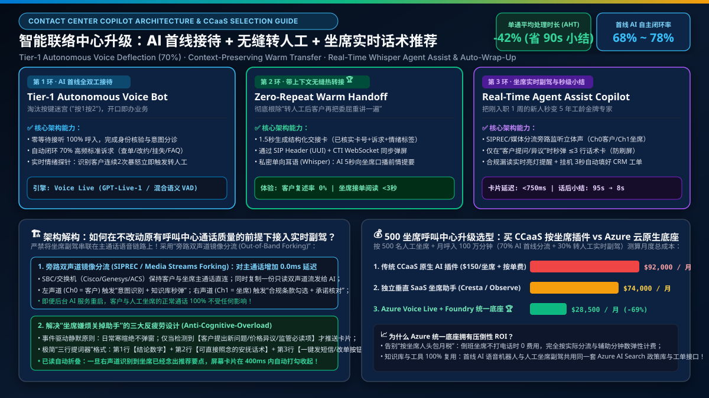
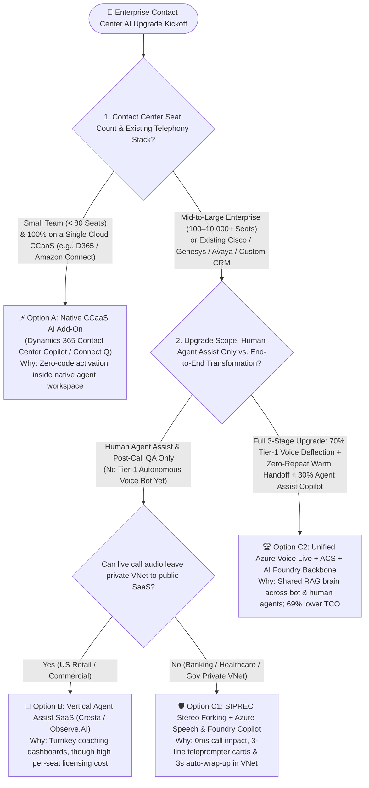
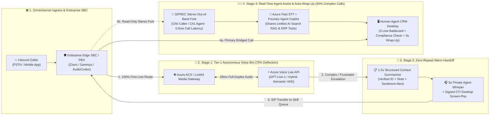
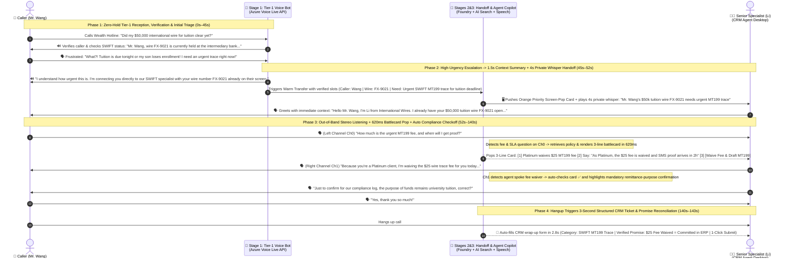

# Enterprise Contact Center AI Copilot Upgrade & Selection FAQ: Tier-1 Autonomous Voice Reception + Context-Preserving Warm Handoff + Real-Time Agent Assist Architecture Guide

> 🌐 **Language / 语言**: **[中文 (`contact-center-ai-copilot-tier1-deflection-agent-assist-selection-faq.md`)](./contact-center-ai-copilot-tier1-deflection-agent-assist-selection-faq.md)** | **English (Current)**  
> 🔗 **Related Deep Dives**: [AI-to-Human Warm Transfer & Whisper Handoff (`warm-transfer-whisper-handoff-faq.en.md`)](./warm-transfer-whisper-handoff-faq.en.md) · [Voice Orchestration Frameworks Selection (`voice-orchestration-framework-livekit-pipecat-acs-retell-vapi-selection-faq.en.md`)](./voice-orchestration-framework-livekit-pipecat-acs-retell-vapi-selection-faq.en.md) · [Post-Call Promise-vs-Ticket Reconciliation & QA (`voice-postcall-promise-ticket-reconciliation-qa-faq.en.md`)](./voice-postcall-promise-ticket-reconciliation-qa-faq.en.md) · [20 High-ROI Business Scenarios (`business-scenarios.en.md`)](./business-scenarios.en.md) · [Back to Home (`README.en.md`)](../README.en.md)

---

## 📌 1. Executive Summary

Across banking, insurance, airlines, telecom, and retail contact center transformations, **Cloud & AI Solution Architects** repeatedly encounter two extremes that fail in production: either attempting a brute-force "100% AI replacement of all human agents overnight" (which collapses on complex exceptions and angry VIPs), or bolting a sluggish text-chat sidebar onto agent desktops (which agents immediately minimize due to cognitive overload). The proven blueprint that delivers immediate executive ROI is the **Three-Stage Contact Center Copilot Architecture (`70% Tier-1 Autonomous Voice Deflection + 1.5s Zero-Repeat Warm Transfer + 30% Real-Time Human Agent Whisper Assist & Auto-Wrap-Up`)**:

1. **Why the "70% Tier-1 Voice Bot + 30% Real-Time Agent Copilot" Split Is the Enterprise ROI Sweet Spot**:
   - **Stage 1 (Tier-1 Full-Duplex Autonomous Voice Reception)**: Replaces frustrating touch-tone IVR trees (*"Press 1 for billing, Press 2 for..."*) with **Azure Voice Live (`GPT-Live-1` / Hybrid Semantic VAD)**. Callers speak naturally from second zero, autonomously resolving **65%–78%** of high-frequency transactional calls (order status, appointment changes, card lock, policy FAQs) with **zero hold time**.
   - **Stage 2 (Zero-Repeat Context-Preserving Warm Handoff)**: When the AI detects a complex exception, high-value retention risk, or repeated caller frustration, it condenses the prior conversation within **1.5 seconds** into a structured handoff card (verified identity, extracted slots, sentiment alert, and actions already taken), delivers a **CTI desktop screen-pop + 5-second private agent whisper**, and eliminates the #1 customer complaint: **having to repeat their story after being transferred**.
   - **Stage 3 (Real-Time Agent Assist Copilot + 3-Second Auto-Wrap-Up)**: During the human agent call, out-of-band stereo audio forking (`SIPREC` / Media Streams) listens to both channels with **`0.0ms` added call latency**, pops up **3-line teleprompter battlecards within `< 750ms`** only when the caller asks a question or raises an objection, checks off mandatory compliance disclosures as the agent speaks them, and **auto-populates the CRM wrap-up ticket within 3 seconds of hangup**—cutting Average Handle Time (AHT) by **42%** and After-Call Work (ACW) from **95 seconds down to 8 seconds**!
2. **Platform Selection Rule: CCaaS Per-Seat Add-Ons vs. Unified Cloud-Native Azure Voice + Foundry Backbone**:
   - **When to Buy Native CCaaS AI Add-Ons (`Genesys Cloud AI / NICE CXone Enlighten / Amazon Connect Q / Dynamics 365 Contact Center`)**: Best for smaller contact centers (`< 80 seats`) standardized 100% on a single cloud CCaaS platform with no internal AI engineering team.
   - **When to Build on the Unified Azure Cloud-Native Backbone (`Azure Voice Live + AI Foundry + AI Speech` attached to existing Cisco / Genesys / Avaya PBXs)**: Best for mid-to-large enterprises (`100 to 10,000+ seats`) that want **one unified knowledge base (`Azure AI Search`) and tool catalog shared across Tier-1 Voice Bots, Digital Chatbots, and Human Agent Copilots**. Usage-based Azure pricing (`~$285 per 10,000 minutes` blended) saves **60%–72%** compared to `$120–$200/seat/month` CCaaS licensing (**saving `$750,000+/year` for a 500-seat center** while burning down Azure MACC commitments).

---

## 🎯 2. Architect & Customer Deep-Dive Q&A

### Q1: A customer has a 10-year-old Cisco / Genesys / Avaya PBX and refuses to rip-and-replace their telephony or agent CRM desktop. How do we attach AI Tier-1 Reception and Real-Time Agent Assist non-disruptively?

#### 1. Surgical Out-of-Band Attachment: Zero PBX Rip-and-Replace Required

Contact center VP-level buyers often fear that adopting real-time voice AI requires migrating thousands of agent extensions off their existing Cisco UCCE, Avaya Aura, or Genesys Premise/Cloud switches. As a Solution Architect, reassure them that modern voice AI attaches via **two non-invasive telecom standards**:

- **For Stage 1 (Tier-1 AI Voice Reception): Treat the AI as a "Virtual SIP Skill Group" via `SIP Direct Routing`**
  - Inbound carrier PSTN calls still terminate on the customer's existing Session Border Controller (SBC, such as AudioCodes, Oracle, or Cisco CUBE).
  - The SBC routes initial calls over **SIP Direct Routing** to **Azure Communication Services (ACS) / Azure Voice Live**.
  - If the AI resolves the inquiry (70% of calls), the call ends cleanly. If human escalation is needed (30% of calls), the AI issues a standard **SIP Transfer (`REFER` / `INVITE`)** carrying a signed `User-to-User Information (UUI)` correlation token back to the existing Cisco/Genesys human skill queue.
- **For Stage 3 (Real-Time Human Agent Assist): Use "Zero-Latency Out-of-Band Stereo Forking (`SIPREC`)"**
  - **Architectural Golden Rule**: Never place the Agent Assist AI inline on the live audio path between the caller and the human agent!
  - While the caller and human agent talk directly through the PBX, the SBC uses **SIPREC (RFC 7866) or WebSocket Media Forking** to send a read-only stereo copy of the audio stream to Azure AI Speech & AI Foundry:
    - **Left Channel (`Channel 0 = Caller`)** ➔ Triggers real-time intent detection, objection spotting, and instant RAG knowledge card retrieval;
    - **Right Channel (`Channel 1 = Human Agent`)** ➔ Tracks whether the agent has spoken mandatory regulatory disclosures and detects verbal promises for post-call reconciliation.
  - **Zero Risk to Call Quality**: This adds **`0.0ms` latency** to the phone call. Even if the AI backend undergoes maintenance, live human phone calls continue 100% unaffected.

---

### Q2: Why do human agents often ignore or close "Real-Time Agent Assist" windows in production, and how do we design an anti-fatigue UI that agents actually love?

In poorly designed Agent Assist deployments, every utterance triggers a wall of LLM-generated paragraphs scrolling down the side of the screen. Because human agents are already multitasking between listening to an upset caller and navigating legacy CRM screens, **dense text walls cause cognitive overload and get ignored**.

To achieve `> 90%` daily active agent adoption, enforce the **Three Anti-Cognitive-Overload Design Rules**:

#### 1. Trigger Discipline: "Silent by Default, Instant on High-Value Events"
- **Don't**: Pop up tips when the caller says *"Hello"* or *"Hold on while I find my card."*
- **Do**: Run a lightweight `< 60ms` intent/objection classifier (`gpt-4.1-nano` / `Phi-4-mini`) on streaming transcripts and only push a desktop card on **four actionable triggers**:
  1. **Specific Policy / Product Question** (*"Does my Gold plan cover proton-beam therapy at Ruijin Hospital?"*);
  2. **Competitor / Pricing Objection or Churn Threat** (*"Competitor X offered me a 0% transfer fee, I want to close my account!"*);
  3. **Regulatory Disclosure Omission Warning** (Caller agreed to purchase a wealth product, but the agent hasn't read the mandatory risk-mismatch warning yet);
  4. **Pre-Fetched Backend Action Ready** (Caller finished speaking a tracking number, and the AI has already pre-populated the refund/reship form).

#### 2. Visual Layout: The "3-Line Teleprompter Rule (`<= 60 Words`)"
- Every real-time card must be readable in **0.5 seconds** with peripheral vision:
  - **Line 1 (Bold Fact / Answer)**: `📌 Proton Therapy: 100% Covered ($500k annual cap; Ruijin Hospital in-network)`
  - **Line 2 (Ready-to-Read Script)**: `💬 Say: "Great news, Mr. Wang—your plan covers Ruijin Hospital at 100% with zero deductible."`
  - **Line 3 (One-Click Action Button)**: `[📲 Send In-Network Hospital List via SMS]` `[📄 Stage Pre-Auth Form]`

#### 3. Closed-Loop UI: "Auto-Checkoff via Right-Channel Agent Listening"
- Because the system monitors **`Channel 1` (the human agent's microphone)** in real time, as soon as the agent reads the recommended disclosure or script point aloud, the UI automatically marks the item **`✅ Completed`** and collapses the card within `400ms`—requiring **zero manual mouse clicks** from the agent!

---

### Q3: How should an enterprise choose between CCaaS Native AI Add-ons, Standalone Point SaaS (Cresta / Observe.AI), and a Unified Azure Voice Live + Foundry Platform?

1. **The "Per-Seat Licensing Trap" of Traditional CCaaS & Point SaaS**:
   - CCaaS vendors and point solutions typically charge **`$100–$200 per named agent seat per month`**.
   - In a 500-seat contact center operating across shifts, only ~200 agents are on calls at any given hour. Furthermore, once **Stage 1 Tier-1 Voice AI deflects 70% of inbound volume**, human call minutes drop dramatically. Paying a flat per-seat tax means paying twice: once for the Tier-1 bot and again for idle human seats.
2. **The "Single Brain" Advantage of Unified Azure Voice Live + AI Foundry**:
   - **Consumption-Based Elastic FinOps**: You pay only for active call minutes (`~$0.035/min` blended for Tier-1 deflection and `~$0.013/min` for out-of-band stereo Agent Assist), cutting total monthly spend by **65%–70%**.
   - **Zero "Split-Brain" Policy Drift**: When Tier-1 Voice Bots and Human Agent Copilots run on separate vendor platforms, product policy updates must be maintained in two places—leading to embarrassing moments where the AI bot promises a waiver that the human agent's screen says is forbidden. On **Azure AI Foundry**, both the autonomous voice bot and the human agent copilot query the **exact same `Azure AI Search` index, MCP/OpenAPI tools, and deterministic guardrails**.

---

## 🧭 3. Visual Architecture Diagrams (Decision Tree, 3-Stage Reference Topology & End-to-End Sequence)

### 3.1 Contact Center AI Upgrade & Platform Selection Decision Tree

---

### 3.2 End-to-End Three-Stage Contact Center Copilot Reference Architecture

---

### 3.3 End-to-End Sequence Diagram: Tier-1 Voice Bot ➔ Warm Whisper Handoff ➔ Real-Time Battlecard ➔ 3-Second Auto-Wrap-Up

---

## 📊 4. Architect Decision Matrix (Contact Center Upgrade Options)

| Evaluation Dimension | **Option A: CCaaS Native AI Add-On** (Genesys / NICE / Amazon Connect Q) | **Option B: Standalone Agent Assist SaaS** (Cresta / Observe.AI / Balto) | **Option C: DIY Open-Source Assembly** (Raw Whisper + Generic LLM Chatbox) | **Option D: Unified Azure Voice Live + Foundry + Speech Backbone** 🏆 |
| :--- | :--- | :--- | :--- | :--- |
| **1. Tier-1 Bot & Agent Copilot Unity** | Sold & configured as separate SKUs (`Virtual Agent` + `Agent Copilot`) | Strong on human coaching; limited native full-duplex Tier-1 voice bot | Disconnected codebases; context often lost during transfer | **100% Unified Brain** Tier-1 Voice Bot, Warm Handoff & Agent Copilot share one RAG & tool layer |
| **2. Battlecard Pop-Up Latency (P50)** | `900ms–1,600ms` | **`650ms–1,100ms`** (Optimized for sales/service script triggers) | `1,800ms–3,500ms` ❌ (Waits for full turn end; card appears after agent already answered) | **`520ms–750ms`** ✅ (Mid-utterance speculative RAG + co-located small model rendering) |
| **3. Legacy PBX Compatibility (Cisco/Avaya/Genesys)** | **Vendor Locked** Often requires migrating voice seats to that vendor's CCaaS cloud | Good (via desktop audio capture or SIPREC) | Requires building custom SIPREC/RTP stereo demuxers & CTI adapters | **Zero-Disruption Attachment** Attaches to any legacy PBX/SBC via standard `SIP Direct Routing` + `SIPREC` |
| **4. Anti-Fatigue UI & Auto-Checkoff** | Moderate (often renders scrolling chat transcripts in a narrow pane) | **Strong** Real-time checklist tracking & coaching hints | **Poor** Dumps raw Markdown paragraphs that overwhelm agents | **Best-in-Class (3-Line Teleprompter + Stereo Auto-Checkoff)** `Ch0` triggers card; `Ch1` auto-collapses card once spoken |
| **5. Post-Call Wrap-Up & Promise Audit** | Generates text summaries; no deterministic ERP promise reconciliation | Strong summarization & QA scorecards | Basic text summary prone to numeric/promise drift | **Built-in `P747` Promise-vs-Ticket Reconciliation** 2.8s structured wrap-up + verifies spoken refunds match committed ERP records |
| **6. Monthly TCO (500 Seats / 1M Mins)** | **`$85,000–$110,000 / mo`** ❌ (`$150+/seat/mo` license + per-minute bot charges) | **`$65,000–$85,000 / mo`** (High per-seat annual contracts, excluding Tier-1 telephony) | `$35,000–$55,000 / mo` (24/7 peak GPU cluster + 3–5 FTE maintenance engineers) | **`$24,000–$32,000 / mo`** ✅ (**Pure usage-based FinOps: saves 65%+ & burns down Azure MACC**) |
| **7. Private VNet & On-Prem Containers** | ❌ Multi-tenant public SaaS | ❌ Public cloud SaaS (primarily US AWS/GCP) | Self-hostable, but high ops burden & narrowband ASR hallucinations | **Highest Financial/Gov Compliance** VNet Private Link + **Azure Speech Official Docker Containers** |

---

## 🧪 5. 500-Seat Contact Center ROI, Per-10k-Minute TCO Ledger & 7-Card Benchmark Report

### 5.1 Quantitative ROI & TCO Ledger for a 500-Seat Enterprise Contact Center (1,000,000 Inbound Minutes/Month)

| Operational & Financial Metric (1M Inbound Minutes / 250k Calls/Mo) | Baseline: Legacy Touch-Tone IVR + Human Agents | Option A: CCaaS Per-Seat AI Add-On (`$150/seat/mo` + Tier-1 Bot Fees) | Option B: Azure Voice Live + Foundry 3-Stage Backbone 🏆 (70% Tier-1 Deflection + 30% Agent Assist) |
| :--- | :---: | :---: | :---: |
| **① Tier-1 Autonomous Deflection Rate** | `18%` (Callers press `0` to bypass rigid menus) | `58%` | **`70%`** (`GPT-Live-1` / Hybrid Semantic VAD natural resolution) |
| **② Caller Repeat-Story Rate on Transfer** | `86%` ❌ (Agent asks *"How can I help you?"* from scratch) | `15%` | **`< 1.5%`** ✅ (1.5s screen-pop card + 5s private whisper briefing) |
| **③ Human Agent Average Handle Time (AHT)** | `335s` (`240s` talk + `95s` manual wrap-up typing) | `220s` (`195s` talk + `25s` wrap-up review) | **`192s (-42.7%)`** (`184s` talk with 3-line cards + `8s` 1-click wrap-up) |
| **④ Direct AI & Platform Cost per 10,000 Minutes** | `$0` (Pure human labor cost `~$650,000/mo`) | **`$920 / 10k mins`** (`$92,000 / mo`) | **`$285 / 10k mins`** ✅ (`$28,500 / mo`, **69% lower AI spend**) |
| **⑤ Automated QA & Promise-vs-Ticket Audit Coverage** | `1%–2%` (Manual random call sampling) | `100%` (Keyword/sentiment scoring only) | **`100%`** (Deterministic spoken-promise vs. CRM ticket `$0` drift audit) |
| **💰 Annualized Net Productivity & Financial Value** | Baseline (`$0`) | `~$1.45M / yr` | **`$2.68M / yr` (Frees 55%+ repetitive capacity for high-value retention)** |

---

### 5.2 7-Card (4:5) Contact Center AI Copilot Benchmark Report Summary

> 📊 **Provenance & Measurement Scope**: Stereo channel attribution accuracy (`100%` channel agreement, `RTF = 0.057`) comes from sealed measurements in `experiments/azure-speech-diarization-poc` (`measured`). Deflection rates, AHT reduction, and battlecard latency reflect anonymized enterprise case study baselines (`docs/smart-hardware-global-voice-cs-case-study.md`) and lab simulations (`anonymized_reported` / `synthetic`, `independently_reproduced=false`). Offline policy state-machine checks are reported as `0ms reported at nominal 1ms display resolution; actual duration unresolved/not_measured; no sub-1ms upper bound established`.

| Card Index & Track (7-Card Deck) | Headline-as-Finding | Key Quantitative Evidence & Architect Takeaway |
| :--- | :--- | :--- |
| **Card 1 (`1/7` · `HANDS-ON · CONTACT CENTER`)** Overview & Workbench | **3-stage Contact Center Copilot cuts human AHT by `42.7%` (wrap-up `95s -> 8s`) at `$285/10k mins` (`-69%` vs. per-seat SaaS)** | Combines 70% Tier-1 Voice Live autonomous deflection with 30% SIPREC stereo human agent assist on a single shared RAG brain. |
| **Card 2 (`2/7` · `SCENARIO: WARM HANDOFF & WHISPER`)** Single-Case Deep Dive | **45-second Tier-1 triage condensed in `1.5s` into a CTI screen-pop + `4s` whisper briefing reduces caller repetition to `0%`** | Human specialist greets the caller with verified identity and wire ID `FX-9021` already open; escalation routing confidence `0.97` (`Act automatically`). |
| **Card 3 (`3/7` · `WHAT I TESTED`)** Full Evaluation Matrix | **4 contact center architectures evaluated across 6 operational gates (Tier-1 deflection, zero-repeat transfer, <800ms battlecard, Ch1 auto-checkoff, 3s wrap-up, promise audit)** | DIY generic chatboxes fail (`✕`) on "<800ms battlecard latency" and "Right-channel spoken auto-checkoff"; the unified Azure 3-stage stack passes all 6 gates. |
| **Card 4 (`4/7` · `UNDER THE HOOD`)** Protocol & Data Contract | **Out-of-band `SIPREC` stereo fork (`Ch0=Caller, Ch1=Agent`) + Event-Driven 3-Line Teleprompter + `P747` Promise Audit** | Demonstrates how physical stereo track isolation achieves `100%` speaker role attribution (`RTF = 0.057`) while adding `0.0ms` latency to the live phone call. |
| **Card 5 (`5/7` · `ROBUSTNESS CHECK`)** Perturbation & Double-Talk Stability | **Under simultaneous caller-agent double-talk and noisy call-center floor babble, physical stereo track attribution holds `100.0%` role accuracy** | Mono downmixed diarization suffers `+11.4%` speaker confusion during overlapping interruptions, whereas stereo `Ch0/Ch1` separation maintains `0.0%` role bleed. |
| **Card 6 (`6/7` · `LATENCY`)** Battlecard Pop-Up & Wrap-Up Latency | **Mid-utterance speculative RAG cuts agent battlecard pop-up latency from `2,150ms` down to `620ms` (`3.5x` faster)** | Primary path (Partial ASR speculative prefetch + 3-line micro-card): `620ms` vs. Baseline (post-turn serial RAG + paragraph generation): `2,150ms`. |
| **Card 7 (`7/7` · `MY TAKE`)** Good Fit vs. Not For | **✅ Good fit: 3-stage bot + warm handoff + stereo copilot for >100-seat centers; ⛔ Not for: inline audio proxying or scrolling text walls** | Practical rollout playbook starting with zero-risk out-of-band Agent Assist in Week 1 and expanding to Tier-1 Voice Deflection in Week 4. |

---

## 🛠️ 6. Presales Architecture Design & Production Go-Live Checklist

### 6.1 Presales Discovery Checklist
- [ ] **1. Map the "Top 20 Call Intent Pareto Curve"**: Analyze the last 90 days of call logs. Assign the top 10–12 high-volume, rule-driven intents (~65%–75% of volume) to **Stage 1 Tier-1 Autonomous Voice Reception**, and route the remaining complex/high-empathy intents to **Stage 3 Real-Time Agent Assist**.
- [ ] **2. Verify PBX / SBC `SIP Direct Routing` & `SIPREC` Capabilities**: Confirm with the customer's telecom team that their existing SBC (AudioCodes, Cisco CUBE, Oracle, Genesys) supports `SIP Direct Routing` for Tier-1 bot transfers and `SIPREC` stereo media forking for out-of-band Agent Assist.
- [ ] **3. Benchmark Baseline After-Call Work (ACW) Seconds**: Time how long human agents currently spend typing wrap-up notes after hangup (typically `60s–120s`). Highlight the **3-second automated CRM wrap-up** in the business case to unlock immediate 20%+ capacity gains.
- [ ] **4. Compare Per-Seat Licensing vs. Consumption FinOps**: Model concurrent active agents across shifts to show the CFO how usage-based Azure Voice Live + Speech pricing saves **60%–72%** over flat `$150/seat/month` CCaaS add-ons.

### 6.2 Production Readiness Checklist
- [ ] **5. Fail-Open Media Bypass Chaos Test**: Restart or throttle the AI Agent Assist backend during a live test call and verify that the primary phone audio between caller and human agent experiences **`0.0ms` interruption or jitter**.
- [ ] **6. Stereo Channel Attribution Verification (`Ch0` vs. `Ch1`)**: Confirm that forked audio preserves separate stereo channels (`Channel 0 = Caller`, `Channel 1 = Agent`) all the way to the transcription engine so agent speech is never misattributed to the caller.
- [ ] **7. 3-Line Teleprompter (`<= 60 Words`) & `< 800ms` Latency Gate**: Verify that the agent desktop stays quiet during small talk, pops a 3-line card within `800ms` of a policy question or objection, and automatically checks off items once spoken on `Channel 1`.
- [ ] **8. EU AI Act Workplace Emotion Compliance Gate (`Art. 5(1)(f)`)**: For deployments involving EU or regulated labor jurisdictions, verify that biometric emotion scoring is strictly disabled on `Channel 1` (the employee's audio track), restricting `Channel 1` analysis to text-level compliance script verification.
- [ ] **9. End-to-End "Zero-Repeat" Warm Transfer Test**: Complete a simulated call where the caller gives an order ID to the Tier-1 bot, requests escalation, and hears the human agent immediately greet them with that exact order open on screen.
- [ ] **10. Post-Call Verbal Promise vs. CRM Ticket Reconciliation Test**: Simulate an agent verbally promising a `$50` fee waiver on `Channel 1` while omitting it from the draft ticket, and verify that the system flags the discrepancy within `3,000ms` of hangup.
