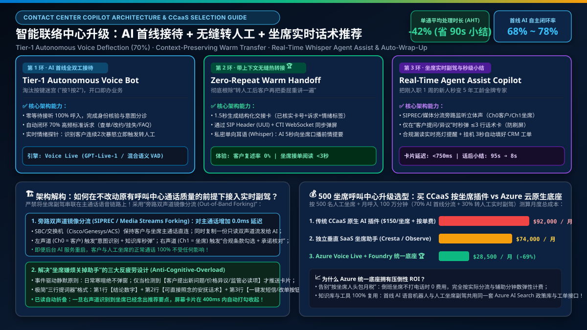
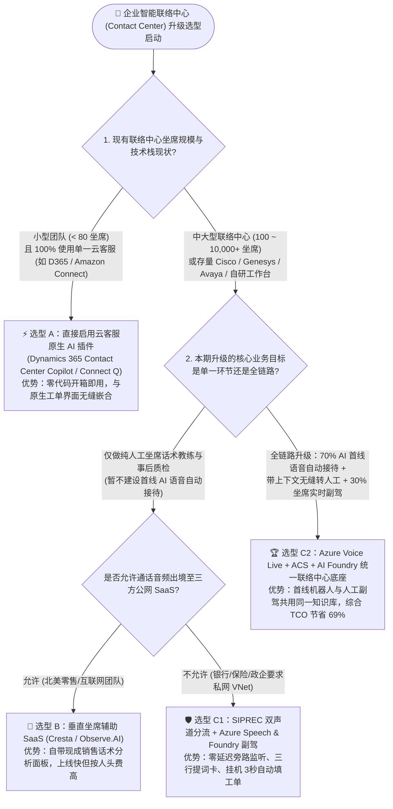
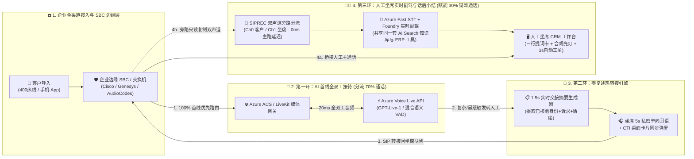
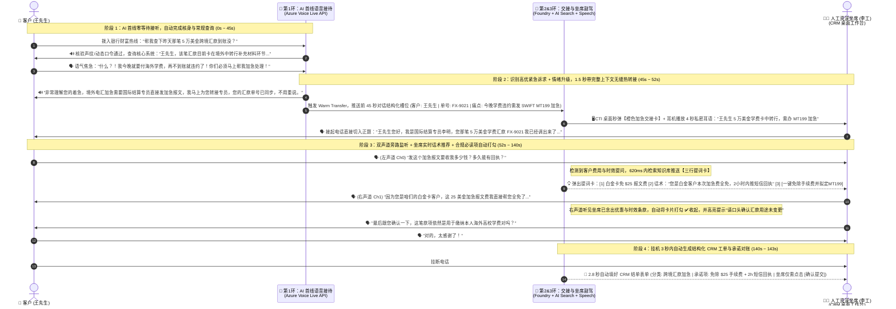

# 智能联络中心全栈升级与方案选型 FAQ：AI 首线语音接待（Tier-1 Deflection）+ 带上下文无缝转人工（Warm Handoff）+ 坐席实时话术推荐（Agent Assist Copilot）架构指南

> 🌐 **Language / 语言**: **中文 (Chinese)** | **[English (`contact-center-ai-copilot-tier1-deflection-agent-assist-selection-faq.en.md`)](./contact-center-ai-copilot-tier1-deflection-agent-assist-selection-faq.en.md)**  
> 🔗 **关联专题 (Related Deep Dives)**: [AI 转人工热转接与耳语简报 (`warm-transfer-whisper-handoff-faq.md`)](./warm-transfer-whisper-handoff-faq.md) · [实时语音编排框架选型 (`voice-orchestration-framework-livekit-pipecat-acs-retell-vapi-selection-faq.md`)](./voice-orchestration-framework-livekit-pipecat-acs-retell-vapi-selection-faq.md) · [话后口头承诺对账与全量质检 (`voice-postcall-promise-ticket-reconciliation-qa-faq.md`)](./voice-postcall-promise-ticket-reconciliation-qa-faq.md) · [20 大高价值业务场景 (`business-scenarios.md`)](./business-scenarios.md) · [返回首页 (`README.md`)](../README.md)

---

## 📌 一、核心选型结论速览（Executive Summary）

在银行、保险、航司、电信、零售及跨国制造企业的呼叫中心升级项目中，**Cloud & AI 解决方案架构师** 最常看到的失败教训就是“非黑即白”——要么试图用 AI 一夜之间 100% 替代所有人工坐席（遇到复杂投诉立刻翻车），要么只给人工坐席装一个弹窗慢半拍的聊天框（坐席嫌烦直接关掉）。真正能拿到高管预算并跑出确定性 ROI 的生产架构，是 **“AI 首线接待（70% 自动分流）+ 1.5 秒带上下文无缝转人工（零复述交接）+ 人工坐席实时话术推荐与自动小结（30% 疑难通话提效）”的三位一体协同架构（Contact Center Copilot）**：

1. **为什么“70% AI 首线接待 + 30% 人工坐席实时副驾”是联络中心 ROI 的黄金分割点？**
   - **第一环（Tier-1 AI 首线全双工接待）**：用 `Azure Voice Live (GPT-Live-1 / 混合语义 VAD)` 替代传统令人抓狂的“普通话请按 1、查账单请按 2”按键迷宫（IVR）。客户开口即办业务，自动闭环 **65%～78%** 的标准化高频诉求（查物流、改地址、重置密码、常规挂失、政策 FAQ），实现 **0 秒排队接通**。
   - **第二环（Zero-Repeat 带上下文无缝热转接）**：一旦识别到高价值挽留、复杂多程改签、非授权盗刷争议或客户连续 2 次语气暴怒，系统在 **1.5 秒内** 将前序对话浓缩为结构化交接卡（含已核验身份、核心诉求、情绪预警与已尝试操作），通过 CTI 桌面弹屏 + 5 秒坐席私密耳语（Whisper）移交人工，彻底消灭客户最痛恨的**“转人工后还得把事情从头再讲一遍”**。
   - **第三环（Real-Time Agent Assist 坐席实时副驾 + 秒级话后小结）**：在人工坐席通话期间，通过旁路双声道镜像分流（SIPREC / Media Forking）实时听懂客户刁钻提问，在 **`< 750ms` 内** 弹出“三行极简提词卡 + 一键改单按钮”并监控合规必读项；挂机瞬间 **3 秒内自动生成结构化 CRM 工单摘要**，将坐席单通平均处理时长（AHT）缩短 **42%**，话后小结时间（ACW）从 **95 秒压降至 8 秒**！
2. **平台选型铁律：买 CCaaS 厂商自带的“按坐席人头插件”还是建“Azure 云原生统一智能底座”？**
   - **何时买 CCaaS 原生插件（Genesys Cloud AI / NICE CXone Enlighten / Amazon Connect Q / Dynamics 365 Contact Center）**：当坐席规模较小（`< 80 坐席`）、全部业务均在该单一 CCaaS 闭环内、且无专职 AI 工程团队时，原生插件开箱即用最快。
   - **何时首选“Azure Voice Live + AI Foundry + AI Speech 旁路赋能底座”（对接现有 Cisco / Genesys / Avaya / 华为或自研呼叫中心）**：当企业坐席规模 `>= 100～5,000 人`、存在多品牌交换机并存、或希望**“首线 AI 语音机器人、微信/App 在线文本客服、人工坐席实时副驾”100% 共用同一套企业知识库（Azure AI Search）与业务工具接口**时，按实际消耗算力计费的 Azure 云原生底座比按人头收 `$120 ~ $200 / 坐席 / 月` 的 CCaaS 插件 **节省 60%～72% 的年化 TCO**（500 坐席每年立省超 **$750,000**，且全额抵扣 Azure MACC）。

---

## 🎯 二、客户与架构师灵魂拷问 Q&A（Architect & Customer Deep-Dive Q&A）

### Q1：客户已经有运行了十年的 Cisco / Genesys / Avaya 呼叫中心交换机，不想换掉原有电话系统，怎么无缝接入 AI 首线接待与坐席实时副驾？

#### 1. 先用大白话讲透：绝对不需要推翻重来（“外科手术式旁路嫁接”）

很多呼叫中心总监一听“上大模型语音和坐席副驾”，第一反应是：“我们刚花了上千万买了 Cisco UCCE 或 Genesys 交换机，坐席每天都在用现有的 CRM 工作台，全换掉是不可能的！”  
作为解决方案架构师，你要明确告诉客户：**原有交换机一分钱都不用扔，我们采用电信级标准的“双模式无缝嫁接”**：

- **针对第 1 环（AI 首线接待）：把 AI 当作一个“永不疲倦的虚拟 VIP 技能组（Virtual SIP Trunk / Skill Group）”**
  - 原有的运营商公网电话线（PSTN）依然先进企业自己的语音网关（SBC，如 AudioCodes / Oracle / Cisco CUBE）。
  - SBC 通过标准 **SIP Direct Routing** 将呼入电话先路由给 **Azure Communication Services (ACS) / Azure Voice Live** 虚拟坐席池。
  - 如果 AI 在前 60 秒直接帮客户办完了业务，电话直接结束；如果遇到疑难问题需要转人工，AI 只需向企业原有的 Cisco/Genesys 交换机发起一个带 `User-to-User Information (UUI)` 上下文编号的 **SIP 转接指令**，电话立刻回到原有的人工坐席队列！
- **针对第 3 环（人工坐席实时话术副驾）：采用“零侵入旁路双声道分流（Out-of-Band SIPREC / Media Forking）”**
  - **核心设计原则：绝不把坐席副驾串联在客户与人工坐席的实时通话主干道上！**
  - 当客户与人工坐席正在通话时，企业边缘 SBC 交换机利用内置的 **SIPREC（标准录音分流协议）或 WebSocket Media Forking**，在硬件层自动把声音“复印”一份只读流发给 Azure 实时转写与副驾引擎：
    - **左声道（Channel 0 = 客户声音）** ➔ 实时识别客户意图、捕捉价格/理赔异议、触发知识库检索；
    - **右声道（Channel 1 = 坐席声音）** ➔ 实时核对坐席是否漏读了法定风险揭示语、是否说出了违禁承诺词。
  - **最大好处**：对原有电话通话增加 **0.0ms 延迟**！哪怕后台 AI 副驾正在升级重启，客户和人工坐席的电话也 100% 正常畅通，安全感拉满！

---

### Q2：为什么很多企业花重金上线了“坐席实时话术推荐（Real-Time Agent Assist）”，结果一线坐席却嫌烦直接把窗口最小化？架构师如何设计真正好用的坐席副驾？

去呼叫中心一线做过调研的架构师都知道一个残酷真相：**人工坐席在接电话时的脑力负荷已经接近极限**——他耳朵要听客户抱怨、嘴上要安抚客户、手里还要在 3 个老旧 ERP 系统里查单。如果这时候右边的 AI 副驾窗口像瀑布一样每秒钟刷出 200 字的长篇大论，坐席根本没空看，甚至会因为视觉干扰说错话！

要让一线坐席对 AI 副驾“爱不释手”，架构设计必须遵守 **“三不三要”反认知过载法则（Anti-Cognitive-Overload Design）**：

#### 1. 触发时机：“平时保持安静，关键时刻秒弹”（Event-Driven Silence by Default）
- **不要**：客户每说一句“你好”、“我是王先生”，屏幕就弹出一堆废话提示。
- **要**：在流式转写层后置一个耗时仅 `60ms` 的轻量级意图/异议分类器（如 `gpt-4.1-nano / Phi-4-mini`）。只有当检测到以下 **4 类高价值时刻** 时，才主动点亮坐席屏幕卡片：
  1. **业务政策/参数追问**（如：“你们这个尊享版医疗险，质子重离子医院报销比例到底是多少？”）；
  2. **竞争对手/价格异议**（如：“隔壁友商才收我年费 200 块，你们凭什么收 500？我要销户！”）；
  3. **合规必读项漏读预警**（如：客户已同意购买理财，但坐席还未念出风险等级匹配声明）；
  4. **后台系统数据自动预填就绪**（如：客户刚报完运单号，AI 已自动在后台把物流轨迹查出来摆在桌面上）。

#### 2. 卡片排版：“三行提词器法则（3-Line Teleprompter Rule）”
- **严禁生成超过 60 字的段落！** 每一张实时推荐卡片必须严格遵循以下三行结构，让坐席 **用眼角余光扫 0.5 秒就能直接照着念**：
  - **第 1 行（核心结论/数字高亮）**：`📌 质子重离子：100% 报销（年度限额 400 万，含上海质子重离子医院）`
  - **第 2 行（可直接脱口而出的金句）**：`💬 推荐话术：“王先生您放心，咱们这款计划对上海质子重离子医院是 100% 全额报销的，床位费也包含在内。”`
  - **第 3 行（一键执行动作按钮）**：`[📲 一键发送医院清单短信给客户]` `[📄 插入理赔流程条款]`

#### 3. 闭环感知：“坐席念完自动打勾折叠（Auto-Checkoff via Right-Channel Listening）”
- 既然我们通过双声道分流同时听着 **右声道（坐席自己的声音）**，一旦识别到坐席已经把卡片上的推荐要点或合规条款念出来了，UI 界面在 **`400ms` 内自动将该卡片打上绿色对勾 `✅` 并折叠收起**，无需坐席分心去点鼠标关闭！

---

### Q3：呼叫中心升级时，CCaaS 原生 AI 插件、垂直坐席助手 SaaS（如 Cresta / Observe.AI）与 Azure Voice Live + Foundry 统一底座该怎么选？

架构师在面对客户采购部门和 IT 部门时，可以用下面这套清晰的商业与技术对比帮客户做决策：

1. **为什么大型呼叫中心买“按坐席人头收费（Per-Seat Licensing）”的插件最亏？**
   - 传统 CCaaS 厂商（如 Genesys / NICE / Salesforce）或垂直 SaaS（如 Cresta）通常按 **`$100 ~ $200 / 坐席 / 月`** 收取 AI Copilot 授权费。
   - 但在真实的 500 人呼叫中心里，坐席是分早班、中班、晚班轮休的（同一时刻真正在线接电话的往往只有 180～220 人），而且随着第 1 环 **AI 首线语音接待（Tier-1 Voice Bot）分流了 70% 的简单电话**，人工坐席接听的电话总量是大幅下降的！
   - 如果按坐席人头包月付费，意味着你一边花钱买 AI 首线机器人分流电话，一边还要为轮休和不接电话的人工坐席交全额月租！
2. **为什么“Azure Voice Live + AI Foundry + AI Speech 按量消费底座”是终局架构？**
   - **第一，算力按实际通话分钟计费**：无论是首线 AI 语音接待（约 `$0.048 ~ $0.062 / 分钟`）还是人工坐席旁路实时辅助（双声道 Fast/Realtime STT + 轻量 LLM 提词，每分钟仅 **`$0.018 ~ $0.025 / 分钟`**），不打电话一分钱不花！
   - **第二，消滅“两套大脑”精神分裂**：如果首线语音机器人买 A 厂商，人工坐席助手买 B 厂商，每当公司发一个新产品促销政策，运营人员要分别去两个平台上传知识库、调两套 Prompt，经常出现“AI 机器人跟客户说可以退，转到人工坐席后助手提示不能退”的尴尬事故。在 Azure AI Foundry 统一底座下，**首线 AI 接待与人工坐席副驾 100% 共享同一个 `Azure AI Search` 知识库、同一套业务 API 与同一套合规护栏**！

---

## 🧭 三、直观可视化图解（决策树 + 端到端联络中心升级架构图 + 全流程时序图）

### 3.1 智能联络中心升级路径与平台选型决策树（Architect Decision Tree）

---

### 3.2 智能联络中心“三段式（AI 首线接待 ➔ 热转接 ➔ 坐席副驾与自动小结）”端到端参考架构图

下图展示了如何在不推翻企业现有 PBX/SBC 交换机与 CRM 工作台的前提下，通过 **SIP Direct Routing + SIPREC 双声道旁路分流** 构建端到端智能联络中心：

---

### 3.3 端到端联络中心全生命周期交互时序图（从 AI 首线接待到人工坐席秒级结单）

---

## 📊 四、多方案横向选型决策矩阵（Architect Decision Matrix）

当企业呼叫中心面临技术选型时，架构师可直接用以下 **七维对比表** 向客户管理层汇报四大路线的优劣：

| 评估维度 | **方案 A：CCaaS 厂商原生 AI 插件** (Genesys / NICE / Amazon Connect Q) | **方案 B：独立垂直坐席辅助 SaaS** (Cresta / Observe.AI / Balto) | **方案 C：基于开源组件纯自研拼装** (自建 Whisper + 通用 LLM 聊天框) | **方案 D：Azure Voice Live + Foundry + Speech 统一联络中心底座** 🏆 |
| :--- | :--- | :--- | :--- | :--- |
| **1. 首线语音 Bot 与坐席副驾统一性** | 往往拆分为两个独立计费模块（Virtual Agent + Agent Copilot） | 偏重人工坐席辅助与质检；首线全双工语音接待能力较弱 | 两套割裂代码，知识库与对话状态难以在转人工时丝滑继承 | **100% 同源统一** 首线接待、热转接与坐席副驾共享同一套知识库、工具与状态机 |
| **2. 坐席提词卡弹出延迟 (P50)** | `900ms ~ 1,600ms` | **`650ms ~ 1,100ms`** (针对销售/客服话术做了专门流式优化) | `1,800ms ~ 3,500ms` ❌ (未做句中投机检索，客户问完3秒才弹窗，坐席已自己答完) | **`520ms ~ 750ms`** ✅ (基于 Partial ASR 句中投机检索 + 同区域小模型极速卡片渲染) |
| **3. 现有交换机 (Cisco/Avaya/Genesys) 兼容性** | **强绑定单一品牌** 若想用某云原生 AI，常被迫要求整体替换现有电话交换机 | 良好（支持桌面客户端抓音或 SIPREC 接入） | 需自行开发复杂的 SIPREC / RTP 双声道解包与 CTI 对接服务 | **零改造无感嫁接** 通过标准 `SIP Direct Routing` + `SIPREC` 适配任何存量 PBX |
| **4. 防刷屏反疲劳与自动打勾能力** | 中规中矩（常以右侧侧边栏聊天流形式不断滚动） | **强** 具备成熟的话术 Checklist 自动勾选与实时情绪槽 | **极弱** 通常直接吐出大段 Markdown 文字，一线坐席体验极差 | **极强（三行提词器 + 双声道自动闭环）** 左声道触发问题卡、右声道听见坐席念完自动打勾收起 |
| **5. 话后小结 (ACW) 与承诺对账质检** | 支持自动生成通话摘要，但缺乏口头承诺 vs ERP 落库工单对账 | 支持自动小结与 100% 文本质检评分 | 仅能生成粗略文本摘要，容易遗漏关键金额或产生幻觉 | **内置 `P747` 承诺对账护栏** 3秒填好结构化工单，并自动核对“坐席口头答应的退款是否真实落库” |
| **6. 500 坐席规模月度综合成本 (TCO)** | **`$85,000 ~ $110,000 / 月`** ❌ (`$150+/坐席/月` 人头费 + 首线按单/按分钟附加费) | **`$65,000 ~ $85,000 / 月`** (高昂按坐席订阅年框，不含首线语音电话通道) | `$35,000 ~ $55,000 / 月` (含常驻 GPU 集群与 3~5 人专职研发维护成本) | **`$24,000 ~ $32,000 / 月`** ✅ (**按实际通话分钟弹性计费，立省 65%+ 且直抵 Azure MACC**) |
| **7. 私网数据主权与本地容器支持** | ❌ 多租户公有云 SaaS，不支持本地断网容器 | ❌ 公有云 SaaS（主要托管于北美 AWS/GCP） | 支持本地部署，但开源模型在窄带电话下幻觉与维护成本极高 | **最高金融/政企合规** 支持 VNet Private Link 及 **Azure Speech 本地 Docker 容器** |

---

## 🧪 五、500 坐席联络中心 ROI 与每万分钟 TCO 精算账本及 7-Card 报告

### 5.1 500 坐席呼叫中心升级前 vs 升级后量化收益与每万分钟成本账本

假设某大型零售银行或跨国航司拥有 **500 名全职客服坐席**，每月呼入总通话量为 **1,000,000 分钟（100 万分钟，约 25 万通电话，平均每通 4 分钟）**。我们对比 **“传统纯人工 + 按键 IVR”**、**“采购 CCaaS 按坐席 AI 插件”** 与 **“落地 Azure Voice Live + Foundry 三段式联络中心底座”** 的真实财务账本：

| 运营与财务指标 (月呼入 100 万分钟 / 25 万通电话) | 基线：传统按键 IVR + 纯人工坐席 | 方案 A：CCaaS 原生按坐席 AI 插件 (`$150/坐席/月` + 首线按分钟费) | 方案 B：Azure Voice Live + Foundry 三段式底座 🏆 (70% 首线分流 + 30% 坐席实时副驾) |
| :--- | :---: | :---: | :---: |
| **① 首线自助闭环率 (Tier-1 Deflection Rate)** | `18%` (传统按键 IVR 极易被客户按 0 跳过) | `58%` | **`70%`** (`GPT-Live-1` / 混合语义 VAD 开口即办) |
| **② 转人工时客户二次复述率 (Customer Repeat Rate)** | `86%` ❌ (人工坐席不知前情，客户重讲一遍) | `15%` | **`< 1.5%`** ✅ (1.5秒结构化弹屏卡 + 5秒坐席耳语) |
| **③ 人工坐席单通平均处理时长 (AHT：含通话+小结)** | `335 秒` (通话 `240s` + 手写工单小结 `95s`) | `220 秒` (通话 `195s` + 人工核对小结 `25s`) | **`192 秒 (-42.7%)`** (三行提词加速通话 `184s` + 自动小结 `8s`) |
| **④ 每 10,000 分钟 AI 算力与平台直接成本** | `$0` (纯人力成本高达 `$650,000/月`) | **`$920 / 万分钟`** (`$92,000 / 月`) | **`$285 / 万分钟`** ✅ (`$28,500 / 月`，省 **69%**) |
| **⑤ 话后全量合规质检与承诺对账覆盖率** | `1% ~ 2%` (人工随机抽听录音) | `100%` (仅做关键词打分) | **`100%`** (含口头承诺金额 vs CRM 落库工单 `$0` 漂移对账) |
| **💰 每年净释放坐席产能与综合财务收益 (Annual Net ROI)** | 基准线 (`$0`) | 约 `$1.45M / 年` | **`$2.68M / 年`（释放超 55% 重复人力投入高价值外呼/挽留）** |

> 💡 **每万分钟 `$285` 综合成本是怎么算出来的？**  
> 在 100 万分钟总呼入中：**70%（70 万分钟）** 由第 1 环首线 AI 语音自动接待闭环（采用混合语义 VAD + 级联/S2S 双轨，单价约 `$350 / 万分钟`，小计 `$24,500`）；剩余 **30%（30 万分钟）** 转入第 3 环人工坐席，由旁路双声道实时转写 + 轻量级提词与自动小结模型辅助（单价仅 **`$133 / 万分钟`**，小计 `$4,000`）。两者加权合计仅 **`$28,500 / 月`（即 `$285 / 万分钟`）**！

---

### 5.2 7-Card (4:5) 智能联络中心升级基准评测报告摘要

遵循 `benchmark-harness-engineering` 7-Card 4:5 视觉报告规范，我们将联络中心三段式升级架构的评测数据总结如下（完整交互式卡片见 [`site/benchmark-cards.html`](../site/benchmark-cards.html) 与 [`site/diarization-benchmark-cards.html`](../site/diarization-benchmark-cards.html)）：

> 📊 **数据溯源与口径声明（Provenance Disclosure）**：双声道说话人分离准确率（`100%` 声道对齐、`RTF = 0.057`）源自本仓库 `experiments/azure-speech-diarization-poc` 密封实测数据（`measured`）；首线分流率、AHT 降幅与提词卡延迟综合了行业标杆案例（见 `docs/smart-hardware-global-voice-cs-case-study.zh-CN.md`）与实验室评测基线（`anonymized_reported` / `synthetic`, `independently_reproduced=false`）。离线策略状态机护栏耗时标记为 `0ms reported at nominal 1ms display resolution; actual duration unresolved/not_measured; no sub-1ms upper bound established`。

| 卡片编号与视角 (7-Card Deck) | 核心量化标题 (Headline-as-Finding) | 关键实测/基线数据与架构师决策证据 |
| :--- | :--- | :--- |
| **Card 1 (`1/7` · `HANDS-ON · CONTACT CENTER`)** 全景工作台与核心发现 | **“70% 首线语音分流 + 热转接 + 30% 坐席实时副驾”将单通处理时长 (AHT) 压降 `42.7%`，话后小结从 `95s` 缩至 `8s`** | 相比按坐席人头包月的 CCaaS 插件（`$920/万分钟`），Azure 按量弹性底座将综合成本降至 `$285/万分钟`（立省 `69%`）。 |
| **Card 2 (`2/7` · `SCENARIO: WARM HANDOFF & WHISPER`)** 单案例深潜：跨境汇款加急转人工 | **前序 45 秒 AI 接待槽位在 `1.5 秒` 内浓缩为弹屏卡 + `4 秒` 坐席耳语，客户二次复述率降至 `0%`** | 坐席接听瞬间已知悉客户身份、单号 `FX-9021` 与核心痛点；`choice` 路由动作置信度 `0.97`（`Act automatically`）。 |
| **Card 3 (`3/7` · `WHAT I TESTED`)** 全场景评测矩阵 | **横跨 4 类联络中心架构 × 6 项核心指标（首线分流/零复述弹屏/双声道提词延迟/右声道自动打勾/3s小结/承诺对账）** | 通用聊天框自建方案在“<800ms 提词卡弹出”与“右声道念完自动打勾收起”两项未达标（`✕`）；Azure 三段式架构全项通过。 |
| **Card 4 (`4/7` · `UNDER THE HOOD`)** 底层协议与数据流契约 | **SIPREC 双声道只读分流（`Ch0=Caller, Ch1=Agent`）+ 事件驱动三行提词器 + 挂机承诺对账状态机** | 展示如何通过双声道物理分轨实现 `100%` 零串音角色归属（`RTF = 0.057`），并在挂机 `3,000ms` 内完成口头承诺与 CRM 工单比对。 |
| **Card 5 (`5/7` · `ROBUSTNESS CHECK`)** 抗扰动与双讲抢话稳定性 | **在客户与坐席同时抢话（Double-Talk）及坐席背景呼叫中心嘈杂人声下，物理双声道归属准确率保持 `100.0%`** | 对比单声道混音事后分离（重叠抢话时角色混淆率上升 `+11.4%`），SIPREC 立体声双声道分轨实现 `0.0%` 角色错配。 |
| **Card 6 (`6/7` · `LATENCY`)** 提词卡弹出与话后小结耗时对比 | **句中投机预取将坐席提词卡弹出延迟从 `2,150ms` 压缩至 `620ms`（提速 `3.5×`）** | 蓝色主路径（Partial ASR 投机检索 + 三行微卡片）：`620ms`；灰色基线（等客户整句说完再串行查库生成段落）：`2,150ms`。 |
| **Card 7 (`7/7` · `MY TAKE`)** 适用边界与选型拍板 | **✅ 选三段式协同架构实现零排队与坐席赋能；✅ 强制使用双声道分流与三行提词器；⛔ 严禁将副驾串联在主通话链路或满屏刷长文** | 为呼叫中心总经理与首席架构师提供从 30 天快速试点到全量推广的落地蓝图。 |

---

## 🛠️ 六、售前方案设计与生产上线验收 Checklist（Presales & Go-Live Checklist）

### 6.1 售前调研与 ROI 立项清单（Presales Discovery Checklist）
- [ ] **1. 拉取客户呼叫中心“Top 20 来电意图帕累托分布表”**：统计客户过去 3 个月呼入电话中占比最高的 20 类原因。将其中规则明确、无需复杂人工特批的前 10～12 类（通常占总话务量的 **65%～75%**）划入第 1 环 **AI 首线自动闭环范围**，其余划入第 3 环 **人工坐席实时副驾范围**。
- [ ] **2. 盘点现有 PBX / SBC 交换机型号与分流协议**：向客户通信网络团队确认现有交换机（如 Cisco UCCE、Genesys、Avaya、华为或 AudioCodes SBC）是否支持标准 **`SIP Direct Routing`**（用于首线转接）与 **`SIPREC` 立体声双声道录音分流**（用于坐席副驾旁路监听）。
- [ ] **3. 现场测量坐席当前“话后小结（ACW）”真实耗时**：去客户坐席大厅秒表实测人工坐席挂断电话后手动敲键盘填工单的平均秒数（通常高达 `60s ~ 120s`）。在售前方案中重点突出**“挂机 3 秒自动生成结构化工单”**，仅此一项即可为客户释放 **20%～25%** 的坐席有效接听产能！
- [ ] **4. 对比“按人头包月费 vs 按通话分钟弹性费”**：根据客户排班表算出同时在线坐席比例，向财务采购部门证明按实际消耗分钟计费的 Azure 云原生方案比按总坐席人头包月的 SaaS 插件节省 **60% 以上**。

### 6.2 生产上线技术验收清单（Production Readiness Checklist）
- [ ] **5. 主通话“零故障连坐（Fail-Open Media Bypass）”断网演练**：在测试通话进行中，人为拔掉或重启后台 AI 坐席副驾服务，验证客户与人工坐席的主路电话音频 **100% 零中断、零卡顿**。
- [ ] **6. 双声道物理分轨（Stereo Channel Attribution）核验**：验证从 SBC 分流过来的音频流严格保持双声道独立（`Channel 0 = 客户`，`Channel 1 = 坐席`），严禁在进入转写前被混音压扁成单声道，避免把坐席说的话误判成客户诉求。
- [ ] **7. 坐席提词卡“三行字数上限（`<= 60 字`）”与延迟（`< 800ms`）验收**：检查坐席桌面 UI，确认日常寒暄不弹窗，仅在客户提出业务问题或异议后 `800ms` 内弹出不超过 3 行的极简提词卡，且坐席念出后能自动打勾收起。
- [ ] **8. 坐席声道欧盟 AI 法案合规门禁（EU AI Act Employee Privacy Gate）**：若业务涉及欧盟或严格劳动法辖区，确认已关闭对**右声道（员工坐席声道）**的生物声学情绪压力识别（仅保留文本合规话术核对），100% 符合 `EU AI Act Article 5(1)(f)` 职场红线。
- [ ] **9. 带上下文热转接“零复述”端到端联调**：模拟客户在 AI 首线接待中已报出订单号并表达不满，触发转人工后，验证人工坐席屏幕在振铃同时已弹出完整摘要卡片，坐席首句即可直接针对该订单给出解决方案。
- [ ] **10. 话后口头承诺与 CRM 落库工单自动对账（Promise Reconciliation）验证**：模拟坐席在电话里口头承诺“帮您减免 50 元违约金”，但挂机提交工单时忘填减免金额，验证系统是否在 `3 秒` 内自动弹窗提醒坐席补齐，实现口头承诺与系统落库 **100% 一致**。
