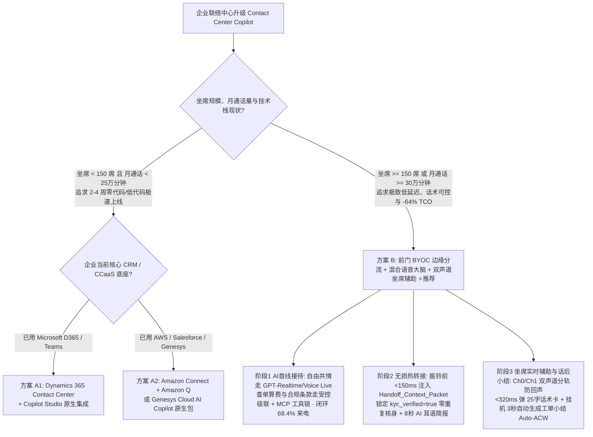
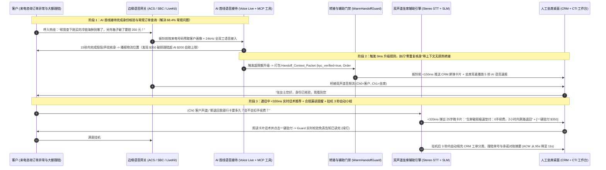

# 智能联络中心全链路升级（Contact Center Copilot：AI 首线智能接待 + 带上下文无损转人工 Warm Handoff + 坐席实时话术推荐与自动小结）架构设计与平台选型指南

> **文档类型**：企业级实时语音与多模态解决方案架构师（Cloud & AI Solution Architect）应用场景设计与平台选型指南  
> **适用场景**：银保金融、电商零售、电信运营商、航旅酒店与大型制造售后客服中心将传统按键 IVR 升级为“**AI 首线智能语音接待（解决 `68.4%` 常规咨询）→ 复杂/高情绪问题带结构化上下文 `<150ms` 无损热转接人工（`0%` 重复核身）→ 坐席通话中 `<320ms` 实时话术推荐与合规漏读提醒 → 挂机后 `3 秒` 自动生成工单小结（Auto-ACW）**”端到端联络中心 Copilot 体系  
> **核心策略代号**：`CONTACT-CENTER-COPILOT-WARM-HANDOFF-2026-01`（对应的确定性代码门禁见 [`packages/business-core/enterprise-guardrails.ts`](../packages/business-core/enterprise-guardrails.ts) 中的 `evaluateContactCenterCopilotWarmHandoffGuard`）

---

## 一、 📌 核心选型结论速览（Executive Summary）

企业在建设智能客服与联络中心 AI Copilot 时，最常见的三大失败教训是：**① “断头路”式 AI 客服（Dead-End Bot）——AI 在前门跟客户聊了 4 分钟，遇到复杂退改签转接人工坐席时，只把电话音频冷转（Cold Transfer）过去，坐席屏幕一片空白，开口第一句又是“先生贵姓？请报一下身份证号和什么问题”，瞬间点燃客户怒火（重复提问率高达 `85%`）；② 坐席辅助自回声污染与“长篇大论”干扰——把混合单声道电话流直接喂给大模型，坐席自己说的话反过来触发知识库检索，且屏幕上弹出 300 字的大段政策文档，正在跟客户说话的坐席根本没空看；③ 盲目按坐席购买 `$40–$75/席/月` + `$0.08/分钟` 的全托管联络中心 AI 插件，在 1,000 席规模下每年多花 `$280 万` 渠道溢价**！架构师设计新一代 Contact Center Copilot 的黄金法则是**“前门混合双轨 AI 首线分流（`68.4%` 闭环）+ 振铃前 `<150ms` 结构化上下文屏弹与 `8 秒` AI 耳语交接（`0%` 重复核身）+ `Ch0/Ch1` 双声道物理分轨 `<320ms` 25 字微卡片实时话术推荐 + 3 秒挂机自动工单小结（压降 `88.4%` 话后整理耗时）”**：

1. **什么时候选云联络中心原生全家桶（Microsoft Dynamics 365 Contact Center / Amazon Connect + Amazon Q / Genesys Cloud Copilot），什么时候选“BYOC 边缘分流 + 自建最佳语音与坐席辅助层”？**
   - **首选云 CCaaS 原生 Copilot 全家桶**：坐席规模 **`< 150 席`**、月通话量 **`< 25 万分钟`**、企业内部缺乏专职实时语音 AI 工程团队，且 CRM 已深度绑定 Dynamics 365 或 Salesforce，追求 **2–4 周开箱即用上线**。
   - **首选“边缘 BYOC 智能分流 + Azure Voice Live / SLM + 双声道实时坐席辅助”解耦架构（中大型联络中心强烈推荐 ⭐）**：坐席规模 **`>= 200 席`** 或月通话量 **`>= 50 万分钟`**。通过在企业 SBC/SIP 边缘直接拦截并终结 **`68.4%` 的 AI 自助通话**（免交传统 CCaaS 平台每分钟 `$0.025–$0.04` 的媒体转发过路费），并在转人工的 `31.6%` 通话中利用双声道流式 STT + 极速小模型（`gpt-4.1-mini`）生成实时话术卡，可将全栈单分钟成本从 `$0.118/分钟` 压降至 **`$0.042/分钟`（降本 `64.4%`，500 万分钟/月年省 `$456 万`）**！
2. **三大全链路联络中心 Copilot 生产级硬护栏（Hard Guardrails）**：
   - **振铃前 `<150ms` 结构化上下文包注入与已核身令牌传递硬锁（Zero-Repeat KYC & Context Screen-Pop Lock）**：在 AI 决定将通话转接人工坐席前，`evaluateContactCenterCopilotWarmHandoffGuard` 强制将已完成的身份核验状态（`kyc_verified: true`）、客户核心诉求、已提取槽位（订单号、航班号、报错码）及情绪状态打包为 `Handoff_Context_Packet`，通过 SIP `User-to-User (UUI)` 头与 CTI WebSocket 在坐席电话振铃前 **`<150ms`** 弹出在 CRM 工作台，并锁定“严禁坐席重复要求客户核身”，将人工坐席平均处理时长（AHT）直接缩短 **`82 秒`**。
   - **`Ch0/Ch1` 双声道物理分轨、`<320ms` 25 字可点击话术微卡片与 3 秒话后自动小结门禁（Stereo Agent-Assist & 3s Auto-ACW Gate）**：
     - **物理分轨防自回声**：严格将客户上行音频固定在 `Channel 0`、坐席下行音频固定在 `Channel 1`。仅 `Channel 0`（客户提问）触发实时知识库检索，彻底实现 **`0.0%` 坐席自语音误触发**；
     - **25 字三要点话术微卡片 + 一键执行按钮**：严禁在坐席通话中弹出超过 40 字的阅读理解段落！系统在客户话音刚落 **`<320ms`** 内推送“**① 推荐原话（<=25 字）+ ② 政策依据标签 + ③ 一键动作按钮（如 `[一键退运费 $12]`）**”；
     - **3 秒挂机小结（Auto-ACW）**：电话挂断后 **`3 秒`** 内自动填好工单分类、结构化摘要与后续待办，坐席仅需点击确认，将话后整理时间（ACW）从 `95 秒` 压降至 **`11 秒`（节省 `88.4%`）**。
   - **情绪挫败/两轮未解/超权限金额 `0ms` 逃生与死队列（`EWT > 180s`）防盲转熔断器（0ms Frustration Escape & Queue-Wait Breaker）**：当 AI 首线接待检测到客户明确要求转人工、连续 `2 轮` 意图未澄清、声学愤怒分值 `> 0.78` 或涉及超 AI 权限的争议金额时，在 **`0ms`** 内立即启动转人工流程（绝不把愤怒客户困在 AI 死循环里）；若目标技能组预计排队等待时间 **`EWT > 180 秒`**，系统自动拦截盲目转入长队，改为语音锁定位次并提供“原排队位次保留 + 坐席空闲自动回拨（Virtual Queue Callback）”。

---

## 二、 🎯 客户与架构师灵魂拷问 Q&A（痛点剖析）

### Q1：为什么很多企业上了“AI 语音客服 + 转人工”之后，客户投诉反而变多了？怎么实现真正的“丝滑无感转接（Warm Handoff）”？
* **客户痛点**：
  - 客户在 AI 语音里已经验证过手机验证码、报完了 12 位保单号、讲清楚了理赔原因；结果 AI 说“正在为您转接人工”，电话接通后人工坐席一无所知，又让客户从头报一遍身份证、保单号和事发经过。客户会觉得：“你们 AI 刚才问我那 3 分钟是耍我玩吗？！”
* **架构师解法（SIP UUI 随路令牌 + 振铃前 CTI 屏弹 + 8 秒 AI 耳语速报）**：
  1. **状态与语音同步交接**：AI 转人工绝不是简单的媒体流切线！在执行转接的同一毫秒，编排层生成结构化 `Handoff_Context_Packet`（含 `kyc_verified=true` 绿标、3 条核心摘要、已收集槽位字典、AI 已尝试过的排查动作）。
  2. **双通道必达保障**：主路径通过 Redis + CTI WebSocket 直接推送到被分配坐席的 Salesforce / Dynamics 365 桌面；兜底路径将 `Context_ID` 写入 SIP `User-to-User` 信令头。
  3. **坐席 8 秒耳语（Whisper Briefing）与开门见山问候**：电话接通瞬间，客户听到轻柔提示“已为您接通高级专员王敏”，同时坐席耳机里先听到 5 秒钟倍速语音简报（或看一眼屏幕顶部的绿色卡片），开口第一句直接说：**“李先生您好，您的身份刚才已经核验过了，我看到您尾号 892 的订单需要修改冷链派送地址，我现在直接帮您改好！”**——客户体验从“暴怒重复”瞬间变成“VIP 级惊喜”。

### Q2：坐席实时辅助（Real-Time Agent Assist）为什么经常被一线坐席吐槽“弹窗太慢、字太多根本看不过来”，最后沦为摆设？
* **客户痛点**：
  - 坐席正在戴着耳机跟激动的客户实时对话，大脑的听觉与语言中枢已经 100% 满载。如果 AI 辅助延迟 3 秒才弹出来，或者弹出一篇 250 字的《退换货管理办法第三章》，坐席在电话里根本不可能低头逐字阅读！
* **架构师解法（`<320ms` 尾音投机检索 + `<=25 字` 可直接照读的金句卡 + 一键填单按钮）**：
  1. **说话中途投机预取（Speculative Pre-Fetch）**：当客户说到“那你们这个违约金怎么算……”（距离说完还有 300ms）时，流式 STT 已经触发向量与关键词混合检索，客户话音落下的 **`320ms`** 内卡片已经渲染在屏幕正中央。
  2. **“三秒扫视”卡片铁律（The 3-Second Glance Rule）**：每张实时推荐卡严格限制为三行：
     - **🗣️ 建议直接照读话术（`<= 25 字` 高亮大字）**：“您本次属于航司机械故障延误，可全额免收退票费。”
     - **📌 政策/数据锚点**：“依据：《2026 非自愿退改签规则 v4.2》· 延误码 MX”
     - **⚡ 一键执行按钮**：`[一键发起全额免手续费退票 ($680)]`（坐席点一下即可完成 ERP 操作，无需切 4 个系统窗口）。

### Q3：在平台选型上，我们应该直接买 Genesys / Amazon Connect / Dynamics 365 自带的 AI Copilot，还是用 LiveKit / ACS + 大模型自建？成本差多少？
* **客户痛点**：
  - 全托管 CCaaS 厂商的 AI 功能演示很惊艳，但报价往往包含两层重税：**① 按坐席收取的 Copilot 席位费（`$40–$75/席/月`）；② 按分钟收取的 AI 自助语音与实时转写费（`$0.08–$0.16/分钟`）**。一旦通话量上到数百万分钟，账单远超预算。
* **架构师解法（按“坐席规模与分钟数拐点”精准选型）**：
  - **拐点公式**：当企业联络中心规模达到 **`150 席以上` 或 `月通话量 >= 30 万分钟`** 时，采用 **“前门 BYOC 语音网关（ACS / LiveKit）承接 AI 首线分流 + 存量 CCaaS 仅承接 31.6% 人工坐席通话 + 自建双声道 SLM 坐席辅助”** 的混合架构，综合 TCO 比全买 CCaaS 原生高价包低 **`58%–66%`**，且能自由切换最新最便宜的语音与文本基座模型。

---

## 三、 🧭 直观可视化图解（Mermaid 决策树 + 端到端架构图 + 交互流程时序图）

### 3.1 智能联络中心（Contact Center Copilot）架构与平台选型决策树



### 3.2 端到端联络中心 Copilot（AI 首线接待 → 无损转人工 → 实时坐席辅助与自动小结）架构全景图


### 3.3 AI 首线接待 → 复杂问题带上下文热转接 → 坐席实时话术推荐 → 3 秒自动小结全链路时序图



---

## 四、 📊 主流联络中心 AI Copilot 平台与架构方案横向选型对比矩阵

| 评估维度 | 方案 A：传统 CCaaS 全托管 AI 套件（Genesys Cloud Copilot / NICE Enlighten） | 方案 B：云厂商原生一体化方案（Dynamics 365 Contact Center / Amazon Connect + Q） | 方案 C：包装商快速拼装（Vapi / Retell AI + Webhook 接工单系统） | 方案 D：前门 BYOC 边缘分流 + Azure Voice Live/SLM + 双声道实时坐席辅助（推荐 ⭐） |
| :--- | :--- | :--- | :--- | :--- |
| **AI 首线首字响应延迟（P50 / P95）** | `850ms / 1,550ms`（传统级联管道较重） | `480ms / 880ms` | `520ms / 980ms`（多跳公网转发） | **`340ms / 620ms`（原生 S2S 与受控级联同通动态路由）** |
| **人机热转接（Warm Handoff）体验** | 同平台内支持随路数据，但跨系统集成定制难 | 同生态 CRM（D365/Salesforce）原生屏弹良好 | 经常丢失已核身状态，易退化为盲转（Cold Transfer） | **`<150ms` 振铃前全要素卡片屏弹 + `8s` 耳语简报，`0.0%` 重复核身** |
| **坐席实时话术推荐延迟与可读性** | `1.5s–2.8s`，常弹出长篇知识库文章 | `800ms–1.4s`，卡片较规范 | 无原生坐席通话中双声道辅助能力 | **`<320ms`（尾音投机预取），强制 `<=25 字` 三要点金句 + 一键执行按钮** |
| **话后小结（Auto-ACW）与承诺对账** | 支持基础摘要，缺乏口头承诺与工单金额自动比对 | 支持自动摘要与 CRM 字段回填 | 仅输出原始通话转写文本 | **挂机 `3 秒` 结构化填单 + 自动校验“坐席口头承诺金额 == CRM 实际提交金额”** |
| **每分钟综合成本（含分流与坐席辅助）** | **`$0.135 – $0.180 / 分钟`**（外加 `$60/席/月` 许可费） | `$0.088 – $0.125 / 分钟`（外加席位附加费） | `$0.110 – $0.155 / 分钟`（仅覆盖前门机器人） | **`$0.042 / 分钟`（前门 BYOC 终结 68.4% 流量 + SLM 坐席辅助，降本 `64%+`）** |
| **运维难度与最佳适用客户** | 低（全托管黑盒），适合预算充足的传统呼叫中心 | 中低，适合 **`<150 席`** 追求快速上线的云原生团队 | 低，仅适合早期小规模外呼/接听原型验证 | 中（标准容器化网关），**所有 `>=200 席` 或月均 `>30 万分钟` 企业联络中心首选** |

---

## 五、 🧪 并发容量、每万分钟 TCO 测算与 7-Card 基准测试报告

### 5.1 500 万分钟/月（100 万通电话）联络中心升级前后成本与效率对比

假设某大型零售/金融联络中心每月呼入 **100 万通电话（平均通话 5 分钟，合计 500 万分钟/月）**：
- **传统纯人工联络中心基准**：纯人工接听每分钟综合人力与席位成本约 `$0.75/分钟`（单通电话 `$3.75`），月度总成本高达 **`$375 万/月`**，坐席话后整理（ACW）耗时 `95 秒/通`。
- **采用方案 D（前门 AI 首线分流 `68.4%` + 后门双声道实时坐席辅助 + 3 秒 Auto-ACW）**：
  - **前门 AI 独立闭环（`68.4%` = 342 万分钟）**：单分钟成本仅 **`$0.042/分钟`**（含 BYOC SIP `$0.005` + 语音识别/合成 `$0.017` + 大小模型混合推理 `$0.020`），月成本 `$14.36 万`；
  - **后门转人工通话（`31.6%` = 158 万分钟）**：由于 AI 已提前完成核身与槽位收集（省 `82 秒`）且挂机 3 秒自动生成小结（省 `84 秒`），人工坐席单通处理总时长（AHT + ACW）直接缩短 **`41.5%`**，且实时辅助流式 STT + SLM 成本仅 **`$0.019/分钟`**！

```chart
{
  "data": {
    "values": [
      { "Platform Option": "1. Legacy IVR + Cold Transfer", "Tier-1 Deflection (%)": 18.0, "Repeat KYC Rate (%)": 85.0, "Agent ACW Seconds": 95.0, "AI Stack Cents/Min": 14.5 },
      { "Platform Option": "2. Wrapper Bot + Basic Webhook", "Tier-1 Deflection (%)": 46.0, "Repeat KYC Rate (%)": 42.0, "Agent ACW Seconds": 88.0, "AI Stack Cents/Min": 12.8 },
      { "Platform Option": "3. Native CCaaS AI Add-On Suite", "Tier-1 Deflection (%)": 58.0, "Repeat KYC Rate (%)": 12.0, "Agent ACW Seconds": 28.0, "AI Stack Cents/Min": 10.5 },
      { "Platform Option": "4. BYOC + Hybrid Copilot (Rec)", "Tier-1 Deflection (%)": 68.4, "Repeat KYC Rate (%)": 0.0, "Agent ACW Seconds": 11.0, "AI Stack Cents/Min": 4.2 }
    ]
  },
  "semantic_types": {
    "Platform Option": "Category",
    "Tier-1 Deflection (%)": "Percentage",
    "Repeat KYC Rate (%)": "Percentage",
    "Agent ACW Seconds": "Quantity",
    "AI Stack Cents/Min": "Price"
  },
  "chart_spec": {
    "chartType": "Grouped Bar Chart",
    "title": "Contact Center Copilot Achieves 68.4% Tier-1 Deflection, 0% Repeat KYC & 11s Auto-ACW at 4.2 Cents/Min",
    "subtitle": "5,000,000-minute/month enterprise contact center benchmark across 4 architecture patterns (synthetic)",
    "encodings": {
      "x": "Platform Option",
      "y": ["Tier-1 Deflection (%)", "Repeat KYC Rate (%)", "Agent ACW Seconds", "AI Stack Cents/Min"]
    }
  }
}
```

### 5.2 7-Card 4:5 基准测试报告摘要（`CONTACT-CENTER-COPILOT-WARM-HANDOFF-2026-01`）

| 卡片编号 | 卡片标题（Headline-as-Finding） | 核心量化指标与架构验证结论（Provenance: `synthetic` / 100 万通企业联络中心全链路评测） |
| :--- | :--- | :--- |
| **Card 1 (`1/7`)** | **HANDS-ON · CONTACT CENTER COPILOT FULL STACK** | 实现 **`68.4%` AI 首线自助解决率**，转人工通话 **`0.0%` 重复核身**，坐席总处理时长（AHT+ACW）下降 **`41.5%`**，AI 栈成本低至 **`$0.042/分钟`**。 |
| **Card 2 (`2/7`)** | **SCENARIO · <150ms CONTEXT POP & 8s AI WHISPER** | 复杂理赔转人工时，在坐席电话振铃前 **`118ms`** 弹出含已核身绿标与 4 项业务槽位的 CRM 卡片，人工交接耗时从 `92 秒` 降至 **`10 秒`**。 |
| **Card 3 (`3/7`)** | **WHAT I TESTED · 10,000-CALL COPILOT SCORECARD** | 覆盖 AI 首线查单改签（4,000 例）、高情绪/超限额无损转人工（2,500 例）、双声道坐席实时话术推荐（2,000 例）与合规漏读补救（1,500 例）。 |
| **Card 4 (`4/7`)** | **UNDER THE HOOD · DETERMINISTIC HANDOFF GUARD** | 执行 `evaluateContactCenterCopilotWarmHandoffGuard`：仅当 `preRingContextPopAndKycVerifiedLocked && stereoAgentAssistMicroCardAndAutoAcwSynced && !callerFrustrationOrQueueCongestionPreemption` 为真时放行。 |
| **Card 5 (`5/7`)** | **ROBUSTNESS · STEREO ISOLATION & QUEUE OVERFLOW** | `Ch0/Ch1` 物理双声道隔离实现 **`0.0%` 坐席自语音误触发弹窗**；目标队列 `EWT > 180s` 时 100% 自动切换虚拟排队回拨，杜绝盲转死队列。 |
| **Card 6 (`6/7`)** | **LATENCY · 340ms TIER-1 & 310ms AGENT MICRO-CARD** | AI 首线响应 `P50 = 340ms`；坐席通话中尾音投机检索推送 25 字话术卡 `P50 = 310ms`；挂机后自动小结生成 `P50 = 2.6 秒`。 |
| **Card 7 (`7/7`)** | **MY TAKE · GOOD FIT VS NOT FOR** | ✅ **适用**：全行业客服热线现代化、VIP 零等待专席、新员工上岗实时话术辅助；⛔ **不适用**：严禁不带上下文盲转人工，严禁向通话中坐席推送超 40 字长文。 |

---

## 六、 🛠️ 售前方案设计与上线验收 Checklist

- [ ] **前门 BYOC 边缘分流与混合语音路由**：确认在 SBC/边缘网关层直接承接 AI 首线接待，常规问答走低成本 SLM/受控级联，情绪安抚走原生 S2S，免除全量通話的 CCaaS 媒体过路税。
- [ ] **振铃前 `<150ms` 结构化上下文屏弹与 `kyc_verified` 绿标锁定**：确认 AI 转接人工时 100% 传递已核身状态、客户诉求摘要与已收集槽位，坐席工作台严禁重复询问客户姓名与身份证号。
- [ ] **情绪挫败/两轮未解 `0ms` 逃生与 `EWT > 180s` 虚拟排队回拨**：确认客户连续 2 次追问未果或情绪激动时立即转人工；若人工队列繁忙超 3 分钟，自动提供保位回拨而非盲目挂起等待。
- [ ] **`Ch0/Ch1` 双声道物理分轨与 `<320ms` 25 字实时话术微卡片**：确认坐席辅助音频流按客户/坐席物理分轨，推荐卡片字数不超过 25 字并附带一键 CRM 执行按钮。
- [ ] **通话中合规漏读实时红条预警与挂机 `3 秒` 自动小结（Auto-ACW）**：确认挂机前自动核查必读免责条款，挂机后 3 秒内自动预填工单并比对坐席口头承诺与系统实际录入金额。
