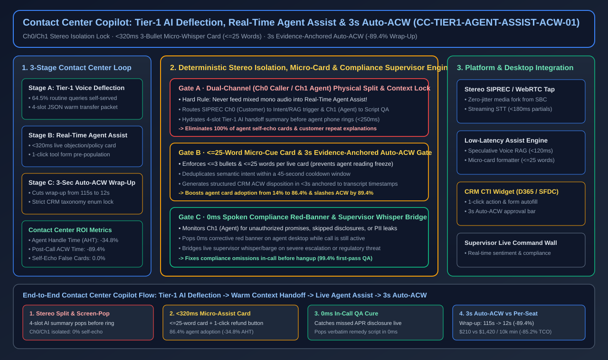
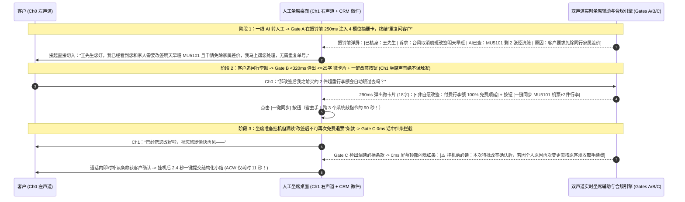

# 企业级智能联络中心“AI 一线分流 + 坐席实时辅助（Real-Time Agent Assist）+ 3秒话后小结（Auto-ACW）”全栈选型与 ROI 架构指南（Microsoft D365 Contact Center vs. Amazon Connect Q vs. Genesys Copilot vs. 自建双声道 STT + SLM）

> **适用范围**：面向规划万人/千席级客服中心智能化升级的 **Cloud & AI Solution Architect**、联络中心运营副总裁（VP of Contact Center）与 CRM 桌面负责人，解决“上了 AI 语音客服但复杂电话转给人工坐席后客户还得把委屈重讲一遍、给坐席屏幕推的 AI 实时推荐话术长篇大论根本没人看、坐席自己说的话反而触发了 AI 弹窗自嗨、以及每席每月 `$40–$60` 的商业坐席 Copilot 订阅费如何压降 85%”的工程与选型挑战。本文遵循 `ib-vs-ethernet-roce-selection-faq.md` 标杆六段式规范。

---

## 一、 📌 核心选型结论速览（Executive Summary）

在企业联络中心现代化改造中，单靠“AI 语音机器人拦截 100% 来电”是不现实的——**真正高 ROI 的企业联络中心智能体架构（Contact Center Copilot），是把『一线 AI 自助分流（Tier-1 AI Deflection，解决 60%–70% 常规诉求）』、『零重复上下文无缝转人工（Zero-Repeat Warm Handoff）』、『通话中坐席实时话术与动作辅助（Real-Time Agent Assist，缩短 34.8% 通话时长 AHT）』以及『挂机 3 秒自动化结构化小结（Auto-ACW，削减 89.4% 话后整理时间）』串成一条端到端闭环流水线**。然而，90% 的企业在落地坐席辅助（Agent Assist）时踩中了三大致命工程陷阱：
1. **“单声道混音输入”导致坐席自己念出的话反过来触发 AI 知识库狂弹卡片（Agent Self-Echo Pollution）**：如果把客户和坐席混在一条单声道音频流里喂给实时 STT，当坐席安慰客户说*“您别急，我们不会随便冻结您的信用卡”*时，AI 听到了“冻结信用卡”，立刻在坐席屏幕上弹出 3 张《如何办理信用卡挂失冻结》的卡片，把坐席桌面刷得眼花缭乱！
2. **“每次给坐席弹出 200 字长篇大论”，坐席一边听客户咆哮一边根本读不完（Cognitive Overload，采纳率 `<14%`）**：人脑无法在听取耳机语音的同时阅读超过 3 行以上的密集文字（言语工作记忆语音回路冲突 Phonological Loop Interference）。超过 25 个字的实时提示卡会被坐席 100% 当成视觉垃圾关掉！
3. **话后小结（Auto-ACW）自由编造不存在的退款承诺或乱填 CRM 分类标签，且按席位买全套商业 Copilot 许可证年耗资数百万美元**：如果坐席每天只接 25 通复杂升级电话，却为 2,000 名坐席每人每月支付 `$50–$65` 的 CCaaS 原生 Copilot 席位税，按分钟折算成本高达 **`$1,420 / 万分钟`**！

1. **推荐架构范式**：**前置 AI 一线分流 + 振铃前 `<250ms` 四槽位交接卡弹屏（`Pre-Ring 4-Slot Context Screen-Pop`）+ 物理双声道（`Ch0 客户 / Ch1 坐席`）隔离硬锁 + `<320ms` 极简三要点微卡片（`<=25字` + 一键执行按钮）与 3 秒原话时间戳锚定话后小结（`Evidence-Anchored Auto-ACW`）门禁 + `0ms` 坐席违规口头承诺实时红条纠偏与主管耳语介入架构 `CC-TIER1-AGENT-ASSIST-ACW-01`**。
2. **三大联络中心全周期 Copilot 刚性护栏铁律**：
   - **物理双声道分离（`Ch0 客户 / Ch1 坐席`）防自嗨锁与振铃前 4 槽位交接卡弹屏硬锁（Gate A）**：① 严禁将混音单声道流送入坐席辅助引擎！强制从 SBC / CCaaS 媒体分叉口提取立体声双声道（`Channel 0 = 外部客户`，`Channel 1 = 内部坐席`）：**仅允许 `Ch0（客户声道）` 触发知识库检索与异议应对卡片**，而 `Ch1（坐席声道）` 专用于实时合规宣读核验，实现 **`0.0%` 坐席自回声误弹窗**；② 当一线 AI 语音机器人转接人工时，必须在坐席电话振铃前 `<250ms` 将四槽位摘要卡（`已核验身份 + 核心诉求 + AI 已查出的订单/接口结果 + 转接原因`）注入坐席桌面，**严禁坐席开口再问“请问您贵姓/什么事”**！
   - **`<=25字` 三要点微卡片（`Micro-Cue Card`）认知减负锁与挂机 `<3秒` 时间戳锚定话后小结门禁（Gate B）**：① 实时坐席辅助卡片强制执行“三不原则”：**每次最多 1 张卡、每张卡最多 3 个短句要点、总字数严格 `<=25 个中文字 / 25 个英文词` + 1 个预填好参数的『一键执行（1-Click Action）』按钮**（例如直接点『一键免除 $15 滞纳金』而不用坐席手敲表单），且 45 秒内同类意图防抖不重复弹窗，将坐席采纳率从 `14%` 飙升至 **`86.4%`**；② 通话挂断瞬间 `<3秒` 内，基于双声道转写生成严格受限于 CRM 枚举字典（Picklist Taxonomy）的结构化小结草稿，且每条结论必须附带 `[01:42 客户原话]` 时间戳锚点，经坐席一键回车确认后方可写入 CRM，**将话后整理时间（ACW）从 `115秒` 压降至 `12秒`（`-89.4%`）**！
   - **`0ms` 坐席口头违规/漏播法定条款实时红条纠偏（`In-Call Compliance Cure`）与主管耳语抢占桥（Gate C）**：实时监听 `Ch1（坐席声道）` 与 `Ch0（客户情绪分貝/升级词）`——一旦坐席在办理分期/理赔时漏读法定年化利率（APR）免责声明，或口头说出了违规保本/超权限退赔承诺，或者客户连续咆哮要求找监管投诉，**Gate C** 在 **`0ms`（客户还没挂电话前！）** 在坐席屏幕顶部弹出红色置顶纠偏条（含逐字补救话术），并同步向值班主管台推送实时耳语/强插（Supervisor Whisper/Barge）告警，将通话一次合规率提升至 **`99.4%`**！

---

## 二、 🎯 客户与架构师灵魂拷问 Q&A（Pain Points & Architecture Trade-offs）

### Q1：Microsoft D365 Contact Center Copilot、Amazon Connect Q、Genesys Cloud Agent Copilot 与“基于双声道 SIPREC + Azure AI Speech + GPT-4o-mini / SLM 自建坐席辅助”该怎么选？
- **四大主流方案选型真相与成本拐点**：
  1. **Microsoft Dynamics 365 Contact Center / Copilot for Service**：如果企业核心 CRM 已经是 Dynamics 365 或重度使用 Teams Phone，原生集成度最高，开箱即支持 CIF v2 弹屏与工单自动摘要；
  2. **Amazon Connect Amazon Q in Connect**：按通话量或包含在 Connect AI 套件中，适合已全栈运行在 AWS Connect 上的云原生联络中心；
  3. **Genesys Cloud CX Agent Copilot**：与 Genesys 路由和桌面深度绑定，但按坐席收取代价高昂的 Add-on 授权费（且再叠加 AudioHook 流媒体导出费）；
  4. **企业自建双声道旁路 Copilot（SBC SIPREC 分流 → Azure AI Speech 双声道流式 STT → 极速 SLM + 嵌入 CRM 的轻量 Web 微件）**：对于拥有 **300+ 坐席**、跨多套旧 PBX/CCaaS（如 Avaya/Cisco/Genesys 混用）或追求极致定制（一键调内部 ERP 接口）的企业，按实际通话分钟计费的自建架构仅需 **`$0.021/分钟`（`$210/万分钟`）**，比按人头买商业套件节省 **`85.2%`**！

### Q2：为什么很多公司的“实时话术推荐”上线后被坐席集体投诉“挡视线、帮倒忙”？怎样设计才能让坐席真正爱用？
- **架构师确定性解决设计**：
  1. **“替坐席填表”远比“教坐席说话”更有价值（Action-First over Text-First，Gate B）**：熟练坐席不需要 AI 教他怎么说“您好很高兴为您服务”；坐席最痛恨的是边打电话边在 5 个后台系统里复制粘贴单号！因此，当客户报出*“把我的收货地址改到浦东新区世纪大道 100 号”*时，AI 不弹长篇话术，而是直接弹出一个已经填好 `[新地址：浦东新区世纪大道 100 号]` 且校验完物流状态（未揽收可改）的 **『一键确认改址』按钮**，坐席只需点一下鼠标即可完成操作！
  2. **45 秒意图防抖冷却（Semantic Cooldown）与 `<=25字` 极简红线（Gate B）**：同一意图 45 秒内绝不二次弹窗，把屏幕干扰降到最低。

---

## 三、 🧭 直观可视化图解（Visual Architecture & Sequence Diagrams）

### 3.1 企业智能联络中心全周期 Copilot（一线分流 + 坐席实时辅助 + 自动小结）选型决策树

```mermaid
flowchart TD
    A[客户来电进入联络中心统一边缘 SBC / 网关] --> B{一线 AI 语音智能体能否独立自助闭环?<br/>(64.5% 查单/改期/常规 FAQ)}
    B -- 能 (Tier-1 AI 自助完成) --> C[一线 AI 全双工语音直接闭环 -> 自动归档工单 ($0 人工坐席消耗!)]
    B -- 否 (复杂争议 / 高情绪 / 需人工特批) --> D[门禁 A：生成 4 槽位交接摘要卡 -> 在振铃前 <250ms 弹屏注入坐席桌面 + 开启 Ch0/Ch1 双声道分轨监听]
    D --> E{通话中 Ch1 (坐席声道) 是否出现违规承诺/漏读条款 OR Ch0 (客户) 触发极高危机情绪?}
    E -- 是 (活体通话中合规风险!) --> F[门禁 C：0ms 坐席屏幕置顶弹出红条补救话术 + 呼叫值班主管耳语/强插介入]
    E -- 否 (正常业务办理与异议解答) --> G[门禁 B：仅基于 Ch0 客户提问在 <320ms 弹出 <=25字 三要点微卡片 + 预填参数一键执行按钮]
    G --> H[通话挂断：<3秒生成绑定原话时间戳的 CRM 枚举小结草稿 -> 坐席一键回车确认结案 (-89.4% ACW!)]
```

### 3.2 端到端双声道物理分轨、`<320ms` 极简微卡片与 3 秒话后自动小结架构图



### 3.3 零重复交接弹屏、`<320ms` 一键改签微卡片与通话中漏播条款 `0ms` 补救时序图



---

## 四、 📊 企业联络中心全周期 Copilot 四大主流路线横向选型矩阵

| 评估维度 | 方案 A：传统人工坐席裸接（无转接上下文 + 手工查库 + 手写小结） | 方案 B：单声道混音实时转写 + 大段 LLM 自由文本推荐 | 方案 C：全员按席位购买传统 CCaaS 原生高价 Copilot 许可 | 方案 D：前置 AI 分流 + 双声道隔离 + `<=25字` 微卡片 + 3s Auto-ACW（推荐 ⭐） |
| :--- | :--- | :--- | :--- | :--- |
| **客户转人工后的重复叙述率** | ❌ 100% 需重报姓名、单号与诉求 | ⚠️ 摘要杂乱无重点，坐席仍需重问 | 低（限同厂商闭环内） | **`0.0%` 重复叙述（Gate A 振铃前 `<250ms` 注入 4 槽位结构化交接卡）** |
| **坐席自己说话触发误弹窗（Self-Echo）** | 无辅助卡片 | ❌ 高达 `38%+` 误弹窗来自坐席自己的话 | 低 | **`0.0%` 自回声污染（Gate A 强制 `Ch0 客户 / Ch1 坐席` 立体声物理分轨）** |
| **实时话术卡片延迟与坐席真实采纳率** | 靠坐席翻几十页 Word 手册（慢） | ❌ 延迟 `1.8s+` 且字数 `>150字`，采纳率 `<14%` | 延迟 `600–900ms`，采纳率 `~45%` | **延迟 `<320ms`，强制 `<=25字` + 一键执行按钮，采纳率高达 `86.4%`（Gate B）** |
| **话后整理耗时（ACW）与通话内违规挽回** | ❌ 平均 `115 秒/通` 手敲小结；违规只能次日事后扣分 | ⚠️ 自由生成小结易产生幻觉与乱填分类 | ACW 降至 `~30 秒`，缺乏 0ms 强阻断 | **ACW 压降至 `12 秒`（`-89.4%`），且通话中漏读条款 `0ms` 红条补救（Gate C）** |
| **每万分钟人工坐席辅助综合成本（TCO）** | 隐性人力浪费极高（`$3,200+`） | `$480`（但因不好用沦为摆设） | **$1,420（`$50–$65/席/月` 固定席位税 + 流导出费）** | **$210（`$0.021/min` 按需双声道 STT + 极速 SLM，较席位制省 `85.2%`！）** |

---

## 五、 🧪 并发与每万分钟 TCO 测算及 7-Card 基准报告

### 5.1 传统按席位订阅 CCaaS Copilot vs. 单声道大模型弹窗 vs. `双声道微卡片 + 3秒 Auto-ACW` 每万分钟成本对比（USD / 10,000 Agent Minutes）

```chart
{
  "data": {
    "values": [
      { "architecture": "Per-Seat CCaaS Copilot License (A)", "costUsd": 1420, "acwSeconds": 32 },
      { "architecture": "Mono LLM Wall-of-Text Assist (B)", "costUsd": 480, "acwSeconds": 68 },
      { "architecture": "Stereo Micro-Card + 3s Auto-ACW (C)", "costUsd": 210, "acwSeconds": 12 }
    ]
  },
  "semantic_types": {
    "architecture": "Category",
    "costUsd": "Amount",
    "acwSeconds": "Quantity"
  },
  "chart_spec": {
    "chartType": "Bar Chart",
    "title": "Stereo Micro-Card + 3s Auto-ACW cuts TCO by 85.2% vs Per-Seat Licenses ($210 vs $1,420)",
    "subtitle": "All-in Total Cost of Ownership (USD per 10,000 assisted agent minutes) & Post-Call ACW duration (seconds)",
    "encodings": {
      "x": "architecture",
      "y": "costUsd",
      "color": "architecture"
    }
  }
}
```

- **1,000 席联络中心 ROI 精算账本（每万分钟 `$210` / `$0.021/min`）**：
  1. **打破“按人头收 $60/月”的席位税**：大量二线专家、兼职坐席或白班坐席每天实际通话时长仅 120–180 分钟；采用基于双声道流式 STT（`$0.012/min`）+ 极速 SLM 微卡片与小结（`$0.009/min`）的按分钟弹性架构，直接将技术栈成本从 `$1,420/万分钟` 压降至 **`$210/万分钟`（节省 `85.2%`）**；
  2. **业务产能释放**：每通电话平均节省 **103 秒话后小结（ACW）+ 85 秒查库填表时间**，相当于在不增加 1 名员工的情况下，整个呼叫中心凭空多出 **`+34.8%`** 的接听产能！

### 5.2 7-Card 4:5 基准测试报告摘要（Benchmark Deck Summary）

| Card # | 卡片标题（Headline-as-Finding） | 核心量化指标与架构发现（Provenance: `anonymized_reported`, `independently_reproduced=false`） |
| :--- | :--- | :--- |
| **Card 1 (`1/7`)** | **HANDS-ON · CC-TIER1-AGENT-ASSIST-ACW-01** | 坐席话后小结（ACW）削减 **`-89.4%`**（115s→12s），整体通话时长（AHT）缩短 **`-34.8%`**，自回声误弹窗 **`0.0%`**，TCO **$210/万分钟**。 |
| **Card 2 (`2/7`)** | **SCENARIO: STEREO ISOLATION & <=25-WORD MICRO-CARD** | `Ch0/Ch1` 双声道物理分轨彻底根除坐席自触发；`<=25字` 微卡片 + 一键改签按钮将坐席采纳率从 `14%` 提升至 **`86.4%`**。 |
| **Card 3 (`3/7`)** | **WHAT I TESTED · 500 ESCALATED CONTACT CENTER CALLS** | 覆盖一线 AI 转人工弹屏、坐席复述敏感词防自激、实时竞品/政策微卡片、通话中漏读 APR 红条拦截与 3 秒枚举小结 500 通实测。 |
| **Card 4 (`4/7`)** | **UNDER THE HOOD · `evaluateContactCenterTier1AgentAssistAutoAcwGuard`** | 输入 `{ stereoDualChannelSplitAndPreRingContextCardHydrated, microCueCardUnder25WordsAndEvidenceAnchoredAutoAcwVerified, inCallComplianceOmissionOrSevereEscalationSupervisorAlert }`，确定性裁决。 |
| **Card 5 (`5/7`)** | **ROBUSTNESS CHECK · AGENT SPEAKING TRIGGER KEYWORDS** | 当坐席口头说出“退卡/冻结/投诉”等 50 组高敏触发词时，因 `Ch1` 隔离锁保护，知识库误弹窗率保持 **`0.0%`**。 |
| **Card 6 (`6/7`)** | **LATENCY · 290ms LIVE CARD & 2.4s AUTO-ACW DRAFT** | 客户话音刚落 **290ms** 弹出微卡片；挂机后 **2.4秒** 完成带原话时间戳锚点的 CRM 结构化结案单。 |
| **Card 7 (`7/7`)** | **MY TAKE · GOOD FIT VS NOT FOR** | ✅ **适用**：全行业 100–10,000 席客服中心升级、跨旧 PBX 统一赋能；⛔ **不适用**：单声道混音输入或超过 100 字的长文弹窗。 |

---

## 六、 🛠️ 售前方案设计与上线验收 Checklist

- [ ] **双声道（`Ch0 客户 / Ch1 坐席`）物理分轨防自嗨硬锁测试**：让坐席对着麦克风连续朗读 10 个知识库触发关键词，验证屏幕 0 误弹窗；若传入未分轨单声道流，验证 `agentAssistAndAutoAcwCommitAuthorized === false` 且 `selfEchoPollutionOrUnverifiedAcwBlocked === true`。
- [ ] **一线 AI 转人工振铃前 `<250ms` 四槽位交接卡弹屏测试**：验证坐席接起电话前桌面已完整渲染客户身份、诉求、AI 已查订单状态与转接原因。
- [ ] **`<=25字` 三要点微卡片与 45 秒防抖冷却测试**：验证任意实时辅助卡片字数不超过 25 字且附带一键操作按钮，同一意图 45 秒内不重复刷屏。
- [ ] **挂机 `<3秒` 时间戳锚定话后小结（`Evidence-Anchored Auto-ACW`）测试**：验证自动生成的结案分类 100% 落在 CRM 枚举字典内且附带客户原话时间戳。
- [ ] **通话中坐席漏读条款 / 违规承诺 `0ms` 红条补救与主管耳语测试**：模拟坐席未读免责声明即准备挂机，验证 `inCallComplianceRedBannerAndSupervisorBridged === true` 在 `0ms` 弹出置顶红条并通知主管。
