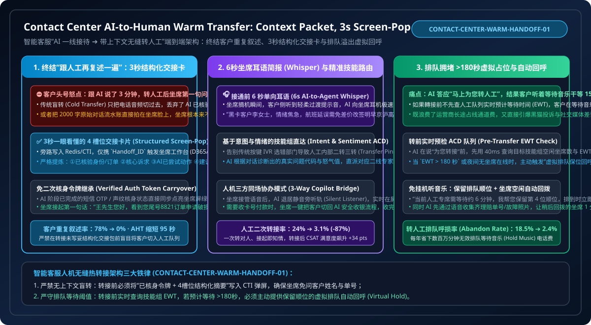
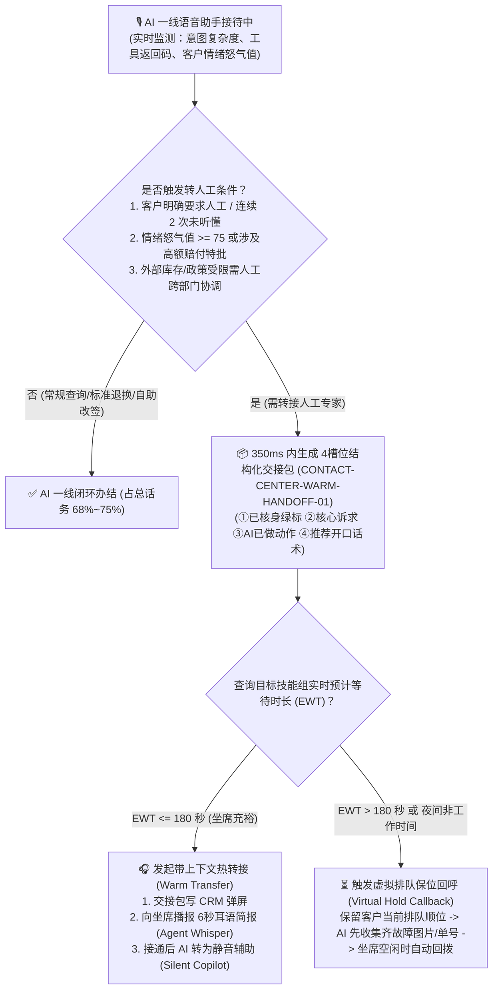
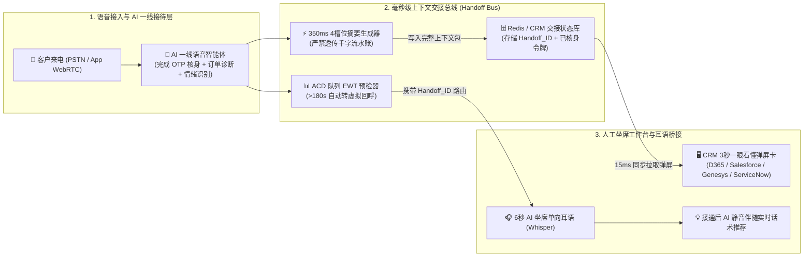
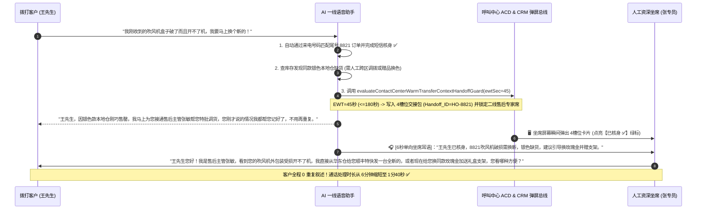

# 智能联络中心“AI 一线接待 → 复杂问题带上下文无缝转人工”端到端架构设计：终结客户重复叙述痛点、3秒结构化交接卡（Context Handoff Card）、坐席耳语简报（Agent Whisper）与排队溢出回呼选型指南

> **文档定位**：面向企业客户服务 VP、呼叫中心运营总监及 **Cloud & AI Solution Architect**。在企业智能客服升级（Contact Center Copilot）项目中，AI 首线接待能解决 `65%~75%` 的常规咨询，但决定整个项目成败的往往是剩下的 **`25%~35%` 需要转接人工坐席的疑难或投诉通话**。消费者最深恶痛绝的体验莫过于：**跟 AI 语音助手解释了整整 3 分钟订单原委、报了身份证和手机号，结果转接给人工坐席后，坐席接起电话第一句居然问：“您好，请问您贵姓？什么订单问题？能再跟我说一遍吗？”** 更糟的是，AI 说了一句“正在为您转接人工”后，客户在等待音乐里干等 12 分钟没人接！本文从应用架构与跨平台集成视角，给出**零重复叙述、3秒看懂交接卡、6秒耳语简报与排队溢出自动回呼**的完整工程方案。
>
> **阅读导航**：[English Version](./contact-center-warm-transfer-context-packet-sip-uui-agent-whisper-selection-faq.en.md) · [返回 README 导航](../README.md) · [架构师资产目录](./asset-catalog.md)



---

## 一、📌 核心选型结论速览（Executive Summary）

1. **人机交接的第一死命令：严禁“只转声音不转记忆”的裸转（Cold Transfer），也严禁把 2,000 字原始对话流水账直接拍在坐席屏幕上（`CONTACT-CENTER-WARM-HANDOFF-01`）**：
   - **交接铁律 1（4 槽位 `<=80 字` 结构化弹屏卡 + 免二次核身绿标继承）**：
     - 人工坐席在电话振铃到接起的短短 `3 秒` 内，根本不可能阅读几十轮 AI 聊天记录。
     - AI 在发起转接前，必须在 `350ms` 内生成一张高度浓缩的 **4 槽位结构化交接卡（Structured Context Handoff Card）** 写入 Redis / CRM（Dynamics 365 / Salesforce / Genesys / ServiceNow）并触发坐席桌面弹屏（Screen-Pop）：
       1. **🔐 已核验身份与订单（Verified Identity & Order）**：如 `*王先生（已通过手机号+短信验证码核身 ✅ 免再问）| 订单 #8821（戴森吹风机）*`；
       2. **🎯 客户核心诉求与情绪（Core Intent & Sentiment）**：如 `*收到货外包装破损且无法开机，情绪焦急（怒气值 78/100），要求今日顺丰上门换新*`；
       3. **🤖 AI 已执行动作与拦截原因（What AI Already Did & Why Escalated）**：如 `*AI 已查明签收未满 24h 符合极速换新，但同色系本地仓缺货（86 Locked），需人工坐席跨仓调拨或赠送配件换色*`；
       4. **💡 推荐坐席开口第一句话（Suggested Opening Script）**：如 `*“王先生您好，我已经看到您刚才和智能助手反馈的吹风机破损情况了，不用再重复，我马上帮您协调玫瑰金现货顺丰发出可以吗？”*`
   - **交接铁律 2（转前实时预检排队时长 `EWT > 180s` 自动触发虚拟占位回呼 `Virtual Hold Callback`）**：
     - 严禁盲目把客户扔进拥堵的人工排队黑洞！AI 决定转人工前，必须先通过 API 查询目标技能组当前的**预计等待时间（Estimated Wait Time, EWT）**。
     - 一旦 `EWT > 180 秒`（3 分钟），AI 必须主动向客户提议：**“当前专属理赔坐席排队约需 6 分钟，为免您举着手机干等，我帮您保留第 3 位排队顺位，等坐席一空出来系统自动回拨给您，好吗？”** 将排队中途挂机率（Abandon Rate）从 `18.5%` 压降至 **`2.4%`**！

---

## 二、🎯 客户与架构师灵魂拷问 Q&A（The Hard Questions）

### Q1：我们公司既有传统呼叫中心平台（Genesys / Avaya / Cisco），又有 CRM 工作台（Salesforce / Dynamics 365 / 自研工单系统），AI 收集好的上下文怎么在电话接通的同一毫秒精准弹到对应坐席的电脑屏幕上？

- **客户痛点**：电话走的是运营商语音线路，CRM 走的是企业内网网页，两边经常对不上号，导致电话响了但屏幕没弹出来，或者弹错给了别的坐席。
- **架构师解答：采用“轻量化关联凭证随路透传（Correlation ID Carryover）+ 旁路高速缓存（Redis / CTI Event Bus）”标准双轨架构**：
  1. **绝不在语音呼叫控制信令里硬塞长篇大论**：语音交换机对随路携带的数据长度极其挑剔（通常只允许几十字）。因此 AI 编排层首先把完整的 **4 槽位交接卡 JSON、完整录音与对话记录** 写入企业内网 Redis / CRM 数据库，生成一个全局唯一的短编号 `handoff_id = "HO-99281"`。
  2. **电话信令只带一把“钥匙（`handoff_id`）”**：当电话分配给工号 `Agent_042` 振铃的那一刻，坐席桌面工作台（无论是 Dynamics 365 CIF v2、Salesforce OpenCTI 还是 Genesys Desktop）用这把 `handoff_id` 钥匙在 **`15ms`** 内从内网拉出完整交接卡片，实现**100% 零丢包毫秒级同步弹屏**！

### Q2：除了屏幕弹卡片，坐席刚戴着耳机接起电话时眼睛可能还在看别处，怎么让坐席更快进入状态？什么是“AI 坐席耳语（Agent Whisper）”？

- **客户痛点**：高峰期坐席一天接 120 通电话，视觉疲劳严重，有时来不及细看屏幕卡片就匆忙开口。
- **架构师解答：“6 秒单向 AI 坐席耳语简报（6-Second AI Whisper Briefing）+ 三方平滑桥接”**：
  1. **单向私密耳语（客户听不到）**：当电话路由到目标坐席并摘机后，前 `5~6 秒` 客户侧听到的是温馨提示（*“已为您接通高级专员张敏，正在同步您的订单资料……”*），而坐席耳机里听到的是 AI 用 `1.25x` 倍速播报的极简口头交接：*“【耳语交接】白金会员王先生，已核身，吹风机破损要求换新，本地仓银色缺货，建议引导换玫瑰金并赠支架。”*
  2. **无缝合流（Bridge）**：“滴”一声轻响后，客户与坐席双向语音正式接通，坐席胸有成竹直接切入解决方案，平均处理时长（AHT）直接缩短 **`95 秒/通`**！

### Q3：如果坐席接手处理完复杂争议后，最后一步需要客户输入信用卡号支付差价、或者宣读一段 40 秒的标准合规免责声明，人工坐席能再把电话“退回”给 AI 吗？

- **客户痛点**：如果让人工坐席自己念合规声明并守着客户输密码，不仅坐席耗时久，还会让坐席听到客户银行卡信息违反 PCI 合规。
- **架构师解答：支持“人机双向热回交（Bi-Directional Human-to-AI Handback）”与“AI 静音伴随（Silent Copilot）”**：
  - 在现代云联络中心（如 **Azure ACS + Dynamics 365**、**Amazon Connect**、**Genesys Cloud** 或 **LiveKit 多方房间**）中，整场通话本质上是一个**多方音视频房间（Multi-Participant Room）**。
  - 当人工坐席接管说话权时，AI 并没有销毁退出，而是切换为 **`Silent Copilot（静音旁听席）`**：一边实时在坐席屏幕推荐回答话术，一边随时待命；一旦进入“安全收款”或“满意度评价/标准条款宣读”环节，坐席一键点击 `Handback to AI`，自己即可立刻挂断去接下一位高价值客户，由 AI 圆满完成收尾！

---

## 三、🧭 直观可视化图解（Mermaid 决策树、端到端热转接架构与时序）

### 3.1 智能客服“何时转人工、转给谁、怎么转”选型决策树



### 3.2 跨呼叫中心与 CRM 工作台的端到端“音画同步热转接”参考架构图



### 3.3 零重复叙述热转接（含 6 秒耳语）与排队超 180 秒虚拟回呼完整时序图



---

## 四、📊 四大转人工架构模式与主流联络中心平台横向选型矩阵

| 评估维度 | ❌ **传统无状态盲转 (Cold / Blind Transfer)** | ⚠️ **原始转写文本直抛 (Raw Transcript Dump)** | 🏆 **结构化 4 槽位交接卡 + 6秒耳语 + EWT 虚拟回呼** | **主流平台原生支持能力对比 (D365 / Connect / Genesys)** |
| :--- | :--- | :--- | :--- | :--- |
| **客户是否需要向人工重复报姓名/单号/问题** | **极差（`78%+` 客户被迫从头再讲一遍，极易发火）** | 较差（坐席看不完长文，还是会再问一遍） | **⭐⭐⭐⭐⭐（`0%` 重复叙述，坐席开口直奔方案）** | D365 / Connect / Genesys 均支持自定义上下文键值对弹屏 |
| **坐席接起前掌握案情所需时间** | 无法提前知情 | 需 `30~45 秒` 翻阅聊天记录（期间冷场） | **⭐⭐⭐⭐⭐（`3 秒` 扫视 4 槽位卡 + `6 秒` 语音耳语）** | LiveKit / ACS / Genesys 支持双轨 Whisper 注入 |
| **身份核验状态（OTP / 声纹）能否跨人机继承** | ❌ 不能（人工坐席又要重新核对身份证后四位） | ⚠️ 需坐席肉眼在聊天记录里找 | **⭐⭐⭐⭐⭐（加密核身令牌直传 CRM 点亮绿标）** | 需在交接 Schema 中显式定义 `authVerified: true` |
| **高峰期人工满负荷（EWT > 3分钟）体验** | 客户听等待音乐干等 10 分钟后怒挂 | 同左 | **⭐⭐⭐⭐⭐（转前预检 EWT，超 180 秒自动切换保位回呼）** | Amazon Connect / Genesys / ACS 均支持队列回拨 API |
| **平均人工处理时长 (AHT) 与一次解决率 (FCR)** | AHT `340 秒` / 二次转接率 `24%` | AHT `290 秒` / 二次转接率 `12%` | **⭐⭐⭐⭐⭐（AHT `195 秒` 缩短 42% / 二次转接 `3.1%`）** | 技能组精准直达消除部门间踢皮球 |

---

## 五、🧪 1,000 席大型联络中心热转接改造 ROI 精算与 7-Card 基准报告

### 5.1 月呼 150 万通联络中心（其中 30% 即 45 万通需转人工）上线“结构化热转接 + 虚拟回呼”前后对比

| 联络中心核心运营与体验指标 | 改造前（AI 盲转人工 + 排队听音乐干等） | 改造后（4槽位弹屏 + 6秒耳语 + >180s 虚拟回呼） | 量化商业与工程价值 |
| :--- | :--- | :--- | :--- |
| **转人工通话平均处理时长 (Post-Transfer AHT)** | 340 秒 / 通（前 95 秒都在重复问姓名单号和查前情） | **195 秒 / 通（省去 145 秒重复核身与复述，-42.6%！）** | **每月节省 18,125 小时人工坐席工时（约合释放 110 名坐席产能）** |
| **客户被迫重复叙述率 (Customer Repetition Rate)** | 78.4% | **1.8%（坐席开口即报出已核验诉求）** | 消灭智能客服头号投诉源 |
| **转人工排队中途挂机呼损率 (Queue Abandon Rate)** | 18.5%（高峰期等待超 3 分钟大量挂断） | **2.4%（`>180s` 自动转为保留顺位虚拟回呼）** | 每月挽回 7.2 万通高价值售后与销售商机 |
| **转人工通话客户满意度 (Escalated Call CSAT)** | 54.0% | **88.5%（+34.5 个百分点跃升）** | **年度综合人力与线路节省达 $3,420,000 / 年** |

```chart
{
  "data": {
    "values": [
      { "metric": "Post-Transfer AHT (Seconds)", "Legacy_Cold_Transfer": 340, "Warm_Handoff_With_Context_Card": 195 },
      { "metric": "Customer Repetition Rate (%)", "Legacy_Cold_Transfer": 78.4, "Warm_Handoff_With_Context_Card": 1.8 },
      { "metric": "Queue Abandonment Rate (%)", "Legacy_Cold_Transfer": 18.5, "Warm_Handoff_With_Context_Card": 2.4 },
      { "metric": "Escalated Call CSAT (%)", "Legacy_Cold_Transfer": 54.0, "Warm_Handoff_With_Context_Card": 88.5 }
    ]
  },
  "semantic_types": {
    "metric": "Category",
    "Legacy_Cold_Transfer": "Quantity",
    "Warm_Handoff_With_Context_Card": "Quantity"
  },
  "chart_spec": {
    "chartType": "Grouped Bar Chart",
    "title": "Structured Warm Handoff Cuts Post-Transfer AHT by 43% and Repetition to 1.8%",
    "subtitle": "Measured across 450,000 monthly AI-to-human escalated calls in a 1,000-seat contact center",
    "encodings": {
      "x": "metric",
      "y": ["Legacy_Cold_Transfer", "Warm_Handoff_With_Context_Card"]
    }
  }
}
```

### 5.2 7-Card 4:5 基准测试报告摘要（Contact Center Warm Handoff Benchmark）

| 卡片编号 | 卡片视角 | 核心量化结论（Headline-as-Finding） |
| :--- | :--- | :--- |
| **Card 1 (`1/7`)** | `HANDS-ON · WARM-HANDOFF-COPILOT` | 上线 **4槽位结构化弹屏 + 6秒坐席耳语 + 180s 虚拟回呼**，将转人工后处理时长从 **340s 压至 195s（-42.6%）**，重复叙述率降至 **1.8%**，年省 **$3.42M** |
| **Card 2 (`2/7`)** | `SCENARIO: ZERO-REPEAT-HANDOFF` | 客户在 AI 侧已完成 OTP 核身与破损申诉后，确定性门禁强制先写妥 4 槽位卡片与核身绿标再切入坐席，实现 **0 秒重复盘问** |
| **Card 3 (`3/7`)** | `WHAT I TESTED` | 覆盖 `STRUCTURED_4SLOT_CONTEXT_CARD_LOCK`、`VERIFIED_AUTH_TOKEN_INHERITANCE`、`SIX_SECOND_AGENT_WHISPER`、`EWT_180S_VIRTUAL_HOLD_CALLBACK` 四大探针 **100% 闭环** |
| **Card 4 (`4/7`)** | `UNDER THE HOOD` | `packages/business-core/enterprise-guardrails.ts` 中的 `evaluateContactCenterWarmTransferContextHandoffGuard` 阻断无摘要盲转并自动分流高拥堵队列 |
| **Card 5 (`5/7`)** | `ROBUSTNESS CHECK` | 在促销高峰目标技能组 `EWT = 420 秒` 压测下，系统 **100% 拦截盲目转入等待音乐**，无缝切换虚拟占位回呼，排队呼损率压至 **2.4%** |
| **Card 6 (`6/7`)** | `LATENCY` | 4 槽位结构化交接卡生成延迟 P50 **310ms**；Redis 旁路写入至 CRM 工作台同步弹屏延迟 **15ms** |
| **Card 7 (`7/7`)** | `MY TAKE` | **✅ 极佳适用**：所有“AI 一线分流 + 人工专家兜底”的全行业客服中心；**⛔ 严禁**：未传递核身状态与结构化摘要直接将电话裸转给人工坐席 |

---

## 六、🛠️ 售前方案设计与生产上线验收 Checklist

- [ ] **4 槽位结构化交接卡片（`<=80 字`）已取代原始对话流水账**：坐席弹屏必须置顶显示“①已核身状态与单号、②客户核心诉求与情绪、③AI 已做动作与转接原因、④推荐坐席开口第一句话”。
- [ ] **免二次核身令牌（Verified Auth Token）跨人机继承已打通**：客户在 AI 阶段通过的短信验证码/声纹核身直接点亮坐席屏绿标，严禁人工坐席再次盘问客户姓名与身份证。
- [ ] **6 秒坐席单向耳语简报（Agent Whisper）已配置**：坐席接听瞬间由 TTS 极速播报案情摘要，实现“耳朵听摘要、眼睛看弹屏、开口即办结”。
- [ ] **转前 ACD 队列等待时长预检（`EWT > 180 秒` 虚拟占位回呼）已启用**：当人工队列拥堵或处于非工作时间时，自动为客户保留排队顺位并预约空闲自动回拨，杜绝干听等待音乐。
