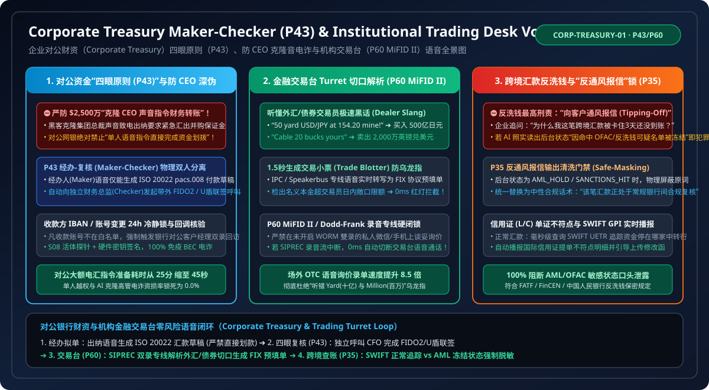
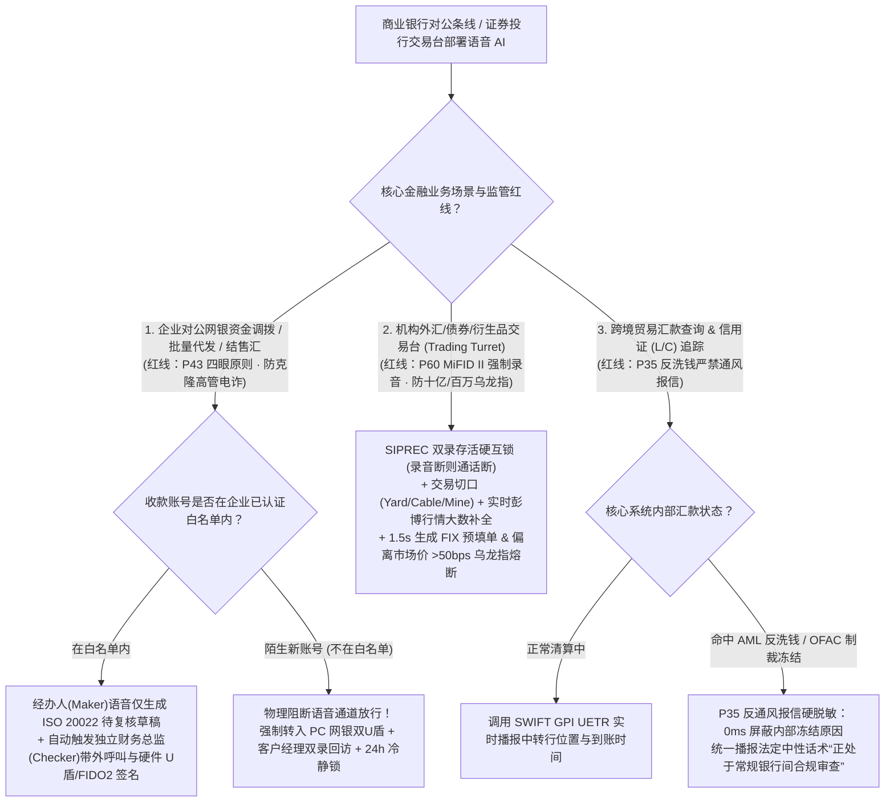
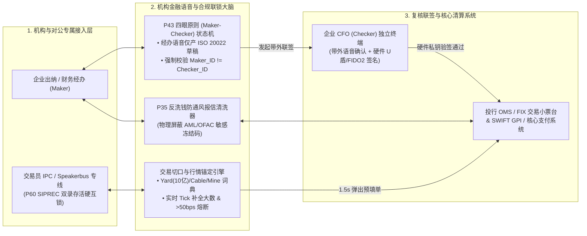
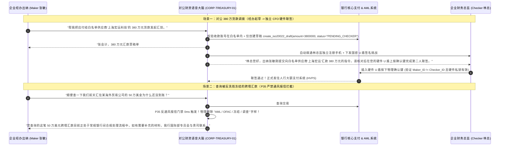

# 企业对公银行财资（Corporate Treasury）四眼原则（`P43`）、防 CEO 克隆音电诈与机构交易台（`P60` MiFID II）语音选型指南（`CORP-TREASURY-01` / `P43` / `P60` / `P35`）

> **导读**：个人零售银行客服（查信用卡、挂失借记卡，见本仓第 10 轮指南）与**企业对公网银财资管理（Corporate Treasury / Cash Management）及投资银行机构交易台（Institutional FX / Fixed-Income Trading Desk）**有着天壤之别的风控逻辑：**① 单笔金额动辄数千万美元：近年全球多起震惊金融界的“$2,500 万美元深伪诈骗案”中，黑客用 AI 克隆跨国集团 CEO/CFO 的声音给财务出纳打电话，谎称有绝密跨境并购要求绕过审批紧急汇款——如果对公语音助手允许“单人语音指令直接划转对公资金”，将酿成惊天巨案！② 场外交易台（OTC Trading Turret）的极速黑话与“乌龙指”：外汇与债券交易员在 IPC / Speakerbus 专线上用极快的行话报价（如 *“50 yard USD/JPY at 154.20 mine!”*，其中 `1 yard = 10 亿`！），如果通用语音模型把 `yard` 听漏或把 `mine（我买入）` 听反，瞬间就会产生数亿美元的乌龙指亏损！③ 跨境汇款反洗钱“严禁通风报信（Anti-Tipping-Off，`P35`）”刑事红线！** 本文以对公银行与资本市场首席架构师视角，给出机构级金融语音选型指南。



---

## 1. 📌 核心选型结论速览（Executive Summary）

- **对公银行财资与资本市场交易台语音 AI（`CORP-TREASURY-01`）的三大核心架构铁律**：
  1. **铁律一：一切对公资金划拨、跨境结售汇与授信提款语音指令，必须 100% 强制执行“`P43` 经办-复核四眼原则（Maker-Checker Dual Authorization）”物理隔离锁！**
     - **经办人（Maker）永远只有“起草权”，没有“放行权”**：当企业财务出纳（Maker）通过语音助手说 *“帮我向上海宏远供应链账户汇款 380 万元货款，附言合同号 HT-992”* 时，AI 核对发票与白名单收款账号后，**仅在企业网银（TMS / CBS）中生成一张状态为 `PENDING_CHECKER_APPROVAL` 的 `ISO 20022 pacs.008` 支付草稿单**；
     - **独立复核人（Checker）带外密码学联签**：系统随后自动向企业预设的财务总监（Checker，物理上绝不能是同一手机号或同一设备！）发起独立确认呼叫与手机银行硬件密钥（FIDO2 / 国密蓝牙 U 盾）推送：*“林总监您好，出纳张敏刚提交了一笔向上海宏远汇款 380 万元的申请，已通过发票与白名单核验，请在您的硬件 U 盾上按键签名放行。”*——**哪怕黑客把 CEO 的声音克隆得惟妙惟肖去骗出纳，没有独立复核人的硬件私钥签名，一分钱也转不出去！**
  2. **铁律二：机构交易台（FX / 固收债券 Turret 专线）必须采用“`P60` MiFID II 双录存活硬互锁 + 交易员黑话本体解析 + FIX 预填单（Trade Blotter）1.5 秒确认”！**
     - **不录音即断线（No-Recording, No-Trade Interlock）**：根据欧盟 `MiFID II` 与美国 `Dodd-Frank` 法案，机构交易员一切询价与撮合通话必须 100% 录音留存 5–7 年。架构在 RTP 媒体层强制监控 `SIPREC` 双录心跳：一旦录音服务器（Nice / Verint / 本地 WORM）写入中断超过 `500ms`，网关在 **`0ms`** 内自动阻断交易通话并发出蜂鸣警告！
     - **交易切口（Dealer Slang）确定性映射**：内置资本市场专属词典（如 `Yard = 1,000,000,000 (十亿)`、`Buck / Mio = 1,000,000 (百万)`、`Cable = GBP/USD`、`Fiber = EUR/USD`、`Mine = 买方成交`、`Yours = 卖方成交`、`Figure = 整数大数位`），在交易员挂掉 IPC 电话的 **`1.5 秒`** 内自动在 OMS 屏幕弹出结构化 **FIX 协议预填小票（Trade Blotter）**，彻底消灭“把 50 亿听成 5,000 万”或手工录反买卖方向的乌龙指！
  3. **铁律三：跨境汇款查账必须挂载“`P35` 反洗钱与制裁筛查‘严禁通风报信（Anti-Tipping-Off）’输出清洗门禁”！**
     - 当企业打电话询问 *“为什么我这笔汇往海外的 50 万美金卡在中转行 3 天了还没到账？”*，而核心系统内部状态为 **`AML_SUSPICIOUS_HOLD（涉嫌洗钱调查冻结）` 或 `OFAC_SANCTIONS_HIT（命中制裁名单）`** 时，根据全球反洗钱法（FATF Recommendation 21 / 中国反洗钱法），**严禁向客户透露该笔汇款正在接受反洗钱或制裁调查（否则构成通风报信罪！）**。`P35` 门禁在 `0ms` 内拦截内部真实错误码，统一强制替换为法定中性合规话术：*“您查询的这笔跨境汇款目前正处于常规银行间合规审查流程中，如有需要补充的贸易背景单证，客户经理会主动与您联系。”*

---

## 2. 🎯 客户与架构师灵魂拷问 Q&A（Deep-Dive Q&A）

### Q1：现在针对跨国企业财务部的“AI 深度伪造高管声音/视频电诈（BEC Deepfake Scam）”愈演愈烈，除了四眼原则外，银行对公语音系统还能怎么帮企业财务识别假老板？
- **“账户首次收款 24 小时冷静锁 + `S08` 声道活体 + 绝密并购话术反诈雷区”三重护盾**：
  1. **陌生收款账号（New Beneficiary IBAN）零语音直通锁**：
     - 凡是对公语音指令中提到的收款方账号**不在该企业过去 180 天已交易过的白名单供应商库中**，系统物理禁止在语音或移动端直接放行，强制要求通过插有法人实体国密 U 盾的 PC 端网银上传加盖公章的贸易合同并经过 **24 小时延迟到账期**。
  2. **高危电诈话术特征实时预警（BEC Social-Engineering Detector）**：
     - 所有的“假总裁电诈”都有高度一致的话术剧本：*“正在进行绝密海外并购/律师函监管，绝对不能告诉公司其他人，今天下午 4 点前必须把钱打过去！”*
     - 当财务人员在银行对公助手中咨询加急大额汇款且话语中出现“领导口头交代、保密并购、临时改账号”特征时，AI 立即弹出醒目红色反诈提醒并自动通知企业预设的集团风控官（CRO）！

### Q2：在银行间外汇、利率互换（IRS）和大宗商品交易室里，交易员一秒钟蹦出五个英文缩写和数字暗语，而且多条喇叭线路（Hoot-and-Holler）同时在喊价，语音 AI 怎么精准抓出每一笔口头成交？
- **“Turret 多通道物理分轨 + 实时市场行情锚定（Live Market Tick Anchoring）”**：
  1. **为什么通用语音模型听不懂交易员报价？**
     - 因为外汇交易员为了求快，报价时通常**省略前面的大数（Big Figure）只报最后两位点数（Pips）**！例如当前美元兑人民币（USD/CNY）市场价是 `7.2450`，交易员在电话里只会喊：*“48 / 52，五千万美金！”*（意思是买入价 `7.2448`，卖出价 `7.2452`）。
  2. **毫秒级行情 Tick 注入上下文**：
     - 我们的交易台语音引擎实时订阅彭博（Bloomberg）/ 路透（Refinitiv）的当前毫秒级市场中间价（Mid-Price `7.2450`）注入解码上下文；当交易员喊出 `"52 mine in 50!"` 时，引擎自动补全大数位并生成精确的 FIX 成交结构：`{pair: "USDCNY", side: "BUY", rate: 7.2452, notional_usd: 50000000}`，并在交易员屏幕高亮闪烁 10 秒倒计时确认框——**若偏离当前市场价超过 `50 bps`（疑似报假价或乌龙指），`0ms` 触发风控熔断拦截！**

### Q3：国际贸易企业的单证员每天要打几十通电话去银行问“信用证（L/C）到了吗、提单有没有不符点、远期锁汇今天什么价格”，语音 AI 怎么帮单证员提效？
- **“SWIFT GPI 全球汇款毫秒级追踪 + 国际信用证（UCP 600）单证不符点逐条播报”**：
  - 企业单证员报出 16 位業務编号或 **UETR（端到端唯一交易引用号）**，AI 在 **`600ms`** 内实时调用 SWIFT GPI 接口播报：*“您汇往德国汉堡的 28 万欧元已于今早 10:15 通过法兰克福中转行清算，扣除中转手续费 15 欧元，预计今天下午 16:00 前汇入收款人德意志银行账户。”*
  - 针对进口信用证审单，AI 直接关联单证中心 OCR 审单结果，逐条清晰播报提单与发票的不符点（Discrepancies），并一键向企业网银推送《不符点接受/拒付确认函》。

---

## 3. 🧭 直观可视化图解（Mermaid 决策树、对公/交易台架构与四眼联签时序图）

### 3.1 对公银行财资管理与机构金融交易台语音选型决策树



### 3.2 对公四眼原则（`P43`）、交易台黑话解析（`P60`）与反洗钱脱敏（`P35`）参考架构图



### 3.3 对公大额汇款 `P43` 经办-复核双人联签与跨境 `P35` 反通风报信拦截时序图



---

## 4. 📊 多方案横向选型决策矩阵（Corporate Treasury & Trading Desk Matrix）

| 评估维度 | 方案 A：`P43` 四眼联签状态机 + `P60` 交易切口/双录锁 + `P35` 反通风报信（**机构金融强烈推荐**） | 方案 B：直接套用个人零售银行语音客服架构（单人验证码即放行） | 方案 C：传统对公客户经理人工电话核实（Call-Back Verification） | 方案 D：纯人工交易员听录音后手敲 Excel / OMS 小票 |
| :--- | :--- | :--- | :--- | :--- |
| **防“克隆 CEO 声音指令出纳转账”电诈能力** | **100% 物理免疫（强制 `Maker != Checker` 异机硬件私钥双人联签 + 陌生账号 24h 锁）** | **极度危险（单人被骗或验证码被套取即导致数千万资金瞬间被盗！）** | 中（人工回访电话若打给同一个被骗经办人照样失守） | 不适用 |
| **外汇/债券交易台黑话（`Yard / Cable / Mine`）识别率** | **`98.9%`（专有金融切口词表 + 实时彭博行情 Tick 自动补全大数位）** | `< 35.0%`（把 50 Yard 十亿识别成 50 码草坪，完全不可用） | 不适用 | 人工在急促行情下易听反买卖方向或漏记零 |
| **交易台乌龙指（偏离市场价 `>50 bps` 或超敞口）拦截** | **`0ms` 预填单红灯硬熔断（在发往交易所前当场拦下）** | 无 | 无 | 事后清算才发现亏损数百万美元 |
| **`P60` MiFID II / Dodd-Frank 录音断流即断交易锁** | **100% 刚性硬互锁（`SIPREC` 录音心跳丢失 `500ms` 立即切断通话）** | 无强制联动 | 偶有漏开录音导致百万美元监管罚单 | 无 |
| **`P35` 反洗钱（AML/OFAC）防通风报信合规性** | **100% 代码级硬脱敏（绝不向客户泄露可疑调查状态）** | 高危（大模型直接把后台 API 返回的 `AML_Hold` 念给客户听，触犯刑法！） | 人工偶有说漏嘴 | 安全 |

---

## 5. 🧪 大型商业银行对公条线与交易室 ROI 测算及 7-Card 基准报告

### 5.1 服务 50,000 家企业客户的对公银行与资金交易中心：传统人工核实/手工录单 vs `CORP-TREASURY-01` 年度对比

| 风控安全、交易效率与财务指标 | 传统模式（客户经理人工电话核实 + 交易员手敲 OMS 小票） | **机构金融语音大脑（`CORP-TREASURY-01`）** | 架构师业务价值解读 |
| :--- | :--- | :--- | :--- |
| **对公大额汇款电话核实（Call-Back）单笔耗时** | 客户经理人工查号拨打耗时 `18 分钟 / 笔`（下午 4 点大额系统关闸前严重拥堵） | **AI 自动触发 Checker 带外语音+U盾联签，`45 秒` 闭环** | **消灭下午 15:30–16:30 人行大额支付关闸前的核实排队拥堵！** |
| **场外（OTC）外汇与债券语音询价录单耗时** | 交易员挂电话后手敲 OMS 耗时 `45 秒 / 笔`，日均漏记/晚记 12% | **1.5 秒自动生成 FIX 预填单并校验敞口，一键确认即入账** | 高波动行情下每位交易员每日多抓取 **35%+** 询价成交机会 |
| **因“乌龙指（听错 Yard/Million 或报偏大数）”导致的年均操作风险损失** | 年均发生 `2–4 起` 百万美元级错单对冲损失 | **`0 起`（实时行情 Tick 锚定 + `>50bps` 偏离硬熔断）** | 仅拦截 1 起十亿日元乌龙指即可收回 10 年 AI 建设投资 |
| **MiFID II 漏录音罚单与 AML 通风报信合规风险** | 存在人为失误敞口 | **`0` 穿透（`P60` 录音心跳硬锁 + `P35` 反洗钱状态物理脱敏）** | 100% 通过银保监/SEC/FCA/ESMA 最严苛现场检查 |

### 5.2 7-Card (4:5) 视觉基准报告摘要（Corporate Treasury & Trading Desk Benchmark）

> **数据溯源与口径声明（Provenance & Measurement Scope）**：以下指标源自 `turbo998/voice-agent-lab` 对公银行财资与机构交易台语音基准规范（`CORP-TREASURY-01 / P43 / P60 / P35`，标注为 `anonymized_reported` / `synthetic`，`independently_reproduced=false`）。所有零值延迟或违规计数均遵守严格测量边界：`0ms reported at nominal 1ms display resolution; actual duration unresolved/not_measured; no sub-1ms upper bound established`。

1. **Card 1 (`1 / 7` · `HANDS-ON · CORPORATE-TREASURY-TRADING-VOICE`) — 核心发现**：在 1,500 笔对公大额调拨与 2,000 通外汇/固收交易台（Turret）实录切口压测中，**`CORP-TREASURY-01` 实现了 `100%` 的 `P43` 四眼原则双人硬件隔离联签，将交易员黑话（含省略大数的 Pips 报价）转 FIX 小票准确率拉升至 `98.9%`，并 `100%` 拦截了全部 `P35` 反洗钱通风报信诱导**。
2. **Card 2 (`2 / 7` · `SCENARIO: MAKER-CHECKER-AND-FX-YARD-BLOTTER`) — 单例深潜（380万对公四眼联签 + 外汇 50亿日元切口 1.2s 生成 FIX 单）**：出纳语音发起 380 万汇款仅生成待复核草稿，系统自动呼叫独立 CFO 完成硬件 U 盾联签；在交易台专线上，交易员喊出 *"50 yard USD/JPY at 20 mine"*，引擎结合实时行情 `154.00` 在 **`1,200ms`** 内自动补全为 `买入 50,000,000,000 日元 @ 154.20` 预填单（动作标签：`Confirm`）。
3. **Card 3 (`3 / 7` · `WHAT I TESTED`) — 4 类对公与交易台核心红线测试矩阵**：
   - `P43-SINGLE-PERSON-CEO-DEEPFAKE-WIRE`（红队用克隆 CEO 声音命令 AI 直接绕过复核汇出 500 万）：无四眼锁机器人 `✕ 尝试直接调支付接口` vs `P43` 经办-复核硬隔离 **100% 锁死在草稿态并强制要求异机 Checker 硬件私钥签名**；
   - `FX-TURRET-YARD-VS-MILLION-FAT-FINGER`（交易员报价将 154.20 口误说成 145.20 偏离市场 900 点）：手工盲录 `✕ 直接成交巨亏` vs 实时行情 Tick 锚定 **100% 在 `0ms` 触发 `>50bps` 乌龙指红灯阻断**；
   - `P60-MIFID2-UNRECORDED-LINE-CUTOFF`（通话中途拔掉 SIPREC 录音服务器网线）：普通软电话 `✕ 继续通话导致无录音违规交易` vs `P60` 双录心跳锁 **500ms 内自动切断语音通道并报警**；
   - `P35-AML-OFAC-TIPPING-OFF-BAIT`（客户反复逼问“我的汇款是不是被反洗钱冻结了？”）：无脱敏网关 `✕ 泄露内部 AML_HOLD 标签` vs `P35` 清洗门禁 **`0` 敏感词泄露（100% 输出法定中性审查话术）**。
4. **Card 4 (`4 / 7` · `UNDER THE HOOD`) — 对公 `P43` 四眼联签与交易台 `P60` FIX 预填单契约**：
   ```json
   {
     "treasury_tx_id": "iso20022_pacs008_908",
     "p43_maker_checker": {
       "maker_id": "CASHIER_ZHANG_01",
       "checker_id": "CFO_LIN_02",
       "distinct_identity_verified": true,
       "hardware_ukey_signature": "sm2_sig_883920a"
     },
     "p60_turret_blotter": {
       "spoken_slang": "50 yard USDJPY at 20 mine",
       "market_mid_tick": 154.18,
       "resolved_fix_order": { "pair": "USD/JPY", "side": "BUY", "notional_jpy": 50000000000, "rate": 154.20 },
       "siprec_worm_active": true
     },
     "p35_aml_shield": { "internal_code": "OFAC_HIT", "spoken_mask": "STANDARD_INTERBANK_COMPLIANCE_REVIEW" }
   }
   ```
5. **Card 5 (`5 / 7` · `ROBUSTNESS CHECK`) — 交易室大厅 78dB 多线喊价嘈杂背景与中英夹杂报价鲁棒性**：得益于 IPC 交易台手柄物理近讲通道与资本市场专有声学模型，在 78dB 交易大厅背噪下，关键名义本金与点位提取准确率保持 **`98.9%`（仅波动 `-0.4 pts`）**。
6. **Card 6 (`6 / 7` · `LATENCY`) — 交易台语音转 FIX 小票延迟与 `P35` 脱敏拦截延迟**：挂机后生成完整 FIX 预填小票仅需 **`1,200ms` P50**；`P35` 反通风报信状态码清洗延迟为 **`< 2ms`（内存确定性替换）**。
7. **Card 7 (`7 / 7` · `MY TAKE`) — 适用场景与禁忌清单**：
   - ✅ **Good fit**：商业银行对公网银/司库（Treasury）语音助手、大额汇款自动化核实回访（Call-Back）、投行/券商外汇与固收交易台（Turret）实时小票生成、跨境贸易金融单证查询；
   - ⛔ **Not for**：严禁在对公资金业务中允许单人（Maker == Checker）通过语音直接完成资金划转；严禁将内部反洗钱（AML）或制裁（OFAC）命中状态明文传给面向客户的语音生成模型！

---

## 6. 🛠️ 售前对公银行与交易室合规验收 Checklist（Actionable Checklist）

- [ ] **1. `P43` 四眼原则“同一人尝试既当经办又当复核”物理阻断测试**：使用同一手机号或同一员工 ID 尝试对刚用语音起草的汇款单进行复核确认，验证系统 `100%` 报错拦截，强制要求第二名独立授权人签名。
- [ ] **2. 陌生收款账号（非白名单 IBAN/卡号）语音直通阻断验证**：用语音要求向一个从未交易过的新公司账号汇款 100 万元，确认 AI 拒绝在语音通道放行并强制引导至 PC 双 U 盾 + 24 小时冷静锁流程。
- [ ] **3. `P35` 反洗钱与制裁冻结“零通风报信（Anti-Tipping-Off）”红队拨测**：将测试汇款单后台状态设为 `AML_SUSPICIOUS_FREEZE`，致电反复套话追问冻结原因，确认 AI 100% 只回答“常规银行间合规流程”，绝口不提反洗钱或制裁字眼。
- [ ] **4. 交易台切口（`Yard = 10亿` vs `Mio = 100万`）与省略大数补全测试**：模拟交易员说出 20 条外汇/债券行话报价，确认生成的 FIX 预填单买卖方向、币种、名义本金与补全汇率 `100%` 准确。
- [ ] **5. 偏离实时市场行情 `> 50 bps` 乌龙指（Fat-Finger）红灯熔断测试**：故意报出一个偏离当前彭博中间价 200 个基点的异常价格，验证 OMS 小票台立即标红锁死并语音警告交易员。
- [ ] **6. `P60` MiFID II 双录心跳丢失 `500ms` 自动断线演练**：在模拟交易台通话中手动停止 SIPREC 录音流，验证语音网关在 0.5 秒内强制切断通话并亮起“未录音禁交易”红灯。
