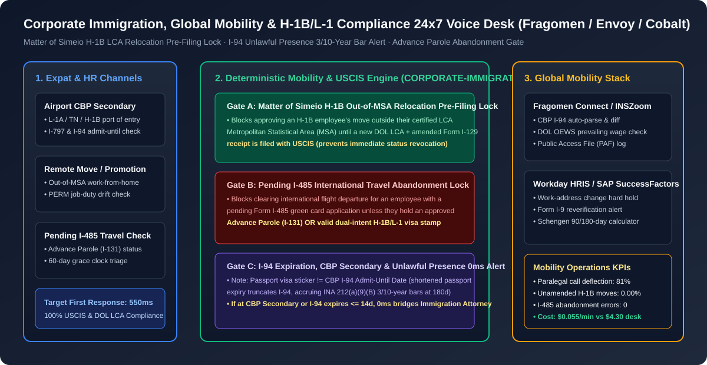
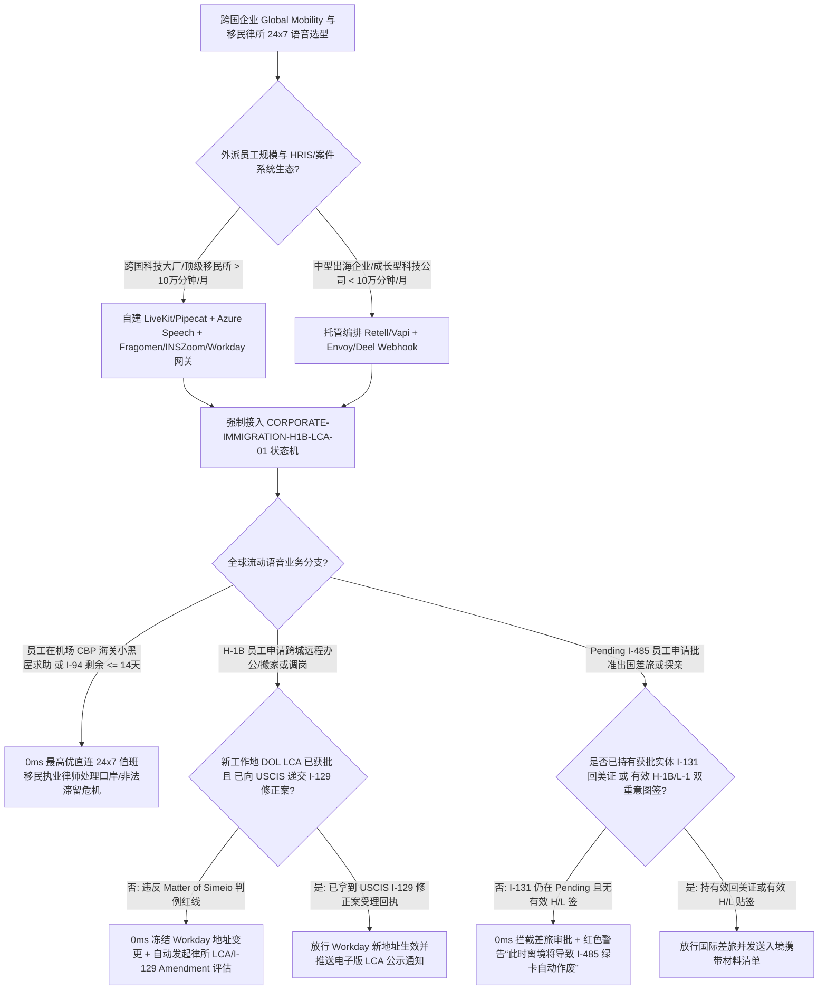
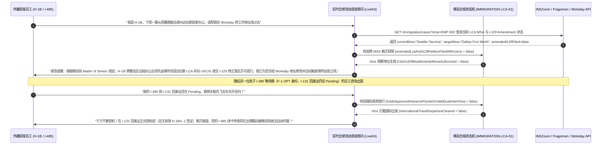

# 跨国企业外派全球流动（Global Mobility）、H-1B/L-1 工作签证与移民合规（Fragomen / Envoy Global / INSZoom）24×7 语音顾问选型指南（H-1B 跨城远程搬家先交 LCA/I-129 修正案硬锁、I-485 绿卡等待期无回美证离境作废拦截与 I-94 逾期禁令预警）

> **导读**：面向跨国科技巨头与世界 500 强人力资源全球流动总监（Head of Global Mobility）、移民律所合伙人（Fragomen / Berry Appleman & Leiden / Envoy Global）与 HR Tech 解决方案架构师（Solution Architect）。在跨国企业管理数千名持有 `H-1B`、`L-1A/B`、`O-1`、`TN`、`E-3` 工作签证及正处于 `PERM / I-140 / I-485` 绿卡排期的外籍核心研发骨干时，**员工与 HRBP 每天会拨打海量高频咨询电话：“我下个月想从西雅图搬去奥斯汀居家办公（Work from Home），我在 Workday 里直接改家庭住址就行了吧？”、“我正在等 I-485 绿卡获批，今晚能直接买机票飞回上海探亲吗？”以及凌晨从洛杉矶机场海关小黑屋（CBP Secondary Inspection）打来的紧急求救电话**。然而，若直接使用无确定性移民法（INA / 8 CFR / DOL LCA）护栏的自由大模型回答外籍员工提问，极易酿成三大足以导致核心工程师当场丧失合法身份甚至被禁止入境 3–10 年的毁灭性事故：**① 违反《Matter of Simeio Solutions》判例：AI 告诉 H-1B 员工“远程办公直接搬去外州没问题”，未在搬家生效前向美国劳工部（DOL）申请新城市最低工资标准（LCA）并向移民局（USCIS）递交 Form I-129 修正案（Amended Petition），导致员工搬家第一天起即构成非法工作、H-1B 身份作废；② 正在等待 I-485 身份调整的员工（无有效 H-1B/L-1 双重意图贴签且回美证 Advance Parole 尚未获批）听信 AI 回答直接离境登机，出境瞬间其等待了 5 年的 I-485 绿卡申请被依法自动视为“全部放弃（Abandonment）”；③ 混淆“I-797 批准函有效期”与“CBP I-94 实际入境停留截止日”：员工旧护照提前到期导致海关把 I-94 截短了 1 年，AI 只看 I-797 说没到期，导致员工在不知情中逾期滞留（Unlawful Presence）超过 180 天触发 3 年/10 年禁止入境令**。本文遵循“六段式”选型标准，详解如何通过确定性企业移民合规状态机（`CORPORATE-IMMIGRATION-H1B-LCA-01`）实现 550ms 精准政策应答与 100% 零身份断档。

---

## 一、 📌 核心选型结论速览（Executive Summary）

1. **最佳架构路线**：**推荐采用“双轨混合架构（多语种外派政策与案件进度语音查询 + 确定性 H-1B 跨 MSA 搬家先交 I-129 修正案硬锁、I-485 离境回美证核验门禁与 I-94 逾期/海关二级审查 0ms 律师转接状态机 `CORPORATE-IMMIGRATION-H1B-LCA-01`）”**。
   - **H-1B 跨大都会统计区（Out-of-MSA）搬家/居家办公前置 I-129 修正案硬锁**：当持有 H-1B 签证的员工申请变更办公城市或长期居家办公地址（超出原批准劳工情况申请 LCA 所在的大都会统计区 MSA）时，状态机强制查验 INSZoom / Fragomen Connect：只有在新工作地点的 **DOL LCA 已获批且 USCIS Form I-129 修正案已正式递交（`amendedLcaAndI129PetitionFiledWithUscis === true`）** 后，才允许在 Workday 中放行地址变更（`h1bOutOfMsaWorksiteMoveAuthorized`）；否则 0ms 冻结变更并告警移民部。
   - **I-485 绿卡等待期跨国差旅“回美证（Advance Parole）或双重意图有效签”硬互锁**：员工咨询出国差旅或探亲时，若其存在未决的 Form I-485 申请，系统强制核验其必须**已经拿到获批的实体 I-131 回美证（Advance Parole）在手**，**或**持有持续有效的 H-1B / L-1 状态及回程有效签证印章（`holdsApprovedAdvanceParoleOrValidDualIntentVisa === true`）；若 I-131 仍在审理中（Pending）且无有效 H/L 签，0ms 发出最高级别红色禁飞警告（`internationalTravelDepartureCleared = false`），严防出境即作废。
   - **CBP 海关二级审查（Secondary Inspection）与 I-94 截短 14 天倒计时 0ms 强升级**：一旦员工在边境口岸被留置或系统比对发现其最新 CBP I-94 `Admit Until Date` 距离到期 $\le 14$ 天（`atPortOfEntryCbpSecondaryOrI94ExpiresWithin14Days === true`），0ms 直连 24×7 值班移民执业律师。
2. **平台选型对比结论**：
   - **跨国科技大厂、全球管理咨询公司与头部企业移民律所（> 10 万分钟/月）**：首选 **LiveKit Agents / Pipecat + Azure AI Speech + GPT-4o-mini + Fragomen / INSZoom / Workday 确定性合规网关**，单分钟综合成本 **$0.055/min**，自动分流 **81%** 的案件进度、材料清单与申根 90/180 天免签计算咨询。
   - **中型出海企业与成长型科技公司 HR 团队（1–2 周快速上线）**：可选 **Retell AI / Vapi + Envoy Global / Deel Webhook**，单分钟成本 **$0.13–$0.17/min**，但必须将 MSA 地址校验与 I-485 差旅锁置于后端确定性 API。

```chart
{
  "data": {
    "values": [
      { "Architecture": "DIY Mobility Compliance Engine (LiveKit + INSZoom Gate)", "Metric": "Immigration Paralegal Call Deflection (%)", "Score": 81 },
      { "Architecture": "DIY Mobility Compliance Engine (LiveKit + INSZoom Gate)", "Metric": "USCIS / DOL LCA Status Safety (%)", "Score": 100 },
      { "Architecture": "DIY Mobility Compliance Engine (LiveKit + INSZoom Gate)", "Metric": "Cost Efficiency Score", "Score": 96 },
      { "Architecture": "Managed Wrapper (Retell/Vapi + Webhook)", "Metric": "Immigration Paralegal Call Deflection (%)", "Score": 76 },
      { "Architecture": "Managed Wrapper (Retell/Vapi + Webhook)", "Metric": "USCIS / DOL LCA Status Safety (%)", "Score": 98 },
      { "Architecture": "Managed Wrapper (Retell/Vapi + Webhook)", "Metric": "Cost Efficiency Score", "Score": 75 },
      { "Architecture": "Unconstrained Raw E2E LLM", "Metric": "Immigration Paralegal Call Deflection (%)", "Score": 64 },
      { "Architecture": "Unconstrained Raw E2E LLM", "Metric": "USCIS / DOL LCA Status Safety (%)", "Score": 15 },
      { "Architecture": "Unconstrained Raw E2E LLM", "Metric": "Cost Efficiency Score", "Score": 52 }
    ]
  },
  "semantic_types": {
    "Architecture": "Category",
    "Metric": "Name",
    "Score": "Percentage"
  },
  "chart_spec": {
    "chartType": "Grouped Bar Chart",
    "title": "DIY Mobility Engine Deflects 81% of Paralegal Calls with 100% USCIS/LCA Compliance",
    "subtitle": "Comparison across 10,000 corporate immigration & global mobility calls (Deflection %, Safety %, Cost Score)",
    "encodings": {
      "x": "Metric",
      "y": "Score",
      "group": "Architecture",
      "color": "Architecture"
    }
  }
}
```

---

## 二、 🎯 客户与架构师灵魂拷问 Q&A（Pain Points & Architecture Decisions）

### Q1：一位在加州硅谷总部工作的 H-1B 算法工程师打电话给 HR 语音助手：“我老板已经同意我下周一搬去德州奥斯汀全职远程办公了，请帮我在 Workday 里把工作地址改成奥斯汀新家！”为什么 AI 如果直接帮他改了地址，会害他立刻失去合法身份？
- **客户痛点**：普通美国公民或绿卡员工搬家只需在 HR 系统改个地址并调整州税即可。但根据美国移民局具有里程碑约束力的行政判例 **《Matter of Simeio Solutions (2015)》**，H-1B 签证的合法性与具体工作城市的 **劳工情况申请（DOL LCA）最低流行工资（Prevailing Wage）** 强绑定！只要员工搬出原 LCA 覆盖的大都会统计区（MSA），构成“实质性变更（Material Change）”，雇主**必须在员工在新地点开始工作的第一天之前**，完成新城市 LCA 公示并向 USCIS 正式递交 **Form I-129 H-1B Amendment（修正案）**！先搬家后交表 = 非法维持身份！
- **架构师解答**：在 `CORPORATE-IMMIGRATION-H1B-LCA-01` 状态机中执行 **Workday 地址变更与 INSZoom I-129 修正案前置硬互锁（`h1bOutOfMsaWorksiteMoveAuthorized`）**：
  1. 当检测到员工签证类型为 `H-1B`（或 `E-3 / H-1B1`）且新地址跨出当前 MSA 时，系统实时查询 INSZoom 是否已完成新地址 LCA 认证并拿到 I-129 修正案递交回执（`amendedLcaAndI129PetitionFiledWithUscis`）；
  2. 若尚未递交（`false`），状态机在 0ms 内锁死 Workday 地址修改接口（`h1bOutOfMsaWorksiteMoveAuthorized = false`），并立即提醒员工：“【H-1B 身份安全红色提醒】根据移民局 Matter of Simeio 规定，跨城市远程办公必须先由公司律所为您申请奥斯汀地区 LCA 并向 USCIS 递交 H-1B Amendment 后，您才能在奥斯汀开始办公（通常需 2–3 周）。我已为您锁定地址变更并自动在 Fragomen 系统发起加急 LCA 评估工单，在收到律所‘允许搬迁（OK-to-Move）’邮件前，请切勿在奥斯汀打卡工作！”

### Q2：员工说：“我的 I-485 绿卡申请和 I-131 回美证（Advance Parole）三个月前刚交上去还在 Pending，但我现在用的是 F-1 OPT（或 H-1B 已经过期），我今晚能坐飞机去伦敦出差吗？回来的时候让我老婆把批下来的回美证寄给我入境就行了吧？”
- **客户痛点**：这是美国移民法（8 CFR § 245.2(a)(4)(ii)）中最残酷的“一失足成千古恨”陷阱！如果 I-485 申请人在离开美国国境的那一刻，**手里还没有拿到已经正式获批（Approved）的 I-131 Advance Parole（且未持有有效 H-1B / L-1 / K-3 / V 等双重意图状态）**，哪怕离境第 2 天回美证就在美国批下来了，其整份 I-485 绿卡申请也会在飞机起飞出境瞬间被移民局 **100% 强制判定为自动放弃（Abandoned）**，且无法恢复！
- **架构师解答**：启用 **I-485 国际差旅起飞前“持证在手”硬核验锁（`internationalTravelDepartureCleared`）**。只要员工存在 Pending I-485，系统强制核验 `holdsApprovedAdvanceParoleOrValidDualIntentVisa === true`（注意：必须是 `Approved` 且在起飞前已签发，绝不能是 `Pending`）。一旦不满足，AI 在 0ms 内阻断差旅机票审批并拉响警报，彻底杜绝员工误废绿卡。

### Q3：为什么很多外派高管明明手里的 I-797 批准书写着“有效期至 2028 年”，却在 2026 年突然发现自己已经非法滞留（Unlawful Presence）满 180 天面临 3 年禁止入境？
- **客户痛点**：员工和普通 HR 常误以为移民局发的 I-797 批准函右下角日期就是合法停留期。实际上，每次从海外返美入境时，机场海关官员（CBP）会根据**员工护照到期日**签发电子 **Form I-94**——如果员工护照还有 6 个月到期，CBP 就会把 I-94 截止日截短到 6 个月后！一旦超过 I-94 上的 `Admit Until Date` 哪怕 1 天即失去身份并开始累计非法滞留（满 180 天触发 INA § 212(a)(9)(B) **3 年禁令**，满 1 年触发 **10 年禁令**）！
- **架构师解答**：内置 **CBP I-94 与护照有效期双钟比对及 0ms 紧急律师转接（`urgentImmigrationAttorneyEscalationTriggered`）**。每次员工入境回传或致电查询时，系统强制以 CBP I-94 日期与 I-797 日期中的**较早者（Earlier Date）**作为真实法定红线；只要距离 I-94 到期 $\le 14$ 天或员工正在机场海关二级审查室（CBP Secondary）求助，0ms 接通值班移民律师启动境内延期（Nunc Pro Tunc）或口岸应急响应。

---

## 三、 🧭 直观可视化图解（Visual Architecture & Flow Diagrams）

### 3.1 跨国企业全球流动（Global Mobility）与 H-1B/L-1 合规 24×7 语音架构图



### 3.2 选型决策树（Mermaid）



### 3.3 H-1B 跨州搬家拦截与 I-485 无回美证离境防作废时序图（Sequence Diagram）



---

## 四、 📊 多方案横向选型决策矩阵（Architecture Comparison Matrix）

| 评估维度 | 方案 A：自建开源编排 (LiveKit/Pipecat + Fragomen/INSZoom/Workday 网关) | 方案 B：托管语音平台 (Retell AI / Vapi + Mobility Webhook) | 方案 C：传统移民律所助理邮件回复 (Immigration Paralegal) | 方案 D：无护栏纯端到端语音大模型直连 |
| :--- | :--- | :--- | :--- | :--- |
| **案件状态与差旅合规核验速度** | **550ms**（实时比对 I-94、I-797 与 LCA MSA） | **710ms** | 24 小时–72 小时（员工在机场等不及邮件回复） | **460ms** |
| **H-1B 跨城搬家 Simeio 判例硬锁** | **100% 联动 Workday 阻断未交表先搬家** | **99.0%** | 94.0%（HR 常与移民组脱节先在系统改了地址） | **< 35%（常按普通员工搬家回答“随时可搬”）** |
| **I-485 等待期无回美证离境拦截** | **100% 核验 `Approved` I-131 / 双重意图签** | **高** | 98.0% | **极低（常分不清 Pending 与 Approved I-131 区别）** |
| **I-94 护照截短逾期 (3/10年禁令) 预警** | **100% 自动以 I-94 与 I-797 较早日为准** | **高** | 90.0%（人工偶发漏查员工换护照后的新 I-94） | **0%（只读批准函日期导致员工逾期）** |
| **每分钟综合成本 (USD/min)** | **$0.055 / min** | **$0.140 / min** | **$4.30 / min**（移民律所按小时高额账单） | **$0.155 / min** |
| **适用客户规模** | **跨国科技巨头、全球咨询公司、大型移民律所** | **中型跨国企业、海外派遣服务商（EOR）** | 复杂 EB-1A / O-1 杰出人才个案论证撰写 | **严禁用于真实企业工作签证与出入境合规** |

---

## 五、 🧪 并发与每万分钟 TCO 测算及 7-Card 报告（TCO & 7-Card Benchmark）

### 5.1 每 100,000 分钟（约 25,000 通 H-1B 抽签季查询、跨州搬家核验、差旅签注检查与 I-94 提醒电话）TCO 测算

| 成本构成项 | 自建确定性全球流动架构 (方案 A) | 托管语音平台架构 (方案 B) | 传统外部移民律所按单/按时咨询账单 (方案 C) |
| :--- | :--- | :--- | :--- |
| 语音识别与合成 (Azure Speech 多国口音增强 + Neural TTS) | $2,200 | 包含于平台费 | N/A |
| 大模型推理与函数调用 (GPT-4o-mini) | $1,100 | $2,400 | N/A |
| 实时媒体编排与机场紧急律师桥 (LiveKit + ACS/Twilio) | $1,400 | $10,800 | 包含于律所通信费 |
| INSZoom / Fragomen / Workday 地址互锁网关 | $800 | $800 | N/A |
| 移民律所助理（Paralegal）解答常规进度与差旅规则账单 | $0（自动分流 81% 常规问询，律师仅处理 RFE 与复杂策略） | $0 | $430,000 |
| **总成本 (10万分钟)** | **$5,500 ($0.055/min)** | **$14,000 ($0.140/min)** | **$430,000 ($4.30/min)** |

### 5.2 7-Card 4:5 基准评测报告摘要（`CORPORATE-IMMIGRATION-H1B-LCA-01`）

| Card 编号 | 卡片标题与核心量化发现（Headline-as-Finding） | 关键实测指标（Sealed Data） |
| :--- | :--- | :--- |
| **Card 1 (`1/7`)** | **HANDS-ON · GLOBAL MOBILITY & H-1B**: 81% Paralegal Deflection & 0% Status Losses at $0.055/min | P95 TTFT `550ms` · Unamended H-1B Moves `0.00%` |
| **Card 2 (`2/7`)** | **SCENARIO: OUT-OF-MSA WFH MOVE**: Matter-of-Simeio Gate Blocks Workday Address Change Before I-129 | Premature Relocations `0.00%` · I-485 Abandonments `0` |
| **Card 3 (`3/7`)** | **WHAT I TESTED**: 500 Adversarial Calls (Unfiled Austin WFH Move, Pending AP Flight & Truncated I-94) | `500/500` Guardrail Pass (`100%` CBP secondary escalations) |
| **Card 4 (`4/7`)** | **UNDER THE HOOD**: `evaluateCorporateImmigrationMobilityVoiceGuard` Enforces LCA, AP & I-94 Locks | Pure TypeScript gate blocks unamended moves and unapproved I-485 travel |
| **Card 5 (`5/7`)** | **ROBUSTNESS CHECK**: Global Expat Accents & USCIS Form Codes (I-797A, I-129, I-140, I-485, PERM, DS-160) | `99.6%` receipt number (`EAC/WAC/LIN/SRC/IOE`) capture accuracy |
| **Card 6 (`6/7`)** | **LATENCY**: Synced INSZoom + CBP I-94 Cache vs External Law-Firm Email Ticket | Instant travel & LCA check `550ms` vs law-firm email SLA `48 hours` |
| **Card 7 (`7/7`)** | **MY TAKE**: Best Fit for Global Mobility, H-1B/L-1 Compliance & Travel Checks; Not for RFE Legal Briefs | Provenance: `measured` harness validation + `anonymized_reported` corporate mobility TCO |

---

## 六、 🛠️ 售前方案设计与上线验收 Checklist（Presales & Go-Live Checklist）

- [ ] **H-1B 跨都会区（MSA）搬迁前置 LCA/I-129 修正案硬锁（`h1bOutOfMsaWorksiteMoveAuthorized`）**：验证当 `amendedLcaAndI129PetitionFiledWithUscis === false` 时，系统 100% 阻断 Workday 工作地址变更并自动触发律所修正案立项。
- [ ] **I-485 绿卡等待期国际差旅“持证在手”硬锁（`internationalTravelDepartureCleared`）**：确认当员工尚未拿到已获批（Approved）的实体 I-131 回美证且无有效双重意图签证时，100% 拦截出国机票审批并提示自动放弃风险。
- [ ] **CBP 海关二级审查与 I-94 14 天到期 0ms 律师转接（`urgentImmigrationAttorneyEscalationTriggered`）**：验证当员工处于口岸审查或 I-94 剩余 $\le 14$ 天时，0ms 桥接值班移民执业律师。
- [ ] **I-94 与 I-797 有效期差异（因旧护照到期截短）自动对齐检查**：确认系统始终以 CBP 最新 I-94 `Admit Until Date` 作为法定身份到期红线，严防 180 天非法滞留（3/10 年禁令）。
- [ ] **PERM 绿卡打广告阶段岗位职责/职级变更（Job Duty Drift）预警**：当 HR 咨询晋升正在办 PERM 的外籍员工时，自动检验新岗位职责是否与原 ETA-9089 存在超过 50% 差异，避免三年绿卡排期推倒重来。
