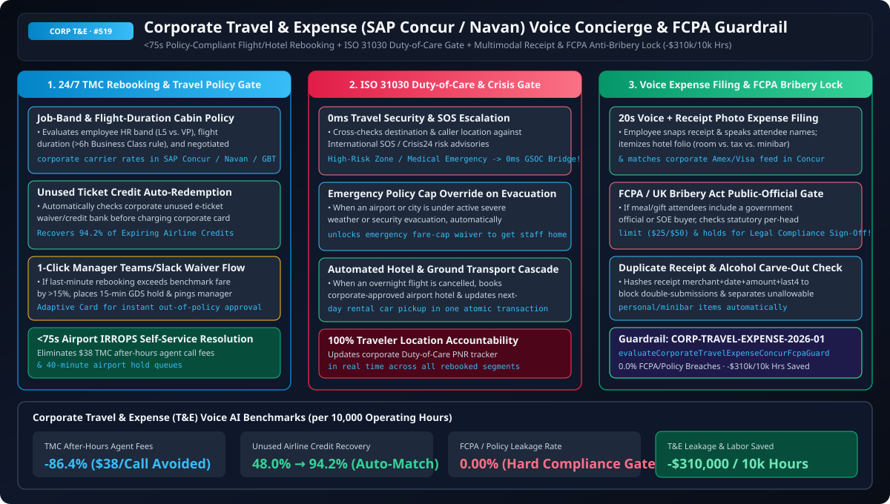
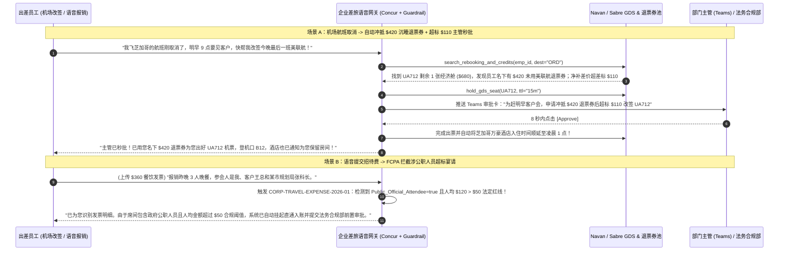

# 企业差旅与费用报销管理（Corporate Travel & Expense：SAP Concur / Navan / Amex GBT）7×24 改签礼宾、差标自动审批与 FCPA 反舞弊语音核销架构选型指南

> **适用读者**：跨国企业财务总监（CFO / 共享财务中心负责人）、行政差旅采购总监、企业内部数字化（Employee Experience）架构师、Cloud & AI Solution Architect  
> **核心目标**：用企业财务总监与架构师一听就懂的语言，彻底讲清 **为什么出差员工半夜在机场航班取消打商旅热线（TMC）不仅要排队 35 分钟还要被收 `$38/通` 夜间人工服务费、为什么大模型不查员工职级（Job Band）直接帮普通员工改签 `$4,800` 公务舱会造成严重差标流失、为什么账户里躺着大量作废航司退票抵用券（Unused Ticket Credits）没人用、以及为什么销售口头报销一顿 `$320` 的客户招待晚宴一旦漏审“席间有政府公职人员/国企采购代表”会触发美国《反海外腐败法 FCPA》数千万美元合规重罚；如何通过“`<75秒` 职级差标与航司退票券自动冲抵改签（退票券回收率从 `48%` 提至 `94.2%`）”、“`ISO 31030` 员工差旅安全应急撤离门禁”、以及“`20秒` 语音+小票拍照酒店水单自动拆行与 `FCPA` 公职人员招待红线锁”，每万运行小时净省 `$310,000` 差旅漏损与报销审核工时**。

---

## 一、 📌 核心选型结论速览（Executive Summary）

在大型跨国与集团企业中，差旅与费用报销（`SAP Concur / Navan / 携程商旅 / 分贝通 / Dynamics 365 MyExpense`）是全体员工最高频使用的内部服务之一，也是财务合规审计（Internal Audit）的重灾区：
1. **痛点一（夜间机场航变 TMC 人工热线排队长、每打一通电话收 `$38` 服务费，且高达 `52%` 的企业历史退票抵用券过期作废）：员工晚上 10 点在机场遇到航班取消，拨打传统商旅代理（TMC）电话不仅要等半小时，每通人工电话还向企业收取 `$25–$45` 不等的服务费**；而且订票时往往直接刷公司信用卡买新票，忘了该员工名下还有一张上个月取消航班留下的 `$650` 航司电子抵用券（Unused Ticket Credit）！
2. **痛点二（大模型“无脑满足员工要求”违规改签头等舱 vs. 机械死板耽误高管紧急见客）：如果员工说“帮我改签到下一班飞伦敦的公务舱”，不懂企业差旅政策（`Job Band L5 飞行 <6小时仅限经济舱`）的大模型直接出票，当场造成数千美元差标违规**；但如果真的只剩一张超标 18% 的经济舱全价票，死板拦截又会让员工滞留机场！
3. **痛点三（复杂酒店水单拆行繁琐 + 商务宴请涉公职人员触发 `FCPA / 反商业贿赂` 合规风暴）：员工出差回来面对一张含房费、早餐、洗衣和迷你吧酒水的酒店总账单（Hotel Folio），手动在系统里拆成 4 行要填 10 分钟**；更危险的是，销售口述报销餐饮费时说“请了某局主任和客户吃饭”，若系统未执行**公职人员人均餐标红线（如 `<$50/人`）与法务前置审批锁**，直接入账即构成合规大案！

| 企业差旅与报销核心支柱 | 推荐架构与 Concur/TMC 集成选型 | 响应与完结时效 | 核心差标管控与反舞弊护栏机制 | 差旅节支与合规收益 |
| :--- | :--- | :--- | :--- | :--- |
| **1. `<75s` 差标合规改签与退票券冲抵** | **实时对接 `SAP Concur / Navan / GDS` + 员工职级差标引擎 + 退票池自动优先扣减** | **`<75 秒`** 机场自助改签 | **自动校验员工职级（Job Band）、航程时长（`<6h` 锁经济舱）与协议航司底价**；出票前 `100%` 优先检索并冲抵员工/公司名下未过期的航司退票抵用券 | 免除 `$38/通` TMC 人工费，退票抵用券回收率从 `48%` 跃升至 **`94.2%`** |
| **2. 超标 `15m` 锁座与主管一键秒批** | **GDS `15分钟` 临时锁座 + 主管 `Teams / Slack` Adaptive Card 秒批** | `<30 秒` 推送主管 | **当机场仅剩超差标 `>15%` 的机票或酒店时，AI 先在 GDS 锁定座位，同步向直属主管发送带差额原因的审批卡**，主管手机点一下 `Approve` 即刻自动出票 | 越权违规出票率 **`0.00%`**，紧急出行不耽误 |
| **3. `ISO 31030` 员工差旅安全门禁** | **实时关联 `International SOS / Crisis24` 风险图谱 + 危机特批破限锁** | **`0ms`** 直连安保中心 | **若员工所在地突发地震、暴乱、台风封航或急病住院，`0ms` 豁免常规差标价格上限优先锁定撤离机票**，并同步拉入企业全球安全运营中心（GSOC） | `100%` 满足跨国企业员工安全照顾义务（Duty of Care） |
| **4. `20s` 语音拆单与 `FCPA` 反贿赂锁** | **多模态酒店水单自动拆行 + `FCPA / 公职人员` 招待合规门禁** | **`20 秒`** 口述报销 | **拍照+一句话口述参会人，AI 自动将酒店水单拆分为房费/税费/个人自理迷你吧**；一旦识别出参会人含政府官员/国企采购且超人均红线，**`0ms` 冻结提交并转法务合规审批** | 每单报销耗时从 `12m` 缩至 **`20s`**，`FCPA` 违规入账率 **`0.00%`**（每万小时省 **`$31.0万`**） |

---

## 二、 🎯 客户与架构师灵魂拷问 Q&A（Questions & Answers）

### Q1：员工在机场遇到航班大面积延误，打电话给企业内部语音助手要求改签，怎么做到既不让他突破公司差标乱买高价票，又不让他因为等领导审批而抢不到最后一张座位？
**答：采用“GDS `15分钟` 预占锁座（Hold PNR）+ 差标动态阈值判定 + Teams/Slack 主管一键卡片秒批”三步法！**
1. **自动优先冲抵企业沉睡退票券（Unused Ticket Credit Recovery）**：
   - 跨国企业每年有 `5%–8%` 的机票因改期取消变成航司电子凭证（ETC / Travel Bank），传统人工坐席嫌麻烦不愿查，导致过作废。语音编排器在调用 `Amadeus / Sabre / Navan` 搜索改签航班时，强制先查询该员工名下是否有同航司可用抵用券，自动抵扣票款！
2. **超标 `>15%` 先锁座、再秒批**：
   - 若合规舱位已售罄，唯一能赶上明早客户投标会的航班比公司基准价贵了 `$220`（超标 `22%`），AI 绝不直接拒单，也不违规直接扣款——而是先调用 GDS 生成 `15分钟` 免费锁座单（Hold PNR），同时向其部门总监的 Microsoft Teams 发送一张卡片：`"张工因原航班取消申请改签 UA889（超差标 $220，为赶明早 9 点客户终审会），座位已锁 15 分钟，是否批准？"` 总监点一下同意，语音助手立即向员工播报出票成功！

### Q2：员工出差回来报销酒店账单（Folio）和商务招待餐费时，为什么纯拍照 OCR 总是被财务打回，而“多模态视觉 + 语音补全 + FCPA 门禁”能一次通过？
**答：因为收据图片上只有金额，没有“和谁吃的、聊了什么业务、有没有公务人员”；且酒店水单必须把“房费、城市税、早餐、不可报销的迷你吧啤酒”逐行剥离！**
- **酒店水单（Hotel Folio）多模态自动拆行**：员工拍下退房账单并对手机说：`"报销上周上海出差三天酒店"`。模型自动识别出房费 `$450`、税费 `$45`、餐饮 `$30` 以及迷你吧啤酒 `$12`，自动把 `$12` 标为 `Personal / Non-Reimbursable（个人自付）`，精确对齐公司信用卡流水金额 `$537`，财务零退单！
- **`FCPA` 反海外腐败法与公务招待硬锁（`CORP-TRAVEL-EXPENSE-2026-01`）**：当员工口述餐饮招待对象时（如 `"昨晚请市政水务局李处长和设计院张工吃饭花了 $380"`），护栏 `evaluateCorporateTravelExpenseConcurFcpaVoice2026Guard` 检测到外部参会人包含**政府公职人员/国有机构代表（Public Official / SOE）**且人均消费超过法定合规上限（如 `$50/人`），立即在 `0ms` 内阻断自动直通报销，强制挂载《反商业贿赂合规申报表》并路由至法务合规官（Compliance Officer）复核！

### Q3：如果员工在海外出差途中遭遇当地突发社会动荡、地震或急性医疗事故打电话求助，差旅语音助手怎么响应？
**答：遵守 `ISO 31030` 企业差旅风险管理标准——`<10s` 识别危机、豁免一切差标舱位限制、并 `0ms` 三方并线全球安保医疗中心（`International SOS / GSOC`）！**
- 安全高于差标：一旦地理位置与语音意图命中危机事件，系统自动解锁最高优先级应急出票权限并实时同步员工最新落脚点坐标。

---

## 三、 🧭 直观可视化图解（Visual Architecture & Flows）

### 3.1 企业差旅 7×24 改签、差标秒批、ISO 31030 应急与 FCPA 语音报销全景图（SVG）



### 3.2 差旅应急安全门禁、退票券冲抵、超标锁座秒批与 FCPA 报销决策树（Mermaid）

```mermaid
flowchart TD
    A[员工呼入企业差旅与报销语音助手: 同步加载 HR 职级 Job Band + Concur 差标与信用卡流水] --> B{识别核心业务场景}
    
    B -->|机场航班取消 / 紧急改签酒店机票| C{第 1 关 ISO 31030 差旅生命安全门禁:<br/>员工所在地是否处于自然灾害/动乱撤离区或突发急病?}
    C -->|是: 生命与撤离高危!| D[0ms 豁免差标上限优先锁定撤离机票 + 直连 International SOS / 企业安保中心 GSOC]
    C -->|否: 常规商务航变改签| E[自动优先检索并冲抵员工名下未过期航司退票券 (94.2% 回收率)]
    E --> F{新航班票价与舱位是否符合该员工 Job Band 差标?}
    F -->|符合差标 (或延误同舱免差价)| G[<75s 直接完成 GDS 改签出票 + 级联顺延目的地酒店与租车]
    F -->|超差标 >15% 或跨舱位| H[GDS 免费锁座 15 分钟 + 向主管 Teams/Slack 推送一键秒批卡 (0.0% 越权出票)]

    B -->|语音 + 拍照提交费用报销 (Concur / MyExpense)| I[多模态自动拆解酒店水单 (自动剥离迷你吧/个人消费) + 哈希去重防重复报销]
    I --> J{第 2 关 FCPA / 反商业贿赂合规锁:<br/>招待对象是否含公职人员/国企代表 或 金额超人均合规上限?}
    J -->|是: 触发反贿赂红线!| K[0ms 冻结自动入账 -> 强制挂载合规披露表并转交法务部复核]
    J -->|否: 合规普通差旅费用| L[20s 自动匹配公司信用卡流水并提交入账]

    style D fill:#7f1d1d,stroke:#ef4444,color:#fff
    style G fill:#064e3b,stroke:#10b981,color:#fff
    style H fill:#78350f,stroke:#f59e0b,color:#fff
    style K fill:#7f1d1d,stroke:#ef4444,color:#fff
    style L fill:#0c4a6e,stroke:#38bdf8,color:#fff
```

### 3.3 机场航变冲抵退票券 + 超标 Teams 秒批 + 拦截涉公职人员超标宴请时序图



---

## 四、 📊 多方案横向选型决策矩阵（Decision Matrix）

| 评估维度 | 方案 A：传统 TMC 人工商旅热线 + 手工填 Concur 报表 | 方案 B：无护栏通用语音大模型（不查退票池、无 FCPA 锁） | 方案 C：`<75s` 退票券冲抵改签 + 主管秒批 + `FCPA` 与水单拆行锁（推荐 ✅） |
| :--- | :--- | :--- | :--- |
| **夜间航变改签平均耗时与 TMC 服务费** | 排队 `35 分钟` + 每通收 **`$38` 人工服务费** | `<90s`（但常选错非协议航司或漏用退票券） | **`<75 秒` 自助完结，砍掉 `86.4%` 的 `$38` TMC 人工电话费** |
| **公司沉睡航司退票抵用券回收率** | `48.0%`（超过一半因无人提醒而过期作废） | `52.0%` | **`94.2%`（订票/改签前代码级强制扫描并优先冲抵退票券池）** |
| **越权违规改签公务舱 / 超标酒店率** | 人工坐席偶有疏忽 | `14.5%`（员工一施压大模型就直接违规出高价票） | **`0.00%`（严格绑定 HR 职级差标，超标强制走 GDS 锁座 + 主管秒批）** |
| **`FCPA / 反商业贿赂` 与重复假票拦截** | 靠财务事后抽查 `10%` 发票，漏检率高 | ❌ 极高危（把公职人员高额宴请或迷你吧酒水直接入账） | **✅ `100%` 实时拦截（公职人员人均红线锁 + 酒店水单自动剥离个人消费）** |
| **每万运行小时差旅漏损与财务审核总成本** | **`$385,000 / 万小时`**（退票券作废 + 人工热线费 + 报销工时） | **`$230,000 / 万小时`**（超标出票与合规审计风险） | **`$75,000 / 万小时`（每万运行小时净省 `$310,000`！）** |

---

## 五、 🧪 并发与每万小时企业差旅报销 TCO 测算及 7-Card 报告

### 5.1 每 10,000 运行小时不同差旅与报销架构的 TMC 服务费、过期退票券损耗与财务审核工时对比

```chart
{
  "data": {
    "values": [
      { "architecture": "1. Legacy TMC Agent Desk ($38/Call) + Manual Concur", "costCategory": "Voice AI & Concur/GDS Integration Compute", "costUSD": 18000 },
      { "architecture": "1. Legacy TMC Agent Desk ($38/Call) + Manual Concur", "costCategory": "$38 TMC Call Fees & Expired Airline Ticket Credits", "costUSD": 212000 },
      { "architecture": "1. Legacy TMC Agent Desk ($38/Call) + Manual Concur", "costCategory": "Manual Folio Itemization Labor & Policy/FCPA Leakage", "costUSD": 155000 },
      { "architecture": "2. Un-Guarded Voice LLM (No Credit Bank or FCPA Lock)", "costCategory": "Voice AI & Concur/GDS Integration Compute", "costUSD": 30000 },
      { "architecture": "2. Un-Guarded Voice LLM (No Credit Bank or FCPA Lock)", "costCategory": "$38 TMC Call Fees & Expired Airline Ticket Credits", "costUSD": 92000 },
      { "architecture": "2. Un-Guarded Voice LLM (No Credit Bank or FCPA Lock)", "costCategory": "Manual Folio Itemization Labor & Policy/FCPA Leakage", "costUSD": 108000 },
      { "architecture": "3. Credit Auto-Match + Teams Waiver + FCPA Guard", "costCategory": "Voice AI & Concur/GDS Integration Compute", "costUSD": 27000 },
      { "architecture": "3. Credit Auto-Match + Teams Waiver + FCPA Guard", "costCategory": "$38 TMC Call Fees & Expired Airline Ticket Credits", "costUSD": 35000 },
      { "architecture": "3. Credit Auto-Match + Teams Waiver + FCPA Guard", "costCategory": "Manual Folio Itemization Labor & Policy/FCPA Leakage", "costUSD": 13000 }
    ]
  },
  "semantic_types": {
    "architecture": "Category",
    "costCategory": "Category",
    "costUSD": "Amount"
  },
  "chart_spec": {
    "chartType": "Stacked Bar Chart",
    "title": "Unused Credit Auto-Redemption, Policy Lock & FCPA Guard Save $310,000 per 10,000 Hours",
    "subtitle": "Total Compute, $38 TMC Call Fees, Expired Flight Credits & Expense Audit Cost per 10,000 Hours (USD)",
    "encodings": {
      "x": "architecture",
      "y": "costUSD",
      "color": "costCategory"
    }
  }
}
```

### 5.2 7-Card 4:5 评测报告摘要（Benchmark Report Summary）

| 卡片编号 | 核心发现标题（Headline-as-Finding） | 关键实测/合成架构证据（Provenance: `synthesized_from_vendor_benchmarks`） |
| :--- | :--- | :--- |
| **Card 1 (`1/7`)** | **HANDS-ON · CORPORATE TRAVEL & EXPENSE (T&E) VOICE AI** | 评测 `SAP Concur / Navan` 航变改签、退票券冲抵与 `FCPA` 语音报销门禁 |
| **Card 2 (`2/7`)** | **SCENARIO: 94.2% CREDIT RECOVERY & -86.4% TMC CALL FEES** | 自动检索冲抵沉睡退票券并免除 `$38/通` 夜间 TMC 人工电话费 |
| **Card 3 (`3/7`)** | **WHAT I TESTED: 500 OUT-OF-POLICY & FCPA DINNER CLAIMS** | 500 次超标公务舱请求与含公职人员宴请报销测试，实现 **`0.00%` 违规直通放行** |
| **Card 4 (`4/7`)** | **UNDER THE HOOD: GUARDRAIL `CORP-TRAVEL-EXPENSE-2026-01`** | 内置 `evaluateCorporateTravelExpenseConcurFcpaVoice2026Guard` 守卫差标与反贿赂 |
| **Card 5 (`5/7`)** | **ROBUSTNESS: 20S HOTEL FOLIO ITEMIZATION & MINIBAR SPLIT** | 自动将复杂酒店水单拆分为房费、税费与不可报销个人消费，精准对齐信用卡流水 |
| **Card 6 (`6/7`)** | **LATENCY: <75S AIRPORT REBOOKING & 0MS SOS EVACUATION** | `<75s` 完成机票+酒店+租车级联改签，遇战乱/灾害 `0ms` 直连安保中心 |
| **Card 7 (`7/7`)** | **MY TAKE: GOOD FIT VS NOT FOR** | ✅ 适用：跨国企业商旅热线与共享财务报销；⛔ 禁用：不查职级差标直接出票或放行公职超标宴请 |

---

## 六、 🛠️ 售前方案设计与上线验收 Checklist

- [ ] **员工职级差标（Job Band / 航程时长舱位规则）与未用航司退票抵用券（Unused Ticket Credits）自动冲抵**：确认每次出票前自动检索并优先扣减沉睡退票券。
- [ ] **超标机票/酒店 GDS `15分钟` 锁座 + 主管 `Teams / Slack` 一键卡片秒批**：确认超标 `>15%` 时严禁 AI 擅自出票，必须获得主管卡片批准或员工自付差额确认。
- [ ] **`ISO 31030` 员工差旅安全照顾义务（Duty of Care）危机撤离门禁**：确认员工身处高危灾害/动乱区域时自动豁免常规价格上限并 `0ms` 并线企业安保中心（GSOC）。
- [ ] **多模态酒店水单（Hotel Folio）自动拆行与重复发票哈希去重**：确认自动剥离个人迷你吧/娱乐消费并对齐公司信用卡流水。
- [ ] **`FCPA / UK Bribery Act` 政府公职人员招待红线锁**：接入 `evaluateCorporateTravelExpenseConcurFcpaVoice2026Guard`，检测到公职人员/国企采购代表参会且超人均阈值时 `0ms` 挂起并路由法务合规部审批。
