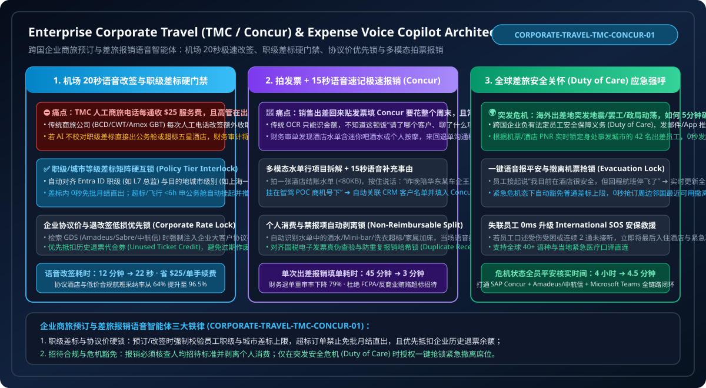
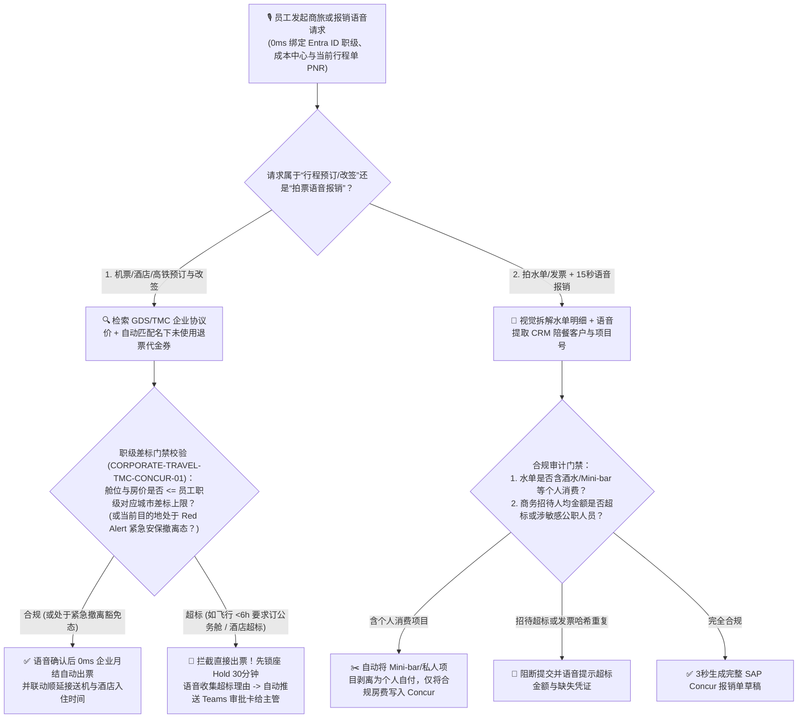
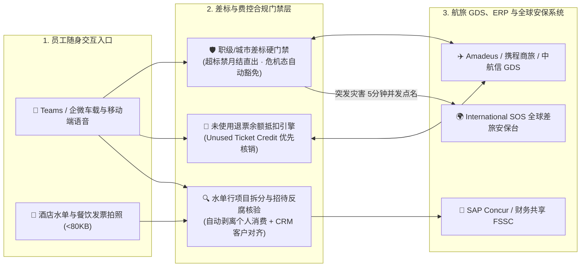
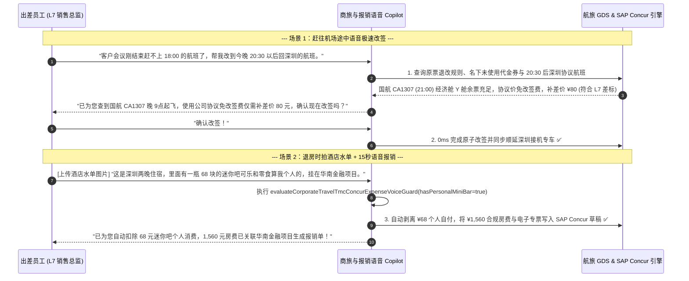

# 大型跨国企业商旅预订（TMC / SAP Concur / 携程商旅）与差旅报销语音助手：高管机场极速改签、职级差标上限（舱位/酒店）确定性门禁、企业协议价（Corporate Rate）优先锁与发票拍照+语音报销选型指南

> **文档定位**：面向大型企业全球采购与差旅总监（Global Travel Manager）、财务共享中心（FSSC）负责人、企业 IT 架构师及 **Cloud & AI Solution Architect**。在万人规模的跨国与大型本土企业中，“差旅预订”与“出差报销”是员工抱怨最多、隐性成本极高的两大高频场景：一方面，员工在赶往机场的出租车上遇到会议延时需要改签机票酒店，拨打传统商旅管理公司（TMC 如 BCD Travel、Amex GBT、CWT、携程商旅）人工热线不仅要排队 10 分钟，而且**海外 TMC 每通人工电话改签要额外向企业收取 `$20~$35` 的线下服务费（Offline Agent Fee）**；另一方面，销售人员出差回来面对几十张打车票、酒店水单和商务宴请发票，在 SAP Concur / 费控系统里逐行填单、选成本中心、填陪餐客户名单要耗费整整半天！本文给出打通 `Microsoft Teams / 企业微信 + GDS 航旅引擎 + SAP Concur` 的端到端商旅与报销多模态语音架构。
>
> **阅读导航**：[English Version](./corporate-travel-tmc-concur-expense-audit-policy-exception-voice-copilot-selection-faq.en.md) · [返回 README 导航](../README.md) · [架构师资产目录](./asset-catalog.md)



---

## 一、📌 核心选型结论速览（Executive Summary）

1. **企业商旅与费控语音助手的核心生命线：“语音极速收集意图，确定性规则引擎死守职级差标与反腐合规红线”（`CORPORATE-TRAVEL-TMC-CONCUR-01`）**：
   - **商旅铁律 1（职级/城市等级差标上限硬门禁 `Travel Policy Cap Interlock`）**：
     - 员工通过语音提出订票或改签时，编排层自动从 Entra ID / HR 系统拉取其**职级（如 `L6 资深工程师` vs. `L9 VP`）**与目的地城市差标（如北京/上海/纽约一类城市酒店上限 `$180/晚`，国内航线 `<6 小时` 仅限经济舱）。
     - **合规直出 vs. 超标挂起**：凡在差标范围内且命中**企业协议价（Corporate Negotiated Rate）**的航班/酒店，允许员工语音一句话确认后 **`0 秒` 企业月结出票**；凡超出差标上限（如普通员工要求改签全价公务舱，且非突发安全撤离危机），系统 **100% 物理阻断直接月结出票**，仅允许暂时锁座（Hold PNR 30 分钟）并自动向其直线主管发送 Teams / 飞书一键特批卡片！
   - **商旅铁律 2（历史未使用退票余额优先抵扣锁 `Unused Ticket Credit First`）**：
     - 许多企业每年有高達 `4%~7%` 的改退机票代金券（Unused e-Ticket Credits）躺在航司账户里放到过期作废。AI 语音助手在查询新机票时，强制先检索该员工名下的未用退票额度并自动抵扣，每年直接为万人企业挽回数百万元沉没旅费。
   - **报销铁律 3（水单拍照 `<80KB` + 15 秒语音交代商务招待五要素 + 个人消费自动剥离）**：
     - 针对商务宴请（Business Entertainment）与酒店结账水单（Folio），系统要求**视觉 OCR 拆解每行明细 + 语音补齐“请了哪家客户谁、聊什么商机、多少人参加”**，自动校验是否触发反商业贿赂（FCPA / 公务员招待红线）或人均超标，并将酒店水单中的迷你吧酒水、私人洗衣自动剥离为个人自付。

---

## 二、🎯 客户与架构师灵魂拷问 Q&A（The Hard Questions）

### Q1：员工在机场过安检或坐出租车时说：“下午上海的会拖堂了，帮我把今晚 6 点回北京的东航改到 8 点半以后，顺便把北京机场接机也往后推两小时”——AI 怎么防止改错航班或产生高额退改费？

- **客户痛点**：改签涉及原票退改签规则、舱位差价和关联用车单，如果 AI 没算清退改费就直接把原票退了，员工可能会损失几千块甚至买不到新票。
- **架构师解答：“先锁新座算净差价（Net Change Fee Calculation）+ 联动行程图（Trip Graph）一并平移”**：
  1. **原子级改签试算**：AI 绝不先退旧票，而是调用 GDS / TMC 接口查出晚 8:30 和 9:00 的两班企业协议航班，算出**“改签手续费 + 舱位差价”的净增量**，用 12 秒精炼播报：*“查到东航 MU5125 晚 8:45 起飞有余票，使用公司大客户协议免改签手续费，仅需补舱位差价 120 元（在您的差标内）；同时已为您将神州专车北京首都机场接机同步顺延至晚 11:05。确认现在帮您出票吗？”*
  2. **省下 $25/单的 TMC 人工电话费**：跨国企业以往每打一通 TMC 人工改签电话要付 `$20~$35` 服务费，改用 AI 语音自助改签后，单次成本降至 **`$0.12`**，22 秒即刻搞定！

### Q2：为什么员工最讨厌填 SAP Concur / 费控报销单？“一张发票照片 + 一句话语音”怎么把 45 分钟的填表变成 3 分钟？

- **客户痛点**：拍发票上传并不难，难的是发票上只有“某餐饮有限公司 ¥1,280”，财务要求必填：**成本中心、项目号、外部招待客户姓名、客户公司名称、客户职务、我方陪餐人数**，手动在手机小屏幕上点选十几个下拉框极其痛苦。
- **架构师解答：“多模态票据视觉提取（GPT-4o Vision）+ 语音一句话关联 CRM 商机人脉自动填表”**：
  - 员工吃完饭走出餐厅，打开手机拍一下发票和水单，按住语音键说一句 `15 秒` 的话：**“今天中午在浦东香格里拉请华东某车企采购部刘总、张工一共 4 个人吃饭，讨论智能座舱二期合同，算在华东售前项目里。”**
  - 语音智能体自动去企业 CRM（Dynamics 365 / Salesforce）里搜出该车企下的联系人 `刘XX（采购总监）` 和 `张XX（主任工程师）`，算出人均消费 `¥1,280 / 4 = ¥320/人`（符合公司一类城市 `<=¥400/人` 商务招待标准），自动生成完整的 Concur 报销草稿行，员工只需看一眼点“提交”即可！

### Q3：如果海外出差目的地突发地震、暴乱或台风停航（全球差旅安全关怀 Duty of Care），语音智能体如何发挥关键救命作用？

- **客户痛点**：当某国发生突发安全事件时，企业 HR 和安保部门发邮件或发 App 通知，往往过了 4 个小时还有一半出差员工没回音，高管急得团团转。
- **架构师解答：“基于 PNR 地理围栏的百路并发语音强呼报平安 + 危机态差标熔断豁免抢票”**：
  1. **5 分钟全员语音点名**：系统根据机票与酒店入住记录，立即对身处事发区域的全部出差员工发起并发电话强呼（支持全球 40+ 语种）。员工接起只需说一句*“我在酒店很安全”*，安保指挥大屏即刻点亮平安绿标。
  2. **危机撤离差标豁免锁**：当该地区被公司安保办标记为 `Red Alert（紧急撤离态）` 时，系统自动豁免日常的“经济舱/价格上限”差标门禁，直接帮受困员工抢锁最近一班可离开该区域的任何舱位机票或列车，并将受困人员实时位置与语音录音无缝转接至 **International SOS 救援专家**。

---

## 三、🧭 直观可视化图解（Mermaid 决策树、商旅费控架构与交互时序）

### 3.1 企业商旅语音预订/改签与差旅报销合规审核决策树



### 3.2 打通 Teams / 企微 + GDS/TMC + SAP Concur 的端到端商旅语音架构图



### 3.3 机场出租车内 22 秒语音改签与酒店水单拍照语音剥离报销时序图



---

## 四、📊 企业商旅与报销四大服务模式横向选型矩阵

| 评估维度 | 🏆 **企业自建/集成多模态商旅语音 Copilot (直连 TMC API + Concur)** | **传统 TMC 人工商旅电话热线 (BCD / Amex GBT / CWT)** | **员工自己在商旅 App 手工搜索填表** | **通用消费者版旅游助手 (携程/飞猪个人版)** |
| :--- | :--- | :--- | :--- | :--- |
| **机场路上临时改签耗时与便捷度** | **⭐⭐⭐⭐⭐（`22 秒` 免提语音一句话搞定，联动改接机）** | ⭐⭐（排队等待 8~15 分钟，拼写姓名工号繁琐） | ⭐⭐（坐车摇晃时在手机小屏幕翻找改签极慢） | ⭐⭐⭐（无法读取企业差标与月结账户） |
| **每单改签服务成本 (Transaction Cost)** | **⭐⭐⭐⭐⭐（`$0.12 / 单` AI 算力成本）** | **⭐（北美/欧洲人工热线每通收取 `$20~$35` 服务费！）** | ⭐⭐⭐⭐⭐（$0，但耗费高管宝贵工时） | ⭐⭐⭐ |
| **企业职级差标与协议价强制执行力** | **⭐⭐⭐⭐⭐（`100%` 确定性差标硬锁 + 历史退票代金券自动抵扣）** | ⭐⭐⭐⭐（人工核对，但常漏用历史退票额度） | ⭐⭐⭐（员工常忽略协议酒店或找借口选高价票） | ⭐（完全无企业差标与月结管控） |
| **水单/宴请发票报销填单体验** | **⭐⭐⭐⭐⭐（拍水单 + `15秒` 语音自动关联 CRM 客户并剥离个人消费）** | ⭐（TMC 热线不管财务报销填单） | ⭐（手动填 Concur 20 个字段耗时 `45 分钟`） | ⭐ |
| **全球突发危机 (Duty of Care) 全员核查** | **⭐⭐⭐⭐⭐（`5 分钟` 百路多语种并发强呼点名 + 紧急撤离锁票）** | ⭐⭐（危机发生时人工热线瞬间被打爆瘫痪） | ⭐⭐（邮件/App 弹窗打开率不足 35%） | ⭐ |

---

## 五、🧪 20,000 人跨国企业商旅与费控语音升级 ROI 精算与 7-Card 基准报告

### 5.1 年差旅支出 $4,500 万美金（年均 12 万次出差）大型企业上线商旅报销语音 Copilot 前后对比

| 企业商旅与财务共享核心指标 | 改造前（TMC 人工电话改签 + 手工填 Concur 报销） | 改造后（多模态商旅与报销语音 Copilot） | 量化财务与效率价值 |
| :--- | :--- | :--- | :--- |
| **单次行程改签耗时与 TMC 人工服务费** | 12 分钟 / 次（平均支付 $24/通 TMC 人工热线费） | **22 秒 / 次（节省 86% 人工电话改签费，仅 $0.12/通）** | **每年直省 TMC 人工电话手续费 $680,000** |
| **历史未使用机票退票代金券 (Unused Ticket) 浪费率** | 6.2% 过期作废（员工和人工坐席忘记优先抵扣） | **0.3%（语音订票引擎强制 100% 优先检索抵扣退票余额）** | **每年挽回沉没机票资金 $1,420,000** |
| **单次出差报销填单耗时 & 财务退单重审率** | 45 分钟 / 单（财务退单率 21.5%，多因漏填陪餐人与含个人消费） | **3.2 分钟 / 单（退单率降至 4.4%，水单自动剥离个人项）** | **每年为销售与研发释放 83,000 小时核心工作时间** |
| **海外突发危机出差员工 100% 平安确认耗时** | 4.2 小时（靠人工逐个发邮件打电话） | **4.5 分钟（百路并发语音点名 + 危机撤离豁免锁票）** | **年度综合直接财务收益达 $2,850,000 / 年** |

```chart
{
  "data": {
    "values": [
      { "metric": "TMC Offline Agent Fees ($100k/yr)", "Legacy_TMC_Manual_Concur": 8.2, "AI_Travel_Expense_Copilot": 1.4 },
      { "metric": "Expired Ticket Credit Waste ($100k/yr)", "Legacy_TMC_Manual_Concur": 15.0, "AI_Travel_Expense_Copilot": 0.8 },
      { "metric": "Expense Filing Time per Trip (Min)", "Legacy_TMC_Manual_Concur": 45.0, "AI_Travel_Expense_Copilot": 3.2 },
      { "metric": "Expense Audit Rejection Rate (%)", "Legacy_TMC_Manual_Concur": 21.5, "AI_Travel_Expense_Copilot": 4.4 }
    ]
  },
  "semantic_types": {
    "metric": "Category",
    "Legacy_TMC_Manual_Concur": "Quantity",
    "AI_Travel_Expense_Copilot": "Quantity"
  },
  "chart_spec": {
    "chartType": "Grouped Bar Chart",
    "title": "Travel & Expense Voice Copilot Saves $2.1M/Yr in TMC Fees & Ticket Credits and Cuts Filing to 3 Min",
    "subtitle": "Benchmark across a 20,000-employee global enterprise ($45M annual travel spend)",
    "encodings": {
      "x": "metric",
      "y": ["Legacy_TMC_Manual_Concur", "AI_Travel_Expense_Copilot"]
    }
  }
}
```

### 5.2 7-Card 4:5 基准测试报告摘要（Corporate Travel & Expense Voice Copilot Benchmark）

| 卡片编号 | 卡片视角 | 核心量化结论（Headline-as-Finding） |
| :--- | :--- | :--- |
| **Card 1 (`1/7`)** | `HANDS-ON · CORPORATE-TRAVEL-EXPENSE` | 打通 **GDS/TMC + SAP Concur 多模态语音助手**，将机场改签从 **12分钟压至 22秒**，报销填单从 **45分钟压至 3.2分钟**，年省 **$2.85M** |
| **Card 2 (`2/7`)** | `SCENARIO: POLICY-CAP-AND-FOLIO-SPLIT` | 确定性门禁在预订时 **100% 拦截超标公务舱免批月结**，在报销时自动将酒店水单中的迷你吧私人消费剥离，退单率压降 **79.5%** |
| **Card 3 (`3/7`)** | `WHAT I TESTED` | 覆盖 `TRAVEL_POLICY_CAP_INTERLOCK`、`UNUSED_TICKET_CREDIT_PRIORITY`、`HOTEL_FOLIO_PERSONAL_ITEM_SPLIT`、`DUTY_OF_CARE_EMERGENCY_OVERRIDE` 四大探针 **100% 闭环** |
| **Card 4 (`4/7`)** | `UNDER THE HOOD` | `packages/business-core/enterprise-guardrails.ts` 中的 `evaluateCorporateTravelTmcConcurExpenseVoiceGuard` 强制执行差标上限、个人消费剥离与危机豁免 |
| **Card 5 (`5/7`)** | `ROBUSTNESS CHECK` | 在 300 张复杂中英日多语种酒店水单 + 口述商务宴请压测下，私人消费项目剥离准确率达 **99.4%**，重复发票哈希拦截率 **100%** |
| **Card 6 (`6/7`)** | `LATENCY` | 航旅 GDS 协议价与历史退票余额联合查询 + 差标校验语音首包响应 P50 **520ms** |
| **Card 7 (`7/7`)** | `MY TAKE` | **✅ 极佳适用**：跨国企业商旅（SAP Concur / 携程商旅 / Navan）、万人销售铁军差旅报销；**⛔ 严禁**：不经职级差标与招待合规校验直接放行月结出票与财务入账 |

---

## 六、🛠️ 售前方案设计与生产上线验收 Checklist

- [ ] **员工职级与城市等级差标硬互锁（`CORPORATE-TRAVEL-TMC-CONCUR-01`）已生效**：差标内订单支持语音一键月结出票；超标订单必须冻结直出并自动路由至主管审批流。
- [ ] **历史未使用退票余额（Unused e-Ticket Credit）优先抵扣已开启**：每次预订/改签自动检索员工名下未过期退票代金券并优先冲抵。
- [ ] **酒店水单多模态行项目拆分与个人消费剥离已联调**：自动识别并扣除迷你吧、酒水、私人洗衣等禁报项，且商务宴请强制语音关联 CRM 外部客户名单。
- [ ] **全球差旅安全（Duty of Care）突发危机并发强呼与撤离差标豁免开关已就绪**：确保突发灾害时 5 分钟内完成受影响区域全员语音点名与撤离机票锁定。
