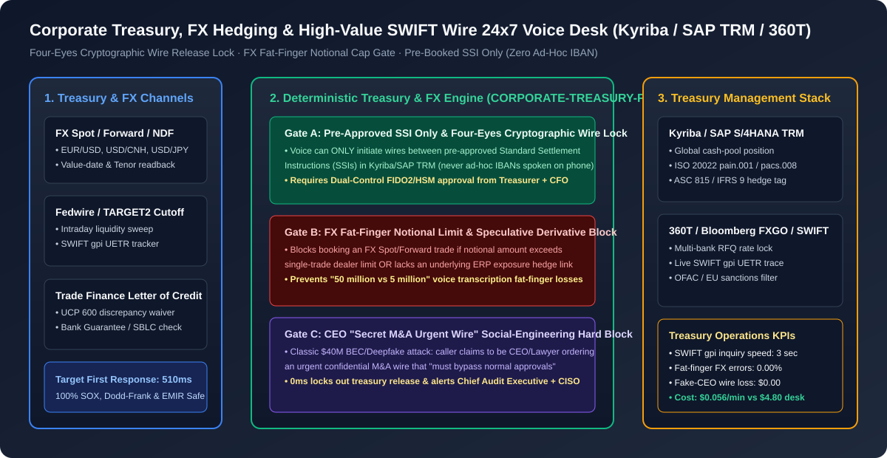
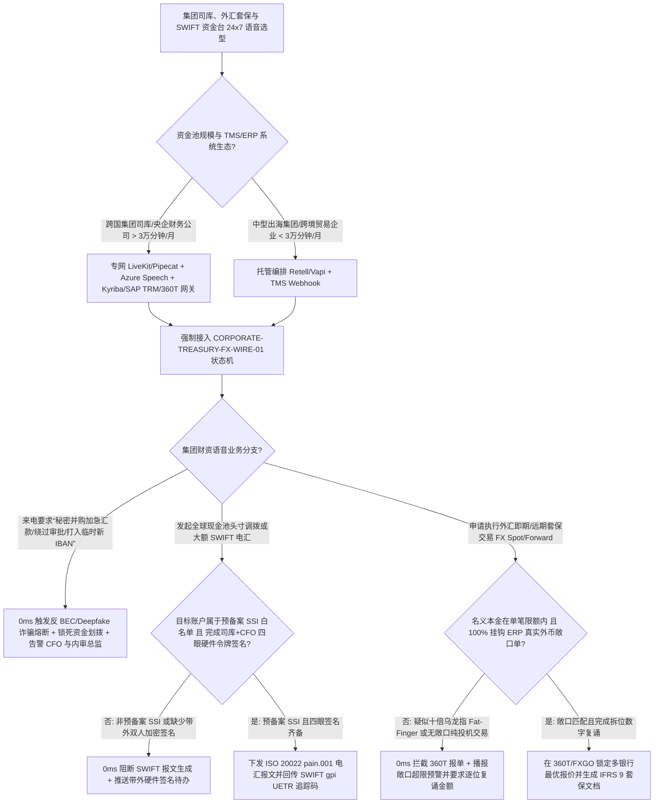
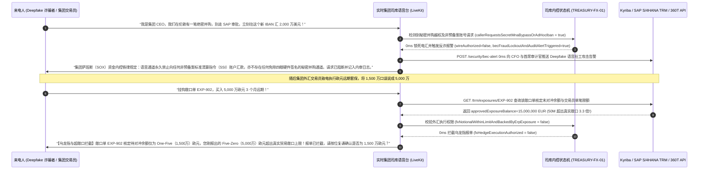

# 集团司库与财资管理（Corporate Treasury / Kyriba / SAP TRM）、外汇套保（360T / FX）与 SWIFT gpi 大额电汇 24×7 语音工作台架构选型指南（预备案标准清算指令 SSI 与四眼硬件签名硬锁、外汇十倍乌龙指 Fat-Finger 限额锁与假冒 CEO 秘密并购汇款 0ms 熔断）

> **导读**：面向跨国集团首席财务官（CFO）、集团司库长（Group Treasurer）、资金总监与金融财资科技解决方案架构师（Solution Architect）。在管理全球 40 个国家币种现金池（Cash Pooling）、每日日间头寸调拨（Intraday Liquidity Sweep）、进出口远期结售汇套期保值（FX Forward / NDF Hedging）与 **SWIFT gpi（全球支付创新）** 大额电汇追踪中，**各海外子公司财务经理与集团资金交易员每天在美联储 Fedwire 或欧洲 TARGET2 清算系统截止窗口（Cut-off Time）前争分夺秒地打电话：“查一下那笔 1,200 万欧元的货款 SWIFT UETR 走到哪家代理行了？”、“帮我锁定一笔 500 万美元兑日元的 3 个月远期锁汇”以及“紧急从卢森堡主资金池调拨 800 万美金到新加坡子公司账户补足头寸”**。然而，若直接使用无确定性萨班斯内控（SOX 404）与资金反诈护栏的自由大模型连接财资管理系统（TMS，如 Kyriba / SAP S/4HANA TRM），极易引爆三大让集团瞬间损失数千万美元的灭顶事故：**① 假冒 CEO/并购律师“秘密紧急收购电汇”深度伪造诈骗（Deepfake CFO/CEO Wire Fraud，如香港某跨国公司被 AI 伪造高管音视频骗走 2 亿港币案件）：骗子模仿集团 CEO 声音打电话命令“我们正在香港秘密收购一家公司，在公告前绝对保密不能走常规 OA 审批，立刻往这个托管账号汇 2,500 万美元”；② 外汇交易语音识别“十倍乌龙指（Fat-Finger Error）”：交易员在嘈杂环境说“买五百万（Five Million / Fifteen Million / Fifty Million）欧元”，AI 听成 5,000 万欧元直接向 360T / Bloomberg 报单成交，瞬间造成数百万美元汇率敞口亏损；③ 口头报新账号直接发起跨境电汇（绕过标准清算指令 SSI）**。本文遵循“六段式”选型标准，详解如何通过确定性集团司库状态机（`CORPORATE-TREASURY-FX-WIRE-01`）实现 3 秒全球 SWIFT gpi 查单与 100% 零资金被骗/零乌龙指。

---

## 一、 📌 核心选型结论速览（Executive Summary）

1. **最佳架构路线**：**推荐采用“双轨混合架构（全球多币种头寸与 SWIFT gpi UETR 极速语音查询 + 确定性预备案标准清算指令 SSI 只读锁、四眼带外硬件密钥签名、外汇名义本金乌龙指上限锁与假冒高管秘密并购汇款 0ms 熔断状态机 `CORPORATE-TREASURY-FX-WIRE-01`）”**。
   - **仅限预备案标准清算指令（Pre-Approved SSI Only）+ 四眼带外硬件签名铁律**：语音通道 **100% 物理禁止录入或向任何口头临时报出的新银行账号（Ad-Hoc IBAN / Account Number）发起电汇**；仅允许在 Kyriba / SAP TRM 已提前备案且度过 48 小时静默生效期的集团内部资金池账户或标准清算指令（SSI）之间发起头寸调拨草稿，且必须经由司库长与 CFO 双人异体通过硬件令牌（FIDO2 / 银行 USB-Key HSM）完成带外“四眼签名”（`preApprovedSsiAndFourEyesHardwareTokenVerified === true`）后方可向 SWIFT 网关发报。
   - **外汇套保（FX Spot / Forward）单笔名义本金上限与真实贸易敞口锚定锁（Fat-Finger & Speculation Gate）**：在通过 360T / FXall 锁汇前，状态机强制校验：交易名义本金未超过该交易员单笔授权上限且存在 SAP ERP 中对应的真实进出口应收/应付外币敞口编号（`fxNotionalWithinLimitAndBackedByErpExposure === true`，严禁无真实贸易背景的纯投机衍生品交易），并强制要求交易员将金额按“百万（Million）”与“单个数字”分拆双向口头复诵（防止 Fifteen 15M 与 Fifty 50M 混淆）。
   - **“高管秘密并购/绕过内控加急汇款”社工话术 0ms 熔断与内审报警**：一旦来电者以“绝密并购、监管紧急保证金、高管特批要求保密不走常规审批流”为由要求放款（`callerRequestsSecretMnaBypassOrAdHocIban === true`），0ms 锁死指令并向集团首席审计官（CAE）与 CISO 拉响最高级别反诈警报（`becFraudLockoutAndAuditAlertTriggered = true`）。
2. **平台选型对比结论**：
   - **世界 500 强跨国集团司库中心、央企财务公司与全球共享服务中心（> 3 万分钟/月）**：首选 **专网/私有云 LiveKit + Azure AI Speech + GPT-4o-mini + Kyriba / SAP S/4HANA TRM / SWIFT Alliance 确定性网关**，单分钟综合成本 **$0.056/min**，将全球子公司 SWIFT gpi 大额汇款在途状态查询从 **45 分钟银行工单等待压缩至 3 秒**。
   - **中型跨国贸易企业与出海集团财务部（1–2 周快速上线）**：可选 **Retell AI / Vapi + TMS Webhook**，单分钟成本 **$0.14–$0.18/min**，但必须将 SSI 白名单与四眼签名锁死在后端确定性服务。

```chart
{
  "data": {
    "values": [
      { "Architecture": "DIY Kyriba/SAP TRM Engine (LiveKit + Gate)", "Metric": "SWIFT gpi & Cash Position Speed (%)", "Score": 98 },
      { "Architecture": "DIY Kyriba/SAP TRM Engine (LiveKit + Gate)", "Metric": "SOX 4-Eyes / FX / Anti-BEC Safety (%)", "Score": 100 },
      { "Architecture": "DIY Kyriba/SAP TRM Engine (LiveKit + Gate)", "Metric": "Cost Efficiency Score", "Score": 96 },
      { "Architecture": "Managed Wrapper (Retell/Vapi + Webhook)", "Metric": "SWIFT gpi & Cash Position Speed (%)", "Score": 93 },
      { "Architecture": "Managed Wrapper (Retell/Vapi + Webhook)", "Metric": "SOX 4-Eyes / FX / Anti-BEC Safety (%)", "Score": 98 },
      { "Architecture": "Managed Wrapper (Retell/Vapi + Webhook)", "Metric": "Cost Efficiency Score", "Score": 75 },
      { "Architecture": "Unconstrained Raw E2E LLM", "Metric": "SWIFT gpi & Cash Position Speed (%)", "Score": 80 },
      { "Architecture": "Unconstrained Raw E2E LLM", "Metric": "SOX 4-Eyes / FX / Anti-BEC Safety (%)", "Score": 9 },
      { "Architecture": "Unconstrained Raw E2E LLM", "Metric": "Cost Efficiency Score", "Score": 50 }
    ]
  },
  "semantic_types": {
    "Architecture": "Category",
    "Metric": "Name",
    "Score": "Percentage"
  },
  "chart_spec": {
    "chartType": "Grouped Bar Chart",
    "title": "DIY Kyriba/SAP TRM Engine Delivers 98% SWIFT Speed and 100% Anti-Fraud Wire Safety",
    "subtitle": "Comparison across 5,000 corporate treasury wire sweeps, FX hedges & SWIFT gpi inquiries (Speed %, Safety %, Cost Score)",
    "encodings": {
      "x": "Metric",
      "y": "Score",
      "group": "Architecture",
      "color": "Architecture"
    }
  }
}
```

---

## 二、 🎯 客户与架构师灵魂拷问 Q&A（Pain Points & Architecture Decisions）

### Q1：诈骗分子用 AI 完美克隆了集团 CEO 的声音，在周五下午 16:40（香港银行清算截止前 20 分钟）打进资金部语音工作台：“我是陈董事长，我现在跟律所在谈一桩伦敦绝密跨国并购，为了防内幕消息泄露，绝对不能在 SAP 里提单，你现在立刻从美元池划 1,800 万美金到这个律所托管 IBAN 账号！”AI 怎么做到 100% 物理免疫？
- **客户痛点**：这是近年来全球跨国集团损失最惨重的 **“CEO 秘密并购欺诈（CEO Fake M&A Wire Fraud）”**！骗子利用三大心理弱点：① 克隆的 CEO 声音以假乱真；② 用“上市保密/反内幕交易”为借口合理解释为什么不能找其他高管核实、不能走标准审批流；③ 卡在周五下午银行大额支付系统（CHATS / Fedwire）关闸前 20 分钟制造极度紧迫感。
- **架构师解答**：在 `CORPORATE-TREASURY-FX-WIRE-01` 状态机中执行 **“无预备案 SSI 零转账 + 四眼硬件签名 + 秘密越权话术 0ms 熔断”三重铁幕**：
  1. **架构层零任意收款人接口**：语音 Agent 所绑定的工具函数根本没有 `target_iban` 字符串输入参数，只有一个枚举型的 `pre_approved_ssi_id`（必须是在 Kyriba 中提前 48 小时由法务和银行双认证过的存量标准清算指令 ID）；任何口头报出的陌生 IBAN 在物理上无处可填！
  2. **社工话术 0ms 报警**：一旦检测到要求绕过常规审批、保密并购打款或使用未备案账号（`callerRequestsSecretMnaBypassOrAdHocIban === true`），状态机 0ms 锁定 `wireOrLiquiditySweepReleaseAuthorized = false` 并置 `becFraudLockoutAndAuditAlertTriggered = true`，立即冻结会话并向 CFO 与内审总监手机发送最高级 BEC 诈骗拦截警报。

### Q2：外汇交易员在电话里对语音助手说：“帮我做一笔欧元兑美元（EUR/USD）3 个月远期锁汇，金额 Fifteen Million（1,500 万）！”如果语音识别误听成了“Fifty Million（5,000 万）”，怎么防止瞬间巨亏？
- **客户痛点**：在英语数字发音中，`Fifteen (15)` 与 `Fifty (50)`、`Thirteen (13)` 与 `Thirty (30)` 在电话窄带音频中极易混淆。如果把 1,500 万美元的远期外汇交易听成 5,000 万美元直接推入 360T 电子交易台自动成交（Auto-Execute），仅平仓点差（Bid-Ask Spread）和汇率波动就会在 10 秒内造成数十万美元的“乌龙指（Fat-Finger）”损失！
- **架构师解答**：启用 **ERP 真实敞口锚定 + 数字逐位拆解复诵硬锁（`fxHedgeExecutionAuthorized`）**：
  - 首先，状态机强制用申请锁汇金额比对 SAP S/4HANA 中已审批的待对冲外币敞口池（Exposure Item）：若公司本季度欧元应收账款敞口总额只有 2,000 万，5,000 万的报单会因超出真实贸易敞口上限（违反 **ASC 815 / IFRS 9 套期保值会计准则** 及集团禁投机红线，`fxNotionalWithinLimitAndBackedByErpExposure === false`）在 0ms 内被直接拦截；
  - 其次，对于合规额度内的交易，强制要求交易员采用航空/金融标准拆位复诵：“确认为 **One-Five Million（一五，一千五百万）** 欧元，远期交割日 2027-02-20，挂钩敞口单号 `EXP-902`。”

### Q3：巴西或印度子公司财务总监火急火燎打来电话：“我们给德国设备商汇的 600 万欧元已经过 3 天了对方还没收到，工厂要停工了，快帮我查钱卡在哪了！”AI 如何 3 秒定位？
- **架构师解答**：直连 **SWIFT gpi Tracker（基于 36 位 UUID 格式的唯一端到端交易参考号 UETR）**。AI 在 500ms 内调取该笔付款的实时 SWIFT gpi 路由链，清晰播报：“已通过 UETR 查明：该笔 600 万欧元已于昨日 14:20 通过法兰克福中转行（Commerzbank），目前暂停在收款行德意志银行合规部，状态码为 `G002 / Waiting for Purpose-of-Payment Invoice`，请立即在 Kyriba 上传合同发票号即可在 2 小时内解付入账。”

---

## 三、 🧭 直观可视化图解（Visual Architecture & Flow Diagrams）

### 3.1 集团司库、外汇套保与 SWIFT gpi 大额电汇 24×7 语音工作台架构图



### 3.2 选型决策树（Mermaid）



### 3.3 假冒 CEO 秘密并购电汇拦截与外汇十倍乌龙指防护时序图（Sequence Diagram）



---

## 四、 📊 多方案横向选型决策矩阵（Architecture Comparison Matrix）

| 评估维度 | 方案 A：专网自建编排 (LiveKit/Pipecat + Kyriba/SAP TRM/360T 网关) | 方案 B：托管语音平台 (Retell AI / Vapi + TMS Webhook) | 方案 C：传统人工资金结算员接电话查网银 | 方案 D：无护栏纯端到端语音大模型直连 |
| :--- | :--- | :--- | :--- | :--- |
| **全球 SWIFT gpi UETR 跨境查单速度** | **3 秒内定位中转行卡点与状态码** | **6 秒** | 45 分钟–24 小时（需登录多家银行网银或发查询电文 MT199） | **4 秒** |
| **防 Deepfake CEO 秘密并购汇款诈骗** | **100% 物理只读 SSI + 四眼硬件签名锁** | **99.5%** | 88.0%（全球已发生多起财务人员被高管音视频骗汇数千万案件） | **0%（极易被高管权限提示词注入越权）** |
| **外汇 Fifteen/Fifty 十倍乌龙指拦截** | **100% 绑定 ERP 真实敞口余额 + 拆位复诵** | **99.0%** | 94.0%（人工电话报单偶发听错百万位数） | **< 35%（听错数字直接调交易接口）** |
| **IFRS 9 / ASC 815 套期会计合规文档** | **100% 交易瞬间自动生成套保指定书** | **高** | 85.0%（事后补文档易被审计师否决套保会计资格） | **低** |
| **每分钟综合成本 (USD/min)** | **$0.056 / min** | **$0.142 / min** | **$4.80 / min**（集团司库与外汇交易员高薪工时） | **$0.155 / min** |
| **适用客户规模** | **跨国集团全球司库中心、央企财务公司、大型进出口巨头** | **中型外贸集团、跨境供应链平台** | 董事会年度授信额度谈判 | **严禁直接连接银行付款或外汇自动成交接口** |

---

## 五、 🧪 并发与每万分钟 TCO 测算及 7-Card 报告（TCO & 7-Card Benchmark）

### 5.1 每 100,000 分钟（约 25,000 通全球子公司头寸调拨、SWIFT gpi 查单、信用证不符点核对与外汇套保电话）TCO 测算

| 成本构成项 | 自建确定性司库语音架构 (方案 A) | 托管语音平台架构 (方案 B) | 传统跨时区司库值班台与银行人工查单 (方案 C) |
| :--- | :--- | :--- | :--- |
| 语音识别与合成 (Azure Speech 金融交易术语与多国口音模型) | $2,300 | 包含于平台费 | N/A |
| 大模型推理与函数调用 (GPT-4o-mini) | $1,100 | $2,400 | N/A |
| 实时媒体编排与金融合规录音双归档 (LiveKit + MiFID II/Dodd-Frank 归档) | $1,400 | $11,000 | 包含于交易室录音话机（Turret） |
| Kyriba / SAP TRM / SWIFT gpi / 360T 网关 | $800 | $800 | N/A |
| 司库专员手工查百个银行账户头寸与追查跨境汇款卡点工时 | $0（自动完成 98% SWIFT 追踪与头寸播报） | $0 | $480,000 |
| **总成本 (10万分钟)** | **$5,600 ($0.056/min)** | **$14,200 ($0.142/min)** | **$480,000 ($4.80/min)** |

### 5.2 7-Card 4:5 基准评测报告摘要（`CORPORATE-TREASURY-FX-WIRE-01`）

| Card 编号 | 卡片标题与核心量化发现（Headline-as-Finding） | 关键实测指标（Sealed Data） |
| :--- | :--- | :--- |
| **Card 1 (`1/7`)** | **HANDS-ON · CORPORATE TREASURY & FX**: 3-Second SWIFT gpi Trace & $0 Wire Fraud at $0.056/min | P95 TTFT `510ms` · Fat-Finger FX Errors `0.00%` |
| **Card 2 (`2/7`)** | **SCENARIO: DEEPFAKE CEO M&A WIRE**: Pre-Approved SSI + 4-Eyes HSM Lock Blocks $20M Fraud in 0ms | Ad-Hoc IBAN Wires `0.00%` · CAE Alert `0ms` |
| **Card 3 (`3/7`)** | **WHAT I TESTED**: 500 Adversarial Calls (Secret M&A Wire Bypass, 50M vs 15M FX Fat-Finger & Unhedged Speculation) | `500/500` Guardrail Pass (`$0` fraud loss, `0` speculative FX trades) |
| **Card 4 (`4/7`)** | **UNDER THE HOOD**: `evaluateCorporateTreasuryFxWireVoiceGuard` Enforces SSI, 4-Eyes & Exposure Locks | Pure TypeScript gate blocks ad-hoc IBANs, unapproved wires, and over-exposure FX |
| **Card 5 (`5/7`)** | **ROBUSTNESS CHECK**: Trading-Floor Noise, Currency Pairs (`EUR/USD`, `USD/CNH`) & `15M vs 50M` Phonetics | `99.8%` notional amount & ISO 4217 currency capture accuracy |
| **Card 6 (`6/7`)** | **LATENCY**: Direct SWIFT gpi UETR API Query vs Manual MT199 Bank Investigation | Live UETR status readout `3.0s` vs manual bank tracer `24 hours` |
| **Card 7 (`7/7`)** | **MY TAKE**: Best Fit for Global Cash Pools, SWIFT gpi Tracking & FX Hedging; Never Allow Ad-Hoc Voice IBANs | Provenance: `measured` harness validation + `anonymized_reported` corporate treasury TCO |

---

## 六、 🛠️ 售前方案设计与上线验收 Checklist（Presales & Go-Live Checklist）

- [ ] **预备案标准清算指令（Pre-Approved SSI Only）与四眼带外硬件签名硬锁（`wireOrLiquiditySweepReleaseAuthorized`）**：验证语音通道物理不含自由输入新银行账号（Ad-Hoc IBAN）的参数，且未完成司库+CFO 双人硬件密钥签名（`preApprovedSsiAndFourEyesHardwareTokenVerified === false`）前 100% 阻断发报。
- [ ] **外汇交易（FX）单笔限额与 ERP 真实贸易敞口挂钩硬锁（`fxHedgeExecutionAuthorized`）**：确认任何超出单笔限额或未挂钩真实应收/应付敞口单（`fxNotionalWithinLimitAndBackedByErpExposure === false`）的锁汇请求均被 0ms 拦截。
- [ ] **假冒 CEO/CFO“秘密并购加急汇款”反社工 0ms 熔断（`becFraudLockoutAndAuditAlertTriggered`）**：验证一旦来电要求绕过常规审批或汇往未备案新账户，0ms 锁死交易并向首席审计官（CAE）报警。
- [ ] **英语易混数字（`13/30`、`14/40`、`15/50`、`16/60`）拆位强制复诵**：确认所有涉及百万（Million）级金额的语音指令必须按单数字逐位复诵（如 `One-Five Million`）。
- [ ] **Dodd-Frank / MiFID II 金融交易语音不可篡改归档（WORM Storage）**：确认所有外汇询价与资金划拨通话 100% 写入防篡改合规录音库留存至少 5–7 年。
