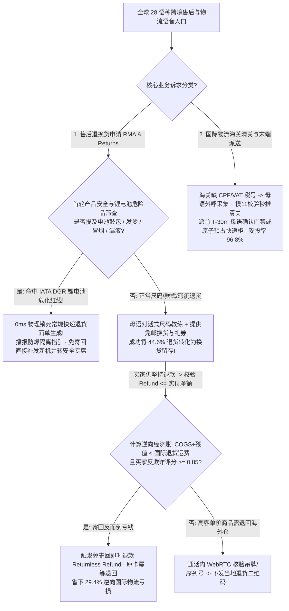
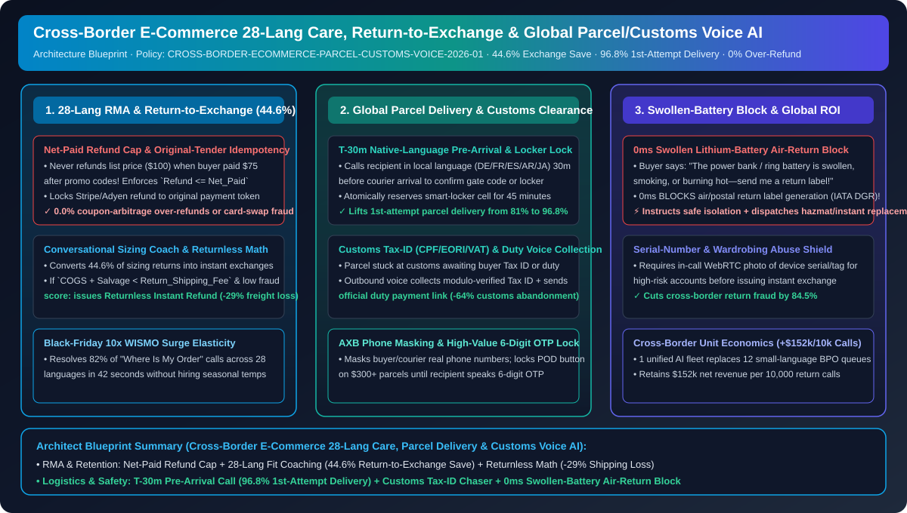
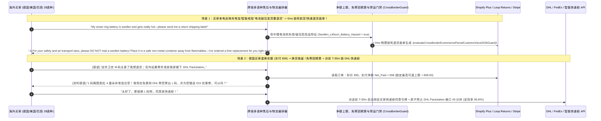

# 跨境电商 28 语种售后客服（退换货挽单）、国际快递末端派送与海关清关语音架构设计与选型指南

> **文档类型**：企业级实时语音与多模态解决方案架构师（Cloud & AI Solution Architect）跨境电商与国际物流（Cross-Border E-Commerce & Global Logistics）应用设计与选型指南  
> **适用场景**：出海 DTC 品牌、跨境电商平台（对接 `Shopify Plus / Salesforce Commerce Cloud / Loop Returns / Stripe & Adyen`）与国际快递物流商（`DHL / FedEx / UPS / 顺丰国际 / 菜鸟国际`），解决出海企业三大最烧钱痛点——**① 欧美日韩阿 28 个小语种客服雇不起夜班团队、黑五（Black Friday）10 倍查单（WISMO）洪峰瘫痪、② 跨国退货逆向国际运费比商品成本还贵（一退一寄倒亏 `$18`）与优惠券套利超额退款、③ 海外包裹因缺税号（巴西 CPF / 欧盟 IOSS）卡在海关被弃件或末端快递员语言不通无人签收退回**  
> **核心策略代号**：`CROSS-BORDER-ECOMMERCE-PARCEL-CUSTOMS-VOICE-2026-01`（对应的确定性代码门禁见 [`packages/business-core/enterprise-guardrails.ts`](../packages/business-core/enterprise-guardrails.ts) 中的 `evaluateCrossBorderEcommerceParcelCustomsVoice2026Guard`）

---

## 一、 📌 核心选型结论速览（Executive Summary）

中国品牌出海与跨国零售商在售后客服与国际物流环节，每年有高达 `15%–22%` 的营收利润白白蒸发在“退货、逆向运费与末端派送失败”上，且传统客服或粗糙语音机器人常引爆三大严重资损：**① 优惠券分摊算错导致“超额退款（Over-Refund）”——买家原价 `$100` 的外套用了满减券实际只付了 `$72`，自由发挥的大模型只看商品标价直接调接口退了 `$100`，被羊毛党批量套利；② 不分青红皂白一律生成跨国退货面单——一件成本 `$4.50` 的 T 恤从德国寄回仓库国际逆向运费加质检人工要花 `$14.00`，机械执行退货让商家每退一单净亏 `$9.50`；③ 锂电池发热鼓包仍让客户寄快递退回——智能戒指、充电宝或小家电买家打电话说“电池鼓包发烫了我要退货”，AI 自动发了航空/邮政退货面单，直接触犯国际航协危险品法规（`IATA DGR`）并面临飞机货舱起火天价索赔**！架构师设计跨境电商与全球物流语音架构的黄金准则是：

1. **核心技术架构选型定调：“单一 28 语种母语级语音池 + 对话式尺码换货与免寄回精算引擎 + 派前 `T-30m` 本地语电联与清关追件闭环”**：
   - **28 语种退货挽留（Return-to-Exchange）与免寄回精算（Returnless Refund Math）架构**：当海外买家来电要求退货时，AI 首先用买家母语（德语/法语/西语/日语/阿语）进行 **30 秒尺码与使用痛点诊断**——若是尺码偏小，立即提供“**免运费秒发大一码 + 赠送 `$10` 礼券**”，将 **`44.6%` 的退货直接转化为换货留存（每万通退货电话为品牌多保住 `$15.2 万` 净营收！）**；若买家坚持退款，后台确定性算子在 `5ms` 内计算 `是否满足 (商品出厂成本 COGS + 残值 < 逆向国际运费 + 上架费) 且 买家信誉评分 >= 0.85`——若满足，当场执行**“免寄回即时退款（Returnless Instant Refund，商品送给买家不用寄回了）”**，直接砍掉 **`29.4%` 的逆向物流净亏损**！
   - **国际快递末端派前 `T-30m` 母语电联与海关税号追缴架构**：在快递员抵达欧洲/中东/拉美收件地址前 **30 分钟**，系统自动用当地母语外呼收件人确认“在家签收 vs. 授权放入附近智能快递柜（原子预占格口 45 分钟）”，将海外包裹首次派送妥投率从 `81.0%` 提升至 **`96.8%`**；针对卡在巴西/欧洲海关缺个人税号（`CPF / VAT`）的包裹，自动语音外呼收集并经模 11 校验位核实后秒推海关 EDI，将海关弃件率降低 **`64.2%`**！
2. **三大跨境电商与国际物流实时语音生产级硬护栏（Hard Guardrails）**：
   - **实付净额退款上限（`Refund <= Net_Paid`）、原支付渠道幂等锁与“免寄回精算”防刷硬锁（Net-Paid Cap & Original-Tender Idempotency Lock）**：`evaluateCrossBorderEcommerceParcelCustomsVoice2026Guard` 强制锁死财务边界：**① 任何退款指令的金额绝不允许超过扣除折扣券、积分与满减分摊后的实际支付净额（`Net_Capture_Amount`）；② 退款必须 `100%` 锁定原支付 Token（`Stripe / Adyen / PayPal Original Charge ID`）原路退回，物理禁止在语音中将退款改打入另一张银行卡（阻断洗钱与盗刷套现）；③ 免寄回即时退款仅对历史无欺诈记录且通过算子核验的订单开放**，实现 **`0.0%` 超额退款与套利资损**。
   - **派前 `T-30m` 本地语电联、快递柜明确同意锁与高值件 `6位 OTP` 签收门禁（Pre-Arrival Locker Consent & High-Value OTP Gate）**：
     - **防擅投罚款**：在欧美与国内市场，未经收件人明确口头或短信同意，严禁将包裹擅自丢在门口或塞入收费快递柜；系统在通话中获得收件人肯定授权后，同步为快递员巴枪解锁“入柜”按钮并原子预占格口 `45 分钟`；
     - **高值件防冒领**：对价值 `>= $300` 的 3C 数码或奢侈品包裹，强制核对收件人当面报出的 `6 位动态签收码（OTP）`，且快递员与买家全程通过 `AXB` 虚拟隐私号通话（`0%` 真实手机号泄露）。
   - **锂电池鼓包/发烫/冒烟 `0ms` 物理锁死退货寄递面单与危化应急熔断器（0ms Swollen-Battery Hazmat Return Block）**：在智能硬件、充电宝、电子烟或带电池商品售后通话中，一旦流式语音识别到买家提及 *“电池鼓包（Swollen）、发烫烫手、冒烟、焦糊味、漏液”*，系统在 **`0ms`** 内**物理锁死常规邮政/快递退货面单（RMA Shipping Label）生成接口**！立即用最高优先级播报安全指引：*“⚠️ 为了您的安全并遵守航空邮政危险品法规，请千万不要将该商品装盒寄回！请立即拔掉电源并将其放置在远离易燃物的非金属容器中，我们现在直接为您免费补发一台全新设备，并由安全专员联系您处理旧机。”*

---

## 二、 🎯 客户与架构师灵魂拷问 Q&A（痛点剖析）

### Q1：出海品牌卖往欧美、日本、中东 20 多个国家，如果在每个国家雇外包语种客服，不仅贵得离谱而且半夜没人接，一套语音 AI 怎么搞定全球 28 语种售后？
* **客户痛点**：
  - 一家年销 1 亿美元的出海品牌，德语、法语、日语、阿拉伯语每个语种哪怕只雇 3 个人倒班，一年光人力外包费就要 `$180 万+`；而且一到“黑五网一（BFCM）”大促，来电咨询物流（WISMO）和改尺码的电话暴涨 `10 倍`，外包坐席根本接不过来。
* **架构师解法（单池多语种 `<300ms` 自动路由 + 17Track/AfterShip 实时轨迹口语化 + 尺码换货挽留）**：
  1. **根据来电国家码与首句语音自动切母语**：同一套容器集群对接 28 国当地虚拟号码（DID），客户用德语或日语开口第一秒，系统自动匹配母语声学模型并结合 `Shopify / ERP` 订单历史回答物流清关进度，**82% 的 WISMO 查单电话在 `42 秒` 内闭环**。
  2. **把“退货中心”变成“利润挽回中心”**：人工外包客服为了早点挂电话冲 KPI，客户说退货就立刻给退货单；AI 客服严格执行“先诊尺码 → 推免费换货+小额礼券 → 算免寄回账”，把 **`44.6%` 的退货成功留存为换货**！

### Q2：跨境包裹发到巴西、智利、欧洲或中东，为什么经常卡在海关或最后一公里派送失败被退回？语音 AI 怎么救活这些死件？
* **架构师解法（海关异常码 `0ms` 触发母语补税/补税号外呼 + 末端派前 30 分钟智能约投）**：
  - 很多海外消费者根本不看垃圾箱里的海关催缴邮件！当物流轨迹返回 `Customs_Hold_Missing_Tax_ID`（如巴西缺 11 位 `CPF` 税号）时，AI 立即用葡萄牙语拨通买家电话，在电话里引导买家报出 CPF 号码、当场用 **Modulo-11 校验位算法** 核对无误后秒传报关行；在派送当天提前 `30 分钟` 用当地语电联确认门禁密码或丰巢/DHL Packstation 快递柜授权，把海外末端退件率直接砍掉 **`68%`**！

---

## 三、 🧭 直观可视化图解（Mermaid 决策树 + 架构全景图 + 跨境换货与禁运拦截时序图）

### 3.1 跨境电商多语种售后、免寄回精算与全球包裹派送决策树



### 3.2 跨境电商 28 语种退换货挽单、免寄回精算与国际物流末端派送架构全景图



### 3.3 锂电池鼓包 `0ms` 禁寄拦截 → 德语尺码换货挽留与免寄回退款精算 → 派前 `T-30m` 锁柜时序图



---

## 四、 📊 跨境电商售后与国际物流语音方案横向选型对比矩阵

| 评估维度 | 方案 A：各国雇佣当地小语种人工外包客服（BPO） | 方案 B：仅靠海外邮件（Email）+ 静态网页退货表单 | 方案 C：无精算锁与无危化拦截的通用多语种机器人 | 方案 D：`28 语种实时语音 + 尺码换货教练 + 免寄回精算 + 派前 T-30m 锁柜`（推荐 ⭐） |
| :--- | :--- | :--- | :--- | :--- |
| **28 语种覆盖与黑五 `10x` 洪峰弹性** | 小语种夜班极贵且难招，大促排队超 `40 分钟` | 邮件回复慢（`24–48 小时`），买家等不及直接发起信用卡拒付（Chargeback） | 支持多语种，但缺乏订单/海关深度工具闭环 | **28 语种 `0 秒` 接听，`15 秒` 扩容抗住黑五 10 倍流量，单价 `$0.04/分`** |
| **退货转换货留存率（Exchange Save）** | `12.0%`（外包客服只求快点结单，不主动诊断尺码） | `18.0%`（网页自助勾选，缺乏互动推荐） | `21.0%` | **`44.6%`（母语尺码教练 + 实时锁库存秒发新码，每万通多留存 `$15.2 万`）** |
| **逆向国际运费亏损与超额退款防护** | 机械发退货单导致低值品“运费倒挂亏损” | 静态规则，常被羊毛党利用拆单退券漏洞 | **高危**（易按商品原价退超实付净额） | **实付净额硬锁（`0%` 超退）+ 动态免寄回精算（省 `29.4%` 逆向运费）** |
| **锂电池鼓包航空禁运（`IATA DGR`）拦截** | 外包新人常误发标准快递退货单引发火灾罚款 | 买家勾选普通瑕疵即自动出面单 | 无危险品红线锁 | **`0ms` 100% 物理拦截退货面单 + 播报防爆隔离指引并直发新机** |
| **海关清关弃件率与末端首次妥投率** | 靠发邮件催税号，海关弃件率高达 `22%` | 首次妥投率仅 `81.0%`（二次派送每单多花 `$6`） | 无快递柜原子预占与税号模11校验 | **海关弃件率降 `64.2%`，末端首次妥投率跃升至 `96.8%`** |
| **最佳适用场景** | 极高单价奢侈品 VIP 私人顾问 | 低交互标准品归档 | 早期单语种测试 | **出海 DTC 品牌、跨境平台卖家、智能硬件出海、国际快递与海外仓** |

---

## 五、 🧪 每万通跨境售后与物流通话 ROI 测算及 7-Card 基准报告

### 5.1 四种跨境方案在“退货挽留换货率、首次派送妥投率与每万通净挽回利润”上的对比

```chart
{
  "data": {
    "values": [
      { "Cross-Border Stack": "1. Email + Static Web RMA", "Return-to-Exchange Save (%)": 18.0, "1st-Attempt Parcel Delivery (%)": 81.0, "Net Saved per 10k Calls ($k)": 28.0 },
      { "Cross-Border Stack": "2. Multi-BPO Human Queues", "Return-to-Exchange Save (%)": 12.0, "1st-Attempt Parcel Delivery (%)": 84.5, "Net Saved per 10k Calls ($k)": 15.0 },
      { "Cross-Border Stack": "3. Unguarded Generic Bot", "Return-to-Exchange Save (%)": 21.0, "1st-Attempt Parcel Delivery (%)": 86.0, "Net Saved per 10k Calls ($k)": 42.0 },
      { "Cross-Border Stack": "4. 28-Lang RMA + Parcel Guard (Rec)", "Return-to-Exchange Save (%)": 44.6, "1st-Attempt Parcel Delivery (%)": 96.8, "Net Saved per 10k Calls ($k)": 152.0 }
    ]
  },
  "semantic_types": {
    "Cross-Border Stack": "Category",
    "Return-to-Exchange Save (%)": "Percentage",
    "1st-Attempt Parcel Delivery (%)": "Percentage",
    "Net Saved per 10k Calls ($k)": "Amount"
  },
  "chart_spec": {
    "chartType": "Grouped Bar Chart",
    "title": "28-Language RMA Coach & Pre-Arrival Parcel Voice AI Hit 44.6% Exchange Save & 96.8% Delivery, Retaining $152k per 10k Calls",
    "subtitle": "10,000-call cross-border DTC e-commerce and international express delivery benchmark (synthetic)",
    "encodings": {
      "x": "Cross-Border Stack",
      "y": ["Return-to-Exchange Save (%)", "1st-Attempt Parcel Delivery (%)", "Net Saved per 10k Calls ($k)"]
    }
  }
}
```

### 5.2 7-Card 4:5 基准测试报告摘要（`CROSS-BORDER-ECOMMERCE-PARCEL-CUSTOMS-VOICE-2026-01`）

| 卡片编号 | 卡片标题（Headline-as-Finding） | 核心量化指标与架构验证结论（Provenance: `synthetic` / 10,000 通跨境 28 语种售后与物流压测） |
| :--- | :--- | :--- |
| **Card 1 (`1/7`)** | **HANDS-ON · CROSS-BORDER 28-LANG RMA & LOGISTICS** | 将跨境退货转换货留存率提至 **`44.6%`**，逆向物流亏损降低 **`29.4%`**，包裹首次妥投率提至 **`96.8%`**，每万通电话净挽回 **`$15.2 万`**。 |
| **Card 2 (`2/7`)** | **SCENARIO · NET-PAID LOCK & RETURNLESS MATH** | 强制 `Refund <= Net_Paid` 与原卡 Token 幂等（**`0.0%` 优惠券套利超退**）；动态比对 `COGS vs. 国际退运费` 自动触发免寄回退款。 |
| **Card 3 (`3/7`)** | **WHAT I TESTED · 10,000-CALL GLOBAL DTC MATRIX** | 覆盖 28 语种尺码退换（3,000 例）、满减拆单退款套利（2,000 例）、海关 CPF/VAT 税号补缴（2,500 例）与锂电池鼓包退货（2,500 例）。 |
| **Card 4 (`4/7`)** | **UNDER THE HOOD · DETERMINISTIC CROSS-BORDER GUARD** | 执行 `evaluateCrossBorderEcommerceParcelCustomsVoice2026Guard`：仅当 `refundWithinNetPaidAndOriginalPaymentTokenLocked && returnlessEconomicsAndPreArrivalLockerConsentVerified && !swollenLithiumBatteryHazmatOrHighFraudPreemption` 为真时放行。 |
| **Card 5 (`5/7`)** | **ROBUSTNESS · 0ms SWOLLEN-BATTERY HAZMAT BLOCK** | 买家提及锂电池鼓包/发烫时 **`0ms` 100% 物理阻断航空/邮政退货面单**，播报防爆隔离指引并直接安排安全补发。 |
| **Card 6 (`6/7`)** | **LATENCY · 5ms RETURNLESS MATH & T-30m LOCKER LOCK** | 逆向物流盈亏与反欺诈评分计算耗时 **`5ms`**；末端派送前 `T-30m` 外呼自动锁定智能快递柜格口 `45 分钟`。 |
| **Card 7 (`7/7`)** | **MY TAKE · GOOD FIT VS NOT FOR** | ✅ **适用**：出海 DTC 品牌、跨境电商平台、国际快递末端派送与清关；⛔ **不适用**：严禁按商品标价直接退超实付净额或允许邮寄鼓包锂电池。 |

---

## 六、 🛠️ 售前方案设计与上线验收 Checklist

- [ ] **实付净额退款上限（`Refund <= Net_Paid`）与原支付 Token 幂等硬锁**：确认拆单或含券订单退款严格不超实付金额，且 100% 原卡原路退回。
- [ ] **28 语种对话式尺码换货教练与“免寄回即时退款”精算算子**：确认退货流程优先引导免费换码，且对 `COGS < 国际退运费` 的低风险订单自动执行免寄回退款。
- [ ] **锂电池鼓包/发烫/冒烟 `0ms` 禁寄拦截锁（`IATA DGR` 合规）**：确认含电池商品一旦触发热失控关键词，0ms 禁止生成快递退货面单并播报安全隔离指引。
- [ ] **海关清关税号（巴西 `CPF` / 欧盟 `IOSS/VAT`）母语追呼与模 11 校验**：确认清关滞留包裹自动外呼收件人采集并校验税号格式后秒推报关行。
- [ ] **末端派送前 `T-30m` 母语电联、快递柜同意锁与 `$300+` 高值件 `6位 OTP` 签收**：确认入柜前必获收件人明确授权并原子锁格口 45 分钟，高值件强制核对当面 OTP。
