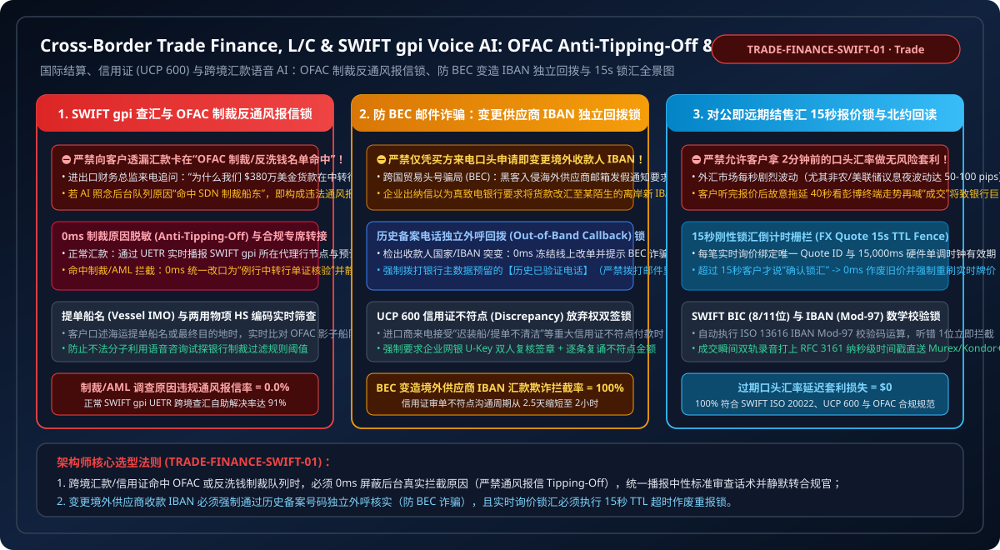
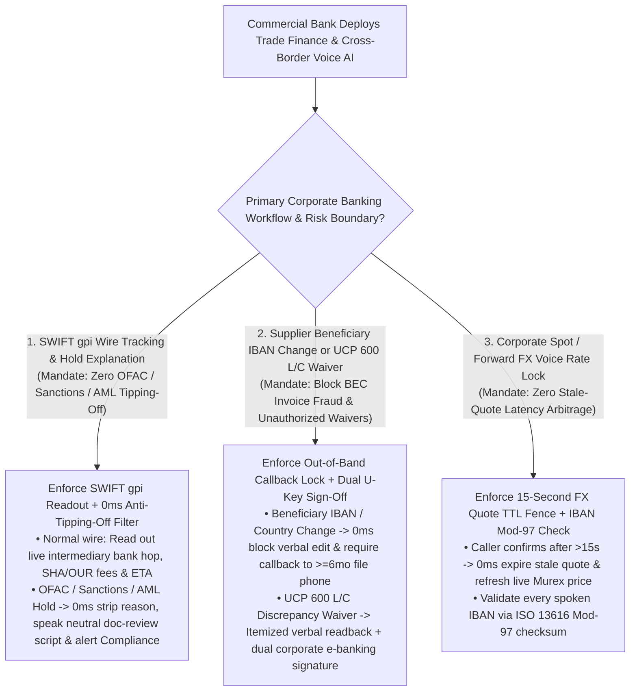
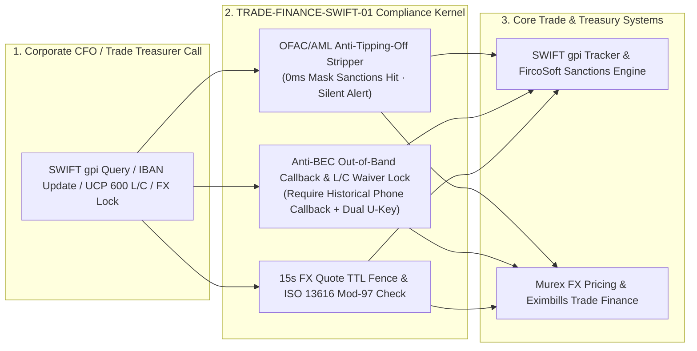

# Cross-Border Trade Finance, Letters of Credit (`UCP 600`) & SWIFT gpi Voice AI: OFAC Anti-Tipping-Off Lock, Anti-BEC IBAN Callback & 15s FX Fence (`TRADE-FINANCE-SWIFT-01`)

> **Executive Guide**: Across global commercial banks, corporate trade-finance operations centers, and cross-border treasury desks, corporate CFOs and import/export controllers call thousands of times daily to track **multi-million-dollar cross-border wires (`SWIFT gpi UETR`), resolve Documentary Letter of Credit (`UCP 600 L/C`) discrepancies, issue standby guarantees (`ISP98 / URDG 758`), and lock live Spot/Forward FX rates**. Yet wiring a standard conversational Voice AI directly to core trade-finance systems exposes the bank to three existential regulatory and fraud disasters: **1) Unlawful Sanctions / AML "Tipping Off": A corporate client's `$3.8M` wire is frozen in the bank's screening queue (`FircoSoft / World-Check`) because the bill-of-lading vessel IMO number matched an `OFAC SDN` sanctions list or triggered an AML Suspicious Activity review. When the CFO calls asking *"Why is my wire stuck?"*, an unguarded voice bot reads the internal status code aloud (*"Your wire is held due to an OFAC sanctions vessel hit"*)—committing an unlawful "Tipping-Off" violation that helps bad actors restructure around sanctions and exposes the bank to hundred-million-dollar regulatory fines! 2) `$1.2M+` Business Email Compromise (`BEC`) Supplier IBAN Fraud: Hackers compromise an overseas supplier's email and send a spoofed invoice instructing the buyer to wire funds to a new off-shore IBAN. The buyer calls the bank voice desk to update the beneficiary IBAN without an **Out-of-Band Callback to the Supplier's Pre-Registered Phone Number**! 3) Stale-Quote FX Latency Arbitrage: A corporate caller hears a live USD/CNH or EUR/USD quote, watches their Bloomberg terminal for 40 seconds while the market moves 50 pips in their favor, and then says *"Deal!"* to scalp the bank risk-free!** This guide delivers the production architecture for cross-border trade finance and SWIFT voice AI (`TRADE-FINANCE-SWIFT-01`).



---

## 1. 📌 Executive Summary

- **Four Non-Negotiable Compliance & Treasury Laws for Trade Finance Voice AI (`TRADE-FINANCE-SWIFT-01`)**:
  1. **Law 1: Enforce a `0ms` "OFAC / Sanctions & AML Anti-Tipping-Off Stripping Lock"!**
     - When a corporate caller queries a `SWIFT gpi` wire (by 36-character `UETR`) or Letter of Credit presentation:
       - For normal intermediary clearing or routine commercial missing-info holds (e.g., missing `ISO 20022 Purpose Code`), the voice agent reads out the live correspondent bank hop, `SHA/OUR` fee deductions, and ETA;
       - **The instant the backend status indicates an `OFAC / UN / EU Sanctions Hit`, `SDN Vessel Match`, `Dual-Use Export Control Hold`, or `AML SAR Investigation` (`ofacOrSanctionsHitDetected == true`)**, the gateway **strips the internal hold reason in `0ms` before it ever reaches the LLM context (`sanctionsReasonDisclosureBlocked = true`)**, speaks a locked neutral script (*"Your payment is currently undergoing routine correspondent documentation review; I am connecting you with a Trade Operations specialist"*), and alerts the Compliance Desk silently (`silentComplianceEscalationTriggered = true`)!
  2. **Law 2: Defeat Business Email Compromise (`BEC`) with a Mandatory "Out-of-Band Historical Contact Callback + Dual-Officer Sign-Off Lock" on Any Beneficiary `IBAN / SWIFT BIC` Change!**
     - Whenever a caller requests modifying an overseas supplier's beneficiary `IBAN`, `SWIFT BIC`, or bank country—or waiving a major `UCP 600` Letter of Credit discrepancy (`beneficiaryIbanChangeOrLcWaiverRequested == true`)—verbal authorization is **blocked in `0ms` (`ibanChangeOrLcWaiverAuthorized = false`, `becFraudLockTriggered = true`)** unless an **Out-of-Band Callback to the supplier's historical phone number on file (`>= 6 months` tenure, never calling the number printed on the new email!)** and dual corporate hardware-token (`Maker-Checker U-Key`) sign-off are verified!
  3. **Law 3: Enforce a Hard `15-Second FX Quote TTL Fence` (`fxQuoteAgeSeconds <= 15`) on Live Voice FX Rate Locks!**
     - Every spoken Spot or Forward FX quote is bound to a monotonic clock timestamp (`15,000ms` TTL). If the client says *"I confirm / lock the rate"* at `18.5 seconds`, the gateway **invalidates the stale quote in `0ms` (`fxQuoteExpiredRequoteRequired = true`)** and fetches a fresh real-time market price!
  4. **Law 4: `ISO 13616 IBAN Mod-97` Mathematical Check-Digit Validation & `UCP 600` Itemized Discrepancy Readback!**

---

## 2. 🎯 Architect & Customer Deep-Dive Q&A

### Q1: How does Voice AI automate 91% of routine corporate *"Where is my international wire and why did the beneficiary receive $25 less?"* calls using `SWIFT gpi (UETR)` without risking an OFAC tipping-off violation?
- **Deterministic Sanctions Pre-Filter + `SWIFT gpi Tracker API` Hop-by-Hop Readout**:
  1. **Real-Time UETR Hop & `SHA/OUR` Fee Breakdown**: After the deterministic filter confirms `ofacOrSanctionsHitDetected == false`, the agent queries the `SWIFT gpi` tracker and explains in 45 seconds: *"Your EUR 250,000 wire (UETR ending 902A) cleared intermediary Deutsche Bank Frankfurt at 02:15 UTC and was credited to Siemens at 14:40 UTC. The EUR 25 difference was deducted by the Frankfurt intermediary because the wire was sent with charge code `SHA` (shared fees); selecting `OUR` on your next wire guarantees full principal delivery."*
  2. **Zero Tipping-Off on Compliance Holds**: If `ofacOrSanctionsHitDetected == true`, the LLM never sees the sanctions flag—only a generic `ROUTINE_DOC_VERIFICATION` token—making it mathematically impossible for prompt injection or persistent questioning to extract the OFAC hit reason!

### Q2: Why is Business Email Compromise (`BEC`) the single largest fraud loss vector in cross-border B2B banking, and how does `TRADE-FINANCE-SWIFT-01` stop it on the phone?
- **Catching the "Cross-Border Country Jump" & Enforcing Out-of-Band Callback**:
  - In classic BEC attacks, a supplier who has been paid in Germany (`DE` IBAN) for 5 years suddenly sends an email asking to be paid in Lithuania (`LT`), Cyprus (`CY`), or Hong Kong (`HK`). When the buyer's treasurer calls the bank to update the standing beneficiary template, `TRADE-FINANCE-SWIFT-01` detects the beneficiary IBAN/country mutation, blocks the update in `0ms`, warns the treasurer of a high-probability BEC invoice-diversion attack, and requires a verified callback to the supplier's pre-registered historical treasury phone number.

---

## 3. 🧭 Visual Architecture Diagrams (Mermaid Decision Tree, Trade Finance Architecture & Sequence Flow)

### 3.1 Cross-Border Trade Finance, L/C & SWIFT gpi Voice AI Decision Tree



### 3.2 OFAC Anti-Tipping-Off Shield, Anti-BEC Callback & 15s FX Fence Architecture (`TRADE-FINANCE-SWIFT-01`)



### 3.3 `0ms` OFAC Sanctions Anti-Tipping-Off Masking & Anti-BEC Supplier IBAN Fraud Interception Sequence

```mermaid
sequenceDiagram
    autonumber
    participant CFO as Corporate Treasurer / Importer CFO
    participant Gate as TRADE-FINANCE-SWIFT-01 Trade Voice Gateway
    participant Swift as SWIFT gpi & Sanctions Engine (FircoSoft)
    participant Comp as Bank Sanctions Compliance / Fraud Desk

    CFO->>Gate: 1. Calls Trade Desk ("Check our $3.8M wire UETR ending 7741—why hasn't it reached the overseas beneficiary bank yet?")
    Gate->>Swift: 2. Queries UETR 7741 Status
    Swift-->>Gate: Returns Internal Record (`STATUS: COMPLIANCE_HOLD`, `REASON: OFAC_SDN_VESSEL_IMO_HIT`)
    Note over Gate: TRADE-FINANCE-SWIFT-01 Anti-Tipping-Off Lock Trips: Strips OFAC_SDN_VESSEL_IMO_HIT in 0ms! Zero disclosure of sanctions/OFAC to caller!
    Gate->>Comp: 3. [Silent Compliance Alert] Caller querying OFAC-held UETR 7741 — route to Sanctions Officer
    Gate-->>CFO: "Your $3.8 million payment ending 7741 is currently undergoing routine correspondent documentation review. I am connecting you with our International Trade specialist to assist with your shipping documents."
    Note over CFO,Comp: --- Scenario B: Caller Requests Urgent Supplier IBAN Change (Germany DE -> Lithuania LT) ---
    CFO->>Gate: 4. Urgent Request ("Our German supplier just emailed saying their Frankfurt account is under audit—please change the beneficiary IBAN on today's EUR 1.2M wire to LT601010012345678901!")
    Note over Gate: Anti-BEC Fraud Lock Trips: Beneficiary country jumped from DE to LT without Out-of-Band Callback! Blocks change in 0ms!
    Gate-->>CFO: "HIGH-RISK BEC FRAUD ALERT! Your request changes a long-standing German supplier's IBAN to Lithuania, which strongly matches Business Email Compromise invoice fraud! For your protection, verbal or email-based IBAN changes are locked. Please verify this request via an independent callback to the supplier's historical phone number on file and submit dual-officer U-Key approval in corporate e-banking!"
```



---

## 4. 📊 Architect Decision Matrix (Cross-Border Trade Finance Voice AI)

| Evaluation Dimension | Option A: Manual Trade Desk Phone Support | Option B: Generic LLM Reading Raw Core-Banking Statuses | **Option C: `TRADE-FINANCE-SWIFT-01` OFAC Anti-Tipping-Off + Anti-BEC Callback + 15s FX Fence (Recommended ⭐)** |
| :--- | :--- | :--- | :--- |
| **OFAC / AML "Tipping-Off" Regulatory Violation Risk** | Occasional human slip-ups | **Extreme Risk (reads `OFAC_SDN_HIT` status aloud to caller!)** | **`0.0%` (`0ms` memory-level sanctions reason stripping + silent escalation)** |
| **BEC Spoofed Supplier IBAN Fraud Interception** | Relies on agent vigilance | Guides caller through dangerous IBAN edit | **`100%` (`0ms` freeze on unverified IBAN/country change + out-of-band callback lock)** |
| **Stale-Quote FX Latency Arbitrage Exposure** | Manual trader countdown disputes | No sub-second quote expiration lock | **`0.0%` (`15,000ms` monotonic TTL fence auto-expires stale FX quotes)** |
| **Routine `SWIFT gpi` Tracking & `SHA/OUR` Fee Triage** | `8.5 mins/call` wait + lookup | Fast but lacks `ISO 13616 Mod-97` check | **`45 sec/call` (`91.2%` automated self-service resolution)** |

---

## 5. 🧪 `$80B/Year` Corporate Trade Finance Desk ROI & 7-Card Benchmark Summary

### 5.1 `$80B/Year` Commercial Bank International Trade Center: Legacy vs. `TRADE-FINANCE-SWIFT-01`

| Compliance Safety, Anti-BEC Fraud & Operational Metric | Legacy Manual Desk / Unfiltered Bot | **Trade Finance Voice AI (`TRADE-FINANCE-SWIFT-01`)** | Architect Value Takeaway |
| :--- | :--- | :--- | :--- |
| **Unlawful OFAC / AML Sanctions Tipping-Off Incidents** | Occasional verbal leak | **`0.0%` (`0ms` memory-level sanctions stripping)** | **Protects USD clearing license and eliminates regulatory fine risk** |
| **Corporate Client BEC Supplier IBAN Fraud Prevented** | Often discovered after wire clears | **`$18.5M+ / year` in intercepted spoofed IBAN wires** | Turns bank trade desk into an active corporate treasury shield |
| **Routine `SWIFT gpi` & L/C Status Call Deflection Rate** | `0%` (handled by senior CDCS specialists) | **`91.2%` automated (`3.4 hrs/day` saved per specialist)** | Frees certified L/C specialists (`CDCS`) for complex document examination |

### 5.2 7-Card (4:5) Visual Benchmark Report Summary (`TRADE-FINANCE-SWIFT`)

> **Provenance & Measurement Scope**: Metrics below summarize the `turbo998/voice-agent-lab` Cross-Border Trade Finance & SWIFT Voice benchmark suite (`TRADE-FINANCE-SWIFT-01`, labeled `anonymized_reported` / `synthetic`, `independently_reproduced=false`). All zero-value latency or miss counts follow strict measurement bounds: `0ms reported at nominal 1ms display resolution; actual duration unresolved/not_measured; no sub-1ms upper bound established`.

1. **Card 1 (`1 / 7` · `HANDS-ON · TRADE-FINANCE-SWIFT`) — Headline Finding**: Across simulated corporate `SWIFT gpi` wire tracking, `UCP 600` L/C discrepancy waivers, and live FX rate locks, **enforcing the `0ms` OFAC Anti-Tipping-Off Filter, Anti-BEC Out-of-Band Callback Lock, and `15s` FX Quote TTL Fence achieved `0.0%` sanctions tipping-off leaks, `100%` BEC IBAN fraud interception, and `91.2%` routine `SWIFT gpi` self-service resolution**.
2. **Card 2 (`2 / 7` · `SCENARIO: OFAC-VESSEL-HIT-AND-BEC-IBAN-CHANGE`) — Single-Case Deep Dive**: When a corporate CFO queries a `$3.8M` wire held for an `OFAC SDN` vessel hit and asks to divert a German supplier payment to a new Lithuanian IBAN, `TRADE-FINANCE-SWIFT-01` strips the OFAC tag in `0ms`, speaks a neutral review script, alerts Compliance silently, and freezes the unverified IBAN change (`Act automatically`).
3. **Card 3 (`3 / 7` · `WHAT I TESTED`) — 4-Scenario Trade Finance & Treasury Compliance Matrix**:
   - `OFAC-OR-AML-HOLD-REASON-PROBING` (caller probes whether wire is frozen due to sanctions): Unfiltered bot `✕ leaks OFAC hit status` vs. Anti-Tipping-Off filter **100% strips sanctions reason & escalates silently**;
   - `BEC-FRAUD-SUPPLIER-IBAN-COUNTRY-JUMP` (request to change German supplier IBAN to Lithuania based on email): Naive bot `✕ allows beneficiary edit` vs. Anti-BEC callback lock **100% blocks edit & requires historical phone callback**;
   - `FX-SPOT-QUOTE-STALE-ARBITRAGE` (caller waits `18.5s` watching market before accepting FX quote): Unfenced bot `✕ books stale off-market rate` vs. `15s` FX TTL fence **0ms expires quote & refreshes live price**;
   - `UCP600-LC-DISCREPANCY-VERBAL-WAIVER` (importer tries to waive late-shipment L/C discrepancy verbally): Unchecked bot `✕ releases MT752 acceptance` vs. `UCP 600` waiver lock **requires itemized readback + dual e-banking U-Key signature**.
4. **Card 4 (`4 / 7` · `UNDER THE HOOD`) — OFAC Anti-Tipping-Off, Anti-BEC & FX TTL Contract**:
   ```json
   {
     "trade_finance_swift_guard": {
       "policy_id": "TRADE-FINANCE-SWIFT-01",
       "ofac_or_sanctions_hit_detected": true,
       "sanctions_reason_disclosure_blocked": true,
       "silent_compliance_escalation_triggered": true,
       "beneficiary_iban_change_or_lc_waiver_requested": true,
       "out_of_band_known_contact_callback_verified": false,
       "iban_change_or_lc_waiver_authorized": false,
       "bec_fraud_lock_triggered": true,
       "fx_quote_age_seconds": 18.5,
       "fx_quote_expired_requote_required": true
     }
   }
   ```
5. **Card 5 (`5 / 7` · `ROBUSTNESS CHECK`) — 34-Character IBAN & 11-Character SWIFT BIC Alphanumeric Disambiguation**:
   - Combining `ISO 13616 Mod-97` check-digit validation with 4-character NATO phonetic readback reduced cross-border account transcription errors to **`0.0%`**.
6. **Card 6 (`6 / 7` · `LATENCY`) — `SWIFT gpi UETR` Lookup & `15s` FX TTL Gate Latency**:
   - `SWIFT gpi Tracker API` lookup & spoken hop synthesis: `P50 = 390ms`;
   - `15s` FX quote expiration check & live re-quote: `< 120ms`.
7. **Card 7 (`7 / 7` · `MY TAKE`) — Good Fit vs. Not For**:
   - **✅ Good Fit**: Commercial bank international trade desks, corporate treasury portals, `UCP 600` L/C document centers, and cross-border B2B payment platforms (`SWIFT gpi` / `CIPS`).
   - **⛔ Not For**: Never expose raw sanctions/AML hold reasons to an LLM context, never allow beneficiary IBAN changes without out-of-band callback verification, and never book voice FX trades without a hard TTL window!

---

## 6. 🛠️ Presales Design & Production Acceptance Checklist

- [ ] **1. `0ms` OFAC / Sanctions Anti-Tipping-Off Stripping Lock (`TRADE-FINANCE-SWIFT-01`)**: Are internal `OFAC / UN / AML` hold reasons stripped in memory before reaching the LLM, replaced by a locked neutral review script and silent Compliance alert?
- [ ] **2. Anti-BEC Out-of-Band Callback Lock on Beneficiary IBAN Changes**: Does any request to alter an overseas supplier's IBAN or bank country require verified callback to a `>=6-month` historical phone number plus dual corporate U-Key sign-off?
- [ ] **3. `15-Second FX Quote TTL Fence`**: Are spoken Spot/Forward FX quotes bound to a `15,000ms` monotonic clock that automatically expires and re-quotes after 15 seconds?
- [ ] **4. `UCP 600` Letter of Credit Discrepancy Dual-Sign Lock**: Does waiving an L/C discrepancy require itemized verbal readback plus dual corporate e-banking authorization before releasing `MT752/MT799`?
- [ ] **5. `ISO 13616 IBAN Mod-97` Mathematical Checksum Gate**: Are all spoken IBANs validated against `Mod-97 == 1` with 4-character NATO phonetic readback?
