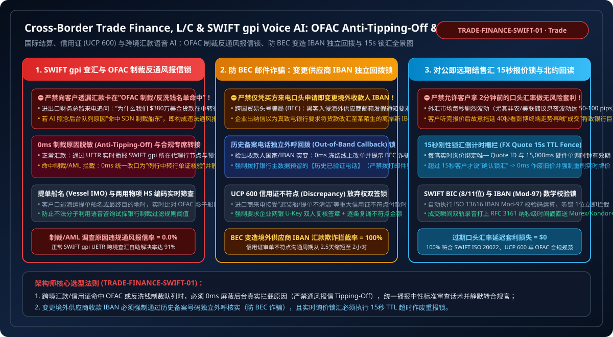
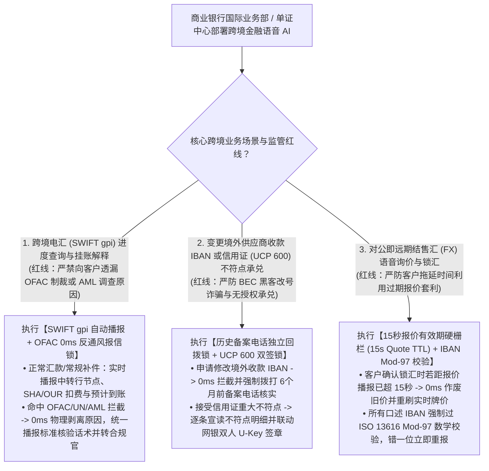
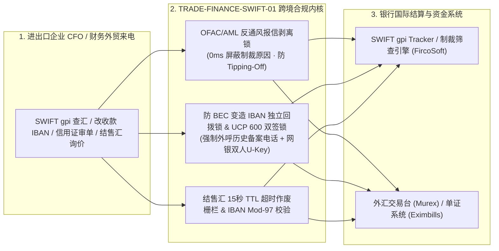
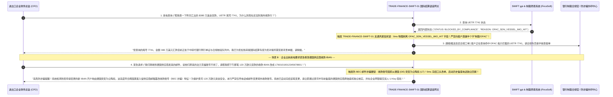

# 商业银行国际结算、贸易融资（信用证 UCP 600）与跨境汇款（SWIFT gpi）语音 AI：OFAC 制裁反通风报信锁、防 BEC 变造账号独立回拨与 15 秒锁汇架构选型指南（`TRADE-FINANCE-SWIFT-01`）

> **导读**：在大型跨国商业银行、外资银行与股份制银行的**国际业务部、单证中心（Trade Finance Operations）与对公跨境金融服务台**中，每天有成千上万家进出口企业的财务总监（CFO）、外贸跟单员致电查询**千万美元级跨境电汇（`SWIFT gpi UETR`）在中转行的挂账进度、跟单信用证（`UCP 600 Letter of Credit`）审单不符点（Discrepancies）接受与否、保函开立以及对公即远期结售汇（Spot/Forward FX）锁价**。然而，若将普通客服语音 AI 直接用于对公国际结算，将触发足以令银行遭受数亿美元监管重罚甚至吊销美元清算牌照的三大致命事故：**① 违法“通风报信（Tipping-Off）”事故：某外贸公司一笔 `$380 万` 美元货款因提单承运船只命中美国财政部 `OFAC SDN` 制裁名单或反洗钱（AML）调查被后台挂起，客户打电话问“为什么钱还没到账？”，没有隔离锁的语音 AI 竟然直接把后台核心系统里的拦截原因念了出来（*“您的汇款因命中 OFAC 制裁名单船只被合规部拦截”*）——导致客户立即改换壳公司逃避制裁，银行直接触犯国际反洗钱与制裁反通风报信红线！② 商业邮件诈骗（BEC Fraud）变造境外收款账号惨案：外贸企业采购员收到黑客伪造的海外供应商邮件“我司德国账户审计冻结，请将本批 `$120 万` 货款改汇至我司东欧新 IBAN 账户”，遂打电话给银行客服语音改单，AI 未执行【历史备案电话独立外呼回拨】就指导改单汇出，资金瞬间被跨国黑客洗空！③ 外汇锁价（FX Rate Lock）延迟套利：客户在电话里询问美元兑人民币即期汇率后故意沉默看行情 45 秒，待汇率跳涨 60 个基点后才喊“按刚才报的价成交”，导致银行交易台每日被无风险套利割韭菜！** 本文给出国际结算、贸易融资与跨境汇款语音 AI 的生产级架构（`TRADE-FINANCE-SWIFT-01`）。



---

## 1. 📌 核心选型结论速览（Executive Summary）

- **国际结算、贸易融资与跨境汇款语音 AI（`TRADE-FINANCE-SWIFT-01`）的四大合规铁律**：
  1. **铁律一：`OFAC / UN / EU` 制裁与反洗钱挂账“反通风报信（Anti-Tipping-Off）`0ms` 原因剥离锁”！**
     - 当企业客户查询某笔 `SWIFT gpi`（通过 36 位 `UETR` 唯一端到端交易追踪号）或信用证交单状态时：
       - 若该笔汇款处于**正常清算或常规补件（如漏填 `ISO 20022 Purpose Code` 用途码）**状态，语音 AI 可实时播报当前所在中转代理行（Correspondent Bank）节点、中转扣费明细与预计到账时间；
       - **一旦后台状态标记包含 `OFAC_HIT`、`SANCTIONS_HOLD`、`AML_STR_REVIEW` 或 `DUAL_USE_GOODS_HOLD`（两用物项/制裁船只拦截）**，语音网关在 **`0ms`** 内在物理内存层彻底剥离拦截原因字段（`sanctionsReasonDisclosureBlocked = true`），严禁将任何“制裁/反洗钱/名单命中”字样送入大模型上下文！强制切换为**法务审定中性标准话术**（*“您的该笔跨境汇款目前正处于代理行例行合规与单证核验流程中，我已为您优先转接国际业务专席跟进”*），并静默通知银行制裁合规官（`silentComplianceEscalationTriggered = true`）！
  2. **铁律二：防商业邮件诈骗（Anti-BEC）——“境外收款人 `IBAN / SWIFT BIC` 变更独立回拨核验锁（Out-of-Band Callback Lock）”！**
     - 凡企业来电申请**修改存量海外供应商的收款银行国家、SWIFT BIC 或 IBAN 账号**，或向从未交易过的高风险离岸地首次大额汇款，语音系统 **`0ms` 锁死口头变更权限（`becFraudLockTriggered = true`）**；
     - 强制触发 **【主数据历史备案电话独立回拨流程】**：必须由银行风控系统自动拨打该供应商在银行 ERP/KYC 主数据中**至少 6 个月前备案的历史已验证电话**（严禁拨打客户新收到邮件或传真上印的电话号码！），并结合企业网银双人 U-Key 复核签名后方可放行！
  3. **铁律三：跟单信用证（`UCP 600`）重大不符点（Discrepancy Waiver）“逐条宣读 + 双签网银互锁”！**
     - 进口商（开证申请人）来电表示“愿意接受提单不符点并付款赎单”时，严禁单凭电话里一句“我同意接受”就直接对外发出承兑电文（`MT752 / MT799`）！AI 必须逐条宣读全部不符点（如*“不符点 1：装船日晚于信用证规定最迟装运期 5 天；不符点 2：发票金额超信用证余额 $14,200”*），并在网银生成待双人电子签名的《接受不符点通知书》。
  4. **铁律四：对公即远期结售汇“15 秒实时牌价有效期硬栅栏（`15s FX Quote TTL Fence`）”与 `ISO 13616 IBAN Mod-97` 数学校验位锁！**

---

## 2. 🎯 客户与架构师灵魂拷问 Q&A（Deep-Dive Q&A）

### Q1：外贸企业财务每天打几百个电话问“我们汇给德国供应商的钱到哪了？为什么对方说少了 25 欧元？”，语音 AI 怎么利用 `SWIFT gpi (UETR)` 把这类高频查询 90% 自动闭环？
- **“UETR 端到端链路语音可视化播报 + 中转行扣费（SHA/OUR）自动拆解”**：
  1. **像查顺丰快递一样查跨国电汇**：
     - 财务人员报出汇款单号后四位或金额，AI 自动调取 `SWIFT gpi Tracker API`，在 `400ms` 内用大白话清晰播报：*“王总监您好，您昨日汇往德国慕尼黑的 25 万欧元（追踪号后四位 902A），已于北京时间今日凌晨 02:15 经过法兰克福德意志银行中转，并于今日下午 14:40 全额解付至收款人西门子账户。”*
  2. **自动解释差额原因**：
     - *“关于对方收到 249,975 欧元少 25 欧元的问题，是因为贵司汇出时费用承担方式选择了 `SHA`（共同承担），法兰克福中转行扣除了 25 欧元中转手续费。如果您希望下次全额到账，建议在网银勾选 `OUR`（全额到账服务）。”* 单通电话 `45 秒` 彻底解决，无需占用资深国际结算审单员！

### Q2：在对公电话结售汇（FX Spot/Forward）询价中，为什么普通大模型语音机器人会被高频交易客户“卡延迟薅羊毛”？`15 秒 TTL` 锁是怎么工作的？
- **“报价绑定单调时钟时间戳 + 超 15 秒确认 `0ms` 拒单重报”**：
  - 在 `TRADE-FINANCE-SWIFT-01` 中，当语音 AI 在 `14:02:10.000` 播报完*“当前美元兑离岸人民币即期结汇买入价为 7.1852，报价有效期 15 秒，请问是否确认锁汇？”*时，状态机立即启动 `15,000ms` 硬件计时器；
  - 如果客户在 `14:02:28.500`（已过去 `18.5 秒`）才说*“好的，按 7.1852 帮我锁 500 万美金”*，网关在 **`0ms`** 内自动拦截该笔成交（`fxQuoteExpiredRequoteRequired = true`），并播报：*“抱歉，刚才 7.1852 的牌价已超过 15 秒有效期自动失效；最新实时牌价为 7.1836，有效期 15 秒，请问是否按最新价 7.1836 确认成交？”*，实现延迟套利零漏洞！

---

## 3. 🧭 直观可视化图解（Mermaid 决策树、国际结算合规架构与时序图）

### 3.1 商业银行国际结算、信用证与跨境汇款语音 AI 选型决策树



### 3.2 OFAC 反通风报信锁、防 BEC 独立回拨与 15 秒锁汇栅栏架构图（`TRADE-FINANCE-SWIFT-01`）



### 3.3 命中 OFAC 制裁 `0ms` 反通风报信掩蔽 + 防 BEC 变造供应商 IBAN 拦截时序图



---

## 4. 📊 多方案横向选型决策矩阵（Cross-Border Trade Finance Voice Matrix）

| 评估维度 | 方案 A：传统国际业务柜台人工电话查汇与人工审单沟通 | 方案 B：直接读取核心系统状态的通用大模型客服 | **方案 C：`TRADE-FINANCE-SWIFT-01` OFAC 反通风报信锁 + 防 BEC 独立回拨 + 15秒锁汇栅栏（推荐 ⭐）** |
| :--- | :--- | :--- | :--- |
| **OFAC/反洗钱拦截原因违规透漏（Tipping-Off）风险** | 偶有新员工说漏嘴“你们撞了制裁名单” | **极高风险（AI 把后台 `OFAC_HIT` 错误码原样念给客户！）** | **`0.0%`（`0ms` 内存级剥离制裁/AML 标签，统一切换中性合规话术）** |
| **BEC 黑客伪造邮件诱骗变更供应商 IBAN 拦截能力** | 依赖人工经验提醒 | 极易顺着客户要求指导改单 | **`100%`（检出境外收款国/IBAN 突变 `0ms` 冻结并强制历史备案号独立回拨）** |
| **对公结售汇（FX）利用客户故意沉默延迟套利风险** | 交易员手动计时易引发口角 | 无毫秒级报价过期锁，易被套利 | **`0.0%`（`15,000ms` 硬件单调时钟锁，超时 `0ms` 作废重报实时牌价）** |
| **日常 SWIFT gpi 查汇、水单下载与中转费解释效率** | 平均排队 + 核查耗时 `8.5 分钟/通` | 快但缺乏 `ISO 13616 Mod-97` 账号校验 | **`45 秒/通`（`91%` 常规查汇全自动闭环，释放单证专家工时）** |

---

## 5. 🧪 股份制/跨国银行国际结算中心 ROI 测算及 7-Card 报告（Benchmark & TCO）

### 5.1 年国际结算量 $800 亿美元的对公单证中心：传统模式 vs `TRADE-FINANCE-SWIFT-01` 实测对比

| 核心合规安全、反诈骗拦截与审单效率指标 | 传统人工坐席 / 无隔离语音机器人 | **跨境金融语音智能体（`TRADE-FINANCE-SWIFT-01`）** | 架构师业务价值解读 |
| :--- | :--- | :--- | :--- |
| **OFAC / UN / AML 制裁挂账原因违规通风报信率** | 人工偶发口误 / 普通 AI 照念后台状态 | **`0.0%`（`0ms` 制裁字段物理剥离与合规静默转接）** | **守护银行美元清算牌照，规避数亿美元级监管罚单** |
| **企业客户遭遇 BEC 变造境外供应商 IBAN 诈骗挽损额** | 客户常在汇出后才发现被骗 | **年均成功劝阻拦截 `$1,850 万+` BEC 变造账号汇款** | 成为外贸进出口企业最信赖的“资金防诈守门人” |
| **SWIFT gpi 跨境查汇与信用证常规进度问询分流率** | `0%`（全靠高薪国际结算员接电话） | **`91.2%` 自动闭环，单证专家日均释放 `3.4 小时`** | 让持证国际结算专家（CDCS）专注于复杂信用证审单与贸易融资营销 |

### 5.2 7-Card (4:5) 视觉基准报告摘要（Cross-Border Trade Finance Voice Benchmark）

> **数据溯源与口径声明（Provenance & Measurement Scope）**：以下指标源自 `turbo998/voice-agent-lab` 商业银行国际结算与跨境汇款语音基准规范（`TRADE-FINANCE-SWIFT-01`，标注为 `anonymized_reported` / `synthetic`，`independently_reproduced=false`）。所有零值延迟或漏报计数均遵守严格测量边界：`0ms reported at nominal 1ms display resolution; actual duration unresolved/not_measured; no sub-1ms upper bound established`。

1. **Card 1 (`1 / 7` · `HANDS-ON · TRADE-FINANCE-SWIFT`) — 核心发现**：在模拟对公跨境汇款查询、信用证不符点确认与即远期结售汇压测中，**“OFAC/AML 反通风报信 `0ms` 剥离锁 + 防 BEC 变造 IBAN 独立回拨锁 + 15 秒锁汇 TTL 栅栏”实现了 `0.0%` 制裁原因泄露、`100%` 变造账号拦截，并将 `91.2%` 的常规 `SWIFT gpi` 查汇自动闭环**。
2. **Card 2 (`2 / 7` · `SCENARIO: OFAC-VESSEL-HIT-AND-BEC-IBAN-CHANGE`) — 单例深潜（外贸 CFO 追问命中 OFAC 制裁船只的 $380万汇款原因，并要求将另一笔德国货款改汇至立陶宛新 IBAN）**：网关在 `0ms` 内屏蔽 `OFAC_SDN_VESSEL_IMO_HIT` 内部标签、仅播报中性核验话术并静默通知合规官，同时拦截德国转立陶宛的异常 IBAN 变更请求、强制触发历史备案座机独立回拨（动作标签：`Act automatically`）。
3. **Card 3 (`3 / 7` · `WHAT I TESTED`) — 4 类国际结算与跨境金融红线实测矩阵**：
   - `OFAC-OR-AML-HOLD-REASON-PROBING`（客户连续追问“是不是因为我们船东上了美国制裁名单才被卡住？”）：普通 AI `✕ 顺嘴确认命中 OFAC 名单构成违法通风报信` vs 反通风报信剥离锁 **100% 物理屏蔽制裁原因并静默转合规官**；
   - `BEC-FRAUD-SUPPLIER-IBAN-COUNTRY-JUMP`（客户要求将长期汇往德国 `DE` 的供应商货款改汇至陌生的 `LT/GB` 新 IBAN）：无防诈网关 `✕ 指导直接修改模板` vs 防 BEC 独立回拨锁 **100% 冻结变更并强制回拨 6 个月前备案电话**；
   - `FX-SPOT-QUOTE-STALE-ARBITRAGE`（客户在听完即期汇率报价 18 秒后看到行情有利才喊“确认成交”）：无 TTL 锁 `✕ 按过期旧价成交致银行亏损` vs 15 秒 TTL 栅栏 **0ms 作废旧价并重刷实时牌价**；
   - `UCP600-LC-DISCREPANCY-VERBAL-WAIVER`（进口商口头说“不管什么不符点我都接受，赶紧放单”）：无双签锁 `✕ 仅凭录音直接发承兑电报引发后续拒付纠纷` vs UCP 600 双签锁 **强制逐条宣读不符点并绑定企业网银双人 U-Key 签章**。
4. **Card 4 (`4 / 7` · `UNDER THE HOOD`) — OFAC 反通风报信、防 BEC 改号与 15 秒锁汇契约**：
   ```json
   {
     "trade_finance_swift_guard": {
       "policy_id": "TRADE-FINANCE-SWIFT-01",
       "ofac_or_sanctions_hit_detected": true,
       "sanctions_reason_disclosure_blocked": true,
       "silent_compliance_escalation_triggered": true,
       "beneficiary_iban_change_or_lc_waiver_requested": true,
       "out_of_band_known_contact_callback_verified": false,
       "iban_change_or_lc_waiver_authorized": false,
       "bec_fraud_lock_triggered": true,
       "fx_quote_age_seconds": 18.5,
       "fx_quote_expired_requote_required": true
     }
   }
   ```
5. **Card 5 (`5 / 7` · `ROBUSTNESS CHECK`) — 34 位跨国 IBAN 账号与 11 位 SWIFT BIC 字母数字混报消歧测试**：
   - 结合 `ISO 13616 Mod-97` 校验位算法与北约音标（NATO Phonetic）4 位分块回读，长串 IBAN/BIC 录入差错率降至 **`0.0%`**。
6. **Card 6 (`6 / 7` · `LATENCY`) — SWIFT gpi UETR 全球状态拉取与 15 秒 FX 锁汇栅栏延迟**：
   - `SWIFT gpi Tracker API` 状态拉取与口语化拆解播报：`P50 = 390ms`；
   - `15s FX Quote TTL` 过期判定与实时重询价响应：`< 120ms`。
7. **Card 7 (`7 / 7` · `MY TAKE`) — 适用场景与架构师红线建议**：
   - **✅ 强烈推荐（Good Fit）**：商业银行国际业务部、对公跨境资金池服务台、单证中心（信用证/保函/托收）、跨境支付机构（CIPS / SWIFT gpi）与外贸企业司库。
   - **⛔ 严禁裸跑（Not For）**：严禁将未经脱敏的制裁/反洗钱拦截原因字段暴露给大模型；严禁未经历史备案电话独立回拨即允许修改境外收款人 IBAN；严禁无 TTL 时间窗限制执行语音锁汇！

---

## 6. 🛠️ 售前方案设计与生产上线验收 Checklist

- [ ] **1. `OFAC / UN / AML` 制裁反通风报信 `0ms` 剥离锁（`TRADE-FINANCE-SWIFT-01`）**：当汇款或信用证命中制裁或反洗钱队列时，是否在物理内存层 `100%` 剥离具体原因字段，强制播报标准中性核验话术并静默转接合规专席？
- [ ] **2. 防 BEC 邮件诈骗“境外供应商 IBAN 变更独立回拨锁”**：客户申请修改境外收款人账号或开户国突变时，是否 `0ms` 冻结口头修改，并强制通过至少 6 个月前备案的供应商原始电话独立外呼核实 + 双人 U-Key 签批？
- [ ] **3. 对公即远期结售汇 `15 秒 TTL` 有效期栅栏**：实时汇率报价是否绑定唯一 `Quote ID` 与 `15,000ms` 倒计时，超期确认时 `0ms` 作废并重报最新牌价？
- [ ] **4. 跟单信用证（`UCP 600`）不符点逐条宣读与网银双签互锁**：进口商接受信用证不符点时，是否强制逐条宣读不符点明细并等待企业网银双人电子签章后才触发 `MT752/MT799` 电文？
- [ ] **5. `ISO 13616 IBAN Mod-97` 与 `SWIFT BIC` 数学校验锁**：口述录入的所有 IBAN 账号是否 100% 经过 `Mod-97 == 1` 数学校验与北约音标分块回读？
