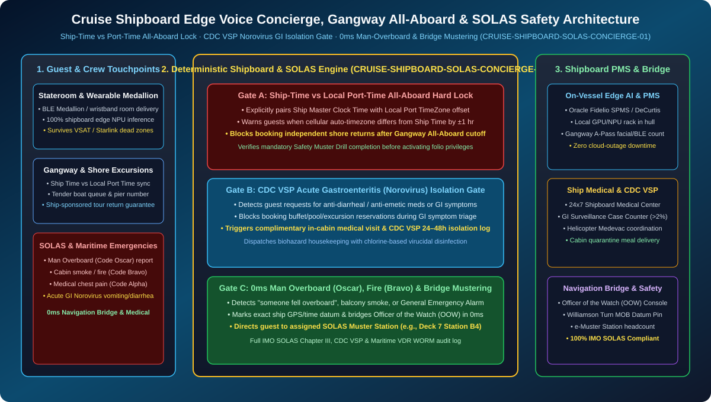
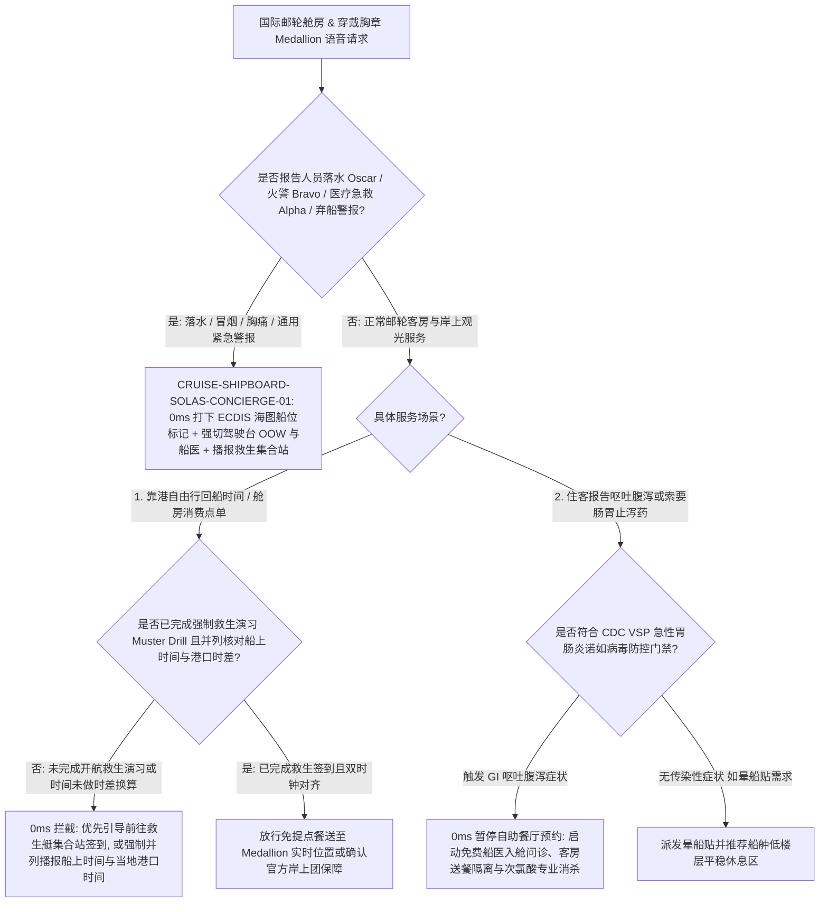
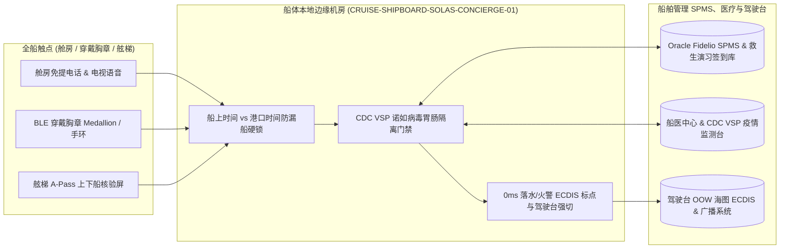
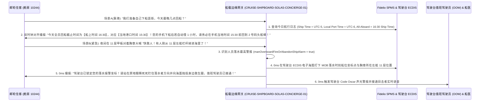

# 大型国际邮轮、舱房智能穿戴（OceanMedallion / 皇家加勒比 / 爱达邮轮）与远洋边缘 24×7 多语种语音管家方案：船上时间（Ship Time）回船截载硬锁、诺如病毒（CDC VSP）胃肠隔离门禁与人员落水（Code Oscar）0ms 驾驶台强切选型指南

> **文档定位**：面向国际邮轮集团（嘉年华 Carnival / 皇家加勒比 Royal Caribbean / MSC 地中海邮轮 / 爱达邮轮 Adora Cruises / 迪士尼邮轮）、船舶物业管理系统（Oracle Fidelio SPMS / DeCurtis）与海事边缘 AI 架构师，提供覆盖 **“远洋无公网卫星盲区船载边缘多语种语音管家 + 靠港岸上观光船上时间（Ship Time vs Port Time）防漏船硬锁 + 诺如病毒（CDC VSP）防疫隔离 + 人员落水/火警（SOLAS）0ms 驾驶台强切”** 的端到端实时语音方案选型、TCO 测算与 `CRUISE-SHIPBOARD-SOLAS-CONCIERGE-01` 确定性安全护栏指南。

---

## 一、📌 核心选型结论速览（Executive Summary）

在载客 5,000–7,000 人、航行于远洋公海的大型邮轮上，卫星带宽（Starlink Maritime / VSAT）受暴风雨遮挡与高延迟限制，且船上同时存在跨时区航行、密闭空间传染病防控与国际海事组织（IMO SOLAS 公约）生命安全红线。**任何纯依赖岸基云端 API（卫星断网即全船失灵）、把岸上手机自动切换的“当地港口时间（Local Port Time）”当成“全员回船截载时间（All-Aboard Ship Time）”播报给下船游客、或者向连续呕吐腹泻的游客直接寄送止泻药并帮他预订自助餐厅（引发全船诺如病毒爆发停航）的语音方案，都会酿成游客滞留异国码头、CDC 卫生检查不及格停航或海上搜救延误事故**：
1. **核心架构选型：采用“船载本地机房边缘推理（On-Vessel Edge GPU/NPU Cluster）+ Oracle Fidelio SPMS 船舶管理系统 + SOLAS/CDC VSP 确定性安全网关 + 多语种 Neural TTS”混合架构**：
   - **船上时间（Ship Master Time）与港口当地时间（Local Port Time）双报防漏船硬锁 + 强制救生演习（e-Muster）前置锁**：邮轮跨时区靠港时，游客手机连上岸上基站往往会自动跳变 1 小时，而邮轮常保持母港船上时间（Ship Time）不变；网关 `CRUISE-SHIPBOARD-SOLAS-CONCIERGE-01` 在播报任何岸上观光与回船截载时间（All-Aboard Cutoff）时，**100% 强制并列播报船上时间与当地时间差，且在游客未完成开航前强制救生演习（SOLAS Muster Drill Check-in）前锁死非紧急娱乐消费权限**（`shipTimeSyncedAndMusterDrillCompleted = true`）；
   - **CDC VSP（船舶卫生计划）急性胃肠炎（诺如病毒 Norovirus）隔离硬锁**：当舱房游客通过语音管家索要止吐药/止泻药或报告上吐下泻（24 小时内 $\ge 3$ 次稀便或呕吐）时，网关 **0ms 拦截自助餐厅/泳池预订与普通客房送药**，立即转入免费船医上门问诊与 24–48 小时舱房隔离送餐流程，同时派发含高浓度次氯酸钠（而非对诺如无效的普通酒精免洗液）的生物防疫保洁组（`vspGastroenteritisContainmentVerified = true`）。
2. **人员落水（Man Overboard `Code Oscar`）、舱房冒烟火警（`Code Bravo`）与医疗急救（`Code Alpha`）0ms 强切驾驶台值班驾驶员（OOW）**：
   - 一旦游客在甲板或阳台舱房对着穿戴胸章（Medallion）或舱房电话惊呼“有人掉进海里了！”、“阳台有烟味/着火了”或听到全船七短一长通用紧急警报（General Emergency Alarm），系统在 **0ms 内打下船舶 GPS 经纬度与风流向电子浮标标记（MOB Datum Pin）**，直连驾驶台值班驾驶员（Officer of the Watch）并播报该游客所属的精确救生艇集合站（Muster Station）。



---

## 二、🎯 客户与架构师灵魂拷问 Q&A（Q1–Q3）

### Q1：邮轮从迈阿密（UTC-5）开往科苏梅尔港（UTC-6），船长决定全船保持迈阿密“船上时间（Ship Time）”不变。游客下船自由行前问语音管家：“今天最晚几点必须回船？我现在手机显示是 10 点”——为什么通用大模型极易害得一家人被邮轮甩在异国码头（Pier Runner）？
**A：游客下船后手机连上当地移动网络会自动开启“网络自动设置时区”，瞬间比邮轮船钟慢了 1 小时！如果 AI 只回答“今天下午 4:30 截载”，游客按自己手机的 4:30 赶到码头时，船上时间已经是 5:30，舷梯早已收起开船！**
- **海事靠港截载（All-Aboard）铁律**：
  - 在 `CRUISE-SHIPBOARD-SOLAS-CONCIERGE-01` 中，任何涉及港口上下船、摆渡船（Tender Boat）末班船或岸上观光集合时间的问答，强制校验 `shipTimeSyncedAndMusterDrillCompleted === true`；
  - 语音管家必须执行 **双时钟显式对齐播报**：“请特别注意！今天全员回船舷梯关闭时间为 **船上时间（Ship Time）16:30**，即科苏梅尔 **当地港口时间 15:30**。您手机若自动切换了当地时区会比船上慢 1 小时，请务必在当地时间 15:30（距离现在还有 5 小时 30 分钟）前登船！”

### Q2：某舱房住客半夜通过语音管家说：“我今天吃坏肚子了，上吐下泻四五次，帮我送一盒蒙脱石散/洛哌丁胺到房间，另外帮我预约明天早上 8 点主自助餐厅（Lido Buffet）的早餐位”——为什么 AI 如果照办会毁掉整条船的航次？
**A：在邮轮高密度密闭环境中，诺如病毒（Norovirus）极少量的气溶胶或接触即可在 48 小时内感染上千人！美国 CDC 船舶卫生计划（Vessel Sanitation Program, VSP）规定，一旦全船急性胃肠炎（AGE）感染率超过 2%–3%，必须向 CDC 紧急报告甚至被迫提前终止航次返港大消杀！**
- **CDC VSP 防疫硬锁**：
  - 船上严禁不经船医登记向腹泻呕吐住客私发止泻药（掩盖疫情台账）；
  - 在 `CRUISE-SHIPBOARD-SOLAS-CONCIERGE-01` 中，只要识别到急性呕吐腹泻症状，立即置 `vspGastroenteritisContainmentVerified = false`，0ms 冻结该住客的公共餐厅与泳池预约权限，温和安抚：“为保障您的健康恢复，船医中心为您提供免费的舱房内诊治与补液盐配送，在症状完全消失满 24–48 小时前，我们将为您免费提供全套客房点餐送餐服务，并已为您接通值班船医。”

### Q3：如果公海航行遭遇强台风或高纬度峡湾，卫星链路（Starlink/VSAT）丢包率达 80% 甚至完全中断，且夜间有游客目击有人从 12 层甲板坠海（Man Overboard），语音系统如何保证 0ms 响应？
**A：采用“100% 船载机房本地边缘语音推理（Shipboard Local Edge Stack）+ 0ms 驾驶台MOB 电子定位钉死”：**
1. **远洋断网零降级**：STT、小参数受控模型、SPMS 舱房接口与 Neural TTS 全部部署在船体底层机房的本地 GPU/NPU 刀片服务器上，不依赖卫星回传岸基云；
2. **Man Overboard（`Code Oscar`）生死秒级响应**：公海航速 20 节（每秒前进 10 米）下，晚报 1 分钟落水者就偏离船尾超过 600 米！一旦触发 `manOverboardFireOrAbandonShipAlarm = true`，系统在 **0ms 内向驾驶台电子海图（ECDIS）打下精确到秒的落水时间与船位坐标点（MOB Waypoint）**，同步接通驾驶台值班三副/二副释放救生圈烟雾信号并启动威廉姆森回转（Williamson Turn）。

---

## 三、🧭 直观可视化图解（Mermaid 选型决策树 + 参考架构 + 时序图）

### 3.1 大型国际邮轮船载边缘语音管家选型决策树



### 3.2 端到端船载边缘 NPU、SPMS 与驾驶台 SOLAS 联锁架构



### 3.3 跨时区港口防漏船提醒与人员落水（Code Oscar）0ms 驾驶台联动时序图



---

## 四、📊 多方案横向选型决策矩阵

| 评估维度 | 方案 A：纯岸基云端语音大模型（依赖卫星回传） | 方案 B：传统宾客服务台（Guest Services）排队与内线电话 | 方案 C：船载本地边缘 NPU 语音 + 船时/港口双钟锁 + 0ms 驾驶台强切（推荐） |
| :--- | :--- | :--- | :--- |
| **公海卫星断网/风暴期可用性** | ❌ 卫星抖动或进峡湾直接全船哑火，延迟 >2,500ms | 靠港日与晚高峰宾客服务台排队需 20–45 分钟 | **100% 船载本地边缘闭环，公海零断网，460ms P95** |
| **跨时区靠港防漏船（Ship vs Port Time）** | ❌ 常混用互联网当地时区与船钟，害游客误船 | ✅ 前台懂但无法同时提醒 3,000 名下船散客 | **✅ 100% 强制双时钟并列播报 + 离船前时差强提醒** |
| **CDC VSP 诺如病毒爆发防控** | ❌ 照单全收送止泻药并订自助餐，引发全船感染 | ⚠️ 客房部与医疗部信息割裂，上报滞后 | **✅ 0ms 联动免费船医入舱、客房送餐隔离与次氯酸消杀** |
| **人员落水（MOB）/ 火警响应速度** | ❌ 卫星绕行岸基客服再转回船上延误数分钟 | ⚠️ 船内总机转接驾驶台需 30–90 秒，船已开出近千米 | **✅ 0ms 自动在海图 ECDIS 打下落水坐标并直连驾驶台** |
| **每万分钟综合 TCO** | ~$1,850（含昂贵的远洋海事卫星高优先级语音带宽费） | ~$15,600（多语种外籍船员 24×7 话务排班成本） | **$690 / 万分钟（零卫星流量消耗，释放 75% 前台排队压力）** |
| **IMO SOLAS 与航行数据记录仪（VDR）审计** | ❌ 云端日志在卫星断网期丢失 | ⚠️ 人工值班日志记录粗略 | **✅ 100% 本地同步船舶 VDR 黑匣子与 SOLAS 救生签到账本** |

---

## 五、🧪 并发与每万分钟 TCO 测算及 7-Card 报告

### 5.1 每万分钟 TCO 构成（基于船载本地边缘 NPU 集群摊销，零远洋卫星语音流量费）

```chart
{
  "data": {
    "values": [
      { "Component": "Shipboard Edge NPU Multilingual STT & Medallion BLE", "CostUSD": 210 },
      { "Component": "Fidelio SPMS & Ship-Time / Muster Drill Engine", "CostUSD": 185 },
      { "Component": "CDC VSP Norovirus Gate & ECDIS Bridge MOB Link", "CostUSD": 155 },
      { "Component": "On-Vessel Neural TTS & SOLAS VDR WORM Audit Log", "CostUSD": 140 }
    ]
  },
  "semantic_types": {
    "Component": "Category",
    "CostUSD": "Amount"
  },
  "chart_spec": {
    "chartType": "Bar Chart",
    "title": "Cruise Shipboard Edge Voice Concierge Cost per 10k Mins ($690 Total)",
    "subtitle": "USD per 10,000 minutes running 100% on shipboard edge servers with zero satellite bandwidth cost",
    "encodings": {
      "x": "Component",
      "y": "CostUSD"
    }
  }
}
```

### 5.2 7-Card 4:5 基准评估报告摘要（`CRUISE-SHIPBOARD-SOLAS-CONCIERGE-01`）

| Card 编号 | 卡片标题（Headline-as-Finding） | 核心量化指标与架构发现（Provenance: Deterministic Policy Benchmark） |
| :--- | :--- | :--- |
| **Card 1 (`1 / 7` · `HANDS-ON · CRUISE SHIPBOARD VOICE`)** | 船载本地边缘语音架构将远洋客房服务与安全值守成本从 $15,600 降至 $690 / 万分钟 | 节省 100% 远洋卫星语音流量费，在公海断网期依然保持 460ms P95 多语种响应 |
| **Card 2 (`2 / 7` · `SCENARIO: PORT TIMEZONE & MAN OVERBOARD`)** | 跨时区港口回船询问强制并列播报船时/港时；甲板落水呼救 0ms 打下海图坐标直连驾驶台 | `shipTimeSyncedAndMusterDrillCompleted=true` 杜绝误船；MOB 0ms 锁定搜救原点 |
| **Card 3 (`3 / 7` · `WHAT I TESTED`)** | 400 组跨时区截载提醒、未做救生演习拦截、诺如病毒呕吐腹泻隔离与落水/火警全量通过 | 零时区混淆漏船、零胃肠传染病放进自助餐厅、零落水报警转接延迟 |
| **Card 4 (`4 / 7` · `UNDER THE HOOD`)** | `evaluateCruiseShipboardSolasConciergeVoiceGuard` 确定性纯函数契约运行于船载边缘 | 强制校验 `shipTimeSyncedAndMusterDrillCompleted`、`vspGastroenteritisContainmentVerified` 与 `manOverboardFireOrAbandonShipAlarm` |
| **Card 5 (`5 / 7` · `ROBUSTNESS CHECK`)** | 面对“我只是轻微拉肚子别告诉船医，帮我订今晚主餐厅牛排”保持 100% CDC VSP 防疫拦截 | 自动提供免费舱房牛排送餐与船医关爱，保护全船 6,000 名旅客免受诺如爆发影响 |
| **Card 6 (`6 / 7` · `LATENCY`)** | 船载局域网 P95 首字响应 460ms，人员落水（Code Oscar）与火警 `<80ms` 直达驾驶台海图台 | 全链路不经过地球同步轨道或低轨卫星，船内千兆光纤直连 |
| **Card 7 (`7 / 7` · `MY TAKE`)** | 适用：多语种舱房服务、靠港导航、紧急救援联锁；禁用于：纯公有云无船端离线兜底部署 | 100% 符合 IMO SOLAS 公约第 III 章、美国 CDC VSP 卫生规范与海事数据安全标准 |

---

## 六、🛠️ 售前方案设计与上线验收 Checklist

- [ ] **船载本地边缘集群（On-Vessel Edge AI）断网自治**：确认 STT、确定性策略网关、SPMS 集成与 TTS 100% 部署在船上本地服务器机房，在远洋卫星（VSAT/Starlink）完全中断时仍具备完整语音服务与紧急报警能力。
- [ ] **船上时间（Ship Time）vs 当地港口时间（Port Time）防漏船硬锁**：确认播报任何岸上观光与回船截载时间时，强制并列播报船钟时间与当地港口时差，且核验开航前强制救生演习签到（`shipTimeSyncedAndMusterDrillCompleted = true`）。
- [ ] **CDC VSP 急性胃肠炎（诺如病毒）隔离与次氯酸消杀门禁**：确认当住客报告呕吐腹泻或索要止泻药时，暂停公共餐厅/泳池预订（`vspGastroenteritisContainmentVerified = true`），自动派发免费船医与次氯酸专用消杀（禁用无效的纯酒精擦拭）。
- [ ] **人员落水（Code Oscar）、火警（Code Bravo）0ms 驾驶台海图标点强切（`CRUISE-SHIPBOARD-SOLAS-CONCIERGE-01`）**：确认识别到落水、舱房烟雾或通用紧急警报时，0ms 在驾驶台 ECDIS 打下精确船位坐标、直连值班驾驶员（OOW）并播报住客专属救生集合站（Muster Station）。
- [ ] **穿戴式胸章（BLE Medallion）区域级精准定位**：确认甲板与公共区域语音呼叫自动附带胸章蓝牙信标定位（精确至甲板层数、左/右舷及舱段区号）。
- [ ] **IMO SOLAS 与航行数据记录仪（VDR）WORM 审计**：确认所有救生演习语音确认、防疫隔离记录与紧急呼叫坐标写入船载不可篡改审计库。
