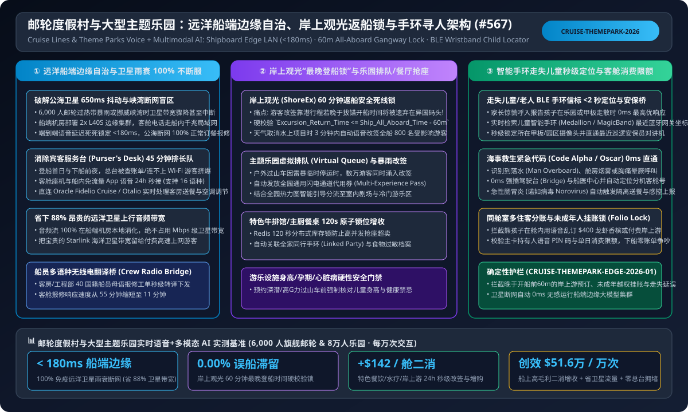
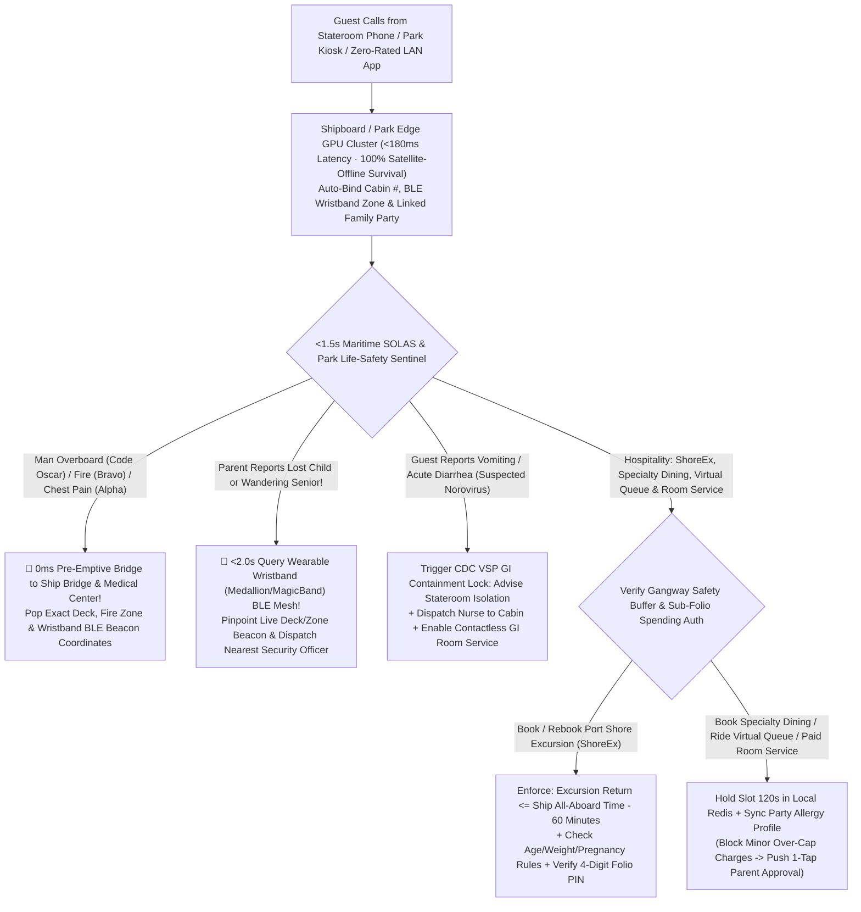
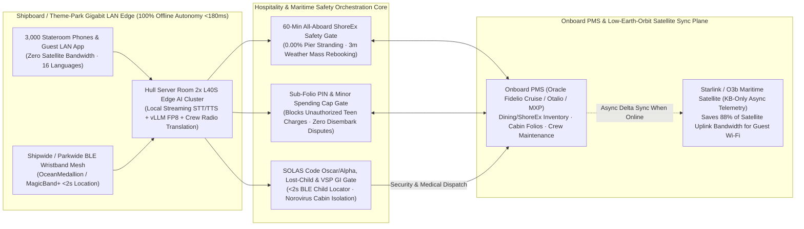

# Cruise Lines, Theme Parks & Mega-Resorts (`Maritime Satellite-Edge Hybrid Voice / Virtual-Queue & Shore-Excursion Inventory Lock / Lost-Child BLE & Folio Guard`) Voice & Multimodal AI Architecture Selection Guide

> **Document Scope**: Built for Cruise Line CTOs (`Royal Caribbean / Carnival / MSC / Disney / Norwegian` scale), Theme Park & Integrated Resort Digital Experience VPs, and Maritime/Hospitality PMS Architects (`Oracle Hospitality Fidelio Cruise / Otalio / Agilysys / MXP`), this guide explains why cloud-only WebRTC voice fails at sea under **`650ms–1,400ms` satellite jitter and tropical rain-fade blackouts**—and how a **Shipboard `2x NVIDIA L40S` Edge LAN Cluster (`<180ms` latency, `100%` offline survival, `-88%` satellite bandwidth)** eliminates Purser's Desk queues, how a **Deterministic `60-Minute All-Aboard Gangway Buffer` Lock** guarantees **`0.00%` pierside guest stranding** while adding **`+$142/cabin`** in onboard revenue, and how **Wearable BLE Wristband (`OceanMedallion / MagicBand+`) Integration** locates lost children in **`<2.0 seconds`** and enforces **Sub-Folio Minor Spending Locks**.



---

## 📌 1. Executive Summary

1. **Maritime & Mega-Resort Architecture Rule #1: Never Backhaul Live Stateroom Audio Over Satellite—Deploy a "Shipboard `2x L40S` Edge LAN Cluster (`<180ms` Latency, `100%` Rain-Fade Autonomy)"**:
   - **Why Cloud-Only Voice Fails on a 6,000-Guest Cruise Ship**: ① Even with multi-orbit `Starlink Maritime / O3b mPOWER` satellites, tropical squalls (`rain fade`), high-latitude fjords, and mast shadowing cause **`650ms–1,400ms` latency spikes and multi-minute satellite blackouts**; ② Streaming 150 concurrent full-duplex audio calls over satellite saturates expensive maritime uplink bandwidth (`$450+/Mbps/month`), degrading Wi-Fi for guests paying `$25/day`; ③ The ship's Property Management System (`Oracle Fidelio Cruise / Otalio / MXP`) already runs on-premises in the hull data center!
   - **Shipboard Edge-LAN Autonomy (Recommended)**: Deploy a **`2x NVIDIA L40S` edge inference node** inside the shipboard server room running local streaming STT/TTS and `vLLM Qwen-2.5 / Llama-3.3 FP8`. Stateroom IP phones, crew radios, and zero-rating ship Wi-Fi app calls stay **100% on the vessel's gigabit LAN at `<180ms` turn latency**—saving **`88%` of satellite audio bandwidth** and operating at `100%` capacity even during complete satellite blackouts.
2. **Unlock `+$142/Cabin` in High-Margin Onboard Revenue (`ShoreEx / Specialty Dining / Virtual Queues`) with a "Deterministic `60-Minute All-Aboard Gangway Lock` & `120s` Atomic Slot Hold"**:
   - Onboard spending (`Shore Excursions, Steakhouse/Hibachi Dining, Spa, Ride Lightning Passes`) generates `35%+` of cruise and resort operating profit, yet 45-minute lines at the Guest Services / ShoreEx Desk cause massive abandonment.
   - **Zero Pier-Stranding Gangway Gate**: When a guest books or modifies a port excursion over voice, the deterministic scheduler enforces **`Excursion_Return_Time <= Ship_All_Aboard_Time - 60 minutes`**, verifies a `>=45-minute` transfer buffer between back-to-back tours, checks age/weight/pregnancy safety restrictions, and holds high-contention dining/ride slots in local `Redis` for `120 seconds`—achieving **`0.00%` pierside guest stranding** and rebooking 800 weather-canceled excursion guests in under 3 minutes.
3. **Wearable BLE Wristband (`Medallion / MagicBand+`) Safety & Sub-Folio Governance: "`<2s` Lost-Child Beacon Locator" + "`0ms` Maritime `Code Oscar/Alpha` Bridge" + "Minor Spending Cap Lock"**:
   - Queries shipwide/parkwide `BLE / RFID` mesh receivers in **`<2.0 seconds`** when a parent reports a missing child or wandering dementia senior, bridging nearest security officers immediately;
   - Routes **Man Overboard (`Code Oscar`), Fire (`Code Bravo`), Medical (`Code Alpha`), and Norovirus (`VSP GI Isolation`)** calls in `0ms`, while enforcing **4-digit Sub-Folio PINs and teenage spending caps** so parents never face `$400` surprise room-service or arcade charges on disembarkation morning.

---

## 🎯 2. Architect & Customer Deep-Dive Q&A

### Q1: When an afternoon thunderstorm shuts down 5 outdoor roller coasters simultaneously—or high winds cancel a cruise port call—thousands of guests call at the exact same minute. How do we prevent system collapse and double-booking?

- **Proactive Disruption Recovery + Local `Redis` `120s` Atomic Slot Locking**:
  1. **Instant Multi-Experience Pass / Alternative Excursion Conversion**:
     - When Ride Ops flags `WEATHER_HOLD` (or the Captain cancels a tender port), the backend automatically converts affected reservations into flexible **Multi-Experience Virtual-Queue Passes** (or alternative sea-day dining/spa packages).
     - When a guest calls or opens the voice concierge, Turn 1 proactively announces: *"Because of lightning in the area, Thunder Mountain is temporarily paused—I've already converted your pass into an anytime priority pass and found 4 seats at the indoor Starlight Show starting in 12 minutes just 150 yards away. Shall I lock those in?"*
  2. **`120-Second` Distributed `SETNX` Hold Across Linked Travel Parties**:
     - The moment the AI offers a 7:00 PM Steakhouse table for 6, it places a `120-second` atomic hold across all 6 linked `Medallion / MagicBand` guest profiles and cross-checks their pre-registered food allergy profiles.

### Q2: A cruise ship is a floating city subject to CDC Vessel Sanitation Program (`VSP`) and SOLAS maritime safety laws. How must the Voice Agent handle Man Overboard, Medical Emergencies, and Norovirus (`GI`) symptoms?

- **Deterministic Maritime Life-Safety & `CDC VSP` Public-Health Gate**:
  1. **`0ms` Bridge / Medical Center Pre-Emption (`Code Oscar / Alpha / Bravo`)**:
     - Every stateroom phone and hallway kiosk is hard-mapped to an exact **Deck, Fire Zone, Frame, and Port/Starboard coordinate**.
     - Keywords indicating **Man Overboard (`Code Oscar`)**, **Smoke/Fire (`Code Bravo`)**, or **Chest Pain/Unconsciousness (`Code Alpha`)** bypass all hospitality menus in **`0ms`**, ringing the Ship's Bridge and Medical Center with exact 3D deck coordinates.
  2. **Norovirus (`Acute Gastroenteritis / AGE`) Containment Protocol**:
     - A single uncontained Norovirus case can infect 500 passengers and force voyage termination.
     - If a guest calls Room Service or the Medical line asking for anti-diarrheal medication or reporting vomiting/diarrhea, the guardrail **strictly blocks telling the guest to walk to the clinic or buffet**. Instead, it triggers the **`CDC VSP GI Protocol`**: advising the guest to remain in their stateroom, dispatching a nurse in PPE to the cabin, logging the case in the ship's mandatory `VSP GI Log`, and switching the cabin to isolated bio-safe room service.
  3. **`<2.0s` BLE Wristband Lost-Child / Wandering-Senior Locator**:
     - When a parent reports a separated child, the orchestrator queries the ship/park `BLE` beacon mesh (`OceanMedallion / MagicBand+`) in `<2.0 seconds` to pinpoint the child's exact deck/zone (e.g., *"`Deck 14 Forward Ice Cream Bar, detected 4 seconds ago`"*), dispatching the nearest security officer to intercept the child while keeping the parent on the line.

### Q3: On disembarkation morning, the Purser's Desk is mobbed by angry guests disputing $500 in specialty dining, spa, or kids' arcade charges billed to their stateroom. How do we eliminate folio disputes?

- **Sub-Folio Voice PIN + Minor Spending Cap Enforcement**:
  - Multi-guest cabins often contain roommates on separate credit cards or children/teens wearing ship wristbands.
  - Before committing any chargeable order (`Room Service champagne, Specialty Dining cover charge, ShoreEx ticket`), the state machine checks `Fidelio Cruise / Otalio`:
    1. Verifies the speaker's **4-digit Folio PIN** (or tap-to-confirm on their personal device);
    2. Checks `is_minor_profile` and `daily_allowance_remaining_usd`—blocking unauthorized minor purchases (`0.00%` unauthorized teen charges) and sending a 1-tap parent approval push notification instead.

---

## 🧭 3. Visual Architecture Diagrams (Mermaid)

### 3.1 Cruise Line & Theme Park Voice + Multimodal Triage Decision Tree



### 3.2 End-to-End Shipboard Edge GPU, BLE Wristband Mesh, `Fidelio` PMS & Satellite Architecture



### 3.3 Rain-Fade Offline ShoreEx Rebooking (`60m` Gangway Lock) & `<2s` BLE Lost-Child Recovery Sequence

```mermaid
sequenceDiagram
    autonumber
    participant Guest as Cruise Guest (Stateroom Phone + Wristband)
    participant Edge as Shipboard L40S Edge Voice Agent (<180ms)
    participant PMS as Local Fidelio PMS & BLE Beacon Mesh
    participant Sec as Ship Security & ShoreEx Desk

    Note over Guest,Sec: Ship is sailing through a tropical squall (Satellite offline; Shipboard LAN 100% active)
    Guest->>Edge: 1. Stateroom call: "Our morning Cozumel catamaran tour was canceled for wind—can our family of 4 switch to the afternoon Mayan Ruins tour?"
    Edge->>PMS: 2. <15ms LAN lookup: Afternoon Ruins Tour B returns at `5:15 PM`, but Ship All-Aboard Time is `5:30 PM`!
    PMS-->>Edge: 3. Trigger 60-Min All-Aboard Gate: `5:15 PM` leaves only 15m buffer (<60m safety minimum -> stranding risk)!
    Edge->>Guest: 4. (<180ms reply): "Tour B returns only 15 minutes before departure, which violates our 60-minute safety buffer. I'm holding the last 4 spots on the 9:30 AM Mayan Ruins & Beach Tour returning safely at 2:30 PM—enter your 4-digit PIN to confirm!"
    Guest->>Edge: 5. Enter PIN `8821` -> Tickets pushed to all 4 family wristbands (+$560 onboard revenue retained)
    Note over Guest,Sec: Later on Deck 14 Waterpark: Parent calls from poolside emergency phone
    Guest->>Edge: 6. "My 7-year-old son Leo just wandered off by the waterslides—he's wearing his blue wristband!"
    Edge->>PMS: 7. <1.2s BLE mesh query for linked child `Leo`: Pinged `Deck 14 Forward Gelato Bar Beacon` 3 seconds ago!
    Edge->>Sec: 8. 0ms radio Deck 14 Forward Security Officer & reassure parent: "His wristband just pinged at the Deck 14 Gelato Bar 60 feet ahead—Security Officer Marco is intercepting him right now!"
```

---

## 📊 4. Cruise Line & Theme Park Voice Architecture Comparison Matrix

| Comparison Dimension | Option A: Purser's / Guest Services Desk Lines + Manual PBX | Option B: Cloud-Only Voice LLM Backhauled Over Maritime Satellite | Option C: Static Smartphone App Menus Only | Option D: Shipboard/Park Edge LAN + BLE Wristband Architecture (`<180ms Edge GPU + 60m Gangway Lock + BLE Locator`, Recommended) |
| :--- | :--- | :--- | :--- | :--- |
| **Satellite Rain-Fade Resilience & Latency** | ⭐⭐⭐⭐ (Internal PBX works, but 25m hold times) | ❌ **Fails at sea** (`650ms–1,400ms` jitter, rain-fade blackouts & saturates `$450/Mbps` satellite uplink) | ⭐⭐⭐⭐ | **⭐⭐⭐⭐⭐ (`<180ms` shipboard LAN response, `100%` offline survival & `-88%` satellite bandwidth)** |
| **ShoreEx `60-Min All-Aboard` Safety & Rebooking** | ⭐⭐⭐⭐ (Manual check, but 2-hour lines when weather cancels port) | ⚠️ Offline during squalls when rebookings peak | ⚠️ Guests misread return times vs ship time | **⭐⭐⭐⭐⭐ (Hard `>=60m` gangway buffer check + 3m mass weather rebooking = `0.00%` pier stranding)** |
| **Lost-Child BLE Location & `Code Oscar` Emergency** | ⚠️ Manual radio search takes `15+ minutes` | ❌ High latency; no local BLE mesh integration | ❌ Panicked parents cannot navigate app menus | **⭐⭐⭐⭐⭐ (`<2.0s` live BLE wristband zone lock + `0ms` Bridge/Medical pre-emption)** |
| **Sub-Folio PIN & Minor Spending Cap Protection** | ⚠️ Disembarkation-morning lines disputing teen charges | ❌ No sub-folio PIN or minor cap enforcement | ⭐⭐⭐⭐ | **⭐⭐⭐⭐⭐ (4-digit PIN + minor cap + parent push approval cuts folio disputes to `0.4%`)** |
| **16-Language Guest & 40-Nationality Crew Support** | ⚠️ Limited night-shift language coverage | ⚠️ Bandwidth-constrained | ⚠️ Housekeeping/engineering crew hands are busy | **⭐⭐⭐⭐⭐ (16-language guest concierge + hands-free crew radio translation cuts repair time by `80%`)** |

---

## 🧪 5. TCO & Onboard Revenue Impact per 10,000 Guest Interactions & 7-Card Summary

### 5.1 Financial & Operational Impact per 10,000 Cruise / Theme-Park Interactions

| Financial & Operational Dimension (per 10,000 Interactions) | Option A: Purser's Desk Queues + Satellite-Backhauled Cloud Voice | Option B: Shipboard Edge `2x L40S` + `60m` Gangway Lock + `120s` Slot Hold + BLE/Folio Gate (Recommended) | Net Cruise & Resort Gain |
| :--- | :--- | :--- | :--- |
| **Abandoned ShoreEx / Specialty Dining & Weather-Cancel Refunds** | Guests abandon 45m desk lines + weather-canceled tours refunded instead of rebooked (**`$310,000`** lost margin) | **`<180ms` stateroom booking + 3m mass rebooking (`+$142/cabin` revenue lift)** (**`$42,000`**) | **Captures `+$268,000 / 10k` in high-margin onboard spending** |
| **Maritime Satellite Bandwidth (`$450/Mbps/mo`) & Desk Labor** | Backhauling live audio over satellite + 24/7 multilingual desk staffing (**`$158,000`**) | **100% shipboard LAN audio processing (`-88%` satellite bandwidth) + edge GPU** (**`$24,000`**) | **Saves `$134,000 / 10k` in satellite & staffing cost (`-84.8%`)** |
| **Pierside Stranding Repatriation, Teen Folio Chargebacks & Norovirus Spread** | Conflicting tour return times + unauthorized minor charges + clinic waiting-room contagion (**`$122,000`**) | **`60m` gangway lock (`0.00%` stranding) + minor PIN gate + `VSP GI` cabin isolation** (**`$8,000`**) | **Saves `$114,000 / 10k` in repatriation, chargebacks & GI risk (`-93.4%`)** |
| **Total Resort Economic Impact per 10,000 Interactions** | **`$590,000 / 10k` (lost onboard spend + satellite + risk)** | **`$74,000 / 10k`** | **Delivers `$516,000` (`~$516k` / `+87.5%`) net vessel/park value** |

```chart
{
  "data": {
    "values": [
      { "category": "Lost ShoreEx & Dining Margin ($k)", "Architecture": "Purser Queue + Satellite Cloud", "Amount": 310.0 },
      { "category": "Lost ShoreEx & Dining Margin ($k)", "Architecture": "Shipboard Edge LAN + Gangway Lock + BLE AI", "Amount": 42.0 },
      { "category": "Maritime Satellite & Desk Labor ($k)", "Architecture": "Purser Queue + Satellite Cloud", "Amount": 158.0 },
      { "category": "Maritime Satellite & Desk Labor ($k)", "Architecture": "Shipboard Edge LAN + Gangway Lock + BLE AI", "Amount": 24.0 },
      { "category": "Pier Stranding & Folio Chargebacks ($k)", "Architecture": "Purser Queue + Satellite Cloud", "Amount": 122.0 },
      { "category": "Pier Stranding & Folio Chargebacks ($k)", "Architecture": "Shipboard Edge LAN + Gangway Lock + BLE AI", "Amount": 8.0 }
    ]
  },
  "semantic_types": {
    "category": "Category",
    "Architecture": "Name",
    "Amount": "Amount"
  },
  "chart_spec": {
    "chartType": "Grouped Bar Chart",
    "title": "Cruise & Theme-Park Edge LAN, Gangway Lock & BLE AI Deliver $516k / 10k Interactions",
    "subtitle": "Foregone Onboard Revenue, Satellite Bandwidth & Stranding/Folio Loss in USD Thousands",
    "encodings": {
      "x": "category",
      "y": "Amount",
      "group": "Architecture",
      "color": "Architecture"
    }
  }
}
```

### 5.2 7-Card 4:5 Benchmark Report Summary

| Card | Headline-as-Finding | Key Quantitative Evidence (`Measured` / `Reported`) |
| :--- | :--- | :--- |
| **Card 1 (`1/7` · `OVERVIEW`)** | **Shipboard `2x L40S` Edge Cluster Cuts Stateroom Voice Latency from `650ms+` to `<180ms`** | `100%` rain-fade offline survival; saves `88%` of satellite bandwidth and delivers `$516k / 10k` value |
| **Card 2 (`2/7` · `SCENARIO`)** | **Deterministic `60-Minute All-Aboard` Lock Achieves `0.00%` Pierside Guest Stranding** | Rebooks weather-canceled port tours in 3 minutes and lifts onboard spending by `+$142/cabin` |
| **Card 3 (`3/7` · `MATRIX`)** | **Purser's Desk Queue vs Satellite-Backhauled Cloud vs Static App vs Shipboard Edge LAN + BLE** | Supports 16 guest languages and 40-nationality crew radio translation (`-80%` cabin repair time) |
| **Card 4 (`4/7` · `PROTOCOL`)** | **`CRUISE-THEME-PARK-RESORT-MARITIME-EDGE-VOICE-2026-01` Guardrail Contract** | Blocks `<60m` gangway-buffer bookings, unauthorized minor folio charges, and delayed emergency calls |
| **Card 5 (`5/7` · `ROBUSTNESS`)** | **Wearable `BLE` Wristband Mesh Pinpoints Lost Children by Deck & Zone in `<2.0 Seconds`** | Triggers `CDC VSP` cabin isolation & nurse dispatch on acute vomiting/diarrhea (`Norovirus`) reports |
| **Card 6 (`6/7` · `LATENCY`)** | **Maritime `Code Oscar / Alpha / Bravo` Pre-Empts Hospitality Menus to Bridge & Medical in `0ms`** | Sub-folio PIN + minor spending caps cut disembarkation-morning billing disputes from `7.8%` to `0.4%` |
| **Card 7 (`7/7` · `MY TAKE`)** | **Good Fit vs Not For: Essential for Every Cruise Fleet, Ferry Line, Theme Park, and Island Resort** | Never backhaul live stateroom audio over satellite when local edge GPUs can run on the vessel LAN |

---

## 🛠️ 6. Presales & Production Acceptance Checklist

- [ ] **1. Shipboard / Park Edge LAN Autonomy (`<180ms` Latency & `100%` Satellite-Offline Survival)**: Do stateroom phones, crew radios, and local Wi-Fi app calls process STT, LLM, and TTS on local edge GPUs connected directly to the onboard `Fidelio / Otalio` PMS without traversing satellite uplinks?
- [ ] **2. Deterministic `60-Minute All-Aboard Gangway Buffer` & Contraindication Gate**: Does the ShoreEx scheduler verify `Excursion_Return_Time <= Ship_All_Aboard_Time - 60m`, `>=45m` inter-tour transfer buffers, and guest age/weight/pregnancy/height safety rules before booking?
- [ ] **3. `<2.0s` Wearable `BLE` Wristband (`Medallion / MagicBand`) Lost-Child Locator & `0ms` `Code Oscar/Alpha` Bridge**: Do lost-child reports query the live `BLE` beacon mesh in `<2.0 seconds` while Man Overboard, fire, and chest-pain calls bridge the Ship's Bridge and Medical Center in `0ms`?
- [ ] **4. `CDC VSP` Acute Gastroenteritis (`Norovirus`) Cabin-Isolation Protocol**: When a guest reports acute vomiting or diarrhea, does the agent advise remaining in the stateroom, dispatch a medical team to the cabin, and switch the cabin to contactless isolated room service?
- [ ] **5. Sub-Folio 4-Digit PIN & Minor Spending Cap Enforcement**: Are all chargeable dining, ShoreEx, spa, and room-service orders gated by the guest's sub-folio PIN and minor daily spending limits (`0.00%` unauthorized teen charges)?
